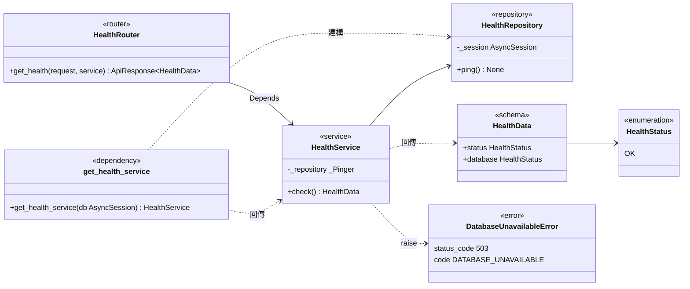
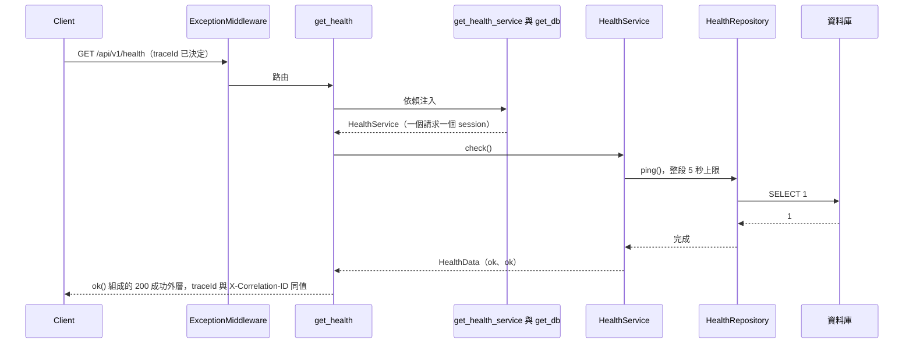
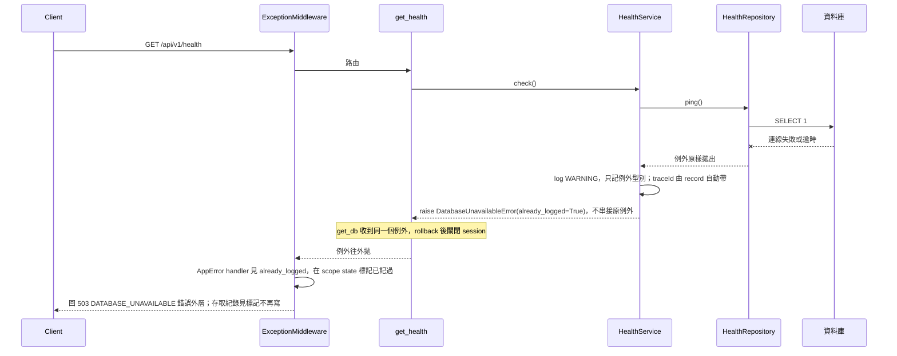
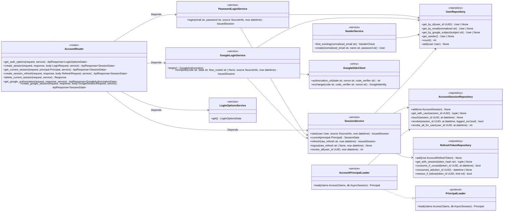
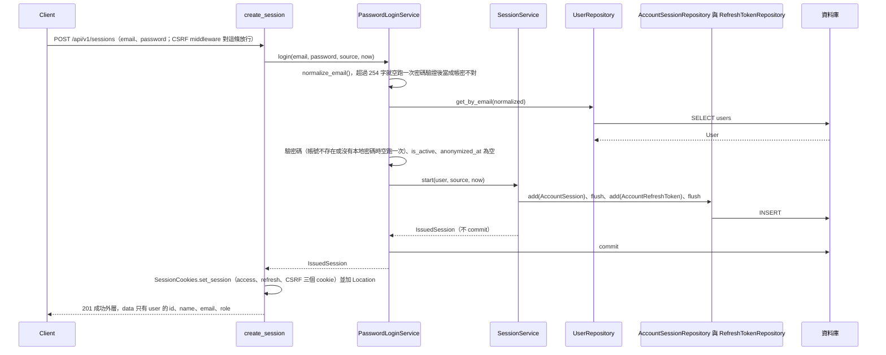
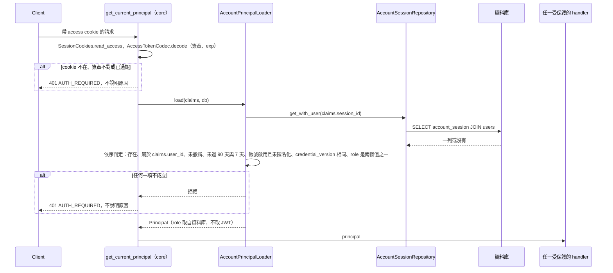
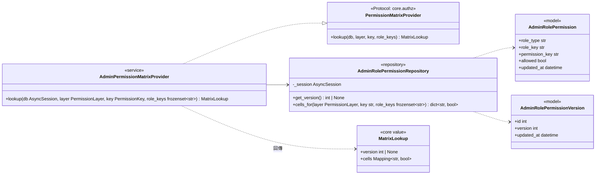
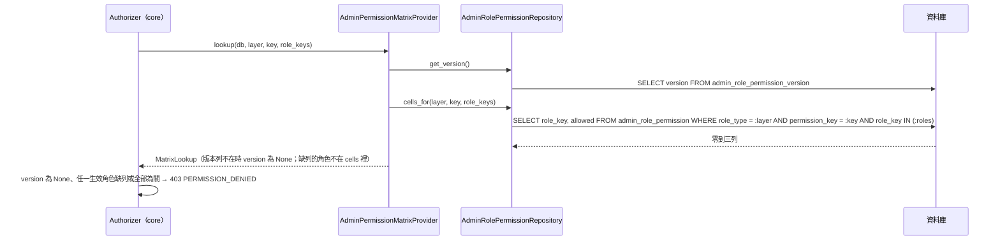

# 後端模組與基礎建設

這份記 `main` 上的 `backend/` 現在長怎樣：每個業務模組一節，加上全站共用的基礎建設；**只寫已合併的程式有的東西**，唯一的例外是 [§預定模組與資料表歸屬](#預定模組與資料表歸屬) 的規劃。
要照著做的規則在 [技術架構](../../development/architecture.mdx)，為什麼這樣決定在 [ADR](../../development/adr/index.mdx)；API 的形狀以 `backend/openapi.json` 為準，本文不另寫一份。
本文與程式不一致時，是本文錯了：以程式為準，並回頭改本文。

各節的收合區塊是實作或規劃時才要查的細節，預設收起。

## 誰改、什麼時候改

規劃時先改本文，change 的 `system-design.md` 只寫本文的路徑與異動摘要，不重抄本文的內容。

| 時機 | 誰 | 做什麼 |
| :--- | :--- | :--- |
| 規劃（寫 `system-design.md`） | `sd` | 新模組加一節；既有模組改分層表、Class 圖與主要 Sequence 圖；動到基礎建設時改 [§後端基礎建設](#後端基礎建設)。`system-design.md` 的「常駐文件異動」節寫出本文路徑與異動摘要 |
| 規劃審閱 | `design-reviewer` | 核對本文與這次的 `system-design.md` 一致 |
| 實作後 | `backend-developer` | 實作出來的分層、類別或主要流程和設計不同時，依程式校正本文；動到 `app/core/` 的改 [§後端基礎建設](#後端基礎建設) |
| 程式審查 | `code-reviewer` | 再核對一次本文與實作一致；不一致時列為審查意見 |

change 的 `system-design.md` 仍然畫這次新增或修改的類別，以及這次每個 Scenario 的 Sequence 圖；本文留下的是合併之後全系統的樣子。資料表的欄位不在本文，見 [候選資料表字典](./data-table-dictionary.mdx)。

## 模組一覽

一個業務模組一個資料夾 `backend/app/modules/<module>/`；目前有 `health`、`account` 與 `admin`。

| 模組 | 資料夾 | 端點（operationId） | 行為的契約 |
| :--- | :--- | :--- | :--- |
| [health](#health) | `app/modules/health/` | `getHealth`（`GET /api/v1/health`） | `openspec/specs/health-check/` |
| [account](#account) | `app/modules/account/` | `getAuthOptions`、`createSession`、`getCurrentSession`、`createSessionRefresh`、`deleteCurrentSession`、`getGoogleAuthorization`、`createGoogleSession`（路徑以 `backend/openapi.json` 為準） | `openspec/specs/` 的 `account-login`、`login-session`、`auth-guard`、`csrf-protection`；Seeder 指令是 `user-management` |
| [admin](#admin) | `app/modules/admin/` | 沒有：只提供權限矩陣給授權依賴，`router.py` 沒有路由、不掛進 app | `openspec/specs/` 的 `role-permission-matrix`；授權怎麼用它見 `permission-authorization` |

還沒有程式的模組與每張資料表歸哪個模組，見 [§預定模組與資料表歸屬](#預定模組與資料表歸屬)。

## 預定模組與資料表歸屬

**本節是規劃，不是現況**：除了 `health` 與已有程式的 `account`、`admin`，下列模組都還沒有程式；開新模組或替模組加表時照本節放，實作後該模組照 [§誰改、什麼時候改](#誰改什麼時候改) 另寫一節。為什麼這樣切見 [ADR-003 的 D14](../../development/adr/003-backend-architecture.mdx#d14-後端業務模組的切分)。

| 模組 | 負責的規格頁 | 表 | 現況 |
| :--- | :--- | ---: | :--- |
| `account` | [01-01](../../specs/01-account/01-login.mdx)～[01-05](../../specs/01-account/05-login-state.mdx)、[06-01 使用者管理](../../specs/06-admin/01-user-management.mdx) | 7 | 已有程式，見 [§account](#account)：只涵蓋該節列的範圍，model 只有 `users`、`account_session`、`account_refresh_token` 3 張；其餘 4 張表、01-02～01-04、06-01 的使用者管理頁面都未實作 |
| `dashboard` | [02-01 儀表板](../../specs/02-dashboard/01-dashboard.mdx) | 0 | 未實作 |
| `task` | [03-01](../../specs/03-task-management/01-task-list.mdx)～[03-03](../../specs/03-task-management/03-task-detail.mdx)、[04-01](../../specs/04-annotation/01-annotation-list.mdx)、[04-02](../../specs/04-annotation/02-annotation-workspace.mdx) | 25 | 未實作 |
| `dataset` | [05-01](../../specs/05-dataset/01-analysis-list.mdx)～[05-03](../../specs/05-dataset/03-ingestion-lineage.mdx) | 5 | 未實作 |
| `admin` | [06-02 角色設定](../../specs/06-admin/02-role-settings.mdx) | 4 | 部分有程式，見 [§admin](#admin)：只有 `admin_role_permission`、`admin_role_permission_version` 兩張表、初始矩陣與讀矩陣；06-02 的頁面與編輯、`ai_runs`、`ai_run_events` 未實作 |
| `app/core/`（不是業務模組） | — | 1 | `audit_events`，[ADR-003 的 D13](../../development/adr/003-backend-architecture.mdx#d13-稽核紀錄的-model-與寫入函式放在-core)；未實作 |

`health` 不變、沒有表。07 共用介面不設後端模組：07-01、07-02 不持有業務資料（[字典 §逐欄要記的九項](./data-table-dictionary.mdx#逐欄要記的九項)），07-03 是前端畫面；07-04 通知事件沒有表，見 [§待決](#待決) 第 1 列。

### 42 張表的歸屬

字典的九個分組照下表併進模組；每張表只屬一個模組。

| 字典分組 | 表數 | 模組 |
| :--- | ---: | :--- |
| `account` | 7 | `account` |
| `admin` | 5 | `admin` 4 張；`audit_events` 放 `app/core/` |
| `dataset` | 5 | `dataset` |
| `task`、`run`、`annotation`、`review`、`export`、`work` | 25 | `task` |

本節和[候選資料表字典 §九個領域分組](./data-table-dictionary.mdx#九個領域分組)說法不同的三處，以本節為準，字典的分組文字不跟著改：

- `audit_events` 字典列在 `admin` 組，本節放 `app/core/`
- `run` 組字典寫「03 加 04」，03 與 04 同在 `task`，不必再分
- `admin` 組字典對應「06 系統管理」；06-01 的程式放 `account`，它讀寫的 `users`、`account_password_token` 本來就在 `account` 組，`admin` 組的表不變

:::note{title="逐表對照（42 張）" collapsible}

| # | 表 | 字典分組 | 模組 |
| ---: | :--- | :--- | :--- |
| 1 | `users` | account | account |
| 2 | `account_session` | account | account |
| 3 | `account_refresh_token` | account | account |
| 4 | `account_password_token` | account | account |
| 5 | `account_email_change_request` | account | account |
| 6 | `account_notification_preference` | account | account |
| 7 | `user_deletion_request` | account | account |
| 8 | `audit_events` | admin | core |
| 9 | `admin_role_permission` | admin | admin |
| 10 | `admin_role_permission_version` | admin | admin |
| 11 | `ai_runs` | admin | admin |
| 12 | `ai_run_events` | admin | admin |
| 13 | `dataset` | dataset | dataset |
| 14 | `dataset_version` | dataset | dataset |
| 15 | `dataset_import_batch` | dataset | dataset |
| 16 | `dataset_item` | dataset | dataset |
| 17 | `dataset_item_private` | dataset | dataset |
| 18 | `task` | task | task |
| 19 | `task_config_version` | task | task |
| 20 | `task_guideline_version` | task | task |
| 21 | `task_membership` | task | task |
| 22 | `task_reviewer_roster_member` | task | task |
| 23 | `task_run_cycle` | run | task |
| 24 | `task_trial_round` | run | task |
| 25 | `task_trial_iaa_result` | run | task |
| 26 | `task_sample_snapshot` | run | task |
| 27 | `task_run` | run | task |
| 28 | `task_run_item` | run | task |
| 29 | `task_annotation_assignment` | run | task |
| 30 | `task_annotation_exclusion` | run | task |
| 31 | `submission` | run | task |
| 32 | `annotation_record` | annotation | task |
| 33 | `annotation_history_event` | annotation | task |
| 34 | `annotation_review_draft` | review | task |
| 35 | `annotation_review_submission` | review | task |
| 36 | `annotation_review_submission_revision` | review | task |
| 37 | `annotation_review_decision` | review | task |
| 38 | `annotation_arbitration_vote` | review | task |
| 39 | `annotation_exception_resolution` | review | task |
| 40 | `task_export` | export | task |
| 41 | `task_export_run` | export | task |
| 42 | `task_work_interval` | work | task |

`user_deletion_request`、`ai_runs`、`ai_run_events` 三張在字典是「提案」，歸屬未決，見 [§待決](#待決) 第 2 列；表中先照字典的分組放。

:::

### 預期的跨模組呼叫

預期有 5 處確定的跨模組 service 呼叫，每處在 independence 契約加一條 `ignore_imports`，約 5 條；這是估計，不是契約，條數以各 change 實際加進 `backend/pyproject.toml` 的為準。呼叫的寫法見 [ADR-003 的 D12](../../development/adr/003-backend-architecture.mdx#d12-跨模組呼叫只走-service-對-service-的公開函式)。

| # | 呼叫端 → 被呼叫端 | 用途 |
| ---: | :--- | :--- |
| 1 | `task` → `account` | 顯示使用者姓名與頭像（`task` 側指向 `users` 的 FK、標記歷程的真實操作者）；03-03 以 Email 找帳號邀請成員；寄「你被分配標記／審核清單」前讀通知開關（[07-04](../../specs/07-shared/04-notification-events.mdx) 事件 5、6） |
| 2 | `task` → `dataset` | 綁定已定版的資料集快照；抽樣讀公開項目；03-02 建任務時上傳資料集；評分 worker 讀 `dataset_item_private`；04-01 工作區與清單顯示公開項目 |
| 3 | `dataset` → `task` | 05-01 列出可分析的任務；05-02 驗成員資格、讀試標 IAA 結果、用指派與排除算統計、即時計算標記與審核結果 |
| 4 | `dataset` → `account` | 05-03 顯示資料集的建立者 |
| 5 | `dashboard` → `task` | 02-01 的任務角色摘要、任務列欄位、「快速繼續」與「快速審核」、審核覆蓋率與審核單位計數 |

`task` 與 `dataset` 互相呼叫，是唯一一對雙向依賴。下列不算進 5 條：

| 項目 | 為什麼不算 |
| :--- | :--- |
| `account` → `task`：受邀者登入後把成員資格從「邀請中」改成「啟用」（[03-03 §成員管理](../../specs/03-task-management/03-task-detail.mdx#成員管理)） | 做在 `account` 的登入流程才多 1 條；放哪邊未決，見 [§待決](#待決) 第 3 列 |
| `dashboard` → `account`：系統管理員的「平台使用者統計」 | 02-01 的卡片目前都是示範值、算法另案；落地時多 1 條 |
| 寫 `audit_events` | 放 `app/core/`，任何模組直接呼叫（[ADR-003 的 D13](../../development/adr/003-backend-architecture.mdx#d13-稽核紀錄的-model-與寫入函式放在-core)） |
| 權限矩陣（授權第 3、4 步） | `admin` 經 `app/core/` 定義的 Protocol 提供，`app/main.py` 組裝（[ADR-004 的 D6](../../development/adr/004-auth-and-security.mdx#d6-權限矩陣當授權輸入)） |
| `ai_runs`、`ai_run_events` 的寫入 | 寫它們的流程沒有規格頁，呼叫端不知道 |
| 07-04 通知 | 沒有表，見 [§待決](#待決) 第 1 列 |

### 02-01 儀表板怎麼取資料

02-01 用獨立的 `dashboard` 模組：沒有表，service 只呼叫 `task` 的 service 公開函式（上表第 5 列）。審核員任務列的摘要數字要呼叫 04-01 用的同一個函式，不在 `dashboard` 重算（[02-01 §審核員任務列的摘要數字從哪裡來](../../specs/02-dashboard/01-dashboard.mdx#審核員任務列的摘要數字從哪裡來)）。

## health

回報服務與資料庫能不能用；刻意公開，不需要登入。

| 層 | 檔案 | 做什麼 |
| :--- | :--- | :--- |
| Router | `router.py` | `get_health` 呼叫 service，用 `ok()` 包成功外層；額外宣告 `503` 回應 |
| Service | `service.py` | `HealthService.check()` 在 5 秒上限內查一次資料庫；連不上就丟 `DatabaseUnavailableError`。依賴工廠 `get_health_service` 也在這裡 |
| Repository | `repository.py` | `HealthRepository.ping()` 對目前的 session 跑 `SELECT 1`，例外原樣往上丟 |
| Schemas | `schemas.py` | `HealthData` 只有 `status` 與 `database` 兩個欄位，值只有 `ok` |

### 分層與類別

模組內的 import 方向是 `router → service → repository`：依賴工廠放在 `service.py`，所以 `router.py` 不必 import repository。



`HealthService` 只依賴一個有 `ping()` 的 Protocol（`_Pinger`），單元測試以假的 repository 測它，不開資料庫。`HealthData` 繼承 `ResponseModel`，見 [§共用的 schema 基底](#共用的-schema-基底)。

### 主要情境

兩張圖都從中介層之後畫起；中介層各做什麼見 [§請求管線](#請求管線)。

#### 健康檢查回傳完整外層與追蹤編號



#### 資料庫無法連線時健康檢查回 503 外層



哪些例外算「連不上」、上限怎麼算，見 [§health 的 503](#health-的-503)。

## account

帳號：登入（Email 與密碼、Google）、一段登入狀態的開始、延續與結束、之後每個模組共用的「目前是誰」判定所需的資料讀取，以及建立第一位 Seeder 管理員的初始化指令。七個端點的資源直接接在 `/api/v1` 後面（api-agent-rules A1 不插模組段）；規格依據是 01-01、01-05 與 06-01。

登入失敗鎖定還沒有（見 [§已知限制](#已知限制)）；插入點在 `PasswordLoginService.login` 正規化 Email 之後、查帳號之前。

| 層 | 檔案 | 做什麼 |
| :--- | :--- | :--- |
| Router | `router.py` | 七個 handler：`get_auth_options`、`create_session`、`get_current_session`、`create_session_refresh`、`delete_current_session`、`get_google_authorization`、`create_google_session`。組 `SourceInfo`、發與清 cookie 一律經 `core.cookies.SessionCookies`、在兩個 `201` 回應加 `Location: /api/v1/current-session`；錯誤回應也要清 cookie 時，在接住後重丟的錯誤上設 `response_hook`（見 [§錯誤怎麼對到 envelope](#錯誤怎麼對到-envelope)） |
| Service | `service/`（套件） | 合起來超過 400 行（B11），所以拆成套件；import-linter 仍把 `app.modules.account.service` 當成同一層，呼叫端只從 `service/__init__.py` import。交易都由這一層 commit，依賴工廠也在這裡，各檔見下表 |
| Repository | `repository.py` | `UserRepository`、`AccountSessionRepository`、`RefreshTokenRepository`；只查與寫，不 commit。延續的「消耗」與寬限期重發是單一條件式 `UPDATE ... WHERE`，以 rowcount 判斷誰搶到，兩種資料庫行為相同 |
| Models | `models.py` | `User`、`AccountSession`、`AccountRefreshToken`；欄位見[候選資料表字典](./data-table-dictionary.mdx)的 `account` 組 |
| Schemas | `schemas.py` | request 有 `LoginRequest`、`RefreshRequest`（一律是空物件 `{}`）、`GoogleSessionRequest`；response 一律明列欄位（登入者自己的 `id`、`name`、`email`、`role`），**不回** `hashed_password`、`google_subject`、`credential_version`、`is_seeder` 與登入狀態的識別碼 |

| `service/` 裡的檔案 | 內容 |
| :--- | :--- |
| `__init__.py` | 對外唯一的 import 入口，re-export 下列各檔的公開名稱 |
| `login.py` | `PasswordLoginService`、`LoginOptionsService`，與依賴工廠 `get_password_login_service`、`get_login_options_service` |
| `google.py` | `GoogleLoginService`、`GoogleAuthorization`、依賴工廠 `get_google_login_service` |
| `session.py` | `SessionService`、`SessionPolicy`、`SourceInfo`、`IssuedSession`、實作 `core.auth.PrincipalLoader` 的 `AccountPrincipalLoader`、`session_data`、`may_sign_in`、依賴工廠 `get_session_service` |
| `seeder.py` | `SeederService`、`SeederCheck`、`SeederConflictError`、`password_meets_policy`；只有初始化指令呼叫，見 [§Seeder 初始化指令](#seeder-初始化指令) |
| `errors.py` | 七個繼承 `AppError` 的帳號錯誤，都不帶參數；登入失敗的幾種原因共用同一個錯誤碼，不分是帳號不存在、密碼錯誤還是停用。碼與 HTTP 狀態見[錯誤碼](./error-codes.mdx#account) |

### 分層與類別

`router.py` 只 import `service` 與 `schemas`；`AccountPrincipalLoader` 由 `app.main` 在組裝時放進 `app.state.principal_loader`，`core` 因此不必 import 本模組（契約 `Core does not depend on modules`）。



`IssuedSession` 帶著這次要發的 access token、refresh token、CSRF 值、refresh token 的到期時間與帳號，Router 把這幾個純值交給 `SessionCookies.set_session` 寫成三個 cookie 再組回應。`AccountSessionRepository.get_with_user` 回 `(AccountSession, User)`，`RefreshTokenRepository.get_with_session` 回 `(AccountRefreshToken, AccountSession, User)`，查不到都是 `None`。`GoogleOidcClient` 的兩個方法都是 async，在入口套件 `app/oidc/`；`PrincipalLoader`、`Principal`、`AccessClaims` 在 `core/auth.py` 與 `core/tokens.py`，見 [§`core/` 各模組](#core-各模組)。

:::note{title="登入狀態的期限與寬限（SessionPolicy）" collapsible}
- 絕對上限 90 天（從登入算起）、閒置上限 7 天（從最後一次延續算起），任一個到了就過期
- access token 15 分鐘，但不超過 90 天上限；refresh token 到期是「現在加 7 天」與「90 天上限」取早的那個，三個 session cookie 都活到這個時間
- 同一張 refresh token 第一次使用後 30 秒內再用，算同一個瀏覽器的另一個分頁，可以多發 1 次；寬限期內第三次用回 `409 ACCOUNT_REFRESH_CONFLICT`，什麼都不改；寬限期外重用視為疑似盜用，撤銷這個帳號全部的登入狀態並 commit 後才回 `401`
- 延續的判定順序：token 查不到、登入狀態已撤銷或帳號不能登入 → 已過期（撤銷但不記登出）→ 重用；已撤銷的登入狀態不會有寬限
- 登出只在 refresh token 對得到、登入狀態仍有效且未過期時才撤銷並記 `logged_out_at`；其他情況什麼都不寫，回應一律 `204`
:::

### 主要情境

#### 登入成功進入儀表板



#### 每一次操作都用最新的身分判定



### Seeder 初始化指令

第一位系統管理員只能由 `app/scripts/create_seeder.py` 建立，沒有任何端點能建立帳號；怎麼執行見[本機開發的「建立第一位系統管理員」](../../development/workflow/local-development.mdx#建立第一位系統管理員)。

| 項目 | 做法 |
| :--- | :--- |
| 參數 | 只有 `--email`、`--name`（去除前後空白後 1 到 100 字）、`--password-stdin`；Email 經 `normalize_email`，超過 254 字或不像 Email 就拒絕 |
| 密碼 | 標準輸入是終端機時以 `getpass` 問兩次並比對；`--password-stdin` 時讀一行；兩者都不是就拒絕。規則由 `password_meets_policy` 判斷：至少 8 字元，含大寫、小寫與數字 |
| 冪等 | `SeederService.find_existing` 回 `SeederCheck`：`UNCHANGED`（同一個 Email 已是 Seeder，不問密碼、退出碼 `0`）、`OTHER_SEEDER` 與 `EMAIL_TAKEN`（拒絕，退出碼 `2`）、`CREATE` |
| 交易 | `SeederService.create` 在一筆交易寫入啟用中的 `super_admin`、`is_seeder = true` 與 argon2id 雜湊；兩個人同時執行時由部分唯一索引或 Email 唯一限制擋下，`IntegrityError` 轉成 `SeederConflictError`，退出碼 `2` |
| 設定 | 只讀 `DatabaseSettings`，自己開 engine 與 session、結束時 dispose；不需要 `CORS_ALLOWED_ORIGINS` 或 `AUTH_SECRET` |
| 輸出 | 英文；成功一行到標準輸出，錯誤以 `create_seeder: ` 開頭寫到標準錯誤；不含密碼或雜湊 |

## admin

系統管理的角色設定：權限矩陣的兩張表與讀矩陣。授權第 3 步經 `app/core/authz.py` 的 `PermissionMatrixProvider`（Protocol）向本模組讀矩陣，`app.main` 組裝時把 `AdminPermissionMatrixProvider` 放進 `app.state.permission_matrix_provider`，`core` 因此不必 import 本模組（契約 `Core does not depend on modules`；做法同 [§account](#account) 的 `AccountPrincipalLoader`）。規格依據是 06-02。

本模組沒有端點：06-02 的頁面、編輯、樂觀鎖與稽核都未實作。初始矩陣由 migration 寫入，值與 `app/core/permissions.py` 的 `applicable_cells()` 逐格相同；授權不快取矩陣，每個決定都讀一次（[ADR-004 的 D6](../../development/adr/004-auth-and-security.mdx#d6-權限矩陣當授權輸入)）。

| 層 | 檔案 | 做什麼 |
| :--- | :--- | :--- |
| Router | `router.py` | 一個沒有路由的 `APIRouter`，`create_app` 不掛它、`OPENAPI_TAGS` 沒有 `admin`；只為了符合 `Module layers` 契約（除了 `models`，每一層都要存在） |
| Service | `service.py` | `AdminPermissionMatrixProvider` 實作 `core.authz.PermissionMatrixProvider`：每次 `lookup` 以請求的 session 建一個 repository，讀版本列與「一個鍵 × 這次的生效角色」的格，回 `MatrixLookup`；不快取、只讀、不 commit |
| Repository | `repository.py` | `AdminRolePermissionRepository`：`get_version()` 讀唯一的版本列，`cells_for(layer, key, role_keys)` 讀這些角色存在的格，缺列的角色不放進結果、不補值，`role_keys` 為空時不查；只查，不寫、不 commit |
| Models | `models.py` | `AdminRolePermission`、`AdminRolePermissionVersion`；欄位見[候選資料表字典](./data-table-dictionary.mdx)的 `admin` 組 |
| Schemas | `schemas.py` | 沒有內容；同樣只為了符合 `Module layers` 契約 |

### 分層與類別



兩張表沒有 FK，彼此也不關聯；錯層的格不存資料列，由應用層守（字典 `admin` 組的關聯與限制）。固定格由資料庫 CHECK 擋住被改成別的值。

### 主要情境

#### 授權第 3 步讀矩陣



`Authorizer` 只看這次要用的格：認不得的鍵的列被忽略，壞掉的某一列只影響用到它的操作。整份矩陣是否合法由 06-02 的頁面載入時判斷，該頁未實作。

## 後端基礎建設

`app/core/` 放換一個業務也照樣需要的東西，業務邏輯一律在 `app/modules/<module>/`；理由見 [ADR-003 的 D3](../../development/adr/003-backend-architecture.mdx#d3-後端採模組內分層)。

### 目錄

```text
backend/
├─ pyproject.toml            uv 專案；版號是 API 文件 info.version 的唯一來源
├─ alembic.ini
├─ alembic/
│  ├─ env.py                 只讀 DatabaseSettings；自動載入各模組的 models
│  └─ versions/              基準 revision、account 的三張表、admin 的兩張表與初始矩陣
├─ openapi.json              匯出的 API 文件，提交進 repo
├─ app/
│  ├─ main.py                create_app()：組裝入口
│  ├─ core/                  全站共用的基礎建設，見下表
│  ├─ i18n/<locale>/messages.json   外層 message 的字串
│  ├─ scripts/export_openapi.py     匯出 openapi.json（不帶 --output 時同時寫文件站副本）
│  ├─ scripts/create_seeder.py      建立第一位 Seeder 管理員（密碼互動輸入或 --password-stdin；冪等）
│  ├─ oidc/                  Google OIDC 的入口套件（B12 單一入口，唯一 import authlib 的地方）
│  └─ modules/<module>/      業務模組：router、service、repository、schemas（有表時加 models；service 超過 400 行時改成 service/ 套件）
└─ tests/
   ├─ unit/
   ├─ integration/
   ├─ factories/             建立測試資料的 helper（目前是 accounts.py）
   ├─ support/               測試用的替身與客戶端（browser.py、google_oidc.py、authz.py）
   ├─ probe.py               只在測試掛載的探測路由
   └─ authz_probe.py         只在測試掛載的授權探測路由，加進 probe.py 的 probe_router
```

| 目錄 | 放什麼 | 判斷方式 |
| :--- | :--- | :--- |
| `app/modules/` | 業務模組 | 有業務規則、會出現在 spec 的 Scenario |
| `app/core/` | 基礎建設 | 換一個業務也照樣需要，通常只在 `create_app` 掛一次 |
| `app/scripts/` | 命令列工具 | 用 `uv run python -m app.scripts.<name>` 執行，不是端點 |
| `tests/factories/`、`tests/support/` | 測試輔助 | 多個測試檔共用、不是測試本身；見 [§測試輔助](#測試輔助) |
| `app/oidc/` | Google OIDC 入口 | 對外整合的單一入口（[backend-agent-rules B12](../../development/rules/backend-agent-rules.mdx) 的 (a) 寫法：頂層入口套件，登記在 `tests/unit/import_tree.py` 的 `ENTRY_TOP_LEVEL_PACKAGES`）；測試替身不放這裡，測試在網路邊界以 `monkeypatch` 替換 `httpx.AsyncClient.send` |

### `core/` 各模組

每個檔案管一件事；新的共用基礎建設先找這張表，有就擴充，沒有才新開檔案。

| 檔案 | 管什麼 | 主要介面 |
| :--- | :--- | :--- |
| `config.py` | 唯一的設定入口 | `DatabaseSettings`、`Settings`（含 `google_configured()`、`mail_configured()`）、`load_settings`、`ConfigError` |
| `db.py` | engine、request session、declarative base；時間欄位一律存 UTC | `create_engine`、`create_sessionmaker`、`get_db`、`Base`、`NAMING_CONVENTION`、`UtcDateTime`（SQLite 讀回的時間沒有時區，這個型別在讀寫時補成 UTC） |
| `schemas.py` | 共用 schema 基底、外層、分頁 | `RequestModel`、`ResponseModel`、`ApiResponse`、`ErrorResponse`、`ErrorDetail`、`PaginatedResponse`、`PaginationParams` |
| `envelope.py` | 組成功與錯誤外層；correlation id 的 contextvar | `ok`、`success`、`error_response`、`current_trace_id` |
| `errors.py` | 領域錯誤與 exception handler；`AppError(already_logged=True)` 表示丟出的那一層已自己記過；`AppError.response_hook` 讓 router 在錯誤回應送出前改 HTTP 層（例：清 cookie） | `AppError`、`NotFoundError`、`NotAcceptableError`、`DatabaseUnavailableError`、`register_exception_handlers` |
| `middleware.py` | 自寫的純 ASGI 中介層 | `CorrelationIdMiddleware`、`AccessLogMiddleware`、`UnhandledExceptionMiddleware`、`LocaleMiddleware` |
| `log_config.py` | 整個後端的 log 輸出設定與一行 `key=value` 格式；讓每筆 log record 帶目前請求的 `traceId`；「這個請求已記過」的標記 | `configure_logging`、`install_trace_id_record_factory`、`KeyValueFormatter`、`mark_error_logged`、`is_error_logged`、`is_repo_handler`；常數 `ACCESS_LOGGER_NAME`（`app.access`）、`NO_TRACE_ID`（`-`）、`UNMATCHED_ROUTE`（`<unmatched>`） |
| `i18n.py` | `Accept-Language` 解析與訊息目錄 | `resolve_locale`、`MessageCatalog` |
| `openapi.py` | operationId、唯一性檢查、API 文件後處理、版號 | `generate_operation_id`、`assert_unique_operation_ids`、`install_openapi`、`get_app_version` |
| `log_safety.py` | 把來自請求的值轉成安全的一行 log | `escape_for_log` |
| `paths.py` | 路徑常數 | `API_V1_PREFIX`（`/api/v1`） |
| `auth.py` | 取得目前使用者（B12 入口 4）；授權四步的第 1、2 步 | `Principal`、`SystemRole`、`PrincipalLoader`（Protocol）、`get_current_principal`、`AuthenticationRequiredError` |
| `permissions.py` | 權限鍵白名單：24 個鍵各自的層級（`system`／`task`）、06-02 的所屬段落、是否啟用、固定格與初始值，登錄表唯讀；矩陣的 62 個適用格與初始值只由這裡推出 | `PermissionKey`（`StrEnum`）、`PermissionLayer`、`PermissionSection`、`TaskRole`、`SYSTEM_ROLES`、`TASK_ROLES`、`PermissionSpec`、`PERMISSION_REGISTRY`、`MatrixCell`、`applicable_cells` |
| `authz.py` | 授權四步裡接在 `get_current_principal` 之後的部分，依序判斷、任一步不通過就停：任務範圍的操作先讀生效中的任務角色（沒有、或作用角色不是他的 → `404`），再判斷鍵在白名單且已啟用、層級相符、矩陣版本列在、每個生效角色的格都在且至少一個為開（否則 `403`），最後依序跑附加條件。生效角色是系統角色、任務角色的聯集，或指定作用角色時只有它。任務識別碼與作用角色只從端點宣告的路徑參數取，無法轉換時回 `404`；`app.state` 缺矩陣提供者、任務範圍的操作缺成員身分讀取者，或宣告的路徑參數不存在，都丟 `RuntimeError`。矩陣與任務成員身分經 Protocol 取得，由持有資料的模組實作、`app.main` 組裝，`core` 不 import 模組；不快取，每次都重讀 | `require_permission`（依賴工廠，參數 `task_id_param`、`acting_role_param`、`conditions`）、`Authorizer`（`authorize`、`check_conditions`）、`PermissionMatrixProvider`、`TaskMembershipReader`、`AccessCondition`（三者為 Protocol）、`ConditionKind`（七種，含預留的 `acting_role`）、`GroundTruthBarrier`、`AccessContext`、`AccessGrant`（含 `acting_role` 與 `matrix_version`）、`MatrixLookup`、`PermissionDeniedError` |
| `tokens.py` | 從 `AUTH_SECRET` 以用途標籤衍生三把金鑰；access JWT 的簽發與驗證；不透明 token 與它的雜湊；綁定登入狀態的 CSRF 值；短期簽章 payload | `TokenKeys`（`derive`）、`AccessClaims`、`AccessTokenCodec`（`issue`、`decode`、給 CSRF 用的 `decode_ignoring_expiry`）、`InvalidAccessTokenError`、`new_opaque_token`、`hash_token`、`csrf_value_for`、`sign_payload`、`verify_payload` |
| `cookies.py` | 發、清與讀登入 cookie 的唯一 helper（B12 入口 5）；四個 cookie 都是 `__Host-`、`Secure`、`Path=/`、`SameSite=Lax`，只有 CSRF cookie 不是 `HttpOnly` | `SessionCookies`：`set_session`（收 access、refresh、CSRF 三個純值與 `expires_at`、`now`）、`set_oidc_flow`、`clear`、`clear_oidc_flow`、`read_access`、`read_refresh`、`read_csrf`、`read_oidc_flow`；cookie 名稱常數與 `OIDC_FLOW_MAX_AGE`（600 秒） |
| `csrf.py` | CSRF 驗證 middleware（B12 入口 6）；放行清單只寫在這裡 | `CsrfMiddleware`、`CsrfFailedError`、`CSRF_EXEMPT_OPERATIONS`、`CSRF_HEADER`（`X-CSRF-Token`） |
| `auth_secret.py` | `AUTH_SECRET` 的來源：有設就用；Lite 層沒設就在資料 volume 產生並重用；正式層沒設就失敗 | `resolve_auth_secret`、`KEY_FILE_NAME` |
| `passwords.py` | argon2id 密碼雜湊與驗證，在 worker thread 執行，不擋 event loop | `PasswordHasher`：三個方法都是 async：`hash`、`verify`（雜湊格式不對回 `False`，不丟例外）、`verify_dummy`（帳號不存在時空跑一次驗證，讓回應時間不洩漏帳號是否存在） |
| `email_identity.py` | Email 的正規化與長度上限（01-05 Q14，登入、註冊、邀請、換 Email 共用）；上限以正規化之後的值計算 | `normalize_email`、`MAX_EMAIL_LENGTH`（254）、`EmailTooLongError`（訊息不含 Email） |

`log_safety.py` 與 `paths.py` 不 import `app` 的任何東西，任何模組都能用而不產生循環；`envelope.py` 擁有 correlation id 的 contextvar，所以依賴方向只會是 middleware → envelope。`log_config.py` 只 import `envelope` 與 `config`，`middleware.py` 與 `errors.py` 都能 import 它。

### app factory 與 lifespan

`create_app(settings)` 組出整個 app，import 時不讀環境變數；資料庫 engine 在 lifespan 才建立，組 app 不開連線。

```bash
cd backend && uv run uvicorn app.main:create_app --factory
```

| 步驟 | 做什麼 | 失敗時 |
| :--- | :--- | :--- |
| 1 | `settings` 是 `None` 時用 `load_settings(Settings)` 從環境變數讀 | `ConfigError`，只寫變數名與原因 |
| 1a | `configure_logging(settings)`：安裝帶 `trace_id` 的 record factory；root 掛一個 `KeyValueFormatter` 的 handler（預設寫 stderr，測試可用可選的 `stream` 參數擷取輸出），root 與 handler 的等級都是 `LOG_LEVEL`；`sqlalchemy`（含 `engine`、`pool`）、`aiosqlite`、`asyncpg` 固定 `WARNING`；`uvicorn` 改走 root handler，`uvicorn.access` 清空 handler 並 `propagate=False`（關掉 uvicorn 內建 access log）。重複呼叫不會疊加 handler | — |
| 1b | `resolve_auth_secret` 決定 `AUTH_SECRET`，寫回 `settings`；`TokenKeys.derive` 衍生三把金鑰，建 `AccessTokenCodec`。組好 app 後，金鑰、codec、`AccountPrincipalLoader` 與 `AdminPermissionMatrixProvider` 分別放進 `app.state.token_keys`、`access_codec`、`principal_loader`、`permission_matrix_provider`。`app.state.task_membership_reader` 還沒有實作者，不放；任務範圍的授權判斷遇到它不在時丟 `RuntimeError`（接線錯誤） | `ConfigError`（正式層沒設，或 Lite 層存的祕密檔不合格），只寫變數名 |
| 2 | 建 `FastAPI`：版號讀 `pyproject.toml`、`generate_unique_id_function` 設成 `generate_operation_id`、`openapi_tags` 傳 `OPENAPI_TAGS`（宣告順序即 API 文件的分組顯示順序：照規格章節，`health` 最後）；`API_DOCS_ENABLED` 為 `false` 時 `docs_url`、`redoc_url`、`openapi_url` 傳 `None`（四條內建路由都不註冊，請求落入既有 404 envelope） | 讀不到版號就失敗，沒有預設值 |
| 3 | 載入訊息目錄，放進 `app.state.message_catalog` | `MessageCatalogError` |
| 4 | 依序加中介層，見 [§請求管線](#請求管線)；`AccessLogMiddleware` 的 `quiet_success_routes` 在這裡傳入（`/api/v1/health`），core 不寫死路徑 | — |
| 5 | 註冊 exception handler，見 [§錯誤怎麼對到 envelope](#錯誤怎麼對到-envelope) | — |
| 6 | 建 `/api/v1` 父 router，把 `health` 與 `account` 的 router 掛進去（`admin` 的 router 沒有路由，不掛）；掛載時用 `include_router(tags=["<module>"])` 帶模組 tag，模組的 `APIRouter()` 不寫 tags | — |
| 7 | 檢查 operationId 不重複，換上後處理過的 `app.openapi` | `OperationIdCollisionError` |

lifespan 啟動時建 engine 與 sessionmaker，放在 `app.state.engine`、`app.state.sessionmaker`；關閉時 `dispose()` engine。模組層沒有任何全域的 engine 或 session。

### 請求管線

一個 `/api/v1` 請求由外而內穿過六個中介層與 exception handler 才到模組；每一種失敗都在固定的一層產生回應，而且每個回應的 `traceId` 都和 `X-Correlation-ID` 標頭同值。

{/* @ai-visualize
id: backend-request-pipeline
type: motion
prompt: |
  核心洞察：一個 /api/v1 請求由外而內穿過 CorrelationIdMiddleware、CORSMiddleware、AccessLogMiddleware、UnhandledExceptionMiddleware、LocaleMiddleware、Starlette 的 ExceptionMiddleware，才到 Router、Service、Repository 與資料庫；每種結果都由固定的一層產生回應，回程再由外層加上標頭，而 traceId 從第一層決定之後一路相同，最後等於回應標頭 X-Correlation-ID，也等於每一筆 log 的 traceId。存取紀錄與那一層自己記的 WARNING／ERROR 不會同時出現。
  互動：四個情境分頁（正常、422、500、health 503）；上一步、播放／暫停、下一步、重設；點任一層跳到該層的那一步。限流與關機還沒做，不畫。
  圖形：十層由上往下的直列，左側是去程、右側是回程；目前那一步的層實心，已走過的淡色；產生回應的那一層標「產生回應」；AccessLogMiddleware 在回程那一步另外顯示一張「log 行」卡片（寫出的一行 key=value，或「不寫：已記過」）。每一步下方的面板顯示這一層做什麼、目前的 traceId 晶片（一路同一個值），最後一步顯示狀態碼、code、message 與 X-Correlation-ID，並標示兩者相同。
  資料/數值：以 backend/app/main.py、app/core/middleware.py、log_config.py、errors.py、envelope.py 與 app/modules/health/ 為準。
    - 正常：GET /api/v1/items/42（只在測試掛載）Router 以 ok() 回 200，code OK，message「成功」；回程 AccessLogMiddleware 寫一行 INFO：logger=app.access、traceId、method=GET、route=/api/v1/items/{item_id}（模板，不是實際路徑）、status=200、durationMs，不含 query。另註：GET /api/v1/health 成功時不寫存取紀錄
    - 422：POST /api/v1/probe（只在測試掛載）body 缺 displayName；FastAPI 驗 body 丟 RequestValidationError，handler 不執行；ExceptionMiddleware 的 handler 回 422 VALIDATION_FAILED，errors 一筆 location body、field displayName、code missing；回程 AccessLogMiddleware 寫一行 WARNING，route=/api/v1/probe、status=422
    - 500：GET /api/v1/probe-crash（只在測試掛載）handler 丟 RuntimeError；ExceptionMiddleware 沒有 handler，往外拋；UnhandledExceptionMiddleware 記一筆 ERROR（method、實際 path、只有型別與 frame 的 traceback；traceId 由 record 自動帶），在 scope state 標記已記過，回 500 INTERNAL_ERROR；回程 AccessLogMiddleware 看到標記，不寫
    - health 503：GET /api/v1/health，資料庫連不上；Repository 原樣拋出，Service 記 WARNING（例外型別）並丟 DatabaseUnavailableError(already_logged=True)，get_db 收到例外會 rollback；ExceptionMiddleware 的 AppError handler 標記已記過、回 503 DATABASE_UNAVAILABLE；回程 AccessLogMiddleware 看到標記，不寫
    - 回程：LocaleMiddleware 加 Content-Language，AccessLogMiddleware 決定寫不寫存取紀錄，CORSMiddleware 加 Access-Control-Allow-Origin，CorrelationIdMiddleware 加 X-Correlation-ID
caption: 切換情境逐步走，看哪一層產生回應、哪一層留下那一筆 log，traceId 一路都是同一個值
status: generated
*/}

import GeneratedFrame from '@/components/GeneratedFrame.astro'
import BackendRequestPipeline from '@notes/components/backend-request-pipeline'

<GeneratedFrame id="backend-request-pipeline" type="motion" prompt={"核心洞察：一個 /api/v1 請求由外而內穿過 CorrelationIdMiddleware、CORSMiddleware、AccessLogMiddleware、UnhandledExceptionMiddleware、LocaleMiddleware、Starlette 的 ExceptionMiddleware，才到 Router、Service、Repository 與資料庫；每種結果都由固定的一層產生回應，回程再由外層加上標頭，而 traceId 從第一層決定之後一路相同，最後等於回應標頭 X-Correlation-ID，也等於每一筆 log 的 traceId。存取紀錄與那一層自己記的 WARNING／ERROR 不會同時出現。\n互動：四個情境分頁（正常、422、500、health 503）；上一步、播放／暫停、下一步、重設；點任一層跳到該層的那一步。限流與關機還沒做，不畫。\n圖形：十層由上往下的直列，左側是去程、右側是回程；目前那一步的層實心，已走過的淡色；產生回應的那一層標「產生回應」；AccessLogMiddleware 在回程那一步另外顯示一張「log 行」卡片（寫出的一行 key=value，或「不寫：已記過」）。每一步下方的面板顯示這一層做什麼、目前的 traceId 晶片（一路同一個值），最後一步顯示狀態碼、code、message 與 X-Correlation-ID，並標示兩者相同。\n資料/數值：以 backend/app/main.py、app/core/middleware.py、log_config.py、errors.py、envelope.py 與 app/modules/health/ 為準。\n  - 正常：GET /api/v1/items/42（只在測試掛載）Router 以 ok() 回 200，code OK，message「成功」；回程 AccessLogMiddleware 寫一行 INFO：logger=app.access、traceId、method=GET、route=/api/v1/items/{item_id}（模板，不是實際路徑）、status=200、durationMs，不含 query。另註：GET /api/v1/health 成功時不寫存取紀錄\n  - 422：POST /api/v1/probe（只在測試掛載）body 缺 displayName；FastAPI 驗 body 丟 RequestValidationError，handler 不執行；ExceptionMiddleware 的 handler 回 422 VALIDATION_FAILED，errors 一筆 location body、field displayName、code missing；回程 AccessLogMiddleware 寫一行 WARNING，route=/api/v1/probe、status=422\n  - 500：GET /api/v1/probe-crash（只在測試掛載）handler 丟 RuntimeError；ExceptionMiddleware 沒有 handler，往外拋；UnhandledExceptionMiddleware 記一筆 ERROR（method、實際 path、只有型別與 frame 的 traceback；traceId 由 record 自動帶），在 scope state 標記已記過，回 500 INTERNAL_ERROR；回程 AccessLogMiddleware 看到標記，不寫\n  - health 503：GET /api/v1/health，資料庫連不上；Repository 原樣拋出，Service 記 WARNING（例外型別）並丟 DatabaseUnavailableError(already_logged=True)，get_db 收到例外會 rollback；ExceptionMiddleware 的 AppError handler 標記已記過、回 503 DATABASE_UNAVAILABLE；回程 AccessLogMiddleware 看到標記，不寫\n  - 回程：LocaleMiddleware 加 Content-Language，AccessLogMiddleware 決定寫不寫存取紀錄，CORSMiddleware 加 Access-Control-Allow-Origin，CorrelationIdMiddleware 加 X-Correlation-ID\n"} caption="切換情境逐步走，看哪一層產生回應、哪一層留下那一筆 log，traceId 一路都是同一個值">
  <BackendRequestPipeline client:visible />
</GeneratedFrame>

| 順序 | 層 | 職責 | 自己產生的回應 |
| :--- | :--- | :--- | :--- |
| — | Starlette `ServerErrorMiddleware` | 框架固定的最外層，只剩最後保險 | 本 repo 的 `500` 不靠它 |
| 1 | `CorrelationIdMiddleware` | 決定 correlation id，回應時加 `X-Correlation-ID` | 無 |
| 2 | `CORSMiddleware` | 來源逐一列出；`X-Correlation-ID` 列在允許與公開的標頭 | 預檢回應（不是錯誤外層）；預檢不往內走，所以沒有存取紀錄 |
| 3 | `AccessLogMiddleware`（只作用在 `/api/v1`） | 回應送完後寫一行存取紀錄到 `app.access`：method、路由模板（沒有模板記 `<unmatched>`）、狀態、耗時；2xx／3xx 記 INFO、4xx 記 WARNING、5xx 記 ERROR。請求已被標記為記過，或 2xx 且路由在 `quiet_success_routes` 裡（健康檢查）時不寫。耗時從進入這一層到最後一段 body 送出，一位小數；路由模板由 `route_template` 以 `iter_route_contexts` 對照（含 `/api/v1` 前綴）。內層拋例外時照同一套判斷（還沒開始回應的記 `500`），再原樣往外拋 | 無 |
| 4 | `UnhandledExceptionMiddleware` | 攔下沒有 handler 的例外，記一筆 ERROR，並標記這個請求已記過 | `500 INTERNAL_ERROR` |
| 5 | `LocaleMiddleware`（只作用在 `/api/v1`） | 解析 `Accept-Language`，回應時加 `Content-Language` | `406 NOT_ACCEPTABLE`，一律 zh-TW |
| 5a | `CsrfMiddleware`（只作用在 `POST`、`PUT`、`PATCH`、`DELETE`） | 在路由之前判定。請求**沒有** access cookie 時不驗、直接交給路由；有時要 `X-CSRF-Token` 標頭與 CSRF cookie 都在，且兩者都等於以 access token 裡的 `sid`（驗簽章、不看到期）算出的 `HMAC(csrf key, sid)`。放行清單 `CSRF_EXEMPT_OPERATIONS` 以 method 加完整路徑比對，四條：Email 與密碼登入、Google 登入完成、延續、登出 | `403 CSRF_FAILED` |
| 6 | Starlette `ExceptionMiddleware` | 執行註冊的 exception handler | `404`、`405`、`422` 與各 `AppError` |
| 7 | Router → Service → Repository | 模組內分層 | 成功外層，由 Router 的 `ok()` 組 |

`500` 自己攔、不交給 `ServerErrorMiddleware`：它在所有中介層外面，由它產生的 `500` 不會帶 `Access-Control-Allow-Origin` 與 `X-Correlation-ID`。自寫的中介層都是純 ASGI、不用 `BaseHTTPMiddleware`，contextvar 才不會在 task 之間斷掉、串流回應也不會被緩衝。兩個理由的出處見已歸檔的 [backend-skeleton `system-design.md`](https://github.com/label-suite/label-suite/blob/main/openspec/changes/archive/2026-11-20-backend-skeleton/system-design.md) §請求穿過的層。存取紀錄放在 CORS 內側、未處理例外外側：看得到 `406` 與最終的 `500` 及其「已記過」標記，預檢則自然不經過它。認證不是中介層，是端點掛的依賴 `get_current_principal`，見 [§account](#account)；CSRF 在 `LocaleMiddleware` 內側，錯誤外層的 `message` 才有語系。

六個中介層之外還有 uvicorn 的 `ProxyHeadersMiddleware`：它包在整個 app 的最外面，在請求進到 `CorrelationIdMiddleware` 之前，就依 `FORWARDED_ALLOW_IPS` 把 `scope["client"]` 與 `scope["scheme"]` 改寫成 `X-Forwarded-For`（由右往左第一個不受信任的位址）與 `X-Forwarded-Proto` 的值，所以六個中介層、存取紀錄與所有路由看到的已是改寫後的值，應用程式不另外處理。對端不在信任清單內時兩個標頭都不看。`CMD` 不帶 `--forwarded-allow-ips` 與 `--proxy-headers`，信任清單只由環境變數決定；改寫後 `scope["client"]` 的埠是 0。

:::note{title="CORS 的實際設定" collapsible}
- 來源：`CORS_ALLOWED_ORIGINS`，見 [§設定](#設定)
- 方法：`GET`、`POST`、`PUT`、`PATCH`、`DELETE`、`OPTIONS`
- 允許的請求標頭：`Content-Type`、`Accept-Language`、`X-Correlation-ID`、`X-CSRF-Token`
- 公開的回應標頭：`X-Correlation-ID`
- `allow_credentials` 跟著 `CORS_ALLOW_CREDENTIALS`，預設 `true`
:::

### 錯誤怎麼對到 envelope

service 只丟例外、不組回應；例外在下表那一層變成錯誤外層，`message` 依請求的語系從訊息目錄取字。

| 例外或情況 | 在哪一層變成回應 | HTTP | `code` | 訊息鍵 |
| :--- | :--- | :--- | :--- | :--- |
| `AppError` 的子類別 | `handle_app_error`；錯誤上設了 `response_hook` 時，組好錯誤外層後最後套用它 | 類別的 `status_code` | 類別的 `code` | 類別的 `message_key` |
| `RequestValidationError` | `handle_validation_error` | `422` | `VALIDATION_FAILED` | `common.validation_failed` |
| 路由找不到 | `handle_http_exception` | `404` | `NOT_FOUND` | `common.not_found` |
| 方法不允許 | `handle_http_exception` | `405`，保留 `Allow` 標頭 | `METHOD_NOT_ALLOWED` | `common.method_not_allowed` |
| 其他狀態的 `HTTPException` | `handle_http_exception`，另記一筆 ERROR 並標記已記過 | `500` | `INTERNAL_ERROR` | `common.internal_error` |
| `Accept-Language` 全被拒 | `LocaleMiddleware` | `406` | `NOT_ACCEPTABLE` | `common.not_acceptable` |
| CSRF 驗不過 | `CsrfMiddleware` | `403` | `CSRF_FAILED` | `common.csrf_failed` |
| 沒有可通行的登入狀態 | `AuthenticationRequiredError`（`AppError` 的子類別），由 `get_current_principal` 丟出，經 `handle_app_error` | `401` | `AUTH_REQUIRED` | `common.auth_required` |
| 路徑上的任務識別碼或作用角色無法轉換；授權第 2 步沒有生效的任務成員身分或作用角色不是他的；第 4 步遇到看不到的資源 | `NotFoundError`，由 `require_permission`、`Authorizer` 或附加條件（含 `GroundTruthBarrier`）丟出，經 `handle_app_error` | `404` | `NOT_FOUND` | `common.not_found` |
| 授權第 3 步不通過 | `PermissionDeniedError`（`app/core/authz.py`），由 `Authorizer` 丟出，經 `handle_app_error`；不帶 `params`、不動 cookie | `403` | `PERMISSION_DENIED` | `common.permission_denied` |
| 其他例外，含 `ResponseValidationError` | `UnhandledExceptionMiddleware` | `500` | `INTERNAL_ERROR` | `common.internal_error` |

錯誤碼的格式與通用碼見 `openspec/specs/api-envelope/spec.md`。

:::note{title="外層的組法與 422 的逐欄位錯誤" collapsible}
- 成功外層由 Router 呼叫 `ok(data, request)`；錯誤外層由 handler 與中介層呼叫 `error_response()`。兩者都補上 `timestamp`（UTC、毫秒、`Z` 結尾）、`traceId`（目前的 correlation id）與本地化的 `message`，錯誤回應另加 `Content-Language`
- 錯誤外層的 `data` 固定 `null`；`errors` 只有 `422` 是非空陣列，其餘為 `null`
- `ErrorDetail` 的 `location` 取 Pydantic `loc` 的第一段，`field` 是其餘各段以 `.` 串接；body 無法解析（`json_invalid`）時 `field` 為空字串
- 只留 Pydantic 的 `type`（成為 `code`）與 `msg`（成為 `message`，英文）；`input`、`ctx`、`url` 一律丟掉，送進來的值不會回顯
- `AppError(params)` 的 `params` 會填進訊息範本、回到前端，不能放內部識別碼或祕密
- `response_hook` 只由 router 設定：service 不碰 HTTP，router 接住錯誤、設好 hook 再原樣重丟。目前兩處：延續回 `ACCOUNT_SESSION_EXPIRED`、`ACCOUNT_SESSION_INVALID` 時設 `SessionCookies.clear`；Google 登入完成回 `ACCOUNT_GOOGLE_FLOW_INVALID`、`ACCOUNT_GOOGLE_REJECTED` 時設 `SessionCookies.clear_oidc_flow`。清 cookie 因此仍只經 `SessionCookies`
- 每個 `/api/v1` 操作都在 API 文件宣告 `404`、`405`、`406`、`500` 回應：父 router 統一帶上，模組不必各自寫
:::

### correlation id

每個請求都有一個 correlation id：帶進來的 `X-Correlation-ID` 合格就沿用，否則產生新的 UUID4；它就是外層的 `traceId`。

| 項目 | 做法 |
| :--- | :--- |
| 合格條件 | 整個值符合 `^[A-Za-z0-9-]{8,64}$`；不合格時直接丟掉、換新的，不回錯誤 |
| 存放 | `scope["state"]["correlation_id"]` 與 `envelope.correlation_id_var` |
| 回應 | 每個 HTTP 回應都加 `X-Correlation-ID`，連預檢與 `500` 都有 |
| 程式裡取用 | `current_trace_id()`；請求之外呼叫時回一個新的 UUID4，`traceId` 不會是空的 |
| log | `log_config.py` 安裝的 record factory 讓每一筆 log record 都有 `trace_id` 屬性，值取自同一個 contextvar；請求以外（啟動、關閉）是固定的 `-`，不產生新的 UUID。業務程式照常呼叫 `logger.info(...)`，訊息裡不必、也不要自己寫 traceId |

回應外層的 `traceId`、`X-Correlation-ID` 標頭與 log record 的 `trace_id` 三者同值。

### log 安全規則

log 只記型別、位置與 `traceId`，不記任何可能帶著請求或資料庫內容的文字。

| 規則 | 在哪裡做 |
| :--- | :--- |
| 來自請求的值（method、path）先經 `escape_for_log`：控制字元與非 ASCII 字元寫成跳脫序列，無法偽造新的一行；traceId 不經它，由 `accept_or_generate` 限定字元集後才進 record | `log_safety.py`、`CorrelationIdMiddleware` |
| 未處理例外只記一筆 ERROR：method、實際 path，以及只有型別與 frame 的 traceback，traceId 由 record 自動帶；不帶 `exc_info`、例外訊息、query、body、標頭、cookie。記完標記這個請求已記過，存取紀錄就不再寫 | `UnhandledExceptionMiddleware`、`format_exception_without_text`、`mark_error_logged` |
| 資料庫連不上只記一筆 WARNING：例外型別，traceId 由 record 自動帶；丟的例外帶 `already_logged=True`，handler 據以標記，存取紀錄不再寫 | `HealthService.check`、`handle_app_error` |
| 存取紀錄只記 method、路由模板（沒有模板記固定的 `<unmatched>`，從不記實際路徑）、狀態碼、耗時與 traceId；不記 query、body、標頭、cookie、來源 IP，method 先經 `escape_for_log` | `AccessLogMiddleware` |
| 每一筆紀錄都是一行 `key=value`，`msg` 裡的控制字元寫成跳脫序列；第三方紀錄帶 `exc_info` 時只寫 `excType`（例外型別），不寫例外訊息與 traceback 文字 | `KeyValueFormatter` |
| uvicorn 內建 access log 會印出 query，在程式裡關掉；`sqlalchemy`（父 logger，含 `engine` 與 `pool`）、`aiosqlite`、`asyncpg` 固定 `WARNING`，`LOG_LEVEL=DEBUG` 也不會印出 SQL 本文、參數或驅動的錯誤文字（`aiosqlite` 在 DEBUG 記下的參數不經 `hide_parameters`） | `configure_logging` |
| `AUTH_SECRET` 只記來源與路徑，不記值、長度或雜湊；Google 交換或驗證失敗時丟出的錯誤不串接原例外，Google 的回應不會進 log | `resolve_auth_secret`、`GoogleOidcClient.exchange` |
| engine 一律 `hide_parameters=True`，SQL 參數不會出現在例外訊息或 SQL echo | `db.create_engine` |
| 設定錯誤只寫變數名與原因，不寫設定值；原本的 `ValidationError` 以 `from None` 丟掉 | `config.load_settings` |

寄信失敗時把設定密碼連結印在 log 的降級做法（[ADR-008 的 D3](../../development/adr/008-deployment-and-operations.mdx#d3-寄信用-resend沒設-key-時把連結印到-log)），[security-agent-rules S9](../../development/rules/security-agent-rules.mdx#s9-稽核脫敏與保留) 要求不得進一般 log 管道；那條紀錄還不存在，它的 logger 名稱或獨立管道留給寄信的 change 決定。目前所有紀錄都走同一個 root handler。

### i18n 目錄

後端只本地化外層的 `message`；字串放在 `app/i18n/<locale>/messages.json`，目前有 `zh-TW` 與 `en`。前後端各管各的理由見 [ADR-003 的 D11](../../development/adr/003-backend-architecture.mdx#d11-i18n-分前端與後端兩層)。

| 項目 | 做法 |
| :--- | :--- |
| 檔案格式 | 一層的 key 對字串，例 `"common.ok": "成功"`；範本參數寫成 `{name}` |
| 載入 | `create_app` 載入一次；兩個語系的 key 不完全相同就啟動失敗 |
| 選語系 | `resolve_locale` 依 `Accept-Language`；沒帶或空白時是 zh-TW |
| 新增訊息 | 兩個檔案同時加同一個 key |

:::note{title="Accept-Language 的解析規則" collapsible}
- 依 q 值由高到低試，同分維持標頭順序；第一個支援的語系勝出
- 比對不分大小寫；`zh`、`zh-TW`、`zh-Hant`、`zh-Hant-TW` 對到 `zh-TW`，`en` 與 `en-*` 對到 `en`
- `*` 選第一個沒有被 `q=0` 拒絕的支援語系（`zh-TW` 優先）
- 不支援的語言與格式錯誤的項目略過
- 只列了不支援的語言，或支援的語言與 `*` 都被 `q=0` 拒絕時，回 `406`
- `422` 的 `ErrorDetail.message` 是 Pydantic 的英文說明，不本地化
:::

### 設定

設定只從環境變數來，分兩層：`DatabaseSettings` 只有資料庫，Alembic 只讀這一層；`Settings` 再加上 API 要的 CORS、內建文件路由的開關、log 等級、信任代理的位址清單，以及認證用的祕密、Google 與寄信是否設定。一律透過 `load_settings` 建立。

| 環境變數 | 層 | 必填 | 規則 |
| :--- | :--- | :--- | :--- |
| `DATABASE_URL` | 資料庫 | 否 | 有設就走 PostgreSQL；接受 `postgresql`、`postgresql+asyncpg`、`postgres`，一律改寫成 `postgresql+asyncpg` |
| `SQLITE_PATH` | 資料庫 | 否 | 沒設 `DATABASE_URL` 時的 SQLite 檔，預設 `./data/label_suite.db`，解析成絕對路徑 |
| `CORS_ALLOWED_ORIGINS` | API | 是 | 逗號分隔；每一個都是 `http(s)://host[:port]`，不能有路徑；含 `*` 就拒絕 |
| `CORS_ALLOW_CREDENTIALS` | API | 否 | 預設 `true` |
| `API_DOCS_ENABLED` | API | 否 | 布林，預設 `true`；`false` 時不提供 FastAPI 內建的 `/docs`、`/docs/oauth2-redirect`、`/redoc`、`/openapi.json`。`docker-compose.prod.yml` 的後端明確設為 `false` |
| `LOG_LEVEL` | API | 否 | `DEBUG`、`INFO`、`WARNING`、`ERROR`、`CRITICAL` 之一，不分大小寫，預設 `INFO`；其他值 `ConfigError`。管整個後端的輸出等級（root 與它的 handler）；資料庫套件的 logger（`sqlalchemy`、`aiosqlite`、`asyncpg`）不跟著它，固定 `WARNING`。兩層編排檔以 `${LOG_LEVEL:-INFO}` 傳入後端容器 |
| `FORWARDED_ALLOW_IPS` | API | 否 | 逗號分隔的單一 IP 或 CIDR（去除空白），預設 `127.0.0.1,::1`；`*`、前綴長度 0（`0.0.0.0/0`、`::/0`）、帶主機位元的網段（`127.0.0.1/8`）、主機名稱、空項目與空清單都 `ConfigError`。**後端只驗證，不使用它的值**：uvicorn 讀同一個變數做比對。兩層編排檔以 `${FORWARDED_ALLOW_IPS:-10.77.250.10}` 傳入後端容器，`migrate` 不傳 |
| `AUTH_SECRET` | API | 正式層是 | 至少 32 字元；簽 access JWT、CSRF token 的 HMAC 與 Google 登入流程的短期 cookie，三者以不同的用途標籤各自衍生金鑰。有設 `DATABASE_URL`（正式層）而沒設就 `ConfigError`；Lite 層沒設時 `resolve_auth_secret` 讀或產生 `SQLITE_PATH` 同目錄的 `auth_secret`（權限 `0o600`，在資料 volume 裡，刪 volume 才會變），啟動時記一行 INFO 只寫來源與路徑，不印值 |
| `GOOGLE_CLIENT_ID`、`GOOGLE_CLIENT_SECRET`、`GOOGLE_REDIRECT_URI` | API | 否 | 三個一起設或一起不設，只設一部分就 `ConfigError`；都沒設時 `google_configured()` 為 false |
| `RESEND_API_KEY` | API | 否 | 本後端目前只看它有沒有設：`mail_configured()`，登入頁、註冊頁與註冊的送出共用這一個判斷（01-02 Q10） |

變數名沒有前綴；`AUTH_SECRET`、三個 `GOOGLE_*` 與 `RESEND_API_KEY` 的空字串等同沒設（Compose 以 `${VAR:-}` 傳入沒設的變數）。驗證失敗時 `ConfigError` 一行列一個「變數名：原因」，不含設定值。

### 資料庫雙層

`DATABASE_URL` 有設走 PostgreSQL，沒設走 SQLite；API 與 Alembic 用同一段程式推導連線。規則與理由見 [技術架構的資料庫雙層](../../development/architecture.mdx#資料庫雙層) 與 [ADR-003 的 D7](../../development/adr/003-backend-architecture.mdx#d7-資料庫分兩層)。

| 項目 | 做法 |
| :--- | :--- |
| session | `get_db` 一個請求開一個 `AsyncSession`；發生例外時 rollback 再往外拋，**從不 commit**，交易由 service 負責 |
| model | 繼承 `core.db.Base`，放在 `app/modules/<module>/models.py`；Alembic 自動載入，不必改 `env.py` |
| 約束命名 | `Base.metadata` 帶固定的命名慣例，SQLite 重建表時 batch migration 才找得到約束 |
| migration | `render_as_batch` 一律開啟，一份 migration 兩種資料庫都能跑；目前有空的基準 revision `0dfb129ee036` 與建立 `account` 三張表的 `7bf0f909ce8f` |

:::note{title="兩層 engine 的差異" collapsible}
- Lite（SQLite）：URL 是 `sqlite+aiosqlite:///<絕對路徑>`；建 engine 時先建好上層目錄，每條新連線都執行 `PRAGMA foreign_keys=ON`
- 正式（PostgreSQL）：連線逾時 `POSTGRES_CONNECT_TIMEOUT_SECONDS`（5 秒）、`pool_pre_ping=True`，資料庫重啟後第一個請求不會拿到失效連線（出處見已歸檔的 [backend-skeleton `design.md`](https://github.com/label-suite/label-suite/blob/main/openspec/changes/archive/2026-11-20-backend-skeleton/design.md) D8）
- 兩層都 `hide_parameters=True`
- sessionmaker 設 `expire_on_commit=False`：service commit 之後，組回應時物件還讀得到
- 測試：有設 `TEST_DATABASE_URL` 就用 PostgreSQL，否則每個測試用暫存的 SQLite 檔；兩者都先對測試庫跑 `alembic upgrade head`
:::

### 共用的 schema 基底

request 的 body 與 query 繼承 `RequestModel`，response 繼承 `ResponseModel`；兩者都不直接繼承 `ApiModel`。

| 基底 | JSON 欄位 | 未宣告的欄位 | 用途 |
| :--- | :--- | :--- | :--- |
| `RequestModel` | 只接受 camelCase；送 snake_case 視為未宣告 | 拒絕（`extra_forbidden`） | request body、query |
| `ResponseModel` | 輸出 camelCase；程式內可用 Python 欄位名或 ORM 物件建立 | 拒絕 | response 的 `data` 與外層 |

:::note{title="外層、分頁與 API 文件裡的名稱" collapsible}
- `ApiResponse[T]`：`success`、`code`、`message`、`data`、`timestamp`、`traceId`；`ErrorResponse` 是 `ApiResponse[None]` 加 `errors`
- `PaginatedResponse[T]`：`items`、`total`、`limit`、`offset`，另算出 `hasMore`、`totalPages`、`nextOffset`
- `PaginationParams`：`limit` 預設 20、範圍 1–100；`offset` 預設 0
- API 文件裡的名稱：`ApiResponse[X]` 叫 `XResponse`、`PaginatedResponse[X]` 叫 `XPage`、分頁的外層叫 `XPageResponse`
- `timestamp` 序列化成 `2026-11-20T08:15:30.123Z` 這種 UTC 毫秒字串
:::

### OpenAPI 匯出與 operationId 檢查

API 文件由 FastAPI 產生、經後處理後匯出成 `backend/openapi.json` 並提交；前端的 client 從它產生。為什麼用 Orval 見 [ADR-003 的 D6](../../development/adr/003-backend-architecture.mdx#d6-前端-client-用-orval-產生)。

```bash
cd backend && uv run python -m app.scripts.export_openapi
```

| 項目 | 做法 |
| :--- | :--- |
| operationId | `generate_operation_id` 由 method、`/api/v1` 之後最後一個非參數路徑段與 handler 的回傳型別算出，不看函式名；不手寫也不逐個覆寫 |
| 重複檢查 | `create_app` 與第一次產生 API 文件時各查一次，重複就失敗並列出兩條路由 |
| tag | 一個模組一個 tag，名稱等於 `app/modules/` 下的目錄名；每個 operation 恰好一個，且在頂層 `tags` 宣告並附一句非空的英文說明（[api-agent-rules A1](../../development/rules/api-agent-rules.mdx#a1-路由http-statusoperationid-與回應外層)）。缺 tag、未宣告與空說明由 `tests/unit/test_openapi_tags.py` 擋，名稱對錯靠審查；tag 不參與 operationId 的計算 |
| 後處理 | 每個 `422` 改指向 `ErrorResponse`、刪掉 FastAPI 的 `HTTPValidationError` 與 `ValidationError`、泛型元件改用 `title` 當名稱 |
| 版號 | `info.version` 讀 `backend/pyproject.toml` 的 `[project].version` |
| 匯出 | 用固定的佔位設定組 app，不跑 lifespan、不開資料庫、不需要環境變數；輸出排序過的 key、縮排 2、結尾換行，失敗時不動既有檔案、退出碼 1 |
| 文件站副本 | 不帶 `--output` 時，同一份文字也寫到 `docs/diagrams/architecture/api.openapi.json`（`openapi-renderer` 外掛渲染它）；兩份內容位元組相同、都提交進 repo，副本不是第二個契約來源、前端 client 仍只讀 `backend/openapi.json`；帶 `--output PATH` 只寫該處、不寫副本；兩處寫入先寫同目錄暫存檔、全部成功才 `os.replace`，失敗時刪暫存檔、既有檔案不動、退出碼 1 |
| 漂移檢查 | 指令見 `openspec/config.yaml` 的 `operations.apply`（後端契約漂移那一條） |

:::note{title="operationId 的算法" collapsible}
- 資源名是最後一個非參數路徑段，`-` 分詞後轉 PascalCase：`task-items` → `TaskItems`
- `GET` 且回傳型別是 `ApiResponse[PaginatedResponse[...]]`：`list` 加複數，例 `listTaskItems`
- 其他 `GET` 是 `get`、`POST` 是 `create`、`PUT` 與 `PATCH` 是 `update`、`DELETE` 是 `delete`，加上單數，例 `getHealth`
- 單數化依序：不規則表（`health`、`statuses`、`buses`）、`ss` 不變、`ies` → `y`、`sses`／`xes`／`ches`／`shes` 去 `es`、其他 `s` 去掉；規則算錯的字加進 `_IRREGULAR_SINGULARS`
- 一條路由只能有一個 method；handler 沒有回傳型別、或 method 是 `HEAD`／`OPTIONS` 時直接失敗
- FastAPI 內建的 `/docs`、`/docs/oauth2-redirect`、`/redoc`、`/openapi.json` 在 `API_DOCS_ENABLED=true`（預設）時提供，不在 `/api/v1` 底下、不套外層；`false`（正式層 compose）時四條都不註冊。匯出直接呼叫 `app.openapi()`，不經這些路由，不受開關影響
:::

### health 的 503

`GET /api/v1/health` 對資料庫查一次；連不上、逾時或連線池耗盡都回 `503 DATABASE_UNAVAILABLE`，流程見 [§資料庫無法連線時健康檢查回 503 外層](#資料庫無法連線時健康檢查回-503-外層)。

| 項目 | 做法 |
| :--- | :--- |
| 算「連不上」的例外 | `OperationalError`、`DBAPIError`、`OSError`、內建 `TimeoutError`、SQLAlchemy 連線池的 `TimeoutError`；其他例外照一般規則變成 `500` |
| 上限 | 整個查詢（含等連線池）包在 `POSTGRES_CONNECT_TIMEOUT_SECONDS`（5 秒）裡；只限這個檢查，不改 engine |
| 例外 | 丟 `DatabaseUnavailableError` 時不串接原例外，連線字串與驅動細節不會跟著出去 |
| 回應 | 成功時 `data` 只有 `status` 與 `database`，不含版本、主機或部署資訊 |

### 新增業務模組的檢查清單

照 `health` 的寫法開新模組；以下每一項在程式裡都有對應的機制，漏了會在啟動、匯出或審查時被擋。

- [ ] 建 `app/modules/<module>/`，放 `router.py`、`service.py`、`repository.py`、`schemas.py`；依賴工廠 `get_<module>_service` 放在 `service.py`。service 超過檔案行數上限時改成 `service/` 套件，呼叫端只從它的 `__init__.py` import（`account` 是這樣）
- [ ] request schema 繼承 `RequestModel`、response schema 繼承 `ResponseModel`
- [ ] handler 用回傳型別宣告回應（`ApiResponse[X]`，列表是 `ApiResponse[PaginatedResponse[X]]`），不用 `response_model=`；回傳時呼叫 `ok(data, request)`
- [ ] 業務錯誤繼承 `AppError`，設定 `status_code`、`code`、`message_key`；新的訊息鍵同時加進 `zh-TW` 與 `en` 的 `messages.json`
- [ ] 在 `create_app` 把模組的 router 掛進 `/api/v1` 父 router：掛載時用 `include_router(tags=["<module>"])` 指定模組 tag、模組的 `APIRouter()` 不寫 tags，在 `OPENAPI_TAGS`（傳給 `openapi_tags`）依規格章節的位置加一筆英文說明，同時更新 `tests/unit/test_openapi_tags.py` 契約測試的順序與值（[api-agent-rules A1](../../development/rules/api-agent-rules.mdx#a1-路由http-statusoperationid-與回應外層)）
- [ ] 需要登入的端點掛 `Depends(get_current_principal)`（`app.core.auth`），不自己讀 cookie；角色一律取 `Principal.role`，不讀 JWT 的 `role`
- [ ] 需要權限的端點掛 `Depends(require_permission(<PermissionKey>, ...))`（`app.core.authz`），不自己讀矩陣、不自己比對角色；任務範圍的端點宣告 `task_id_param`（工作區另宣告 `acting_role_param`），需要讀那一筆才能判斷的條件由 service 呼叫 `Authorizer.check_conditions`；router 另宣告 `403` 與 `404` 回應。新的權限鍵只加在 `app/core/permissions.py`，預設 `enabled=False`
- [ ] 第一個掛任務層鍵的模組在 `create_app` 放進 `app.state.task_membership_reader`（實作 `core.authz.TaskMembershipReader`）；沒放時任務範圍的端點一律回 `500 INTERNAL_ERROR`，不會退回成 `404`
- [ ] service 擁有交易：需要寫入時自己 commit，`get_db` 不會幫你 commit
- [ ] 有資料表時，model 放 `models.py` 並繼承 `Base`；migration 由 `dba` 寫
- [ ] 資源名用預設規則單數化會算錯時，加進 `_IRREGULAR_SINGULARS`
- [ ] `app/` 裡公開的模組、類別、函式與方法附 google 風格的英文 docstring（`Args:`／`Returns:`／`Raises:`），`_` 開頭的私有 helper 免寫；公開類別的建構參數寫在類別 docstring 的 `Args:`，`__init__` 本身不必另寫。`tests/` 與 `alembic/` 不受這條檢查。`uv run ruff check .` 會擋下 `app/` 的缺漏（[backend-agent-rules B2](../../development/rules/backend-agent-rules.mdx)）。router handler 與 schema 的 docstring 會寫進 `openapi.json`，改了要重新匯出
- [ ] 函式的圈複雜度（10）、敘述數（30）與分支數（10）由 `uv run ruff check .` 擋下，檔案行數（400，排除空白行與只含 `#` 的行）由 `tests/unit/test_size_limits.py` 擋下；`alembic/versions/` 不受限（[backend-agent-rules B11](../../development/rules/backend-agent-rules.mdx)）
- [ ] 重新匯出 `openapi.json`，再在前端跑 `pnpm --filter frontend api:generate`
- [ ] 本文加一節：分層表、Class 圖與主要 Sequence 圖（見 [§誰改、什麼時候改](#誰改什麼時候改)）

### 測試輔助

多個測試檔共用的 helper 放在 `backend/tests/factories/` 與 `backend/tests/support/`，不放進 `app/`。

| 檔案 | 提供什麼 |
| :--- | :--- |
| `factories/accounts.py` | `add_user` 以 ORM 加真正的 argon2id 雜湊建立並 commit 一個帳號（`plain=None` 時沒有本地密碼），與 Seeder 指令寫入的方式相同；`sessions_of`、`tokens_of`、`reload_user` 重新讀回資料庫的狀態；`PLAIN` 是測試帳號的預設密碼 |
| `support/browser.py` | `Browser` 代表一台裝置：自己保存 cookie、以 `Cookie` 標頭送出（`__Host-` 加 `Secure` 的 cookie 不會被一般 cookie jar 送回 `http://testserver`），`csrf=True` 時像前端一樣把 CSRF cookie 複製到 `X-CSRF-Token`；另有 `set_cookies`、`cleared` 解析 `Set-Cookie` |
| `support/authz.py` | 授權的測試替身，各自實作 `app.core.authz` 的 Protocol，直接交給 `Authorizer` 或放進 `app.state`：`FakePermissionMatrixProvider`（從 62 個初始格與版本 `1` 開始的記憶體內矩陣，可改格、刪列、拿掉版本）、`FakeTaskMembershipReader`（依 `task_id` 與 `user_id` 回固定的生效任務角色，沒登記的回空集合）、`RefusingCondition`（任一種 `ConditionKind`，一律丟指定的錯）與 `PassingCondition`（一律通過）；兩個條件替身都記下每次收到的 `AccessContext`。`task`、`dataset` 落地前，授權第 2、4 步的測試靠它們 |
| `authz_probe.py` | 授權的探測路由，由 `add_authz_probes(probe_router)` 直接加進 `probe.py` 的 `probe_router`（不用 `include_router`：FastAPI 0.165 把包含進來的 router 當成一個延遲展開的項目，`test_harness_parity.py` 的 `probe_paths()` 看不到它的路徑）。每個白名單的鍵各有平台、任務範圍（宣告 `taskId: UUID`）與帶作用角色三條路由，另有一個白名單外的鍵、六種會拒絕的附加條件、兩個都通過的條件、格為關時不該執行的條件，以及掛 `GroundTruthBarrier` 的讀標準答案路由；`path` 輔助函式組出各自的網址 |
| `support/google_oidc.py` | `FakeGoogle` 在網路邊界替換 `httpx.AsyncClient.send`，只接 Google 的 token 與金鑰兩個端點：以執行期產生的 RSA 金鑰簽 `id_token`、公開 JWKS，並驗 PKCE；app 用的仍是正式的 `GoogleOidcClient` |

## 已知限制

已落地的後端讓一條請求走得通、出錯時回得了外層；下表是它還沒有的東西與風險。

| 還沒有 | 風險 | 追蹤 |
| :--- | :--- | :--- |
| 登入失敗鎖定 | 登入失敗次數的限制還沒實作；`account` 模組只留插入點 | [#726](https://github.com/label-suite/label-suite/issues/726)；[規格 01-05 §已確認決議](../../specs/01-account/05-login-state.mdx#已確認決議) Q3（失敗 10 次擋 30 分鐘；「同一個人」以帳號加來源位址認定） |
| 全域速率限制 | 端點沒有呼叫上限 | [ADR-004 的 D7](../../development/adr/004-auth-and-security.mdx#d7-不做全域速率限制登入失敗鎖定用-redis-計數)：後端不做，全域上限日後交給反向代理層 |
| 授權第 2 步的任務成員身分與第 4 步的業務條件（任務歸屬與狀態、指派、審核者身分、資料集可見性、依作用角色的條件） | 只有 `app/core/authz.py` 的 Protocol 與測試替身；`app.state.task_membership_reader` 沒有實作者，任務範圍的端點在 `task` 模組接上之前一律回 `500 INTERNAL_ERROR`。平台層的判斷已接上 `admin` 的矩陣；讀標準答案的操作已由 `GroundTruthBarrier` 對所有人關閉。目前沒有任何正式端點掛 `require_permission`，整合測試只經測試掛載的探測路由驗證 | `task`、`dataset` 模組各自的 change；[ADR-004 的 D6](../../development/adr/004-auth-and-security.mdx#d6-權限矩陣當授權輸入) |
| Cloudflare 或其他邊緣代理在 Nginx 前面；TLS 邊緣之後的 scheme | 後端拿到的是邊緣位址而不是真實用戶端，還原需要 Nginx 的 real_ip 設定；後端看到的 scheme 恆為 `http`；Docker 發布埠的來源位址依平台而異（Docker Desktop 為 `192.168.65.1`，Linux 未測）。後端只信任 Nginx 的固定位址，見 [architecture.mdx 的 §部署與維運](../../development/architecture.mdx#部署與維運) | [ADR-008 的 D1](../../development/adr/008-deployment-and-operations.mdx#d1-compose-加-nginx-當-runtimecloudflare-可選) 尚未落地的 origin 憑證設定（Full (strict) 已決，憑證怎麼放進 Nginx 留到正式部署的 change） |
| 監控、告警與錯誤追蹤 | 出錯時只能看 log，沒有人會被通知 | [ADR-008 的 D4](../../development/adr/008-deployment-and-operations.mdx#d4-觀測性只做-ai_runs監控與錯誤追蹤本期不做) |
| 回應已開始送出後才出錯時，錯誤會被記兩筆（`UnhandledExceptionMiddleware` 一筆、uvicorn 以 `exc_info` 一筆，後者只寫例外型別） | 錯誤只記一次在這條路徑不成立 | 第一個串流端點的 change（request-access-log clarification N2） |

## 待決

| # | 問題 | 卡住什麼 | 誰決定 |
| :--- | :--- | :--- | :--- |
| 1 | 07-04 通知事件要求每位收件者各一份已讀狀態，但字典 42 張裡沒有任何一張以 07-04 為來源：通知的表放哪個模組（或像 `audit_events` 一樣放 `app/core/`） | 通知落地時寫通知的模組與讀開關的一方會多出跨模組呼叫，[§預期的跨模組呼叫](#預期的跨模組呼叫) 還沒算進去 | 維護者 |
| 2 | `ai_runs`、`ai_run_events`（暫放 `admin`）與 `user_deletion_request`（暫放 `account`）的歸屬：字典標「提案」，寫入它們的流程沒有規格頁 | 這三張表的 model 放哪個模組，以及誰要跨模組呼叫它們 | 維護者 |
| 3 | 受邀者登入後，成員資格從「邀請中」改成「啟用」放在 `account` 的登入流程，還是做成 `task` 的端點由前端登入後呼叫 | 放 `account` 就多一條 `account` → `task` 的 `ignore_imports`，`task` 與 `account` 也變成雙向依賴 | 維護者 |

## 決策紀錄

| 日期 | 決策 | 取代了什麼 | 來源 |
| :--- | :--- | :--- | :--- |
| 2026-11-23 | 後端模組的分層、Class 圖與主要 Sequence 圖落地成本文；規劃時由 `sd` 先改本文，change 只寫異動摘要與路徑（[§誰改、什麼時候改](#誰改什麼時候改)） | 只散在各 change 的 `system-design.md` | [#546](https://github.com/label-suite/label-suite/issues/546) |
| 2026-11-23 | 本文加一節後端基礎建設與已知限制，不另開文件（[§後端基礎建設](#後端基礎建設)） | — | [#546](https://github.com/label-suite/label-suite/issues/546) |
| 2026-11-23 | 實作後由 `backend-developer` 依程式校正本文，`code-reviewer` 再核對（[§誰改、什麼時候改](#誰改什麼時候改)） | — | [#546](https://github.com/label-suite/label-suite/issues/546#issuecomment-7100137950) |
| 2026-11-25 | 後端紀錄一律一行 `key=value`，格式由 request-access-log 定；`msg` 固定最後（[§log 安全規則](#log-安全規則)） | 歸檔 `2026-11-23-infra-compose-e2e-ci` clarification Q15（access log 格式留給 01-01） | request-access-log clarification Q2、[#567](https://github.com/label-suite/label-suite/issues/567) |
| 2026-11-25 | 新增業務模組的檢查清單加上一項：`app/` 公開的模組、類別、函式與方法附 google 風格的英文 docstring，由 `uv run ruff check .` 擋下（[§新增業務模組的檢查清單](#新增業務模組的檢查清單)） | — | [#524](https://github.com/label-suite/label-suite/issues/524) |
| 2026-11-25 | 新增業務模組的檢查清單加上一項：函式複雜度、敘述數、分支數與檔案行數的上限（[§新增業務模組的檢查清單](#新增業務模組的檢查清單)） | — | [#561](https://github.com/label-suite/label-suite/issues/561) |
| 2026-11-26 | 新增 `account` 模組一節；基礎建設加上認證依賴、token、cookie、CSRF、密碼與 Email 正規化，以及 `app/oidc/` 入口（規劃，待實作後校正） | 已知限制的「認證、授權與 CSRF」縮成授權第 3、4 步 | [#719](https://github.com/label-suite/label-suite/issues/719) |
| 2026-11-26 | 後端只信任 Nginx 的固定位址轉發的來源標頭，`Settings` 新增只做驗證的 `FORWARDED_ALLOW_IPS`；已知限制的「信任反向代理的來源 IP」改記 Cloudflare 與 TLS 邊緣（[§設定](#設定)、[§請求管線](#請求管線)） | — | [#566](https://github.com/label-suite/label-suite/issues/566) |
| 2026-11-26 | 依實作校正 `account` 一節與基礎建設：service 改成 `service/` 套件、錯誤放 `service/errors.py`、Class 圖改成實際簽章、加上 Seeder 初始化指令、`AppError.response_hook` 與測試輔助（[§account](#account)、[§測試輔助](#測試輔助)） | 本文 2026-11-26 依設計寫成的 `account` 一節（單一 `service.py`、`errors.py`） | [#719](https://github.com/label-suite/label-suite/issues/719) |
| 2026-11-27 | 已知限制拿掉「CI 的後端檢查」一列：兩種資料庫的 pytest 由 CI 的 `backend-sqlite`、`backend-postgres` 跑，ruff、mypy 與分層 import 方向（`lint-imports`）由 `backend-sqlite` 跑，契約漂移由 `api-contract` 跑（[§已知限制](#已知限制)） | 已知限制的「CI 的後端檢查……目前只在本機跑」，追蹤於已關閉的 #506 | [#745](https://github.com/label-suite/label-suite/issues/745) |
| 2026-11-27 | 新增預定模組與 42 張表的歸屬：`account`（含 06-01）、`dashboard`、`task`（03 加 04）、`dataset`、`admin`（只剩 06-02），`audit_events` 放 `app/core/`；預期 5 處跨模組 service 呼叫（[§預定模組與資料表歸屬](#預定模組與資料表歸屬)） | 本文原本只寫已存在的 `health` 與 `account`，其他模組與表的歸屬由各 change 的 `sd` 臨場決定 | [#750 留言](https://github.com/label-suite/label-suite/issues/750#issuecomment-7208259366) |
| 2026-11-27 | 02-01 用獨立的 `dashboard` 模組，沒有表、只呼叫 `task` 的 service（[§02-01 儀表板怎麼取資料](#02-01-儀表板怎麼取資料)） | — | [#750 留言](https://github.com/label-suite/label-suite/issues/750#issuecomment-7208521478) |
| 2026-11-27 | 後端 OpenAPI 依模組分 tag：`create_app` 掛載時帶模組 tag、`OPENAPI_TAGS` 依規格章節宣告且 `health` 最後，由 `tests/unit/test_openapi_tags.py` 擋缺 tag、未宣告與空說明（[§app factory 與 lifespan](#app-factory-與-lifespan)、[§OpenAPI 匯出與 operationId 檢查](#openapi-匯出與-operationid-檢查)、[§新增業務模組的檢查清單](#新增業務模組的檢查清單)） | 各 operation 沒有 tag，API 文件全落在 `default` | [#765](https://github.com/label-suite/label-suite/issues/765) |
| 2026-11-27 | 基礎建設加上授權第 3、4 步的 `permissions.py` 與 `authz.py`，已落地並依實作校正：`AccessGrant` 多帶 `acting_role`，路徑參數無法轉換回 `404`、缺接線丟 `RuntimeError`（[§`core/` 各模組](#core-各模組)、[§錯誤怎麼對到 envelope](#錯誤怎麼對到-envelope)、[§測試輔助](#測試輔助)） | — | [#755](https://github.com/label-suite/label-suite/issues/755) |
| 2026-11-27 | 新增 `admin` 一節（兩張矩陣表、初始矩陣、讀矩陣，沒有端點）；模組一覽、預定模組歸屬、目錄、app factory、錯誤對照、檢查清單、測試輔助與已知限制跟著改（已落地並依實作校正；[§admin](#admin)） | 已知限制的「授權四步的第 3、4 步」縮成第 2 步的任務成員身分與第 4 步的業務條件 | [#755 的 clarification](https://github.com/label-suite/label-suite/issues/755) |
| 2026-11-27 | 依實作校正 `admin` 一節與基礎建設：repository 讀版本列不帶條件、`cells_for` 不補缺列；檢查清單加上接 `task_membership_reader`；目錄與測試輔助加上 `tests/authz_probe.py`（直接加進 `probe_router`，不用 `include_router`）；已知限制寫明沒接 reader 時回 `500`（[§admin](#admin)、[§新增業務模組的檢查清單](#新增業務模組的檢查清單)、[§測試輔助](#測試輔助)、[§已知限制](#已知限制)） | 本文 2026-11-27 依設計寫成的 `admin` 一節與各節 | [#755](https://github.com/label-suite/label-suite/issues/755) |
