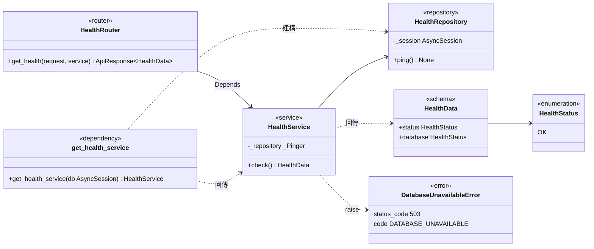
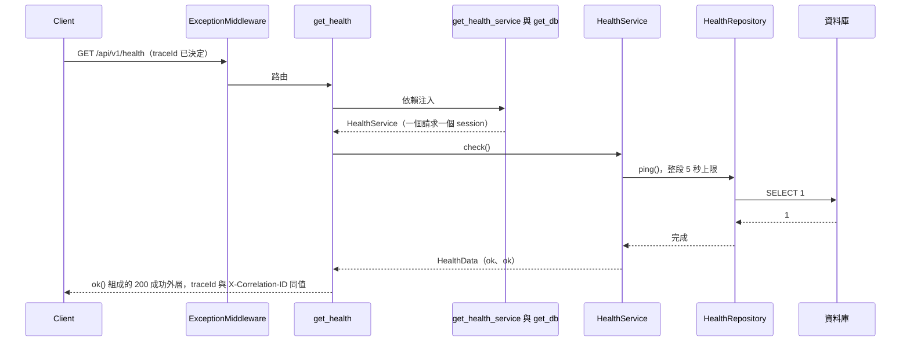
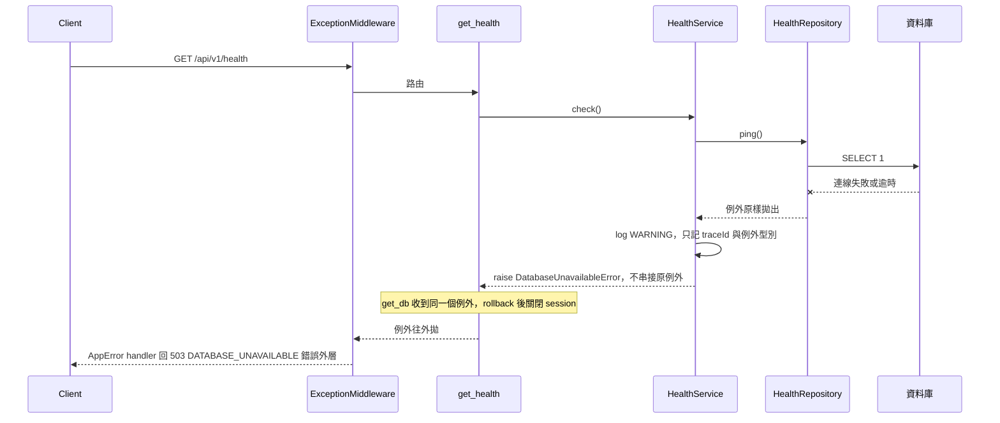

# 後端模組與基礎建設

這份記 `main` 上的 `backend/` 現在長怎樣：每個業務模組一節，加上全站共用的基礎建設；**只寫已合併的程式有的東西**。
要照著做的規則在 [技術架構](../../development/architecture.mdx)，為什麼這樣決定在 [ADR](../../development/adr/index.mdx)；API 的形狀以 `backend/openapi.json` 為準，本文不另寫一份。
本文與程式不一致時，是本文錯了：以程式為準，並回頭改本文。

各節的收合區塊是實作或規劃時才要查的細節，預設收起。

## 誰改、什麼時候改

規劃時先改本文，change 的 `system-design.md` 只寫本文的路徑與異動摘要，不重抄本文的內容。

| 時機 | 誰 | 做什麼 |
| :--- | :--- | :--- |
| 規劃（寫 `system-design.md`） | `sd` | 新模組加一節；既有模組改分層表、Class 圖與主要 Sequence 圖；動到基礎建設時改 [§後端基礎建設](#後端基礎建設)。`system-design.md` 的「常駐文件異動」節寫出本文路徑與異動摘要 |
| 規劃審閱 | `design-reviewer` | 核對本文與這次的 `system-design.md` 一致 |
| 實作後 | `backend-developer` | 實作出來的分層、類別或主要流程和設計不同時，依程式校正本文；動到 `app/core/` 的改 [§後端基礎建設](#後端基礎建設) |
| 程式審查 | `code-reviewer` | 再核對一次本文與實作一致；不一致時列為審查意見 |

change 的 `system-design.md` 仍然畫這次新增或修改的類別，以及這次每個 Scenario 的 Sequence 圖；本文留下的是合併之後全系統的樣子。資料表的欄位不在本文，見 [候選資料表字典](./data-table-dictionary.mdx)。

## 模組一覽

一個業務模組一個資料夾 `backend/app/modules/<module>/`；目前只有 `health`。

| 模組 | 資料夾 | 端點（operationId） | 行為的契約 |
| :--- | :--- | :--- | :--- |
| [health](#health) | `app/modules/health/` | `getHealth`（`GET /api/v1/health`） | `openspec/specs/health-check/` |

## health

回報服務與資料庫能不能用；刻意公開，不需要登入。

| 層 | 檔案 | 做什麼 |
| :--- | :--- | :--- |
| Router | `router.py` | `get_health` 呼叫 service，用 `ok()` 包成功外層；額外宣告 `503` 回應 |
| Service | `service.py` | `HealthService.check()` 在 5 秒上限內查一次資料庫；連不上就丟 `DatabaseUnavailableError`。依賴工廠 `get_health_service` 也在這裡 |
| Repository | `repository.py` | `HealthRepository.ping()` 對目前的 session 跑 `SELECT 1`，例外原樣往上丟 |
| Schemas | `schemas.py` | `HealthData` 只有 `status` 與 `database` 兩個欄位，值只有 `ok` |

### 分層與類別

模組內的 import 方向是 `router → service → repository`：依賴工廠放在 `service.py`，所以 `router.py` 不必 import repository。



`HealthService` 只依賴一個有 `ping()` 的 Protocol（`_Pinger`），單元測試以假的 repository 測它，不開資料庫。`HealthData` 繼承 `ResponseModel`，見 [§共用的 schema 基底](#共用的-schema-基底)。

### 主要情境

兩張圖都從中介層之後畫起；中介層各做什麼見 [§請求管線](#請求管線)。

#### 健康檢查回傳完整外層與追蹤編號



#### 資料庫無法連線時健康檢查回 503 外層



哪些例外算「連不上」、上限怎麼算，見 [§health 的 503](#health-的-503)。

## 後端基礎建設

`app/core/` 放換一個業務也照樣需要的東西，業務邏輯一律在 `app/modules/<module>/`；理由見 [ADR-003 的 D3](../../development/adr/003-backend-architecture.mdx#d3-後端採模組內分層)。

### 目錄

```text
backend/
├─ pyproject.toml            uv 專案；版號是 API 文件 info.version 的唯一來源
├─ alembic.ini
├─ alembic/
│  ├─ env.py                 只讀 DatabaseSettings；自動載入各模組的 models
│  └─ versions/              目前只有空的基準 revision
├─ openapi.json              匯出的 API 文件，提交進 repo
├─ app/
│  ├─ main.py                create_app()：組裝入口
│  ├─ core/                  全站共用的基礎建設，見下表
│  ├─ i18n/<locale>/messages.json   外層 message 的字串
│  ├─ scripts/export_openapi.py     匯出 openapi.json
│  └─ modules/<module>/      業務模組：router、service、repository、schemas（有表時加 models）
└─ tests/
   ├─ unit/
   ├─ integration/
   └─ probe.py               只在測試掛載的探測路由
```

| 目錄 | 放什麼 | 判斷方式 |
| :--- | :--- | :--- |
| `app/modules/` | 業務模組 | 有業務規則、會出現在 spec 的 Scenario |
| `app/core/` | 基礎建設 | 換一個業務也照樣需要，通常只在 `create_app` 掛一次 |
| `app/scripts/` | 命令列工具 | 用 `uv run python -m app.scripts.<name>` 執行，不是端點 |

### `core/` 各模組

每個檔案管一件事；新的共用基礎建設先找這張表，有就擴充，沒有才新開檔案。

| 檔案 | 管什麼 | 主要介面 |
| :--- | :--- | :--- |
| `config.py` | 唯一的設定入口 | `DatabaseSettings`、`Settings`、`load_settings`、`ConfigError` |
| `db.py` | engine、request session、declarative base | `create_engine`、`create_sessionmaker`、`get_db`、`Base`、`NAMING_CONVENTION` |
| `schemas.py` | 共用 schema 基底、外層、分頁 | `RequestModel`、`ResponseModel`、`ApiResponse`、`ErrorResponse`、`ErrorDetail`、`PaginatedResponse`、`PaginationParams` |
| `envelope.py` | 組成功與錯誤外層；correlation id 的 contextvar | `ok`、`success`、`error_response`、`current_trace_id` |
| `errors.py` | 領域錯誤與 exception handler | `AppError`、`NotFoundError`、`NotAcceptableError`、`DatabaseUnavailableError`、`register_exception_handlers` |
| `middleware.py` | 三個純 ASGI 中介層 | `CorrelationIdMiddleware`、`UnhandledExceptionMiddleware`、`LocaleMiddleware` |
| `i18n.py` | `Accept-Language` 解析與訊息目錄 | `resolve_locale`、`MessageCatalog` |
| `openapi.py` | operationId、唯一性檢查、API 文件後處理、版號 | `generate_operation_id`、`assert_unique_operation_ids`、`install_openapi`、`get_app_version` |
| `log_safety.py` | 把來自請求的值轉成安全的一行 log | `escape_for_log` |
| `paths.py` | 路徑常數 | `API_V1_PREFIX`（`/api/v1`） |

`log_safety.py` 與 `paths.py` 不 import `app` 的任何東西，任何模組都能用而不產生循環；`envelope.py` 擁有 correlation id 的 contextvar，所以依賴方向只會是 middleware → envelope。

### app factory 與 lifespan

`create_app(settings)` 組出整個 app，import 時不讀環境變數；資料庫 engine 在 lifespan 才建立，組 app 不開連線。

```bash
cd backend && uv run uvicorn app.main:create_app --factory
```

| 步驟 | 做什麼 | 失敗時 |
| :--- | :--- | :--- |
| 1 | `settings` 是 `None` 時用 `load_settings(Settings)` 從環境變數讀 | `ConfigError`，只寫變數名與原因 |
| 2 | 建 `FastAPI`：版號讀 `pyproject.toml`、`generate_unique_id_function` 設成 `generate_operation_id` | 讀不到版號就失敗，沒有預設值 |
| 3 | 載入訊息目錄，放進 `app.state.message_catalog` | `MessageCatalogError` |
| 4 | 依序加中介層，見 [§請求管線](#請求管線) | — |
| 5 | 註冊 exception handler，見 [§錯誤怎麼對到 envelope](#錯誤怎麼對到-envelope) | — |
| 6 | 建 `/api/v1` 父 router，把各模組的 router 掛進去 | — |
| 7 | 檢查 operationId 不重複，換上後處理過的 `app.openapi` | `OperationIdCollisionError` |

lifespan 啟動時建 engine 與 sessionmaker，放在 `app.state.engine`、`app.state.sessionmaker`；關閉時 `dispose()` engine。模組層沒有任何全域的 engine 或 session。

### 請求管線

一個 `/api/v1` 請求由外而內穿過四個中介層與 exception handler 才到模組；每一種失敗都在固定的一層產生回應，而且每個回應的 `traceId` 都和 `X-Correlation-ID` 標頭同值。

{/* @ai-visualize
id: backend-request-pipeline
type: motion
prompt: |
  核心洞察：一個 /api/v1 請求由外而內穿過 CorrelationIdMiddleware、CORSMiddleware、UnhandledExceptionMiddleware、LocaleMiddleware、Starlette 的 ExceptionMiddleware，才到 Router、Service、Repository 與資料庫；每種結果都由固定的一層產生回應，回程再由外層加上標頭，而 traceId 從第一層決定之後一路相同，最後等於回應標頭 X-Correlation-ID。
  互動：四個情境分頁（正常、422、500、health 503）；上一步、播放／暫停、下一步、重設；點任一層跳到該層的那一步。限流與關機還沒做，不畫。
  圖形：九層由上往下的直列，左側是去程、右側是回程；目前那一步的層實心，已走過的淡色；產生回應的那一層標「產生回應」；每一步下方的面板顯示這一層做什麼、目前的 traceId 晶片（一路同一個值），最後一步顯示狀態碼、code、message 與 X-Correlation-ID，並標示兩者相同。
  資料/數值：以 backend/app/main.py、app/core/middleware.py、errors.py、envelope.py 與 app/modules/health/ 為準。
    - 正常：GET /api/v1/health，Router 以 ok() 回 200，code OK，message「成功」，data status ok、database ok
    - 422：POST /api/v1/probe（只在測試掛載）body 缺 displayName；FastAPI 驗 body 丟 RequestValidationError，handler 不執行；ExceptionMiddleware 的 handler 回 422 VALIDATION_FAILED，errors 一筆 location body、field displayName、code missing
    - 500：GET /api/v1/probe-crash（只在測試掛載）handler 丟 RuntimeError；ExceptionMiddleware 沒有 handler，往外拋；UnhandledExceptionMiddleware 記一筆 ERROR（traceId、method、path、只有型別與 frame 的 traceback），回 500 INTERNAL_ERROR
    - health 503：GET /api/v1/health，資料庫連不上；Repository 原樣拋出，Service 記 WARNING 並丟 DatabaseUnavailableError，get_db 收到例外會 rollback；ExceptionMiddleware 的 AppError handler 回 503 DATABASE_UNAVAILABLE
    - 回程：LocaleMiddleware 加 Content-Language，CORSMiddleware 加 Access-Control-Allow-Origin，CorrelationIdMiddleware 加 X-Correlation-ID
caption: 切換情境逐步走，看哪一層產生回應、traceId 一路都是同一個值
status: generated
*/}

import GeneratedFrame from '@/components/GeneratedFrame.astro'
import BackendRequestPipeline from '@notes/components/backend-request-pipeline'

<GeneratedFrame id="backend-request-pipeline" type="motion" prompt={"核心洞察：一個 /api/v1 請求由外而內穿過 CorrelationIdMiddleware、CORSMiddleware、UnhandledExceptionMiddleware、LocaleMiddleware、Starlette 的 ExceptionMiddleware，才到 Router、Service、Repository 與資料庫；每種結果都由固定的一層產生回應，回程再由外層加上標頭，而 traceId 從第一層決定之後一路相同，最後等於回應標頭 X-Correlation-ID。\n互動：四個情境分頁（正常、422、500、health 503）；上一步、播放／暫停、下一步、重設；點任一層跳到該層的那一步。限流與關機還沒做，不畫。\n圖形：九層由上往下的直列，左側是去程、右側是回程；目前那一步的層實心，已走過的淡色；產生回應的那一層標「產生回應」；每一步下方的面板顯示這一層做什麼、目前的 traceId 晶片（一路同一個值），最後一步顯示狀態碼、code、message 與 X-Correlation-ID，並標示兩者相同。\n資料/數值：以 backend/app/main.py、app/core/middleware.py、errors.py、envelope.py 與 app/modules/health/ 為準。\n  - 正常：GET /api/v1/health，Router 以 ok() 回 200，code OK，message「成功」，data status ok、database ok\n  - 422：POST /api/v1/probe（只在測試掛載）body 缺 displayName；FastAPI 驗 body 丟 RequestValidationError，handler 不執行；ExceptionMiddleware 的 handler 回 422 VALIDATION_FAILED，errors 一筆 location body、field displayName、code missing\n  - 500：GET /api/v1/probe-crash（只在測試掛載）handler 丟 RuntimeError；ExceptionMiddleware 沒有 handler，往外拋；UnhandledExceptionMiddleware 記一筆 ERROR（traceId、method、path、只有型別與 frame 的 traceback），回 500 INTERNAL_ERROR\n  - health 503：GET /api/v1/health，資料庫連不上；Repository 原樣拋出，Service 記 WARNING 並丟 DatabaseUnavailableError，get_db 收到例外會 rollback；ExceptionMiddleware 的 AppError handler 回 503 DATABASE_UNAVAILABLE\n  - 回程：LocaleMiddleware 加 Content-Language，CORSMiddleware 加 Access-Control-Allow-Origin，CorrelationIdMiddleware 加 X-Correlation-ID\n"} caption="切換情境逐步走，看哪一層產生回應、traceId 一路都是同一個值">
  <BackendRequestPipeline client:visible />
</GeneratedFrame>

| 順序 | 層 | 職責 | 自己產生的回應 |
| :--- | :--- | :--- | :--- |
| — | Starlette `ServerErrorMiddleware` | 框架固定的最外層，只剩最後保險 | 本 repo 的 `500` 不靠它 |
| 1 | `CorrelationIdMiddleware` | 決定 correlation id，回應時加 `X-Correlation-ID` | 無 |
| 2 | `CORSMiddleware` | 來源逐一列出；`X-Correlation-ID` 列在允許與公開的標頭 | 預檢回應（不是錯誤外層） |
| 3 | `UnhandledExceptionMiddleware` | 攔下沒有 handler 的例外，記一筆 log | `500 INTERNAL_ERROR` |
| 4 | `LocaleMiddleware`（只作用在 `/api/v1`） | 解析 `Accept-Language`，回應時加 `Content-Language` | `406 NOT_ACCEPTABLE`，一律 zh-TW |
| 5 | Starlette `ExceptionMiddleware` | 執行註冊的 exception handler | `404`、`405`、`422` 與各 `AppError` |
| 6 | Router → Service → Repository | 模組內分層 | 成功外層，由 Router 的 `ok()` 組 |

`500` 自己攔、不交給 `ServerErrorMiddleware`：它在所有中介層外面，由它產生的 `500` 不會帶 `Access-Control-Allow-Origin` 與 `X-Correlation-ID`。三個自寫的中介層都是純 ASGI、不用 `BaseHTTPMiddleware`，contextvar 才不會在 task 之間斷掉、串流回應也不會被緩衝。兩個理由的出處見已歸檔的 [backend-skeleton `system-design.md`](https://github.com/label-suite/label-suite/blob/main/openspec/changes/archive/2026-11-20-backend-skeleton/system-design.md) §請求穿過的層。認證與 CSRF 還沒有，見 [§已知限制](#已知限制)。

:::note{title="CORS 的實際設定" collapsible}
- 來源：`CORS_ALLOWED_ORIGINS`，見 [§設定](#設定)
- 方法：`GET`、`POST`、`PUT`、`PATCH`、`DELETE`、`OPTIONS`
- 允許的請求標頭：`Content-Type`、`Accept-Language`、`X-Correlation-ID`
- 公開的回應標頭：`X-Correlation-ID`
- `allow_credentials` 跟著 `CORS_ALLOW_CREDENTIALS`，預設 `true`
:::

### 錯誤怎麼對到 envelope

service 只丟例外、不組回應；例外在下表那一層變成錯誤外層，`message` 依請求的語系從訊息目錄取字。

| 例外或情況 | 在哪一層變成回應 | HTTP | `code` | 訊息鍵 |
| :--- | :--- | :--- | :--- | :--- |
| `AppError` 的子類別 | `handle_app_error` | 類別的 `status_code` | 類別的 `code` | 類別的 `message_key` |
| `RequestValidationError` | `handle_validation_error` | `422` | `VALIDATION_FAILED` | `common.validation_failed` |
| 路由找不到 | `handle_http_exception` | `404` | `NOT_FOUND` | `common.not_found` |
| 方法不允許 | `handle_http_exception` | `405`，保留 `Allow` 標頭 | `METHOD_NOT_ALLOWED` | `common.method_not_allowed` |
| 其他狀態的 `HTTPException` | `handle_http_exception`，另記一筆 ERROR | `500` | `INTERNAL_ERROR` | `common.internal_error` |
| `Accept-Language` 全被拒 | `LocaleMiddleware` | `406` | `NOT_ACCEPTABLE` | `common.not_acceptable` |
| 其他例外，含 `ResponseValidationError` | `UnhandledExceptionMiddleware` | `500` | `INTERNAL_ERROR` | `common.internal_error` |

錯誤碼的格式與通用碼見 `openspec/specs/api-envelope/spec.md`。

:::note{title="外層的組法與 422 的逐欄位錯誤" collapsible}
- 成功外層由 Router 呼叫 `ok(data, request)`；錯誤外層由 handler 與中介層呼叫 `error_response()`。兩者都補上 `timestamp`（UTC、毫秒、`Z` 結尾）、`traceId`（目前的 correlation id）與本地化的 `message`，錯誤回應另加 `Content-Language`
- 錯誤外層的 `data` 固定 `null`；`errors` 只有 `422` 是非空陣列，其餘為 `null`
- `ErrorDetail` 的 `location` 取 Pydantic `loc` 的第一段，`field` 是其餘各段以 `.` 串接；body 無法解析（`json_invalid`）時 `field` 為空字串
- 只留 Pydantic 的 `type`（成為 `code`）與 `msg`（成為 `message`，英文）；`input`、`ctx`、`url` 一律丟掉，送進來的值不會回顯
- `AppError(params)` 的 `params` 會填進訊息範本、回到前端，不能放內部識別碼或祕密
- 每個 `/api/v1` 操作都在 API 文件宣告 `404`、`405`、`406`、`500` 回應：父 router 統一帶上，模組不必各自寫
:::

### correlation id

每個請求都有一個 correlation id：帶進來的 `X-Correlation-ID` 合格就沿用，否則產生新的 UUID4；它就是外層的 `traceId`。

| 項目 | 做法 |
| :--- | :--- |
| 合格條件 | 整個值符合 `^[A-Za-z0-9-]{8,64}$`；不合格時直接丟掉、換新的，不回錯誤 |
| 存放 | `scope["state"]["correlation_id"]` 與 `envelope.correlation_id_var` |
| 回應 | 每個 HTTP 回應都加 `X-Correlation-ID`，連預檢與 `500` 都有 |
| 程式裡取用 | `current_trace_id()`；請求之外呼叫時回一個新的 UUID4，`traceId` 不會是空的 |

業務程式的 log 要帶 `traceId` 時目前得自己呼叫 `current_trace_id()`，見 [§已知限制](#已知限制)。

### log 安全規則

log 只記型別、位置與 `traceId`，不記任何可能帶著請求或資料庫內容的文字。

| 規則 | 在哪裡做 |
| :--- | :--- |
| 來自請求的值（method、path、traceId）先經 `escape_for_log`：控制字元與非 ASCII 字元寫成跳脫序列，無法偽造新的一行 | `log_safety.py` |
| 未處理例外只記一筆 ERROR：traceId、method、path，以及只有型別與 frame 的 traceback；不帶 `exc_info`、例外訊息、query、body、標頭、cookie | `UnhandledExceptionMiddleware`、`format_exception_without_text` |
| 資料庫連不上只記一筆 WARNING：traceId 與例外型別 | `HealthService.check` |
| engine 一律 `hide_parameters=True`，SQL 參數不會出現在例外訊息或 SQL echo | `db.create_engine` |
| 設定錯誤只寫變數名與原因，不寫設定值；原本的 `ValidationError` 以 `from None` 丟掉 | `config.load_settings` |

### i18n 目錄

後端只本地化外層的 `message`；字串放在 `app/i18n/<locale>/messages.json`，目前有 `zh-TW` 與 `en`。前後端各管各的理由見 [ADR-003 的 D11](../../development/adr/003-backend-architecture.mdx#d11-i18n-分前端與後端兩層)。

| 項目 | 做法 |
| :--- | :--- |
| 檔案格式 | 一層的 key 對字串，例 `"common.ok": "成功"`；範本參數寫成 `{name}` |
| 載入 | `create_app` 載入一次；兩個語系的 key 不完全相同就啟動失敗 |
| 選語系 | `resolve_locale` 依 `Accept-Language`；沒帶或空白時是 zh-TW |
| 新增訊息 | 兩個檔案同時加同一個 key |

:::note{title="Accept-Language 的解析規則" collapsible}
- 依 q 值由高到低試，同分維持標頭順序；第一個支援的語系勝出
- 比對不分大小寫；`zh`、`zh-TW`、`zh-Hant`、`zh-Hant-TW` 對到 `zh-TW`，`en` 與 `en-*` 對到 `en`
- `*` 選第一個沒有被 `q=0` 拒絕的支援語系（`zh-TW` 優先）
- 不支援的語言與格式錯誤的項目略過
- 只列了不支援的語言，或支援的語言與 `*` 都被 `q=0` 拒絕時，回 `406`
- `422` 的 `ErrorDetail.message` 是 Pydantic 的英文說明，不本地化
:::

### 設定

設定只從環境變數來，分兩層：`DatabaseSettings` 只有資料庫，Alembic 只讀這一層；`Settings` 再加上 API 要的 CORS。一律透過 `load_settings` 建立。

| 環境變數 | 層 | 必填 | 規則 |
| :--- | :--- | :--- | :--- |
| `DATABASE_URL` | 資料庫 | 否 | 有設就走 PostgreSQL；接受 `postgresql`、`postgresql+asyncpg`、`postgres`，一律改寫成 `postgresql+asyncpg` |
| `SQLITE_PATH` | 資料庫 | 否 | 沒設 `DATABASE_URL` 時的 SQLite 檔，預設 `./data/label_suite.db`，解析成絕對路徑 |
| `CORS_ALLOWED_ORIGINS` | API | 是 | 逗號分隔；每一個都是 `http(s)://host[:port]`，不能有路徑；含 `*` 就拒絕 |
| `CORS_ALLOW_CREDENTIALS` | API | 否 | 預設 `true` |

變數名沒有前綴；驗證失敗時 `ConfigError` 一行列一個「變數名：原因」，不含設定值。

### 資料庫雙層

`DATABASE_URL` 有設走 PostgreSQL，沒設走 SQLite；API 與 Alembic 用同一段程式推導連線。規則與理由見 [技術架構的資料庫雙層](../../development/architecture.mdx#資料庫雙層) 與 [ADR-003 的 D7](../../development/adr/003-backend-architecture.mdx#d7-資料庫分兩層)。

| 項目 | 做法 |
| :--- | :--- |
| session | `get_db` 一個請求開一個 `AsyncSession`；發生例外時 rollback 再往外拋，**從不 commit**，交易由 service 負責 |
| model | 繼承 `core.db.Base`，放在 `app/modules/<module>/models.py`；Alembic 自動載入，不必改 `env.py` |
| 約束命名 | `Base.metadata` 帶固定的命名慣例，SQLite 重建表時 batch migration 才找得到約束 |
| migration | `render_as_batch` 一律開啟，一份 migration 兩種資料庫都能跑；目前只有空的基準 revision `0dfb129ee036` |

:::note{title="兩層 engine 的差異" collapsible}
- Lite（SQLite）：URL 是 `sqlite+aiosqlite:///<絕對路徑>`；建 engine 時先建好上層目錄，每條新連線都執行 `PRAGMA foreign_keys=ON`
- 正式（PostgreSQL）：連線逾時 `POSTGRES_CONNECT_TIMEOUT_SECONDS`（5 秒）、`pool_pre_ping=True`，資料庫重啟後第一個請求不會拿到失效連線（出處見已歸檔的 [backend-skeleton `design.md`](https://github.com/label-suite/label-suite/blob/main/openspec/changes/archive/2026-11-20-backend-skeleton/design.md) D8）
- 兩層都 `hide_parameters=True`
- sessionmaker 設 `expire_on_commit=False`：service commit 之後，組回應時物件還讀得到
- 測試：有設 `TEST_DATABASE_URL` 就用 PostgreSQL，否則每個測試用暫存的 SQLite 檔；兩者都先對測試庫跑 `alembic upgrade head`
:::

### 共用的 schema 基底

request 的 body 與 query 繼承 `RequestModel`，response 繼承 `ResponseModel`；兩者都不直接繼承 `ApiModel`。

| 基底 | JSON 欄位 | 未宣告的欄位 | 用途 |
| :--- | :--- | :--- | :--- |
| `RequestModel` | 只接受 camelCase；送 snake_case 視為未宣告 | 拒絕（`extra_forbidden`） | request body、query |
| `ResponseModel` | 輸出 camelCase；程式內可用 Python 欄位名或 ORM 物件建立 | 拒絕 | response 的 `data` 與外層 |

:::note{title="外層、分頁與 API 文件裡的名稱" collapsible}
- `ApiResponse[T]`：`success`、`code`、`message`、`data`、`timestamp`、`traceId`；`ErrorResponse` 是 `ApiResponse[None]` 加 `errors`
- `PaginatedResponse[T]`：`items`、`total`、`limit`、`offset`，另算出 `hasMore`、`totalPages`、`nextOffset`
- `PaginationParams`：`limit` 預設 20、範圍 1–100；`offset` 預設 0
- API 文件裡的名稱：`ApiResponse[X]` 叫 `XResponse`、`PaginatedResponse[X]` 叫 `XPage`、分頁的外層叫 `XPageResponse`
- `timestamp` 序列化成 `2026-11-20T08:15:30.123Z` 這種 UTC 毫秒字串
:::

### OpenAPI 匯出與 operationId 檢查

API 文件由 FastAPI 產生、經後處理後匯出成 `backend/openapi.json` 並提交；前端的 client 從它產生。為什麼用 Orval 見 [ADR-003 的 D6](../../development/adr/003-backend-architecture.mdx#d6-前端-client-用-orval-產生)。

```bash
cd backend && uv run python -m app.scripts.export_openapi
```

| 項目 | 做法 |
| :--- | :--- |
| operationId | `generate_operation_id` 由 method、`/api/v1` 之後最後一個非參數路徑段與 handler 的回傳型別算出，不看函式名；不手寫也不逐個覆寫 |
| 重複檢查 | `create_app` 與第一次產生 API 文件時各查一次，重複就失敗並列出兩條路由 |
| 後處理 | 每個 `422` 改指向 `ErrorResponse`、刪掉 FastAPI 的 `HTTPValidationError` 與 `ValidationError`、泛型元件改用 `title` 當名稱 |
| 版號 | `info.version` 讀 `backend/pyproject.toml` 的 `[project].version` |
| 匯出 | 用固定的佔位設定組 app，不跑 lifespan、不開資料庫、不需要環境變數；輸出排序過的 key、縮排 2、結尾換行，失敗時不動既有檔案、退出碼 1 |
| 漂移檢查 | 指令見 `openspec/config.yaml` 的 `operations.apply`（後端契約漂移那一條） |

:::note{title="operationId 的算法" collapsible}
- 資源名是最後一個非參數路徑段，`-` 分詞後轉 PascalCase：`task-items` → `TaskItems`
- `GET` 且回傳型別是 `ApiResponse[PaginatedResponse[...]]`：`list` 加複數，例 `listTaskItems`
- 其他 `GET` 是 `get`、`POST` 是 `create`、`PUT` 與 `PATCH` 是 `update`、`DELETE` 是 `delete`，加上單數，例 `getHealth`
- 單數化依序：不規則表（`health`、`statuses`、`buses`）、`ss` 不變、`ies` → `y`、`sses`／`xes`／`ches`／`shes` 去 `es`、其他 `s` 去掉；規則算錯的字加進 `_IRREGULAR_SINGULARS`
- 一條路由只能有一個 method；handler 沒有回傳型別、或 method 是 `HEAD`／`OPTIONS` 時直接失敗
- FastAPI 內建的 `/docs`、`/redoc`、`/openapi.json` 維持預設開啟，不在 `/api/v1` 底下、不套外層
:::

### health 的 503

`GET /api/v1/health` 對資料庫查一次；連不上、逾時或連線池耗盡都回 `503 DATABASE_UNAVAILABLE`，流程見 [§資料庫無法連線時健康檢查回 503 外層](#資料庫無法連線時健康檢查回-503-外層)。

| 項目 | 做法 |
| :--- | :--- |
| 算「連不上」的例外 | `OperationalError`、`DBAPIError`、`OSError`、內建 `TimeoutError`、SQLAlchemy 連線池的 `TimeoutError`；其他例外照一般規則變成 `500` |
| 上限 | 整個查詢（含等連線池）包在 `POSTGRES_CONNECT_TIMEOUT_SECONDS`（5 秒）裡；只限這個檢查，不改 engine |
| 例外 | 丟 `DatabaseUnavailableError` 時不串接原例外，連線字串與驅動細節不會跟著出去 |
| 回應 | 成功時 `data` 只有 `status` 與 `database`，不含版本、主機或部署資訊 |

### 新增業務模組的檢查清單

照 `health` 的寫法開新模組；以下每一項在程式裡都有對應的機制，漏了會在啟動、匯出或審查時被擋。

- [ ] 建 `app/modules/<module>/`，放 `router.py`、`service.py`、`repository.py`、`schemas.py`；依賴工廠 `get_<module>_service` 放在 `service.py`
- [ ] request schema 繼承 `RequestModel`、response schema 繼承 `ResponseModel`
- [ ] handler 用回傳型別宣告回應（`ApiResponse[X]`，列表是 `ApiResponse[PaginatedResponse[X]]`），不用 `response_model=`；回傳時呼叫 `ok(data, request)`
- [ ] 業務錯誤繼承 `AppError`，設定 `status_code`、`code`、`message_key`；新的訊息鍵同時加進 `zh-TW` 與 `en` 的 `messages.json`
- [ ] 在 `create_app` 把模組的 router 掛進 `/api/v1` 父 router
- [ ] service 擁有交易：需要寫入時自己 commit，`get_db` 不會幫你 commit
- [ ] 有資料表時，model 放 `models.py` 並繼承 `Base`；migration 由 `dba` 寫
- [ ] 資源名用預設規則單數化會算錯時，加進 `_IRREGULAR_SINGULARS`
- [ ] 重新匯出 `openapi.json`，再在前端跑 `pnpm --filter frontend api:generate`
- [ ] 本文加一節：分層表、Class 圖與主要 Sequence 圖（見 [§誰改、什麼時候改](#誰改什麼時候改)）

## 已知限制

已落地的後端讓一條請求走得通、出錯時回得了外層；下表是它還沒有的東西與風險。

| 還沒有 | 風險 | 追蹤 |
| :--- | :--- | :--- |
| 一般請求的存取 log；業務程式的 log 不會自動帶 `traceId` | 拿到使用者回報的 `traceId`，只找得到未處理例外那一筆 | [#567](https://github.com/label-suite/label-suite/issues/567) |
| 登入失敗鎖定 | 登入失敗次數的限制還沒實作 | [規格 01-05 §已確認決議](../../specs/01-account/05-login-state.mdx#已確認決議) Q3（失敗 10 次擋 30 分鐘） |
| 全域速率限制 | 端點沒有呼叫上限 | [#565 的裁定](https://github.com/label-suite/label-suite/issues/565#issuecomment-7100090994)：後端不做，全域上限日後交給反向代理層 |
| 認證、授權與 CSRF | 目前唯一的端點刻意公開；第一個需要登入的端點要先把這幾層補上 | [ADR-004 的 D1](../../development/adr/004-auth-and-security.mdx#d1-認證-token-放在-httponly-cookie)、[D3](../../development/adr/004-auth-and-security.mdx#d3-csrf-用綁定-session-的-double-submit-token) |
| 信任反向代理的來源 IP | 放在 Nginx 後面時，後端看到的 client IP 都是 Nginx | [#566](https://github.com/label-suite/label-suite/issues/566) |
| Nginx 與安全標頭 | 回應不帶 CSP 等安全標頭 | [#568](https://github.com/label-suite/label-suite/issues/568) |
| 監控、告警與錯誤追蹤 | 出錯時只能看 log，沒有人會被通知 | [ADR-008 的 D4](../../development/adr/008-deployment-and-operations.mdx#d4-觀測性只做-ai_runs監控與錯誤追蹤本期不做) |
| CI 的後端檢查：兩種資料庫的 pytest、ruff、mypy、契約漂移、分層 import 方向 | 這些檢查目前只在本機跑，PR 不會因為違反而失敗 | [#506](https://github.com/label-suite/label-suite/issues/506) |
| `pyproject.toml` 沒有設 mypy strict | 本機直接跑 `uv run mypy app` 不是 strict | [#524](https://github.com/label-suite/label-suite/issues/524) |

## 決策紀錄

| 日期 | 決策 | 取代了什麼 | 來源 |
| :--- | :--- | :--- | :--- |
| 2026-11-23 | 後端模組的分層、Class 圖與主要 Sequence 圖落地成本文；規劃時由 `sd` 先改本文，change 只寫異動摘要與路徑（[§誰改、什麼時候改](#誰改什麼時候改)） | 只散在各 change 的 `system-design.md` | [#546](https://github.com/label-suite/label-suite/issues/546) |
| 2026-11-23 | 本文加一節後端基礎建設與已知限制，不另開文件（[§後端基礎建設](#後端基礎建設)） | — | [#546](https://github.com/label-suite/label-suite/issues/546) |
| 2026-11-23 | 實作後由 `backend-developer` 依程式校正本文，`code-reviewer` 再核對（[§誰改、什麼時候改](#誰改什麼時候改)） | — | [#546](https://github.com/label-suite/label-suite/issues/546#issuecomment-7100137950) |
