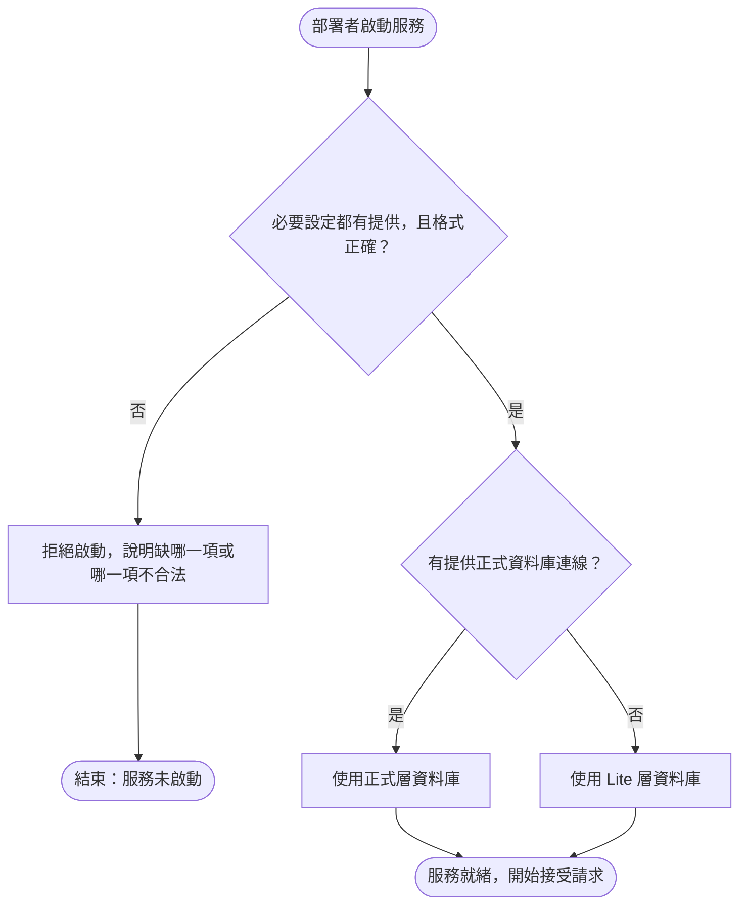
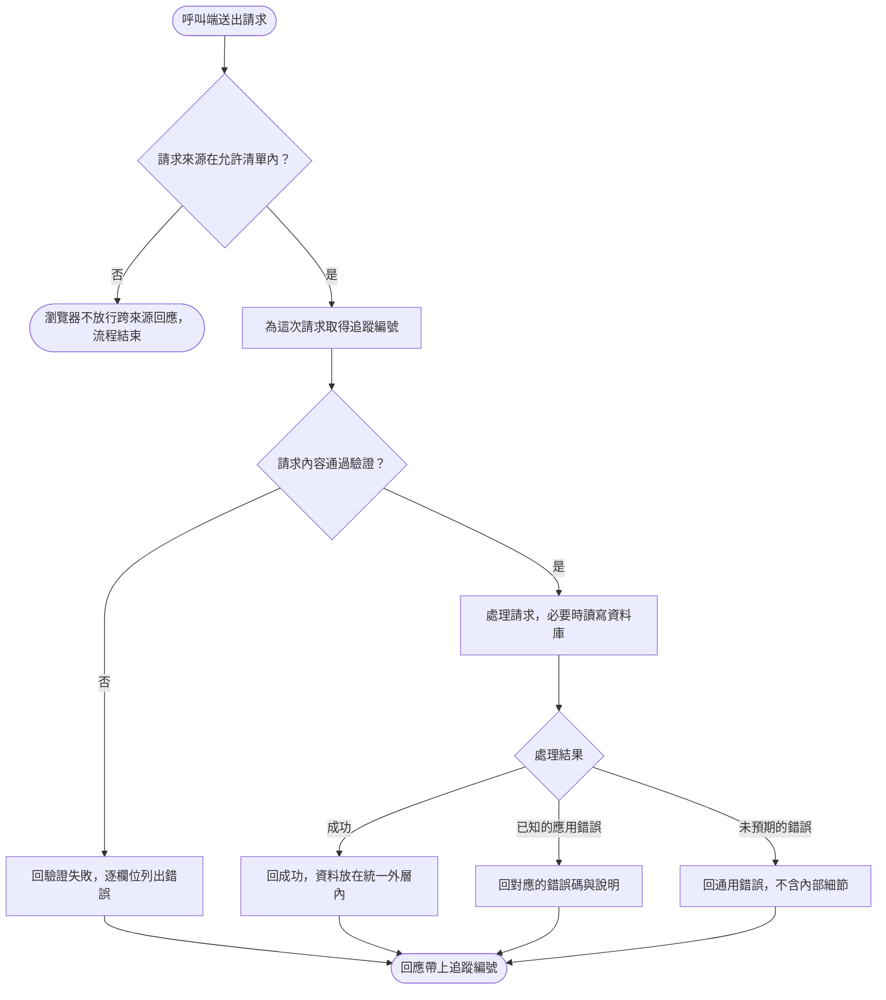
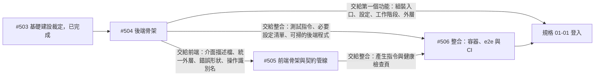

# System Analysis

本 change 是基礎建設 Epic #502 的第一個程式 change（#504 後端骨架），**沒有 `docs/specs/` 規格可追溯**：spec-migration D4 已裁定 foundation 屬技術規範、不寫成規格書（`docs/development/workflow/spec-migration.mdx` §決議 D4）。依 `openspec/config.yaml` 的 `context`（維護者 2026-11-20 裁定，#503），需求改追溯到 ADR 與規則文件的條號。

本文只寫「骨架要提供什麼能力、誰會用、跟誰相依、哪裡沒定」；做法（框架、目錄、資料結構、介面形狀）留給 `system-design` 與 `api-contract`。為了能對回條號，下文以業務語意稱呼幾個技術概念：

| 本文用語       | 對應的條文用語（只供對照）                 |
| :------------- | :----------------------------------------- |
| 統一回應外層   | envelope（ADR-003 D5、api-agent-rules A1） |
| 追蹤編號       | correlation id／`traceId`（A6、A7）        |
| 介面描述檔     | 後端匯出的 `openapi.json`（A4、A5）        |
| 操作識別名     | operationId（A1）                          |
| 資料庫結構遷移 | Alembic migration（B6）                    |
| 允許來源清單   | CORS allowlist（Hard Rule 7、S2）          |
| 語言偏好       | `Accept-Language`（A8）                    |

## 需求依據

需求依據順序：維護者指定的需求文件（#504、Epic #502、#503 的裁定）＞ `docs/specs/`（本次無對應規格頁，只有一條業務規則被引用）＞ `docs/` 其他需求文件（ADR、規則文件、`architecture.mdx`）＞ `openspec/`。

| 來源                                              | 章節／編號                                                                            | 摘要（一句）                                                                                                                                                   |
| :------------------------------------------------ | :------------------------------------------------------------------------------------ | :------------------------------------------------------------------------------------------------------------------------------------------------------------- |
| Issue #504                                        | §使用情境／功能範圍「包含」「不包含」、§驗收條件 七項                                 | 本次範圍與完成條件的唯一依據                                                                                                                                   |
| Epic #502                                         | §需求目標、§承接的延後條文                                                            | 一條健康檢查請求要走完整條契約鏈並落到兩種資料庫；骨架要讓待建置的機械檢查有地方掛                                                                             |
| Issue #503                                        | 裁定 1–3                                                                              | 統一回應外層的六個欄位、錯誤套同一外層、對外欄位一律小駝峰                                                                                                     |
| `docs/specs/07-shared/01-sidebar.mdx`（已定案）   | §卡控機制「系統要向使用者顯示錯誤」                                                   | 錯誤只給看得懂的說明，不露出內部資料結構、路徑或原始錯誤內容（未處理例外不露堆疊的業務依據）                                                                   |
| `docs/development/workflow/spec-migration.mdx`    | §決議 D4                                                                              | foundation 屬技術規範，不寫進 `docs/specs/`                                                                                                                    |
| ADR-002                                           | D1 §後果「第一個 `backend/` 骨架 change 可以直接走完整流程」                          | 本 change 走完整九份產物；本 change 是 D1「重新討論」條件的第一個觀察點                                                                                        |
| ADR-003                                           | D1                                                                                    | 前後端同一個 repo，後端放在獨立的頂層目錄                                                                                                                      |
| ADR-003                                           | D2                                                                                    | 後端框架與它自動產生介面描述檔的能力（D6 的輸入）                                                                                                              |
| ADR-003                                           | D3                                                                                    | 一個業務模組一個資料夾、模組內分層；層間 import 檢查要等後端存在                                                                                               |
| ADR-003                                           | D5（含 2026-11-20 決策紀錄）                                                          | 路徑前綴 `/api/v1`、成功與錯誤共用統一回應外層、對外欄位小駝峰；例外只有無內容、檔案與串流                                                                     |
| ADR-003                                           | D6 §後果「CI 重產比對目前沒有機制」                                                   | 介面描述檔是前端產物的唯一來源；比對機制等後端與 CI 存在                                                                                                       |
| ADR-003                                           | D7                                                                                    | 資料庫兩層：沒設連線就走 Lite 層、有設就走正式層；schema 只走遷移，Lite 層要用批次模式                                                                         |
| ADR-003                                           | D8                                                                                    | 背景工作與快取（本次不包含，見 §範圍）                                                                                                                         |
| ADR-004                                           | D1 §後果                                                                              | 允許來源清單要允許帶憑證的請求（已決：本次骨架就允許帶憑證，見待決 #3／clarification §不需維護者決定的結論）                                                   |
| ADR-005                                           | D1–D2                                                                                 | 前端單頁應用與目錄分層；本 change 只是它的上游，不動前端                                                                                                       |
| ADR-007                                           | D1                                                                                    | 測試只分 unit、integration、e2e 三層，打 API 但不開瀏覽器的叫 integration                                                                                      |
| ADR-007                                           | D2                                                                                    | 覆蓋率只管「不得下降」與五項關鍵路徑；骨架期以第一次測得的值當基準                                                                                             |
| ADR-008                                           | D4                                                                                    | 監控與錯誤追蹤本期不做（對應 #504「不包含可觀測性」）                                                                                                          |
| ADR-008                                           | D8 §重新討論「後端程式建立之後（接 Semgrep）」                                        | 本 change 讓 Semgrep 有程式可掃，實際接上屬 #506                                                                                                               |
| `docs/development/rules/backend-agent-rules.mdx`  | B1、B2、B3、B5、B6、B7、B10                                                           | 分層方向、後端指令一律走 `uv run`、一個請求一個資料庫工作階段、不拼 SQL、schema 只由遷移管且能上能下、兩種資料庫都要測、設定集中驗證且缺必要設定就在啟動時失敗 |
| `docs/development/rules/api-agent-rules.mdx`      | A1                                                                                    | 路徑前綴、操作識別名由一處固定成「動詞加資源」且全專案唯一、成功回應包統一外層                                                                                 |
| `docs/development/rules/api-agent-rules.mdx`      | A2                                                                                    | 共用基底一次設定：拒收未知欄位、對外小駝峰；健康檢查是「不必建回應模型」的例外（見需求矛盾 #2）                                                                |
| `docs/development/rules/api-agent-rules.mdx`      | A3                                                                                    | 列表統一用 offset 分頁，回應固定七個欄位，後三個由前四個推導                                                                                                   |
| `docs/development/rules/api-agent-rules.mdx`      | A4、A5                                                                                | 三份契約產物的分工；一條命令完成「匯出介面描述檔 → 產生前端 client」                                                                                           |
| `docs/development/rules/api-agent-rules.mdx`      | A7                                                                                    | 錯誤套同一外層、`422` 另帶逐欄位錯誤、`5xx` 只給通用錯誤並附追蹤編號、不露堆疊                                                                                 |
| `docs/development/rules/api-agent-rules.mdx`      | A8                                                                                    | 回應外層的訊息由後端依語言偏好本地化，不得回 key 或原始英文；fallback 繁體中文；全部被拒回 `406`（已決：本次就實作，見待決 #2／clarification Q2）              |
| `docs/development/rules/security-agent-rules.mdx` | S2                                                                                    | 允許來源逐一列出，不得用萬用字元（Hard Rule 7）                                                                                                                |
| `docs/development/rules/security-agent-rules.mdx` | S9                                                                                    | log 不帶個資與 secret                                                                                                                                          |
| `docs/development/rules/testing-agent-rules.mdx`  | T1、T3、T4、T5、T9、T10、T11                                                          | 測試層名與位置、測行為不測自己、integration 的 harness 與正式環境共用同一個組裝且兩層資料庫各跑遷移、測試自備自清、七項自動 gate 的歸屬、覆蓋率基準、證據要求  |
| `docs/development/architecture.mdx`               | §技術選型、§後端分層、§API 契約、§資料庫雙層、§i18n 兩層、§測試分層                   | 上述 ADR 的落地做法（實作與規劃查的細節）                                                                                                                      |
| `AGENTS.md`                                       | Hard Rule 3、4、5、6、7、8、9                                                         | 用 `uv add`；不改版號；不寫死任務邏輯；不外露答案；不用萬用來源；不寫死 secret；所有輸入先驗證                                                                 |
| `openspec/config.yaml`                            | `operations.apply.guidance` 第 4 條（「後端與前端的檢查指令等骨架 change 建好再補」） | #504 驗收條件最後一項要補上後端的檢查指令                                                                                                                      |
| `openspec/specs/`                                 | 只有 `user-management`                                                                | 與本 change 無重疊；本 change 不改任何既有 capability                                                                                                          |
| `openspec/changes/`                               | 只有 `backend-skeleton` 進行中                                                        | 沒有其他進行中的 change 可衝突                                                                                                                                 |

## 範圍

- 這次包含（依 #504 §包含，以能力描述）：
  - 一個可以用 `uv` 管理與執行的後端專案（B2、Hard Rule 3）
  - 一個同時供正式執行與測試使用的應用組裝入口（T4「harness 與 production 共用同一個 app 組裝函式」）
  - 啟動時一次驗證所有設定：缺必要設定就拒絕啟動並說明缺哪一項；允許來源逐一列出（B10、S2、Hard Rule 7）
  - 一個所有對外資料形狀共用的基底：對外欄位小駝峰、未知欄位拒收（A2、#503 裁定 3）
  - 統一回應外層：成功與錯誤共用六個欄位，`422` 另帶逐欄位錯誤（A1、A7、#503 裁定 1–2）
  - 分頁回應的共用形狀：七個欄位與推導規則（A3）
  - 每個請求都有追蹤編號，出現在回應標頭與回應外層（A6、A7；已決：兩者同值，呼叫端自帶的值通過格式檢查才沿用，見待決 #7／clarification Q8）
  - 統一的錯誤處理：驗證失敗、已知應用錯誤、未處理例外都轉成統一外層，未處理例外不露出內部細節（A7、07-01 §卡控機制）
  - 操作識別名由一處依「動詞加資源」產生，不逐個指定、不從函式名推導（A1）
  - 資料庫連線與工作階段：Lite 層與正式層都能跑，一個請求一個工作階段（ADR-003 D7、B3）
  - 資料庫結構遷移的基礎設定：SQLite 用批次模式、約束命名慣例、遷移檔名模板（ADR-003 D7、B6）
  - 一條健康檢查（`/api/v1` 底下），當端到端的證明（Epic #502 §需求目標）
  - 匯出介面描述檔的指令（A5 的前半段）
  - unit 與 integration 測試，兩種資料庫都要跑（T1、T4、B7）
  - 在 `openspec/config.yaml` 補上後端的檢查指令（#504 驗收條件第 7 項）
- 這次不包含（依 #504 §不包含與 Epic #502）：
  - 認證、權限與任何業務資料表：維護者 2026-11-20 裁定放在第一個功能 change（規格 01-01 登入）
  - 背景工作與快取（ADR-003 D8）：等第一個背景工作出現
  - 可觀測性：監控、指標與錯誤追蹤（ADR-008 D4）
  - 前端骨架、client 產生與 mutator：屬 #505
  - 容器編排、`.env.example`、e2e、CI 檢查（雙資料庫 job、drift、覆蓋率門檻、import 方向、Semgrep）：屬 #506
  - 任何 `docs/specs/` 需求、`design/prototype/` 與畫面：本次無 UI 變更

### 涉及的角色

本次沒有登入，也沒有業務角色；PRD §權限矩陣的角色都還碰不到任何能力。以下是會「用到」骨架的對象：

| 對象                                                     | 能做的事                                                                   | 備註                                                                                   |
| :------------------------------------------------------- | :------------------------------------------------------------------------- | :------------------------------------------------------------------------------------- |
| 部署者                                                   | 提供設定（資料庫連線、允許來源等）並啟動服務；設定缺漏時得到明確的啟動失敗 | 已決：唯一的必要設定是 `CORS_ALLOWED_ORIGINS`，見待決 #1／clarification Q1             |
| 呼叫端（#505 之後是前端單頁應用）                        | 呼叫健康檢查，拿到統一外層與追蹤編號；送錯資料時拿到逐欄位錯誤             | 不經登入；健康檢查刻意公開，認證上線後也維持公開（已決，見待決 #12／clarification Q4） |
| 後續功能 change 的開發角色（`backend-developer`、`dba`） | 在模組資料夾底下沿用同一套回應格式、錯誤格式、分頁形狀與資料庫工作階段     | Epic #502「agent 實作功能時有可以參照的既有寫法」                                      |
| CI 與本機檢查（#506）                                    | 執行兩種資料庫的測試、比對介面描述檔、量覆蓋率、檢查分層                   | 本次只提供可被呼叫的指令                                                               |

權限矩陣：**不適用**。本次沒有受保護的能力，也沒有任何被遮蔽或唯讀的資料；所有呼叫端拿到的內容相同。

Hard Rule 5（任務設定驅動）與 Hard Rule 6（測試集答案不外露）：**不適用**。本次不碰任務、資料集或答案，沒有任何任務專屬邏輯；但共用的回應外層與錯誤處理是之後所有端點的出口，未處理例外不露內部細節（A7）這一條也是答案不經錯誤訊息外洩的前提，clarification 第 9、10 面向可據此下結論。

## 業務流程

| 規格 | 業務流程                                                                                  | 本次涉及                         |
| :--- | :---------------------------------------------------------------------------------------- | :------------------------------- |
| 無   | 不適用：本 change 沒有 `docs/specs/` 規格（spec-migration D4），需求依據是 ADR 與規則文件 | 下方兩張圖依 #504 與規則條文整理 |

依 `sa` 的寫法，需求依據不是 `docs/specs/` 時要畫完整流程。一般情況還要在待決問題建議用 `spec-writing` 把流程補回規格書，但 spec-migration D4 已明定 foundation 不寫成規格書，所以**不提這項建議**，流程只留在本文件。

### 服務啟動

- 依據：B10（缺必要設定在啟動時失敗，不是第一個請求才爆）、ADR-003 D7（有沒有提供連線決定哪一層）
- 「必要設定」已決：只有 `CORS_ALLOWED_ORIGINS` 一項，缺少、空清單或含 `*` 都拒絕啟動；其餘設定都有預設（已決，見待決 #1／clarification Q1）

### 一次請求

- 依據：S2（允許來源）、A6／A7（追蹤編號）、A2（驗證）、A1（成功外層）、A7（錯誤外層與 `5xx`）、07-01 §卡控機制（錯誤不露內部）
- 健康檢查的「讀寫資料庫」已決：實際對資料庫確認一次連線，連不上時回「資料庫不可用」的錯誤（見待決 #11／clarification Q3）
- 「說明」已決：本次就依使用者語言偏好本地化，支援繁體中文與英文、預設繁體中文，所有語言都被拒時回「無法接受」的錯誤（見待決 #2／clarification Q2）
- 本次沒有認證與授權，所以圖中沒有身分判斷；01-01 登入會在「取得追蹤編號」與「驗證」之間插入認證、授權與 CSRF 的判斷（architecture.mdx §後端分層 的九站）

### 與基礎建設其他 change 的串接

## 跨模組依賴

### 需要先存在的

| 依賴                               | 狀態                         | 說明                                   |
| :--------------------------------- | :--------------------------- | :------------------------------------- |
| #503 的五項裁定寫回 ADR 與規則文件 | 已合併（PR #510，`b8bfec3`） | 外層六欄、錯誤同外層、小駝峰都以此為準 |
| #507 issue-dispatch 範圍           | 已合併                       | 與本 change 無直接關係，僅為 Epic 順序 |
| 其他前置功能                       | 無                           | `backend/` 不存在，本 change 從零建立  |

### 會被後續依賴的

| 下游                                 | 依賴本次的什麼                                                                                                                                                                                                                                                                                                                                         | 依據                                                          |
| :----------------------------------- | :----------------------------------------------------------------------------------------------------------------------------------------------------------------------------------------------------------------------------------------------------------------------------------------------------------------------------------------------------- | :------------------------------------------------------------ |
| #505 前端骨架                        | 介面描述檔的匯出指令與輸出位置；統一外層的六個欄位（mutator 拆外層）；錯誤外層與 `422` 的逐欄位錯誤（轉成單一錯誤型別，帶狀態、錯誤碼、訊息與追蹤編號）；健康檢查的操作識別名與回應形狀（健康檢查頁的四種狀態）；`frontend/package.json` 的初始版號沿用 `0.0.0`，與 `backend/pyproject.toml` 一致（clarification Q7）                                  | A4、A5、A6、A7；#505 §驗收條件；clarification Q7              |
| #506 整合                            | 兩種資料庫各自的測試指令；必要設定清單（寫進 `.env.example` 與容器設定）；覆蓋率報告的產出方式與第一次基準（已決：本次產出報告、數字記在 `acceptance.md`，門檻由 #506 建，見待決 #9／clarification Q8）；至少一個模組資料夾供分層 import 檢查（已決：健康檢查就是第一個模組資料夾，見待決 #14／clarification Q8）；允許來源的設定項供 Semgrep 規則對照 | ADR-007 D2、T9、T10、ADR-008 D8、architecture.mdx §部署與維運 |
| 規格 01-01 登入（第一個功能 change） | 應用組裝入口（插入認證、CSRF 中介層）；設定驗證（加入簽章 secret 等必要設定）；允許來源允許帶憑證的請求，本次骨架就已設好（已決，見待決 #3／clarification §不需維護者決定的結論）；統一外層與錯誤碼（`401`、`403`、`409`）；健康檢查是**刻意公開**的端點，認證上線後也維持公開，01-01 要在 S10 權限矩陣把它列為刻意的例外（clarification Q4）          | ADR-004 D1、D3；S1、S2、S10；A7；clarification Q4             |
| 之後所有業務模組                     | 模組資料夾慣例、共用基底、分頁形狀、資料庫工作階段、遷移的命名慣例                                                                                                                                                                                                                                                                                     | ADR-003 D3、A2、A3、B3、B6                                    |

### 共用的資料

- **業務資料：無。** 本次不建立任何業務資料表，`docs/diagrams/architecture/data-table-dictionary.mdx` 與 ER 不需要異動。
- 資料庫結構遷移本身會留下版本紀錄，那是遷移工具的內部紀錄，不是業務資料。
- `openspec/config.yaml` 的 `operations.apply.guidance` 會被本 change 改寫（補後端檢查指令），之後所有 change 的 apply 都依它跑檢查。

## 需求矛盾

| #   | 矛盾                                                                                                                                                                                                                                         | 來源                                                                                                    | 影響                                                                                                                                                                                                                                                                                                                               |
| :-- | :------------------------------------------------------------------------------------------------------------------------------------------------------------------------------------------------------------------------------------------- | :------------------------------------------------------------------------------------------------------ | :--------------------------------------------------------------------------------------------------------------------------------------------------------------------------------------------------------------------------------------------------------------------------------------------------------------------------------- |
| 1   | 七項自動 gate 的實作歸屬：testing-agent-rules T9 寫「七項的實作全歸 #111」（#111 仍為 open），Epic #502 與 #506 把分層 import、drift、覆蓋率、Semgrep 排給 #506                                                                              | `docs/development/rules/testing-agent-rules.mdx` §T9；Epic #502 §需求目標；#506 §包含                   | 本次只影響「`openspec/config.yaml` 要補哪些後端檢查指令」與 Python lint／型別檢查歸誰（待決 #15，已決）；主要牽動 #506 的範圍，記在這裡供 clarification 一併確認。**已解決**（clarification Q6）：本次建立 `ruff` 與 `mypy --strict` 並寫進 `config.yaml`，只在本機與 apply 跑；匯入方向、契約漂移、覆蓋率門檻與 Semgrep 留給 #506 |
| 2   | 健康檢查要不要有明確的回應形狀：api-agent-rules A2 把「不碰業務資料的健康檢查端點」列為不必建回應模型的例外，B1 也把它列在分層例外；Epic #502 卻要它走完整條契約鏈（前端靠產生的 client 與型別顯示四種狀態），沒有明確形狀就產不出型別       | `api-agent-rules.mdx` §A2 例外；`backend-agent-rules.mdx` §B1 例外；Epic #502 §需求目標；#505 §驗收條件 | `api-contract` 是否把健康檢查列為有明確形狀的端點；#505 健康檢查頁能否只用產生的型別。見待決 #10（已決）。**已解決**（clarification §不需維護者決定的結論）：A2 的例外是「不必建」而非「不得建」，健康檢查有明確的 `HealthData` 並放進 `openapi.json`                                                                              |
| 3   | 缺必要設定就啟動失敗（B10）與「clone 後不必設定就能跑」（ADR-003 D7 背景與 E 選項）方向相反；本次又沒有認證 secret，資料庫連線是可選的，「必要設定」可能一項都沒有，#504 驗收條件第 5 項就驗不出來                                           | `backend-agent-rules.mdx` §B10；`adr/003-backend-architecture.mdx` §D7；#504 §驗收條件第 5 項           | 見待決 #1（已決）。**已解決**（clarification Q1）：`CORS_ALLOWED_ORIGINS` 是本次唯一必要設定，B10 有可驗對象；D7 的「不必設定就能跑」由 #506 的 `.env.example` 與 compose 補預設值                                                                                                                                                 |
| 4   | 回應訊息的本地化：A8 要求外層的 `message` 依語言偏好本地化、不得回 key 或原始英文，architecture.mdx §i18n 兩層 要求字串放在後端的語系目錄；#504 §包含 沒有列語系能力。成功與錯誤外層都有 `message`，只要骨架回出第一個 `message` 就會碰到 A8 | `api-agent-rules.mdx` §A8；`architecture.mdx` §i18n 兩層；#504 §包含                                    | 見待決 #2（已決）。**已解決**（clarification Q2）：本次就實作完整 A8，zh-TW／en 兩份訊息檔，`response-localization` 列為本次 capability                                                                                                                                                                                            |

## 待決問題

| #   | 問題                                                                                                                                                                                                                                                                                                                   | 影響                                                                                                                                                            | 狀態                                                                                                                                                                               |
| :-- | :--------------------------------------------------------------------------------------------------------------------------------------------------------------------------------------------------------------------------------------------------------------------------------------------------------------------- | :-------------------------------------------------------------------------------------------------------------------------------------------------------------- | :--------------------------------------------------------------------------------------------------------------------------------------------------------------------------------- |
| 1   | 本次的「必要設定」是哪幾項？（來源：`backend-agent-rules.mdx` §B10、`adr/003-backend-architecture.mdx` §D7、#504 §驗收條件第 5 項；衝突點：資料庫連線依 D7 是可選的，認證 secret 不在本次範圍，允許來源清單是唯一候選，但把它設為必要會讓「不必設定就能跑」要靠 #506 的 `.env.example` 補值）                          | 決定 #504 驗收第 5 項怎麼驗；`system-design` 的設定清單；#506 的 `.env.example` 與容器設定；本機第一次啟動的步驟                                                | 已決：`CORS_ALLOWED_ORIGINS` 是唯一必要設定，缺少、空清單或含 `*` 都啟動失敗；其餘設定都有預設（clarification Q1）                                                                 |
| 2   | 回應外層的 `message` 要不要在本次就依語言偏好本地化（含解析規則、fallback 繁體中文、全部被拒回 `406`），還是本次只放固定字串、語系能力留給第一個功能 change？（來源：`api-agent-rules.mdx` §A8、`architecture.mdx` §i18n 兩層、#504 §包含；衝突點：A8 禁止回 key 或原始英文，#504 沒列語系能力）                       | 本次範圍是否多一塊語系能力與它的測試（A8 檢查方式要求兩種語言的斷言）；`api-contract` 是否列出 `406`；#505 mutator 是否要送語言偏好                             | 已決：本次就實作完整 A8（zh-TW／en 訊息檔、依 q 值挑語言、預設 zh-TW、全部被拒回 `406 NOT_ACCEPTABLE`、帶 `Content-Language`），`ErrorDetail.message` 維持英文（clarification Q2） |
| 3   | 允許來源清單要不要在本次就允許帶憑證的請求？（來源：`adr/004-auth-and-security.mdx` §D1 後果「CORS 要設 credentials: true」、#504 §不包含 認證；衝突點：那是認證的後果，但允許來源屬本次範圍）                                                                                                                         | `system-design` 的允許來源設定；01-01 登入是否要回頭改骨架；#505 mutator 是否本次就帶憑證                                                                       | 已決：允許帶憑證（`allow_credentials=True`），origins、methods、headers 都明列（clarification §不需維護者決定的結論）                                                              |
| 4   | 本次的 PostgreSQL 由誰提供？（來源：#504 §驗收條件第 1 項「兩種資料庫都通過」、`testing-agent-rules.mdx` §T4、#506 §包含 容器與 CI 的 PostgreSQL；衝突點：容器編排與 CI 的資料庫服務在 #506，#504 驗收時還沒有）                                                                                                       | #504 驗收第 1 項的驗收方式與 `acceptance.md` 的人工步驟；`tasks.md` 是否要包含一個臨時的本機 PostgreSQL 啟動方式；若改由 #506 才驗正式層，#504 的驗收條件要調整 | 已決：本機 `docker run postgres:16` 加 `TEST_DATABASE_URL` 跑 pytest，未設時 PostgreSQL 測試跳過，指令與結果寫進 `acceptance.md`；CI 的 PostgreSQL 由 #506 建（clarification Q5）  |
| 5   | `backend/pyproject.toml` 的初始版號填什麼？（來源：`AGENTS.md` Hard Rule 4、`docs/development/workflow/commit-and-release.md` §版本所在位置；衝突點：版號只能由 release commit 改，但建立檔案時就得有一個值，而 `CITATION.cff` 目前還沒有 `version` 可以對齊）                                                         | `tasks.md` 的專案建立步驟；之後第一次 release commit 要同步的起點；`code-reviewer` 會不會判為違反 Hard Rule 4                                                   | 已決：初始版號 `0.0.0`，#505 的 `frontend/package.json` 沿用（clarification Q7）                                                                                                   |
| 6   | 外層的 `code` 欄位怎麼定？成功時放什麼、錯誤碼的命名規則與第一批錯誤碼（驗證失敗、找不到、未處理例外）是什麼？（來源：`api-agent-rules.mdx` §A1、§A7「`code` 放應用錯誤碼」；衝突點：只定了欄位，沒有定值的規則）                                                                                                      | `api-contract` 的錯誤碼表；#505 單一錯誤型別與畫面分流；之後每個功能 change 新增錯誤碼的方式                                                                    | 已決：成功碼固定 `OK`；錯誤碼 `UPPER_SNAKE_CASE`，通用碼無前綴、模組碼加模組前綴；採第一批六個通用碼（clarification Q8）                                                           |
| 7   | 回應標頭的追蹤編號與外層的 `traceId` 是不是同一個值？呼叫端自帶的追蹤編號要不要沿用，沿用時怎麼驗證？（來源：#504 §包含 `X-Correlation-ID`、`api-agent-rules.mdx` §A1、§A7、`AGENTS.md` Hard Rule 9；衝突點：條文同時出現兩個名稱，沒有寫兩者的關係與外部輸入的處理）                                                  | `system-design` 的請求流程；`api-contract` 的回應標頭；呼叫端自帶值時的驗證測試；#505 錯誤型別取哪一個                                                          | 已決：`X-Correlation-ID` 與 `traceId` 同值；自帶值符合 `^[A-Za-z0-9-]{8,64}$` 才沿用，否則重新產生、不回錯誤（clarification Q8）                                                   |
| 8   | 外層 `timestamp` 的格式與時區是什麼？（來源：`api-agent-rules.mdx` §A1、`architecture.mdx` §稽核與可追溯 `occurred_at` 用 UTC、#503 裁定 5 前端用 day.js 加 utc／timezone；衝突點：外層的時間欄位沒有定格式）                                                                                                          | `api-contract` 的欄位型別；#505 的日期處理；`backend-agent-rules.mdx` §B7 日期與時區要兩種資料庫都測                                                            | 已決：ISO 8601、UTC、毫秒、`Z` 結尾（clarification Q8）                                                                                                                            |
| 9   | 後端覆蓋率的第一次基準由誰量、記在哪裡？（來源：`adr/007-testing-strategy.mdx` §D2、`testing-agent-rules.mdx` §T10 例外、#506 §包含「覆蓋率基準與不得下降」；衝突點：基準是「第一次測得的值」，但 #504 沒列覆蓋率，#506 才建門檻）                                                                                     | `tasks.md` 是否包含產出覆蓋率報告；`acceptance.md` 是否記下數字；#506 的基準從哪裡來                                                                            | 已決：本次以 `pytest-cov` 產出覆蓋率報告，數字記在 `acceptance.md`；門檻由 #506 建（clarification Q8）                                                                             |
| 10  | 健康檢查要不要有明確的回應形狀，並放進介面描述檔供前端產生型別？（來源：`api-agent-rules.mdx` §A2 例外、Epic #502 §需求目標；衝突點：見需求矛盾 #2）                                                                                                                                                                   | `api-contract` 的健康檢查條目；#505 健康檢查頁能否只依產生的型別顯示                                                                                            | 已決：有明確的 `HealthData` 與回應模型，放進 `openapi.json`（clarification §不需維護者決定的結論）                                                                                 |
| 11  | 健康檢查要不要實際確認資料庫連得上？連不上時回什麼狀態與內容？（來源：Epic #502「Orval → mutator → `/api/v1` → envelope → SQLite 與 PostgreSQL」、`backend-agent-rules.mdx` §B1 例外「唯讀的健康檢查之類不碰業務資料」；衝突點：Epic 要它落到資料庫，條文只說不碰業務資料，沒定失敗語意）                              | `api-contract` 的狀態碼與錯誤碼；integration 測試要不要有「資料庫不可用」那一格；#505 健康檢查頁的 error 狀態                                                   | 已決：實際執行一次 `SELECT 1`；成功回 200 與 `{status:"ok", database:"ok"}`，連不上回 `503 DATABASE_UNAVAILABLE`，PostgreSQL 連線最多等 5 秒（clarification Q3）                   |
| 12  | 認證上線之後，健康檢查是否維持不需登入？（來源：`security-agent-rules.mdx` §S10「每一個受保護端點」的八格矩陣、#504 §不包含 認證；衝突點：本次所有端點都不需登入，沒有寫明健康檢查是刻意公開還是暫時沒擋）                                                                                                             | 01-01 登入要不要把健康檢查列入受保護端點與 S10 矩陣；`api-contract` 的「角色」欄寫什麼                                                                          | 已決：健康檢查刻意公開，認證上線後也維持公開；01-01 在 S10 矩陣列為刻意例外（clarification Q4）                                                                                    |
| 13  | 沒有業務資料表時，要不要建立一個空的基準遷移，讓「上、下、再上」在兩種資料庫都實際跑過？（來源：`backend-agent-rules.mdx` §B6、`testing-agent-rules.mdx` §T4「兩層各自跑完 migration」、#504 §包含 Alembic 設定；衝突點：只要求設定，沒說要不要有第一個遷移）                                                          | `tasks.md` 的 `dba` 工作；遷移相關 integration 測試能不能寫；第一個功能 change 的遷移從哪個版本接上                                                             | 已決：建立空的基準遷移，讓「上、下、再上」在兩種資料庫實際跑過（clarification Q8）                                                                                                 |
| 14  | 健康檢查要不要放成第一個模組資料夾？（來源：`adr/003-backend-architecture.mdx` §D3、§後果「import 檢查要等 `backend/` 存在」、`backend-agent-rules.mdx` §B1 例外、#506 §包含 分層 import 檢查；衝突點：沒有任何模組時 #506 的分層檢查無物可查，但 B1 把健康檢查列為例外）                                              | `system-design` 的目錄配置；#506 分層 import 檢查是否有可驗的對象；後續模組照抄的範本                                                                           | 已決：健康檢查放成第一個模組資料夾 `app/modules/health/`，走完整四件（clarification Q8）                                                                                           |
| 15  | 本次要不要建立 Python 的 lint 與型別檢查（`ruff`、`mypy --strict`），並把哪些指令寫進 `openspec/config.yaml`？（來源：`backend-agent-rules.mdx` §B2 檢查方式、`testing-agent-rules.mdx` §T9 第一項、#504 §驗收條件第 7 項；衝突點：#504 只寫「補上後端的檢查指令」，沒列 lint 與型別檢查，T9 又把 gate 實作歸到 #111） | `tasks.md` 是否多一組工具設定；`config.yaml` 列出的指令清單；之後每個 change apply 時要跑的檢查                                                                 | 已決：本次建立 `ruff check`、`ruff format --check`、`mypy --strict app`，寫進 `config.yaml` 的 `operations.apply.guidance`，不加 CI job（clarification Q6）                        |
| 16  | 未處理例外要不要在本次就寫一筆含追蹤編號的伺服器 log？（來源：`api-agent-rules.mdx` §A7「correlation id 只進錯誤物件與 log」、`security-agent-rules.mdx` §S9 log 脫敏、#504 §不包含 可觀測性；衝突點：A7 預設有 log，#504 排除可觀測性但沒說最小 log 算不算）                                                          | `system-design` 的錯誤處理流程；是否需要 log 脫敏的測試；出錯時部署者能不能憑追蹤編號找到原因                                                                   | 已決：寫一筆含 `traceId` 的 `ERROR` log，不記 body、query、header、cookie（clarification §不需維護者決定的結論）                                                                   |

## 參考檔案

- `openspec/config.yaml`（`context`、`rules.system-analysis`、`operations.apply.guidance`）
- `openspec/schemas/label-suite-sdd/templates/system-analysis.md`
- `AGENTS.md`（Hard Rules、SDD Workflow）
- Issue #504、Epic #502、#503、#505、#506、#111
- `docs/development/adr/002-development-workflow.mdx`（D1）
- `docs/development/adr/003-backend-architecture.mdx`（D1、D2、D3、D5、D6、D7、D8）
- `docs/development/adr/004-auth-and-security.mdx`（D1）
- `docs/development/adr/005-frontend-architecture.mdx`（D1、D2）
- `docs/development/adr/007-testing-strategy.mdx`（D1、D2）
- `docs/development/adr/008-deployment-and-operations.mdx`（D4、D8）
- `docs/development/rules/backend-agent-rules.mdx`（B1–B3、B5–B7、B10）
- `docs/development/rules/api-agent-rules.mdx`（A1–A5、A7、A8）
- `docs/development/rules/security-agent-rules.mdx`（S2、S9、S10）
- `docs/development/rules/testing-agent-rules.mdx`（T1、T3–T5、T9–T11）
- `docs/development/architecture.mdx`（§技術選型、§後端分層、§API 契約、§資料庫雙層、§i18n 兩層、§測試分層、§部署與維運）
- `docs/development/workflow/spec-migration.mdx`（§決議 D4）
- `docs/development/workflow/commit-and-release.md`（版本所在位置）
- `docs/specs/07-shared/01-sidebar.mdx`（§卡控機制）
- `openspec/specs/user-management/`（確認無重疊）
