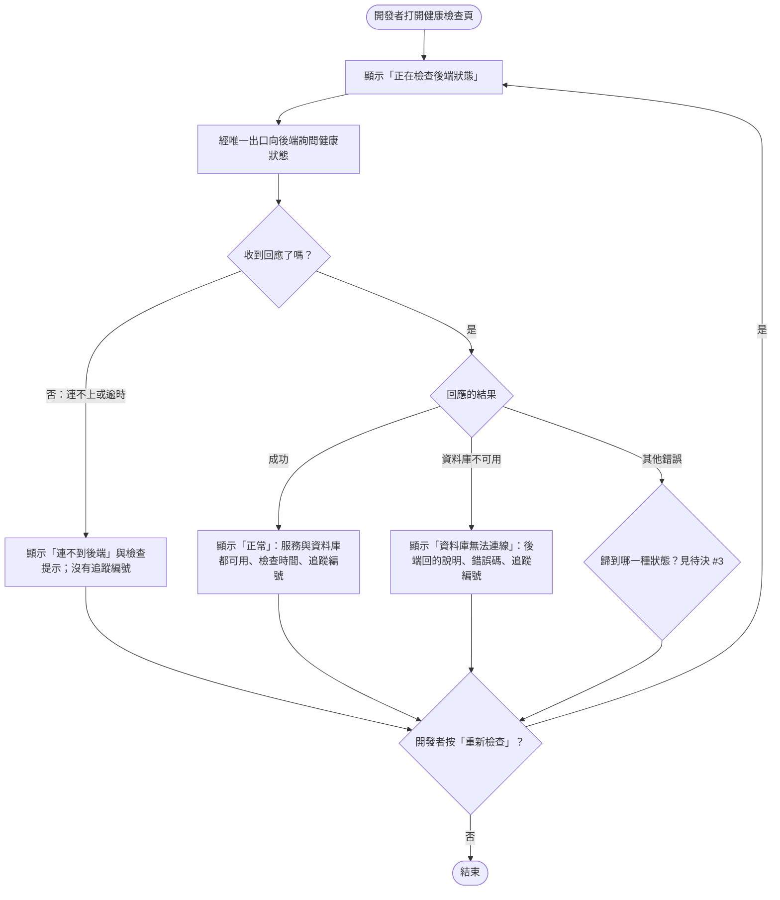
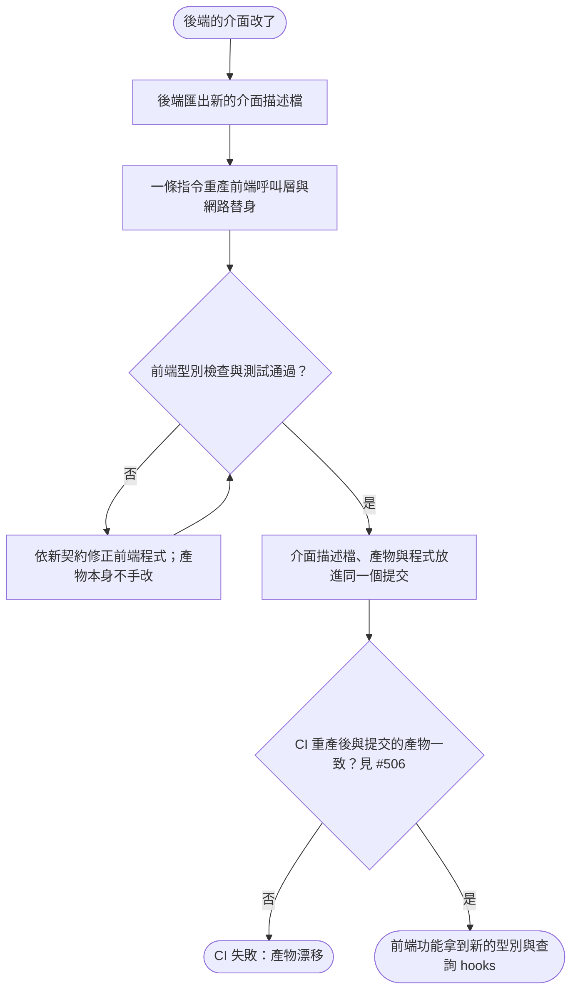
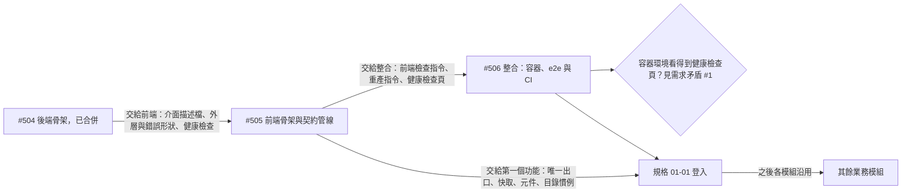

# System Analysis

本 change 是基礎建設 Epic #502 的第二個程式 change（#505 前端骨架與契約管線），**沒有 `docs/specs/` 規格可追溯**：spec-migration D4 已裁定 foundation 屬技術規範、不寫成規格書（`docs/development/workflow/spec-migration.mdx` §決議 D4）。依 `openspec/config.yaml` 的 `context`（維護者 2026-11-20 裁定，#503），需求改追溯到 ADR 與規則文件的條號。上游的後端骨架（#504）已合併並歸檔，它的主規格（`openspec/specs/` 的 `api-envelope`、`health-check` 等七份）與匯出的介面描述檔就是本 change 的輸入。

本文只寫「骨架要提供什麼能力、誰會用、跟誰相依、哪裡沒定」；做法（目錄、設定、資料形狀、元件寫法）留給 `system-design`、`ui-design` 與 `api-contract`。為了能對回條號，下文以業務語意稱呼幾個技術概念：

| 本文用語         | 對應的條文用語（只供對照）                                                                            |
| :--------------- | :---------------------------------------------------------------------------------------------------- |
| 介面描述檔       | 後端匯出的 `backend/openapi.json`（A4、A5）                                                           |
| 產生的呼叫層     | Orval 由介面描述檔產生的型別、查詢 hooks 與網路替身，放在 `frontend/src/api/generated/`（ADR-003 D6） |
| 唯一出口         | Orval 的 mutator，前端唯一的 HTTP 邊界（A6）                                                          |
| 伺服器資料快取   | TanStack Query 的 client（ADR-005 D1、A9）                                                            |
| 網路替身         | MSW（T6）                                                                                             |
| 元件原語         | shadcn/ui 元件，放在 `components/ui/`（ADR-005 D3）                                                   |
| 色值來源／對照層 | `design/prototype/assets/tokens.css`／`frontend/src/styles/` 的語意變數對照（ADR-005 D4、F6）         |
| 日期單一入口     | `src/lib/date.ts`，日期套件只在這裡使用（F10）                                                        |
| 統一回應外層     | envelope `{ success, code, message, data, timestamp, traceId }`（A1、A7）                             |
| 追蹤編號         | `traceId`／`X-Correlation-ID`，兩者同值（後端 clarification Q8）                                      |
| 語言偏好         | `Accept-Language`（A8）                                                                               |
| 健康檢查         | 後端的公開健康檢查，操作識別名 `getHealth`（主規格 `health-check`）                                   |
| 健康檢查頁       | 開發用頁面 `/dev/health`（#505 維護者留言）                                                           |
| 元件展示頁       | 開發用頁面 `/dev/gallery`（architecture.mdx §前端、ADR-005 D3）                                       |
| 分層檢查         | 把前端分層表寫成的 lint 規則（F1、F2）                                                                |

## 需求依據

需求依據順序：維護者指定的需求文件（#505、Epic #502、#503 的裁定、2026-11-20 核可的畫面 artifact）＞ `docs/specs/`（本次無對應規格頁，只引用 07-01 的兩條業務規則）＞ `docs/` 其他需求文件（ADR、規則文件、`architecture.mdx`）＞ `openspec/`。

| 來源                                                    | 章節／編號                                                                                                                 | 摘要（一句）                                                                                                                                                                          |
| :------------------------------------------------------ | :------------------------------------------------------------------------------------------------------------------------- | :------------------------------------------------------------------------------------------------------------------------------------------------------------------------------------ |
| Issue #505                                              | §使用情境／功能範圍「包含」十二項、「不包含」兩項；§需求目標；§驗收條件 五項；§畫面閘門                                    | 本次範圍與完成條件的唯一依據                                                                                                                                                          |
| Issue #505 維護者留言（2026-11-20）                     | 畫面 artifact 核可；`/dev/health` 四種狀態；`/dev/gallery` 的七個區塊；兩頁只在開發環境出現                                | 兩個新畫面的範圍；健康檢查頁的空狀態與無權限不適用                                                                                                                                    |
| 畫面 artifact（canvas 的「假設」1–4）                   | `Main.dc.html`（健康檢查頁四種狀態）、`Gallery.dc.html`（元件展示頁與完整性測試示意）                                      | 兩頁的畫面長相；正式建置不含這兩條路徑；完整性測試以「元件宣告的每個 variant 都要出現」為準                                                                                           |
| Epic #502                                               | §需求目標、§承接的延後條文                                                                                                 | 一條健康檢查請求走完整條契約鏈；`openspec/config.yaml` 要補前端的檢查指令；分層方向與產物漂移的檢查要有地方掛                                                                         |
| Issue #503                                              | 裁定 1–5                                                                                                                   | 統一回應外層六欄位、錯誤同外層、對外欄位小駝峰、不用 Storybook 改用元件展示頁、日期套件用 day.js 只在單一入口使用                                                                     |
| Issue #506                                              | §包含、§驗收條件                                                                                                           | 下游：容器編排、e2e、CI 的漂移／覆蓋率／分層檢查；驗收條件要求容器起來後健康檢查頁顯示成功（見需求矛盾 #1）                                                                           |
| `docs/specs/07-shared/01-sidebar.mdx`（已定案）         | §卡控機制「系統要向使用者顯示錯誤」；§邊界情況「從來沒設定過語言」；§規格 語言切換 第 5 條                                 | 錯誤只給看得懂的說明、不露內部資料（見需求矛盾 #4）；沒有語言設定時呈現繁體中文；日期時間依目前語言呈現                                                                               |
| `docs/development/workflow/spec-migration.mdx`          | §決議 D4                                                                                                                   | foundation 屬技術規範，不寫進 `docs/specs/`                                                                                                                                           |
| ADR-002                                                 | D6                                                                                                                         | 前端套件一律用 pnpm 管理（Hard Rule 3）；工作區與 lockfile 的位置沒有決定（見待決 #8）                                                                                                |
| ADR-003                                                 | D5（含 2026-11-20 決策紀錄）、D6                                                                                           | 統一回應外層與小駝峰；前端呼叫層只從介面描述檔產生、唯一出口集中橫切關注點、query key 只來自產物                                                                                      |
| ADR-004                                                 | D1 §後果、D3                                                                                                               | 請求要帶憑證；CSRF 的自訂標頭由唯一出口加（本次沒有認證，見 §範圍）                                                                                                                   |
| ADR-005                                                 | D1、D2、D3、D4、D5                                                                                                         | 單頁應用、七層目錄、元件原語放進專案並用元件展示頁取代 Storybook、色值只來自色值來源且深色由頁面屬性驅動、圖示只用 Lucide                                                             |
| ADR-007                                                 | D1、D2、D3                                                                                                                 | 三層測試；覆蓋率「不得下降」以第一次測得的值為基準；前端測試與原始碼同目錄                                                                                                            |
| `docs/development/rules/frontend-agent-rules.mdx`       | 前提、F1、F2、F3、F4、F6、F7、F8、F9、F10                                                                                  | 分層表與允許的 import、禁用 `any`、Hooks、狀態去處、對照層的三件事、圖示、四種畫面狀態、無障礙最低要求、日期單一入口                                                                  |
| `docs/development/rules/api-agent-rules.mdx`            | A4、A5、A6、A7、A8、A9                                                                                                     | 產物不得手改（含格式化）、一條命令重產、唯一出口的七件事、錯誤轉成單一型別與重試政策、語言偏好由唯一出口送出、query key 只來自產物                                                    |
| `docs/development/rules/security-agent-rules.mdx`       | S2                                                                                                                         | 前端不碰 token、請求帶憑證、允許來源逐一列出                                                                                                                                          |
| `docs/development/rules/testing-agent-rules.mdx`        | T1、T2、T3、T6、T9、T10、T11                                                                                               | 前端 unit／integration 的工具與位置、TDD、網路替身只放在網路邊界、自動 gate 的歸屬、覆蓋率排除產物、證據要求                                                                          |
| `docs/development/architecture.mdx`                     | §技術選型、§目錄結構（目標）、§API 契約、§i18n 兩層、§前端、§測試分層                                                      | 上述 ADR 的落地做法（實作與規劃查的細節）                                                                                                                                             |
| `AGENTS.md`                                             | Hard Rule 3、4、5、6、7、9；Required Behaviors（pre-commit 以 Prettier 格式化 staged 檔案）                                | 用 `pnpm add`；不改版號；不寫死任務邏輯；不外露答案；不用 `any`；輸入先驗證；提交時會自動格式化（見需求矛盾 #3）                                                                      |
| `openspec/config.yaml`                                  | `operations.apply.guidance`「前端的檢查指令等 frontend/ 骨架 change（#505）建好再補進這一節」；`rules.ui-design` 第 4 條   | #505 驗收條件最後一項要補前端檢查指令；`rules.ui-design` 把框架依據寫成 ADR-004（見需求矛盾 #5）                                                                                      |
| `openspec/specs/`                                       | `api-envelope`、`health-check`、`request-correlation`、`response-localization`、`api-schema-export`（#504 歸檔後的主規格） | 本 change 消費的契約：外層與錯誤碼、健康檢查的成功與 `DATABASE_UNAVAILABLE`、追蹤編號、語言偏好與 `406`、介面描述檔的匯出位置；本 change 不改這些 capability，只新增前端的 capability |
| `openspec/changes/archive/2026-11-20-backend-skeleton/` | `system-analysis.md` §會被後續依賴的、`clarification.md` Q2、Q3、Q4、Q7、Q8                                                | #504 交給 #505 的項目：外層與錯誤形狀、健康檢查回應形狀、`frontend/package.json` 初始版號沿用 `0.0.0`、成功碼 `OK` 與錯誤碼規則、`timestamp` 為 UTC 毫秒                              |
| `openspec/changes/`                                     | 只有 `frontend-skeleton` 進行中                                                                                            | 沒有其他進行中的 change 可衝突                                                                                                                                                        |

## 範圍

- 這次包含（依 #505 §包含，以能力描述）：
  - 一個用 pnpm 管理的前端專案，型別檢查最嚴格、禁用 `any`，lint 擋住下層引用上層與功能之間互相引用（ADR-002 D6、F1、F2、Hard Rule 3、7）
  - 七層目錄的空骨架，後續功能只要在功能層與頁面層底下新增（ADR-005 D2、#505 §需求目標）
  - 客戶端路由，掛上健康檢查頁與元件展示頁兩條開發用路徑（ADR-005 D1、#505 維護者留言）
  - 伺服器資料快取，認證錯誤（只認 `401`）不重試，其他錯誤也不自動重試（A7、A9；Q4）
  - 由介面描述檔產生的呼叫層，產物不手改；一條指令重產（A4、A5；指令只讀 `backend/openapi.json` 跑 Orval，Q8）
  - 唯一出口：拆統一回應外層、把錯誤轉成單一錯誤型別（帶狀態、錯誤碼、訊息、追蹤編號），並集中帶憑證、語言偏好、取消與逾時（A6、A7；逾時 15 秒，Q4；語言偏好與介面語言一致，Q5）
  - 網路替身，只給測試用，讓測試在不起後端時拿到各種回應；lint 擋產品碼 import，正式 bundle 不含（T6、Q6）
  - unit 與 integration 測試的工具與位置（T1、ADR-007 D3）
  - 元件原語與色值對照層：元件只用語意名稱，色值只來自色值來源（ADR-005 D3、D4、F6；對照層同時對應深色，Q13）
  - 日期單一入口：時間點以 UTC 傳輸、顯示依瀏覽者裝置時區（F10、#503 裁定 5）
  - 元件展示頁與它的完整性測試：元件宣告的 variant 少展示一個，測試就失敗；每個原語匯出 `as const` variant 陣列、於執行期比對（ADR-005 D3、#505 §驗收條件第 4 項、Q9）。標題列右側有「淺色／深色」切換，只改 `<html data-theme>`、預設淺色、不記住選擇，僅元件展示頁有（Q13，artifact 第 4 版，維護者 2026-11-20 核可）
  - 介面文字的語系層（Q5 新增需求）：react-i18next，zh-TW 與 en 兩份；語言依 `navigator.language` 判斷（`zh` 開頭用 zh-TW，其餘用 en）；畫面不加切換控制項；唯一出口送出的 `Accept-Language` 與介面語言一致；兩頁介面文字都走翻譯鍵、不寫死中文；測試以指定語言執行
  - 健康檢查頁，當端到端的證明：載入中／正常／資料庫無法連線／連不到後端四種狀態（Epic #502 §需求目標、#505 維護者留言）
  - 在 `openspec/config.yaml` 補上前端的檢查指令（#505 驗收條件第 5 項、Epic #502 §承接的延後條文）
- 這次不包含（依 #505 §不包含、Epic #502 與 #506）：
  - 登入、路由守衛、CSRF 標頭的實際內容、`401` 的換發與重送：規格 01-01 登入（A6 的 CSRF、A7 的 single-flight 屬那個 change）
  - 任何業務頁面、側欄與登入外框、語言與外觀切換（07-01）、標記 widget
  - 容器編排、`.env.example`、e2e、CI 的前端 job 與各項 gate（漂移比對、覆蓋率門檻、分層檢查在 CI 執行）：屬 #506
  - 修改 `design/prototype/`、`docs/specs/`、後端程式與介面描述檔
  - 語言切換控制項（留給 07-01 與之後的業務版面；Q5）、業務頁共用的錯誤元件（留給 01-01；Q11）

### 涉及的角色

本次沒有登入，也沒有業務角色；PRD §權限矩陣的角色都還碰不到任何能力。以下是會「用到」骨架的對象：

| 對象                                               | 能做的事                                                                          | 備註                                                             |
| :------------------------------------------------- | :-------------------------------------------------------------------------------- | :--------------------------------------------------------------- |
| 開發者（本機開發環境）                             | 開健康檢查頁確認前後端接得起來；開元件展示頁檢查每個元件的每個 variant 與色值對照 | 兩頁只在 Vite 開發模式註冊路由，正式建置剪除（Q1）               |
| 後續功能 change 的開發角色（`frontend-developer`） | 在功能層、頁面層新增程式，直接拿到產生的型別、查詢 hooks 與共用元件               | #505 §需求目標                                                   |
| 後端（#504 已完成）                                | 提供介面描述檔與健康檢查；後端改契約後，前端由一條指令重產                        | 介面描述檔的匯出指令已在 `openspec/config.yaml` 的後端檢查指令裡 |
| CI 與本機檢查（#506）                              | 執行前端的 lint、型別檢查、測試，比對產物漂移，量覆蓋率                           | 本次只提供可被呼叫的指令                                         |
| 維護者                                             | 已於 2026-11-20 核可兩頁的畫面 artifact                                           | Ready gate 已過；之後不再為畫面停下，除非畫面要偏離 artifact     |

權限矩陣：**不適用**。本次沒有受保護的能力，也沒有任何被遮蔽或唯讀的資料；健康檢查是刻意公開的端點（後端 clarification Q4），所有呼叫端拿到的內容相同。所以健康檢查頁的四種狀態不含「空」與「無權限」（#505 維護者留言），這是 F8「四種畫面狀態」在本頁的明文例外。

Hard Rule 5（任務設定驅動）與 Hard Rule 6（測試集答案不外露）：**本次不適用**。本次不碰任務、資料集或答案，網路替身的範例資料也不含任何答案（T6）。但兩件事會延續到後續：元件展示頁依 ADR-005 D3 之後要列出標記 widget，那時 widget 要依設定（output type）出現在展示頁，不得在展示頁或完整性測試寫死某一種任務；網路替身的範例資料由產生的呼叫層依介面描述檔產生，未來介面描述檔若含答案欄位會一起被產生，這要靠後端 S5 不把答案放進標記員可達的回應來守。clarification 第 9、10 面向可據此下結論。

## 業務流程

| 規格 | 業務流程                                                                                  | 本次涉及                                    |
| :--- | :---------------------------------------------------------------------------------------- | :------------------------------------------ |
| 無   | 不適用：本 change 沒有 `docs/specs/` 規格（spec-migration D4），需求依據是 ADR 與規則文件 | 下方三張圖依 #505、畫面 artifact 與條文整理 |

依 `sa` 的寫法，需求依據不是 `docs/specs/` 時要畫完整流程。一般情況還要在待決問題建議用 `spec-writing` 把流程補回規格書，但 spec-migration D4 已明定 foundation 不寫成規格書，所以**不提這項建議**，流程只留在本文件。

### 開發者打開健康檢查頁

- 依據：#505 維護者留言的四種狀態、artifact `Main.dc.html`、主規格 `health-check`（成功的回應內容、資料庫不可用的錯誤碼、連線等待上限）、A6（唯一出口）、A7（錯誤轉單一型別、帶追蹤編號）
- 「載入中」持續多久取決於重試與逾時（待決 #4、#5）：後端連資料庫最多等 5 秒、總耗時不超過 10 秒，前端若再重試數次，「資料庫無法連線」會晚很久才出現
- 「正常」顯示追蹤編號，而唯一出口要拆掉外層（見待決 #2）
- 「檢查時間」依瀏覽者裝置時區顯示，經日期單一入口（F10、07-01 §語言切換 第 5 條）

### 契約更新到前端可用

- 依據：A4（三份契約產物分工、產物不得手改含格式化）、A5（一條命令、同一個提交、CI 重產比對）、ADR-003 D6
- 「一條指令」是否包含後端匯出那一步，#505 與 #506 的說法不同（見待決 #10）；提交時 pre-commit 會格式化產物，與「不得格式化」衝突（見需求矛盾 #3）

### 與基礎建設其他 change 的串接

- #504 → #505 的交接項目以後端 `system-analysis.md` §會被後續依賴的 為準；#505 → 01-01 要補上的是 A6 的 CSRF 標頭、A7 的 `401` single-flight 換發與重送、登出時清空快取（A9）

## 跨模組依賴

### 需要先存在的

| 依賴                                          | 狀態                                          | 說明                                                                                                                   |
| :-------------------------------------------- | :-------------------------------------------- | :--------------------------------------------------------------------------------------------------------------------- |
| #503 的五項裁定寫回 ADR 與規則文件            | 已合併                                        | 外層六欄、錯誤同外層、小駝峰、元件展示頁、day.js 都以此為準                                                            |
| #504 後端骨架與介面描述檔                     | 已合併（PR #520）並歸檔                       | 產生呼叫層的唯一輸入；目前只有健康檢查一個操作，回應含 `200`、`404`、`405`、`406`、`500`、`503`                        |
| 後端的允許來源清單                            | 已存在，且是後端唯一的必要設定                | 開發時前端的來源要列在後端允許清單裡，或改走同源代理；採哪一種由 `system-design` 寫明，並交給 #506 寫進 `.env.example` |
| 色值來源 `design/prototype/assets/tokens.css` | 已存在，含 `html[data-theme="dark"]` 的深色值 | 對照層只引用、不複製；它在 `frontend/` 之外，前端建置與 #506 的容器建置都要拿得到它                                    |
| 2026-11-20 核可的畫面 artifact                | 已核可                                        | `ui-design` 以它為畫面基準；不改 `design/prototype/`                                                                   |
| 其他前置功能                                  | 無                                            | `frontend/` 不存在，本 change 從零建立                                                                                 |

### 會被後續依賴的

| 下游                          | 依賴本次的什麼                                                                                                                                                                                | 依據                                |
| :---------------------------- | :-------------------------------------------------------------------------------------------------------------------------------------------------------------------------------------------- | :---------------------------------- |
| #506 整合                     | 前端的 lint、型別檢查、測試、重產指令；覆蓋率報告的產出方式與第一次基準（待決 #13）；分層檢查規則（CI 執行它）；產物的位置（漂移比對與覆蓋率分母排除）；健康檢查頁（容器驗收，見需求矛盾 #1） | T9、T10、A5、#506 §驗收條件         |
| 規格 01-01 登入（第一個功能） | 唯一出口（插入 CSRF 標頭、`401` 換發與重送）；伺服器資料快取（認證錯誤不重試已就位、登出時清空）；路由（加上守衛與登入頁）；元件原語與展示頁                                                  | A6、A7、A9、S2、ADR-004 D3          |
| 07-01 共用介面                | 對照層的深色設定（外觀切換）；語系層（語言切換，見待決 #6）；錯誤顯示不露內部資料（見需求矛盾 #4）                                                                                            | ADR-005 D4、F6、A8、07-01 §卡控機制 |
| 之後所有前端模組              | 七層目錄與分層檢查、產生的型別與查詢 hooks、單一錯誤型別、日期單一入口、元件展示頁（新元件與標記 widget 要在展示頁出現，否則完整性測試失敗）                                                  | ADR-005 D2、D3、F1、F10、A6、A7     |

### 共用的資料

- **業務資料：無。** 本次不讀寫任何業務資料，資料表字典與 ER 不需要異動。
- **共用的契約：** 介面描述檔由後端擁有，前端只讀；本次不改它（A4）。
- **共用的設定檔：** `openspec/config.yaml` 的 `operations.apply.guidance` 會被本 change 改寫（補前端檢查指令），之後所有 change 的 apply 都依它跑檢查；根目錄的 Prettier 設定與 pre-commit 會開始作用在 `frontend/` 上（見需求矛盾 #3）。
- **版號：** `frontend/package.json` 的初始版號沿用 `0.0.0`（後端 clarification Q7），不由本 change 改動（Hard Rule 4）。

## 需求矛盾

維護者已於 2026-11-20 在 `clarification.md` 全部決議（Q1–Q19）、P1 已修正；下表保留原文，「處置」欄指向決議。

| #   | 矛盾                                                                                                                                                                                                                                                                                             | 來源                                                                                                                                             | 牽動     | 處置                      |
| :-- | :----------------------------------------------------------------------------------------------------------------------------------------------------------------------------------------------------------------------------------------------------------------------------------------------- | :----------------------------------------------------------------------------------------------------------------------------------------------- | :------- | :------------------------ |
| 1   | 健康檢查頁「只在開發環境出現、正式建置不含」，但 #506 的驗收條件要求「`docker compose up` 能起前後端，health check 頁顯示成功」；容器裡的前端是建置後的靜態檔由反向代理服務（architecture.mdx §部署與維運），依前者那一頁不存在                                                                  | #505 維護者留言；artifact 假設 1；#506 §驗收條件第 1 項；architecture.mdx §前端「元件展示頁…只在開發時開」                                       | 待決 #1  | 已解決（Q1）；見待決 #1   |
| 2   | 唯一出口「負責拆 envelope」，但核可的畫面在「正常」狀態顯示追蹤編號（成功外層的欄位）；拆掉外層後，成功時呼叫端拿不到追蹤編號與伺服器時間                                                                                                                                                        | #505 §包含「mutator…負責拆 envelope」；artifact `Main.dc.html` 狀態 2；A7「單一 error 型別帶 correlation id」只涵蓋錯誤                          | 待決 #2  | 已解決（Q2）；見待決 #2   |
| 3   | A4 禁止手改產物「含加檔與格式化」，A5 要 CI 重產比對；但 pre-commit 會用 Prettier 格式化所有 staged 檔案，`.prettierignore` 只排除了 `backend/openapi.json`，產物提交時就會被改寫，CI 重產後必然不一致                                                                                           | `api-agent-rules.mdx` §A4 禁止、§A5；`AGENTS.md` Required Behaviors；`.prettierignore`                                                           | 待決 #9  | 已解決（Q8）；見待決 #9   |
| 4   | 07-01 規定「系統要向使用者顯示錯誤時，只顯示使用者看得懂的說明，不出現系統內部的資料結構、路徑或原始錯誤內容」；核可的健康檢查頁顯示錯誤碼、追蹤編號、錯誤類型與前端設定名稱                                                                                                                     | `docs/specs/07-shared/01-sidebar.mdx` §卡控機制；artifact `Main.dc.html` 狀態 3、4                                                               | 待決 #12 | 已解決（Q11）；見待決 #12 |
| 5   | `openspec/config.yaml` 的 `rules.ui-design` 第 4 條寫「框架依 ADR-004 加 2026-11-10 裁定」；本 repo 的 ADR-004 是認證與安全，前端框架在 ADR-005（ADR-004 是個人 repo 的編號）                                                                                                                    | `openspec/config.yaml` `rules.ui-design`；`docs/development/adr/004-auth-and-security.mdx`；`docs/development/adr/005-frontend-architecture.mdx` | 待決 #16 | 已解決（P1）；見待決 #16  |
| 6   | 元件展示頁的 variant 與元件原語的預設不同（Button 多了 `cta`、尺寸 `md` 與 loading 狀態；Badge 改成 success／warning／error／info／neutral；Alert 有四種），需要改元件原語的原始碼；而 architecture.mdx §前端 與 ADR-005 D4 寫「shadcn 元件不改寫」，ADR-005 D3 又把「客製是改一個檔案」列為好處 | artifact `Gallery.dc.html`；architecture.mdx §前端 design token 列；ADR-005 D3 §後果、D4 §決定；F6 禁止「改寫 shadcn 元件去讀別的變數名」        | 待決 #11 | 已解決（Q9）；見待決 #11  |

## 待決問題

維護者已於 2026-11-20 在 `clarification.md` 決議 Q1–Q19、修正 P1；下表保留原問題，「狀態」欄寫決議與一句摘要，細節以 `clarification.md` §決議（Q）為準。SA-1…SA-16 全部已解決。

| #   | 問題                                                                                                                                                                                                                                                                                                                 | 影響                                                                                                                                                                               | 狀態                                                                                                                                                                                                    |
| :-- | :------------------------------------------------------------------------------------------------------------------------------------------------------------------------------------------------------------------------------------------------------------------------------------------------------------------- | :--------------------------------------------------------------------------------------------------------------------------------------------------------------------------------- | :------------------------------------------------------------------------------------------------------------------------------------------------------------------------------------------------------ |
| 1   | 健康檢查頁與元件展示頁要不要出現在正式建置裡？若不出現，#506「容器起來後健康檢查頁顯示成功」怎麼驗？（來源：#505 維護者留言、artifact 假設 1、#506 §驗收條件第 1 項；衝突點：見需求矛盾 #1）                                                                                                                         | `system-design` 的路由掛載方式（開發專用或以設定開關）；`ui-design` 的頁面範圍；#506 的驗收條件與 e2e 能不能經容器打到健康檢查頁；正式環境的根路徑會不會變成空白頁（連動 #15）     | 已決（Q1）：兩頁只在 Vite 開發模式註冊路由，正式建置剪除；#506 改以後端 `/api/v1/health` 驗證，或把 E2E 跑在開發伺服器上                                                                                |
| 2   | 唯一出口拆掉統一回應外層之後，成功時要不要把追蹤編號（與伺服器時間）一併交給呼叫端？若要，是放在回傳值、另一個欄位，還是改讀回應標頭？（來源：#505 §包含、artifact `Main.dc.html` 狀態 2、A6、A7；衝突點：見需求矛盾 #2）                                                                                            | 唯一出口的回傳形狀，也就是之後**每一個**產生的查詢 hook 的回傳型別；之後再改屬 A10 的破壞性變更；`ui-design` 的「正常」狀態欄位；`system-design` 與 `api-contract`（若決定讀標頭） | 已決（Q2）：`apiFetch` 回傳 `{data, meta:{traceId, timestamp}}`，`ApiError` 也帶 `timestamp`                                                                                                            |
| 3   | 健康檢查頁收到四種狀態以外的回應時歸哪一種？例如 `500`、`406`、路徑或方法設錯造成的 `404`／`405`、代理回了不是統一外層的內容。（來源：介面描述檔的健康檢查回應列表、artifact 假設 3、F8；衝突點：核可畫面只畫四種，介面描述檔另有四種錯誤狀態）                                                                      | `ui-design` 的狀態對應表；單一錯誤型別要不要區分「後端有回但不是外層」；健康檢查頁的測試格數；`acceptance.md` 的人工步驟                                                           | 已決（Q3）：所有錯誤外層走〔503〕錯誤版面（通用標題「後端回報錯誤」加錯誤碼與訊息）；非外層回應歸〔連不到後端〕，錯誤類型列直接顯示 `network` 或 `timeout`                                              |
| 4   | 除了「認證錯誤不重試」，其他錯誤（`5xx`、`503`、連不上）要不要重試、重試幾次？目前沒有認證，「認證錯誤」指 `401`、`403` 還是兩者？（來源：#505 §包含「auth 錯誤不重試」、A7「`403` 不重試」、主規格 `health-check`「總耗時不超過 10 秒」；衝突點：條文只定了不重試的部分，快取工具的預設會重試三次）                 | 伺服器資料快取的預設值（之後所有查詢沿用）；健康檢查頁從「載入中」到「資料庫無法連線」要等多久；測試要不要關掉重試                                                                 | 已決（Q4）：不自動重試；`isAuthError` 只認 401（403 留給 01-01）                                                                                                                                        |
| 5   | 唯一出口的請求逾時要設多久？（來源：A6「request timeout」、主規格 `health-check` 連線等待 5 秒、總耗時不超過 10 秒；衝突點：A6 要求有逾時但沒有給值，值若短於後端上限，資料庫不可用會被誤判成連不到後端）                                                                                                            | 唯一出口的設定；「資料庫無法連線」與「連不到後端」兩種狀態能不能正確區分；之後的長請求（匯出、評分查詢）是否要另設                                                                 | 已決（Q4）：請求逾時 15 秒（後端健康檢查最長 10 秒）                                                                                                                                                    |
| 6   | 骨架要不要建立介面文字的語系層（兩種語言、依模組分 namespace）？若不建，唯一出口送出的語言偏好取什麼值、兩頁的介面文字寫成什麼？（來源：architecture.mdx §i18n 兩層、A6、A8、07-01 §邊界情況「從來沒設定過語言 → 繁體中文」；衝突點：A6／A8 要求唯一出口送語言偏好，#505 §包含沒有列語系層）                         | 本次範圍是否多一塊語系能力與它的測試；後端回的說明（資料庫無法連線時）用哪種語言；07-01 語言切換 change 要不要回頭改骨架；`ui-design` 的文案寫法                                   | 已決（Q5）：本次建 react-i18next 語系層，zh-TW 與 en 兩份，依 `navigator.language`（`zh` 開頭用 zh-TW，其餘 en），不加切換控制項，`Accept-Language` 與介面語言一致                                      |
| 7   | 驗收條件「健康檢查頁在網路替身與真實後端下都顯示對應狀態」的「網路替身下」，是指測試裡用替身，還是開發時也能在瀏覽器切到替身模式？（來源：#505 §驗收條件第 3 項、T6；衝突點：兩種解讀的範圍不同）                                                                                                                    | 要不要多一個開發模式開關與它的設定；`ui-design` 是否要標示目前用的是替身；`acceptance.md` 的人工驗收步驟（不起後端能不能看到四種狀態）                                             | 已決（Q6）：MSW、faker 與 `*.msw.ts` 只給測試用，lint 擋產品碼 import，正式 bundle 不含                                                                                                                 |
| 8   | 前端是獨立的 pnpm 專案（自己的 lockfile），還是和根目錄組成工作區？`pnpm lint`、`pnpm typecheck`、`pnpm test` 從哪個目錄執行？（來源：根目錄 `package.json` 名為 `label-suite-workspace` 但沒有工作區設定、ADR-002 D6、`AGENTS.md` Required Behaviors「clone 後跑 `pnpm install`」；衝突點：沒有文件決定工作區結構） | `system-design` 的專案結構；`openspec/config.yaml` 要寫的檢查指令；`scripts/setup.sh` 與新手安裝步驟；#506 CI 的安裝與快取；Node 版本要求放在哪裡                                  | 已決（Q7）：用根目錄 pnpm workspace（新增 `pnpm-workspace.yaml`），`frontend/` 為套件，共用 lockfile 與根目錄 Prettier                                                                                  |
| 9   | 產生的呼叫層要不要排除在 Prettier 之外（比照 `backend/openapi.json`），還是讓產生器自己用 Prettier 輸出、確保提交時不再被改寫？（來源：A4、A5、`.prettierignore`、`AGENTS.md` Required Behaviors；衝突點：見需求矛盾 #3）                                                                                            | `.prettierignore` 或產生器設定；#506 的漂移比對能不能穩定通過；lint 是否也要排除產物                                                                                               | 已決（Q8）：`frontend/src/api/generated/` 進 `.prettierignore`；lint-staged 加 `ts,tsx`                                                                                                                 |
| 10  | 「一條命令」包不包含後端匯出介面描述檔那一步？#505 寫「由 `openapi.json` 產生」，A5 寫「一條命令走完後端匯出到 Orval」，#506 另有根目錄的「契約同步」指令，三者的分工是什麼？（來源：#505 §驗收條件第 2 項、A5、#506 §包含；衝突點：同一件事有三種說法）                                                             | 本次重產指令的範圍；`openspec/config.yaml` 的前端檢查指令；`tasks.md` 的「後端 API 有變動時重產」那一條怎麼寫；#506 的根目錄指令                                                   | 已決（Q8）：`pnpm api:generate` 只讀 `backend/openapi.json` 跑 Orval；匯出到產生的整條鏈由 #506 的根目錄指令串起                                                                                        |
| 11  | 元件展示頁要的 variant（Button 的 `cta` 與 loading、Badge 的五種語意、Alert 的四種）是否允許以修改元件原語原始碼的方式加入？`cta` 這類元件原語沒有的語意 token 走哪一條落點？（來源：artifact `Gallery.dc.html`、architecture.mdx §前端、ADR-005 D3、D4、F6 第 1 點；衝突點：見需求矛盾 #6）                         | `components/ui/` 的實作方式與日後合併上游修正的成本；完整性測試比對的「宣告的 variant」清單；`ui-design` 依 F6 第 1 點要逐一列出的 token 落點                                      | 已決（Q9）：允許修改 `components/ui/` 加 variant；對照層新增 `--cta`、`--success` 等語意變數；每個原語匯出 `as const` variant 陣列，完整性測試於執行期比對；`architecture.mdx` 該句另開 docs issue 改準 |
| 12  | 開發專用頁顯示錯誤碼、追蹤編號與設定名稱，是否視為 07-01「不出現系統內部資料」的例外（對象是開發者）？之後業務頁共用的錯誤顯示要露出到什麼程度（例如 A7「`5xx` 顯示通用錯誤並附 correlation id」）？（來源：07-01 §卡控機制、artifact 狀態 3、4、A7；衝突點：見需求矛盾 #4）                                         | `ui-design` 的錯誤呈現；本次要不要做一個之後業務頁共用的錯誤顯示元件，以及它預設露出哪些欄位；01-01 起的業務頁錯誤畫面                                                             | 已決（Q11）：兩頁是 07-01「不出現系統內部資料」的例外，照 artifact 顯示；本次不做業務頁共用錯誤元件，留給 01-01                                                                                         |
| 13  | 本次要不要產出前端覆蓋率報告並記下第一次的基準？（來源：T10 §例外「骨架期以第一次測得的基準為準」、ADR-007 D2、後端 clarification Q8 的先例；衝突點：門檻屬 #506，但基準要有人先量）                                                                                                                                 | `tasks.md` 要不要有覆蓋率設定（分母排除產物）；`acceptance.md` 要不要記數字；#506「不得下降」的起點                                                                                | 已決（Q12）：`vitest --coverage` 產報告、分母排除產物，數字記進 acceptance.md 當第一次基準；不設門檻、不擋 CI                                                                                           |
| 14  | 色值對照層本次要不要涵蓋深色？元件展示頁要不要能切換深色來驗證對照？（來源：ADR-005 D4「dark variant 吃 `html[data-theme="dark"]`」、F6 正例、frontend-agent-rules §前提 深色模式要做、07-01 §邊界情況「深色下重新整理不閃淺色」；衝突點：外觀切換在 07-01，不在 #505，但對照層的深色屬 D4 的決定）                  | 對照層的範圍與測試；元件展示頁要不要多一個切換；07-01 外觀切換 change 要不要回頭補對照層                                                                                           | 已決（Q13）：對照層同時對應深色；元件展示頁標題列右側加「淺色／深色」切換（只改 `<html data-theme>`、預設淺色、不記住選擇），健康檢查頁不加；artifact 第 4 版（2026-11-20）已確認                       |
| 15  | 根路徑與不存在的路徑要顯示什麼？骨架只有兩條開發用路徑。（來源：#505 §包含「路由」、artifact 假設 1–2；衝突點：沒有來源交代）                                                                                                                                                                                        | 路由的預設與「找不到頁面」處理；正式建置打開根路徑時看到什麼（連動 #1）；01-01 登入接手時要不要改                                                                                  | 已決（Q14）：開發模式下 `/` 與未知路徑導向 `/dev/health`；正式建置只有空殼，首頁與找不到頁面由 01-01 設計                                                                                               |
| 16  | `openspec/config.yaml` 的 `rules.ui-design` 第 4 條把前端框架的依據寫成 ADR-004，應改為 ADR-005 嗎？本 change 本來就要改 `config.yaml`，是否順手修正？（來源：`openspec/config.yaml` `rules.ui-design`；衝突點：見需求矛盾 #5）                                                                                      | `ui-design.md` 的條號追溯；本 change 對 `config.yaml` 的修改範圍（`tasks.md` 多一項）                                                                                              | 已修正（clarification P1）：apply 時把 `config.yaml` 的 ADR-004 改成 ADR-005                                                                                                                            |

## 參考檔案

- Issue #505（含維護者 2026-11-20 留言）、Epic #502、#503、#504、#506
- 畫面 artifact：`Main.dc.html`、`Gallery.dc.html`、`canvas.json`（https://claude.ai/artifact/BA87odDCTUkTT6FWoRteUV）
- `openspec/config.yaml`
- `openspec/specs/api-envelope/spec.md`、`openspec/specs/health-check/spec.md`、`openspec/specs/request-correlation/spec.md`、`openspec/specs/response-localization/spec.md`、`openspec/specs/api-schema-export/spec.md`
- `openspec/changes/archive/2026-11-20-backend-skeleton/system-analysis.md`、`clarification.md`
- `backend/openapi.json`
- `docs/development/architecture.mdx`
- `docs/development/adr/002-development-workflow.mdx`、`003-backend-architecture.mdx`、`004-auth-and-security.mdx`、`005-frontend-architecture.mdx`、`007-testing-strategy.mdx`
- `docs/development/rules/frontend-agent-rules.mdx`、`api-agent-rules.mdx`、`security-agent-rules.mdx`、`testing-agent-rules.mdx`
- `docs/development/workflow/spec-migration.mdx`
- `docs/specs/07-shared/01-sidebar.mdx`
- `design/prototype/assets/tokens.css`（只讀）
- `AGENTS.md`、根目錄 `package.json`、`.prettierignore`
