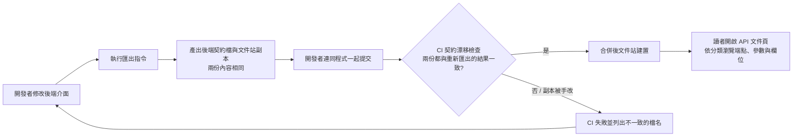

# System Analysis

## 需求依據

本 change 是技術 change，`docs/specs/` 沒有對應的業務規格可追溯（`docs/specs/index.mdx` 與 `00-prd.mdx` 都不涉及文件站如何呈現 API 契約），依 `openspec/config.yaml` context（維護者 2026-11-20 裁定，#503）改追溯到 issue 裁定、ADR 與規則文件。

| 來源                                                | 章節／編號                                                                                                                                    | 摘要（一句）                                                                                                                                                  |
| :-------------------------------------------------- | :-------------------------------------------------------------------------------------------------------------------------------------------- | :------------------------------------------------------------------------------------------------------------------------------------------------------------ |
| Issue #572                                          | §維護者裁定（2026-11-23）、§驗收條件                                                                                                          | 匯出指令一次寫兩處、兩份都進版控且內容完全相同；漂移檢查一起比對；安裝 `openapi-renderer` 對應 `**/*.openapi.json`；`architecture.mdx` §API 契約 加一句與連結 |
| Issue #572                                          | §不在範圍                                                                                                                                     | #547 把常駐文件改連到 API 頁的 operation，等本 change 合併後處理                                                                                              |
| `docs/development/rules/api-agent-rules.mdx`        | A4 三份契約產物的分工                                                                                                                         | 契約有三份產物（`api-contract.md`、匯出的 `openapi.json`、前端產物），都不得手改；本 change 多出第四份（文件站副本）                                          |
| `docs/development/rules/api-agent-rules.mdx`        | A5 重產與 drift 檢查                                                                                                                          | CI 重新匯出後與已提交版本比對，有差異（含未追蹤）即失敗；檢查方式目前只寫了 `backend/openapi.json` 與前端產物                                                 |
| `docs/development/adr/003-backend-architecture.mdx` | D6（Orval）、D9（Bruno 只當可選工具）                                                                                                         | 唯一的契約真相是 `api-contract.md` 加匯出的 `openapi.json`；前端產物只能從 `openapi.json` 來，不能手寫第二份                                                  |
| `docs/development/architecture.mdx`                 | §API 契約                                                                                                                                     | 契約真相與面向表；本次要在表加一句副本與用途，並連到文件站 API 頁                                                                                             |
| `docs/development/workflow/spec-migration.mdx`      | §PR 的變更範圍（`plugins.json` 算文件 PR；`.notecraft/plugins/<id>/` 不算、另開相依套件 PR 先合併；`plugins.json` 每處改動要在 PR body 列出） | 外掛本體與 `plugins.json` 的 PR 歸類與合併順序有既有判例（#245、#246）                                                                                        |
| `docs/development/notecraft/notecraft-writing.md`   | §PluginView 與系列                                                                                                                            | 資料檔以嵌入元件放進頁面；既有用法只有 ER 圖                                                                                                                  |
| `openspec/specs/api-schema-export`                  | Requirement「匯出指令不需環境變數與資料庫並產出穩定的檔案」                                                                                   | 現行契約是「預設寫到 `backend/openapi.json`」，輸出鍵名排序、縮排 2、換行結尾、重複匯出位元組相同                                                             |
| `openspec/specs/ci-quality-gates`                   | Requirement「契約產物不同步時 CI 失敗」                                                                                                       | 現行只涵蓋 `backend/openapi.json` 與前端呼叫層，來源是 A5 與 #506                                                                                             |
| `openspec/specs/frontend-api-codegen`               | Requirement「產物進版控且不同步時檢查失敗」                                                                                                   | 前端產物的同步檢查；本次不改，但同一個 CI job 內運作                                                                                                          |

## 範圍

- 這次包含：
  - 安裝 NoteCraft 外掛 `openapi-renderer`，並在外掛對應設定中加入「`**/*.openapi.json` 交給它渲染」。
  - 匯出指令預設同時產出兩處相同內容的介面描述檔：既有的後端那份，與文件站用的副本（兩份都進版控）；並以測試確認兩份位元組相同。
  - 契約漂移檢查把副本納入：副本與後端那份不一致、或與重新匯出的結果不一致時 CI 失敗，不允許手改副本。
  - 文件站出現一頁可瀏覽的 API 文件頁，內容永遠等於匯出的契約。
  - `architecture.mdx` §API 契約 的表加一句說明副本與用途，並連到 API 頁。
  - 本機建置後 API 頁正常顯示、CI 四個 job 通過。
- 這次不包含：
  - #547 把常駐文件改連到 API 頁的 operation。
  - 變更任何端點、欄位或契約內容本身（本次只改「契約如何被呈現與檢查」）。
  - 變更前端產生 client 的來源（仍只由後端那份產生）。
  - 變更 `docs/specs/` 的業務需求、`00-prd.mdx`、`design/prototype/`。

## 業務流程

不適用：`docs/specs/` 沒有對應規格，也就沒有規格書的「業務流程」章節；本 change 不是使用者的業務流程，而是維護者與 CI 的契約維護流程。下面是這條維護流程的概觀（需求依據不是 `docs/specs/`，依規則在此畫出；建議補回規格書的待決問題見 #9）。

## 跨模組依賴

- 需要先存在的功能
  - #506 的契約漂移檢查（已合併）：本次擴充它的比對對象。
  - #51 的匯出指令與固定的「動詞加資源」操作識別名（主規格 `api-schema-export`）：本次擴充它的輸出位置。
  - NoteCraft 站台與其外掛機制：既有 `er-diagram-renderer` 的對應已在外掛設定，是本次的先例。
- 會被後續功能依賴的部分
  - #547 要連到 API 頁的各 operation，依賴 API 頁的路徑與 operation 的定位方式穩定。
  - 前端產生 client 仍只讀後端那份；副本不得成為第二個輸入來源（ADR-003 D6：不能手寫第二份）。
- 共用的資料
  - 副本與後端契約檔內容完全相同，同一份來源、同一次匯出。
- 會被牽動的既有主規格（由 planner 寫 delta）
  - `api-schema-export`：「預設寫到後端那份」要改為同時寫兩處。
  - `ci-quality-gates`：「契約產物不同步時 CI 失敗」要納入副本。
- 會被牽動的規則與常駐文件
  - `api-agent-rules` A4（三份產物）與 A5（檢查方式只列後端那份）、ADR-003 D6／D9 的敘述，與「副本」這第四份產物的關係未寫；`architecture.mdx` §API 契約 本次明定要改。
- 與其他程序的交界
  - 格式化檢查：後端那份已被排除在格式化之外，因為匯出指令自己擁有格式；副本放在 `docs/` 底下，若沒有同樣處理，格式化會改寫它造成與後端那份不一致（見待決問題 5）。
  - PR 範圍分類：外掛本體與外掛設定的 PR 歸類、合併順序有既有規則（見待決問題 1）。
- 無資料表、無新端點、無新權限、無角色差異；介面描述檔只含契約結構，不含資料。

## 需求矛盾

1. （已由 clarification.md §檢查範圍 sa-1 解決：依 spec-migration 拆兩張 PR，外掛本體加 `NOTICE` 先合併）本 issue 把「安裝外掛、改外掛設定、改匯出指令與測試、改 CI、改文件」放在同一張 issue，但 `spec-migration.mdx` §PR 的變更範圍 規定 `.notecraft/plugins/<id>/` 不算文件 PR、要另開相依套件 PR 先合併，且同一 PR 不宜跨類（七類的差別是目的）。issue 的一次完成與該規則的拆分順序不一致，即待決問題 1。
2. （已由 clarification.md Q2 解決）`api-agent-rules` A5 的檢查方式與現行主規格只提 `backend/openapi.json`；A5 的檢查方式納入副本，由本 change 的 spec delta 與連帶文件修正處理。
3. （已由 clarification.md Q2 解決）副本的定位：A4 補一句「副本是 `openapi.json` 的位元組相同複本，不是第四份契約來源，同樣不得手改」，ADR-003 不動。

## 待決問題

| #   | 問題                                                                                                                                                                                                                                                                                                                                                                                                        | 影響                                                                                                                                      | 狀態                                                                                                                                        |
| :-- | :---------------------------------------------------------------------------------------------------------------------------------------------------------------------------------------------------------------------------------------------------------------------------------------------------------------------------------------------------------------------------------------------------------- | :---------------------------------------------------------------------------------------------------------------------------------------- | :------------------------------------------------------------------------------------------------------------------------------------------ |
| 1   | 本 change 一張 PR 做完，還是依 `spec-migration.mdx` §PR 的變更範圍 拆成「相依套件 PR（外掛本體，先合併）」加「其餘」？外掛本體在 `.notecraft/plugins/openapi-renderer/`，規則寫它不算文件 PR、須先合併、並要連帶交代授權（`NOTICE`）；外掛設定檔的每一處改動也要在 PR body 列出（來源：`docs/development/workflow/spec-migration.mdx` §PR 的變更範圍；issue #572 §驗收條件 1）                              | 決定 tasks.md 的分組與 PR 數、合併順序（順序反過來會讓設定指向沒裝的外掛而建置失敗）、`NOTICE` 是否納入；牽動 proposal、tasks             | 已決議：拆兩張 PR，外掛本體加 `NOTICE` 為相依套件 PR 先合併，其餘為程式 PR（clarification.md §檢查範圍 sa-1）                               |
| 2   | 「文件站的 API 頁」是由哪一頁承載？外掛只把符合樣式的資料檔交給渲染器，既有用法是在某個頁面以嵌入元件引用資料檔；是否需要新增一個 `docs/` 頁面來嵌入副本、頁面放哪裡、標題與在導覽或系列的位置、`architecture.mdx` 要連到哪個路徑（來源：issue #572 §驗收條件 4、5；`docs/development/notecraft/notecraft-writing.md` §PluginView 與系列；既有先例 `docs/diagrams/architecture/data-table-dictionary.mdx`） | 決定 ui-design 的頁面範圍（有無新頁、位置）、`architecture.mdx` 的連結目標、#547 之後要連到的錨點；牽動 ui-design、tasks                  | 已決議：不新增 mdx 頁，API 頁路徑為 `/view/diagrams/architecture/api.openapi`，`architecture.mdx` 連到它（clarification.md §檢查範圍 sa-2） |
| 3   | 匯出指令的行為：不帶參數時寫兩處；帶指定輸出路徑時（既有測試與可能的本機用法）是只寫指定處、還是仍同時寫副本？兩處寫入一處失敗時的處理（現行是整份渲染完才開檔，失敗不留殘檔）要不要延伸為兩處都不留半成品（來源：`openspec/specs/api-schema-export` Requirement「匯出指令不需環境變數與資料庫並產出穩定的檔案」；issue #572 §維護者裁定）                                                                  | 改變主規格 `api-schema-export` 的 delta 內容與 Scenario、既有測試如何改；牽動 system-design、api-contract（命令列介面描述）、specs、tasks | 已決議：不帶參數寫兩處，帶 `--output` 只寫該處；兩處先寫暫存檔、全部成功才替換，失敗不留半成品（clarification.md Q1）                       |
| 4   | 副本在規則文件中的定位：A4「三份契約產物」是否改為四份、或明定副本只是後端那份的呈現複本不是契約來源；A5 的檢查方式與 ADR-003 D6／D9 的敘述要不要一併更新。issue 只要求 `architecture.mdx` 加一句，未提規則文件與 ADR（來源：`docs/development/rules/api-agent-rules.mdx` A4、A5；`docs/development/adr/003-backend-architecture.mdx` D6、D9；issue #572 §驗收條件 4）                                      | 決定本 change 連帶修改的文件範圍（只改 `architecture.mdx`，還是連帶 A4／A5／ADR）；影響 design.md 的連帶文件清單與 PR 範圍歸類            | 已決議：A4 補一句副本是位元組相同複本而非第四份來源，A5 檢查方式納入副本，ADR-003 不動（clarification.md Q2）                               |
| 5   | 副本放在 `docs/` 底下，格式化檢查會不會改寫它、使副本與後端那份不再位元組相同？後端那份已被排除在格式化外（來源：`.prettierignore` 對 `backend/openapi.json` 的說明；issue #572 §驗收條件 2、5「CI 四個 job」）。另外，文件站的規格檢查與建置會不會掃到這個資料檔而失敗，也需實測確認                                                                                                                       | 若不排除，CI 的格式 job 會失敗或副本被改寫、漂移檢查隨之失敗；影響 tasks 是否要含設定檔異動，且該檔屬哪一類 PR                            | 已收斂：`.prettierignore` 已整份排除 `docs/`，不需另加；規格檢查與建置於實作時實測（clarification.md §檢查範圍 sa-5）                       |
| 6   | 漂移檢查的比對口徑：是「重新匯出後，兩份各自與已提交版本比對」，還是另外加「兩份彼此相同」的檢查；錯誤訊息是否要分別列出兩個檔名並提示同一個修復指令（來源：`openspec/specs/ci-quality-gates` Requirement「契約產物不同步時 CI 失敗」；issue #572 §驗收條件 3）                                                                                                                                             | 決定 ci-quality-gates delta 的 Scenario 與 CI job 的步驟；牽動 specs、tasks                                                               | 已收斂：重新匯出後兩個路徑一起做差異與未追蹤檢查，訊息列出落後檔名，不另加 `cmp`（clarification.md §檢查範圍 sa-6）                         |
| 7   | 外掛版本與相容性：issue 指名 `openapi-renderer` v1.0.0，本專案目前的 NoteCraft 版本是否支援它；外掛本體進版控時固定的版本與授權交代方式，以及是否需要讀者可見的瀏覽範圍限制（來源：issue #572 §使用情境；`spec-migration.mdx` §PR 的變更範圍 對外掛授權的判例）                                                                                                                                             | 若不相容，需要先升級 NoteCraft（另一張相依套件 PR），改變本 change 的前置條件與排程                                                       | 已收斂：官方 store 在 `notecraftapp@1.15.0` 提供 v1.0.0，授權交代進 `NOTICE`（clarification.md §檢查範圍 sa-7）                             |
| 8   | 文件站公開的內容界線：API 頁會完整呈現所有端點與欄位，包含限定角色才能用的端點。需確認文件站的讀者範圍可接受這份契約結構外露，且契約中沒有任何欄位或範例值含測試集答案（Hard Rule 6）；副本只含結構與範例，不含資料（來源：`AGENTS.md` Hard Rule 6；`docs/diagrams/architecture/endpoint-authorization.mdx` 已有同類內容；issue #572 §需求目標）                                                            | 若需限制，要決定該頁是否納入公開建置、範例值是否要限制；牽動 ui-design 與 proposal 的風險說明                                             | 已收斂：不新增外露，後端那份本來就公開且副本相同（clarification.md §檢查範圍 sa-8）                                                         |
| 9   | 本維護流程（匯出、同步、檢查、呈現）沒有 `docs/specs/` 規格書可引用業務流程，上方概觀圖是臨時補的；是否需要補回文件（例如 `architecture.mdx` 的流程描述）還是維持純技術 change、不補規格（來源：`openspec/config.yaml` context；`docs/development/workflow/spec-migration.mdx` D4）                                                                                                                         | 僅影響本文件的流程圖是否需要在後續被取代；不阻擋其他產出                                                                                  | 已收斂：不補規格，維持純技術 change（clarification.md §檢查範圍 sa-9）                                                                      |
| 10  | 後端那份與副本內容相同，但如果只有前端產物與後端那份被要求重產，開發者忘了重產副本會導致 CI 失敗；本機的一條命令（現行是同步匯出加前端產生）是否維持不變、讓匯出指令預設就寫兩處即可（來源：根目錄 `package.json` 的 `api:sync`；`api-agent-rules` A5 的本機做法；issue #572 §維護者裁定）                                                                                                                  | 若維持不變則不需改指令；若要拆開則牽動 tasks 與 A5 的文字                                                                                 | 已收斂：`api:sync` 與 CI 匯出指令維持原樣（clarification.md §檢查範圍 sa-10）                                                               |
