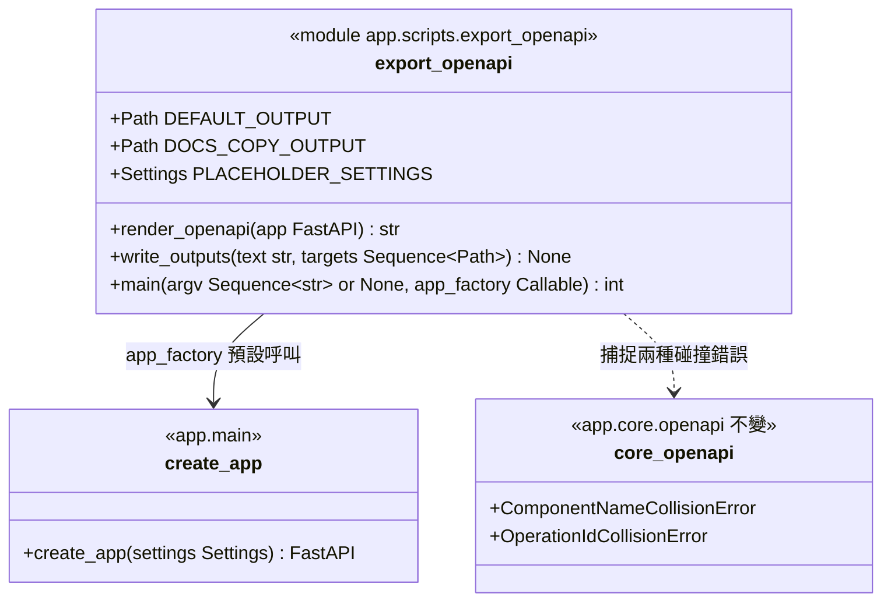
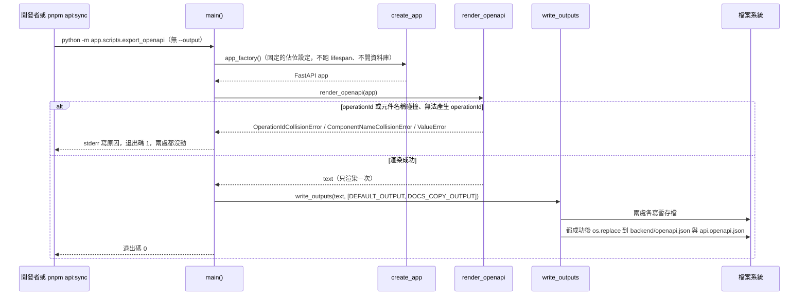
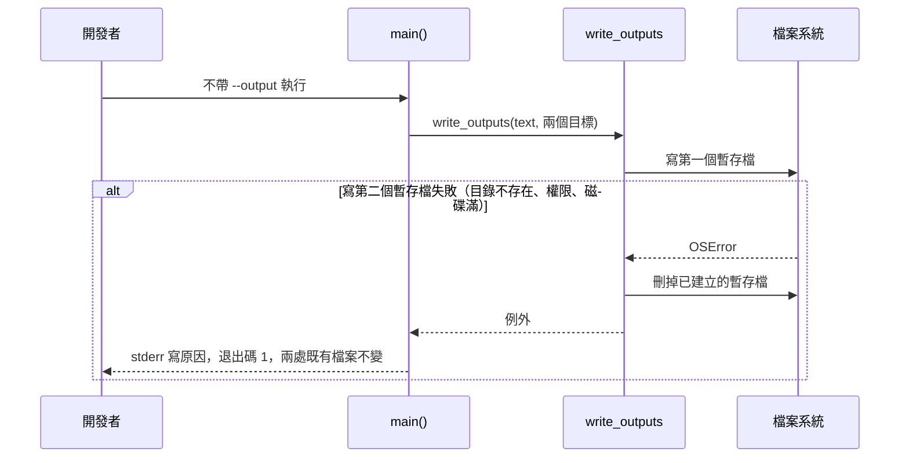
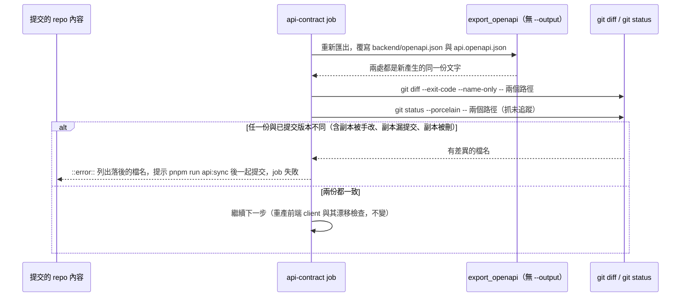

# System Design

本 change 是技術 change：沒有端點、資料表、權限或業務模組，只改「契約如何被匯出、呈現與檢查」。因此沒有 Router、Service、Repository、Model；被修改的是命令列工具 `app/scripts/export_openapi.py`（不是端點，見 `backend-modules.mdx` §目錄 對 `app/scripts/` 的定義）與 CI 的契約漂移檢查。下方「分層與類別」畫的是該腳本的函式與常數，沒有 HTTP、沒有資料庫 session。

待決問題已由 clarification 決議（Q1，2026-11-24）：`--output` 的行為與兩處寫入的失敗處理，以及漂移檢查口徑（sa-6），下文照決議寫。

## 分層與類別

不適用 Router → Service → Repository／Model：匯出指令不經 HTTP、不開資料庫（lifespan 不跑），沒有交易與 session。它依賴既有的 `create_app`（組出 app）與 `app/core/openapi.py` 的後處理，這兩者本次不改。

| 項目                 | 狀態       | 說明                                                                                                                                                                                                                                       |
| :------------------- | :--------- | :----------------------------------------------------------------------------------------------------------------------------------------------------------------------------------------------------------------------------------------- |
| `DEFAULT_OUTPUT`     | 不變       | `backend/openapi.json`，與工作目錄無關                                                                                                                                                                                                     |
| `DOCS_COPY_OUTPUT`   | 新增       | `<repo root>/docs/diagrams/architecture/api.openapi.json`；由 `Path(__file__).resolve().parents[3]` 推得，與 `DEFAULT_OUTPUT` 同樣不看工作目錄。檔名 `api.openapi.json` 符合 `**/*.openapi.json`（issue #572 §驗收條件 1）                 |
| `render_openapi`     | 不變       | 仍是唯一產生文字的地方；兩處寫同一個字串，位元組相同由「只渲染一次」保證，不是事後比對                                                                                                                                                     |
| `write_outputs`      | 新增       | 兩處都先寫成同目錄暫存檔、全部成功後才 `os.replace` 到目標，任一步失敗就刪掉暫存檔，使既有檔案不動、不留半成品、退出碼 1。現行單檔寫法只保證「渲染失敗不留殘檔」，不保證「寫第二個檔失敗時第一個檔已被覆寫」，所以兩處寫入需要這一層（Q1） |
| `main` 的 `--output` | 決議（Q1） | 不帶 `--output` 寫兩處；帶 `--output PATH` 只寫該處、不寫副本。理由：`test_export_openapi.py` 全部用 `--output <tmp_path>` 並斷言 tmp 目錄只出現該檔，帶 `--output` 仍寫副本會讓測試改到 repo 內的真檔案                                   |

不改的部分：`create_app`、`PLACEHOLDER_SETTINGS`、`app/core/openapi.py`、退出碼（失敗 `1`、原因寫 stderr）、輸出格式（排序 key、縮排 2、`ensure_ascii=False`、結尾換行）。

## 關鍵情境

Scenario 名稱在 specs 寫成前先用 issue #572 驗收條件與 `api-schema-export`、`ci-quality-gates` 主規格的語彙暫名；planner 寫 spec delta 時以其 Scenario 名稱為準，並回頭對齊本節標題。

### Scenario: 匯出指令預設同時寫出兩份內容相同的契約

### Scenario: 匯出途中寫入失敗時兩處都不留半成品

依 clarification Q1：寫入失敗時兩處既有檔案都不變、不留暫存檔。

### Scenario: 契約副本與後端契約不一致時 CI 失敗

CI 的 `api-contract` job 已有「重新匯出，再用 `git diff` 與未追蹤檢查比對已提交版本」的做法（`.github/workflows/ci.yml` 的 `Export the OpenAPI document` 與 `Check backend/openapi.json is up to date` 兩步）。本次只擴大比對的路徑，不新增 job：

設計重點：

- 重新匯出會覆寫兩處，所以「副本被手改」在匯出後必然表現為與已提交版本不同，`git diff` 就能抓到；兩份彼此相同由「同一個字串寫兩處」保證，不另加 `cmp`，錯誤訊息列出落後的檔名並提示 `pnpm run api:sync`（sa-6）。
- 前端 client 的產生（`pnpm --filter frontend api:generate`）仍只讀 `backend/openapi.json`，副本不得成為第二個輸入來源（ADR-003 D6）。

## 常駐文件異動

- 常駐文件：`docs/diagrams/architecture/backend-modules.mdx`

| 節                                            | 異動     | 摘要                                                                                                                                                                                                                                         |
| :-------------------------------------------- | :------- | :------------------------------------------------------------------------------------------------------------------------------------------------------------------------------------------------------------------------------------------- |
| 後端基礎建設 §目錄                            | 修改     | `scripts/export_openapi.py` 那行註明「不帶 --output 時同時寫文件站副本」                                                                                                                                                                     |
| 後端基礎建設 §OpenAPI 匯出與 operationId 檢查 | 新增一列 | 「文件站副本」：不帶 `--output` 時同一份文字也寫到 `docs/diagrams/architecture/api.openapi.json`、兩份位元組相同且都提交、副本不是第二個契約來源；帶 `--output PATH` 只寫該處；兩處寫入先寫暫存檔再 `os.replace`，失敗不動既有檔案、退出碼 1 |

沒有新業務模組，所以沒有新增的模組一節、也沒有 Class／Sequence 圖需要放進常駐文件。

## 資料模型異動

本次無資料模型異動：沒有資料表、欄位、索引，沒有 Alembic migration（也就沒有可逆性與 SQLite／PostgreSQL 差異的問題），字典與 ER 不動、不需跑 `pnpm check:er`。匯出指令不開資料庫，所以 API 的 async session 與 worker 的 sync session 分離原則也不涉及。

## 權限檢查點

- 沒有新端點、沒有新權限、沒有角色差異；`docs/specs/00-prd.mdx` §權限矩陣 不受影響。匯出與 CI 是維護者與 CI 的流程，不經應用程式的授權。
- 測試集答案不外露（Hard Rule 6）：副本與 `backend/openapi.json` 同一份文字，只含端點、參數與欄位的結構與範例，不含資料。匯出時 app 以佔位設定組成、不連資料庫，不可能帶出測試集內容；`backend/openapi.json` 本來就在公開 repo、`/openapi.json` 預設開啟，副本沒有新增外露（sa-8，clarification 結論）。
- 其餘結論（clarification）：
  - 交易邊界與 session：不適用（不開資料庫）。
  - 效能：匯出一次渲染、寫兩個檔，負擔與現行相同等級。
  - sa-1 PR 拆兩張、sa-4 規則文件定位、sa-7 外掛相容性不影響本設計的類別與流程。
  - sa-2：API 頁是 `/view/diagrams/architecture/api.openapi`，不新增 mdx 頁。
  - sa-5：`.prettierignore` 已整份排除 `docs/`，Prettier 不會改寫副本；文件站規格檢查與建置是否掃到資料檔，實作時以 `pnpm check:specs` 與本機 build 實測。
  - sa-10：不帶參數的匯出就寫兩處，`api:sync` 與 CI 的匯出指令不改，漂移檢查只擴大比對路徑。

## 待決問題

無。
