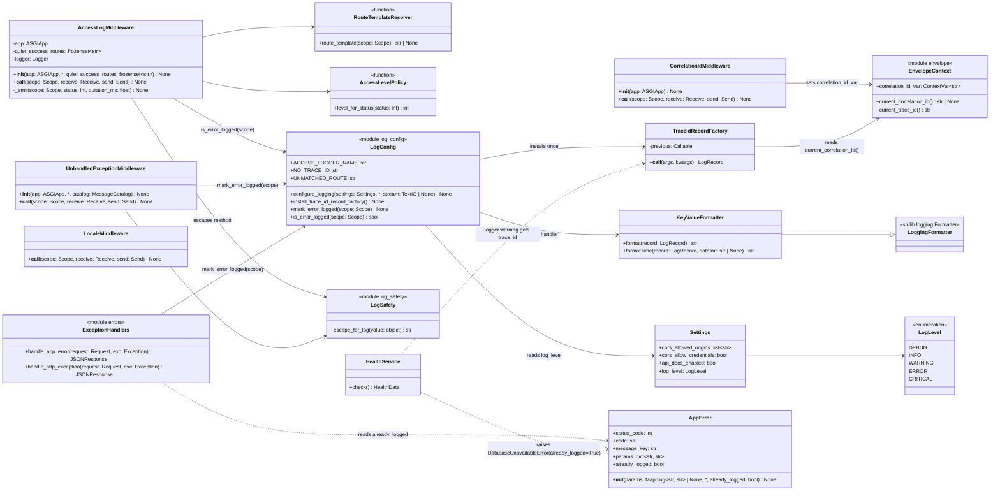
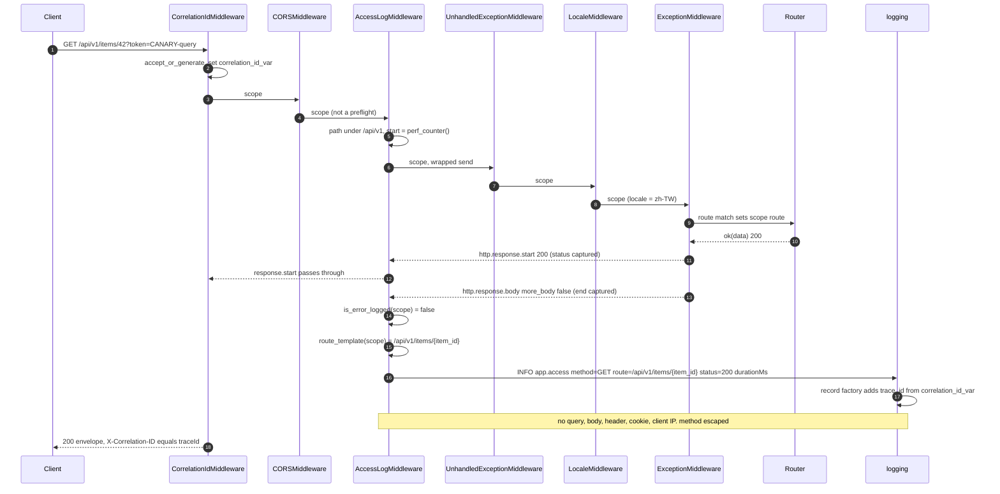
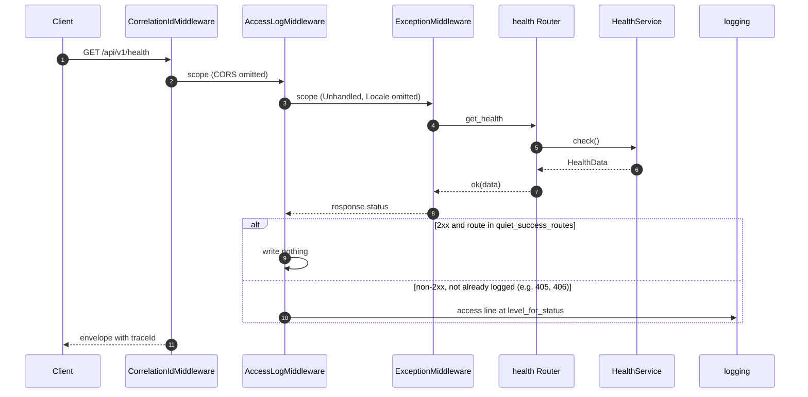
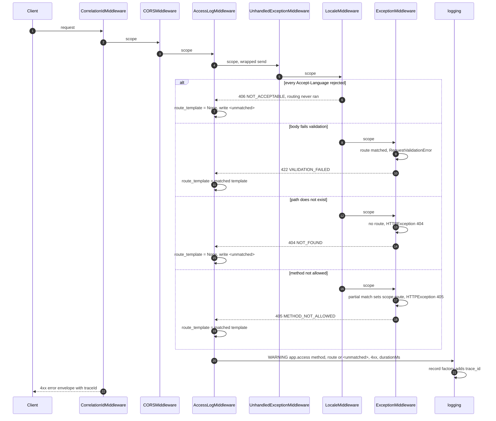
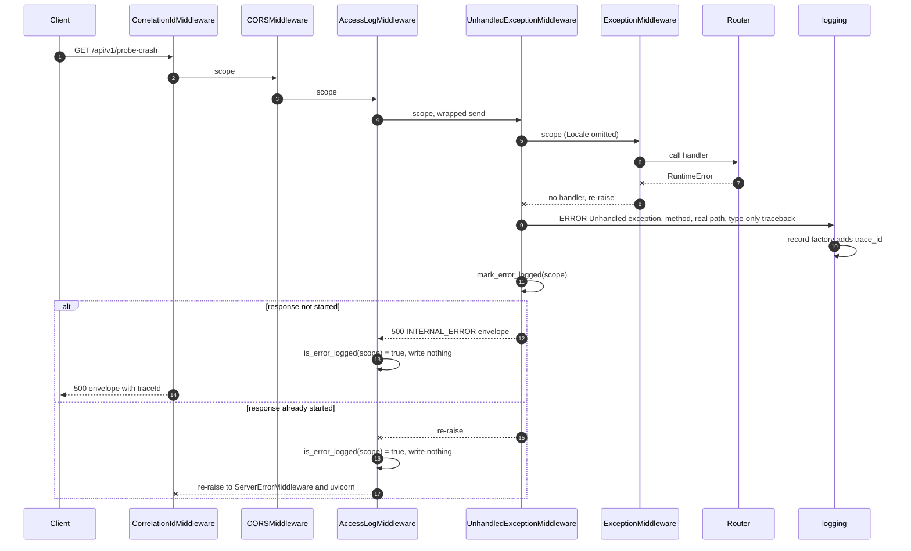
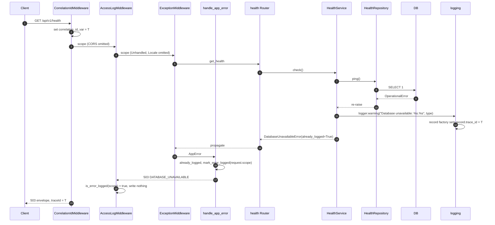

# System Design

本 change 只動後端的基礎建設（`app/core/`），沒有新端點、沒有業務模組、沒有資料表。設計三件事：每個 `/api/v1` 請求一行存取紀錄（`AccessLogMiddleware`）、每一筆 log record 自動帶 `trace_id`（`log_config.py` 的 record factory）、整個後端的 log 輸出設定（`configure_logging`，含 `LOG_LEVEL`）。

system-analysis 的 13 個待決問題、本文的 N1–N3，以及停點另外提出的編排檔傳入 `LOG_LEVEL`，已由維護者 2026-11-25 在 clarification 停點逐題裁定（`clarification.md` Q1–Q14、N1–N3）；本文的圖、元件表與細節都照裁定寫，裁定編號標在相關處。

依據：issue #567、ADR-008 D4、ADR-003 D5、api-agent-rules A7、security-agent-rules S5／S9、backend-agent-rules B1、`backend-modules.mdx` §請求管線／§correlation id／§log 安全規則、`clarification.md`（本 change 沒有 `docs/specs/` 規格可追溯，Q13 裁定不補，理由見 system-analysis §需求依據）。

## 分層與類別

業務模組的 Router → Service → Repository 分層**不變**：本 change 不新增也不修改任何模組的這三層，只改 `HealthService.check` 的一行訊息文字與它丟的例外參數。新元件全在 `app/core/`，位在 Router 外側的中介層與 log 設定；業務程式只透過標準 `logging` 間接受影響（照常呼叫 `logger.warning(...)`，record 自動帶 `trace_id`）。`app/core/` 不 import `app/modules/`（B1、`test_layer_boundaries.py` 的 `Core does not depend on modules`），所以「成功時不寫存取紀錄的路由」由 `main.py` 以 `quiet_success_routes` 傳給中介層，core 不寫死健康檢查的路徑（Q1）。

### 目錄異動

```text
backend/app/
├─ main.py                 修改：呼叫 configure_logging；在 CORS 與 Unhandled 之間掛 AccessLogMiddleware(quiet_success_routes=...)
└─ core/
   ├─ config.py            修改：Settings 加 log_level（列舉驗證，預設 INFO）
   ├─ log_config.py        新增：configure_logging、install_trace_id_record_factory、KeyValueFormatter、mark_error_logged、is_error_logged
   ├─ middleware.py        修改：新增 AccessLogMiddleware；UnhandledExceptionMiddleware 記完 ERROR 後標記、訊息拿掉 traceId
   ├─ errors.py            修改：AppError 加 already_logged；handle_app_error 依它標記；handle_http_exception 未對應狀態那一筆標記、訊息拿掉 traceId
   ├─ envelope.py          不改：correlation_id_var 仍由它擁有，log_config 只讀
   └─ log_safety.py        不改：仍不 import app 的任何東西
backend/app/modules/health/service.py   修改：WARNING 訊息拿掉 traceId；丟 DatabaseUnavailableError(already_logged=True)
.env.example                             修改（根目錄）：加 LOG_LEVEL
docker-compose.yml                       修改：backend 的 environment 加 LOG_LEVEL: ${LOG_LEVEL:-INFO}（Q14）
docker-compose.prod.yml                  修改：同上（Q14）
```

Dockerfile、`scripts/dev.mjs` 與文件裡的手動啟動指令**都不改**：uvicorn 內建 access log 由 `configure_logging` 在程式裡關掉（Q10），三個啟動點一次涵蓋。兩份編排檔只改後端 `environment`，加一行 `LOG_LEVEL: ${LOG_LEVEL:-INFO}`，讓 `.env` 的 `LOG_LEVEL` 進得了後端容器（Q14）；啟動指令不改。

`log_config.py` 不取名 `logging.py`：雖然絕對 import 不會遮蔽標準庫，但同名會讓閱讀與 `mypy` 的錯誤訊息混淆。依 `backend-modules.mdx` §`core/` 各模組「有就擴充，沒有才新開檔案」：中介層放進既有的 `middleware.py`；log 設定沒有現成的檔案可擴充，才新開 `log_config.py`。「這個請求已記過」的標記函式放在 `log_config.py`：`middleware.py` 與 `errors.py` 都要用，而 `log_config.py` 只 import `envelope` 與 `config`，不會形成循環。

### Class Diagram



### 元件清單

| 元件                                                 | 檔案                                | 職責                                                                                                                                                                                                                                                                                                                                                                                                                                                                                                                                                                                                                                                | 裁定                    |
| :--------------------------------------------------- | :---------------------------------- | :-------------------------------------------------------------------------------------------------------------------------------------------------------------------------------------------------------------------------------------------------------------------------------------------------------------------------------------------------------------------------------------------------------------------------------------------------------------------------------------------------------------------------------------------------------------------------------------------------------------------------------------------------- | :---------------------- |
| `AccessLogMiddleware`                                | `core/middleware.py`                | 純 ASGI；只處理 `http` 且路徑在 `/api/v1` 底下的請求（沿用 `_is_api_v1`），其他直接放行。進來時 `time.perf_counter()` 計時，包一層 `send`：在 `http.response.start` 記狀態碼、在最後一個 `http.response.body`（`more_body` 為假）記結束時間；用戶端在最後一個 body 送出前斷線、那個訊息沒有送出時，結束時間改取內層 app 返回的時間。內層結束後依序判斷：`is_error_logged(scope)` 為真就不寫；狀態是 2xx 且路由模板在 `quiet_success_routes` 裡就不寫；其餘寫**一筆**到 `app.access` logger。欄位放 record 的 `extra`（`http_method`、`http_route`、`http_status`、`duration_ms`）。內層拋例外時（回應已開始送出才出錯），同樣先看標記、再原樣往外拋 | Q1、Q3、Q4、Q6、Q9、Q11 |
| `route_template(scope)`                              | `core/middleware.py`（私有 helper） | 回完整路由模板，例 `/api/v1/items/{item_id}`；沒有模板時回 `None`，由 `_emit` 寫成固定的 `UNMATCHED_ROUTE`（`<unmatched>`）。見下方「路由模板怎麼取」                                                                                                                                                                                                                                                                                                                                                                                                                                                                                               | Q5                      |
| `level_for_status(status)`                           | `core/middleware.py`（私有 helper） | 2xx／3xx → `INFO`、4xx → `WARNING`、5xx → `ERROR`。已記過的 5xx 根本不會走到這裡（Q3）                                                                                                                                                                                                                                                                                                                                                                                                                                                                                                                                                              | Q3                      |
| `configure_logging(settings, *, stream=None)`        | `core/log_config.py`                | 在 `create_app` 讀完設定後呼叫：安裝 record factory；在 root 掛**一個**本 repo 的 `StreamHandler`（以屬性標記，重呼叫時先移除舊的再掛，測試反覆建 app 不會疊加），寫到 `stream`，沒給時是 `sys.stderr`（可選參數讓測試擷取 root handler 的輸出），formatter 是 `KeyValueFormatter`；root 與該 handler 的等級都設成 `settings.log_level`；`sqlalchemy`（父 logger，含 `sqlalchemy.engine` 與 `sqlalchemy.pool`）、`aiosqlite`、`asyncpg` 固定 `WARNING`（不隨 `LOG_LEVEL` 調低）；`uvicorn` logger 清空 handler、`propagate=True`，讓 uvicorn 自己的紀錄也走同一個 formatter；`uvicorn.access` 清空 handler、`propagate=False`                       | Q2、Q10、Q12            |
| `install_trace_id_record_factory()`                  | `core/log_config.py`                | 用 `logging.setLogRecordFactory` 包住原本的 factory：每一筆 record 建立時加 `trace_id`，值是 `current_correlation_id()`，在請求以外是 `None` 時填 `NO_TRACE_ID`（`-`）。**不**呼叫 `current_trace_id()`（它在請求外會產生新 UUID）。以模組層旗標保證只包一次                                                                                                                                                                                                                                                                                                                                                                                        | N1、Q7                  |
| `KeyValueFormatter`                                  | `core/log_config.py`                | 把**每一筆** record 排成一行 `key=value`，格式見下方「一行長什麼樣」；保證輸出不含換行                                                                                                                                                                                                                                                                                                                                                                                                                                                                                                                                                              | Q2                      |
| `mark_error_logged(scope)`／`is_error_logged(scope)` | `core/log_config.py`                | 在 `scope["state"]` 設、讀一個固定鍵（`error_logged`）；`Request.state` 與 `scope["state"]` 是同一個 dict，handler 與中介層看到的是同一份                                                                                                                                                                                                                                                                                                                                                                                                                                                                                                           | Q3                      |
| `UnhandledExceptionMiddleware`                       | `core/middleware.py`（修改）        | 照舊攔未處理例外、記一筆 ERROR、回 `500`；記完立刻 `mark_error_logged(scope)`（回應已開始送出、要往外拋的那條路徑也標）。訊息拿掉手寫的 `traceId=%s`，保留 method、實際路徑（經 `escape_for_log`）與只有型別的 traceback                                                                                                                                                                                                                                                                                                                                                                                                                            | Q3、Q5、Q8              |
| `AppError`                                           | `core/errors.py`（修改）            | 建構子加 keyword `already_logged: bool = False`：丟出它的那一層已經自己記過 WARNING 或 ERROR 時設 `True`。它只是一個布林，不帶任何文字，不會進回應                                                                                                                                                                                                                                                                                                                                                                                                                                                                                                  | Q3                      |
| `handle_app_error`                                   | `core/errors.py`（修改）            | `exc.already_logged` 為真時 `mark_error_logged(request.scope)`；回應不變                                                                                                                                                                                                                                                                                                                                                                                                                                                                                                                                                                            | Q3                      |
| `handle_http_exception`                              | `core/errors.py`（修改）            | 未對應狀態轉 `500` 時那一筆 ERROR 照記，記完 `mark_error_logged`；訊息拿掉手寫的 traceId                                                                                                                                                                                                                                                                                                                                                                                                                                                                                                                                                            | Q3、Q8                  |
| `Settings.log_level`                                 | `core/config.py`（修改）            | 環境變數 `LOG_LEVEL`，列舉 `DEBUG`、`INFO`、`WARNING`、`ERROR`、`CRITICAL`，不分大小寫，預設 `INFO`；其他值讓 `load_settings` 丟 `ConfigError`（只寫變數名與原因，不寫值）。只在 `Settings`，`DatabaseSettings`（Alembic）不讀                                                                                                                                                                                                                                                                                                                                                                                                                      | Q12                     |
| `create_app`                                         | `main.py`（修改）                   | 讀完設定後呼叫 `configure_logging(resolved)`；`add_middleware(AccessLogMiddleware, quiet_success_routes=frozenset({f"{API_V1_PREFIX}/health"}))` 加在 `UnhandledExceptionMiddleware` 之後、`CORSMiddleware` 之前（`add_middleware` 後加的在外層），得到由外而內 Correlation → CORS → AccessLog → Unhandled → Locale                                                                                                                                                                                                                                                                                                                                 | Q1、Q4                  |
| `HealthService.check`                                | `modules/health/service.py`（修改） | WARNING 訊息拿掉 `traceId=%s`，只留例外型別；改丟 `DatabaseUnavailableError(already_logged=True)`。仍不碰 `scope`（B1）                                                                                                                                                                                                                                                                                                                                                                                                                                                                                                                             | Q3、Q8                  |

### 關鍵設計細節

#### traceId 怎麼進每一筆 record（N1：用 record factory）

issue #567 寫「logging filter 把目前的 traceId 自動加到每一筆 log record」。N1 裁定改用 **record factory**，理由是 filter 掛在哪裡就只作用在哪裡：

| 做法                        | 後果                                                                                                                                                                                                                                                                                    |
| :-------------------------- | :-------------------------------------------------------------------------------------------------------------------------------------------------------------------------------------------------------------------------------------------------------------------------------------- |
| **record factory（採用）**  | 每一筆 record 一建立就有 `trace_id`，不論它最後交給哪個 handler：本 repo 的 root handler、uvicorn 的 logger、pytest 的 `caplog` 都看得到。formatter 讀 `trace_id` 不會因某筆 record 缺屬性而 `KeyError`。代價：`setLogRecordFactory` 是行程層的全域狀態，要包住前一個 factory、只裝一次 |
| logging filter 掛在 handler | 只有掛了 filter 的 handler 處理的 record 才有屬性；`caplog` 的 handler 沒有這個 filter，測試只能靠 handler 執行順序碰運氣                                                                                                                                                               |
| logging filter 掛在 logger  | logger 層的 filter 只作用在**直接**呼叫該 logger 的 record，子 logger 往上傳的 record 不經過它，掛在 root 等於沒掛                                                                                                                                                                      |

這是實作手段，不改 issue 的需求目標（「業務程式的 log 不用改呼叫方式就帶 traceId」）。

contextvar 能跨到哪裡：async 的處理在同一個 task 的 context 裡，讀得到 `correlation_id_var`；同步依賴與 `run_in_threadpool` 由 anyio 複製 context 進 worker thread，也讀得到。`CorrelationIdMiddleware` 在 `finally` 才 `reset`，所以存取紀錄必須寫在它的內側——Q4 的位置（CORS 內側）滿足這一點。

請求以外（啟動、關閉、lifespan、uvicorn 自己的訊息）`current_correlation_id()` 回 `None`，record 的 `trace_id` 是固定標記 `-`（Q7），一眼看出不屬於任何請求，也不會每筆各拿一個新 UUID、看起來像不同請求。

#### 中介層位置（Q4：CORS 內側、Unhandled 外側）

| 由外而內 | 層                             | 與存取紀錄的關係                                                                                  |
| :------- | :----------------------------- | :------------------------------------------------------------------------------------------------ |
| 1        | `CorrelationIdMiddleware`      | 先決定 correlation id；存取紀錄在它內側，`trace_id` 讀得到                                        |
| 2        | `CORSMiddleware`               | 預檢由它自己回，不往內走，所以**預檢不會有存取紀錄**（Q6）                                        |
| 3        | `AccessLogMiddleware`          | 本 change 新增                                                                                    |
| 4        | `UnhandledExceptionMiddleware` | 在存取紀錄內側：未處理例外變成的 `500` 回應會穿過存取紀錄，它看得到最終狀態與 `error_logged` 標記 |
| 5        | `LocaleMiddleware`             | 在存取紀錄內側：它回的 `406` 會被記到（沒有路由模板，記 `<unmatched>`）                           |

#### 路由模板怎麼取（技術選擇）

實測 FastAPI 0.165 加 Starlette 1.10（本 worktree 的 `uv.lock` 版本）：路由比對後 `scope["route"]` 是**原本的** `APIRoute`，它的 `path` 是 `/health`，**不含** `include_router` 的 `/api/v1` 前綴；完整模板只放在 FastAPI 的私有 scope 鍵（`scope["fastapi"]["effective_route_context"].path_format`）。實測結果：

| 請求                                       | 狀態 | `scope["route"].path`         | 完整模板                  | 存取紀錄的 route    |
| :----------------------------------------- | :--- | :---------------------------- | :------------------------ | :------------------ |
| `GET /api/v1/health`                       | 200  | `/health`                     | `/api/v1/health`          | 不寫（Q1）          |
| `GET /api/v1/items/42?token=x`（測試路由） | 200  | `/items/{item_id}`            | `/api/v1/items/{item_id}` | 完整模板            |
| `GET /api/v1/items/abc`                    | 422  | `/items/{item_id}`            | `/api/v1/items/{item_id}` | 完整模板            |
| `POST /api/v1/health`                      | 405  | `/health`（部分比對也會設）   | `/api/v1/health`          | 完整模板            |
| `GET /api/v1/nope`                         | 404  | 無                            | 無                        | `<unmatched>`（Q5） |
| `OPTIONS /api/v1/health`（預檢）           | 200  | 無（CORS 層自己回，沒進路由） | 無                        | 不寫（Q6）          |

另外，`LocaleMiddleware` 回的 `406` 在路由之前就結束，**即使路徑存在也沒有模板**，記 `<unmatched>`。

取法：用專案已在用的公開函式 `fastapi.routing.iter_route_contexts(app.routes)`（`openapi.py` 的 `assert_unique_operation_ids` 已依賴它），第一次需要時從 `scope["app"]` 建一張「原本的 route 物件 → `path_format`」對照表並快取；同一個 route 物件被掛在兩個前綴下時，以 context 的模板比對實際路徑挑出那一個；查不到時重建一次，仍查不到就視為沒有模板。不讀私有的 `scope["fastapi"]`：FastAPI 升版就可能改名，而且沒有型別。實作要附一條測試釘住「完整模板含 `/api/v1` 前綴」，FastAPI 升版改了行為時測試會先紅。

存取紀錄只寫模板或 `<unmatched>`，**任何情況都不寫實際路徑**（Q5）；未處理例外與未對應狀態那兩筆 ERROR 維持記實際路徑（經 `escape_for_log`），不動 `api-envelope`。

#### 一行長什麼樣（Q2：本 change 定，一行 `key=value` 文字）

`KeyValueFormatter` 套用在**所有**紀錄上（存取紀錄、業務程式、uvicorn），取代 #506 clarification Q15「access log 格式留給 01-01」。

```text
timestamp=2026-11-25T08:00:00.123Z level=INFO logger=app.access traceId=45beadc0-... method=GET route=/api/v1/items/{item_id} status=200 durationMs=12.3 msg=request completed
timestamp=2026-11-25T08:00:05.004Z level=WARNING logger=app.modules.health.service traceId=9f1c2e07-... msg=Database unavailable: sqlalchemy.exc.OperationalError
timestamp=2026-11-25T08:00:00.001Z level=INFO logger=uvicorn.error traceId=- msg=Application startup complete.
```

| 規則         | 內容                                                                                                                                                                                                                                                                                                           |
| :----------- | :------------------------------------------------------------------------------------------------------------------------------------------------------------------------------------------------------------------------------------------------------------------------------------------------------------- |
| 欄位順序     | `timestamp`、`level`、`logger`、`traceId` 固定在前；record 帶存取欄位時接 `method`、`route`、`status`、`durationMs`；record 帶 `exc_info` 時接 `excType`；`msg` **固定最後**，值是到行尾的整段文字，不加引號                                                                                                   |
| `timestamp`  | UTC、毫秒、`Z` 結尾，與回應外層的 `timestamp` 同形狀                                                                                                                                                                                                                                                           |
| `traceId`    | record 的 `trace_id`；請求以外是 `-`（Q7）。鍵名與回應外層、`grep traceId=` 一致                                                                                                                                                                                                                               |
| `durationMs` | 毫秒一位小數（Q11）                                                                                                                                                                                                                                                                                            |
| 一行保證     | `msg` 裡的控制字元（含 `\n`、`\r`）改成跳脫序列；`UnhandledExceptionMiddleware` 那筆多行的 traceback 因此變成同一行裡的 `\n`。formatter **只**跳脫控制字元、不跳脫反斜線，已由 `escape_for_log` 跳脫過的值（例如 `\x0a`）原樣保留，不會被跳脫兩次。來自請求的值仍由呼叫端先經 `escape_for_log`（既有規則不變） |
| `exc_info`   | 本 repo 的程式不傳 `exc_info`；第三方紀錄帶了時，formatter **只**寫 `excType=<module.qualname>`，不寫例外訊息，也不寫 stdlib 的多行 traceback（S9，例外訊息可能帶請求或資料庫內容）                                                                                                                            |

存取紀錄**不含** query、body、標頭、cookie、來源 IP（Q9）；`method` 經 `escape_for_log`（method 由呼叫端送來）；`route` 是程式裡的模板或固定的 `<unmatched>`，都不是呼叫端輸入；`traceId` 已由 `accept_or_generate` 驗證過字元集。

#### log 輸出設定的已知陷阱

- **root 調成 `INFO` 會讓資料庫套件印出 SQL 與驅動錯誤**：`echo=False` 只是不另外加 handler，`sqlalchemy.engine` 的 logger 等級是 `NOTSET`、會繼承 root；root 一旦是 `INFO`，每條 SQL 都會印出來。`engine` 雖有 `hide_parameters=True`（參數不印），SQL 本文仍會進 log。只固定 `sqlalchemy.engine` 不夠：`sqlalchemy.pool` 同樣繼承 root，在 `INFO`／`DEBUG` 會記連線失效等事件並帶上驅動的錯誤文字；`LOG_LEVEL=DEBUG` 時 `aiosqlite` 會記下每條 SQL 本文與參數，完全不經 `hide_parameters`（`asyncpg` 同理）。所以 `configure_logging` 把 `sqlalchemy`（父 logger，一次涵蓋 `engine`、`pool` 等子 logger）、`aiosqlite`、`asyncpg` 都固定設成 `WARNING`，`LOG_LEVEL=DEBUG` 也不會打開它們（Q12）
- **等級要同時設在 handler 上**：uvicorn 在自己的 `dictConfig` 把 `uvicorn.error` 設成 `INFO`；往上傳到 root 的 record 不再檢查 root logger 的等級，只檢查 handler 的等級。所以 `LOG_LEVEL=WARNING` 要能壓掉 uvicorn 的 INFO，root handler 本身也設成 `LOG_LEVEL`
- **uvicorn 先設定 log、才呼叫 `create_app`**：`uvicorn.Config.__init__` 就執行它的 `dictConfig`，`--factory` 之後才呼叫 `create_app`，所以 `configure_logging` 在 `create_app` 裡改 `uvicorn`、`uvicorn.access` 會生效、不會被蓋回去；`--reload` 時每次重載的 worker 行程都會重新呼叫 `create_app`。reloader 父行程（例如 `Will watch for changes`）不經 `create_app`，那幾行維持 uvicorn 原本的格式
- **uvicorn 內建 access log 的關法**（Q10）：`uvicorn.access` 清空 handler 並 `propagate=False`，與 `--no-access-log` 的效果相同；它的紀錄是 `INFO`，不會落到 stdlib 的 lastResort handler（那只收 `WARNING` 以上）
- **遷移行程不受影響**：`migrate` 服務跑 `alembic upgrade head`，不經 `create_app`，log 仍走 `alembic.ini` 的 `fileConfig`，不會有 record factory，也不會有存取紀錄；`LOG_LEVEL` 只在 `Settings`，Alembic 不讀
- **測試**：`create_app` 在測試裡會被呼叫很多次，`configure_logging` 必須可重入（handler 以標記屬性辨識、先移除再加；record factory 只包一次）。root 等級、uvicorn 與資料庫套件 logger 的設定是全域的，測試要用 fixture 還原。要斷言「整個輸出」（含格式與一行保證）的測試直接呼叫 `configure_logging(settings, stream=buffer)` 擷取 root handler 寫出的文字；`caplog` 只拿得到 record，看不到 formatter 的輸出

## 關鍵情境

規格書沒有這些 Scenario（技術 change，見 system-analysis §需求依據），以下標題是提給 `planner` 的 Scenario 名稱，寫 specs 時請沿用，使圖與 Scenario 一一對應。

中介層位置照 Q4（Correlation → CORS → AccessLog → Unhandled → Locale）。參與者到 Router 回傳回應為止；`Log` 代表標準 `logging` 加 `configure_logging` 掛的 root handler 與 `KeyValueFormatter`。

### Scenario: 成功的請求留下一行 INFO 存取紀錄

以測試掛載的 `GET /api/v1/items/{item_id}` 為例；正式環境唯一的端點是健康檢查，它成功時不寫（見下一個 Scenario）。



### Scenario: 成功的健康檢查不留存取紀錄



`quiet_success_routes` 由 `main.py` 傳入（`/api/v1/health`），core 不知道健康檢查的路徑（Q1、B1）。資料庫連不上的 `503` 不在這張圖的 `else`：它已記過 WARNING，依 Q3 不寫存取紀錄，見「業務程式的紀錄不改呼叫方式就帶上追蹤編號」。

### Scenario: 用戶端錯誤的請求記一行 WARNING 存取紀錄



### Scenario: 未處理例外造成的 500 只留一筆 ERROR 紀錄



未對應狀態的 `HTTPException` 轉 `500` 走同一條規則：`handle_http_exception` 記 ERROR 後 `mark_error_logged`，存取紀錄不寫。「回應已開始送出」那條路徑往外拋之後，uvicorn 還會以 `exc_info` 再記一筆，見 [§技術待決問題](#技術待決問題) 的已知限制（N2）。

### Scenario: 業務程式的紀錄不改呼叫方式就帶上追蹤編號

以資料庫連不上的健康檢查為例：`HealthService` 照舊呼叫 `logger.warning(...)`，沒有傳任何 traceId 參數，record 仍帶 `trace_id`；它丟的例外標了 `already_logged`，所以存取紀錄不再為這個 `503` 多寫一筆（Q3）。



訊息文字裡不再手寫 `traceId=%s`（Q8），traceId 只由 formatter 從 `record.trace_id` 寫出一次。

### Scenario: 存取紀錄不含查詢字串、body、標頭與 cookie

不另畫：與第一張圖同一條路徑，差別只在請求帶 `?q=CANARY-query`、`Cookie: session=CANARY-cookie`、body 含 `CANARY-body`。檢查點在 `AccessLogMiddleware._emit`：它只從 `scope` 讀 `method`、從 `route_template` 讀模板、從包裝後的 `send` 讀狀態碼，**從不讀** `scope["query_string"]`、`scope["headers"]`、`scope["client"]`、`receive`；所以這些沒有進入 record 的路徑。uvicorn 內建 access log 會印出 query（歸檔 `backend-skeleton/acceptance.md` §觀察 第 3 條），它已由 `configure_logging` 關掉（Q10），所以這個 Scenario 可以對**整個**輸出斷言，不必限定 `app.access`。

### Scenario: 預檢與 /api/v1 以外的請求不留存取紀錄

不另畫：預檢由 `CORSMiddleware` 在存取紀錄外側直接回應，不會進到 `AccessLogMiddleware`；`/docs`、`/openapi.json` 等 `/api/v1` 以外的路徑由 `_is_api_v1` 判斷直接放行（Q6）。

### Scenario: 請求以外寫的紀錄帶固定標記

不另畫：啟動、關閉時 `current_correlation_id()` 回 `None`，record factory 填 `-`（Q7），輸出是 `traceId=-`；**不**呼叫 `current_trace_id()`。

### Scenario: LOG_LEVEL 不合法時啟動失敗

不另畫：`LOG_LEVEL=verbose` 時 `load_settings(Settings)` 丟 `ConfigError`，訊息是 `LOG_LEVEL：<原因>`，不含設定值；`create_app` 在第 1 步就失敗，不會呼叫 `configure_logging`（Q12）。

## 常駐文件異動

- 常駐文件：`docs/diagrams/architecture/backend-modules.mdx`

| 節                                            | 異動                           | 摘要                                                                                                                                                                                                                                                                                                                                           |
| :-------------------------------------------- | :----------------------------- | :--------------------------------------------------------------------------------------------------------------------------------------------------------------------------------------------------------------------------------------------------------------------------------------------------------------------------------------------- |
| §health › 資料庫無法連線時健康檢查回 503 外層 | 修改                           | Service 那一步改成「記 WARNING（例外型別，traceId 由 record 帶）」並丟 `DatabaseUnavailableError(already_logged=True)`；handler 那一步加上標記已記過                                                                                                                                                                                           |
| §後端基礎建設 › `core/` 各模組                | 修改                           | `middleware.py` 列加入 `AccessLogMiddleware`，說明改成「自寫的純 ASGI 中介層」；新增 `log_config.py` 一列；`errors.py` 列提到 `already_logged`                                                                                                                                                                                                 |
| §後端基礎建設 › app factory 與 lifespan       | 修改                           | 步驟表新增 1a：`configure_logging(settings)` 的內容（record factory、root handler 與一行 `key=value` 格式、`LOG_LEVEL`、`sqlalchemy`／`aiosqlite`／`asyncpg` 固定 `WARNING`、關 `uvicorn.access`、可選的 `stream` 參數）                                                                                                                       |
| §後端基礎建設 › 請求管線                      | 修改                           | 開頭改成五個中介層；層次表在 CORS 與 Unhandled 之間加入 `AccessLogMiddleware`；「三個自寫的中介層」改成「自寫的中介層」                                                                                                                                                                                                                        |
| §後端基礎建設 › 請求管線 的 `@ai-visualize`   | 修改 prompt，`status: pending` | 互動元件 `backend-request-pipeline` 少了存取紀錄這一層：標記改成 `pending`、prompt 依決議更新（十層、各情境存取紀錄那一步寫或不寫；存取紀錄與那一層自己記的 WARNING／ERROR 不會同時出現）；元件本身與 `GeneratedFrame` 的嵌入**不改**，等實作合併後重新生成                                                                                    |
| §後端基礎建設 › correlation id                | 修改                           | 表新增「log」列（record factory 讓每筆 record 帶 `trace_id`，請求以外是 `-`）；刪掉「業務程式的 log 要帶 traceId 時目前得自己呼叫」那句，改寫成外層 `traceId`、標頭與 record 的 `trace_id` 三者同值                                                                                                                                            |
| §後端基礎建設 › log 安全規則                  | 修改、新增                     | 未處理例外與 `HealthService` 兩列改成「traceId 由 record 自動帶、記完標記已記過」；新增存取紀錄一列（只記 method、模板或 `<unmatched>`、狀態、耗時；不記 query、body、標頭、cookie、來源 IP）、一行格式與 `exc_info` 一列、uvicorn 內建 access log 與資料庫套件 logger（`sqlalchemy`、`aiosqlite`、`asyncpg` 固定 `WARNING`）一列；表後加註 N3 |
| §後端基礎建設 › 設定                          | 修改、新增一列                 | 開頭說明加上 log 等級；新增 `LOG_LEVEL` 一列（資料庫套件的 logger 不跟著它）                                                                                                                                                                                                                                                                   |
| §決策紀錄                                     | 新增一列                       | 存取紀錄與所有後端紀錄的格式（一行 `key=value`）由本 change 定，取代 #506 clarification Q15「access log 格式留給 01-01」；來源 #567                                                                                                                                                                                                            |
| §已知限制                                     | **延到實作（不在規劃時改）**   | 第 1 列「一般請求的存取 log；業務程式的 log 不會自動帶 traceId」（#567）在實作合併前仍成立，規劃時保留；N2 那一列也由實作加。兩者由實作群組在同一個 PR 處理（比照 #524 的做法）                                                                                                                                                                |

## 資料模型異動

本次無資料模型異動。

## 權限檢查點

本 change 沒有端點，也沒有產品角色之間的差異：存取紀錄只寫到伺服器的標準輸出，產品內沒有任何 API 或畫面能讀到它，不涉及 PRD §權限矩陣。

| 檢查點                                           | 在哪一層成立                                                                                                                                                                                                                                    |
| :----------------------------------------------- | :---------------------------------------------------------------------------------------------------------------------------------------------------------------------------------------------------------------------------------------------- |
| 呼叫端看不到伺服器紀錄                           | 紀錄只進 log handler，回應只多帶既有的 `traceId`（已存在，不新增欄位）；`already_logged` 與 `error_logged` 標記都不進回應                                                                                                                       |
| 測試集答案不外露（Hard Rule 6、S5 覆蓋面含 log） | 存取紀錄記**路由模板**或固定的 `<unmatched>`，從不記實際路徑，且從不讀 body；答案只可能出現在 body 或日後的路徑參數，兩者都不會進存取紀錄                                                                                                       |
| 不含 PII 與 secret（S9）                         | 不記標頭（含 `Authorization`、`Cookie`）、不記 query（日後的 token 參數）、不記來源 IP（Q9）；formatter 遇到 `exc_info` 只寫例外型別，不寫例外訊息；`sqlalchemy`、`aiosqlite`、`asyncpg` 固定 `WARNING`，SQL 本文、參數與驅動錯誤文字不會進 log |
| 寄信降級的設定密碼連結（ADR-008 D3、S9）         | 本 change 不處理（N3）：那條紀錄還不存在；`backend-modules.mdx` §log 安全規則已註明，留給寄信的 change 決定它的 logger 名稱或獨立管道                                                                                                           |

## 技術待決問題

### 已裁定的待決（clarification 2026-11-25）

system-analysis 待決 1–13、停點另外提出的 Q14 與本文 N1–N3 已全部裁定，設計照下表寫；各題的選項比較已在停點交維護者，裁定與理由見 `clarification.md`，不再重列。

| 裁定 | 主題                     | 決議                                                                                                                    | 落在本文哪裡                                                 |
| :--- | :----------------------- | :---------------------------------------------------------------------------------------------------------------------- | :----------------------------------------------------------- |
| Q1   | 健康檢查的存取紀錄       | 只略過成功的：2xx 不寫、非 2xx 照分級寫；`main.py` 傳 `quiet_success_routes`                                            | 元件清單 `AccessLogMiddleware`、`create_app`；第二張圖       |
| Q2   | 格式                     | 本 change 定，一行 `key=value`，套用所有紀錄；取代 #506 Q15                                                             | §一行長什麼樣                                                |
| Q3   | 500 不多記一次           | 已記過 WARNING／ERROR 的請求以 `scope["state"]` 的 `error_logged` 標記，存取紀錄不寫                                    | `mark_error_logged`、`AppError.already_logged`；第四、五張圖 |
| Q4   | 中介層位置               | Correlation → CORS → AccessLog → Unhandled → Locale                                                                     | §中介層位置                                                  |
| Q5   | 沒有模板的請求           | 固定 `<unmatched>`；兩筆 ERROR 維持記實際路徑                                                                           | §路由模板怎麼取                                              |
| Q6   | 預檢與 `/api/v1` 以外    | 只記 `/api/v1`，預檢不記                                                                                                | §中介層位置；Scenario「預檢與 /api/v1 以外…」                |
| Q7   | 請求以外的 traceId       | 固定 `-`                                                                                                                | `install_trace_id_record_factory`                            |
| Q8   | 手寫的 `traceId=%s`      | 三處拿掉，測試改斷言 `record.trace_id`                                                                                  | 元件清單三列                                                 |
| Q9   | 來源 IP                  | 不記                                                                                                                    | §一行長什麼樣；§權限檢查點                                   |
| Q10  | uvicorn 內建 access log  | `configure_logging` 清空 `uvicorn.access` handler、`propagate=False`                                                    | `configure_logging`；§已知陷阱                               |
| Q11  | 耗時                     | `perf_counter`，到最後一個 body 送出，毫秒一位小數 `durationMs`                                                         | `AccessLogMiddleware`；§一行長什麼樣                         |
| Q12  | log 設定範圍             | 全後端，`LOG_LEVEL` 預設 `INFO`、列舉驗證、錯值 `ConfigError`；資料庫套件的 logger 固定 `WARNING`                       | `Settings.log_level`、`configure_logging`；§已知陷阱         |
| Q13  | 補回規格書               | 不補                                                                                                                    | —                                                            |
| Q14  | 編排檔傳入 `LOG_LEVEL`   | `docker-compose.yml` 與 `docker-compose.prod.yml` 的後端 `environment` 加 `LOG_LEVEL: ${LOG_LEVEL:-INFO}`；啟動指令不改 | §目錄異動                                                    |
| N1   | filter 或 record factory | record factory                                                                                                          | §traceId 怎麼進每一筆 record                                 |
| N2   | 回應已開始送出後才出錯   | 記成已知限制，留給第一個串流端點的 change                                                                               | 下方「已知限制」                                             |
| N3   | 寄信降級的 log 管道      | 本 change 不處理，§log 安全規則註明                                                                                     | §權限檢查點；`backend-modules.mdx` §log 安全規則             |

### 已知限制（N2，實作時寫進 `backend-modules.mdx` §已知限制）

回應已開始送出才出錯時，`UnhandledExceptionMiddleware` 記完 ERROR、標記後原樣往外拋，例外穿過所有中介層到 Starlette `ServerErrorMiddleware` 與 uvicorn；uvicorn 會以 `exc_info` 再記一筆 `Exception in ASGI application`，「錯誤只記一次」在這條路徑不成立。`KeyValueFormatter` 對 `exc_info` 只寫例外型別，所以那一筆**不會**帶出例外訊息，剩下的是重複一筆 ERROR。目前沒有串流端點，碰不到這條路徑；由實作群組在 `backend-modules.mdx` §已知限制加一列，留給第一個串流端點的 change 處理（N2 裁定）。規劃階段不加這一列，因為它描述的是實作合併後的狀態。

### 仍開著、但不需維護者決定

| #   | 問題                                                                                                                                                                              | 處理                                                        |
| :-- | :-------------------------------------------------------------------------------------------------------------------------------------------------------------------------------- | :---------------------------------------------------------- |
| N4  | 路由模板的完整前綴只在 FastAPI 私有 scope 鍵裡（實測 0.165）；本設計改用公開的 `iter_route_contexts` 建對照表。FastAPI 升版若改了 `RouteContext`，`openapi.py` 與本中介層會一起壞 | 升版風險，由測試釘住；供 `code-reviewer` 與日後升版的人知悉 |

### 交易、session 與效能

- **交易邊界與 session**：本 change 不碰資料庫；`AccessLogMiddleware` 不開 session，也不在 `get_db` 的生命週期內。worker 的 sync session 與 traceId 傳遞不在範圍（worker 尚不存在，ADR-003 D8）。
- **事件迴圈阻塞**：`StreamHandler` 寫 stderr 是同步 I/O，在事件迴圈上執行；每個請求多一行，正常量不成問題。若日後正式層的 stdout 被慢的收集器卡住，會拖慢所有請求；屆時可改 `QueueHandler` 加 `QueueListener`（背景 thread 寫出）。本次不做，記在這裡。
- **量**：健康檢查每 30 秒一次（`docker-compose.yml`、`docker-compose.prod.yml`），成功時不寫（Q1），平時不洗版；部署者可用 `LOG_LEVEL=WARNING` 進一步只留 4xx、5xx。log 保存與輪替是部署層的事，不在範圍。
- **路由模板對照表**：第一次請求時建一次並快取，之後每個請求是一次字典查找；對照表隨 app 建立，測試反覆建 app 不會共用。

### 對 api-contract 的影響

本次沒有端點異動：回應的欄位、標頭（`X-Correlation-ID` 早已存在）、錯誤碼都不變，`openapi.json` 不需重新匯出。`LOG_LEVEL` 是執行期設定，屬 `runtime-config` 與 `.env.example`，不是 API 契約。
