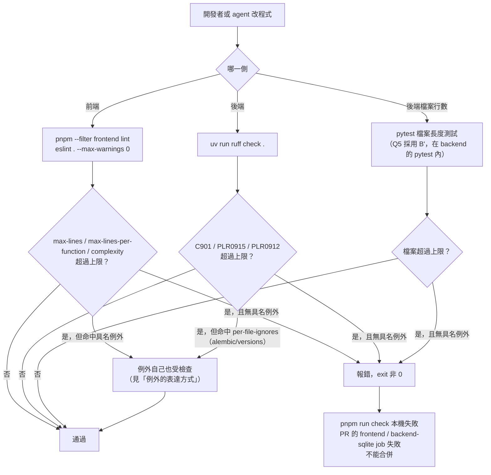
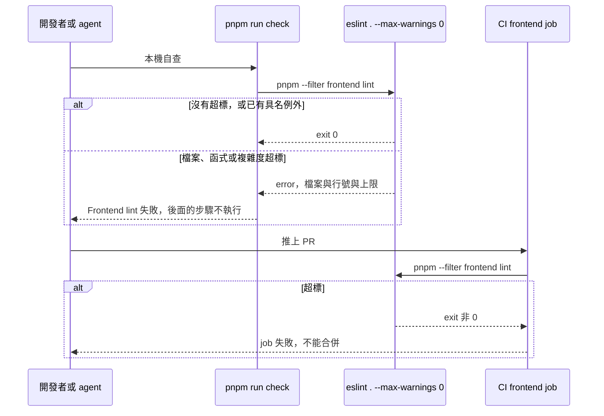
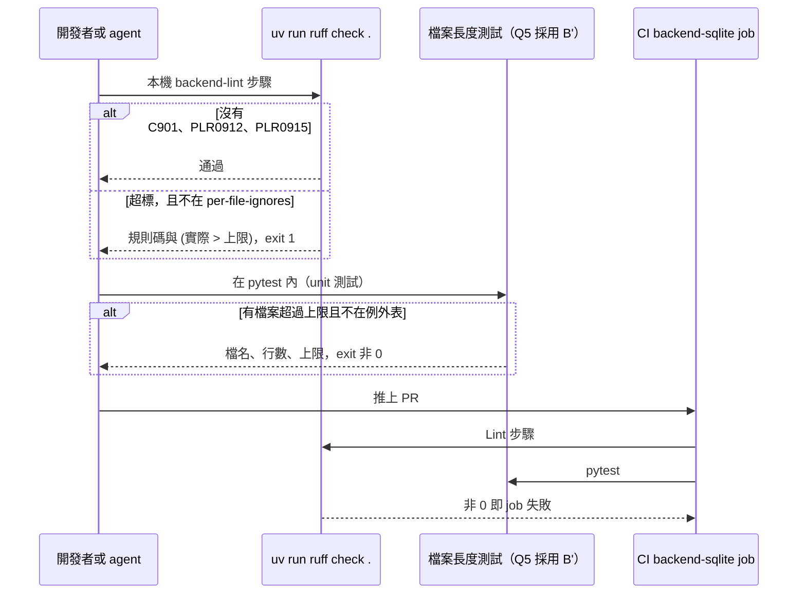
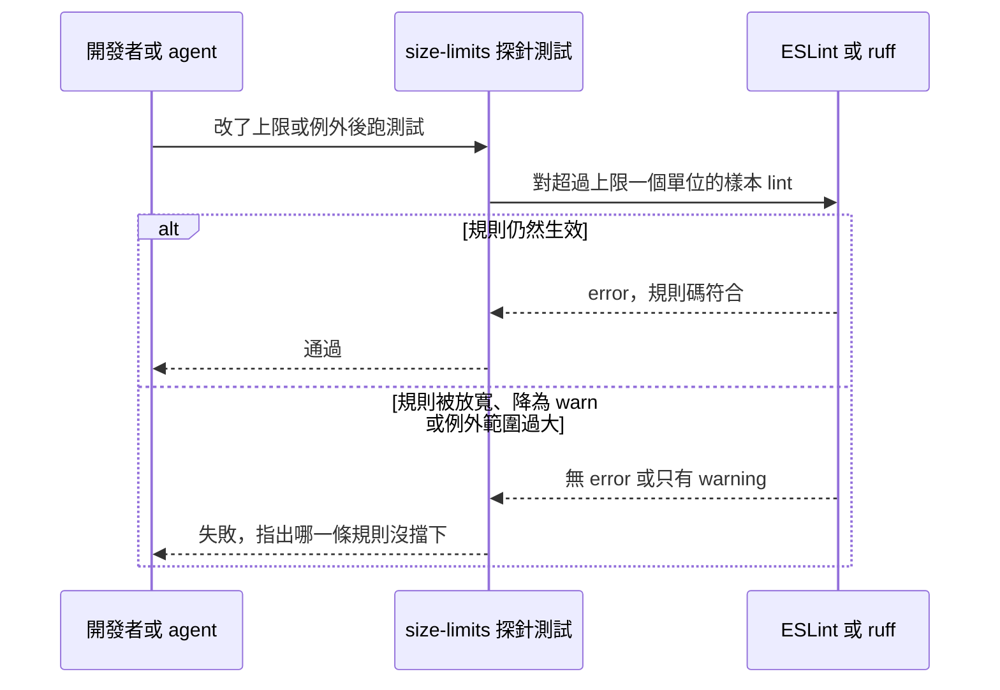

# System Design

本 change 是工具與規則文件的變更：沒有 Router、Service、Repository、Model 或 Pydantic schema，也沒有 API、資料表或 UI。範本的「分層與類別」「關鍵情境」改寫成這類變更適用的內容：**機制的組成**（哪個檔案放哪條規則）與**違規如何被擋下**的流程圖。門檻數字與例外範圍已由維護者在 2026-11-25 依常設授權裁定（`clarification.md` Q1 至 Q12、T2；P3 要求本文件標明採用的選項）。下文以「採用」標出決議，其餘選項保留為「考慮過的選項」，供日後推翻時回修。

下文的實測都在本 worktree 的暫時檔案上做，已刪除，沒有提交（方法見各節「已驗證」）。

## 分層與類別

### 機制總覽

| 關卡         | 規則落點                                                                   | 本機呼叫                                                                  | CI 呼叫                                                 | 擋下的內容                                  |
| :----------- | :------------------------------------------------------------------------- | :------------------------------------------------------------------------ | :------------------------------------------------------ | :------------------------------------------ |
| 前端檔案行數 | `frontend/eslint.config.js`：`max-lines`                                   | `pnpm --filter frontend lint`（`pnpm run check` 的 `frontend-lint` 步驟） | `frontend` job 的 `Lint` 步驟（不新增 job、不新增步驟） | 檔案超過上限                                |
| 前端函式行數 | 同上：`max-lines-per-function`                                             | 同上                                                                      | 同上                                                    | 函式（含 React 元件本體）超過上限           |
| 前端複雜度   | 同上：`complexity`                                                         | 同上                                                                      | 同上                                                    | 圈複雜度超過上限                            |
| 後端複雜度   | `backend/pyproject.toml`：`C901` 加 `[tool.ruff.lint.mccabe]`              | `pnpm run check` 的 `backend-lint` 步驟（`uv run ruff check .`）          | `backend-sqlite` job 的 `Lint` 步驟                     | 圈複雜度超過上限                            |
| 後端函式長度 | 同上：`PLR0915`（敘述數）、`PLR0912`（分支數）加 `[tool.ruff.lint.pylint]` | 同上                                                                      | 同上                                                    | 敘述或分支過多（ruff 沒有「行數」，見 Q6）  |
| 後端檔案行數 | `backend/tests/unit/` 的 pytest 測試（Q5 採用 B'；ruff 沒有對應規則）      | `pnpm run check` 的 `backend-sqlite` 步驟內的 pytest                      | `backend-sqlite`、`backend-postgres` job 的 pytest      | 檔案超過 400 行（含例外表的棘輪與過期偵測） |
| 規則仍然有效 | 持久探針測試（Q10）                                                        | `pnpm --filter frontend test`、`uv run pytest`                            | `frontend`、`backend-sqlite` job 既有的測試步驟         | 規則被誤改寬鬆、例外範圍被誤放大            |

沒有新增 CI job，也沒有新增步驟（Q5 採用 B'，Q10 採用 B 只改探針名清單）。

### 違規如何被擋下



本機 `pnpm run check` 與 CI 呼叫同一組指令（`agent-hook-contract` H4、H7；`scripts/tests/check.test.mjs` 已逐字比對步驟與 CI 的指令），所以新規則掛在既有步驟上時，兩邊自動一致，不必另外同步。

### 前端：ESLint 規則放在哪裡

位置：`frontend/eslint.config.js`，在現有「Layer boundaries」與「Import restrictions」之間或之後新增一組設定物件。flat config 的規則是**逐規則名稱、後面的覆蓋前面的**；`"off"` 會關掉並丟掉前面的選項。已驗證下面三組的覆蓋順序可用。

```js
// Size and complexity limits (frontend-agent-rules F12; numbers decided in #561: Q2 300, Q3 80, Q4 15).
const SIZE_LIMITS = {
  "max-lines": ["error", { max: 300, skipBlankLines: true, skipComments: true }],
  "max-lines-per-function": [
    "error",
    { max: 80, skipBlankLines: true, skipComments: true, IIFEs: false },
  ],
  complexity: ["error", { max: 15 }],
};

// inside defineConfig(...)
{ files: SOURCE_FILES, rules: SIZE_LIMITS },          // src/**/*.{ts,tsx}, build/**/*.ts
{ files: TEST_FILES, rules: { "max-lines": "off", "max-lines-per-function": "off" } },  // Q7 的 B
```

設計要點：

- **`files` 用既有的 `SOURCE_FILES` 常數**（`src/**/*.{ts,tsx}`、`build/**/*.ts`），不套用到 `eslint.config.js`、`vite.config.ts`、`vitest.config.ts` 這類設定檔。理由：新規則加進 `eslint.config.js` 之後它自己會變長（目前 281 個非空白非註解行，加上約 10 行的 `SIZE_LIMITS`、兩個設定物件與 `NAMED_EXEMPTIONS` 就逼近 300），若上限（Q2 採用 300）又套用到設定檔，這份設定會擋自己。把設定檔排除在範圍外，等於 Q7 採用的「設定檔不在範圍」；考慮過的替代方案（未採用）是把規則表抽到 `frontend/eslint.size-limits.js` 再 import，代價是多一個檔案與一個 import。
- **生成檔不需要另設例外**：現有 `ignores: ["src/api/generated/**", ...]` 是全域 ignore，所有規則都不看它。
- **`skipBlankLines`、`skipComments` 必須明寫**：ESLint 預設兩者都是 `false`，不寫的話數字會比 sa 的量測（排除空白與註解）大，與已量測的「零違規」結論不符。`IIFEs: false` 是 `max-lines-per-function` 的預設，明寫是為了讓探針測試可以逐字比對選項。
- **測試檔的處理（Q7 三個選項如何落地）**：
  - **採用 B（只豁免長度，Q7）**：如上，`complexity` 不動，測試仍受 `SIZE_LIMITS.complexity` 約束（實測最大 10，零違規）。
  - 考慮過的 A（三類全豁免）：`TEST_FILES` 的覆蓋物件加 `complexity: "off"`；未採用，測試的複雜度沒有理由放寬。
  - 考慮過的 C（測試用另一組較寬鬆的數字）：`TEST_FILES` 的覆蓋物件改成另一組選項，例如 `"max-lines-per-function": ["error", { max: 120, ... }]`；代價是多維護一組數字，且探針測試要多驗一組；未採用。
- **`complexity` 沒有 `skip*` 選項，也不分測試與否**，所以 B 與 C 之外沒有額外設定。

**已驗證**：用暫時的 `overrideConfig`（上面的數字）對整個 `frontend/src`、`frontend/build` 跑 ESLint，唯一的錯誤是 `src/pages/dev-gallery/dev-gallery-page.tsx:85` 的 `max-lines-per-function`（174 行，上限 80），與 sa 的量測一致；347 行的 `health-status-panel.test.tsx` 因為測試覆蓋為 `off` 而不報。在虛擬路徑上以 `lintText` 做探針會因型別感知的規則（`projectService`）而 parsing error，所以探針必須是磁碟上的真檔案，與既有 `eslint-config.test.ts` 的做法一致（見「持久探針測試」）。

### 例外的表達方式（Q8、Q7 的具名檔案）

要處理的是 `dev-gallery-page.tsx` 的元件函式（Q3 採用 80，只有它違規；若 Q3 選 50 還會多 `api/mutator.ts:129`，Q4 選 10 還會多 `mutator.ts:129` 與 `button.tsx:93`，這兩種都未採用）。三種表達方式都已驗證可用，**Q8 採用 (iii)**：

| 方式                                                                                                                              | 寫在哪裡                                                                           | 範圍                               | 例外過期（程式已改好卻忘了拿掉）會被發現嗎                                                             | 是否改到產品碼                       |
| :-------------------------------------------------------------------------------------------------------------------------------- | :--------------------------------------------------------------------------------- | :--------------------------------- | :----------------------------------------------------------------------------------------------------- | :----------------------------------- |
| (i) 行內 `// eslint-disable-next-line max-lines-per-function -- #<issue> <理由>`，放在函式宣告的上一行                            | 該函式所在的原始檔                                                                 | 只有該函式                         | **會**：ESLint 9 預設 `reportUnusedDisableDirectives` 為 warn，`--max-warnings 0` 下變成失敗（已驗證） | 會（多一行註解，不改行為、不改畫面） |
| (ii) 設定覆蓋：`{ files: ["src/pages/dev-gallery/dev-gallery-page.tsx"], rules: { "max-lines-per-function": "off" } }`            | `eslint.config.js`，註解寫 issue 編號與理由，風格比照現有 `dev-gallery` 的具名例外 | 該檔的**所有**函式                 | 不會                                                                                                   | 不會                                 |
| (iii) 設定覆蓋但只放寬到現況：同 (ii)，規則改成 `["error", { max: 180, skipBlankLines: true, skipComments: true, IIFEs: false }]` | 同 (ii)                                                                            | 該檔所有函式，但設了天花板（棘輪） | 不會，但檔案變大到 180 以上仍會被擋，所以不會悄悄惡化                                                  | 不會                                 |

**採用 (iii)（Q8）**：在 `eslint.config.js` 以 `NAMED_EXEMPTIONS` 常數陣列（每筆含檔案、規則、`issue`、理由）把 `dev-gallery-page.tsx` 的 `max-lines-per-function` 放寬到剛好高於現況的 **180**，註明 `#561` 與理由；本 change 不修該檔、不另開 issue。它不動產品碼（本 change 只改設定、測試與文件，PR 只有一個目的），又比 (ii) 多一層「不得更糟」的棘輪保護。代價是失去 (i) 的過期偵測，所以由探針測試斷言「清單內每個檔案仍然超標」補回（做法見持久探針測試）：豁免過期就失敗，修好檔案後豁免一定會被拿掉。考慮過的 (i)：過期偵測免費、範圍最小，但要改一行產品碼；(ii)：沒有棘輪也沒有過期偵測；兩者都未採用。

### 後端：ruff 設定

位置：`backend/pyproject.toml`。現有 `select = ["E", "F", "I", "UP", "B", "S", "ASYNC", "D"]`；新增三個規則碼與兩個設定表：

```toml
# Q6 採用 B：只開下列三個規則碼
[tool.ruff.lint]
select = ["E", "F", "I", "UP", "B", "S", "ASYNC", "D", "C901", "PLR0912", "PLR0915"]

[tool.ruff.lint.mccabe]
max-complexity = 10        # Q6

[tool.ruff.lint.pylint]
max-statements = 30        # PLR0915，Q6
max-branches = 10          # PLR0912，Q6

[tool.ruff.lint.per-file-ignores]
"tests/**" = ["S101", "D"]                              # 既有
"alembic/**" = ["D"]                                    # 既有
"alembic/versions/**" = ["C901", "PLR0912", "PLR0915"]  # Q7：自動產生的遷移
```

設計要點：

- **用明確的規則碼，不用 `PLR09` 這種前綴**：前綴會一併開啟 `PLR0911`（回傳數）、`PLR0913`（參數數，目前有 1 個 app 與 1 個 tests 違規）、`PLR0917` 等，超出 issue 點名的三個（Q6 採用 B，不開；考慮過的 C 才加 `PLR0913` 並設 `max-args`，未採用）。
- **`PLR0915` 與 `C901` 的數字單位**：`PLR0915` 數敘述（statement），不是行；`PLR0912` 數分支；`C901` 是圈複雜度。ruff 的 `max-complexity`、`max-statements`、`max-branches` 都是「超過才違規」（`36 > 30` 報錯，已驗證）。
- **測試是否豁免（Q7 採用 B）**：後端 `tests/` 不豁免，`per-file-ignores` 的 `tests/**` 不動（後端 tests 在 Q6 的數值下零違規）；只有 `alembic/versions/**` 豁免三條規則。考慮過的 A（測試完全豁免）會在 `"tests/**"` 加 `"C901", "PLR0912", "PLR0915"`，未採用；Q7 的 B 只豁免前端長度規則。
- **後端的具名例外**：Q6 的數值下後端零違規，所以不需要行內 `noqa`。**T2 決議不開 `RUF100`**：實測它會在本 change 呼叫路徑外的 `app/core/log_config.py:128`（一個指向未啟用規則 `N802` 的舊 `noqa`）回報 1 個違規，把無關的既有問題帶進來；因為不需要行內 `noqa`，也就不需要它的過期偵測。檔案行數的例外另走 Q5 的例外表，那裡有過期偵測。行內 `# noqa: PLR0915 - #<issue> <理由>` 在 ruff 可用（已驗證：被正確抑制），只是這次沒有用到。
- **已驗證**：複製真實 `pyproject.toml` 到暫時目錄、套上述設定，36 個敘述的函式在 `app/` 與 `tests/` 回報 `PLR0915 (36 > 30)`，同樣的檔案放在 `alembic/versions/` 則不報；12 個分支的函式同時回報 `C901 (12 > 10)` 與 `PLR0912 (11 > 10)`。對真實 `backend/` 以 `C901` 10、`PLR0915` 30、`PLR0912` 10 檢查為零違規（與 sa 量測一致）。

### 後端檔案行數檢查器（Q5）

四條路，技術面比較；**Q5 採用 B'**，其餘為考慮過的選項：

| 選項                                       | 落點                                                                                                                          | 本機與 CI 怎麼呼叫                                                                                                                                                                                        | 測試                                                                                                                                                                                                  | 改動範圍                                                                                                                                                                                         |
| :----------------------------------------- | :---------------------------------------------------------------------------------------------------------------------------- | :-------------------------------------------------------------------------------------------------------------------------------------------------------------------------------------------------------- | :---------------------------------------------------------------------------------------------------------------------------------------------------------------------------------------------------- | :----------------------------------------------------------------------------------------------------------------------------------------------------------------------------------------------- |
| A 不設                                     | 無                                                                                                                            | 無                                                                                                                                                                                                        | 無                                                                                                                                                                                                    | 最小，但與 issue「前後端各一組」不符，縮減範圍需維護者明示                                                                                                                                       |
| B 檢查腳本                                 | `scripts/check-file-length.mjs`（Node、無相依，比照 `check-junit-skips.mjs`），規則表放腳本頂端的常數                         | CI：`backend-sqlite` job 新增一步 `node ../scripts/check-file-length.mjs`（該 job 已有 setup-node，註解寫明「Node alone is enough」）；本機：`scripts/check.mjs` 的 `STEPS` 新增一步，緊接 `backend-lint` | `scripts/tests/check-file-length.test.mjs`（`node --test`，用暫時目錄造樣本），並加進 `ci.yml` 「Script and workflow tests」步驟的檔案清單（那裡是逐檔列出，不是 glob）；`pnpm test:scripts` 自動納入 | 較大：新增腳本與測試、`ci.yml` 兩處、`check.mjs` 一處；`scripts/tests/check.test.mjs` 有寫死「十二個步驟」與「PASS 11 個」的斷言，要同步改成十三與 12，`ci-workflow.test.mjs` 若列舉步驟也要核對 |
| **B' pytest 測試（採用；B 的低成本變體）** | `backend/tests/unit/test_file_length.py`：走訪 `app/`、`tests/`、`alembic/`（排除 `alembic/versions/`），數行，斷言不超過上限 | 不新增步驟：已在 `backend-sqlite` 與 `backend-postgres` 的 pytest 內，本機在 `pnpm run check` 的 `backend-sqlite` 步驟內                                                                                  | 測試檔本身要有「樣本超標會失敗」的案例：把計數函式拆成可 import 的 helper，對 `tmp_path` 造的樣本呼叫                                                                                                 | 最小的非 A 方案（上限 400）：`check.mjs`、`ci.yml`、`check.test.mjs` 都不用動；代價是它是「測試」不是「lint」，失敗時出現在 pytest 輸出，且兩輪 DB 都會跑一次（毫秒級）                          |
| C pylint                                   | `uv add --dev pylint`，`[tool.pylint]` 只開 `too-many-lines`（C0302）                                                         | 新增 `uv run pylint --disable=all --enable=too-many-lines app tests alembic` 步驟，同 B 要改 `check.mjs` 與 `ci.yml`                                                                                      | 同 B 的後端對應測試                                                                                                                                                                                   | 多一個 linter 要維護、鎖檔與 `pip-audit` 範圍變大，且 pylint 的行數定義（預設連空白與註解都算）與 ruff、ESLint 不一致                                                                            |

**行數定義（B' 採用，B 若選用則共用）**：排除空白行與僅有 `#` 註解的行；docstring 行**計入**（它是字串運算式，不是註解）。這比 ESLint 的 `skipComments` 稍嚴，優點是定義簡單、不需 AST；缺點是兩邊的數字不能直接互比。已用同樣定義重新統計：`backend/app` 最大 319（`core/middleware.py`）、`backend/tests` 最大 399（`integration/test_access_log.py`），與 sa 的數字一致。

**具名例外與棘輪（Q5 採用）**：測試內放一個常數表 `EXEMPTIONS = { "<相對路徑>": { max: <上限>, issue: 561, reason: ... } }`；表內條目的上限取代預設上限 400，同時是棘輪（檔案再變長就失敗）。檢查器對「表內檔案其實已低於預設上限 400」另外報錯，所以**過期的例外會被發現**，這點比 ESLint (ii)、(iii) 與 ruff `noqa` 都好。400 之下現況零違規（`app` 最大 319、`tests` 最大 399），所以**例外表初始為空**，只提供機制。`alembic/versions/**` 在檢查器內以排除清單表達（Q7 的 alembic 例外）；`alembic/env.py` 等其他檔案照常檢查。

**採用 B'（Q5）**：用最小的改動做到「前後端各一組」，且不碰 `ci.yml`、`check.mjs` 的步驟與 `check.test.mjs` 的步驟數斷言（那幾處恰好是 #562、#563 也可能改動的共用檔案，少碰可降低 rebase 衝突，見「與兄弟 issue 的衝突」）。考慮過的 B：失敗訊息像 lint、可在本機單跑，但代價是上表右欄的改動範圍；A（不設）與 issue「前後端各一組」不符；C（pylint）多一個 linter 且行數定義不一致；都未採用。

### 持久探針測試（Q10）

**Q10 採用 B（常駐探針測試）**。目標：每次 CI 都證明「超標的樣本會失敗」，並抓到規則被改寬鬆或例外被誤放大。考慮過的 A（一次性證據，在 acceptance 記錄指令與輸出）不採用，因為規則日後被改寬就沒有東西會抓到。

**前端**，新增 `frontend/build/size-limits-config.test.ts`（`// @vitest-environment node`，沿用 `eslint-config.test.ts` 的 `ESLint` API、`mkdir`／`writeFile`／`rm` 加 `finally` 的模式）：

| 測試               | 做法                                                                                                                                                                                                                                                                                       |
| :----------------- | :----------------------------------------------------------------------------------------------------------------------------------------------------------------------------------------------------------------------------------------------------------------------------------------- |
| 設定值沒有被放寬   | `calculateConfigForFile` 取 `src/components/size-probe.tsx` 的 `rules`，斷言三條規則的嚴重度是 2、選項逐字等於約定值（含 `skipBlankLines`、`skipComments`、`IIFEs`）。這一條不用寫檔，便宜。注意 `calculateConfigForFile` 對不存在的路徑仍可回設定（已驗證）                               |
| 超標的檔案會失敗   | 寫入 `src/components/size-probe.tsx`：一個超過上限行數的檔案（用迴圈產生 `上限 + 1` 個非空白行）。以 `lintFiles` 收集 `severity === 2` 且 `ruleId === "max-lines"` 的訊息，斷言非空。**判嚴重度，不只比規則名**，理由與現有測試的註解相同                                                  |
| 超標的函式會失敗   | 同一個探針檔另含一個 `上限 + 1` 行的函式，斷言 `max-lines-per-function` 的 error                                                                                                                                                                                                           |
| 過複雜的函式會失敗 | 探針檔含 `上限 + 1` 條 `if` 分支的函式，斷言 `complexity` 的 error                                                                                                                                                                                                                         |
| 測試檔的豁免範圍   | 寫 `src/components/size-probe.test.tsx`：同樣的超長函式，斷言**沒有** `max-lines-per-function` 與 `max-lines` 的 error，但超複雜的函式仍有 `complexity` 的 error（Q7 採用 B）                                                                                                              |
| 具名例外仍然需要   | 讀 `eslint.config.js` 匯出的例外清單（或用 `calculateConfigForFile` 取該檔的規則），斷言 `dev-gallery-page.tsx` 的設定寬於探針檔（上限 180，Q8）；另對清單內每個檔案跑真實 `lintFiles` 並以**未套用例外**的覆蓋設定確認它仍超標，否則例外已過期，測試失敗（補回 (iii) 沒有的過期偵測，T3） |

執行成本：每個 `lintFiles` 需要型別感知的 `projectService`，既有測試的 timeout 是 30 秒；實測在虛擬路徑上第一次啟動約 6 秒，真檔案同量級。一個探針檔涵蓋三條規則，加測試檔探針共兩個檔、一到兩次 `lintFiles`，足以放在同一個 `describe` 並共用 30 秒 timeout。生成 301 行的檔案是微不足道的 I/O。

**暫存檔管理**：探針用固定檔名（`size-probe.tsx`、`size-probe.test.tsx`），因為 vitest 的不同測試檔會平行執行，若沿用 `boundary-probe.tsx` 會與 `eslint-config.test.ts` 互相覆寫。代價：`scripts/check.mjs` 的殘留探針檢查（`PROBE_NAME`、`PROBE_FILES`）目前只認 `boundary-probe.tsx`，Q10 採用 B 時**只改探針名清單**（擴充成認 `size-probe*.tsx`），不新增步驟、不改步驟數，並更新 `scripts/tests/check.test.mjs` 對應的案例（T1）。也可以改把探針放在 `src/components/` 下同一個既有檔名的分支，但會失去平行安全，不建議。

**後端**，新增 `backend/tests/unit/test_size_limits.py`，比照 `test_layer_boundaries.py`：複製真實的 `pyproject.toml` 到 `tmp_path`，寫入樣本，用 `Path(sys.executable).parent / "ruff"` 以 `--output-format json` 跑，**按規則碼過濾**（不比總錯誤數，因為樣本還會觸發 F841 等其他規則；樣本寫成會用到每個變數的形式以減少雜訊）。已用同一手法在暫時目錄驗證可行（見上）。

| 測試             | 樣本                                                                                                   |
| :--------------- | :----------------------------------------------------------------------------------------------------- |
| 乾淨樣本通過     | 小函式，沒有 `C901`、`PLR0912`、`PLR0915`                                                              |
| 太多敘述會失敗   | `max-statements + 1` 個敘述，期望 `PLR0915`                                                            |
| 太多分支會失敗   | `max-branches + 1` 個 `if`，期望 `PLR0912` 與 `C901`（分支多必然複雜度高，兩者都斷言，鎖住兩條都開著） |
| 例外範圍         | 同樣的超標函式放在 `alembic/versions/` 不報，放在 `app/`、`tests/` 報（Q7 採用 B）                     |
| 設定值沒有被放寬 | 用 `tomllib` 讀真實 `pyproject.toml`，斷言 `select` 含三個規則碼與兩個設定表的數值                     |

樣本的行數／敘述數要從 `pyproject.toml` 讀出來再加一，不寫死，這樣門檻調整後測試不必改；但「設定值沒有被放寬」那條要寫死約定值，這是刻意的：改門檻必須同時改測試，變成一個明確的審查點。Q5 採用 B' 的檔案長度測試與這個檔案同一個資料夾，可併在同檔，另含：超過 400 行的樣本會失敗、例外表條目的上限即棘輪（再變長失敗）、例外過期（檔案已低於 400）失敗、`alembic/versions/` 被排除。

### 與兄弟 issue 的衝突

#562 動 `frontend/eslint.config.js`，#563 動 `backend/pyproject.toml`，三張同 Epic、互不依賴。本設計把新規則集中成各自一個獨立的設定物件（前端）與兩個獨立的設定表（後端），並把 `select` 只在既有清單**尾端**追加，讓 git 的衝突範圍最小；實作順序由合併先後決定。`ci.yml` 不動；`check.mjs` 只因 Q10 採用 B 改探針名清單（`PROBE_*` 常數），不加步驟。後合併者 merge `origin/main`。

## 關鍵情境

本 change 沒有 Router 到 DB 的請求流程，所以沒有 Sequence Diagram 規格書「驗收標準」可對應（`docs/specs/` 沒有對應規格，見 system-analysis §需求依據）。下面兩個情境以 specs 之後可能用的 Scenario 名稱為準；若 `planner` 的名稱不同，以 specs 為準。

### Scenario: 超過上限的前端程式被 lint 擋下



### Scenario: 超過上限的後端程式被 lint 擋下



### Scenario: 規則被誤改寬鬆時探針測試失敗（Q10 採用 B）



## 常駐文件異動

`docs/diagrams/architecture/backend-modules.mdx` 的 §新增業務模組的檢查清單（第 454 行附近）日後應補一條「函式與複雜度上限由 `uv run ruff check .` 擋下」，Q5、Q6 已決定（B'、400；`C901` 10、`PLR0915` 30、`PLR0912` 10），但**這次規劃階段仍不改，維持 `tasks.md` 的文件任務，由實作時與規則文件一起更新**（clarification 的 tasks 交接已列）。這是對「先改常駐文件」的明示偏離，理由是常駐文件描述 `main` 的現況，而這份規則在實作前並不存在。分層、Class Diagram、Sequence Diagram 與 `app/core/` 的基礎建設沒有異動。

| 節                     | 異動                           | 摘要                                                                                    |
| :--------------------- | :----------------------------- | :-------------------------------------------------------------------------------------- |
| 新增業務模組的檢查清單 | 由實作時新增（tasks 文件任務） | 補一條上限檢查（`C901`、`PLR0912`、`PLR0915`，以及 `tests/unit` 的檔案長度測試 400 行） |

## 資料模型異動

本次無資料模型異動。沒有資料表、欄位、索引或 Alembic migration，`data-table-dictionary.mdx` 與 `database-schema.er.json` 不動；SQLite 與 PostgreSQL 的差異不適用（ruff 與 ESLint 的結果與資料庫無關）。

## 權限檢查點

不涉及。沒有端點、角色或欄位遮蔽。測試集答案隔離：本 change 不新增任何標記員能到達的程式，也不改任何回應；探針樣本是合成的程式碼，不含任何答案資料，且寫入後即刪除。

## 技術待決問題

以下是設計過程中浮現的技術問題，不是維護者要決定的業務問題；T1 至 T5 都已依 `clarification.md` 解決。

| #   | 問題                                                                                                                      | 影響                                                       | 處理結果                                                                                                                                                           |
| :-- | :------------------------------------------------------------------------------------------------------------------------ | :--------------------------------------------------------- | :----------------------------------------------------------------------------------------------------------------------------------------------------------------- |
| T1  | `scripts/check.mjs` 的殘留探針檢查只認 `boundary-probe.tsx`，而 `scripts/tests/check.test.mjs` 把步驟清單寫死成「十二步」 | 動到兩個與 #562、#563 可能重疊的共用檔案，增加 rebase 風險 | **已解決（Q10 採用 B、Q5 採用 B'）**：只改探針名清單（做成一個常數陣列），不加步驟，步驟數斷言不變；同步 `check.test.mjs` 的探針案例；後合併者 merge `origin/main` |
| T2  | 開 `RUF100` 會讓既有的 `app/core/log_config.py:128` 失敗（舊 `noqa: N802` 指向未啟用的規則）                              | 後端行內例外沒有過期偵測                                   | **已解決（T2 決議：不開）**：後端 Q6 數值下零違規，不需要行內 `noqa`；該行不在本 change 的呼叫路徑上，不處理                                                       |
| T3  | 前端 (ii)、(iii) 設定覆蓋沒有過期偵測；(i) 行內有但要改產品碼                                                             | 影響 Q8 的選擇                                             | **已解決（Q8 採用 (iii)）**：`NAMED_EXEMPTIONS` 集中一處，探針測試斷言清單內每個檔案仍然超標（過期即失敗），上限 180 為棘輪                                        |
| T4  | 新規則加進 `eslint.config.js` 後，該檔的非空白非註解行數會上升，設定檔若也受限會擋自己                                    | 影響設定檔是否在規則範圍                                   | **已解決（Q7 採用 B）**：前端規則只套用 `SOURCE_FILES`，`eslint.config.js`、`vite.config.ts`、`vitest.config.ts` 不在範圍；不拆 `eslint.size-limits.js`            |
| T5  | 後端檔案行數的「行」定義（docstring 計入，只排除空白與 `#` 註解）與 ESLint 的 `skipComments`（含區塊註解）不完全一致      | 兩邊的數字不可直接互比                                     | **已解決（Q12）**：`backend-agent-rules.mdx` 的 B11 與 `frontend-agent-rules.mdx` 的 F12 各寫一句「行」的定義                                                      |

交易邊界、session 生命週期與效能疑慮：不適用。
