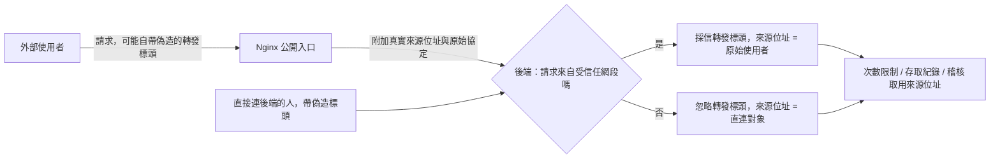

# System Analysis

## 需求依據

本 change 是基礎設施 change：`docs/specs/` 沒有直接描述「信任反向代理」的規格，業務規格（01-05）只提供「為什麼來源 IP 要對」的需求面。依 `openspec/config.yaml` 的規定，沒有可追溯的規格條文時改追溯 issue、ADR 與規則文件的條號（spec-migration D4；維護者 2026-11-20 裁定，#503）。以下依需求依據順序列出（基準 commit `af76e96`）。

| 來源                                                     | 章節／編號                                                                                       | 摘要（一句）                                                                                                                                   |
| :------------------------------------------------------- | :----------------------------------------------------------------------------------------------- | :--------------------------------------------------------------------------------------------------------------------------------------------- |
| GitHub issue #566                                        | 使用情境、需求目標、驗收條件（三條）                                                             | 後端在 Nginx 後面拿不到真實來源 IP；要信任 Nginx 所在網段、不信任外部偽造的轉發標頭、設定寫進 `.env.example` 與 `architecture.mdx` §部署與維運 |
| `docs/specs/01-account/05-login-state.mdx`               | §規格 §登入與申請的嘗試次數；§已確認決議 Q3                                                      | 登入連續失敗 10 次擋 30 分鐘、申請重設密碼每小時 5 次、延續登入狀態不計次；規格只說「同一個人」，沒有說用什麼辨識（帳號、來源 IP 或兩者）      |
| `docs/specs/01-account/05-login-state.mdx`               | §業務流程                                                                                        | 登入狀態的三種結束方式；本次不改流程，只提供次數限制的「來源」依據                                                                             |
| `docs/development/adr/004-auth-and-security.mdx`         | D7（不做全域速率限制，登入失敗鎖定用 Redis 計數）背景表第 4 列                                   | 明寫「放在 Nginx 後面時，要先信任代理的來源 IP，否則所有人共用一個額度」，是本 issue 的直接前置條件                                            |
| `docs/development/architecture.mdx`                      | §容器視圖（Nginx 是唯一公開入口）；§部署與維運（正式環境列、安全標頭耦合備註）                   | 只有 Nginx 對外；Cloudflare 可選，且「邊緣代理可能改寫或移除 origin 的標頭」；本節是驗收條件要求寫入設定的位置                                 |
| `docs/development/adr/008-deployment-and-operations.mdx` | D1（Compose 加 Nginx）、D6（audit_events）、§待決第 1 列（Cloudflare 到 origin 的 TLS 模式未決） | 部署形狀的依據；稽核列是來源 IP 的消費端之一；Cloudflare 那一段與「轉發協定」有關但未決                                                        |
| `docs/diagrams/architecture/backend-modules.mdx`         | 「還沒有」風險表第 4 列（信任反向代理的來源 IP，指向 #566）；§存取紀錄                           | 把本 issue 列為已知缺口；同頁寫明存取紀錄不記來源 IP                                                                                           |
| `openspec/specs/server-logging/spec.md`                  | Requirement 伺服器紀錄不含請求內容；Requirement 伺服器程式內建的存取紀錄已關閉                   | 存取紀錄 MUST NOT 寫入來源 IP；內建存取紀錄已被程式關閉                                                                                        |
| `openspec/specs/container-runtime/spec.md`               | Requirement 前端服務是唯一公開入口；Requirement 設定範例檔列出所有設定且不含 secret              | 只有前端（Nginx）服務發布主機埠，後端不可從主機直連；`.env.example` 必須列出所有設定                                                           |
| `openspec/specs/runtime-config/spec.md`                  | Requirement 其餘設定都有預設值；兩層編排檔把 LOG_LEVEL 傳進後端容器                              | 新增設定要有預設值、要走編排檔傳入的既有做法                                                                                                   |
| `docs/development/rules/security-agent-rules.mdx`        | S9（log 不帶 PII 與 secret）                                                                     | 來源 IP 是否算 PII、能不能進 log，要對照這條                                                                                                   |

## 範圍

- 這次包含：
  - 後端在 Nginx 後面時，把「原始來源 IP」當作請求的來源位址；只在請求確實來自受信任的 Nginx 時才採信轉發標頭。
  - 直接打後端、自帶偽造轉發標頭的請求不被採信（要有測試）。
  - Nginx 對後端送出的轉發標頭（來源鏈與原始協定）的設定核對。
  - 受信任網段的設定值：寫進 `.env.example` 與 `architecture.mdx` §部署與維運，並傳入兩層編排檔。
- 這次不包含：
  - 登入失敗鎖定、全域限流本身（規格 01-05 Q3 的計數與鎖定）：它們是這份設定的消費者，另案實作。
  - 稽核列（`audit_events`）是否新增來源 IP 欄位；存取紀錄是否改為記來源 IP（見待決 6）。
  - Cloudflare 或其他外層邊緣代理的真實 IP 還原；HSTS 與邊緣的 TLS 模式（ADR-008 §待決第 1 列）。
  - `docs/specs/` 的任何需求文字（維護者擁有，只能經 `spec-writing` 修改）。
  - 畫面：本 change 沒有使用者可見的畫面。

## 業務流程

規格書 01-05 的「業務流程」章節描述登入狀態的三種結束方式，與來源 IP 無關；本 change 不改變任何一段流程，也不新增使用者可見的流程。因此：

| 規格              | 業務流程                      | 本次涉及                                                   |
| :---------------- | :---------------------------- | :--------------------------------------------------------- |
| 規格 01-05        | §業務流程（登入狀態結束方式） | 不涉及；僅其 §規格 §登入與申請的嘗試次數是來源 IP 的消費者 |
| 規格 01-01、01-03 | 登入、重設密碼申請            | 不涉及；兩頁把次數限制交給 01-05                           |

不適用：依規格 01-05 §業務流程，不另畫。下圖只畫本次新增的「請求怎麼帶著來源資訊走到後端」這一條基礎設施路徑，因為它沒有任何規格流程可引用（規格書沒有這一段），並建議見待決 9。

交界處：由 Nginx（部署者設定）交給後端（部署者設定受信任網段）；後端不發布主機埠（`container-runtime` 公開入口 Requirement），所以「直接連後端」只可能發生在編排網路內或沒有 Nginx 的執行方式（本機開發、單獨起容器）。

## 跨模組依賴

**現況盤點（evidence，基準 `af76e96`）**

| 項目                   | 現況                                                                                                                                                                                                                                           | 證據                                                                                                         |
| :--------------------- | :--------------------------------------------------------------------------------------------------------------------------------------------------------------------------------------------------------------------------------------------- | :----------------------------------------------------------------------------------------------------------- |
| 後端怎麼啟動（容器）   | `CMD ["uvicorn", "app.main:create_app", "--factory", "--host", "0.0.0.0", "--port", "8000"]`，沒有 `--proxy-headers`、沒有 `--forwarded-allow-ips`，也沒有設環境變數                                                                           | `backend/Dockerfile:60`                                                                                      |
| 編排檔是否覆寫啟動命令 | 後端服務沿用映像的 CMD（註解明寫不重複）；只有 `migrate` 覆寫成 `alembic upgrade head`                                                                                                                                                         | `docker-compose.yml:44`、`docker-compose.yml:32`、`docker-compose.prod.yml:59`                               |
| 編排網路               | 兩份編排檔都沒有宣告 `networks:` 或 `subnet`，用 Compose 預設網路，Nginx 容器位址不固定                                                                                                                                                        | `docker-compose.yml`、`docker-compose.prod.yml`（grep `networks\|subnet` 無命中）                            |
| 後端傳入的環境變數     | 只有 `CORS_ALLOWED_ORIGINS`、`CORS_ALLOW_CREDENTIALS`、`SQLITE_PATH`（或 `DATABASE_URL`）、`LOG_LEVEL`、正式層另釘 `API_DOCS_ENABLED`                                                                                                          | `docker-compose.yml:51-59`、`docker-compose.prod.yml:75-85`                                                  |
| 本機啟動               | `pnpm run dev` 起 `uv run uvicorn ... --reload --port <BACKEND_PORT>`，前端 Vite 刻意「No proxy」，瀏覽器直連後端                                                                                                                              | `scripts/dev.mjs:53`、`frontend/vite.config.*:18`                                                            |
| 其他起 uvicorn 的地方  | 測試以子行程起 uvicorn（先例）：啟動檢查與內建存取紀錄關閉檢查                                                                                                                                                                                 | `backend/tests/integration/test_app_assembly.py:290`、`backend/tests/integration/test_access_log.py:490-520` |
| Nginx 設定在哪         | 在 repo 內：`frontend/nginx.conf`，由 `frontend/Dockerfile` 複製為 `conf.d/default.conf`                                                                                                                                                       | `frontend/nginx.conf:1-5`                                                                                    |
| Nginx 現在送什麼       | `/api/v1/` 區塊已送 `X-Real-IP $remote_addr`、`X-Forwarded-For $proxy_add_x_forwarded_for`、`X-Forwarded-Proto $scheme`、`X-Forwarded-Host $host`                                                                                              | `frontend/nginx.conf:64-68`                                                                                  |
| Nginx 註解指向本 issue | 「sending it only over HTTPS would mean trusting X-Forwarded-Proto, which belongs to #566」                                                                                                                                                    | `frontend/nginx.conf:27-30`                                                                                  |
| `.env.example`         | 沒有任何代理相關設定；後端區段只有 CORS、API 文件、`LOG_LEVEL`、`SQLITE_PATH`、`DATABASE_URL`                                                                                                                                                  | `.env.example:16-58`                                                                                         |
| 後端設定類別           | `Settings` 只有 `cors_allowed_origins`、`cors_allow_credentials`、`api_docs_enabled`、`log_level`；沒有代理相關欄位                                                                                                                            | `backend/app/core/config.py:87-134`                                                                          |
| 目前哪裡讀 client IP   | 沒有任何地方。`client.host`、`request.client`、`X-Forwarded`、`proxy-headers`、`forwarded-allow-ips` 在 `backend/`（不含鎖檔）零命中；`AccessLogMiddleware` 的 docstring 明寫「never reads the query string, headers, client address or body」 | grep 全 repo；`backend/app/core/middleware.py:296`                                                           |
| 後端模組               | 只有 `health`，沒有登入、沒有稽核、沒有次數限制                                                                                                                                                                                                | `backend/app/modules/`（僅 `health`）；`docs/diagrams/architecture/backend-modules.mdx` 風險表第 1 列        |
| 次數限制與稽核的位置   | 都還沒有程式；ADR-004 D7 決定登入失敗計數放 Redis，但兩層編排都沒有 Redis（`container-runtime` Requirement 前端服務是唯一公開入口）                                                                                                            | ADR-004 D7；`openspec/specs/container-runtime/spec.md`                                                       |
| 已知缺口記錄           | 「信任反向代理的來源 IP」列在後端「還沒有」表，追蹤到 #566                                                                                                                                                                                     | `docs/diagrams/architecture/backend-modules.mdx:468`                                                         |
| CI 的 compose job      | 會起兩層、經 Nginx 檢查；有安全標頭腳本，沒有任何檢查來源 IP                                                                                                                                                                                   | `.github/workflows/ci.yml`（job `compose`）、`scripts/check-security-headers.sh`                             |

**依賴與耦合**

- 前置：#563（後端入口清單）已合併，本卡原排在它後面；`backend-code-boundaries` 若要求「取得來源 IP」走單一入口，需要與它對照（待決 4）。
- 被依賴：規格 01-05 Q3 的次數限制實作（依賴後端看到正確來源）；稽核列（ADR-008 D6）若將來記來源，以及 `app.access` 若將來記來源（待決 6）。ADR-004 D7 明寫以 IP 為鍵的上限「要先有信任代理來源 IP 的設定」，所以本 change 是它們的前置。
- 共用資料／設定：`frontend/nginx.conf`（#568 的安全標頭也在同一檔，有「同一 change 同步 `scripts/check-security-headers.sh`」的耦合約定）；兩份編排檔（Lite 與正式層要同步，由 CI `docker compose config` 防漂移）；`.env.example`（`container-runtime` 要求列出所有設定）。
- 與 #568 已知耦合：`nginx.conf` 註解把 X-Forwarded-Proto 的信任留給本 issue；HSTS 與 `Secure` cookie 的前提在 architecture.mdx §部署與維運「正式環境」列。
- 角色（Actor）與權限：不涉及使用者角色或權限矩陣。涉及的是**部署者**（設定受信任網段、維護 Nginx 與編排檔）與**外部請求來源**（可能是一般使用者，也可能是攻擊者偽造標頭）；沒有被遮蔽或唯讀的資料。

## 需求矛盾

1. **issue 要求 vs `server-logging` spec**：issue 說存取 log 會拿到錯的 IP，但 `openspec/specs/server-logging/spec.md` Requirement「伺服器紀錄不含請求內容」明文「存取紀錄 MUST NOT 寫入…來源 IP」，`backend-modules.mdx` 也寫「不記…來源 IP」，`AccessLogMiddleware` 的 docstring 同樣不讀 client address（`middleware.py:296`）。現行規格下存取紀錄根本沒有 IP 可錯；若要「存取 log 拿到正確 IP」，等於要改 server-logging spec。見待決 6。
2. **issue 的 `X-Forwarded-For`／`X-Forwarded-Proto` 設定 vs 現況**：Nginx 已經送這兩個標頭（`nginx.conf:66-67`），所以 issue 的「Nginx 設定」那一半大部分已存在；缺的只是後端信任。issue 文字沒有反映這一點（見待決 7）。
3. **`nginx.conf:67` 的 `X-Forwarded-Proto $scheme` vs 「正式層必須放在 TLS 後面」**：Nginx 在 TLS 邊緣之後自己看到的是 `http`，`$scheme` 會把原始協定寫成 `http`；architecture.mdx §部署與維運 又說 `Secure` 與 `__Host-` cookie 的前提是正式層在 TLS 後面。若後端因 #566 開始信任這個標頭，值會是錯的（見待決 5）。
4. **規格 01-05「同一個人」 vs ADR-004 D7「以 IP 為鍵」**：規格 01-05 §規格 §登入與申請的嘗試次數沒有說鍵是什麼，ADR-004 D7 背景表卻假設以 IP 為鍵；兩者不矛盾但不一致，次數限制採什麼鍵會決定本 change 的來源 IP 是必要還是可選（見待決 8）。
5. 其餘與 `docs/specs/00-prd.mdx`、`glossary.mdx`：沒有找到提及來源 IP 或信任代理的文字，無矛盾。

## 待決問題

| #   | 問題                                                                                                                                                                                                                                                                                                                                                                                                                                                                                                                                                                                                                                                                                                                                                                                                                                                                                                                                                                                             | 影響                                                                                                                                                                                                                              | 狀態                                                                                                       |
| :-- | :----------------------------------------------------------------------------------------------------------------------------------------------------------------------------------------------------------------------------------------------------------------------------------------------------------------------------------------------------------------------------------------------------------------------------------------------------------------------------------------------------------------------------------------------------------------------------------------------------------------------------------------------------------------------------------------------------------------------------------------------------------------------------------------------------------------------------------------------------------------------------------------------------------------------------------------------------------------------------------------------- | :-------------------------------------------------------------------------------------------------------------------------------------------------------------------------------------------------------------------------------- | :--------------------------------------------------------------------------------------------------------- |
| 1   | **信任怎麼設：uvicorn 旗標／環境變數，還是應用程式內的中介層？** 選項 A：沿用 uvicorn 內建的代理標頭處理，以 `--proxy-headers`（預設即開）加 `--forwarded-allow-ips`（或同義環境變數 `FORWARDED_ALLOW_IPS`）限定受信任位址，不寫應用程式碼；選項 B：後端自己寫中介層讀 `X-Forwarded-For`，由 `Settings` 提供受信任網段。（來源：issue #566 範圍；`backend/Dockerfile:60` 目前沒有任何設定；`backend/app/core/config.py` 沒有對應欄位。命中：uvicorn 預設信任清單是 `127.0.0.1,::1`（原版寫「只信任 `127.0.0.1`」，經 system-design 實測更正，見 clarification P1），所以目前在容器內等於不信任 Nginx，與 issue 描述一致；`--proxy-headers` 本來就預設開啟；實作時要以 `uv.lock` 鎖的 uvicorn 0.54.0 實測，不憑記憶。）建議（非決定）：選 A，理由是 issue 範圍已點名 uvicorn 旗標、與 Hard Rule 5（不為了單一部署寫死邏輯）無牴觸、改動最小、逐位址／CIDR 比對由伺服器本身負責；B 要自己處理多層 `X-Forwarded-For` 的取值順序，容易寫錯。                                                         | 決定 `Dockerfile` CMD／環境變數、`Settings` 是否新增欄位、`config.py` 與 `runtime-config` spec 是否要有 delta、測試要打真實 uvicorn 還是只測中介層（見待決 3）。牽動 system-design、api-contract（無端點，應為「無變更」）、tasks | 已決（見 clarification Q1）：選項 A                                                                        |
| 2   | **受信任網段怎麼表示：環境變數名稱、預設值、Lite 與正式層是否相同？** 現況編排檔沒有宣告網路或子網段（兩份 compose 無 `networks:`／`subnet`），Nginx 容器位址不固定。選項 A：兩份編排檔宣告固定子網段，環境變數 `FORWARDED_ALLOW_IPS` 預設該子網段（容器內採用）；選項 B：預設信任私有位址區段（`10.0.0.0/8`、`172.16.0.0/12`、`192.168.0.0/16`），不改編排網路；選項 C：只信任 Nginx 的容器名稱解析後的位址（啟動時查，位址變動要重啟）。環境變數名稱：沿用 uvicorn 原生的 `FORWARDED_ALLOW_IPS`（零程式碼）或自訂如 `TRUSTED_PROXY_IPS` 再轉傳（多一層）。（來源：issue 驗收第 3 條；`.env.example:16-58`；`docker-compose.yml:51-59`；`runtime-config` Requirement 其餘設定都有預設值。）建議（非決定）：A 加原生名稱，因為「只信任 Nginx 所在網段」最貼近 issue 字面，且 B 會讓同網路內任何容器都能偽造；永遠不允許 `*`（比照 Hard Rule 7 CORS 的精神，需有人確認是否要把拒絕 `*` 變成啟動檢查，這部分見待決 3）。兩層編排檔要同步。                                                         | 決定 `.env.example`、兩份編排檔、`architecture.mdx` §部署與維運要寫什麼值；若選 A 要改兩份 compose 的網路宣告，會影響 `container-runtime` spec 的 delta 與 CI `compose` job 的既有檢查；牽動 system-design、design、tasks         | 已決（見 clarification Q2）：選項 A 的變體 A1（只信任 Nginx 單一固定位址，不信任整段子網路）               |
| 3   | **偽造標頭測試怎麼寫：單元／整合（起真實 uvicorn 子行程）還是 e2e（經 Compose 的 Nginx）？** 驗收第 2 條要求「直接打後端、自帶 `X-Forwarded-For` 的請求不被當成真實 IP（有測試）」。注意：現有的 `client` fixture 是 httpx 直接接 ASGI（`backend/tests/conftest.py:177`），不會經過 uvicorn 的代理標頭處理，**無法**證明本需求；必須起真實 uvicorn。選項 A：整合測試，比照 `test_access_log.py:490-520` 以子行程起 uvicorn，一次不信任（預設）、一次把測試用戶端位址放進受信任清單，各自送帶偽造標頭的請求，用一個回報來源位址的測試用探針取值（見 `backend/tests/probe.py`）；選項 B：e2e／CI `compose` job，經 Nginx 與直連各打一次；選項 C：A 加 B。「經 Nginx 看到原始來源」那條（驗收第 1 條）在容器網路內很難由整合測試證明，且 Docker 發布埠的來源位址可能是橋接閘道而不是真實用戶端（待實測，非本分析結論）。建議（非決定）：驗收第 2 條走 A（可在 SQLite 與 PostgreSQL 兩輪都跑，符合 testing-agent-rules 的分層）；驗收第 1 條走 C 的 compose 檢查，並先實測 Docker 發布埠的來源位址。 | 決定測試放在 `backend/tests/integration` 還是 `e2e/`、CI 是否需要改 `compose` job（它不列必過）、`ci-quality-gates` 是否要 delta；探針是否要在非測試環境存在（不得，Hard Rule 6 與安全面）；牽動 tasks 與驗收步驟                 | 已決（見 clarification Q3）：真實 uvicorn 子行程整合測試，加編排層靜態斷言與實際請求兩條檢查（接近選項 C） |
| 4   | **取得來源 IP 要不要有單一入口？** #563 剛建立後端單一入口清單與 import 邊界；若次數限制、稽核、存取紀錄各自讀 `request.client.host`，等於同一件事多份實作。選項 A：本 change 只讓 `request.client.host` 正確，不新增入口；選項 B：同時新增一個取得來源位址的共用函式並列入單一入口清單。（來源：issue #563；`openspec/specs/backend-code-boundaries`；現況零處讀 client IP。）建議（非決定）：A，因為現在沒有任何消費者，等第一個消費者（登入次數限制）出現時再抽，符合「不過度抽象」；B 只在會有第二個消費者時才有意義。                                                                                                                                                                                                                                                                                                                                                                                                                                                                       | 決定是否動 `backend-code-boundaries` spec 與 `backend-agent-rules` 清單；影響 system-design 的範圍與 tasks 的條數                                                                                                                 | 已決（見 clarification Q4）：選項 A                                                                        |
| 5   | **`X-Forwarded-Proto` 要不要也被後端信任，值從哪來？** `nginx.conf:67` 送 `$scheme`，在 Cloudflare 等 TLS 邊緣之後會是 `http`；`nginx.conf:27-30` 又明寫 HSTS 與是否信任這個標頭歸 #566；architecture.mdx 說 `Secure` 與 `__Host-` cookie 的前提是在 TLS 後面。選項 A（原版：後端只還原來源位址，不信任協定標頭，保持現狀，cookie 的 `Secure` 由設定固定。**做不到**：uvicorn 的同一份信任清單同時管 `X-Forwarded-For` 與 `X-Forwarded-Proto`，無法只信其一，經 system-design 實測更正，見 clarification P1）；選項 B：後端信任協定標頭，Nginx 改用 `map` 保留上游邊緣送來的協定值（只在上游受信任時）；選項 C：本 issue 不處理，另開 issue。（來源：`frontend/nginx.conf:27-30,67`；`docs/development/architecture.mdx` §部署與維運「正式環境」列；ADR-008 §待決第 1 列，Cloudflare 到 origin 的 TLS 模式未決。）建議（非決定）：C 或 A：issue 範圍寫了 `X-Forwarded-Proto`，但 Cloudflare 模式未決，今天沒有程式讀協定，信任一個值錯誤的標頭比不信任更糟；需維護者確認 issue 範圍是否含協定。  | 決定 `nginx.conf` 是否改（牽動 `scripts/check-security-headers.sh` 與 #568 的耦合約定）、後端是否讀協定、驗收文字要不要改；若寫進 issue 範圍就要與 ADR-008 §待決第 1 列一併處理                                                   | 已決（見 clarification Q5）：不另外處理（不採 A，也不另開 issue；已知限制寫進 architecture.mdx）           |
| 6   | **「存取 log 與稽核記錄拿到正確 IP」與現行規格衝突：誰記 IP、記不記？** `server-logging` spec 明文存取紀錄不記來源 IP（見需求矛盾 1）；稽核列（`audit_events`）目前沒有欄位定義來源 IP（`architecture.mdx` §稽核與可追溯、資料表字典未列）；來源 IP 是否算 PII 要對照 `security-agent-rules` S9。選項 A：維持現行規格，本 change 只讓「次數限制」將來可用，存取紀錄與稽核不記 IP，並把 issue 的驗收／使用情境文字更正；選項 B：本 change 同時放寬 `server-logging` spec，存取紀錄加來源 IP（需跳脫、需確認隱私）；選項 C：稽核列另案加欄位。（來源：issue #566 使用情境；`openspec/specs/server-logging/spec.md` Requirement 伺服器紀錄不含請求內容；`backend-modules.mdx:325`。）建議（非決定）：A。放寬已定案的 log 規格不屬於「讓代理設定正確」，且會碰 PII 與保留政策（ADR-008 §待決第 3 至 5 列）。                                                                                                                                                                                         | 決定 `server-logging` spec 是否有 delta、`AccessLogMiddleware` 與其測試是否要改、稽核資料表是否動；若選 B 或 C，範圍與 tasks 大幅擴大，且涉及 `docs/specs/` 以外的規則（S9）判讀                                                  | 已決（見 clarification Q6）：選項 A                                                                        |
| 7   | **Nginx 設定在範圍內嗎？** Nginx 設定已存在於 `frontend/nginx.conf`，且已送 `X-Forwarded-For`、`X-Forwarded-Proto`、`X-Real-IP`、`X-Forwarded-Host`（`nginx.conf:64-68`）。issue 把「Nginx 設定」寫成待做項。選項 A：視為已完成，本 change 只做核對與註解更新（例如移除或更新 `nginx.conf:30` 的「belongs to #566」說明）；選項 B：同時強化，例如在 Nginx 對公開入口收到的 `X-Forwarded-For` 做覆寫而不是附加（`$remote_addr` 取代 `$proxy_add_x_forwarded_for`），避免外部自帶的鏈延伸進後端（原版將此視為可能必要；**實測不必要**：Nginx 附加加上 uvicorn 由右到左取第一個不受信任位址的規則，已能擋下偽造鏈，見 clarification P1）；選項 C：只信任 `X-Real-IP` 而非 `X-Forwarded-For`。（來源：issue #566 範圍；`frontend/nginx.conf:64-68`。）建議（非決定）：先 A，並視待決 1 的取值方式決定要不要 B：原版：若後端取「最右側不受信任位址」就已經能擋住外部預先放入的鏈，不必改 Nginx；需在實測中確認。實測已確認，不改 Nginx。                                                              | 決定 `frontend/nginx.conf` 是否有 delta，若有，需同步 `scripts/check-security-headers.sh`（#568 耦合）與 CI `compose` 觸發條件；影響 system-design 的檔案清單                                                                     | 已決（見 clarification Q7）：選項 A（不改轉發寫法）                                                        |
| 8   | **次數限制要用什麼當鍵？** 規格 01-05 §登入與申請的嘗試次數寫「同一個人」，ADR-004 D7 背景表假設以 IP 為鍵；若只以帳號為鍵則來源 IP 的正確性對登入次數限制不是必要。（來源：規格 01-05 §已確認決議 Q3；ADR-004 D7；`docs/specs/01-account/05-login-state.mdx` §規格。）建議（非決定）：不在本 change 裁定，但要在 proposal 把本 change 的價值寫成「前置條件」，而不是「次數限制的必要條件」；真正的鍵留給實作次數限制的 change（也要確認該 change 需要 Redis，兩層編排目前都沒有）。                                                                                                                                                                                                                                                                                                                                                                                                                                                                                                             | 影響 proposal 的 Why 與優先序；若需求端要求以 IP 為鍵，本 change 的優先度與測試強度要上調；不影響本次的實作方式                                                                                                                   | 已決（見 clarification Q8）：本 change 不決定（定位為前置條件）                                            |
| 9   | **規格書沒有「信任代理／來源 IP」的業務流程章節。** 本 change 沒有對應規格，只能追溯到 ADR 與 issue。是否要在 `docs/specs/` 補一份（例如規格 01-05 說明次數限制依什麼辨識）由維護者決定。（來源：`docs/specs/01-account/05-login-state.mdx` 無相關文字；`docs/specs/` 全文 grep 無命中。）建議（非決定）：不補；這是部署面的前置設定，業務面只在規格 01-05 決定「鍵」時才需要（見待決 8），並用 `spec-writing` 處理。                                                                                                                                                                                                                                                                                                                                                                                                                                                                                                                                                                            | 影響 specs delta 的「來源」欄只能寫 ADR-004 D7、ADR-008 D1、architecture.mdx §部署與維運；若維護者決定補規格，delta 追溯對象會換                                                                                                  | 已決（見 clarification Q9）：不補規格                                                                      |
| 10  | **沒有 Nginx 的執行方式（本機 `pnpm run dev`、Lite 層單獨起後端、Vite 直連後端）要怎麼處理？** 這些情境後端直接面對用戶端，必須維持不信任任何轉發標頭（uvicorn 預設只信任 `127.0.0.1,::1`；原版寫 `127.0.0.1`，已更正）。選項 A：預設不信任（空清單或只有本機），只有編排檔把 Nginx 網段傳進去；選項 B：預設信任私有位址區段。（來源：`scripts/dev.mjs:53`；`frontend/vite.config.*:18`；`backend/Dockerfile:60`。）建議（非決定）：A，安全預設，與待決 2 的 A 一致；`.env.example` 要標明「放在代理後面才設，直接暴露時不要設」。                                                                                                                                                                                                                                                                                                                                                                                                                                                               | 決定預設值與 `.env.example` 說明文字；也影響 `docs/development/workflow/local-development.mdx` 的環境變數表是否要新增一列                                                                                                         | 已決（見 clarification Q10）：選項 A（維持 uvicorn 預設，編排檔傳入 Nginx 位址）                           |
| 11  | **Cloudflare 在 Nginx 前面時的真實來源位址。** 此時 Nginx 看到的 `$remote_addr` 是 Cloudflare 的位址，真實用戶端在 Cloudflare 自己的標頭或轉發鏈裡；信任它需要 Nginx 另外還原。（來源：architecture.mdx §部署與維運「正式環境」列；ADR-008 D1 與 §待決第 1 列。）建議（非決定）：本 change 不含，記為已知限制寫進 `architecture.mdx` §部署與維運，並另開 issue；否則部署者放上 Cloudflare 後仍會把所有人當成同一個位址。                                                                                                                                                                                                                                                                                                                                                                                                                                                                                                                                                                         | 影響 architecture.mdx 要寫的限制說明與是否需要新 issue；不影響 tasks 條數（只多一個文件段落）                                                                                                                                     | 已決（見 clarification Q11）：記為已知限制，不另開 issue                                                   |
| 12  | **「不被信任」要不要在啟動時就擋掉危險值（例如 `*`）？** `Settings` 對 CORS 有「含 `*` 就啟動失敗」的先例（`backend/app/core/config.py:129`），但若選待決 1 的 A，信任清單由 uvicorn 讀取，應用程式不會看到；要檢查就得額外讀同一個環境變數。（來源：`config.py:117-134`；`runtime-config` Requirement 允許來源是必要設定且不得含萬用字元；Hard Rule 7 的精神。）建議（非決定）：至少在 `.env.example` 與 architecture.mdx 明寫「不得設為 `*`」；是否加啟動檢查交給 system-design 評估成本（要多一個設定欄位與測試）。                                                                                                                                                                                                                                                                                                                                                                                                                                                                           | 決定 `Settings` 是否新增一個只做驗證的欄位、`runtime-config` spec 是否有 delta、測試多一條；影響範圍小但會讓選項 A 不再是「零應用程式碼」                                                                                         | 已決（見 clarification Q12）：做（Settings 啟動檢查）                                                      |

## 參考檔案

需求與規則：

- `docs/specs/01-account/05-login-state.mdx`（§業務流程、§規格 §登入與申請的嘗試次數、§已確認決議 Q3）
- `docs/development/adr/004-auth-and-security.mdx`（D7）
- `docs/development/adr/008-deployment-and-operations.mdx`（D1、D6、§待決）
- `docs/development/architecture.mdx`（§容器視圖、§稽核與可追溯、§部署與維運）
- `docs/development/rules/security-agent-rules.mdx`（S9）
- `docs/diagrams/architecture/backend-modules.mdx`（存取紀錄、「還沒有」風險表）
- `docs/development/workflow/local-development.mdx`（環境變數表）

既有 capability：

- `openspec/specs/server-logging/spec.md`、`container-runtime/spec.md`、`runtime-config/spec.md`、`security-headers/spec.md`、`backend-code-boundaries`、`ci-quality-gates`

程式與設定：

- `backend/Dockerfile`、`backend/app/core/config.py`、`backend/app/core/middleware.py`、`backend/tests/conftest.py`、`backend/tests/probe.py`、`backend/tests/integration/test_access_log.py`、`backend/tests/integration/test_app_assembly.py`
- `frontend/nginx.conf`、`docker-compose.yml`、`docker-compose.prod.yml`、`.env.example`、`scripts/dev.mjs`、`scripts/check-security-headers.sh`、`.github/workflows/ci.yml`

進行中的其他 change：`openspec/changes/` 只有本 change（其餘在 `archive/`），沒有重疊或衝突。
