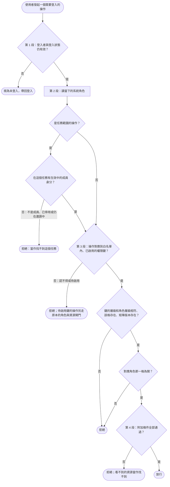
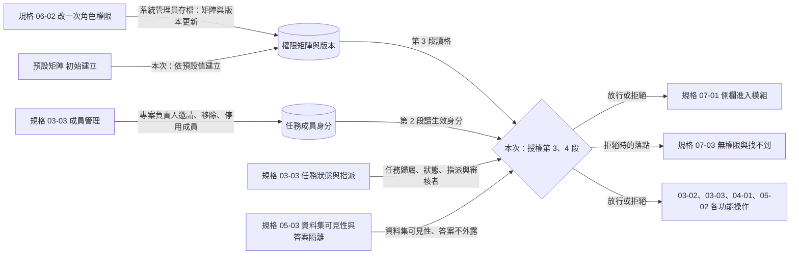

# System Analysis

本次是共用基礎建設（issue #755），把授權四段的第 3、4 段補上：操作對應到權限鍵、要求對應角色那一格開啟，再檢查附加條件。它本身不對應任何規格頁的驗收標準列（issue #755 本文），所以需求依據以 ADR 與規則文件的條號為主，06-02 角色設定的授權相關條文為輔；規格頁的業務規則仍以 `docs/specs/` 為準。

## 需求依據

依 `openspec/config.yaml` 的需求依據順序：角色、權限上限、範圍與模組劃分看 PRD；其餘業務規則看規格書；再來是 `docs/` 其他需求文件（ADR、規則、架構），最後是 `openspec/`。

| 來源                                                   | 章節／編號                                                                                                                                             | 摘要（一句）                                                                                                                                                                                  |
| :----------------------------------------------------- | :----------------------------------------------------------------------------------------------------------------------------------------------------- | :-------------------------------------------------------------------------------------------------------------------------------------------------------------------------------------------- |
| `docs/specs/00-prd.mdx`                                | §使用者角色 §角色清單                                                                                                                                  | 每人恰有一個系統角色，另在各任務有任務角色；兩者互不影響，系統角色不代表任務成員身分；Seeder 管理員權限同系統管理員                                                                           |
| `docs/specs/00-prd.mdx`                                | §使用者角色 §權限矩陣（兩張表與表下條列、矩陣之外的平台硬邊界）                                                                                        | 兩張表是預設值也是上限，只能收窄不能放寬；「06 系統管理」兩列固定；系統管理員沒有任務角色時進不了任務詳情、標記與分析；系統管理員刪除草稿任務不經任務層格                                     |
| `docs/specs/00-prd.mdx`                                | §使用者角色 §不是角色的讀取對象                                                                                                                        | 標準答案只有經授權的計分程序讀得到，矩陣裡沒有、也不會有它的格                                                                                                                                |
| `docs/specs/00-prd.mdx`                                | §模組架構與串接 §模組依賴                                                                                                                              | 06 修改角色權限 → 03、04、05 依新權限顯示與擋下操作；角色變更從下一次操作起生效                                                                                                               |
| 規格 06-02 角色設定                                    | §權限鍵與它們對應的 PRD 格 第 1–11 條                                                                                                                  | 24 個權限鍵（平台層 10、任務層 14），每一個對得上 PRD 的某一格；清單由後端白名單定義                                                                                                          |
| 規格 06-02                                             | §適用格，錯層的不存 第 1–7 條                                                                                                                          | 適用格 62 個；錯層的格不存在、不存資料；已啟用的鍵缺任何一個適用格即不合法；格只有開或關                                                                                                      |
| 規格 06-02                                             | §五個已登錄、待啟用的鍵 第 1–10 條                                                                                                                     | 5 個鍵待啟用：用它們做的授權判斷一律按認不得的鍵拒絕，但對應操作維持原本的角色與資源閘門；矩陣仍收下它們的適用列                                                                              |
| 規格 06-02                                             | §預設矩陣：每一格的初始值 第 1–8 條                                                                                                                    | 62 格的初始值，也是回歸測試的基準；標「固定」的格初始值即永久值                                                                                                                               |
| 規格 06-02                                             | §讀回的矩陣不合法時 第 1–6 條、§已確認決議 Q5                                                                                                          | 讀回的矩陣含認不得的鍵或固定格值不對 → 整份拒絕，不得還原預設值、不得只載入部分                                                                                                               |
| 規格 06-02                                             | §授權判斷的順序 第 1–8 條                                                                                                                              | 四段固定順序；認不得的鍵、缺列、錯層、沒有成員身分、成員身分停用或邀請中一律拒絕；矩陣格通過不等於能碰那一筆資料                                                                              |
| 規格 06-02                                             | §一人多任務角色：聯集與作用角色 第 1–7 條、§已確認決議 Q8                                                                                              | 任務頁面取生效成員身分的允許聯集；標記工作區的寫入只依選定的作用角色                                                                                                                          |
| 規格 06-02                                             | §固定格不能改 第 1–5 條、§已確認決議 Q6、Q13                                                                                                           | 系統管理員 × 系統管理類鍵固定開、平台成員 × 系統管理類鍵固定關、兩種系統角色 × 檢視儀表板固定開                                                                                               |
| 規格 06-02                                             | §卡控機制（授權相關各列）、§驗收標準「待啟用的鍵按認不得的鍵拒絕」「授權要過資源條件」「失效的成員身分被拒絕」「任務頁面取聯集」「工作區只依作用角色」 | 授權判斷的拒絕條件與負向情境；這幾列的 Scenario 屬 06-02（#729）的驗收，本次提供它們依賴的判斷機制                                                                                            |
| 規格 03-01 任務列表                                    | §誰看得到哪些任務 第 6–8 條、§已確認決議 Q23                                                                                                           | 「檢視任務列表」那一格缺列或關閉時任何角色都進不來；系統管理員的全平台範圍同樣要過那一格                                                                                                      |
| 規格 07-01 側欄導覽                                    | §導覽項目與可見性、§進入模組的條件                                                                                                                     | 「系統管理」依系統角色顯示；「標記作業」「資料集分析」依任務角色決定進不進得去                                                                                                                |
| 規格 07-03 無權限與找不到                              | §返回操作的去處 第 3 條、§已確認決議 Q6                                                                                                                | 被權限矩陣擋下而被帶回的那一頁若也擋下他，依那一頁自己的規則再轉一次；本來就不該知道它存在的顯示找不到                                                                                        |
| `docs/specs/glossary.mdx`                              | §權限矩陣、§平台層的權限、§任務層的權限                                                                                                                | 24 個權限鍵的中文名稱與它們對應的 PRD 格；只有中文名稱，沒有原始識別名稱                                                                                                                      |
| `docs/development/rules/security-agent-rules.mdx`      | S3 授權的四段順序                                                                                                                                      | 四段依序判定，未知值或缺失一律拒絕；系統角色與任務成員身分不得快取，矩陣列、格與版本列要快取就以版本列為失效鍵；第 4 段每一種附加條件都要有負向測試                                           |
| 同上                                                   | S4 表內「session 與快取的失效規則」、S5、S6、S10                                                                                                       | 矩陣若快取，失效鍵是版本列；答案隔離涵蓋標記員能到達的每個出口；驗收要蓋矩陣列缺失、cell 為拒絕、非該任務成員、換成另一個任務等八種情形                                                       |
| `docs/development/adr/004-auth-and-security.mdx`       | D2 授權用的角色每次從資料庫讀                                                                                                                          | 授權只看每次讀到的當前角色與帳號狀態，登入憑證內的角色只供顯示                                                                                                                                |
| 同上                                                   | D6 權限矩陣當授權輸入（含 2026-11-27 決策紀錄）                                                                                                        | 矩陣是必要輸入；未知鍵、缺列、層級不符、成員身分失效、版本列不存在一律拒絕；**第一版不快取**；第 3、4 段的檢查做在共用層，矩陣資料由 06-02 角色設定模組透過共用層定義的介面提供、在組裝點接上 |
| `docs/development/adr/003-backend-architecture.mdx`    | D12、D13、D14、§待決 第 1–2 列                                                                                                                         | 跨模組只走 service 對 service；稽核寫入在共用層；五個業務模組中 `admin` 負責 06-02、`task` 負責 03 與 04、`dataset` 負責 05，`task` 與 `dataset` 尚無程式                                     |
| `docs/diagrams/architecture/backend-modules.mdx`       | §預定模組與資料表歸屬、§42 張表的歸屬、§預期的跨模組呼叫（「權限矩陣（授權第 3、4 步）」一列）、§已知限制（授權第 3、4 步一列）                        | 矩陣與版本兩張表歸 `admin`（未實作）；權限矩陣不算跨模組呼叫，由 `admin` 經共用層介面提供；目前守門只做到第 1、2 段                                                                           |
| `docs/diagrams/architecture/data-table-dictionary.mdx` | §三、`admin` 系統管理：「角色權限矩陣」「矩陣版本號」兩節、§`admin` 組的關聯與限制                                                                     | 一列是一個適用格；權限鍵的所屬模組、固定格、啟用狀態是鍵本身的屬性，放程式側登錄表；版本只有一列；錯層格不存在由應用層守                                                                      |
| `docs/development/architecture.mdx`                    | §授權四步、§待決 第 2 列                                                                                                                               | 第 2 段的任務成員身分與第 4 段附加條件的資料由誰提供給共用層仍未決                                                                                                                            |
| `openspec/specs/auth-guard/`                           | Requirement「每一次操作都用當下的帳號狀態與系統角色」                                                                                                  | 第 1、2 段（系統角色部分）已落地；本次接在它後面                                                                                                                                              |
| `openspec/specs/user-management/`                      | Requirement「讀取帳號須具備目前的系統管理員角色與查看權限」「異動帳號須另具備管理權限才會被接受」                                                      | 既有契約已用兩個權限鍵的識別名稱，拒絕時回 403；06-01（#728）落地時會依賴本次的第 3 段                                                                                                        |
| 已歸檔 change `2026-11-26-login-auth-guard`            | system-analysis 待決 11（已決）                                                                                                                        | 維護者 2026-11-26 決定 01-01 只做第 1、2 段，權限矩陣留給 06-02                                                                                                                               |
| issue #755 本文                                        | 使用情境、驗收條件                                                                                                                                     | 第 3、4 段與矩陣介面落在共用層、共用層不 import 業務模組；矩陣以 PRD §權限矩陣 預設值 seed；未知鍵、缺列、層級不符一律拒絕；第 4 段每一種附加條件都有負向測試                                 |
| issue #753 檢查點「拆法已核准」                        | D1（維護者 2026-11-27）                                                                                                                                | 第 3、4 段排在 #720 前面，矩陣先用 PRD §權限矩陣 的預設值 seed，#729 再做編輯畫面                                                                                                             |
| issue #729 本文                                        | 驗收條件第 2 列                                                                                                                                        | 角色設定模組透過共用層定義的介面提供矩陣資料；寫有「#728 若已需要第 3 步，由 #728 依同一做法先建」                                                                                            |

### 參考檔案

- `openspec/config.yaml`
- `openspec/schemas/label-suite-sdd/templates/system-analysis.md`
- `docs/specs/00-prd.mdx`
- `docs/specs/glossary.mdx`
- `docs/specs/06-admin/02-role-settings.mdx`
- `docs/specs/03-task-management/01-task-list.mdx`
- `docs/specs/07-shared/01-sidebar.mdx`
- `docs/specs/07-shared/03-denied-and-not-found.mdx`
- `docs/development/rules/security-agent-rules.mdx`
- `docs/development/adr/003-backend-architecture.mdx`
- `docs/development/adr/004-auth-and-security.mdx`
- `docs/development/architecture.mdx`
- `docs/diagrams/architecture/backend-modules.mdx`
- `docs/diagrams/architecture/data-table-dictionary.mdx`
- `backend/app/core/auth.py`
- `backend/pyproject.toml`（import-linter 契約 `Core does not depend on modules` 與 independence 契約）
- `openspec/specs/auth-guard/spec.md`
- `openspec/specs/user-management/spec.md`
- `openspec/changes/archive/2026-11-26-login-auth-guard/system-analysis.md`
- GitHub issue #755（本文與檢查點）、#753（檢查點「拆法已核准」D1）、#729、#728、#720、#721（本文與 blocked-by）

## 範圍

- 這次包含：
  - 授權第 3 段：把一個操作對應到白名單內、已啟用的權限鍵與它所屬的層（平台層或任務層），要求對應角色那一格為開啟；認不得的鍵、待啟用的鍵、缺列、錯層、矩陣版本不存在一律拒絕（S3、ADR-004 D6、規格 06-02 §授權判斷的順序 第 3、5 條、§五個已登錄、待啟用的鍵 第 3 條）
  - 授權第 4 段：在格通過之後檢查附加條件，格為開也蓋不過它們；每一種附加條件都有負向測試（S3 檢查方式、issue #755 驗收條件第 3 列）。附加條件的確切清單見待決問題 7
  - 24 個權限鍵的白名單與鍵本身的屬性（所屬模組、層級、固定格、啟用狀態），以及依預設值建立的初始矩陣與矩陣版本（issue #755、#753 D1；預設值逐格見規格 06-02 §預設矩陣）
  - 矩陣資料經共用層定義的介面取得，共用層不依賴任何業務模組（ADR-004 D6、issue #755 驗收條件第 1 列）
- 這次不包含：
  - 角色設定頁的檢視、編輯、儲存、樂觀鎖、操作紀錄與讀回不合法時的畫面（規格 06-02 §進到角色設定、§維護角色權限配置、§查看操作紀錄，歸 #729）
  - 任何規格頁的功能端點與畫面；第一批使用者是 #720（07-01）與 #721（07-03），任務層的使用者是 03-02、03-03、04-01、05-02 的子卡（#759、#763、#773、#782）
  - 授權第 1 段與第 2 段的系統角色部分（已由 `login-auth-guard` 落地，見 `openspec/specs/auth-guard/`）
  - 任務成員身分、任務歸屬與狀態、指派與審核者、資料集可見性這些資料本身（屬 `task`、`dataset` 模組，尚無程式）；本次是否要把第 2 段的任務成員身分一起做，見待決問題 2
  - 修改 `docs/specs/`、`docs/specs/00-prd.mdx` 與 `design/prototype/`（issue #755 本文）
  - 畫面：本次沒有任何畫面變更（issue #755 不含畫面；是否要提供給畫面用的權限讀取見待決問題 16）

### 涉及角色

角色名稱依 PRD §角色清單 與術語表。本次不新增角色、不放寬任何格；下表是本次的判斷機制對每個角色會怎麼作用。

| 角色             | 在第 3 段用哪一層的格                      | 本次涉及的固定格                         | 第 4 段          | 說明                                                                                                                                                                                   |
| :--------------- | :----------------------------------------- | :--------------------------------------- | :--------------- | :------------------------------------------------------------------------------------------------------------------------------------------------------------------------------------- |
| 未登入的訪客     | 不到第 3 段                                | —                                        | —                | 第 1 段就擋下（`auth-guard`）                                                                                                                                                          |
| 平台成員         | 平台層 10 鍵                               | 5 個系統管理類鍵固定關；檢視儀表板固定開 | 適用             | 矩陣不能把他的系統管理類格改成開（06-02 §固定格不能改 第 4 條）                                                                                                                        |
| 系統管理員       | 平台層 10 鍵                               | 5 個系統管理類鍵固定開；檢視儀表板固定開 | 適用             | 系統角色不隱含任何任務角色；沒有任務角色時拿不到任何任務層鍵（PRD §權限矩陣 表下第 2 條、06-02 §授權判斷的順序 第 6 條）                                                               |
| Seeder 管理員    | 同系統管理員                               | 同系統管理員                             | 適用             | 矩陣沒有這一欄，PRD §角色清單 寫明權限同系統管理員；不可被移除的規則在 06-01，不在本次                                                                                                 |
| 專案負責人       | 任務層 14 鍵（只限自己參與、生效中的任務） | 無                                       | 適用             | 預設開：檢視任務詳情、編輯任務設定、管理成員、推進生命週期*、刪除草稿任務*、處置最終例外*、裁定爭議*、看任務統計、看品質分析、匯出資料、看與匯入資料版本（* 為待啟用，判斷時一律拒絕） |
| 審核員           | 任務層 14 鍵                               | 無                                       | 適用             | 預設開：檢視任務詳情、以審核員身分審核、看任務統計、看品質分析、看資料匯入與版本                                                                                                       |
| 標記員           | 任務層 14 鍵                               | 無                                       | 適用，含答案隔離 | 預設只開「以標記員身分標記」；他能到達的任何地方都不得出現標準答案或測試集資訊（PRD §權限矩陣 表下第 4 條、Hard Rule 6、S5）                                                           |
| 經授權的計分程序 | 不是角色，矩陣沒有它的格                   | —                                        | —                | 唯一讀得到標準答案的對象（PRD §不是角色的讀取對象）；本次不得為它新增任何格或可讀角色                                                                                                  |

會被遮蔽或唯讀的資料：

- 矩陣資料本身只有系統管理員讀得到；平台成員不經頁面直接讀取也讀不到（06-02 §怎麼進來、誰進得來 第 8 條、§卡控機制）。本次不提供任何讀取矩陣的對外操作，這條由 #729 落地
- 標準答案與測試集資訊對所有使用者角色都不可讀（PRD §不是角色的讀取對象）；第 4 段的答案隔離檢查是這條在授權層的落點
- 審核員的「唯讀」不是第三種格值，而是「檢視任務詳情」開、「編輯任務設定」關的組合（06-02 §適用格 第 7 條）

## 業務流程

授權判斷本身沒有規格書的「業務流程」章節：它的順序寫在規格 06-02 §授權判斷的順序（屬 §規格，不是 §業務流程），做法寫在 ADR-004 D6、S3 與 architecture §授權四步。依 sa 的寫法，需求依據不是 `docs/specs/` 的業務流程時才畫完整流程，所以下面先列引用，再畫授權判斷的完整流程與跨規格的串接圖；要不要把它補回規格書記在待決問題 15。

| 規格       | 業務流程                            | 本次涉及                                                                            |
| :--------- | :---------------------------------- | :---------------------------------------------------------------------------------- |
| 規格 06-02 | §業務流程 `改一次角色權限`          | 不涉及流程本身（屬 #729）；只涉及它的結果：矩陣與版本被更新後，下一次授權判斷依新值 |
| 規格 06-02 | §業務流程 `查誰改了什麼`            | 不涉及                                                                              |
| 規格 03-01 | §業務流程 `進到任務列表` 的前置條件 | 只涉及前置條件「檢視任務列表那一格允許」的判斷                                      |
| 規格 07-01 | §業務流程 `從側欄進入模組` 的 E2    | 只涉及「需要任務角色但沒有」的判斷依據；畫面歸 #720                                 |

### 授權判斷（完整流程）

依 06-02 §授權判斷的順序、ADR-004 D6、S3。第 1 段與第 2 段的系統角色部分已存在，本次從第 2 段的任務成員身分（是否在範圍內見待決問題 2）接到第 4 段。

- 任務範圍的操作在第 3 段要取「生效成員身分的允許聯集」，標記工作區的寫入則只看選定的作用角色（06-02 §一人多任務角色）；本次機制要不要先支援這兩種取法見待決問題 11
- 系統管理員刪除草稿任務、系統管理員的全平台統計是「矩陣之外」的路徑，不經任務層格（PRD §權限矩陣 平台硬邊界、06-02 §五個已登錄、待啟用的鍵 第 9、10 條）；本次要不要涵蓋見待決問題 10

### 跨規格／跨模組的串接

模組之間的交接以 PRD §模組依賴 為準：06 修改角色權限 → 03、04、05 依新權限擋下操作；03 任務設定與成員指派 → 04、05。

- 交界處的資料來源只有矩陣一項已有定案的接法（ADR-004 D6）；任務成員身分、任務狀態與指派、資料集可見性的提供方式都還沒定（architecture §待決 第 2 列），而且 `task`、`dataset` 模組還沒有程式，見待決問題 1、2

## 跨模組依賴

需要先存在的：

| 依賴                                                                                            | 現況                                          | 本次怎麼用                                                                         |
| :---------------------------------------------------------------------------------------------- | :-------------------------------------------- | :--------------------------------------------------------------------------------- |
| 授權第 1 段與第 2 段的系統角色（`auth-guard` capability；共用層的取得目前使用者）               | 已落地（`login-auth-guard`，2026-11-26 歸檔） | 第 3 段接在它之後；它目前只帶系統角色，沒有任何任務成員身分                        |
| 共用層不 import 業務模組的契約（`backend/pyproject.toml` 的 `Core does not depend on modules`） | 已存在                                        | 矩陣介面定義在共用層、由模組實作、在組裝點接上，比照第 1、2 段的做法（ADR-004 D6） |
| `admin` 模組（06-02；矩陣與版本兩張表的歸屬，ADR-003 D14、backend-modules §42 張表的歸屬）      | 未實作；#729 才建 06-02                       | 誰在本次提供矩陣資料與初始矩陣見待決問題 5                                         |
| `task` 模組（03、04；任務、任務成員身分、審核名冊、指派等表）                                   | 未實作；第一張建立任務的卡是 #759             | 第 2 段成員身分與第 4 段多數附加條件的資料來源，見待決問題 1、2                    |
| `dataset` 模組（05；資料集與受控的私有項目）                                                    | 未實作                                        | 第 4 段「資料集可見性」「答案隔離」的資料來源，見待決問題 1、7                     |
| 共用稽核紀錄（放共用層，ADR-003 D13）                                                           | 未實作，#757                                  | 初始建立矩陣要不要留稽核見待決問題 13；本次不依賴它也能完成第 3、4 段              |

會被後續依賴的：

| 後續                                                              | 依賴本次的哪一部分                                                 | 依據                                                                                                                                            |
| :---------------------------------------------------------------- | :----------------------------------------------------------------- | :---------------------------------------------------------------------------------------------------------------------------------------------- |
| #720 07-01 側欄導覽、#721 07-03 無權限與找不到                    | 平台層的判斷；被擋下時的落點                                       | issue #755 本文、blocked-by；07-01 §導覽項目與可見性、07-03 §返回操作的去處                                                                     |
| #759、#763、#773、#782（03-02、03-03、04-01、05-02 的第一張子卡） | 任務層的判斷與附加條件                                             | blocked-by #755                                                                                                                                 |
| #728 06-01 使用者管理                                             | 平台層兩個系統管理類鍵（進入使用者管理頁、新增／編輯／停用使用者） | ADR-003 D14「`account` 同時有本人自助與系統管理員管理別人的端點，授權要靠共用層的矩陣檢查區分」；`openspec/specs/user-management/` 已用這兩個鍵 |
| #729 06-02 角色設定                                               | 白名單、鍵屬性、矩陣介面與初始矩陣；它再加上編輯、樂觀鎖與稽核     | issue #729 驗收條件第 2 列                                                                                                                      |

共用的資料：

- 權限矩陣與矩陣版本：06-02 寫、所有授權判斷讀（資料表字典「角色權限矩陣」讀取權限一欄：「系統管理員讀全部；授權判斷本身讀它」）
- 權限鍵白名單與鍵屬性：不在資料裡，在程式側的登錄表（資料表字典「角色權限矩陣」一節的「八個去處」表）；06-02 的畫面、儲存驗證與授權判斷共用同一份
- 任務成員身分：03-03 寫，授權第 2 段讀；不得快取（S3）

與既有 capability 的關係：

- `auth-guard`：本次延伸它的授權順序，不改它既有的 Requirement（第 1、2 段的回應與行為不變）
- `user-management`：既有契約已寫「具備 `admin.user_management.view`／`manage` 才接受、拒絕回 403」，本次提供這兩個鍵的判斷機制；鍵的識別名稱見待決問題 4
- `backend-code-boundaries`：本次必須維持「共用層不依賴業務模組」「業務模組之間不得互相 import」兩條
- 沒有進行中的其他 change 與本次重疊（`openspec/changes/` 只有本 change）

## 需求矛盾

| #   | 矛盾                                                                                                                                                                                                                                                                                                                                                                              | 來源                                                                                                                                  | 對應待決問題 |
| :-- | :-------------------------------------------------------------------------------------------------------------------------------------------------------------------------------------------------------------------------------------------------------------------------------------------------------------------------------------------------------------------------------- | :------------------------------------------------------------------------------------------------------------------------------------ | :----------- |
| C1  | 矩陣要不要快取：ADR-004 D6 決定「第一版不快取；若要快取，失效鍵是矩陣版本列，且須先驗證失效協定」，issue #755 本文寫「矩陣列可依矩陣版本列快取（S3）」，S3 寫矩陣列「是典型的快取對象，要快取就以版本列為失效鍵」                                                                                                                                                                 | ADR-004 D6 §決定；issue #755 §使用情境 第 3 點；security-agent-rules S3                                                               | 6            |
| C2  | 第 4 段附加條件的清單在四處寫法不同：S3 與 architecture §授權四步、ADR-004 D6 寫「任務歸屬與狀態、指派與審核者身分、資料集可見性、答案隔離」；issue #755 寫「任務歸屬與狀態、任務成員身分、指派與審核者身分、答案隔離」（少資料集可見性，多出 S3 歸在第 2 段的成員身分）；06-02 §授權判斷的順序 第 4 條寫「任務擁有權、任務狀態、指派、答案隔離」（沒有審核者身分與資料集可見性） | 如左                                                                                                                                  | 7            |
| C3  | 任務成員身分放哪一段、由誰做：S3 與 06-02 把它放在第 2 段；`login-auth-guard` 只做了第 2 段的系統角色（已決 sa-11）；issue #755 標題寫「授權第 3、4 步（權限矩陣與任務成員身分檢查）」、本文把成員身分列在第 4 段；architecture §待決 第 2 列仍未決提供者。第 2 段的成員身分目前沒有任何一張卡明確擁有                                                                            | security-agent-rules S3；06-02 §授權判斷的順序 第 2 條；`login-auth-guard` 待決 11；issue #755 標題與本文；architecture §待決 第 2 列 | 2            |
| C4  | 初始矩陣的依據：issue #755 與 #753 D1 寫「以 PRD §權限矩陣 的預設值 seed」，但 PRD 只有依模組的 R/C/E/D，沒有權限鍵；逐鍵逐格的初始值寫在 06-02 §預設矩陣（逐格比對後與 PRD 上限一致，未發現放寬；四個待啟用任務層鍵的「專案負責人開」是 06-02 依維護者裁定載明，不是 PRD 直接讀出）                                                                                              | issue #755；#753 D1；PRD §權限矩陣；06-02 §預設矩陣 第 2、6、7 條                                                                     | 3            |
| C5  | 誰先建第 3 段：issue #729 本文寫「#728 若已需要第 3 步，由 #728 依同一做法先建，本單改為接上資料來源」，但 #753 已拆出 #755 專做這件事；而 #728、#729 的 blocked-by 都沒有 #755（#728 只有 #727、#749、#750、#757；#729 只有 #728、#749）                                                                                                                                         | issue #729 本文；GitHub blocked-by（2026-11-27 以 REST 讀取）                                                                         | 14           |
| C6  | 拒絕時的回應：`openspec/specs/user-management/` 寫平台層權限不足回 403；`openspec/config.yaml` 的 api-contract 規則與 architecture §授權四步 第 4 條要求看不到的資源回找不到、不洩漏存在；07-03 把「本來就不該知道它存在」顯示成找不到、06-02 E1 把平台成員導回儀表板。哪一種拒絕對應哪一種結果，規則分散在四處，沒有一處把第 2、3、4 段的拒絕逐一對上                            | 如左                                                                                                                                  | 12           |

## 待決問題

| #   | 問題                                                                                                                                                                                                                                                                                                                                                                                                                                                                                                                                                                       | 影響                                                                                                                                                                                                                                                                 | 狀態 |
| :-- | :------------------------------------------------------------------------------------------------------------------------------------------------------------------------------------------------------------------------------------------------------------------------------------------------------------------------------------------------------------------------------------------------------------------------------------------------------------------------------------------------------------------------------------------------------------------------- | :------------------------------------------------------------------------------------------------------------------------------------------------------------------------------------------------------------------------------------------------------------------- | :--- |
| 1   | 第 4 段附加條件（任務歸屬與狀態、指派與審核者身分、資料集可見性、答案隔離）的資料由誰、以什麼方式提供給共用層？`task`、`dataset` 模組都還沒有程式，本次要先定義介面並只用測試替身驗證，還是只做到第 3 段、附加條件留給第一個任務層的卡（#759、#763）？（來源：`docs/development/architecture.mdx` §待決 第 2 列；ADR-003 D14「`task`、`dataset` 未實作」；issue #755 驗收條件第 3 列「第 4 段每一種附加條件都有負向測試」；衝突點：驗收要負向測試，但被檢查的資料目前不存在）                                                                                              | `system-design` 的共用層介面數量與形狀、組裝點接什麼；`tasks.md` 有沒有附加條件的實作與負向測試群組；issue #755 驗收條件第 3 列能不能在本次勾掉；後續 #759、#763、#773、#782 要不要回頭實作這些介面                                                                  | 待決 |
| 2   | 第 2 段的「任務成員身分」（含聯集所需的多個身分、停用與邀請中的判斷）在不在本次範圍？若在，資料由誰提供：比照第 1 段由持有表的模組經共用層介面提供，還是各模組在自己的 service 呼叫 `task` 的 service？（來源：security-agent-rules S3 正例第 (2) 段；06-02 §授權判斷的順序 第 2、5、6 條；issue #755 標題「任務成員身分檢查」；architecture §待決 第 2 列；衝突點見需求矛盾 C3）                                                                                                                                                                                          | `system-design` 是否擴充目前只帶系統角色的身分資料；第 3 段任務層鍵能不能在本次被真的判斷；S10 驗收矩陣的「非該任務成員」「換成另一個任務」兩格由本次還是 #763 驗；architecture §待決 第 2 列由哪次 change 關閉                                                      | 待決 |
| 3   | 初始矩陣以 06-02 §預設矩陣 的逐格值為準，對嗎？（來源：issue #755 與 #753 D1 寫「PRD §權限矩陣 預設值」；06-02 §預設矩陣 第 1–8 條；衝突點見需求矛盾 C4；sa 逐格比對未發現超出 PRD 上限）                                                                                                                                                                                                                                                                                                                                                                                  | `specs` 的初始值 Scenario 引用哪一份；回歸測試基準的來源；#729 的「預設矩陣的平台層／任務層初始值」Scenario 與本次是否同一份資料                                                                                                                                     | 待決 |
| 4   | 24 個權限鍵的原始識別名稱以什麼為準？規格 06-02 只列中文名稱並要求畫面顯示「權限鍵的原始名稱」，術語表也只有中文；目前在 repo 裡只看得到 `admin.user_management.view`／`manage`（`openspec/specs/user-management/`）與 `task.delete`、`task.detail.edit`、`task.members.manage`（03-01 §已確認決議引用的來源條文），其餘在舊 repo 來源；Q2 補上的兩個鍵規格明寫「沒有原始名稱」。（來源：06-02 §權限鍵與它們對應的 PRD 格 第 10 條；`openspec/specs/user-management/spec.md`；03-01 §已確認決議 的來源引文）                                                               | 白名單的內容、初始矩陣、`user-management` 既有契約要不要跟著改名；#729 畫面要顯示的原始名稱；兩個沒有原始名稱的鍵要不要另取識別名稱（若要，是否屬改需求、需走 `spec-writing`）                                                                                       | 待決 |
| 5   | 本次要不要建立矩陣與矩陣版本的持久資料、初始矩陣與版本列，以及實作矩陣介面的那一方？依 ADR-003 D14 它們歸 `admin` 模組，但 `admin` 模組尚無程式，06-02 由 #729 實作。選項包括：本次就開 `admin` 模組只放這兩份資料與介面實作、#729 再加編輯；或本次只做共用層與一個暫時的預設值來源，持久資料留給 #729。初始矩陣以什麼方式建立（隨資料庫升級建立、初始化指令建立，或啟動時補齊）也未定。（來源：ADR-003 D14；backend-modules §42 張表的歸屬；ADR-004 D6「矩陣的資料由 06-02 角色設定模組透過介面提供」；issue #755「矩陣以 PRD 預設值 seed」；issue #729 驗收條件第 2 列） | `system-design` 的資料模型異動與常駐文件異動（資料表字典、ER、backend-modules）；有沒有資料庫升級與它在兩種資料庫的可還原性；`tasks.md` 有沒有 [@dba] 群組；#729 的範圍是「接上資料來源」還是「建立資料」；ADR-004 D6 的「版本列不存在一律拒絕」在本次能不能真的被測 | 待決 |
| 6   | 本次授權讀矩陣要不要快取？ADR-004 D6 寫第一版不快取，issue #755 寫可依版本列快取。（來源與衝突點見需求矛盾 C1）                                                                                                                                                                                                                                                                                                                                                                                                                                                            | `system-design` 要不要設計失效協定；ADR-004 D6 是否要先另開驗證；「矩陣編輯在下一個請求就生效」的測試寫法；效能預期                                                                                                                                                  | 待決 |
| 7   | 第 4 段在本次要涵蓋哪幾種附加條件，各自需要哪一個負向測試？四處清單不一致（見需求矛盾 C2）。其中「答案隔離」在目前沒有任何答案資料與標記員端點的情況下，本次要驗到什麼程度？（來源：security-agent-rules S3、S5、S6；ADR-004 D6；architecture §授權四步 第 4 條；06-02 §授權判斷的順序 第 4 條；issue #755）                                                                                                                                                                                                                                                               | `specs` 的負向 Scenario 清單；issue #755 驗收條件第 3 列的完成判定；clarification 第 10 面向（測試集答案不外露）的結論；後續功能卡要補哪些條件                                                                                                                       | 待決 |
| 8   | 授權判斷時讀到的已儲存矩陣本身不合法（含認不得的鍵的列、固定格的值被改過、某個已啟用鍵缺了適用格、版本列不存在），授權要怎麼處理：只拒絕受影響的那一格對應的操作，還是所有依矩陣判斷的操作都拒絕？固定格以登錄表的永久值為準還是以存的值為準？06-02 只定了角色設定頁「整份拒絕載入」，沒有定授權判斷這一側。（來源：06-02 §讀回的矩陣不合法時 第 1–6 條、§固定格不能改；ADR-004 D6「缺少的列、矩陣版本列不存在一律拒絕」）                                                                                                                                                 | `specs` 的拒絕 Scenario；系統管理員在矩陣壞掉時還進不進得了角色設定頁去修（若全拒，06-02 E4 的「等人處理」可能沒有人能處理）；`system-design` 的驗證放在讀取時還是判斷時                                                                                             | 待決 |
| 9   | 5 個「已登錄、待啟用」的鍵：本次只要做到「用它們判斷一律按認不得拒絕、矩陣仍收下它們的適用列」，對嗎？06-02 寫「對應操作維持原本的角色與資源閘門」，但這些「原本的閘門」在本 repo 還沒有任何定義或程式；日後啟用要靠「另一個經審查的變更」，本次要不要留下啟用的方式？（來源：06-02 §五個已登錄、待啟用的鍵 第 2–5、8 條；§驗收標準「待啟用的鍵按認不得的鍵拒絕」）                                                                                                                                                                                                        | 鍵屬性要不要有啟用狀態；`specs` 是否含待啟用鍵的 Scenario；推進任務生命週期、刪除草稿任務、處置最終例外、裁定爭議所屬的功能卡（03-03、03-01、04-02）要自己定「原本的閘門」                                                                                           | 待決 |
| 10  | 「矩陣之外」的兩條路徑要不要在本次的機制裡留位置：系統管理員刪除任何草稿任務（不經任務層格）、系統管理員的全平台統計（依固定格與硬邊界，不經待啟用鍵）？（來源：PRD §權限矩陣「矩陣之外的平台硬邊界」；06-02 §五個已登錄、待啟用的鍵 第 9、10 條；03-01 §已確認決議 Q5）                                                                                                                                                                                                                                                                                                   | `system-design` 的判斷入口是否允許不經格的路徑；若不留，03-01 刪除草稿任務與 02-01 全平台統計的卡要自己繞過共用機制，可能與「每一個操作都要對應一個已啟用的鍵」（06-02 §已確認決議 Q2 理由）衝突                                                                     | 待決 |
| 11  | 一人在同一任務有多個任務角色時：本次的第 3 段要不要支援「任務頁面取聯集」與「標記工作區只依選定的作用角色」兩種取法，還是只留介面、由 04-02 的卡補上作用角色？（來源：06-02 §一人多任務角色 第 1–7 條、§已確認決議 Q8）                                                                                                                                                                                                                                                                                                                                                    | `system-design` 的判斷輸入要不要帶作用角色；`specs` 是否含「任務頁面取聯集」「工作區只依作用角色」的 Scenario；04-01、04-02 子卡的範圍                                                                                                                               | 待決 |
| 12  | 第 2、3、4 段各種拒絕要對應哪一種結果（無權限、找不到、帶回某一頁）？是否由本次統一定下，還是各功能卡各自決定？（來源與衝突點見需求矛盾 C6；07-03 §已確認決議 Q6；06-02 §怎麼進來、誰進得來 第 5 條；03-01 §誰看得到哪些任務 第 7 條）                                                                                                                                                                                                                                                                                                                                     | `api-contract` 的錯誤碼與錯誤碼常駐文件異動；#720、#721 的落點邏輯；`user-management` 的 403 要不要調整                                                                                                                                                              | 待決 |
| 13  | 初始建立矩陣（以及日後白名單加入新鍵時替既有部署補列）要不要寫稽核事件？06-02 只要求「儲存而且真的有變更」時寫、由操作者發起；共用稽核紀錄 #757 尚未落地。新鍵補列時依 06-02 第 8 條「預設是關」，還是另有程序？（來源：06-02 §稽核事件與保存期限 第 1–6 條、§已確認決議 Q5 理由「無主的改動」、§五個已登錄、待啟用的鍵 第 8 條；ADR-003 D13）                                                                                                                                                                                                                             | 本次是否依賴 #757；初始矩陣建立方式（見待決問題 5）的細節；已上線部署升級時的行為                                                                                                                                                                                    | 待決 |
| 14  | #728、#729 是否要記為 blocked-by #755，#729 本文「#728 若已需要第 3 步，由 #728 依同一做法先建」是否改成接上本次的機制？（來源與衝突點見需求矛盾 C5）                                                                                                                                                                                                                                                                                                                                                                                                                      | 派工順序（#728 可能在本次之前被派而重做第 3 段）；#729 的規劃範圍；不影響本次產出，但會牽動 #728、#729 的 system-analysis                                                                                                                                            | 待決 |
| 15  | 授權判斷的流程沒有規格書的「業務流程」章節（06-02 只在 §規格 寫順序），要不要用 `spec-writing` 把它補成 06-02 的一段業務流程？（來源：06-02 §業務流程 只有「改一次角色權限」「查誰改了什麼」兩段；sa 業務流程寫法「沒有業務流程章節時建議補回規格書」）                                                                                                                                                                                                                                                                                                                    | 只影響追溯：本 change 的 `specs` 只能追溯到 06-02 §授權判斷的順序 與 ADR／規則條號；不影響本次行為                                                                                                                                                                   | 待決 |
| 16  | 本次要不要提供任何讓畫面知道「我能做什麼」的讀取（例如側欄或按鈕狀態用）？07-01 的可見性目前依系統角色與任務角色，06-02 規定前端的能力提示不能代替伺服器授權。（來源：07-01 §導覽項目與可見性、§進入模組的條件；06-02 §授權判斷的順序 第 8 條）                                                                                                                                                                                                                                                                                                                            | 有的話 `api-contract` 要新增操作、`ui-design` 要寫用法；沒有的話 `ui-design` 只寫「本次無 UI 變更」，#720 自己決定怎麼判斷顯示                                                                                                                                       | 待決 |
| 17  | 既有已登入才能用的操作（例如查詢目前登入狀態、登出）要不要在本次就對應到平台層的鍵（例如「檢視個人設定頁」）？還是本次只提供機制、不改任何既有操作的授權？（來源：06-02 §已確認決議 Q2 理由「每一個操作都要對應一個已啟用的鍵」；`openspec/specs/auth-guard/`；backend-modules §模組一覽 `account` 的既有操作）                                                                                                                                                                                                                                                            | 本次範圍是否動到 `account` 模組與 `auth-guard` 的既有 Requirement；回歸測試範圍                                                                                                                                                                                      | 待決 |
