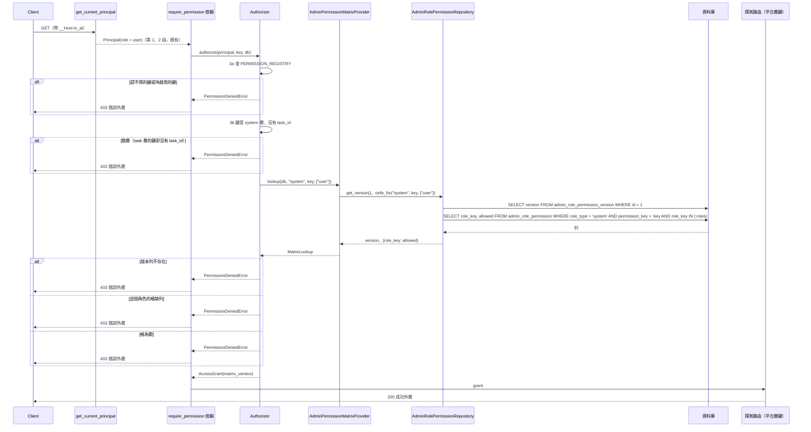
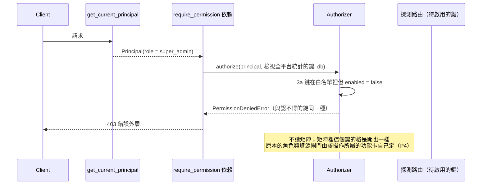
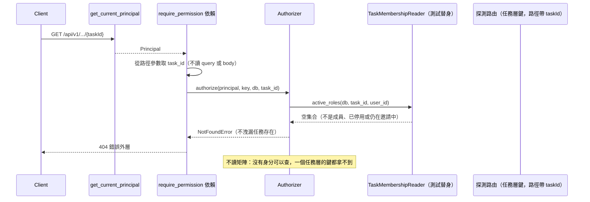
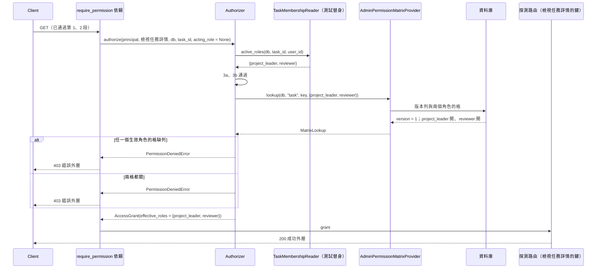
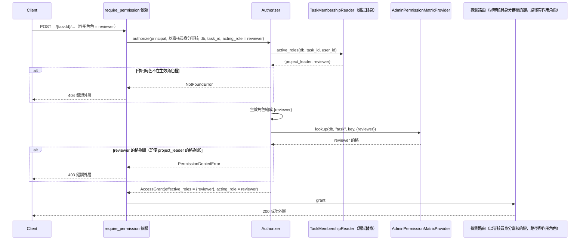
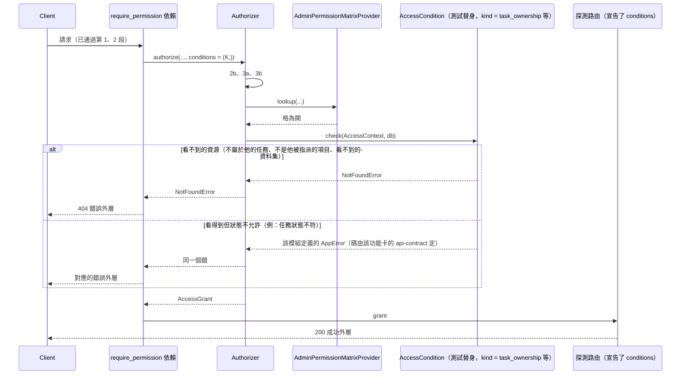
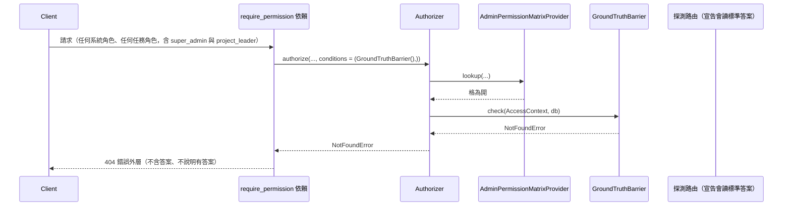

# System Design

本次在 `app/core/` 補上授權四段的第 3、4 段（issue #755）：把操作解析成白名單內、已啟用的權限鍵，要求對應角色那一格為開，再跑附加條件。接法照 [ADR-004 的 D6](../../../docs/development/adr/004-auth-and-security.mdx#d6-權限矩陣當授權輸入)：`app/core/` 定義 Protocol、持有資料的模組實作、`app/main.py` 組裝時放進 `app.state`，與第 1、2 段的 `PrincipalLoader` 同一種做法；`app.core` 不 import 任何業務模組（契約 `Core does not depend on modules`，[ADR-003 的 D12](../../../docs/development/adr/003-backend-architecture.mdx#d12-跨模組呼叫只走-service-對-service-的公開函式)）。

本次**沒有任何對外端點**（clarification P8、P9，見 [§維護者的決定](#維護者的決定2026-11-27) 方案組 F）。第 3、4 段是一個 FastAPI 依賴與一個核心類別，第一批使用者是 #720、#721 與 03、04、05 的子卡；本次的整合測試以只在測試掛載的探測路由（`backend/tests/probe.py` 同一種做法）代替「受保護端點」。

`system-analysis.md` 的 17 個待決問題與本份的 N1–N5，已在 `clarification.md`（2026-11-27）全部定案：Q1 採 A1、Q2 採 C1、Q3 採 R1、Q4 依作用角色，其餘為 P1–P13。各方案組的比較留在 [§維護者的決定](#維護者的決定2026-11-27)，採用的方案已標明；下面各節照定案寫，不再有提案。

## 分層與類別

### 目錄

只列本次新增或修改的檔案；目錄分層照定案的 `app/modules/<module>/`。

```text
backend/
├─ alembic/versions/
│  └─ <rev>_create_admin_permission_tables.py   建兩張表並寫入 62 格與版本列
├─ app/
│  ├─ main.py                     組裝：放進 permission_matrix_provider（task_membership_reader 本次不放，沒有實作者）
│  ├─ core/
│  │  ├─ permissions.py           新增：24 個權限鍵的白名單與鍵屬性（層級、所屬段落、啟用、固定格、初始值）
│  │  └─ authz.py                 新增：第 3、4 段的 Protocol、Authorizer、require_permission、PermissionDeniedError
│  ├─ i18n/{zh-TW,en}/messages.json  加 common.permission_denied
│  └─ modules/admin/              新模組，只有讀矩陣（#729 再加端點與編輯）
│     ├─ __init__.py
│     ├─ router.py                本次只有一個沒有路由的 APIRouter，不掛進 app（Module layers 契約要求這一層存在）
│     ├─ models.py                AdminRolePermission、AdminRolePermissionVersion
│     ├─ repository.py            AdminRolePermissionRepository
│     ├─ schemas.py               本次沒有內容（同上，契約要求這一層存在；#729 才有 request／response）
│     └─ service.py               AdminPermissionMatrixProvider（實作 core.authz.PermissionMatrixProvider）
└─ tests/
   ├─ support/authz.py            新增：FakeTaskMembershipReader、RefusingCondition 等測試替身
   ├─ authz_probe.py              新增：需要權限的探測路由（只在測試掛載）
   └─ probe.py                    把 authz_probe 的路由併進既有的 probe_router（test_harness_parity 照常通過）
```

`admin` 模組本次**沒有端點**，但要有 `router.py` 與 `schemas.py`：`backend/pyproject.toml` 的 `Module layers` 契約只有 `(models)` 標成可省略，`router`、`service`、`repository`、`schemas` 任何一層不存在，契約就判定違反（import-linter 2.17 的 layers 契約：沒有括號的層不存在即違反）。所以 `router.py` 放一個沒有路由的 `APIRouter`，`create_app` 不掛它、`OPENAPI_TAGS` 也不加 `admin`（加了會出現一個空的 API 文件分組）；#729 加第一個端點時才掛進 app 並加 tag。

### 元件清單

| 層                    | 元件                                                                                                                              | 職責                                                                                                                                                                                                                          |
| :-------------------- | :-------------------------------------------------------------------------------------------------------------------------------- | :---------------------------------------------------------------------------------------------------------------------------------------------------------------------------------------------------------------------------- |
| 依賴（router 之前）   | `core.auth.get_current_principal`（既有，不改）                                                                                   | 第 1 段與第 2 段的系統角色；交出 `Principal`                                                                                                                                                                                  |
| 依賴（router 之前）   | `core.authz.require_permission(key, *, task_id_param=None, acting_role_param=None, conditions=())`                                | 依賴工廠：產生一個 FastAPI 依賴，取 `Principal`、從路徑參數取任務 ID 與作用角色，呼叫 `Authorizer.authorize`，回 `AccessGrant`；端點用 `Depends(require_permission(...))` 掛上                                                |
| 共用層                | `core.authz.Authorizer`                                                                                                           | 第 2 段的任務成員身分（Q1 採 A1）、第 3 段、第 4 段的固定順序；不 commit、不寫入                                                                                                                                              |
| 共用層                | `core.permissions`：`PermissionKey`、`PermissionLayer`、`TaskRole`、`PermissionSpec`、`PERMISSION_REGISTRY`、`applicable_cells()` | 白名單：24 個鍵與鍵本身的屬性（資料表字典「角色權限矩陣」一節說「所屬模組、固定格、啟用狀態」在程式側的登錄表）；`applicable_cells()` 由登錄表推出 62 個適用格與初始值，是 seed 與回歸測試的唯一來源                          |
| 共用層（Protocol）    | `core.authz.PermissionMatrixProvider`                                                                                             | 讀矩陣：`lookup(db, layer, key, role_keys)` 回 `MatrixLookup`（版本列在不在、這些角色各自的格）；由 `admin` 實作                                                                                                              |
| 共用層（Protocol）    | `core.authz.TaskMembershipReader`                                                                                                 | 讀某人在某任務**生效中**的任務角色集合（邀請中、已停用不算）；本次只有測試替身，`task` 模組（#763 起）實作                                                                                                                    |
| 共用層（Protocol）    | `core.authz.AccessCondition`                                                                                                      | 第 4 段的一種附加條件；`kind` 標明種類，`check(context, db)` 不通過時丟錯；任務歸屬與狀態、指派與審核者、資料集可見性由 `task`、`dataset` 模組實作；另預留依作用角色判斷的種類 `acting_role`（clarification Q4），本次不實作  |
| 共用層                | `core.authz.GroundTruthBarrier`                                                                                                   | 第 4 段的答案隔離在授權層的落點：宣告會讀標準答案的操作，對任何登入的人一律拒絕（PRD §不是角色的讀取對象：只有經授權的計分程序讀得到，矩陣沒有它的格）；不需要任何業務資料，本次就能真的測                                    |
| 共用層（值物件）      | `AccessContext`、`AccessGrant`、`MatrixLookup`                                                                                    | 第 4 段條件的輸入；交給 service 的授權結果（含生效角色、作用角色與矩陣版本；`Authorizer.check_conditions(grant, ...)` 以它重建 `AccessContext`，所以 `AccessGrant` 也帶 `acting_role`）                                       |
| 共用層（錯誤）        | `core.authz.PermissionDeniedError`（`403`）；既有的 `core.errors.NotFoundError`（`404`）                                          | 拒絕的兩種結果；哪一種拒絕對到哪一個見 [§權限檢查點](#權限檢查點)，碼與訊息鍵見 `api-contract.md` 與 `error-codes.mdx`（clarification Q3 採 R1）                                                                              |
| Service（`admin`）    | `AdminPermissionMatrixProvider`                                                                                                   | 實作 `PermissionMatrixProvider`（Q2 採 C1）；一次讀版本列與所需的格，不 commit                                                                                                                                                |
| Repository（`admin`） | `AdminRolePermissionRepository`                                                                                                   | `get_version()`、`cells_for(layer, key, role_keys)`；只查，不寫                                                                                                                                                               |
| Model（`admin`）      | `AdminRolePermission`、`AdminRolePermissionVersion`                                                                               | 兩張表照資料表字典 `admin` 組                                                                                                                                                                                                 |
| 組裝點                | `app.main.create_app`                                                                                                             | 放進 `app.state.permission_matrix_provider = AdminPermissionMatrixProvider()`；`app.state.task_membership_reader` 本次不放（沒有實作者），任務層的判斷沒有它時丟 `RuntimeError`（接線錯誤，與 `principal_loader` 相同的處理） |

### Class Diagram

```mermaid
classDiagram
  direction LR

  class ProtectedRouter {
    <<router>>
    +handler(grant: AccessGrant, service) ApiResponse~X~
  }

  class require_permission {
    <<dependency factory>>
    +require_permission(key: PermissionKey, task_id_param: str | None, acting_role_param: str | None, conditions: tuple~AccessCondition~) Callable
    -dependency(request: Request, principal: Principal, db: AsyncSession) AccessGrant
  }

  class Authorizer {
    <<core>>
    -matrix: PermissionMatrixProvider
    -memberships: TaskMembershipReader | None
    +authorize(principal: Principal, key: PermissionKey, db: AsyncSession, task_id: UUID | None, acting_role: TaskRole | None, conditions: tuple~AccessCondition~) AccessGrant
    +check_conditions(grant: AccessGrant, conditions: tuple~AccessCondition~, db: AsyncSession) None
    -resolve_spec(key: PermissionKey, task_scoped: bool) PermissionSpec
    -task_roles(principal: Principal, task_id: UUID, acting_role: TaskRole | None, db: AsyncSession) frozenset~TaskRole~
    -require_cell(spec: PermissionSpec, role_keys: frozenset~str~, lookup: MatrixLookup) frozenset~str~
  }

  class PermissionSpec {
    <<core value>>
    +key: PermissionKey
    +layer: PermissionLayer
    +section: str
    +enabled: bool
    +fixed: Mapping~str, bool~
    +initial: Mapping~str, bool~
  }

  class PermissionRegistry {
    <<core module: permissions.py>>
    +PERMISSION_REGISTRY: Mapping~PermissionKey, PermissionSpec~
    +applicable_cells() tuple~MatrixCell~
  }

  class PermissionMatrixProvider {
    <<Protocol>>
    +lookup(db: AsyncSession, layer: PermissionLayer, key: PermissionKey, role_keys: frozenset~str~) MatrixLookup
  }

  class TaskMembershipReader {
    <<Protocol>>
    +active_roles(db: AsyncSession, task_id: UUID, user_id: UUID) frozenset~TaskRole~
  }

  class AccessCondition {
    <<Protocol>>
    +kind: ConditionKind
    +check(context: AccessContext, db: AsyncSession) None
  }

  class GroundTruthBarrier {
    <<core>>
    +kind: ConditionKind
    +check(context: AccessContext, db: AsyncSession) None
  }

  class MatrixLookup {
    <<core value>>
    +version: int | None
    +cells: Mapping~str, bool~
  }

  class AccessContext {
    <<core value>>
    +principal: Principal
    +key: PermissionKey
    +task_id: UUID | None
    +effective_roles: frozenset~str~
    +acting_role: TaskRole | None
  }

  class AccessGrant {
    <<core value>>
    +principal: Principal
    +key: PermissionKey
    +task_id: UUID | None
    +task_roles: frozenset~TaskRole~
    +effective_roles: frozenset~str~
    +acting_role: TaskRole | None
    +matrix_version: int
  }

  class PermissionDeniedError {
    <<AppError 403>>
  }

  class AdminPermissionMatrixProvider {
    <<service: admin>>
    +lookup(db: AsyncSession, layer: PermissionLayer, key: PermissionKey, role_keys: frozenset~str~) MatrixLookup
  }

  class AdminRolePermissionRepository {
    <<repository: admin>>
    +get_version() int | None
    +cells_for(layer: PermissionLayer, key: str, role_keys: frozenset~str~) dict~str, bool~
  }

  class AdminRolePermission {
    <<model>>
    +role_type: str
    +role_key: str
    +permission_key: str
    +allowed: bool
    +updated_at: datetime
  }

  class AdminRolePermissionVersion {
    <<model>>
    +id: int
    +version: int
    +updated_at: datetime
  }

  class FakeTaskMembershipReader {
    <<test double>>
    +active_roles(db, task_id, user_id) frozenset~TaskRole~
  }

  ProtectedRouter ..> require_permission : Depends
  require_permission ..> Authorizer : builds from app.state
  Authorizer ..> PermissionRegistry : resolve_spec
  Authorizer --> PermissionMatrixProvider
  Authorizer --> TaskMembershipReader
  Authorizer ..> AccessCondition : step 4
  Authorizer ..> PermissionDeniedError : raises
  Authorizer ..> AccessGrant : returns
  GroundTruthBarrier ..|> AccessCondition
  PermissionRegistry --> PermissionSpec
  AdminPermissionMatrixProvider ..|> PermissionMatrixProvider
  AdminPermissionMatrixProvider --> AdminRolePermissionRepository
  AdminRolePermissionRepository ..> AdminRolePermission
  AdminRolePermissionRepository ..> AdminRolePermissionVersion
  FakeTaskMembershipReader ..|> TaskMembershipReader
```

Model 只畫屬性；兩張表沒有 FK，彼此也不關聯（以 ER 為準）。`<<Protocol>>` 由右側的模組或測試替身實作，`app.core` 不 import 它們。



- `ProtectedRouter` 代表日後任何掛 `require_permission` 的模組 router；本次只有測試探測路由。router 只拿到 `AccessGrant`，不碰矩陣、不碰 repository；需要紀錄層級條件時把 `AccessGrant` 交給自己的 service，service 呼叫 `Authorizer.check_conditions`（router → service → core，方向不變）
- `require_permission` 每次請求從 `request.app.state` 取 provider 與 reader 組出 `Authorizer`；`Authorizer` 不放模組層的全域狀態，測試直接以替身建構它
- `PermissionKey` 是 `StrEnum`（24 個成員，識別名稱照 [方案組 B](#方案組-b權限鍵白名單放哪裡與待決-4-相關的技術方案) 的表，clarification P2）；`PermissionLayer = Literal["system", "task"]`；`TaskRole = Literal["project_leader", "reviewer", "annotator"]`（與 `task_membership.task_role` 的 CHECK 同一組值）；`ConditionKind = Literal["task_ownership", "task_state", "assignment", "reviewer_identity", "dataset_visibility", "answer_isolation", "acting_role"]`（clarification Q1、Q4）。`acting_role` 是預留的種類：依 `AccessContext.acting_role` 判斷的條件（例：作用角色為 `annotator` 時不得取得測試集辨識資訊），本次只有型別與測試替身，實作屬 04-01、04-02 的卡
- 系統層的 `role_key` 就是 `Principal.role`（`user`／`super_admin`）；Seeder 管理員的 `role` 也是 `super_admin`，矩陣沒有它這一欄（PRD §角色清單）

### 授權判斷的固定順序

`Authorizer.authorize` 依下列順序判斷，**任何一步不通過就停，不往下走**；沒有「預設允許」（S3）。

| 步驟 | 判斷                                                                                                                                          | 不通過時                                                                                   | 依據                                                                   |
| :--- | :-------------------------------------------------------------------------------------------------------------------------------------------- | :----------------------------------------------------------------------------------------- | :--------------------------------------------------------------------- |
| 2b   | 任務範圍的操作（有 `task_id`）：`TaskMembershipReader.active_roles` 讀生效中的任務角色；有 `acting_role` 時，集合必須含它，生效角色縮成只有它 | 集合為空 → `NotFoundError`；`acting_role` 不在集合裡 → `NotFoundError`（clarification Q3） | S3 (2)；06-02 §授權判斷的順序 第 2、5、6 條；§一人多任務角色 第 4–6 條 |
| 3a   | `PERMISSION_REGISTRY` 有這個鍵，而且 `enabled` 為真                                                                                           | `PermissionDeniedError`（認不得的鍵、待啟用的鍵都一樣）                                    | 06-02 §五個已登錄、待啟用的鍵 第 3 條                                  |
| 3b   | 鍵的層級與操作的範圍相符：`task` 層的鍵必須帶 `task_id`，`system` 層的鍵不得帶                                                                | `PermissionDeniedError`（錯層）                                                            | 06-02 §授權判斷的順序 第 5 條                                          |
| 3c   | `PermissionMatrixProvider.lookup` 讀版本列與這些角色的格；版本列存在                                                                          | `PermissionDeniedError`                                                                    | ADR-004 D6「矩陣版本列不存在一律拒絕」                                 |
| 3d   | 每個生效角色的格**都在**（缺任何一列就拒絕，不當成「關」）；至少一個為開。任務頁面取生效角色的允許聯集，有作用角色時只看那一個（2b 已縮小）   | `PermissionDeniedError`                                                                    | 06-02 §適用格 第 6 條、§一人多任務角色 第 2、5 條                      |
| 4    | 依序跑 `conditions`（含端點宣告的 `GroundTruthBarrier`）；每一個都通過                                                                        | 條件自己丟的錯（看不到的資源是 `NotFoundError`）                                           | S3 (4)；06-02 §授權判斷的順序 第 4、7 條                               |

- 3d 的「缺列就拒絕」只看這次要用的格，不在每個請求驗整份矩陣；讀回的矩陣整份不合法時授權這一側只看這次要用的格（clarification P3 採 E1，[方案組 E](#方案組-e讀到的矩陣不合法時待決-8)）
- 固定格：初始值即永久值，資料庫另有 CHECK 擋住被改（[§資料模型異動](#資料模型異動)），所以授權照讀到的值判斷，不另外以登錄表覆寫（P3）
- 「矩陣之外」的兩條路徑（系統管理員刪除草稿任務、全平台統計）不經 `Authorizer`；本次不在 `Authorizer` 開任何旁路（P5，[方案組 F](#方案組-f範圍邊界待決-91011161317)）

### 交易邊界與 session 生命週期

| 流程                 | 交易                                                                                                         | 交易外的動作 |
| :------------------- | :----------------------------------------------------------------------------------------------------------- | :----------- |
| 授權第 2b、3、4 段   | 不寫入，只讀；用同一個請求的 `get_db` `AsyncSession`，與 handler 共用；不 commit，請求結束時由 `get_db` 關閉 | 無           |
| 初始矩陣（Q2 採 C1） | Alembic data migration 一個 revision：建兩張表、寫入 62 格與版本列 `version = 1`，由 Alembic 的交易包住      | 無           |

- 本次只有 API 端的 async session；授權不在 worker 端跑，不開同步 session（B3）。經授權的計分程序（PRD §不是角色的讀取對象）是 worker 端的事，不經 `Authorizer`，本次不建
- **不快取**（ADR-004 D6「第一版不快取」）：每個授權決定讀一次版本列與所需的格（主鍵範圍查詢，見 [§資料模型異動](#資料模型異動)）。不快取已定案（P10）；日後若改成快取，做在 `PermissionMatrixProvider` 的實作那一側，`Authorizer` 與 Protocol 不必改
- 系統角色（`Principal.role`）與任務成員身分**每次都從資料庫讀，不快取**（S3）

## 關鍵情境

本次沒有規格頁的驗收標準列（issue #755 本文）；下面的 Scenario 名稱第 2–6 個照搬規格 06-02 §驗收標準的列名（那幾列屬 #729 的驗收，本次提供它們依賴的判斷機制），第 1 個與第 7 個是本次為 issue #755 驗收條件第 2、3 列取的名稱。`planner` 寫 `specs/` 時沿用同一組名稱。每張圖都以只在測試掛載的探測路由代替「受保護端點」，畫到 router 回傳回應為止。

### Scenario: 平台層操作依系統角色那一格判斷

驗 issue #755 驗收條件第 2 列：未知鍵、缺列、錯層、版本列不存在一律拒絕。



平台層的拒絕回 `403`（clarification Q3 採 R1，與 `user-management` 既有契約一致）。錯誤外層只帶碼與本地化的 `message`，不帶權限鍵、角色或版本號。

### Scenario: 待啟用的鍵按認不得的鍵拒絕



`H` 不會被呼叫。測試另驗矩陣仍收著這五個鍵的適用列（62 格含它們），與 06-02「待啟用的鍵仍有適用列」一致。

### Scenario: 失效的成員身分被拒絕

第 2 段的任務成員身分在本次（Q1 採 A1）。`TaskMembershipReader` 本次只有測試替身。



系統管理員也走同一條：`Principal.role = super_admin` 不隱含任何任務角色（PRD §權限矩陣 表下第 2 條）。換成另一個任務（S10「換成另一個任務」）時替身對那個 `task_id` 回空集合，結果相同。

### Scenario: 任務頁面取聯集



聯集只放寬「有沒有這個權限」，第 4 段的條件仍逐一要過（06-02 §一人多任務角色 第 3 條），見下一張「授權要過資源條件」。

### Scenario: 工作區只依作用角色



作用角色從**路徑參數**取（`acting_role_param`），不讀 query 或 body；它只是「要用哪一個身分」，不能建立身分（06-02 §一人多任務角色 第 6 條：沒有那個生效身分就拒絕）。本次就支援聯集與作用角色（clarification P6）；作用角色由哪一個路徑參數帶，由 04-02 的卡在自己的 `api-contract.md` 定。

### Scenario: 授權要過資源條件

驗 issue #755 驗收條件第 3 列：第 4 段每一種附加條件都有負向測試。依 clarification Q1（A1），任務歸屬與狀態、指派與審核者、資料集可見性的實作屬 `task`、`dataset` 模組，本次以測試替身驗「條件不通過時，格為開也拒絕」，每一種 `ConditionKind`（含預留的 `acting_role`）各一個負向測試；答案隔離由 `GroundTruthBarrier` 真的驗（下一張）。



需要讀「這次要碰的那一筆」才能判斷的條件（例如某一個標記項目是否指派給他），由 service 在碰那一筆之前呼叫 `Authorizer.check_conditions(grant, conditions, db)`，順序仍在第 3 段之後。條件本身的實作與它們各自真正的負向測試，屬各功能卡（#759、#763、#773、#782）。

### Scenario: 標準答案不經任何角色放行



PRD §不是角色的讀取對象：標準答案只有經授權的計分程序讀得到，矩陣裡沒有、也不會有它的格。`GroundTruthBarrier` 讓「讀標準答案」在授權層對所有登入的人關閉，**沒有任何矩陣設定能打開它**。它只擋「整個操作就是讀答案」的情形；標記員能到的端點回應裡不帶答案與測試集辨識資訊，仍靠各端點的 response allowlist（S4、S5），由各功能卡的 `api-contract.md` 逐端點寫。測試集辨識資訊依**作用角色**遮蔽（clarification Q4：以標記員身分進入時遮蔽，以專案負責人身分進入管理頁時看得到）；本次只在 `ConditionKind` 預留 `acting_role`，遮蔽本身由 04-01、04-02 的卡實作，規格回寫追蹤於 #773、#777。

## 常駐文件異動

- 常駐文件：`docs/diagrams/architecture/backend-modules.mdx`

| 節                                    | 異動 | 摘要                                                                                                                                                                             |
| :------------------------------------ | :--- | :------------------------------------------------------------------------------------------------------------------------------------------------------------------------------- |
| 後端基礎建設 §`core/` 各模組          | 修改 | `auth.py` 一列改成只管第 1、2 步；新增 `permissions.py`（白名單與鍵屬性）與 `authz.py`（第 3、4 步的 Protocol、`Authorizer`、`require_permission`、`PermissionDeniedError`）兩列 |
| 決策紀錄                              | 新增 | 兩列，指向 #755：基礎建設加 `permissions.py`、`authz.py`；clarification 定案後補齊 `admin` 一節與下列各節（都是規劃，待實作後校正）                                              |
| 模組一覽                              | 修改 | 加 `admin` 一列（沒有端點）；「目前有 `health` 與 `account`」改成三個                                                                                                            |
| 預定模組與資料表歸屬                  | 修改 | `admin` 的現況改成「兩張矩陣表與讀矩陣已有；06-02 的頁面與編輯、AI 追溯兩張表未實作」；`account` 一列不變                                                                        |
| `admin`（新節）                       | 新增 | 分層表（router 沒有路由、不掛載）、Class 圖、一張主要 Sequence 圖（讀矩陣）；`AdminPermissionMatrixProvider` 由 `app.main` 放進 `app.state.permission_matrix_provider`           |
| 後端基礎建設 §目錄                    | 修改 | `alembic/versions/` 加 `admin` 兩張表與初始矩陣；`tests/support/` 加 `authz.py`                                                                                                  |
| 後端基礎建設 §app factory 與 lifespan | 修改 | 步驟 1b 加「放進 `permission_matrix_provider`」；`task_membership_reader` 由 `task` 模組落地時放進                                                                               |
| 後端基礎建設 §錯誤怎麼對到 envelope   | 修改 | 加授權依賴那一列：第 2 步與第 4 步看不到的資源回 `404 NOT_FOUND`、第 3 步回 `403 PERMISSION_DENIED`                                                                              |
| 後端基礎建設 §新增業務模組的檢查清單  | 修改 | 加一項：需要權限的端點掛 `Depends(require_permission(...))`，不自己讀矩陣；任務範圍的端點宣告 `task_id_param`，router 宣告 `403` 與 `404`                                        |
| 後端基礎建設 §測試輔助                | 修改 | 加 `support/authz.py`                                                                                                                                                            |
| 已知限制                              | 修改 | 「授權四步的第 3、4 步」一列改寫：第 2 步的任務成員身分與第 4 步的業務條件只有 Protocol 與測試替身，`task`、`dataset` 落地時實作；測試集辨識資訊依作用角色遮蔽也在那時實作       |

- 常駐文件：`docs/diagrams/architecture/error-codes.mdx`（`PERMISSION_DENIED` 一列與各步對到的狀態，見 `api-contract.md` §常駐文件異動）

`endpoint-authorization.mdx` 本次不改：沒有新端點，既有端點的授權不變；它的已知限制由實作後校正。

## 資料模型異動

照 clarification Q2（採 C1）：本次建兩張表與初始矩陣。

- 字典：`docs/diagrams/architecture/data-table-dictionary.mdx`（**本次不改**：兩張表在字典 `admin` 組已定義，本次照字典首次落地）
- ER：`docs/diagrams/architecture/database-schema.er.json`（**本次不改**：兩張表已在 ER）
- `pnpm check:er`：通過（`check-er-data: dictionary, diagram, landed revisions, spec entries and both kinds of line citation agree`；2026-11-27 在本 worktree 執行）

| 表                              | 異動                           | 欄位／索引                                                                                                                                                                                                                                                                                                                                                                                                     | 波及的表（依字典 FK 與被參照） | Alembic migration 可逆                                                                                                                          | SQLite 與 PostgreSQL 的差異                                                                                                                                                                                                                        |
| :------------------------------ | :----------------------------- | :------------------------------------------------------------------------------------------------------------------------------------------------------------------------------------------------------------------------------------------------------------------------------------------------------------------------------------------------------------------------------------------------------------- | :----------------------------- | :---------------------------------------------------------------------------------------------------------------------------------------------- | :------------------------------------------------------------------------------------------------------------------------------------------------------------------------------------------------------------------------------------------------- |
| `admin_role_permission`         | 新建（字典既有候選表首次落地） | 照字典：複合 PK `(role_type, role_key, permission_key)`；`role_type` CHECK 限 `system`／`task`；`permission_key` 不加 CHECK（白名單在程式）；`allowed boolean NOT NULL`；固定格另加 CHECK（`role_type = 'system'` 且 `permission_key` 為系統管理類的鍵時，`allowed` 必須等於 `role_key = 'super_admin'`；`permission_key` 為檢視儀表板時 `allowed` 必須為真）；`updated_at` 用 `UtcDateTime`。寫入 62 列初始值 | 沒有 FK；沒有被參照            | 可逆：down 刪表。表裡只有初始值（本次沒有編輯入口），刪掉不丟使用者資料；#729 上線之後再 down 會丟掉編輯過的矩陣，屆時由 #729 的 migration 說明 | `boolean`：PostgreSQL 原生，SQLite 存 0／1，SQLAlchemy 兩邊讀回都是 `bool`；CHECK 兩邊都執行。固定格 CHECK 寫死了鍵的識別名稱（待決 4），日後新增系統管理類的鍵要改 CHECK：PostgreSQL 可 `ALTER`，SQLite 要 `render_as_batch` 重建整張表（已開啟） |
| `admin_role_permission_version` | 新建（字典既有候選表首次落地） | 照字典：PK `id smallint` 加 CHECK `id = 1`；`version integer NOT NULL` CHECK `>= 1`；`updated_at`。寫入一列 `(1, 1, now)`                                                                                                                                                                                                                                                                                      | 沒有 FK；沒有被參照            | 可逆：down 刪表                                                                                                                                 | 無差異（`smallint` 在 SQLite 是 INTEGER affinity，CHECK 照樣執行）                                                                                                                                                                                 |

**Migration**：一個 Alembic revision（`down_revision` 是 `7bf0f909ce8f`，`account` 三張表那一個）建兩張表，再以 `op.bulk_insert` 寫入 62 格與版本列；down 反序刪表。**migration 不 import `app.core.permissions`**：62 格以字面值寫進 revision，因為已部署的 migration 不再修改，而登錄表日後會變；兩者一致由測試保證（升級後讀回的 62 列必須與 `applicable_cells()` 逐格相同，這也是 06-02「預設矩陣是回歸測試的基準」的落點）。seed 用 data migration 而不是初始化指令或啟動補齊，理由與不採用的做法見 [方案組 C](#方案組-c矩陣的持久資料與初始矩陣待決-5)。

**查詢與索引**：授權每次只讀一列版本與「一個鍵 × 一至三個角色」的格；`WHERE role_type = ? AND permission_key = ? AND role_key IN (...)` 用得到複合 PK 的索引（三欄都在等值或 IN 條件裡），不另建索引。

## 權限檢查點

| 層                                     | 檢查                                                                                   | 範圍                           |
| :------------------------------------- | :------------------------------------------------------------------------------------- | :----------------------------- |
| `get_current_principal`（第 1、2 段）  | 既有，不改：登入狀態與帳號仍有效；系統角色取自資料庫                                   | 所有需要登入的端點             |
| `require_permission` → `Authorizer` 2b | 任務範圍的操作讀生效中的任務成員身分；沒有 → `404`；作用角色不在其中 → `404`           | 宣告 `task_id_param` 的端點    |
| 同上，第 3 段                          | 鍵在白名單、已啟用、層級相符、版本列在、每個生效角色的格都在且至少一個為開；否則 `403` | 掛 `require_permission` 的端點 |
| 同上，第 4 段                          | 端點宣告的 `conditions` 依序執行；`GroundTruthBarrier` 對任何人關閉讀標準答案          | 宣告了條件的端點               |
| 各模組 service                         | 需要「這一筆」才能判斷的條件，碰那一筆之前呼叫 `Authorizer.check_conditions`           | 各功能卡                       |

**拒絕的結果**（clarification Q3 採 R1；碼見 `api-contract.md`）：

| 拒絕在哪一步                      | 結果                            | 理由                                                                            |
| :-------------------------------- | :------------------------------ | :------------------------------------------------------------------------------ |
| 2b 沒有生效身分、作用角色不是他的 | `404`（既有 `NOT_FOUND`）       | 不是成員就不該知道任務存在（architecture §授權四步 第 4 條、S10）               |
| 3a–3d 平台層                      | `403`（新 `PERMISSION_DENIED`） | 平台層的頁面本來就公開存在；`user-management` 既有契約已寫 `403`                |
| 3a–3d 任務層（已確認是生效成員）  | `403`                           | 他已經是成員、知道任務存在，回 `404` 不保護任何東西；07-03 的「無權限」頁對應它 |
| 4 看不到的資源                    | `404`                           | 不洩漏存在                                                                      |
| 4 看得到但狀態不允許              | 由條件所屬的功能卡定            | 例如任務狀態不符，各卡在自己的 `api-contract.md` 定碼                           |

**權限上限**：本次不新增任何角色、不放寬任何格。初始矩陣逐格照 06-02 §預設矩陣（sa 已逐格比對，未超出 PRD §權限矩陣；clarification P1）；固定格由資料庫 CHECK 守住，平台成員的系統管理類格無法被改成開。系統管理員沒有任務角色時拿不到任何任務層的鍵（2b 在第 3 段之前）。

**欄位遮蔽**：本次沒有端點，不回任何資料。錯誤外層只帶碼與本地化的 `message`，**不帶**權限鍵、角色、矩陣版本、任務 ID 或拒絕在哪一步；`AccessGrant` 只交給 handler 與 service，不進任何回應 schema。

**測試集答案隔離**：本次沒有任何讀或回任務、資料集、標記資料的端點，回應層沒有外露風險。授權層的落點是 `GroundTruthBarrier`：讀標準答案的操作對所有登入的人關閉，矩陣改不動它；標記員能到的回應不含答案與測試集辨識資訊，仍由各端點的 response allowlist 負責（S4、S5），本次不改。授權第 4 段的負向測試涵蓋 `answer_isolation` 這一種（真的驗，不用替身）。

**任務設定驅動**（Hard Rule 5）：權限鍵、層級、條件種類都與任務類型無關；`Authorizer` 不看任務類型，沒有寫死任何任務類型的分支。

**覆蓋率門檻的路徑**（testing-agent-rules T10「授權與權限檢查」）：本次新增 `app/core/authz.py`、`app/core/permissions.py`、`app/modules/admin/service.py`，要加進 login-auth-guard 建的那份路徑清單。

## 維護者的決定（2026-11-27）

下列方案組對應 `system-analysis.md` 的待決問題，已在 `clarification.md` 定案；比較留作紀錄，採用的方案標「採用」並指向 clarification 的條目，其餘不採用。上面各節照採用的方案寫。

| 方案組 | 對應待決          | 定案                                                                                           | clarification       |
| :----- | :---------------- | :--------------------------------------------------------------------------------------------- | :------------------ |
| A      | 1、2、7           | A1                                                                                             | Q1                  |
| B      | 4                 | B1，鍵名照下表                                                                                 | P2                  |
| C      | 5、13             | C1（data migration 寫初始矩陣，不寫稽核事件）                                                  | Q2、P11             |
| D      | 6                 | D1 不快取                                                                                      | P10                 |
| E      | 8                 | E1                                                                                             | P3                  |
| F      | 9、10、11、16、17 | 全部照本份原本的建議                                                                           | P4、P5、P6、P8、P9  |
| —      | 3、12、14、15、N1 | 3：06-02 §預設矩陣 逐格；12：R1；14：主 session 處理 GitHub 依賴；15：不在本次；N1：依作用角色 | P1、Q3、P7、P12、Q4 |

### 方案組 A：第 2 段的任務成員身分與第 4 段的附加條件（待決 1、2、7）

| 方案                                                                                                                       | 做法                                                                                                                                                                                                                                                             | 後果                                                                                                                                                                                                                                                                                                                                                                                                                                                         |
| :------------------------------------------------------------------------------------------------------------------------- | :--------------------------------------------------------------------------------------------------------------------------------------------------------------------------------------------------------------------------------------------------------------- | :----------------------------------------------------------------------------------------------------------------------------------------------------------------------------------------------------------------------------------------------------------------------------------------------------------------------------------------------------------------------------------------------------------------------------------------------------------- |
| **A1（採用，Q1）** `app/core/` 現在就定義 `TaskMembershipReader` 與 `AccessCondition` 兩個 Protocol，只用測試替身驗        | 任務成員身分比照 `PrincipalLoader`：`task` 模組實作、`app.main` 組裝；附加條件由持有資料的模組實作 `AccessCondition`，端點以 `conditions=(...)` 宣告（router import 自己模組的 service 裡的條件類別，方向合法）；`GroundTruthBarrier` 不需業務資料，本次真的實作 | 第 2 段與第 3 段任務層在本次就能被完整判斷與測試（S10 的「非該任務成員」「換成另一個任務」用替身驗）；issue #755 驗收條件第 3 列以「每一種條件不通過時格為開也拒絕」各一個負向測試勾掉，條件本身真正的負向測試仍屬各功能卡；architecture §待決 第 2 列可由本次關閉（選「Protocol」那一邊）；代價：Protocol 的形狀在沒有真實實作者的情況下定，#763 落地時可能要回頭微調；本次組裝點不放 reader，任務層的判斷沒有它就是接線錯誤（`500`），直到 `task` 模組接上 |
| A2 只做第 3 段平台層；任務層的第 2 段與第 4 段整個留給第一張任務層的卡（#759 或 #763）                                     | `Authorizer` 只接受 system 層的鍵；任務層的鍵一律拒絕                                                                                                                                                                                                            | 本次最小；但 issue #755 驗收條件第 3 列本次勾不掉，要回 issue 改範圍（Scope 鎖定後不得自行縮小，須維護者同意）；#759、#763、#773、#782 都 blocked-by #755，它們拿到的是半套機制，第一張卡要再做一次共用層設計；architecture §待決 第 2 列仍未決                                                                                                                                                                                                              |
| A3 第 2 段用 Protocol（同 A1），第 4 段只做 `GroundTruthBarrier`，其餘條件不定義 Protocol，由各功能卡在自己的 service 檢查 | 任務成員身分照 A1；`AccessCondition` 不定義，業務條件寫在各模組 service 裡                                                                                                                                                                                       | 少一個 Protocol；但第 4 段的位置散到各模組，「格通過後才檢查條件」的順序沒有共用層保證，S3 的「第 (4) 段每種條件負向測試」要靠各卡自律；issue 驗收第 3 列只能以答案隔離一種勾掉                                                                                                                                                                                                                                                                              |

條件種類（`ConditionKind`，待決 7，已由 Q1、Q4 定案）：S3 與 ADR-004 D6 的四類（任務歸屬與狀態拆成兩個、指派、審核者身分、資料集可見性、答案隔離，共六個 kind），加上 Q4 預留的 `acting_role`；任務成員身分**不**列在第 4 段（它在 2b，與 S3、06-02 一致）。

### 方案組 B：權限鍵白名單放哪裡（與待決 4 相關的技術方案）

| 方案                                                          | 做法                                                                            | 後果                                                                                                                                                                                                                                                                                        |
| :------------------------------------------------------------ | :------------------------------------------------------------------------------ | :------------------------------------------------------------------------------------------------------------------------------------------------------------------------------------------------------------------------------------------------------------------------------------------ |
| **B1（採用，P2）** 一份登錄表 `app/core/permissions.py`       | 24 個鍵、層級、06-02 的所屬段落、啟用、固定格、初始值都在這一個檔               | 各模組的端點直接引用 `PermissionKey`，不必跨模組 import（D12）；加鍵只改一個檔，審查集中（06-02「新鍵要經審查才啟用」）；與 `SystemRole` 已放在 `core.auth` 同一個理由。代價：`app/core/` 帶了一份業務清單（ADR-003 D3 的「換一個業務也照樣需要」是邊界案例：機制是通用的，清單是本產品的） |
| B2 各模組提供自己的鍵，`app.main` 組裝時合併成一份交給 `core` | 每個模組在自己的 service 宣告它的 `PermissionSpec`；`core` 只拿到合併後的登錄表 | `core` 不帶業務清單；但 06-02 的「所屬段落」（標記、資料集）與後端模組（`task`、`dataset`）不一對一，「檢視全平台統計」屬系統管理段落卻對到儀表板格；`admin` 要驗整份矩陣仍須拿到全部鍵；跨模組引用別人的鍵（例如 `dashboard` 判斷任務層的鍵）會被 independence 契約擋                      |

鍵的**識別名稱**（待決 4）已定案：照下表（clarification P2：沿用既有 5 個，其餘 19 個採下表的名稱；06-02 寫「沒有原始名稱」的兩個鍵也用下表的名稱，不改規格書）。表的形狀照既有用法 `admin.user_management.view`、`task.detail.edit`、`task.members.manage`、`task.delete` 的 `<段落>.<資源>.<動作>` 形狀，詞取自術語表的 `term.perm-*` 識別碼）：

| 層     | 中文權限名稱                         | 提案的識別名稱                                   | 啟用   |
| :----- | :----------------------------------- | :----------------------------------------------- | :----- |
| system | 檢視個人設定頁                       | `account.profile.view`                           | 是     |
| system | 編輯個人資料與密碼                   | `account.profile.edit`                           | 是     |
| system | 檢視儀表板                           | `dashboard.view`                                 | 是     |
| system | 檢視任務列表                         | `task.list.view`                                 | 是     |
| system | 建立新任務                           | `task.create`                                    | 是     |
| system | 進入使用者管理頁                     | `admin.user_management.view`（既有）             | 是     |
| system | 新增／編輯／停用使用者、指派系統角色 | `admin.user_management.manage`（既有）           | 是     |
| system | 進入角色權限設定頁                   | `admin.role_settings.view`                       | 是     |
| system | 編輯並儲存角色權限矩陣               | `admin.role_settings.manage`                     | 是     |
| system | 檢視全平台統計                       | `admin.platform_overview.view`                   | 待啟用 |
| task   | 檢視任務詳情                         | `task.detail.view`                               | 是     |
| task   | 編輯任務設定                         | `task.detail.edit`（既有）                       | 是     |
| task   | 管理任務成員與任務角色               | `task.members.manage`（既有）                    | 是     |
| task   | 推進任務生命週期                     | `task.lifecycle.manage`                          | 待啟用 |
| task   | 刪除草稿任務                         | `task.delete`（既有）                            | 待啟用 |
| task   | 以標記員身分標記                     | `annotation.annotate`                            | 是     |
| task   | 以審核員身分審核                     | `annotation.review`                              | 是     |
| task   | 處置最終例外                         | `annotation.exception.resolve`                   | 待啟用 |
| task   | 裁定爭議                             | `annotation.dispute.adjudicate`                  | 待啟用 |
| task   | 看任務統計                           | `dataset.stats.view`                             | 是     |
| task   | 看品質分析                           | `dataset.quality.view`                           | 是     |
| task   | 匯出資料                             | `dataset.export`                                 | 是     |
| task   | 看資料匯入與版本                     | `dataset.ingestion.view`（規格寫沒有原始名稱）   | 是     |
| task   | 匯入資料並建立版本                   | `dataset.ingestion.create`（規格寫沒有原始名稱） | 是     |

依 clarification P2：標「既有」的五個沿用 repo 裡已出現的名稱，其餘十九個用上表的名稱；06-02 寫「沒有原始名稱」的兩個鍵也用上表的名稱，規格書不改（畫面照 06-02 第 10 條不顯示它們的識別名稱）。

### 方案組 C：矩陣的持久資料與初始矩陣（待決 5）

| 方案                                                                                                                                                   | 做法                                                                                                 | 後果                                                                                                                                                                                                                                                              |
| :----------------------------------------------------------------------------------------------------------------------------------------------------- | :--------------------------------------------------------------------------------------------------- | :---------------------------------------------------------------------------------------------------------------------------------------------------------------------------------------------------------------------------------------------------------------- |
| **C1（採用，Q2）** 本次開 `admin` 模組（models、repository、service，加上沒有路由、不掛進 app 的 `router.py` 與 `schemas.py`），建兩張表並寫入初始矩陣 | `AdminPermissionMatrixProvider` 實作 Protocol；初始矩陣與版本列由 data migration 寫入（子方案 a）    | 「版本列不存在一律拒絕」「缺列拒絕」能對真的資料庫在兩種資料庫上驗；矩陣資料從一開始就在 ADR-003 D14 定的歸屬；#729 只加 router、編輯、樂觀鎖與稽核，不必換資料來源；`tasks.md` 多一個 [@dba] 群組；`admin` 模組先以沒有端點的形狀存在                            |
| C2 本次不建表：`admin` 模組只放一個從登錄表初始值組出的記憶體內 provider，版本固定為 1                                                                 | `app.core` 不碰；`admin/service.py` 只有 `DefaultPermissionMatrixProvider`                           | 本次沒有 migration；但「版本列不存在」「缺列」只能用替身驗；矩陣改不了（本來也沒有編輯入口，所以行為上相同）；#729 要建表、寫 migration、換掉 provider，並重驗一次所有授權測試；過渡期的「矩陣版本」不是真的版本，若 Q6 選快取也無從失效                          |
| C3 同 C1 建表，但初始矩陣不由 migration 寫，改由初始化指令或啟動時補齊                                                                                 | （b）比照 `create_seeder` 的指令，部署者執行一次；（c）`create_app` 的 lifespan 發現沒有版本列就補齊 | （b）多一個部署步驟，沒執行前所有依矩陣判斷的操作都被拒絕（安全但會讓新部署「什麼都不能做」）；（c）啟動時寫資料庫，違反「組 app 不開連線」的既有約定，也讓「版本列不存在一律拒絕」永遠測不到；兩者相較，（a）data migration 每次升級都可重現、兩種資料庫行為一致 |

初始建立矩陣**不寫稽核事件**（待決 13，clarification P11）：它不是「人發起、真的有變更」的儲存（06-02 §稽核事件與保存期限），#757 也還沒落地。日後白名單加入新鍵時替既有部署補列，由加鍵的那個 change 以新 migration 寫入，值照 06-02 第 8 條「預設是關」；這屬未來的 change，本次不建機制。

### 方案組 D：要不要快取矩陣（待決 6）

| 方案                                               | 後果                                                                                                                                                        |
| :------------------------------------------------- | :---------------------------------------------------------------------------------------------------------------------------------------------------------- |
| **D1（採用，P10）** 不快取，每次讀版本列與所需的格 | 照 ADR-004 D6「第一版不快取」；每個授權決定多兩個主鍵查詢；矩陣一改下一個請求就生效，不必設計失效協定                                                       |
| D2 依版本列快取格（每次仍讀版本列）                | 省下格的查詢，只剩版本列一次；須先依 ADR-004 D6 驗證失效協定，多進程部署時各進程各自失效；ADR-004 D6 寫明要先驗證，所以選它等於要另開一份驗證，本次範圍變大 |

### 方案組 E：讀到的矩陣不合法時（待決 8）

| 方案                                                                                                  | 後果                                                                                                                                                                                                     |
| :---------------------------------------------------------------------------------------------------- | :------------------------------------------------------------------------------------------------------------------------------------------------------------------------------------------------------- |
| **E1（採用，P3）** 只看這次要用的格：版本列不在、這個鍵的某個生效角色缺列就拒絕；認不得的鍵的列被忽略 | 每次只讀所需的列，與 D1 相容；壞掉的某一列只影響用到它的操作，系統管理員仍進得了角色設定頁去修（06-02 E4 才有人能處理）；固定格由資料庫 CHECK 保證不會是錯的值；「整份拒絕」只留給 #729 的角色設定頁載入 |
| E2 每次授權都驗整份矩陣，任何不合法就拒絕所有依矩陣判斷的操作                                         | 與角色設定頁的「整份拒絕」同一套規則；但每個請求讀 62 列並驗一次；矩陣一壞，連系統管理員都進不了角色設定頁，沒有人能從畫面修復                                                                           |
| E3 同 E2，但固定格改以登錄表的永久值判斷，不讀資料庫                                                  | 系統管理員的管理類鍵永遠可用，所以能進去修；但等於固定格「不是矩陣的資料」，與 06-02「固定格被改過也整份拒絕載入」的精神不同，需要維護者確認                                                             |

### 方案組 F：範圍邊界（待決 9、10、11、16、17、13）

| 待決 | 採用（P4–P6、P8、P9、P11）                                                                                                                            | 不採用的做法與後果                                                                                                                                        |
| :--- | :---------------------------------------------------------------------------------------------------------------------------------------------------- | :-------------------------------------------------------------------------------------------------------------------------------------------------------- |
| 9    | 待啟用的五個鍵在登錄表 `enabled = False`，判斷時當認不得；啟用由日後的 change 把旗標改成 `True`（單行、可審查）；「原本的閘門」由該操作所屬的功能卡定 | 本次替五個操作各自先定原本的閘門：需要 03-01、03-03、04-02、02-01 的規格細節，超出本次範圍                                                                |
| 10   | `Authorizer` 不開旁路；系統管理員刪除草稿任務與全平台統計由 03-01、02-01 的卡在自己的 service 依 PRD 硬邊界判斷，並在該卡說明為何不經矩陣             | 在 `Authorizer` 加「平台硬邊界」入口：共用層多一條不經格的路徑，容易被誤用成萬用旁路                                                                      |
| 11   | 本次就支援聯集與作用角色（`acting_role_param`），兩張 Sequence 圖已畫；成本只是一個可選參數                                                           | 只做聯集、作用角色留給 04-02：04-02 的卡要回頭改共用層                                                                                                    |
| 16   | 本次不提供「我能做什麼」的讀取端點；07-01 側欄依 `getCurrentSession` 的系統角色顯示，#720 若需要再在自己的 change 加                                  | 本次加一個讀取端點：`api-contract.md` 多一個端點、`ui-design.md` 要寫用法；且它要回傳的是矩陣的一部分，與「平台成員讀不到矩陣資料」（06-02）要另外對齊    |
| 17   | 本次不改任何既有端點的授權（`account` 的七個端點維持只過第 1、2 段）；`user-management` 的兩個鍵由 #728 接上                                          | 本次把 `getCurrentSession` 等掛上「檢視個人設定頁」：會動 `auth-guard` 的既有 Requirement，且矩陣若關掉這一格，人就看不到自己是誰、無法登出，需要另外裁定 |
| 13   | 初始矩陣不寫稽核事件，見方案組 C                                                                                                                      | 寫一筆系統發起的事件：要等 #757，本次就被它擋住                                                                                                           |

待決 3（P1：初始矩陣以 06-02 §預設矩陣 逐格為準）、12（Q3：R1，見 [§權限檢查點](#權限檢查點)）、14（P7：主 session 在 GitHub 補 blocked-by）、15（P12：不在本次）都已定案，不改變本份的結構。

## 技術待決問題

全部已在 `clarification.md` 定案：N1 由 Q4 決定，N2–N5 由 P13 交給 `design.md`；問題原文保留作紀錄。

| #   | 問題                                                                                                                                                                                                                                                                                                           | 影響                                                                                       | 性質                                                                    |
| :-- | :------------------------------------------------------------------------------------------------------------------------------------------------------------------------------------------------------------------------------------------------------------------------------------------------------------- | :----------------------------------------------------------------------------------------- | :---------------------------------------------------------------------- |
| N1  | 「測試集辨識資訊」（某個項目是不是測試集題目）要不要在授權層對某些角色關閉？PRD 與 Hard Rule 6 說標記員能到的地方都不得出現，但同一人在同一任務可同時是專案負責人與標記員；在工作區以作用角色 `annotator` 進入時一律關閉，還是只要持有標記員身分就關閉，規格沒有寫                                             | `GroundTruthBarrier` 之外要不要再加一個依作用角色判斷的條件；04-01、04-02 的回應 allowlist | 已決：clarification Q4（依作用角色；本次只預留 `acting_role` 條件種類） |
| N2  | 方案 A1 下，本次組裝點不放 `task_membership_reader`：任務層的判斷遇到沒有接線時丟 `RuntimeError`（`500`），與 `principal_loader` 一致；另一種是共用層放一個「永遠回空集合」的預設實作（一律 `404`）。sd 選前者：接線錯誤要大聲失敗，且本次沒有任何任務層端點會碰到                                             | 只影響 `task` 模組落地前的行為                                                             | 已決：P13（丟 `RuntimeError`）                                          |
| N3  | `admin` 模組本次放一個沒有路由、不掛進 app 的 `router.py`，只為了滿足 `Module layers` 契約；另一種是把 `router` 在契約裡也改成可省略 `(router)`，但那會放寬全部模組的檢查。sd 選前者，不動契約                                                                                                                 | `test_openapi_tags.py` 不受影響（沒有 operation）                                          | 已決：P13                                                               |
| N4  | `require_permission` 從路徑參數取 `task_id` 與作用角色，參數名由端點宣告。FastAPI 先解出子依賴、再驗端點自己的路徑參數，所以型別不對的 `taskId`（不是 UUID）或不認得的作用角色會先到 `require_permission`，由它回 `404 NOT_FOUND`，不會先變成 `422`；這與 S10 和「沒有成員身分回 404」一致，不洩漏任務是否存在 | 掛 `require_permission` 的任務層端點都照這樣，不留給第一張卡                               | 已決：P13（design 定案）                                                |
| N5  | 每個授權決定兩個查詢（版本列、格），加上第 1 段的一次讀取；ADR-004 D2 的 P95 500 毫秒目標在有真實端點之前量不到，量測交給第一個高頻端點（04-02 標記寫入）                                                                                                                                                      | 方案組 D 的重新討論時機                                                                    | 已決：P13（待真實端點再量）                                             |
