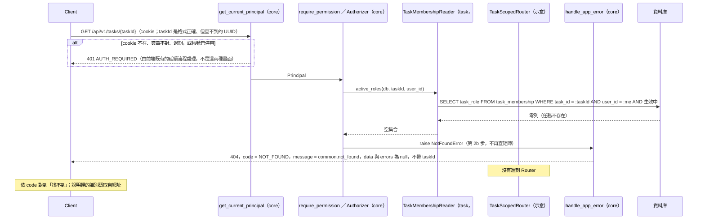
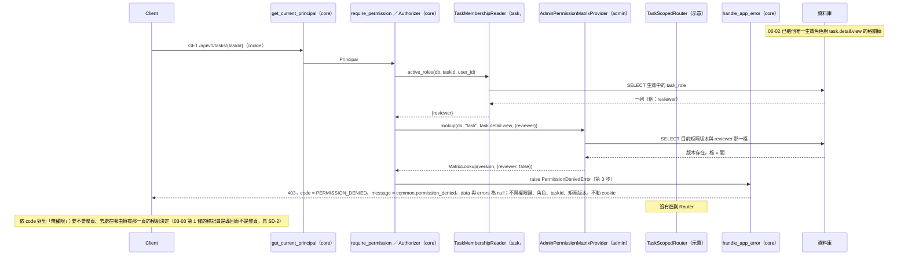
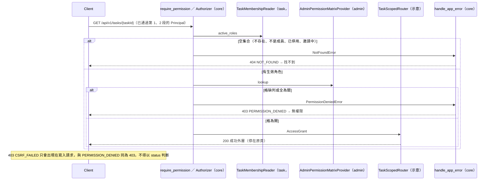
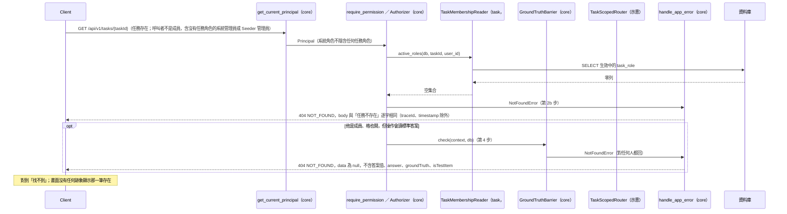
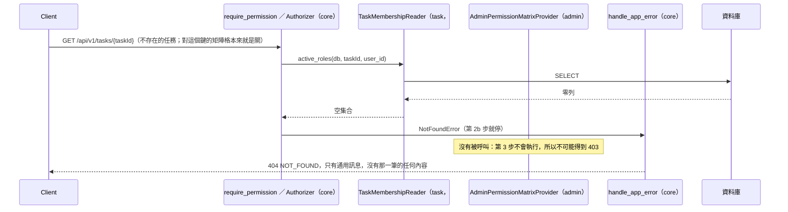
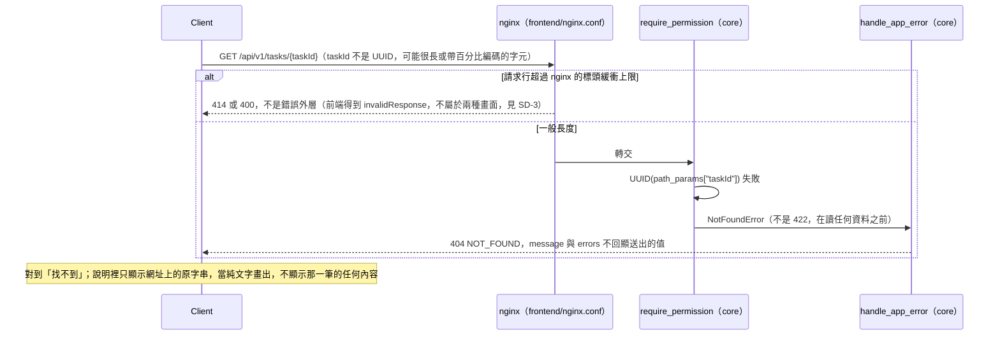

# System Design

這份是 change `denied-and-not-found`（Issue #721）的後端系統設計，以同目錄的 `system-analysis.md` 為脈絡基準。

## 設計結論

**這次後端不新增、也不修改任何端點、模組、類別、資料表或 `app/core/` 基礎建設。**

07-03 的兩種畫面要靠後端的地方只有一件：「那一筆」被擋下時，後端要用兩種**分得開**的回應講出來。這件事 #755（`permission-authorization`）已經落地，本次照用：

| 07-03 要分開的情況                                  | 後端現在的回應                                         | 在哪裡產生                                                                                                                                                                        |
| :-------------------------------------------------- | :----------------------------------------------------- | :-------------------------------------------------------------------------------------------------------------------------------------------------------------------------------- |
| 那一筆不存在（§兩種畫面的分工 第 1 條）             | `404`，`code` 為 `NOT_FOUND`                           | `Authorizer` 第 2b 步：`TaskMembershipReader.active_roles` 碰到不存在的任務回空集合 → `NotFoundError`；路徑上的識別碼不是 UUID 時，`require_permission` 也回 `NotFoundError`      |
| 那一筆存在，但他本來就不該知道它存在（第 3 條、Q2） | `404`，`code` 為 `NOT_FOUND`，`message` 與不存在時相同 | 第 2b 步（不是成員、成員身分已停用、仍在邀請中）；第 4 步的附加條件碰到看不到的資源；讀標準答案一律由 `GroundTruthBarrier` 回                                                     |
| 那一筆存在、他本來看得到、權限被撤銷（第 2 條）     | `403`，`code` 為 `PERMISSION_DENIED`                   | `Authorizer` 第 3 步（矩陣格關閉、鍵不在白名單或層級不符、矩陣版本或格缺列）；任務層的鍵只有在第 2b 步確認他是生效成員之後才會走到這一步。至於「撤銷」是不是只等於這一種，見 SD-1 |

其餘都不必動後端：

- **識別碼只取自網址。** 錯誤外層不帶識別碼、權限鍵、角色、矩陣版本，也不說擋在哪一步（`permission-authorization`「授權拒絕的回應不外露內部資訊」），`data` 與 `errors` 都是 `null`。畫面上的識別碼只能由前端從自己的路由參數取，後端沒有欄位能提供，也不該提供（07-03 §資料欄位：不寫入資料庫）
- **畫面字面不用後端的 `message`。** `common.not_found`（「找不到指定的資源」）與 `common.permission_denied`（「你沒有執行這個操作的權限」）是全站通用的一句話，訊息鍵寫死、沒有參數。07-03 §畫面的組成 要的標題、說明與寫出去處的返回操作，字面由畫面自己決定，屬於 ui-ux
- **未知的網址交給前端。** 正式建置的 `frontend/nginx.conf` 中，`location /` 用 `try_files $uri $uri/ /index.html`，`/api/v1/` 以外的任何路徑都拿到 SPA；Vite 的開發與預覽伺服器同樣有 SPA fallback。所以 system-analysis 待決 2 不論選哪一案，都只動前端路由與 `auth-guard`、`frontend-routing` 的 Requirement，後端不變。`/api/v1` 底下不存在的路徑仍由路由層回 `404 NOT_FOUND` 外層（`api-envelope`「不存在的路徑回 404 錯誤外層」），這跟前端的找不到畫面是兩件事
- **儀表板這個返回去處**目前是 #719 的暫時落點，純前端頁面，不讀任何業務資料，每位登入者都進得去；它唯一碰到的後端讀取是外殼本來就在做的 `getCurrentSession`，本次不改

**現況中沒有任何正式端點會回這兩種拒絕。** `require_permission` 目前只被測試專用的 `backend/tests/authz_probe.py` 掛載（該檔開頭寫明 "No production endpoint declares a permission yet"）；`admin` 模組的 router 沒有路由，也沒有掛上 `app`（`backend/app/main.py` 第 153–155 行）；`error-codes.mdx` 也寫 `PERMISSION_DENIED`「目前沒有：沒有端點掛 `require_permission`」。所以在 `main` 上：

- 正式環境碰得到的 `404 NOT_FOUND`，只有 `/api/v1` 底下不存在的路徑
- 正式環境沒有任何回應是 `403 PERMISSION_DENIED`

system-analysis §跨模組依賴 寫「目前只有系統管理的帳號讀取會回拒絕」，這句與現況不符（見 §待決問題 P-1）。結論沒有因此改變，反而更確定：本單範圍內的 9 條 Scenario，**沒有一條能在正式的後端上端到端觸發**。第一個會掛 `require_permission(..., task_id_param=...)` 的正式端點出自 #763（任務詳情）或 #773（標記清單）。§關鍵情境 畫的後端行為就是那個端點落地後一定會走的路徑，本次只記錄「哪一種回應對到哪一種畫面」，不實作端點。

## 分層與類別

這次沒有新增或修改任何後端類別。下圖只畫兩種畫面會用到的**既有**類別，全部**照用、無異動**；完整的授權類別圖見 `docs/diagrams/architecture/backend-modules.mdx` §後端基礎建設 與 §admin。

`TaskScopedRouter`、`TaskScopedService`、`TaskMembershipReaderImpl` 是 #763／#773 會提供的端點、service 與 `TaskMembershipReader` 實作，在這裡**只當示意**，用來標出授權依賴掛在哪一層。名稱、path 與 operationId 由那兩張單定案。這次沒有 Model：沒有讀寫任何表，07-03 在字典中也沒有任何一張表把它列為規格來源。

```mermaid
classDiagram
  direction LR
  class TaskScopedRouter {
    <<router 示意，#763／#773 提供>>
    +get_task_resource(task_id UUID, grant AccessGrant, service TaskScopedService) ApiResponse~TaskResourceData~
  }
  class TaskScopedService {
    <<service 示意，#763／#773 提供>>
    +read(grant AccessGrant) TaskResourceData
  }
  class require_permission {
    <<core 依賴 照用>>
    +require_permission(key PermissionKey, task_id_param str | None, acting_role_param str | None, conditions Sequence~AccessCondition~) Callable
  }
  class get_current_principal {
    <<core 依賴 照用>>
    +get_current_principal(request Request, db AsyncSession) Principal
  }
  class Authorizer {
    <<core 照用>>
    +authorize(principal Principal, key PermissionKey, db AsyncSession, task_id UUID | None, acting_role TaskRole | None, conditions Sequence~AccessCondition~) AccessGrant
    +check_conditions(grant AccessGrant, conditions Sequence~AccessCondition~, db AsyncSession) None
  }
  class TaskMembershipReader {
    <<protocol core 照用>>
    +active_roles(db AsyncSession, task_id UUID, user_id UUID) frozenset~TaskRole~
  }
  class TaskMembershipReaderImpl {
    <<repository 側實作 示意，#763 提供>>
    +active_roles(db AsyncSession, task_id UUID, user_id UUID) frozenset~TaskRole~
  }
  class PermissionMatrixProvider {
    <<protocol core 照用>>
    +lookup(db AsyncSession, layer PermissionLayer, key PermissionKey, role_keys frozenset~str~) MatrixLookup
  }
  class AdminPermissionMatrixProvider {
    <<admin service 照用>>
    +lookup(db AsyncSession, layer PermissionLayer, key PermissionKey, role_keys frozenset~str~) MatrixLookup
  }
  class AccessCondition {
    <<protocol core 照用>>
    +kind ConditionKind
    +check(context AccessContext, db AsyncSession) None
  }
  class GroundTruthBarrier {
    <<core 照用>>
    +kind ConditionKind
    +check(context AccessContext, db AsyncSession) None
  }
  class AppError {
    <<core 照用>>
    +status_code int
    +code str
    +message_key str
    +params dict~str, str~
  }
  class NotFoundError {
    <<core 照用 404 NOT_FOUND>>
  }
  class PermissionDeniedError {
    <<core 照用 403 PERMISSION_DENIED>>
  }
  class CsrfFailedError {
    <<core 照用 403 CSRF_FAILED>>
  }
  class handle_app_error {
    <<core 例外處理 照用>>
    +handle_app_error(request Request, exc Exception) JSONResponse
  }
  TaskScopedRouter --> require_permission : Depends
  TaskScopedRouter --> TaskScopedService : Depends
  require_permission --> get_current_principal : Depends
  require_permission --> Authorizer
  Authorizer --> TaskMembershipReader
  Authorizer --> PermissionMatrixProvider
  Authorizer --> AccessCondition
  TaskMembershipReaderImpl ..|> TaskMembershipReader
  AdminPermissionMatrixProvider ..|> PermissionMatrixProvider
  GroundTruthBarrier ..|> AccessCondition
  NotFoundError --|> AppError
  PermissionDeniedError --|> AppError
  CsrfFailedError --|> AppError
  handle_app_error ..> AppError : 轉成錯誤外層
```

- 分層照舊：Router 只透過 `Depends(require_permission(...))` 拿 `AccessGrant`，不直接碰 Repository；授權在 `app/core/authz.py`；成員身分與矩陣由擁有資料的模組實作 protocol（ADR-003 D12、D14）
- `CsrfFailedError` 也是 `403`，這次特別畫出來，原因是前端若要把拒絕轉成畫面，**只能看 `code`、不能看 status**（見 SD-2）

## 關鍵情境

只畫**會碰到後端**的 Scenario，參與者到 Router 回傳回應為止。下面六張畫的都是 #755 已落地的後端行為，端點以 #763／#773 的示意端點代稱；**本次沒有後端異動**。這六條要不要在本單驗「判斷層」，取決於 system-analysis 待決 1 與 5。若兩題的結果是本單只做畫面骨架（待決 1 選 A、待決 5 選 A 或 C），這六張就只當作給 #763／#773 的對照，本單驗收時不走後端。

為了讓圖讀得懂，共用的前提是：任務層的鍵 `task.detail.view`、端點宣告 `task_id_param="taskId"`，請求是 `GET`（讀取不經 CSRF 判定）。路徑 `/api/v1/tasks/{taskId}` 只是示意，正式的 path 與 operationId 由 #763／#773 的 `api-contract.md` 定。

### Scenario: 正向：那一筆不存在時顯示找不到

### Scenario: 正向：權限被撤銷時顯示無權限

這張圖畫的是「撤銷 = 他在這個任務的生效角色，對這個鍵的矩陣格被關掉」。若「撤銷」也包括成員身分被停用，後端現在回的是 `404`，見 SD-1。

### Scenario: 反向：兩種畫面不得互換

後端在不同的步驟、用不同的 `code` 回這兩種情況，同一個請求不可能同時得到兩者；前端只要依 `code` 對應，就不會把兩種畫面互換。

### Scenario: 反向：本來就不該知道它存在時顯示找不到

### Scenario: 邊界：兩種條件同時成立

「不存在」和「不會有權限」都在第 2b 步落到同一個空集合，後端沒有第二條路可走，所以結果一定是找不到。

### Scenario: 邊界：識別碼很長或帶著奇怪的字元

### 沒有後端互動的 Scenario

| Scenario                           | 為什麼沒有後端                                                                                                                           |
| :--------------------------------- | :--------------------------------------------------------------------------------------------------------------------------------------- |
| 反向：不得用空白內容代替找不到     | 「取代內容區」是畫面的版面行為                                                                                                           |
| 邊界：網址沒帶識別碼               | 沒有識別碼就沒有可以送的請求；由擁有那一頁的路由判定，或由畫面骨架的「未指定」變體顯示                                                   |
| 權限：每一種角色都看得到同一套結構 | 結構是前端元件；三種系統角色在後端的差別只在 `require_permission` 的判定（上面幾張已畫），系統管理員與 Seeder 管理員都沒有隱含的任務角色 |
| 正向的兩條在待決 1 選 A 時         | 只在元件層驗，不送請求；上方的後端圖保留，給 #763／#773 對照                                                                             |

移交的兩條（邊界：返回之後仍被擋下 → #763；邊界：被權限矩陣帶回的那一頁也擋下他 → #730）不在本單範圍，這份不畫。

## 常駐文件異動

本次無常駐文件異動。

- `docs/diagrams/architecture/backend-modules.mdx`：沒有新增或修改模組、類別、主要流程或基礎建設。它的 §預定模組與資料表歸屬 已經寫明「07 共用介面不設後端模組……07-03 是前端畫面」，與本設計一致
- `docs/diagrams/architecture/error-codes.mdx`、`endpoint-authorization.mdx`：沒有新端點、新錯誤碼，也沒有改動既有端點的角色或遮蔽；這一點屬 `api-contract.md` 的範圍，這裡只先註明。若 SD-1 選 B 或 C，就會動到 `error-codes.mdx` 的 `NOT_FOUND`、`PERMISSION_DENIED` 兩列與 `permission-authorization`，但那是 #763 的事

## 資料模型異動

本次無資料模型異動。07-03 唯一的資料欄位是網址帶來的識別碼，只在這次瀏覽存在、不寫入資料庫（規格 07-03 §資料欄位；`data-field-inventory.mdx` §07-03 無權限與找不到）。字典裡沒有任何一張表把 07-03 列為規格來源，所以 `data-table-dictionary.mdx`、`database-schema.er.json` 都不改，也不需要 Alembic migration，沒有 SQLite 與 PostgreSQL 的差異要處理。

## 權限檢查點

| 檢查點             | 層                                                    | 判定                                                                                       | 本次                                                                                 |
| :----------------- | :---------------------------------------------------- | :----------------------------------------------------------------------------------------- | :----------------------------------------------------------------------------------- |
| 是否登入、帳號狀態 | `get_current_principal`（第 1 段）                    | 只認 `__Host-ls_at` cookie；不能通行一律 `401 AUTH_REQUIRED`                               | 照用；未登入的人開任何登入後頁面仍被 `RequireAuthRoute` 帶回登入頁，看不到這兩種畫面 |
| 系統角色           | `AccountPrincipalLoader` 每次讀資料庫（第 2 段）      | `role` 只供顯示；不隱含任何任務角色                                                        | 照用                                                                                 |
| 任務成員身分       | `Authorizer` 第 2b 步，透過 `TaskMembershipReader`    | 不是成員、停用、邀請中、任務不存在、識別碼不是 UUID → `404 NOT_FOUND`，回應都一樣          | 照用；實作由 #763 提供                                                               |
| 權限鍵與矩陣格     | `Authorizer` 第 3 步，透過 `PermissionMatrixProvider` | 格缺列或全關 → `403 PERMISSION_DENIED`                                                     | 照用                                                                                 |
| 附加條件與答案隔離 | `Authorizer` 第 4 步；`GroundTruthBarrier`            | 看不到的資源 → `404`；讀標準答案對任何人都 `404`                                           | 照用                                                                                 |
| 前端的畫面判定     | 前端（不是授權）                                      | 兩種畫面只是把上面的拒絕講給人聽；前端不能據此放行任何東西，也不能據此推斷那一筆存在       | 待決 5 決定要不要有共用的對應，對應的規則見 SD-2                                     |
| 欄位遮蔽           | 錯誤外層                                              | `403`、`404` 外層的 `data`、`errors` 為 `null`，不帶識別碼、鍵、角色、矩陣版本或步驟       | 照用；畫面上的識別碼只取自網址                                                       |
| 測試集答案隔離     | `GroundTruthBarrier` 加上錯誤外層的 allowlist         | 讀標準答案的操作回 `404`，跟不存在一樣；兩種畫面都只顯示識別碼本身，不顯示那一筆的任何內容 | 無新風險：畫面不讀業務資料，後端也沒有新增回應                                       |

權限沒有超出 PRD §權限矩陣：兩種畫面只用到「07 共用介面」的 `R`，沒有任何 C／E／D；返回去處（儀表板）是每位登入者都有的頁面。

## 技術待決問題

| 項目             | 說明                                                                                                                                                                                                 |
| :--------------- | :--------------------------------------------------------------------------------------------------------------------------------------------------------------------------------------------------- |
| 交易邊界         | 本次沒有寫入；授權只讀（`Authorizer` 與兩個 protocol 都標明 never commits）                                                                                                                          |
| session 生命週期 | 只用 API 的 async session（`get_db`），沒有 worker                                                                                                                                                   |
| 效能             | 被擋下的請求最多多一次成員身分查詢與一次矩陣查詢（第 2b 步就停的話只有一次），都是索引查詢；兩種畫面本身不送請求                                                                                     |
| 狀態轉換         | 後端沒有狀態機，不畫 `stateDiagram-v2`。07-03 §無權限的畫面 第 3 條「權限在背景恢復時不會自動變回去」，以及 07-02 的「只在切回時重查」，都是前端的查詢時機，後端每次請求都讀當下的資料，不必配合調整 |
| 雙資料庫         | 不涉及                                                                                                                                                                                               |

## 待決問題

### 本份的待決

| #    | 問題                                                                                                                                                                                                                                                                                                                                                                                                                                                                                                                                                                                                                                                                                   | 選項與代價                                                                                                                                                                                                                                                                                                                                                                                                                                                                                                      | 對本單的影響                                                                                                                                                                                 | 狀態                                                             |
| :--- | :------------------------------------------------------------------------------------------------------------------------------------------------------------------------------------------------------------------------------------------------------------------------------------------------------------------------------------------------------------------------------------------------------------------------------------------------------------------------------------------------------------------------------------------------------------------------------------------------------------------------------------------------------------------------------------- | :-------------------------------------------------------------------------------------------------------------------------------------------------------------------------------------------------------------------------------------------------------------------------------------------------------------------------------------------------------------------------------------------------------------------------------------------------------------------------------------------------------------- | :------------------------------------------------------------------------------------------------------------------------------------------------------------------------------------------- | :--------------------------------------------------------------- |
| SD-1 | **「權限被撤銷」對到後端的哪一種回應？** 07-03 §兩種畫面的分工 第 2 條與規格 03-03 §誰進得來 第 4 條要求：任務存在、他本來看得到、權限被撤銷時，顯示**無權限**並帶任務編號。後端現在只有「矩陣格被關」會回 `403`；**成員身分被停用**依 `permission-authorization`「任務範圍的操作要有生效中的任務成員身分」回 `404`，而且與任務不存在逐字相同（#755 clarification Q1、Q3）。如果 03-03 說的「撤銷」包括把他移出任務或停用他的成員身分，前端就分不出來，只能顯示找不到，這跟 07-03「兩種畫面不得互換」相衝突。（來源：規格 07-03 §兩種畫面的分工 第 2、4 條；規格 03-03 §誰進得來 第 1、4 條；`permission-authorization` 兩條 Requirement；衝突點：規格的「撤銷」與後端的成員身分判斷） | A．「撤銷」只指矩陣格被關（`403`），成員身分被停用仍是找不到。後端零異動，代價是 03-03 第 4 條得由 #763 寫明這個語意。B．停用的成員身分改回 `403 PERMISSION_DENIED`。代價：要 MODIFIED `permission-authorization`，`TaskMembershipReader` 要多回「曾經是成員」，動到 `app/core/authz.py`；而且推翻 #755 的 Q1、Q3，等於對曾經是成員的人承認任務存在（07-03 第 2 條的「本來看得到」支持這麼做）。C．新增模組專屬碼，例如 `TASK_ACCESS_REVOKED`（`403`）。代價同 B，另外再加一個錯誤碼與 `error-codes.mdx` 的一列 | 本單只在待決 5 選 B 時受影響：A、B 下對應仍是「`PERMISSION_DENIED` → 無權限、`NOT_FOUND` → 找不到」；C 要在對應裡多認一個碼。**建議交給 #763 定案**（它是第一個真實觸發），本單照 A 的對應寫 | 已決議（Q5）：照 A，「停用後顯示哪一種」交 #763 的 clarification |
| SD-2 | **如果待決 5 選 B（共用對應），對應依什麼判斷、誰決定要不要整頁？** 第一，`CSRF_FAILED` 也是 `403`，依 status 判斷會把 CSRF 失敗畫成無權限。第二，規格 03-03 §誰進得來 第 1 條規定：標記員直接開任務詳情，結果是「帶回任務列表並顯示提示」；他在後端得到的也是 `403 PERMISSION_DENIED`（標記員對 `task.detail.view` 的格初始為關），不是整頁無權限。所以同一個 `403 PERMISSION_DENIED`，在不同頁、不同角色下，畫面處理不同。（來源：`api-envelope`「錯誤碼為大寫底線格式並定義第一批通用碼」；`frontend-api-client`「認證錯誤只認 401」「403 不是認證錯誤」；規格 03-03 §誰進得來 第 1、4 條；規格 07-03 §不在本頁範圍 第 1、4 條）                                                    | A．共用層只做**分類**：從 `ApiError` 依 `kind === "http"` 與 `code` 分出 `denied`（`PERMISSION_DENIED`）、`notFound`（`NOT_FOUND`）、`other`（其餘，包括 `CSRF_FAILED`、`401`、網路、逾時與 `invalidResponse`，一律算載入失敗或交給既有流程）；要不要畫成整頁、去處在哪，由擁有那一頁的模組決定。代價：每個模組都要自己接一次。B．共用層收到 `403`／`404` 就自動把內容區換成整頁畫面。代價：違反 03-03 第 1 條與 07-03 §不在本頁範圍 第 4 條（何時顯示由各模組決定），而且只要誤用 status 就會把 CSRF 失敗畫錯  | 只在待決 5 選 B 時成立；**建議 A**。這屬於前端的分層，後端不變；詳細寫法留給 `design.md`                                                                                                     | 已決議（Q4）：照 A，分類函式放在 `api-error.ts`                  |
| SD-3 | **識別碼過長、在請求到達後端之前就被 nginx 擋下時怎麼辦？** 請求行超過 nginx 的標頭緩衝上限時，nginx 自己回 `414` 或 `400`，不是錯誤外層，前端得到 `invalidResponse`，兩種畫面都不會出現。（來源：規格 07-03 §邊界情況「識別碼過長或含看起來不像識別碼的字元」、§不在本頁範圍 第 5 條；`frontend/nginx.conf`）                                                                                                                                                                                                                                                                                                                                                                         | A．擁有那一筆的模組依自己定義的格式（任務編號在 03-03 §資料欄位）先在前端判定，格式不對就直接顯示找不到，不送請求。這屬於 #763、#773 的路由，後端零異動。B．調高 nginx 的緩衝上限。代價：只是把邊界往後推，還會擴大請求的攻擊面。C．接受這種情況落到載入失敗                                                                                                                                                                                                                                                    | 本單不送請求時不受影響。**建議 A，交 #763／#773**；本單的畫面骨架要能接受任意長度的字串，並當成純文字畫出（ui-ux 與 `design.md`）                                                            | 已決議（Q6）：照 A，格式檢查交給擁有那一筆的模組（#763）         |

### system-analysis 待決在後端的處理

| system-analysis 待決         | 後端影響                                                                                                                                                                                                                                     | 處理                                                        |
| :--------------------------- | :------------------------------------------------------------------------------------------------------------------------------------------------------------------------------------------------------------------------------------------- | :---------------------------------------------------------- |
| 1 9 條 Scenario 從哪裡觸發   | 後端提供不了觸發點：正式環境沒有任何端點掛 `require_permission`（見 P-1）。B 案的「未知路徑」是前端路由，不經後端。不論選哪一案，後端都零異動；本單也**不應**為了驗收另加一個只供測試觸發的正式端點，那樣會在正式 API 留下沒有業務依據的操作 | 已決議（Q1）：A；§關鍵情境 的後端圖保留，給 #763／#773 對照 |
| 2 未知網址要不要改顯示找不到 | 無：nginx 與 Vite 已經對 `/api/v1/` 以外的路徑回 SPA；`/api/v1` 底下不存在的路徑仍回 `404` 外層，與前端的找不到畫面無關                                                                                                                      | 已決議（Q2）：維持現狀                                      |
| 3 返回去處與字面             | 無：儀表板（暫時落點）不讀業務資料；字面不用後端的 `message`                                                                                                                                                                                 | 已決議（Q3）：由呼叫端傳入                                  |
| 4 通用頁的目前位置           | 無                                                                                                                                                                                                                                           | 因 Q2 不成立                                                |
| 5 共用的拒絕轉換規則         | 後端兩種回應已經分得開；選 B 時，對應規則見 SD-2，「撤銷」的語意見 SD-1                                                                                                                                                                      | 已決議（Q4）：只做分類，整頁與否由模組決定                  |

### 交回 sa 的明確問題（P）

| #   | 位置                                                                                                                                                                               | 問題                                                                                                                                                                                                                                                                                                                                                  | 建議改法                                                                                                                                                                                     |
| :-- | :--------------------------------------------------------------------------------------------------------------------------------------------------------------------------------- | :---------------------------------------------------------------------------------------------------------------------------------------------------------------------------------------------------------------------------------------------------------------------------------------------------------------------------------------------------- | :------------------------------------------------------------------------------------------------------------------------------------------------------------------------------------------- |
| P-1 | `system-analysis.md` §跨模組依賴 › 需要先存在的 第 3 列（「目前只有系統管理的帳號讀取會回拒絕」）；§待決問題 第 1 題的同一句（「後端目前唯一會回『拒絕』的是系統管理的帳號讀取」） | 與現況不符。`admin` 的 router 沒有路由，也沒有掛上 `app`（`backend/app/main.py` 第 153–155 行、`backend/app/modules/admin/router.py`）；`require_permission` 只在 `backend/tests/authz_probe.py` 被用到；`error-codes.mdx` 的 `PERMISSION_DENIED` 列寫「目前沒有：沒有端點掛 `require_permission`」。正式環境沒有任何回應會是 `403 PERMISSION_DENIED` | 改成「正式環境還沒有任何端點掛 `require_permission`，所以 `403 PERMISSION_DENIED` 與授權產生的 `404` 都沒有正式的觸發點；後端行為只在測試用的探針路由上驗過」。待決 1 的結論不變，而且更明確 |
