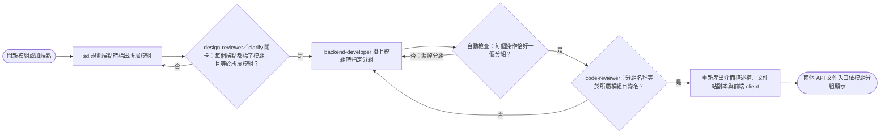

# System Analysis

## 需求依據

本 change 是技術 change，**沒有 `docs/specs/` 的業務規格頁可追溯**（`docs/specs/00-prd.mdx` 與各模組規格都沒有談到 API 文件的分組）。需求依據是 issue 本文中維護者的兩項裁定，加上 `docs/development/` 的 ADR 與規則文件；依 `openspec/config.yaml` 的 `context`，spec delta 的來源要改寫成 ADR 與規則文件的條號，而目前沒有任何規則文件的條號涵蓋 tag（見待決問題 1）。

| 來源                                                                                                                                   | 章節／編號                                                                                  | 摘要（一句）                                                                                                                                 |
| :------------------------------------------------------------------------------------------------------------------------------------- | :------------------------------------------------------------------------------------------ | :------------------------------------------------------------------------------------------------------------------------------------------- |
| issue #765                                                                                                                             | §分類原則（維護者 2026-11-27 裁定）                                                         | 一個後端模組一個 tag，名稱等於 `backend/app/modules/` 下的目錄名，不在模組內再細分；每個 operation 恰好一個 tag；每個 tag 在頂層宣告並附說明 |
| issue #765                                                                                                                             | §同步範圍（維護者 2026-11-27 裁定）                                                         | 規則同步寫進 backend-developer、code-reviewer、sd 與 api-contract 範本、design-reviewer、clarify 五處，「與 operationId 規則的分布一致」     |
| issue #765                                                                                                                             | §預期調整（十項）、§不在本單範圍                                                            | 列出要改的程式、測試、匯出物與文件；Orval 改 `tags-split` 不在範圍                                                                           |
| issue #765                                                                                                                             | 留言：issue-dispatch 檢查點（排程、派工）                                                   | 等 #747 合併後才認領，因兩張都改 `sd.md`、`code-reviewer.md`、`design-reviewer.md`、clarify skill、`openspec/config.yaml`；#747 已合併       |
| ADR-003                                                                                                                                | D5 API 路徑前綴與成功回應外層                                                               | 路徑在 `/api/v1` 後直接接資源、不插模組名，所以 API 文件上看不出端點屬於哪個模組                                                             |
| ADR-003                                                                                                                                | D6 前端 client 用 Orval 產生                                                                | 前端 client 由提交的介面描述檔產生；本 change 要重新產生並維持 hook 名稱不變                                                                 |
| ADR-003                                                                                                                                | D12、D13                                                                                    | 跨模組呼叫只走 service 對 service；稽核紀錄放 `app/core/`。與 tag 無直接關係，只確認「模組」以目錄為界                                       |
| ADR-003                                                                                                                                | D14 後端業務模組的切分                                                                      | 預定業務模組為 `account`、`dashboard`、`task`（03 加 04）、`dataset`、`admin`，`health` 不變；目前只有 `health`、`account` 存在              |
| `docs/diagrams/architecture/backend-modules.mdx`                                                                                       | §預定模組與資料表歸屬、§OpenAPI 匯出與 operationId 檢查、§新增業務模組的檢查清單、§決策紀錄 | 檢查清單目前沒有「指定 tag」一項；匯出一節列 operationId、後處理、文件站副本等做法                                                           |
| `docs/development/rules/api-agent-rules.mdx`                                                                                           | A1 路由、HTTP status、operationId 與回應外層                                                | 「後端的模組邊界由目錄表達，不由路徑表達」；A1 沒有 tag 的規定                                                                               |
| `docs/development/rules/api-agent-rules.mdx`                                                                                           | A4、A5、A10、附錄：來源對照（foundation spec FR-082 一列）                                  | 契約產物分工、重產與漂移檢查、破壞性變更；FR-082「restricted-client router 的 OpenAPI tag」標為歸 security-agent-rules，但該文件沒有對應條文 |
| `openspec/specs/api-schema-export`                                                                                                     | 全部 requirement                                                                            | 既有 capability：匯出指令、文件站副本、operationId 規則與撞名檢查；目前沒有 tag 的 requirement                                               |
| `openspec/specs/frontend-api-codegen`                                                                                                  | 全部 requirement                                                                            | 既有 capability：從介面描述檔產生前端 client                                                                                                 |
| `openspec/config.yaml`                                                                                                                 | `rules.api-contract`                                                                        | api-contract 規則目前沒有 tag／模組欄                                                                                                        |
| `.claude/agents/backend-developer.md`                                                                                                  | §API 與 OpenAPI、完成檢查清單                                                               | operationId 規則所在處；沒有 tag                                                                                                             |
| `.claude/agents/code-reviewer.md`、`.claude/agents/design-reviewer.md`、`.claude/agents/sd.md`、`.claude/skills/clarify/SKILL.md` §4.2 | 各自的 operationId 檢查項                                                                   | 沒有 tag 檢查項                                                                                                                              |
| `openspec/schemas/label-suite-sdd/templates/api-contract.md`                                                                           | §端點總覽                                                                                   | 表格欄位為 Method、Path、operationId、角色、異動，沒有模組欄                                                                                 |

`docs/specs/00-prd.mdx`、`docs/specs/glossary.mdx` 已確認沒有相關內容；`openspec/changes/` 目前只有本 change 在進行，沒有重疊。

## 範圍

- 這次包含：
  - 現有兩個模組（`health`、`account`）的所有操作在 API 文件中依模組分組，並各自帶一句英文說明；分組不再出現「default」或「未分類」
  - 一條會在新模組漏掉分組時失敗的自動檢查
  - 重新產出介面描述檔、文件站副本與前端產生的 client；操作識別名與前端 hook 名稱不變
  - 把「掛模組時指定分組」寫進新增業務模組的檢查清單與該文件的決策紀錄
  - 把分組規則同步到五處角色與範本（後端實作、程式審查、系統設計與 api-contract 範本、規劃審閱、clarify 關卡）
  - 確認兩個閱讀入口（後端自帶的 API 文件頁、文件站的 API 頁）都依模組分組
- 這次不包含：
  - Orval 依分組拆檔（`tags-split`），issue §不在本單範圍
  - 模組內再依資源細分（§分類原則已裁定不細分）
  - 新增或修改任何端點的路徑、行為、權限、錯誤碼
  - 任何產品畫面（`design/prototype/`）與 `docs/specs/` 需求；後端自帶的 API 文件頁與文件站 API 頁是開發文件，不是產品畫面
  - 修改文件站的 API 渲染外掛（它已支援依分組導覽，只需輸入帶分組）

## 業務流程

不適用：本 change 的需求依據不是 `docs/specs/` 的規格頁，沒有可引用的「業務流程」章節，內容也不是終端使用者的業務流程，而是開發流程中一條規則的落點；因此不建議用 `spec-writing` 補回規格書。

| 規格 | 業務流程                                                        | 本次涉及 |
| :--- | :-------------------------------------------------------------- | :------- |
| 無   | 不適用（技術 change，依據為 issue #765 與 `docs/development/`） | —        |

下圖只說明「每個操作歸一個模組分組」這條規則在既有開發流程中由誰守住，供 `sd`、`planner` 對齊落點；節點用角色與動作命名，不是業務流程。

## 跨模組依賴

- **需要先存在的**：`health`、`account` 兩個模組（已存在）；介面描述檔的匯出指令與文件站副本（`api-schema-export`，已存在）；前端 client 產生流程（`frontend-api-codegen`，已存在）；文件站的 API 渲染外掛已支援依分組導覽（`.notecraft/plugins/openapi-renderer/README.md`）。#747 已合併，不再與本 change 搶改同一批角色檔。
- **會被後續功能依賴的**：ADR-003 D14 預定的 `dashboard`、`task`、`dataset`、`admin` 四個模組開模組時，都要照新的檢查清單指定分組；E1–E7 的端點加進來時，分組規則與自動檢查會擋下漏標。`task` 模組涵蓋規格 03 與 04，04 的端點會歸在 `task` 分組，不會有獨立的「標註」分組（見需求矛盾 1）。
- **共用的資料**：介面描述檔 `backend/openapi.json` 與文件站副本 `docs/diagrams/architecture/api.openapi.json`（同一支匯出產生、位元組相同）、前端產生的 client 目錄。分組會進入介面描述檔，所以契約漂移檢查會看到差異，前端 client 需同步重產。
- **既有 capability 的關係**：`api-schema-export` 描述介面描述檔的內容規則（欄位命名、操作識別名、撞名檢查、外層命名），「每個操作恰好一個分組、每個分組在頂層宣告並附說明」屬於同一類內容規則，是最可能承接 spec delta 的 capability；`frontend-api-codegen` 的產生方式不變（不改 `split`），預期只有產物內容變動。由 `planner` 決定 delta 落在哪個 capability。
- **規則文件的分布**：issue 列的五處與 operationId 規則的現況分布相比，operationId 另外還出現在 `api-agent-rules` A1（規則本體）、`openspec/schemas/label-suite-sdd/schema.yaml` 的 api-contract 產出說明、`.claude/agents/ui-ux.md`、`.claude/agents/technical-writer.md`；後兩者用 operationId 綁資料來源，與分組無關，前兩者見待決問題 1、4。

## 需求矛盾

1. **分組名稱舉例與預定模組不一致**：issue #765 §分類原則舉例「之後 `project`、`annotation`…」，但 ADR-003 D14（同日裁定）與 `docs/diagrams/architecture/backend-modules.mdx` §預定模組與資料表歸屬 的預定業務模組是 `account`、`dashboard`、`task`、`dataset`、`admin`，沒有 `project`、`annotation`（04 標註併入 `task`）。原則本身「名稱等於目錄名」沒有矛盾，矛盾只在舉例；若角色檔或檢查清單照抄舉例會寫錯。列為待決問題 2。
2. **同步範圍「與 operationId 規則的分布一致」與實際分布不完全相符**：operationId 規則另外寫在 `api-agent-rules` A1 與 `schema.yaml` 的 api-contract 產出說明，issue 列的五處沒有涵蓋這兩處。列為待決問題 1、4。

## 待決問題

| #   | 問題                                                                                                                                                                                                                                                                                                                                                                                                                                                                                        | 影響                                                                                                                                                        | 狀態 |
| :-- | :------------------------------------------------------------------------------------------------------------------------------------------------------------------------------------------------------------------------------------------------------------------------------------------------------------------------------------------------------------------------------------------------------------------------------------------------------------------------------------------ | :---------------------------------------------------------------------------------------------------------------------------------------------------------- | :--- |
| 1   | 分組規則要不要寫進規則本體 `docs/development/rules/api-agent-rules.mdx` A1（並在其決策紀錄補一列），或另在 ADR-003 記一筆決定？（來源：issue #765 §同步範圍只列五處角色與範本、§預期調整只改 `backend-modules.mdx`；衝突點：AGENTS.md「Agent Rules Index」說規則由區域文件解釋，operationId 規則本體在 A1，五處角色檔都引用 A1；`openspec/config.yaml` `context` 要求技術 change 的 delta 追溯到 ADR 或規則文件條號，目前沒有任何條號涵蓋分組，delta 只能寫「來源：issue #765 §分類原則」） | 決定 spec delta 每條 requirement 的「來源」寫法；`proposal`、`tasks` 是否多一個改 `api-agent-rules.mdx`（或 ADR-003）的工作項；五處角色檔的規則要連到哪一條 | 待決 |
| 2   | issue §分類原則舉例的 `project`、`annotation` 是否只是示意，以 ADR-003 D14 的預定模組名為準（`dashboard`、`task`、`dataset`、`admin`）？（來源：issue #765 §分類原則；衝突點：ADR-003 D14、`backend-modules.mdx` §預定模組與資料表歸屬 沒有這兩個模組）                                                                                                                                                                                                                                     | 角色檔、檢查清單與 api-contract 範本裡的舉例要寫哪些名字；`sd` 在 system-design 寫將來模組的分組名稱時用哪一套                                              | 待決 |
| 3   | 分組的宣告順序（即兩個 API 文件入口的顯示順序）照什麼排：`health` 先、`account` 後，照 D14 預定模組的列序，照字母序，或其他？（來源：issue #765 §預期調整第 2 項只說「宣告順序即分組顯示順序」，沒有指定順序；其他需求依據也沒有）                                                                                                                                                                                                                                                          | 頂層分組宣告的順序、新模組加入時插在哪裡（檢查清單要不要寫出排序規則）；介面描述檔與文件站副本的內容                                                        | 待決 |
| 4   | `openspec/schemas/label-suite-sdd/schema.yaml` 的 api-contract 產出說明（目前寫「method、path、operationId（全專案唯一）」）要不要一併加上模組分組？（來源：issue #765 §同步範圍；衝突點：範本 `templates/api-contract.md` 要加模組欄，但同一 schema 的產出說明不在五處之內，兩者會不一致）                                                                                                                                                                                                 | `tasks` 是否多改 `schema.yaml` 一處；之後 `sd` 依 `openspec instructions api-contract` 拿到的指示是否提到分組                                               | 待決 |
| 5   | 自動檢查是否只驗「每個操作恰好一個分組」，還是也要驗「用到的分組都在頂層宣告且附非空說明」？（來源：issue #765 §分類原則要求每個分組在頂層宣告並附說明；§預期調整第 3 項的測試只寫「每個操作恰好一個 tag」，第 7 項說名稱對錯靠審查，但沒說宣告與說明由誰守）                                                                                                                                                                                                                               | 測試的範圍與 Scenario 數；`code-reviewer` 檢查項要不要多一條「分組已在頂層宣告且有說明」；spec delta 的 requirement 寫法                                    | 待決 |
| 6   | 不屬於任何 `backend/app/modules/` 模組的操作（目前沒有；例如將來若在 `app/core/` 或 `app/oidc/` 掛路由）要歸哪個分組，還是規定所有操作都必須屬於某個模組？（來源：issue #765 §分類原則只定義模組內操作的分組；`backend-modules.mdx` §後端基礎建設 有 `app/oidc/` 入口但目前沒有路由）                                                                                                                                                                                                       | 自動檢查與規則文字的適用範圍；目前不影響任何既有操作，只影響規則寫法                                                                                        | 待決 |
| 7   | `api-agent-rules.mdx` §附錄：來源對照把 foundation spec FR-082「restricted-client router 的 OpenAPI tag」標為歸 `security-agent-rules.mdx`，但該文件沒有對應條文；若將來用分組標示授權邊界，會與「每個操作恰好一個分組、名稱等於模組」衝突。本 change 是否要處理或至少註記這一列？（來源：`docs/development/rules/api-agent-rules.mdx` §附錄：來源對照 FR-082 一列；`docs/development/rules/security-agent-rules.mdx` 全文無此條）                                                          | 若要處理，`tasks` 多一項改附錄或 `security-agent-rules.mdx`；若不處理，維持現狀，只在本 change 記錄風險                                                     | 待決 |

## 參考檔案

- `/Users/mandy610425/project/label-suite-oss/.claude/worktrees/issue-765-openapi-module-tags/openspec/config.yaml`
- `/Users/mandy610425/project/label-suite-oss/.claude/worktrees/issue-765-openapi-module-tags/openspec/schemas/label-suite-sdd/schema.yaml`
- `/Users/mandy610425/project/label-suite-oss/.claude/worktrees/issue-765-openapi-module-tags/openspec/schemas/label-suite-sdd/templates/api-contract.md`
- `/Users/mandy610425/project/label-suite-oss/.claude/worktrees/issue-765-openapi-module-tags/docs/development/adr/003-backend-architecture.mdx`（D5、D6、D12–D14）
- `/Users/mandy610425/project/label-suite-oss/.claude/worktrees/issue-765-openapi-module-tags/docs/diagrams/architecture/backend-modules.mdx`
- `/Users/mandy610425/project/label-suite-oss/.claude/worktrees/issue-765-openapi-module-tags/docs/development/rules/api-agent-rules.mdx`（A1、A4、A5、A10、附錄）
- `/Users/mandy610425/project/label-suite-oss/.claude/worktrees/issue-765-openapi-module-tags/docs/development/rules/security-agent-rules.mdx`
- `/Users/mandy610425/project/label-suite-oss/.claude/worktrees/issue-765-openapi-module-tags/openspec/specs/api-schema-export/spec.md`
- `/Users/mandy610425/project/label-suite-oss/.claude/worktrees/issue-765-openapi-module-tags/openspec/specs/frontend-api-codegen/spec.md`
- `/Users/mandy610425/project/label-suite-oss/.claude/worktrees/issue-765-openapi-module-tags/.claude/agents/backend-developer.md`、`code-reviewer.md`、`sd.md`、`design-reviewer.md`
- `/Users/mandy610425/project/label-suite-oss/.claude/worktrees/issue-765-openapi-module-tags/.claude/skills/clarify/SKILL.md`（§4.2）
- `/Users/mandy610425/project/label-suite-oss/.claude/worktrees/issue-765-openapi-module-tags/backend/openapi.json`（現況：8 個操作皆無分組、無頂層宣告）
- `/Users/mandy610425/project/label-suite-oss/.claude/worktrees/issue-765-openapi-module-tags/.notecraft/plugins/openapi-renderer/README.md`
- issue #765 本文與留言（`gh api repos/label-suite/label-suite/issues/765`）
