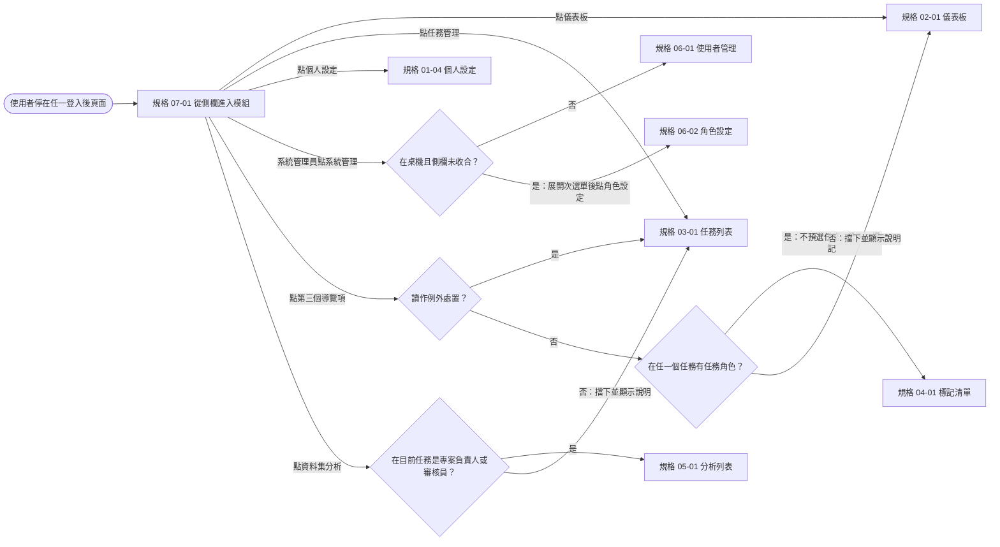
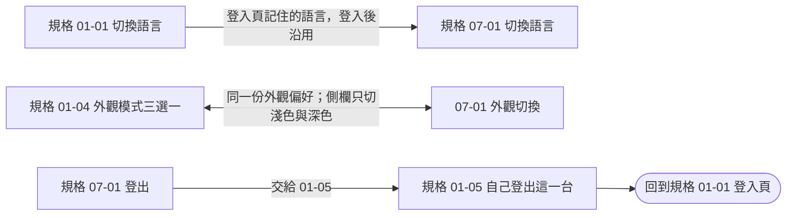

# System Analysis

本份是 change `sidebar-nav`（Issue #720，Epic #713 共用介面外殼）的系統分析。它只寫業務面：需求依據、範圍、角色、流程串接、跨模組依賴、矛盾與待決問題。技術設計、介面契約與畫面細節分別交給 `system-design`、`api-contract`、`ui-design`。

## 需求依據

依 `openspec/config.yaml` 的需求依據順序：角色、權限上限、範圍與模組劃分以 PRD 為準；業務規則以維護者指定的需求文件（Issue #720 與其留言）與 `docs/specs/` 規格書為準，規格與 Issue 說法不同時以規格為準（Issue #720 §需求目標 也這樣寫）；其餘依 PRD 其他內容 ＞ `docs/` 其他文件 ＞ `openspec/`。

| 來源                                                                                                                          | 章節／編號                                                                                                                                                                 | 摘要（一句）                                                                                                                                                                                                                                                                                             |
| :---------------------------------------------------------------------------------------------------------------------------- | :------------------------------------------------------------------------------------------------------------------------------------------------------------------------- | :------------------------------------------------------------------------------------------------------------------------------------------------------------------------------------------------------------------------------------------------------------------------------------------------------- |
| Issue #720                                                                                                                    | §使用情境／功能範圍、§驗收條件                                                                                                                                             | 實作規格 07-01 的「側欄導覽與依角色顯示的選單」「語言切換、外觀切換、快捷鍵總覽」；依 #747 的規則把側欄要用的語言切換、品牌標誌、外觀切換三個元件搬到共用元件區，並更新設計系統元件規格的「程式實作」欄                                                                                                  |
| Issue #720 留言                                                                                                               | 2026-11-27 三則（備註、更正、Ready gate）                                                                                                                                  | 共用與否只看產品畫面、元件展示頁不算使用方；語言切換被側欄用到後跨兩個 feature，屬共用，照計畫搬；密碼輸入框不搬；畫面已於 2026-11-27 經維護者核可                                                                                                                                                       |
| Epic #713                                                                                                                     | 本文                                                                                                                                                                       | 共用介面外殼五張子單（#755、#720、#721、#722、#725）依產品順序以 blocked-by 串接，一次派一張                                                                                                                                                                                                             |
| PRD `docs/specs/00-prd.mdx`                                                                                                   | §使用者角色 §角色清單                                                                                                                                                      | 平台成員、系統管理員、Seeder 管理員三種系統角色（Seeder 權限同系統管理員）；任務角色另計，系統角色不代表任務成員身分                                                                                                                                                                                     |
| PRD                                                                                                                           | §使用者角色 §權限矩陣 「07 共用介面」列與其條列                                                                                                                            | 兩種系統角色都是 `R/E (o)`；`E (o)` 只作用在自己的語言、外觀、側欄收合、通知已讀狀態，上限不含任何業務資料；系統管理員沒有任務角色時進不了該任務的標記與分析                                                                                                                                             |
| PRD                                                                                                                           | §專案範圍 §範圍內                                                                                                                                                          | 共用介面含側欄導覽、工作頁籤、繁中與英文切換、外觀切換、通知、快捷鍵總覽、側欄收合                                                                                                                                                                                                                       |
| PRD                                                                                                                           | §Site Map                                                                                                                                                                  | 登入後從側欄進入各模組；側欄導覽「不是獨立頁面」；第三個導覽項的名稱依任務角色讀「標記作業／審核作業／例外處置」                                                                                                                                                                                         |
| PRD                                                                                                                           | §模組架構與串接 §模組依賴                                                                                                                                                  | 06 變更系統角色從下一次操作起生效；06 修改角色權限時 03、04、05 依新權限顯示與擋下                                                                                                                                                                                                                       |
| 規格 07-01 `docs/specs/07-shared/01-sidebar.mdx`                                                                              | 全頁（已定案；§待釐清 寫明沒有未決問題）                                                                                                                                   | 本次的主要需求：導覽項與可見性、目前位置、進入模組的條件、系統管理次選單、語言、外觀、通知、快捷鍵總覽、登出、工作頁籤的位置、螢幕寬度、收合；72 條 Scenario（規格回寫後，原 69 條）                                                                                                                     |
| 規格 07-01                                                                                                                    | §已確認決議 Q1–Q18（Q10 已被 Q14 取代）                                                                                                                                    | 權限上限放寬到 `R/E (o)`（Q1）、角色標示用字（Q2）、第三個導覽項依任務角色改名（Q3）、通知事件不在本頁（Q4）、預設繁中（Q7）、手機無快捷鍵（Q8）、擋下的落點（Q9）、儀表板行動入口卡不擋（Q13）、跟隨系統跟作業系統（Q14）、例外處置進任務列表（Q15、Q18）、任一任務有角色即放行（Q16）、入口標記（Q17） |
| 規格 07-shared 模組索引 `docs/specs/07-shared/index.mdx`                                                                      | §Logic Flow 分段一、二與三個缺口                                                                                                                                           | 側欄把人送到六個模組與登入頁的每一條連線與出處；缺口一（點通知去哪）、缺口二（桌機次選單點使用者管理去哪）未裁定                                                                                                                                                                                         |
| 規格 07-02 `docs/specs/07-shared/02-workspace-tabs.mdx`                                                                       | §關閉與重開 第 1 條、§快捷鍵                                                                                                                                               | 關閉頁籤後的焦點移動以 07-01 §工作頁籤的位置 為唯一正典、07-02 不另外驗收；三個頁籤快捷鍵列在總覽的「頁籤」組                                                                                                                                                                                            |
| 規格 07-04 `docs/specs/07-shared/04-notification-events.mdx`                                                                  | §兩個消費端、§規格 第 2 條                                                                                                                                                 | 側欄通知清單是兩個消費端之一，畫面行為全部由 07-01 §通知 定義                                                                                                                                                                                                                                            |
| 規格 01-01 `docs/specs/01-account/01-login.mdx`                                                                               | §語言切換、§已確認決議 Q5                                                                                                                                                  | 登入頁記住的語言，登入後沿用；預設繁中                                                                                                                                                                                                                                                                   |
| 規格 01-04 `docs/specs/01-account/04-profile.mdx`                                                                             | §偏好設定、§已確認決議 Q7、Q18                                                                                                                                             | 外觀模式三種值的完整設定在個人設定；外觀只記在這台瀏覽器                                                                                                                                                                                                                                                 |
| 規格 01-05 `docs/specs/01-account/05-login-state.mdx`                                                                         | §業務流程「自己登出這一台」                                                                                                                                                | 側欄登出後原登入狀態失效的規則                                                                                                                                                                                                                                                                           |
| 規格 02-01 `docs/specs/02-dashboard/01-dashboard.mdx`                                                                         | §還沒有任務角色的人看到什麼、§已確認決議 Q2、Q8                                                                                                                            | 三張行動入口卡是真的入口；儀表板版面不沿用側欄「一般使用者」的稱呼                                                                                                                                                                                                                                       |
| 規格 03-01、04-01、05-01、06-01、06-02                                                                                        | 各頁 §業務流程 的進入段落；04-01 §路由上下文與回退 第 10、11 條、§已確認決議 Q1                                                                                            | 側欄導覽的落點；專案負責人進不了標記清單；標記清單以入口標記分辨站內點進與深連結                                                                                                                                                                                                                         |
| 術語表 `docs/specs/glossary.mdx`                                                                                              | `term.system-role`、`term.task-role`、`term.platform-member`、`term.system-admin`、`term.seeder-admin`、`term.appearance-mode`、`term.notification`、`term.workspace-tabs` | 本次用到的角色與共用介面名詞                                                                                                                                                                                                                                                                             |
| 資料欄位盤點 `docs/diagrams/architecture/data-field-inventory.mdx`                                                            | §07 共用介面 › 07-01 側欄                                                                                                                                                  | 語言、外觀模式、側欄收合都是記在本機的瀏覽器偏好；未讀通知數量仍是待決 D1；角色標示由任務角色推導                                                                                                                                                                                                        |
| 產品路線圖 `docs/product/roadmap.mdx`                                                                                         | §排序依據 第 2 條                                                                                                                                                          | 01-01 之後接 07-01、07-03、02-01 外殼，再回頭做註冊、設定密碼、工作頁籤、登入狀態、個人設定                                                                                                                                                                                                              |
| 前端規則 `docs/development/rules/frontend-agent-rules.mdx`                                                                    | F5                                                                                                                                                                         | 共用元件的判準：用到它的產品畫面分屬一個以上 feature；`shared/app-shell`（登入後外殼）自成一個 feature                                                                                                                                                                                                   |
| ADR-003 `docs/development/adr/003-backend-architecture.mdx`                                                                   | D12、D14                                                                                                                                                                   | 跨模組只走公開服務；任務、任務成員與標記歸 `task` 模組（03-01～03-03、04-01、04-02），本次要讀的任務角色屬於它                                                                                                                                                                                           |
| 既有 capability `openspec/specs/permission-authorization`、`role-permission-matrix`                                           | 全部 Requirement                                                                                                                                                           | #755 已建好授權四步與 24 個權限鍵；任務範圍的檢查需要任務成員資料，而那一份目前沒有模組提供                                                                                                                                                                                                              |
| 既有 capability `openspec/specs/auth-guard`                                                                                   | Requirement「暫時落點顯示目前登入者並提供登出」                                                                                                                            | 暫時落點明文「頁面沒有側欄」、自帶登出鈕                                                                                                                                                                                                                                                                 |
| 既有 capability `openspec/specs/frontend-i18n`、`login-session`、`component-gallery`、`frontend-routing`、`date-time-display` | Requirement「介面語言預設繁體中文並記住使用者的選擇」「從這一台登出」「展示頁切換淺色與深色」及路由、時間顯示各條                                                          | 側欄沿用的既有行為；元件展示頁的外觀切換明文不記住選擇、離開時還原淺色                                                                                                                                                                                                                                   |

### 現況盤點（先搜尋的結果）

- 登入後只有一頁：#719 的暫時落點（儀表板將來的路徑），沿用登入頁的頁首與卡片，**沒有側欄**；其餘網址一律導回根路徑
- 已有可沿用的能力：登入狀態查詢（帶回名稱、Email、系統角色）、從這一台登出、繁中與英文切換並記在本機、系統角色每次從伺服器讀
- 已有、但不是本次要的樣子：外觀切換只存在元件展示頁，不記住選擇、離開就還原淺色；語言切換與品牌標誌放在帳號 feature 裡
- **沒有**：任務、任務成員與任務角色的任何資料或讀取能力（伺服器端只有帳號、系統管理、健康檢查三個模組；授權的任務成員讀取介面已定義但沒有模組實作）；通知的任何資料；側欄要導去的儀表板（正式版）、任務列表、任務詳情、標記清單、分析列表、使用者管理、角色設定、個人設定八頁
- 設計系統：App Shell 規格「程式實作：尚未實作」；語言切換有元件規格；**外觀切換與品牌標誌沒有自己的元件規格**；畫面清冊「元件 → 畫面」表的語言切換只列帳號頁與元件展示頁，沒有列 `shared/app-shell`
- 進行中的其他 change：無，只有本 change

### 參考檔案

- `docs/specs/00-prd.mdx`、`docs/specs/glossary.mdx`、`docs/specs/index.mdx`
- `docs/specs/07-shared/index.mdx`、`01-sidebar.mdx`、`02-workspace-tabs.mdx`、`03-denied-and-not-found.mdx`、`04-notification-events.mdx`
- `docs/specs/01-account/01-login.mdx`、`04-profile.mdx`、`05-login-state.mdx`
- `docs/specs/02-dashboard/01-dashboard.mdx`、`docs/specs/03-task-management/01-task-list.mdx`、`docs/specs/04-annotation/01-annotation-list.mdx`、`docs/specs/05-dataset/01-analysis-list.mdx`、`docs/specs/06-admin/01-user-management.mdx`、`docs/specs/06-admin/02-role-settings.mdx`
- `docs/diagrams/architecture/data-field-inventory.mdx`、`docs/product/roadmap.mdx`
- `docs/development/rules/frontend-agent-rules.mdx`、`docs/development/adr/003-backend-architecture.mdx`
- `design/prototype/pages/shared/sidebar.js`、`design/prototype/pages/shared/sidebar.css`（唯讀）
- `design/system/components/app-shell.md`、`lang-toggle.md`、`auth-navbar.md`、`auth-card.md`；`design/system/screen-inventory.md`
- `frontend/src/features/auth/language-toggle.tsx`、`brand-mark.tsx`、`logout-button.tsx`、`session-query.ts`；`frontend/src/pages/dev-gallery/theme-toggle.tsx`；`frontend/src/pages/dashboard-placeholder/`；`frontend/src/lib/i18n/`
- `backend/app/core/authz.py`、`backend/app/core/permissions.py`、`backend/app/main.py`
- `openspec/specs/auth-guard`、`frontend-i18n`、`login-session`、`component-gallery`、`permission-authorization`、`role-permission-matrix`
- `openspec/changes/archive/2026-11-26-login-auth-guard/system-analysis.md`、`clarification.md`（Q5 暫時落點）
- `scripts/check-component-reuse.mjs`

## 範圍

### 規模檢查（Scenario 數）

規格 07-01 §驗收標準 共 **72** 條 Scenario（含 commit `081721f` 依 Q3、Q4、Q6 回寫新增的三條）。依 `clarification.md` §移出本次的驗收標準，32 條移交其他 issue，07-01 留 40 條；加上規格 01-01 回寫新增的「登入頁沿用已儲存的外觀」，本次驗收共 **41** 條，**未超過 75 條，不需要拆分**。下文的 Scenario 編號是 07-01 §驗收標準 回寫後的列序。

- 這次包含（clarification Q1、Q2、Q3、Q4、Q8 確定）：
  - §導覽項目與可見性：依系統角色顯示五或六個導覽項；任務角色本次固定為「任何任務都沒有任務角色」（Q1），所以只驗收這一支的角色標示（Scenario 1 平台成員看不到系統管理、2 系統管理員看到系統管理、7 沒有任務角色時角色標示讀作一般使用者、9 角色標示切換語言後也換）
  - §目前位置：10 每頁只有一個目前位置
  - §進入模組的條件 第 3 條與 §卡控機制 對應列：13 沒有任務角色時點擊標記作業（回到暫時落點，頂端以既有的 Alert 顯示說明，Q2、Q4）；側欄「標記作業」的連結帶入口標記
  - §系統管理的次選單：20 展開系統管理次選單、23 按 Esc 關閉系統管理次選單；次選單的「使用者管理」進 06-01（Q6），其驗收（22）需要使用者管理頁，移交 #728
  - §語言切換：25 切換語言後整頁一起換、26 第一次登入預設繁體中文、27 重新整理後語言保持、29 術語缺少翻譯時顯示備用文字
  - §外觀切換：30–36（含 32 登出後登入頁沿用外觀）；外觀是這台瀏覽器的偏好，全站一致套用，含登出後的登入頁（Q6）；規格 01-01 的「登入頁沿用已儲存的外觀」同屬本次
  - §快捷鍵總覽：45 桌機開啟快捷鍵總覽、46 手機沒有快捷鍵總覽入口、47 手機按問號不開啟快捷鍵總覽、48 側欄收合後快捷鍵入口隱藏、52 快捷鍵總覽只列目前頁面可用的（Q3）
  - §登出：56 點擊登出不會收合、69 登出後回到登入頁；暫時落點不再有自己的登出鈕，改由側欄登出（Q2）
  - §側欄收合：54 點擊側欄空白區收合、55 點擊導覽連結不會收合、57 重新整理後收合狀態保持、59 手機不啟用收合；收合另有鍵盤路徑（Q12）
  - §不同螢幕寬度的呈現：65 手機底部導覽不遮擋主要操作、66 語言文字較長時導覽不截斷（以英文介面實測，Q13）、70–72 桌機／平板／手機能完整導覽
  - §邊界情況 與跨功能的 Scenario：37 關閉動態效果時不播動畫、38 角色被改掉時側欄不立刻變、64 用鍵盤走過側欄所有控制項、67 等待中的操作顯示進行中、68 錯誤訊息不出現系統內部資訊
  - 側欄掛上的頁面：暫時落點掛進外殼（Q2）；導覽項照常顯示並連到各自的路由，落點頁還不存在時沿用現行的導回暫時落點，不新增「建置中」頁（Q2）
  - Issue #720 §驗收條件 第 2 項：語言切換、品牌標誌、外觀切換三個元件搬到共用元件區（Q5）；新增品牌標誌與外觀切換兩份元件規格、畫面清冊「元件 → 畫面」補上 `shared/app-shell`（Q9）
  - 元件展示頁改用同一個共用外觀切換，讀寫同一份外觀偏好、離開不還原（Q5）
- 這次不包含（與 `clarification.md` §移出本次的驗收標準 一致，共 32 條；移出的 Scenario 不寫進 delta，由 `ops` 歸檔時在接手 issue 留移交清單）：

| 規格頁 | Scenario（編號與名稱）                 | 接手 issue | 依據                                       |
| :----- | :------------------------------------- | :--------- | :----------------------------------------- |
| 07-01  | 3 審核員看到審核作業                   | #766       | Q1：需要真實任務角色                       |
| 07-01  | 4 專案負責人看到例外處置               | #766       | Q1                                         |
| 07-01  | 5 標記員看到標記作業                   | #766       | Q1                                         |
| 07-01  | 6 標記員的角色標示讀作標記員           | #766       | Q1                                         |
| 07-01  | 14 在別的任務有角色時點擊標記作業      | #766       | Q1                                         |
| 07-01  | 16 專案負責人進得去標記作業            | #766       | Q1                                         |
| 07-01  | 18 只當專案負責人的人看到例外處置      | #766       | Q1                                         |
| 07-01  | 17 點標記作業進到的是清單頁            | #773       | Q1、Q2：需要任務角色與標記清單頁           |
| 07-01  | 19 沒有任務角色時點擊資料集分析        | #730       | Q4：「回任務列表」那條需要任務列表頁       |
| 07-01  | 8 系統管理頁的角色標示不被任務角色蓋掉 | #728       | Q2：需要落點頁                             |
| 07-01  | 11 在任務詳情頁時任務管理是目前位置    | #763       | Q2                                         |
| 07-01  | 12 在角色設定頁時系統管理是目前位置    | #729       | Q2                                         |
| 07-01  | 21 展開系統管理次選單直達角色設定      | #729       | Q2                                         |
| 07-01  | 24 手機點擊系統管理直接進入使用者管理  | #728       | Q2                                         |
| 07-01  | 49 側欄收合後點擊系統管理              | #728       | Q2                                         |
| 07-01  | 22 展開系統管理次選單點使用者管理      | #728       | Q2、Q6：需要使用者管理頁（規格回寫新增）   |
| 07-01  | 28 換頁後語言保持                      | #730       | Q2：需要第二個存在的登入後頁面             |
| 07-01  | 58 換頁後收合狀態保持                  | #730       | Q2                                         |
| 07-01  | 15 從儀表板行動入口卡進入不被擋下      | #722       | Q8：行動入口卡屬儀表板                     |
| 07-01  | 39 有操作者的通知顯示四件事            | #740       | Q7：側欄通知整節移交，本次不畫通知入口     |
| 07-01  | 40 沒有操作者的通知少一行              | #740       | Q7                                         |
| 07-01  | 41 沒有未讀通知                        | #740       | Q7                                         |
| 07-01  | 42 未讀通知數超過九                    | #740       | Q7                                         |
| 07-01  | 43 全部標為已讀                        | #740       | Q7                                         |
| 07-01  | 44 載入通知失敗                        | #740       | Q7                                         |
| 07-01  | 50 快捷鍵總覽不合併動作                | #780       | Q3：標記與審核的快捷鍵由實作它的單加進總覽 |
| 07-01  | 51 快捷鍵總覽沒有整批審核              | #780       | Q3                                         |
| 07-01  | 53 快捷鍵總覽有頁籤那一組              | #725       | Q3：頁籤的快捷鍵由 #725 加進總覽           |
| 07-01  | 60 關閉作用中的頁籤後焦點移動          | #725       | Q8：§工作頁籤的位置 移交                   |
| 07-01  | 61 關閉最右側的作用中頁籤後焦點移動    | #725       | Q8                                         |
| 07-01  | 62 關閉非作用中的頁籤不動焦點          | #725       | Q8                                         |
| 07-01  | 63 關閉後沒有任何工作頁籤              | #725       | Q8                                         |

07-01 以外、本次同樣不做的部分（沒有 Scenario 要移交，只寫明界線）：

| 部分                                                 | 接手                                           | 理由                                                                                         |
| :--------------------------------------------------- | :--------------------------------------------- | :------------------------------------------------------------------------------------------- |
| 任務角色的讀取、「目前任務」的認定、彙總的成員資格   | #766                                           | Q1：本次前端只保留單一任務角色來源的接縫，固定回答「沒有任務角色、沒有目前任務」，不新增讀取 |
| 07-02 工作頁籤的開啟、切換、關閉、快捷鍵行為         | #725                                           | 頁籤本身尚未存在                                                                             |
| 07-03 無權限與找不到畫面                             | #721                                           | 側欄擋下時回到落點頁並顯示說明，不經過 07-03 的整頁畫面                                      |
| 07-04 通知事件清單與側欄通知入口                     | #740                                           | Q7                                                                                           |
| 各導覽項的落點頁本身                                 | #722、#730、#763、#773、#738、#728、#729、#727 | 本次只負責「點了去哪、擋不擋」；落點頁不存在時沿用現行的導回暫時落點（Q2）                   |
| 外觀模式三種值的完整設定                             | #727                                           | 側欄只做淺色與深色的一鍵切換（07-01 §外觀切換 的註）                                         |
| 「標記作業」入口標記的讀取端（清單分辨站內與深連結） | #773                                           | 本次只負責連結帶上入口標記                                                                   |

### 角色與權限

側欄本身只讀取與記住使用者自己的偏好，不新增、編輯或刪除任何業務資料（07-01 §使用角色、PRD §權限矩陣 條列）。

**本次只實作「任何任務都沒有任務角色」這一支**（clarification Q1）：任務角色來源本次固定回答「沒有任務角色、沒有目前任務」，依任務角色的其他分支由 #766 接上真實的任務角色讀取後實作與驗收。

| 動作                                 | 平台成員                                     | 系統管理員（含 Seeder 管理員）                                                 | 未登入的訪客                                                                    |
| :----------------------------------- | :------------------------------------------- | :----------------------------------------------------------------------------- | :------------------------------------------------------------------------------ |
| 看到側欄                             | 是，五個導覽項                               | 是，六個導覽項（多「系統管理」）                                               | 否，側欄只在登入後頁面                                                          |
| 系統管理次選單（桌機、未收合）       | 看不到、點不到                               | 展開「使用者管理」（進 06-01，Q6）「角色設定」；手機或已收合時直接進使用者管理 | —                                                                               |
| 點「儀表板」「任務管理」「個人設定」 | 放行                                         | 放行                                                                           | —                                                                               |
| 點第三個導覽項                       | 依任務角色（下表）；本次固定讀作「標記作業」 | 同左；系統角色不隱含任務角色                                                   | —                                                                               |
| 點「資料集分析」                     | 依目前任務的任務角色（下表）；本次一律擋下   | 同左                                                                           | —                                                                               |
| 改自己的語言、外觀、側欄收合狀態     | E (o)                                        | E (o)                                                                          | 語言在登入頁可切（01-01）；登入頁的外觀照這台瀏覽器的偏好呈現（Q6）；收合不適用 |
| 快捷鍵總覽                           | 桌機、未收合時可開；手機沒有                 | 同左                                                                           | —                                                                               |
| 登出                                 | 是                                           | 是                                                                             | —                                                                               |
| 通知（本次不包含，Q7）               | E (o)：只限自己的已讀狀態                    | 同左                                                                           | —                                                                               |

第三個導覽項與「資料集分析」依任務角色（07-01 §導覽項目與可見性 第 4–6 條、§進入模組的條件 第 1–3 條、Q15、Q16、Q18）。「本次」欄依 clarification Q1、Q4：

| 使用者的任務角色                                         | 第三個導覽項讀作 | 點第三個導覽項                       | 角色標示                     | 點「資料集分析」     | 本次                                                                      |
| :------------------------------------------------------- | :--------------- | :----------------------------------- | :--------------------------- | :------------------- | :------------------------------------------------------------------------ |
| 目前任務是審核員                                         | 審核作業         | 進標記清單（不預選任務、帶入口標記） | 審核員                       | 放行                 | 不做，移交 #766                                                           |
| 目前任務是專案負責人                                     | 例外處置         | 進任務列表                           | 專案負責人                   | 放行                 | 不做，移交 #766                                                           |
| 目前任務是標記員                                         | 標記作業         | 進標記清單                           | 標記員                       | 回任務列表並顯示說明 | 不做，移交 #766                                                           |
| 目前沒有任務角色，但在別的任務是標記員或審核員           | 標記作業         | 進標記清單                           | 一般使用者                   | 回任務列表並顯示說明 | 不做，移交 #766                                                           |
| 在任何任務都不是標記員或審核員，只在某些任務是專案負責人 | 例外處置（一律） | 進任務列表                           | 依目前任務；沒有則一般使用者 | 依目前任務           | 不做，移交 #766                                                           |
| 任何任務都沒有任務角色                                   | 標記作業         | 回儀表板並顯示說明                   | 一般使用者                   | 回任務列表並顯示說明 | **實作**；「回儀表板」在暫時落點驗收，「回任務列表」的驗收移交 #730（Q4） |

- 系統管理的頁面上角色標示固定讀作「系統管理員」，不被任務角色蓋掉（07-01 §導覽項目與可見性 的註、Q2）；系統管理的頁面本次不存在，Scenario 8 移交 #728（clarification Q2）
- 側欄的進入條件只看任務角色，不讀權限矩陣；矩陣收窄由落點頁各自擋下（clarification Q10）
- 側欄隱藏導覽項不是授權；落點頁仍各自檢查權限
- 遮蔽或唯讀的資料：使用者姓名與角色標示只顯示給本人；側欄不顯示任何其他人的資料、任何業務資料，也沒有標準答案或測試集資訊可以外露（Hard Rule 6 在本次沒有可到達的資料）；擋下說明是固定文案，不帶任務名或任務 ID（clarification Q4）
- 「目前任務」怎麼認定交給 #766（clarification Q1）；本次沒有目前任務，上表凡是寫「目前任務」的列都不在本次

## 業務流程

| 規格                    | 業務流程                   | 本次涉及                                                                           |
| :---------------------- | :------------------------- | :--------------------------------------------------------------------------------- |
| 規格 07-01              | §業務流程 `從側欄進入模組` | 全部（主流程、A1、A2、E1、E2）；E2 之中「儀表板行動入口卡不擋」的例外不在本次      |
| 規格 07-01              | §業務流程 `切換語言`       | 全部                                                                               |
| 規格 07-01              | §業務流程 `登出`           | 全部；登入狀態怎麼結束沿用規格 01-05 §業務流程 `自己登出這一台`                    |
| 規格 01-05              | §業務流程 `自己登出這一台` | 只作交接：本次的登出控制項交給它                                                   |
| 規格 01-01              | §業務流程 `切換語言`       | 只作交接：登入頁記住的語言，登入後由 07-01 接手                                    |
| 規格 07-shared 模組索引 | §Logic Flow 分段一、分段二 | 側欄的每一條離開連線以這兩段為準；缺口一（通知）不在本次（Q7），缺口二已決議（Q6） |

外觀切換、快捷鍵總覽、側欄收合、系統管理次選單的展開與收起，規格 07-01 §業務流程 沒有獨立的流程，07-shared 模組索引把它們歸為「頁內操作」；本次以 §規格 各節條文為準，不另畫，也不補回規格書（待決 15，已決議 clarification Q14）。

這次涉及多份規格，以下是串接圖，只展開交界處；每一條連線的出處見 07-shared 模組索引 §Logic Flow。

主流程：從側欄進入模組

- 交界處的交接：側欄只決定「去哪一頁、擋不擋」，交給落點頁之後，那一頁自己的進入規則與空狀態由該頁規格負責（例：04-01 依入口標記分辨站內點進與深連結）
- 本次這八個落點頁只有儀表板以暫時落點的形式存在，其餘都還不存在；導覽項照常連到各自的路由，落點頁不存在時沿用現行的導回暫時落點（clarification Q2）
- 桌機展開次選單後點「使用者管理」進 06-01 使用者管理（07-shared 模組索引 缺口二，clarification Q6），規格書由 `spec-writing` 回寫

子流程：偏好與登出的交接

- 語言與外觀都是同一台瀏覽器的偏好，換頁、重新整理都保持（07-01 §語言切換 第 3 條、§外觀切換 第 3 條；資料欄位盤點 §07-01）
- 外觀偏好的完整設定（含「跟隨系統」）由 01-04 擁有，側欄切換後兩邊讀到同一個值；01-04 頁本身不在本次

## 跨模組依賴

### 本次需要先存在的

| 需要的東西                                       | 屬於                                                                                   | 現況                                                                        | 本次怎麼處理                                                                                                                 |
| :----------------------------------------------- | :------------------------------------------------------------------------------------- | :-------------------------------------------------------------------------- | :--------------------------------------------------------------------------------------------------------------------------- |
| 登入狀態、系統角色、名稱                         | 01-01、01-05（帳號模組）                                                               | 已有：登入狀態查詢帶回名稱、Email、系統角色，每次以伺服器當下的系統角色為準 | 沿用；「系統管理」的顯示依系統角色                                                                                           |
| 從這一台登出                                     | 01-05                                                                                  | 已有                                                                        | 沿用；側欄的登出控制項交給它                                                                                                 |
| 語言切換與記住選擇                               | 01-01（登入頁）、07-01（登入後）                                                       | 已有：繁中與英文、記在本機、預設繁中、不讀裝置語言                          | 沿用；登入後的擁有者是本次                                                                                                   |
| 使用者在每個任務的任務角色（任一任務、目前任務） | 03 任務管理（建立任務時成為專案負責人、成員指派在任務詳情），依 ADR-003 D14 歸任務模組 | **不存在**：沒有任務、任務成員的資料，也沒有模組提供讀取                    | 本次不新增讀取，前端保留單一接縫、固定「沒有任務角色」；讀取由 #766 提供（clarification Q1）                                 |
| 「目前任務」的認定                               | 規格沒有定義                                                                           | —                                                                           | 交給 #766；本次沒有目前任務（clarification Q1）                                                                              |
| 八個落點頁                                       | 02-01、03-01、03-03、04-01、05-01、06-01、06-02、01-04                                 | 只有儀表板的暫時落點；其餘不存在                                            | 暫時落點掛進外殼；其餘落點頁不存在時沿用現行的導回暫時落點，需要落點頁的 Scenario 移交各落點頁的單（clarification Q2）       |
| 授權四步與權限矩陣                               | #755（共用）                                                                           | 已有；任務範圍的檢查要等任務成員資料                                        | 側欄的可見性與進入條件依 07-01 只看系統角色與任務角色；不讀矩陣，矩陣收窄由落點頁各自擋（clarification Q10）                 |
| 外觀偏好的完整設定（三選一）                     | 01-04                                                                                  | 不存在（#727）                                                              | 本次只做淺色與深色一鍵切換與記住；「跟隨系統」與「值無效」的解讀在本次就要成立（Scenario 34–36），因為沒設定過外觀的人會遇到 |

### 會被後續功能依賴的

- **登入後外殼**：#721（07-03）、#722（02-01）、#725（07-02）與之後每一個登入後頁面都掛在本次的側欄上；07-02 的頁籤列也掛在側欄上
- **擋下的落點**：#722 儀表板與 #730 任務列表要能顯示「被側欄擋下」的說明（07-01 §進入模組的條件 第 3 條）
- **入口標記**：#773 標記清單依它分辨站內點進與深連結（04-01 §路由上下文與回退 第 11 條、07-01 Q17）
- **角色標示的覆寫入口**：#728、#729 系統管理的頁面要固定顯示「系統管理員」（07-01 Q2）
- **外觀偏好**：#727 個人設定的三選一讀寫同一份偏好
- **共用元件**：語言切換、外觀切換、品牌標誌搬到共用元件區後，登入頁與元件展示頁改用共用版本

### 共用的資料

- 使用者自己的語言、外觀、側欄收合狀態：都是記在本機的瀏覽器偏好（資料欄位盤點 §07-01），不新增任何伺服器端資料
- 使用者姓名與系統角色：讀帳號模組；任務角色：本次固定「沒有任務角色」，讀取由 #766 提供（clarification Q1）
- 未讀通知數量：本次不包含，移交 #740（clarification Q7）

### 與既有 capability 的關係

| capability                                           | 關係                                                                                                                                               |
| :--------------------------------------------------- | :------------------------------------------------------------------------------------------------------------------------------------------------- |
| `auth-guard`                                         | Requirement「暫時落點顯示目前登入者並提供登出」明文「頁面沒有側欄」；本次把側欄掛上暫時落點、拿掉它自己的登出鈕，出 MODIFIED（clarification Q2）   |
| `frontend-i18n`                                      | 沿用「介面語言預設繁體中文並記住使用者的選擇」；出 MODIFIED：加入側欄的文案、切換位置含側欄、缺翻譯時以繁中代替（clarification P1、§交給後續產出） |
| `login-session`                                      | 沿用「從這一台登出」；出 MODIFIED：登出改由側欄的控制項呼叫（clarification Q2）                                                                    |
| `component-gallery`                                  | Requirement「展示頁切換淺色與深色」明文不記住選擇、離開時還原淺色；展示頁改用共用外觀切換、記住選擇，出 MODIFIED（clarification Q5）               |
| `permission-authorization`、`role-permission-matrix` | 只讀，不改；側欄進入條件不讀矩陣（clarification Q10）                                                                                              |
| `frontend-routing`                                   | 不改：不新增「建置中」頁，落點頁不存在時沿用現行的導回暫時落點（clarification Q2）                                                                 |
| `date-time-display`                                  | 側欄本次不顯示時間（通知的相對時間不在本次）                                                                                                       |

## 需求矛盾

本節與 §待決問題 寫於規格回寫（commit `081721f`）之前，Scenario 編號是 07-01 回寫前的列序（共 69 條），保留原樣作為提問紀錄；回寫後的列序見 §範圍。

1. **暫時落點「沒有側欄」與 07-01「每一頁都有側欄」**：既有 capability `auth-guard` 的 Requirement「暫時落點顯示目前登入者並提供登出」寫「頁面沒有側欄」，來源是 #719 的維護者決議 Q5（2026-11-26，`openspec/changes/archive/2026-11-26-login-auth-guard/clarification.md` Q5）；規格 07-01 §導覽項目與可見性 第 1 條寫「使用者進入任何登入後的頁面 → 側欄依序顯示……」。暫時落點是目前唯一的登入後頁面，兩者不能同時成立。#719 的決議是在側欄不存在時做的，沒有說側欄做好之後怎麼辦。→ **已解決（clarification Q2）**：暫時落點掛進外殼、拿掉卡片裡的登出鈕，`auth-guard`、`login-session` 各出一條 MODIFIED
2. **元件展示頁的外觀切換「不記住、離開還原淺色」與 07-01「換頁或重新整理都維持」**：`component-gallery` Requirement「展示頁切換淺色與深色」（來源 ADR-005 D4、該 change 的 clarification Q13）與 07-01 §外觀切換 第 3 條。展示頁是開發頁，不是產品畫面，但兩者共用同一個外觀屬性；離開展示頁就還原淺色，會蓋掉使用者在側欄選的深色。→ **已解決（clarification Q5）**：展示頁改用同一個共用外觀切換、讀寫同一份偏好、離開不還原，`component-gallery` 出 MODIFIED
3. **快捷鍵總覽「目前頁面可用的」與固定的三組清單**：07-01 §快捷鍵總覽 第 2 條寫「顯示**目前頁面可用的**快捷鍵清單」，同一節的註與 Scenario 48–50 卻要求清單裡有「標記作業」「審核」「頁籤」三組，且 Scenario 的 Given 沒有限定頁面；在儀表板上，標記與審核的快捷鍵並不可用。→ **已解決（clarification Q3）**：總覽只列目前頁面實際可用的快捷鍵，三組由實作它的單加進總覽（頁籤 #725；標記作業與審核 #780）；審核組以 04-02 為準，07-01 由 `spec-writing` 回寫
4. **Issue #720 本文與留言對要搬的元件**：本文驗收條件列三個（語言切換、品牌標誌、外觀切換），留言（來自 #747）只討論語言切換與外觀切換。兩者沒有互相否定，依 F5 品牌標誌同樣被登入頁與側欄兩個 feature 用到；但品牌標誌與外觀切換**都沒有自己的元件規格**，Issue 要求的「更新元件規格的程式實作欄」沒有地方可寫。→ **已解決（clarification Q9）**：`ui-ux` 新增品牌標誌與外觀切換兩份元件規格，畫面清冊補上 `shared/app-shell`

其餘來源之間沒有發現矛盾：07-01、PRD §權限矩陣、資料欄位盤點、01-04 對語言與外觀的擁有者、存放位置與預設值說法一致。

## 待決問題

| #   | 問題                                                                                                                                                                                                                                                                                                                                                                                                                                                                                                                                                                                                                        | 影響                                                                                                                                                                                                                                                                     | 狀態                        |
| :-- | :-------------------------------------------------------------------------------------------------------------------------------------------------------------------------------------------------------------------------------------------------------------------------------------------------------------------------------------------------------------------------------------------------------------------------------------------------------------------------------------------------------------------------------------------------------------------------------------------------------------------------- | :----------------------------------------------------------------------------------------------------------------------------------------------------------------------------------------------------------------------------------------------------------------------- | :-------------------------- |
| 1   | 任務角色的來源不存在，本次怎麼做依任務角色的行為？（來源：07-01 §導覽項目與可見性 第 4–6 條與角色標示的註、§進入模組的條件 第 1–3 條、Q15–Q18；ADR-003 D14 把任務成員歸任務模組；衝突點：任務、任務成員目前沒有任何資料與讀取能力，授權的任務成員讀取介面也沒有模組實作。可能的做法：本次只做「沒有任何任務角色」這一支、其餘移交建立任務成員的單（#762 或 #766）；或本次新增「目前使用者的任務角色」讀取能力，但沒有資料可讀；或等任務模組再做這部分）                                                                                                                                                                     | Scenario 3–7、9、13、14、16–19 共 12 條能否在本次驗收；`sd` 的 system-design 與 api-contract 要不要新增讀取任務角色的能力；`ui-ux` 的第三個導覽項與角色標示狀態；`planner` 的 specs 與移出驗收標準表；之後接手單的範圍                                                   | 已決議（clarification Q1）  |
| 2   | 「目前任務」怎麼認定？（來源：07-01 §導覽項目與可見性 第 4–6 條、§進入模組的條件 第 2 條與其註「目前沒有任何任務的上下文」；術語表沒有這個詞；衝突點：規格只說「目前任務」與「沒有任務的上下文」，沒有說使用者在哪些頁面算「有目前任務」，例如停在任務詳情、標記工作區時才算，還是會記住最後進過的任務）                                                                                                                                                                                                                                                                                                                    | 第三個導覽項的名稱、角色標示、「資料集分析」放不放行三件事（Scenario 3–9、16、19）；`ui-ux` 的狀態規則與 `planner` 的 Scenario 寫法；若要記住「最後進過的任務」，還牽動資料欄位盤點與 `sd`                                                                               | 已決議（clarification Q1）  |
| 3   | 側欄本次掛在哪些頁、落點頁不存在時點了怎麼辦？（來源：07-01 §導覽項目與可見性 第 1 條；`openspec/specs/auth-guard` Requirement「暫時落點顯示目前登入者並提供登出」；#719 clarification Q5；衝突點：目前唯一的登入後頁面是明文「沒有側欄」的暫時落點；八個落點頁只有儀表板以暫時落點存在，任務列表（#730）、任務詳情（#763）、標記清單（#773）、分析列表（#738）、使用者管理（#728）、角色設定（#729）、個人設定（#727）都不存在，現在點了會被導回根路徑。可能的做法：把側欄掛上暫時落點並改 `auth-guard` 那條；不存在的導覽項照樣顯示但導到某個說明，或先不顯示；擋下後「顯示說明」在暫時落點與不存在的任務列表上怎麼呈現） | `auth-guard` capability 要不要出 delta；`ui-ux` 的頁面組成與暫時落點畫面（已核可的畫面是否涵蓋這種狀態）；Scenario 8、11、12、21、23、27、47、55 共 8 條需要落點頁的驗收（另有 13、17、19 同時受待決 1 影響）；`frontend-routes` 常駐文件；#722 的「暫時落點改回儀表板」 | 已決議（clarification Q2）  |
| 4   | 桌機展開系統管理次選單後點「使用者管理」去哪？（來源：07-shared 模組索引 §Logic Flow 缺口二；07-01 §系統管理的次選單 第 1、2、5 條；06-01 §存取與分頁切換 第 1 條；衝突點：規格只定點「角色設定」直接進角色設定、手機或收合時點「系統管理」直接進使用者管理，次選單裡的「使用者管理」沒有指定落點）                                                                                                                                                                                                                                                                                                                         | Scenario 20 之後的次選單行為；`ui-ux` 的次選單項目；若裁定需改規格，要先用 `spec-writing` 回寫 07-01                                                                                                                                                                     | 已決議（clarification Q6）  |
| 5   | 側欄通知（07-01 §通知 第 1–7 條、Scenario 37–42）歸哪一張單？（來源：Issue #720 §使用情境 沒有列通知；Issue #740 寫「事件清單、兩個消費端」；07-04 §兩個消費端 把側欄通知清單列為消費端之一、§規格 第 2 條寫畫面行為由 07-01 定義；資料欄位盤點 §07-01 的未讀通知數量仍是待決 D1；衝突點：沒有任何一張單明文接手這 6 條 Scenario，而通知資料目前不存在）                                                                                                                                                                                                                                                                    | 6 條 Scenario 的去處與 acceptance 覆蓋表；若歸 #740 要由 `ops` 在 #740 加移交清單；若留在本次，`sd` 要處理通知資料來源（目前沒有），`ui-ux` 要畫通知入口與清單                                                                                                           | 已決議（clarification Q7）  |
| 6   | 側欄收合、登出、螢幕寬度、鍵盤操作、錯誤與等待提示算不算本次？（來源：Issue #720 §使用情境 只列「側欄導覽與依角色顯示的選單」與「語言切換、外觀切換、快捷鍵總覽」；07-01 §側欄收合、§登出、§不同螢幕寬度的呈現、§邊界情況；本份暫列在本次，因為它們是側欄本體，且沒有其他單接手）                                                                                                                                                                                                                                                                                                                                           | Scenario 35、36、51–56、61–69 共 18 條；`ui-ux` 是否畫收合與手機版面；若移出要指定接手 issue                                                                                                                                                                             | 已決議（clarification Q8）  |
| 7   | 07-01 §工作頁籤的位置（Scenario 57–60）移交 #725，#725 是否接手驗收？（來源：07-02 §關閉與重開 第 1 條「焦點怎麼移動依 07-01，本頁不重寫也不另外驗收」；Issue #725 只寫「工作頁籤的開啟、切換與關閉」；衝突點：頁籤在本次不存在，07-02 又明文不驗收這 4 條，若 #725 不接，這 4 條沒有去處）                                                                                                                                                                                                                                                                                                                                 | clarification 的「移出本次的驗收標準」表要寫 #725；`ops` 歸檔時在 #725 加移交清單                                                                                                                                                                                        | 已決議（clarification Q8）  |
| 8   | Scenario 15「從儀表板行動入口卡進入不被擋下」移交 #722 是否成立？（來源：07-01 §進入模組的條件 第 4 條、Q13；Issue #722 範圍含「沒有任務的角色的版面」；衝突點：三張卡屬儀表板，本次不存在）                                                                                                                                                                                                                                                                                                                                                                                                                                | 移出驗收標準表；#722 的移交清單                                                                                                                                                                                                                                          | 已決議（clarification Q8）  |
| 9   | 擋下後「顯示說明」由誰負責呈現？（來源：07-01 §進入模組的條件 第 3 條、§業務流程 E2、§卡控機制「回到儀表板並顯示說明」「回到任務列表並顯示說明」；衝突點：規格沒說說明出現在側欄還是落點頁，也沒有定說明的內容；落點的儀表板是暫時落點、任務列表不存在）                                                                                                                                                                                                                                                                                                                                                                    | Scenario 13、19；`ui-ux` 的說明呈現位置與文案；#722、#730 是否要接住這個說明                                                                                                                                                                                             | 已決議（clarification Q4）  |
| 10  | 快捷鍵總覽在本次列什麼？（來源：07-01 §快捷鍵總覽 第 2 條「目前頁面可用的」與該節的註、Scenario 48–50；07-02 §快捷鍵；衝突點：見需求矛盾 3；而且標記、審核的快捷鍵屬 04-02（#777–#781），頁籤的快捷鍵屬 #725，本次都不存在，列出不能用的快捷鍵會誤導使用者）                                                                                                                                                                                                                                                                                                                                                                | Scenario 43、48–50；`ui-ux` 的總覽內容；若改成依頁面列出，要先用 `spec-writing` 回寫 07-01；之後 #725 與 04-02 各單是否要回來補總覽內容                                                                                                                                  | 已決議（clarification Q3）  |
| 11  | 外觀切換搬成共用元件後，元件展示頁的「不記住、離開還原淺色」要不要改？（來源：`openspec/specs/component-gallery` Requirement「展示頁切換淺色與深色」；07-01 §外觀切換 第 3 條；Issue #720 §驗收條件 第 2 項；衝突點：見需求矛盾 2）                                                                                                                                                                                                                                                                                                                                                                                         | `component-gallery` capability 要不要出 delta；展示頁的兩顆按鈕與側欄的一顆切換是不是同一個元件；`ui-ux` 的元件樹                                                                                                                                                        | 已決議（clarification Q5）  |
| 12  | 品牌標誌與外觀切換沒有自己的元件規格，「更新程式實作欄」寫在哪？（來源：Issue #720 §驗收條件 第 2 項；`design/system/components/` 只有 `lang-toggle.md`，外觀切換是 `app-shell.md` 的一個部分、品牌標誌是 `auth-navbar.md` 與 `auth-card.md` 的插槽；`design/system/screen-inventory.md`「元件 → 畫面」表的語言切換沒有列 `shared/app-shell`；frontend-agent-rules F5 以這張表判斷是否共用；衝突點：見需求矛盾 4）                                                                                                                                                                                                          | `ui-ux` 是否新增兩份元件規格、改畫面清冊；共用元件檢查能否判斷這三個元件；`planner` 的 tasks                                                                                                                                                                             | 已決議（clarification Q9）  |
| 13  | 角色設定把某個任務角色的格關掉時，側欄的進入條件要不要跟著擋？（來源：07-01 §進入模組的條件 只看任務角色；PRD §權限矩陣 第 1 條（系統管理員可在表內收窄）與 §模組依賴「修改角色權限 → 03、04、05 依新的權限顯示與擋下」；06-02 預設矩陣；衝突點：例如審核員的資料集分析格被關掉時，07-01 仍放行，落點頁才擋）                                                                                                                                                                                                                                                                                                               | 「資料集分析」與第三個導覽項的放行規則；`sd` 是否要讀矩陣；若要改規格先 `spec-writing` 回寫 07-01                                                                                                                                                                        | 已決議（clarification Q10） |
| 14  | 使用者選了深色後登出，登入頁要不要也是深色？（來源：07-01 §外觀切換 第 3 條「換頁或重新整理都維持」與 Scenario 31、34 都限定「登入後頁面」；01-01 沒有任何外觀的條文；衝突點：外觀是本機偏好，登出後仍在，但登入頁的規格沒說要不要跟）                                                                                                                                                                                                                                                                                                                                                                                      | 登入頁與登出後畫面的外觀；`ui-ux` 的登入頁是否受影響；若要定，先 `spec-writing` 回寫 01-01                                                                                                                                                                               | 已決議（clarification Q6）  |
| 15  | 規格 07-01 §業務流程 沒有外觀切換、快捷鍵總覽、側欄收合、系統管理次選單的流程（來源：07-01 §業務流程 只有三段；07-shared 模組索引把它們歸為頁內操作；本份不另畫，以 §規格 條文為準）。是否要用 `spec-writing` 補回規格書？                                                                                                                                                                                                                                                                                                                                                                                                  | 只影響規格書的完整度，不改變本次行為；`planner` 的 Scenario 仍以 §驗收標準 為準                                                                                                                                                                                          | 已決議（clarification Q14） |
