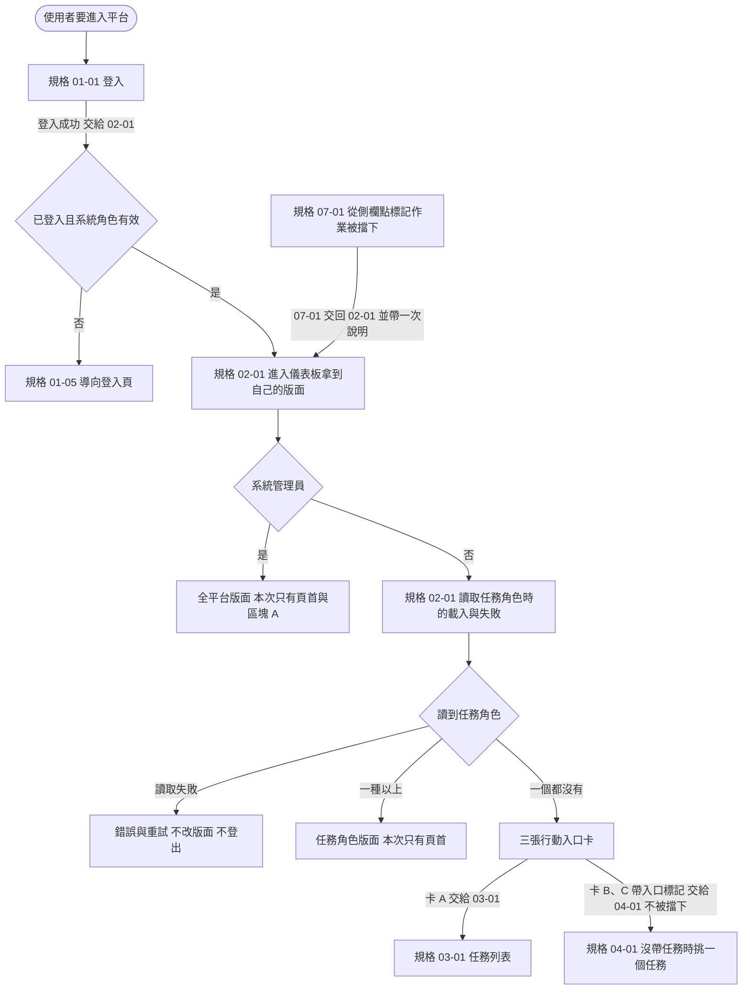

# System Analysis

本份是 change `dashboard-shell`（Issue #722，Epic #713 共用介面外殼）的系統分析。它只寫業務面：需求依據、範圍、角色、流程串接、跨模組依賴、矛盾與待決問題。技術設計、介面契約與畫面細節分別交給 `system-design`、`api-contract`、`ui-design`。

## 需求依據

依 `openspec/config.yaml` 的需求依據順序：角色、權限上限、範圍與模組劃分以 PRD 為準；業務規則以維護者指定的需求文件（Issue #722 本文與留言）與 `docs/specs/` 規格書為準，規格與 Issue 說法不同時以規格為準（Issue #722 §需求目標 也這樣寫）；其餘依 PRD 其他內容 ＞ `docs/` 其他文件 ＞ `openspec/`。

| 來源                                                                  | 章節／編號                                                                                    | 摘要（一句）                                                                                                                                                                                   |
| :-------------------------------------------------------------------- | :-------------------------------------------------------------------------------------------- | :--------------------------------------------------------------------------------------------------------------------------------------------------------------------------------------------- |
| `docs/specs/00-prd.mdx`                                               | §使用者角色 §角色清單                                                                         | 每個使用者恰有一個系統角色（平台成員、系統管理員），任務角色另計，兩者互不影響                                                                                                                 |
| `docs/specs/00-prd.mdx`                                               | §權限矩陣「02 儀表板」列與條列                                                                | 儀表板只有讀：平台成員 `R (o)`、系統管理員 `R`；依任務角色那張表沒有儀表板這一列                                                                                                               |
| `docs/specs/00-prd.mdx`                                               | §模組依賴                                                                                     | 03 任務管理的任務狀態改變影響 02 儀表板；06 的停用與角色變更從下一次操作起生效                                                                                                                 |
| 規格 02-01                                                            | 頁首說明框、§使用角色                                                                         | 儀表板不新增、不修改、不刪除任何東西；進得了只看系統角色，任務角色只決定版面；系統管理員的全平台統計不經過待啟用的「檢視全平台統計」鍵                                                         |
| 規格 02-01                                                            | §業務流程「進入儀表板拿到自己的版面」                                                         | 主流程、A1（沒有任務角色顯示三張行動入口卡）、E1（系統角色無效導向登入頁）                                                                                                                     |
| 規格 02-01                                                            | §業務流程「讀取任務角色時的載入與失敗」                                                       | 主流程（骨架→版面）與 E1（失敗時錯誤與重試，三個禁止）                                                                                                                                         |
| 規格 02-01                                                            | §規格「這一頁顯示哪一種版面」第 1–15 條                                                       | 版面決定規則、優先序、頁首文字、骨架、讀取失敗的畫面文字與三個禁止                                                                                                                             |
| 規格 02-01                                                            | §規格「還沒有任務角色的人看到什麼」第 1–8 條                                                  | 區塊標題、三張卡的標題／說明／三步名稱／按鈕；三個按鈕都是真的入口，由入口頁顯示自己的空狀態                                                                                                   |
| 規格 02-01                                                            | §規格「系統管理員看到的四個區塊」第 1、2、4、9 條                                             | 區塊 A `平台使用者統計`／`系統概況` 四張卡 `總用戶`、`專案負責人`、`標記員`、`審核員`，單位人，標籤在上、數值在下                                                                              |
| 規格 02-01                                                            | §規格「審核概況那三張卡是示範值」第 6–8 條                                                    | 十八張指標卡（含區塊 A 四張）都是示範值，都要用看得見的文字標示，算法另案定義                                                                                                                  |
| 規格 02-01                                                            | §規格「這一頁看不到標準答案」、「導覽、語言與登出不在這一頁」、「在窄螢幕上的呈現」           | 資料邊界、內容隨語言切換、缺翻譯不中斷、窄螢幕兩欄與不需左右滑動、鍵盤可操作                                                                                                                   |
| 規格 02-01                                                            | §卡控機制、§邊界情況、§驗收標準（90 條）                                                      | 本次範圍見 §範圍 的對照表                                                                                                                                                                      |
| 規格 02-01                                                            | §已確認決議 Q2、Q4、Q8、Q9、Q10、Q12、Q16、Q17、Q1a                                           | 三張卡是真的入口（Q2）、指標卡示範值（Q4）、版面不定名（Q8）、單一版面優先序（Q9）、骨架（Q10）、讀取失敗（Q12）、九句步驟說明只是文案（Q16）、不收 1 秒門檻（Q17）、成功路徑區塊已撤掉（Q1a） |
| `docs/specs/02-dashboard/index.mdx`                                   | §Logic Flow 分段一 第 4–6 條                                                                  | 卡 A 去 03-01 任務列表；卡 B、C 都去 04-01 標記清單，卡 B、C 受 07-01 §進入模組的條件 第 4 條例外保護                                                                                          |
| 規格 07-01                                                            | §進入模組的條件 第 3–5 條、§卡控機制、§已確認決議 Q13、Q20                                    | 側欄擋下「標記作業」時回到儀表板並在落點頁最上方顯示一次說明；從儀表板行動入口卡進入不擋，只放寬那三個入口                                                                                     |
| 規格 07-01                                                            | §驗收標準「從儀表板行動入口卡進入不被擋下」                                                   | 由 #720 移交本單（Issue #722 留言，2026-11-27）                                                                                                                                                |
| 規格 04-01                                                            | §路由上下文與回退 第 1、6、11、12 條；§已確認決議 Q21、Q22                                    | 行動入口卡的連結帶「入口標記」；沒帶任務但有入口標記時列出可挑的任務，一個都沒有顯示那一頁的空狀態、不退回儀表板                                                                               |
| 規格 01-01                                                            | §登入頁 第 8、9 條、§已確認決議 Q3、Q7                                                        | 登入成功、已登入的人開登入頁，一律前往儀表板                                                                                                                                                   |
| 規格 01-05                                                            | §每一次操作都用最新的身分判定                                                                 | 未登入導向登入頁；身分每一次操作都以當下為準（02-01 「未登入時導向登入頁」只是套用）                                                                                                           |
| Issue #722                                                            | 本文 §使用情境 / 功能範圍、§驗收條件                                                          | 本單做頁首、依角色決定版面、骨架與錯誤狀態、沒有任務的角色的版面、系統管理員的區塊 A，並把 01-01 登入後的暫時落點改回儀表板                                                                    |
| Issue #722                                                            | 2026-11-28 檢查點留言                                                                         | 維護者看過畫面 artifact 並同意，含三點（見下方「維護者已決定」）                                                                                                                               |
| `openspec/changes/archive/2026-11-27-sidebar-nav/clarification.md`    | Q1、Q2、Q4、§移出本次的驗收標準                                                               | 任務角色來源本次固定回答「沒有任務角色」，真實任務角色由 #766 接上；未建置的落點頁沿用導回暫時落點；擋下說明顯示在落點頁頂端                                                                   |
| `openspec/specs/auth-guard/`                                          | Requirement「暫時落點顯示目前登入者」等                                                       | 現行的暫時落點與導向規則；本次要取代暫時落點                                                                                                                                                   |
| `openspec/specs/app-shell-sidebar/`                                   | Requirement「角色標示與第三個導覽項依任務角色來源」「沒有任務角色時從側欄進入標記作業被擋下」 | 任務角色來源是單一來源、目前一律「沒有任務角色」；擋下後回到儀表板並在內容區最上方顯示說明                                                                                                     |
| `openspec/specs/permission-authorization/`、`role-permission-matrix/` | 尚未啟用的鍵、固定格                                                                          | 「檢視儀表板」兩種系統角色固定開；「檢視全平台統計」已登錄但尚未啟用                                                                                                                           |
| `docs/diagrams/architecture/frontend-routes.mdx`                      | §路由（儀表板那一列）、§已知限制「任務角色的讀取」                                            | 儀表板目前是暫時落點、網址不變；任務角色的讀取等規格 03-03 成員管理                                                                                                                            |

### 維護者已決定（2026-11-28，Issue #722 檢查點留言）

維護者 2026-11-28 看過畫面 artifact 並同意，連同以下三點。這三點是**已決定**，不是待決問題：

1. **卡 B 文案照規格寫「提交」**：說明 `查看待辦任務，完成資料標記並提交結果。`、第 3 步名稱 `提交標記`（規格 02-01 §還沒有任務角色的人看到什麼 第 2 條），不用 prototype 的「送出」（已由 clarification Q12 改為「送出」，2026-11-28）
2. **系統管理員本單只有區塊 A**：區塊 B（任務概況）與 D（任務列表）由 #733（E4）補上，區塊 C（最近提醒）由 #741（E7）補上
3. **三種任務角色版面（專案負責人／審核員／標記員）本單只有頁首**：各自的區塊由 #733（專案負責人）與 #736（標記員、審核員）補上

### 現況盤點

- **任務角色來源**：側欄已有單一個任務角色來源，對每一位使用者都回答「任何任務都沒有任務角色」（`app-shell-sidebar`；sidebar-nav clarification Q1）。任務、任務成員在平台上還不存在，真實讀取由 #766（03-03 成員管理）提供
- **儀表板的位置**：登入成功、已登入的人開登入頁、根路徑，都已前往儀表板的網址；那個網址目前顯示的是 #719 的暫時落點（「你已登入」卡片），畫在登入後外殼裡，被側欄擋下時說明顯示在卡片之上（`auth-guard`、`frontend-routes.mdx`）
- **三張卡的去處**：03-01 任務列表（#730）與 04-01 標記清單（#773）都還沒建置；目前未建置的頁面一律導回儀表板（sidebar-nav clarification Q2）
- **後端模組**：目前只有帳號、系統管理與健康檢查；沒有任務模組

### 參考檔案

- `docs/specs/00-prd.mdx`、`docs/specs/glossary.mdx`
- `docs/specs/02-dashboard/01-dashboard.mdx`、`docs/specs/02-dashboard/index.mdx`
- `docs/specs/07-shared/01-sidebar.mdx`
- `docs/specs/04-annotation/01-annotation-list.mdx`（§路由上下文與回退、Q21、Q22）
- `docs/specs/01-account/01-login.mdx`、`docs/specs/01-account/05-login-state.mdx`
- `design/prototype/pages/dashboard/dashboard.html`、`dashboard.i18n.js`
- `openspec/changes/archive/2026-11-27-sidebar-nav/`（system-analysis、clarification）
- `openspec/changes/archive/2026-11-26-login-auth-guard/`、`openspec/changes/archive/2026-11-27-denied-and-not-found/`
- `openspec/specs/auth-guard/`、`app-shell-sidebar/`、`frontend-routing/`、`frontend-i18n/`、`permission-authorization/`、`role-permission-matrix/`、`account-login/`
- `docs/diagrams/architecture/frontend-routes.mdx`
- Issue #722（本文與留言）、#713、#733、#736、#741、#766、#773、#730、#727

## 範圍

- 這次包含：
  - **頁首**：主標題 `儀表板`、副標題 `掌握任務進度與團隊協作狀態`，在每一種版面最上方，隨語言切換（02-01 §這一頁顯示哪一種版面 第 5–8 條）
  - **依角色決定版面**：系統管理員 → 全平台版面；平台成員 → 依任務角色與優先序決定一種版面；系統角色無效 → 登入頁（同節第 1–4 條）。三種任務角色版面本單只有頁首（維護者 2026-11-28）
  - **骨架與錯誤狀態**：讀取任務角色時的骨架、讀完直接切換、讀取失敗的錯誤畫面與重試、三個禁止（同節第 9–15 條）
  - **還沒有任務角色的版面**：區塊標題與副標、三張行動入口卡，三個按鈕各自走到模組入口頁，卡 B、C 的連結帶入口標記（02-01 §還沒有任務角色的人看到什麼；04-01 §路由上下文與回退 第 1、11 條）
  - **系統管理員的區塊 A**：`平台使用者統計` 四張卡，示範值與看得見的示範值標示（02-01 §系統管理員看到的四個區塊 第 1、2、4 條；§審核概況那三張卡是示範值 第 6–8 條）
  - **01-01 登入後的暫時落點改回儀表板**：取代 #719 的「你已登入」暫時落點，網址不變（Issue #722 §驗收條件 第 2 項）
  - **由 #720 移交**：規格 07-01「從儀表板行動入口卡進入不被擋下」
- 這次不包含：
  - 系統管理員的區塊 B、D 與專案負責人版面的區塊（#733）
  - 標記員、審核員版面的區塊、快速繼續、快速審核、排序、空狀態（#736）
  - 「等待 IAA 確認」卡片與最近提醒（#741）
  - 真實的任務角色讀取（#766）；任務列表與標記清單本身（#730、#773）
  - 側欄、語言切換、登出（規格 07-01，已由 #720 完成，本頁只是使用）
  - 任何 `docs/specs/` 或 `design/prototype/` 的改動

### 規模檢查（Scenario 數）

規格 02-01 §驗收標準 共 **90** 條。本次驗收 **23** 條（其中 14 條完整、9 條只驗本次存在的部分），加上由 #720 移交的規格 07-01 一條，共 **24** 條，未超過 75 條。其餘 67 條移交（#733 21 條、#736 38 條、#741 7 條、#727 1 條）。移交已由 clarification Q7 確認成立（2026-11-28），連同 Q3 移交的部分見 clarification「移出本次的驗收標準」。下表編號是 02-01 §驗收標準 由上往下的列序。

| #     | Scenario                                                            | 本次 | 說明／接手                                                                                                                                                        |
| :---- | :------------------------------------------------------------------ | :--- | :---------------------------------------------------------------------------------------------------------------------------------------------------------------- |
| 1     | 系統管理員拿到全平台版面                                            | 移交 | 要四個區塊同時看得到；本次只有區塊 A。B、D 由 #733、C 由 #741 補上，#741 是 02-01 的最後一張（其驗收條件要求覆蓋全頁），完整驗收歸 #741                           |
| 2     | 沒有任務角色的人拿到行動入口                                        | 完整 | —                                                                                                                                                                 |
| 3     | 專案負責人拿到專案負責人版面                                        | 移交 | #733（需要真實任務角色與專案負責人區塊）                                                                                                                          |
| 4     | 標記員拿到標記員版面                                                | 移交 | #736                                                                                                                                                              |
| 5     | 審核員拿到審核員版面                                                | 移交 | #736                                                                                                                                                              |
| 6     | 多重任務角色只給一種版面                                            | 移交 | #733                                                                                                                                                              |
| 7     | 審核員與標記員並存時取審核員                                        | 移交 | #736                                                                                                                                                              |
| 8     | 角色無效時導向登入頁                                                | 完整 | —                                                                                                                                                                 |
| 9     | 未登入時導向登入頁                                                  | 完整 | 規則已由 `auth-guard` 實作，本次在新的儀表板上再驗                                                                                                                |
| 10    | 頁首在每一種版面都顯示                                              | 部分 | 本次驗還沒有任務角色的版面與系統管理員版面；三種任務角色版面在任務角色一律「沒有」時到不了，依 clarification Q1 沿用現有任務角色來源，本次不新增讀取 → #733、#736 |
| 11    | 讀取任務角色時顯示骨架                                              | 完整 | 依 clarification Q1，骨架與讀取失敗以前端測試替身驗                                                                                                               |
| 12    | 讀完無縫換成實際內容                                                | 完整 | 同上                                                                                                                                                              |
| 13    | 骨架與最終版面不同也直接切換                                        | 完整 | 同上                                                                                                                                                              |
| 14    | 讀取失敗顯示錯誤與重試                                              | 完整 | 同上                                                                                                                                                              |
| 15    | 讀取失敗不改用其他版面                                              | 完整 | 同上                                                                                                                                                              |
| 16    | 讀取失敗不清掉登入狀態                                              | 部分 | 本次驗錯誤畫面期間沒有登出、網址不變、登入狀態仍是已登入；重新整理那一段 → #766（Q11）                                                                            |
| 17    | 重試後再失敗仍留在錯誤畫面                                          | 完整 | 同上                                                                                                                                                              |
| 18    | 行動入口卡文案與步驟                                                | 完整 | 卡 B 用「送出」（clarification Q12，2026-11-28，取代維護者先前的「提交」）                                                                                        |
| 19    | 行動入口卡切換語言                                                  | 完整 | —                                                                                                                                                                 |
| 20    | 三張卡的按鈕都走到模組入口頁                                        | 完整 | 驗連結去處與「不出現擋下說明」；「實際到達入口頁」依 clarification Q3 移交 #730（卡 A）、#773（卡 B、C）                                                          |
| 21    | 系統管理員的平台使用者統計                                          | 完整 | —                                                                                                                                                                 |
| 22    | 系統管理員的任務概況                                                | 移交 | #733                                                                                                                                                              |
| 23    | 最近提醒每筆有標題與內容                                            | 移交 | #741                                                                                                                                                              |
| 24    | 最近提醒為空顯示佔位文字                                            | 移交 | #741                                                                                                                                                              |
| 25    | 系統管理員任務列的欄位                                              | 移交 | #733                                                                                                                                                              |
| 26    | 專案負責人任務概況同名不同範圍                                      | 移交 | #733                                                                                                                                                              |
| 27    | 專案負責人任務列的欄位                                              | 移交 | #733                                                                                                                                                              |
| 28–31 | 等待 IAA 確認可用滑鼠點／可用鍵盤觸發／數字與清單一致／為零仍是入口 | 移交 | #741（4 條）                                                                                                                                                      |
| 32    | 系統管理員查看全部得到全平台                                        | 移交 | #733                                                                                                                                                              |
| 33    | 專案負責人查看全部只得到自己的                                      | 移交 | #733                                                                                                                                                              |
| 34    | 非管理員帶管理員參數仍受限                                          | 移交 | #733                                                                                                                                                              |
| 35    | 全平台範圍不來自前端狀態                                            | 移交 | #733                                                                                                                                                              |
| 36    | 可見範圍不看任務名稱與輸出類型                                      | 移交 | #733                                                                                                                                                              |
| 37–42 | 標記員每列都有快速繼續 … 清單樣式資訊不由輸出類型推導               | 移交 | #736（6 條）                                                                                                                                                      |
| 43–59 | 審核員每列都有快速審核 … 指標依任務自己的輸出類型量測               | 移交 | #736（17 條）                                                                                                                                                     |
| 60    | 審核概況三張卡有示範值標示                                          | 移交 | #736                                                                                                                                                              |
| 61    | 示範值標示隨語言切換                                                | 移交 | #736（Given 是審核員版面）                                                                                                                                        |
| 62    | 示範值標示出現在每一種版面                                          | 部分 | 本次驗系統管理員區塊 A 的標示；專案負責人、標記員的卡 → #733、#736。標示文案已由 clarification Q5 定案                                                            |
| 63    | 示範值標示不改動卡片文字                                            | 移交 | #736（Given 是審核員版面）                                                                                                                                        |
| 64–69 | 標記員排序 … 排序選單文字隨語言切換                                 | 移交 | #736（6 條）                                                                                                                                                      |
| 70–75 | 多種輸出類型各一個標籤 … 標籤過多時換行不破版                       | 移交 | #733 先有任務列；#736 在標記員、審核員任務列再驗（6 條）                                                                                                          |
| 76    | 新增合法組合無需改畫面                                              | 移交 | #733                                                                                                                                                              |
| 77    | 示例不是任務數量上限                                                | 移交 | #733                                                                                                                                                              |
| 78    | 儀表板不出現標準答案                                                | 部分 | 本次驗頁首、行動入口卡、區塊 A 與錯誤畫面能接觸到的一切；任務列 → #733、#736                                                                                      |
| 79    | 任務摘要不由答案推導                                                | 移交 | #733                                                                                                                                                              |
| 80    | 標記員任務列表為空                                                  | 移交 | #736                                                                                                                                                              |
| 81    | 審核員任務列表為空用自己的句子                                      | 移交 | #736                                                                                                                                                              |
| 82    | 頁面內容隨語言一起換                                                | 部分 | 本次驗頁首、行動入口卡、區塊 A、錯誤畫面；其餘區塊 → #733、#736、#741                                                                                             |
| 83    | 換頁再回來語言不變                                                  | 移交 | 要「前往個人設定或帳號頁面再回來」，那一頁還不存在 → #727（01-04 個人設定）（clarification Q7 確認）                                                              |
| 84    | 缺少翻譯時不中斷互動                                                | 完整 | —                                                                                                                                                                 |
| 85    | 窄螢幕指標卡排兩欄                                                  | 部分 | 本次驗區塊 A；專案負責人與區塊 B → #733                                                                                                                           |
| 86    | 窄螢幕任務列上下堆疊                                                | 移交 | #733                                                                                                                                                              |
| 87    | 窄螢幕快速按鈕另起一列                                              | 移交 | #736                                                                                                                                                              |
| 88    | 側欄收合時長標籤仍可讀                                              | 部分 | 本次驗區塊 A 的 `專案負責人`；區塊 B 的 `等待 IAA 確認` → #733                                                                                                    |
| 89    | 任何寬度都不需左右滑動                                              | 部分 | 本次驗兩種存在的版面；其餘 → #733、#736、#741                                                                                                                     |
| 90    | 鍵盤可以走完整頁                                                    | 部分 | 同上                                                                                                                                                              |
| 07-01 | 從儀表板行動入口卡進入不被擋下                                      | 完整 | #720 移交；驗連結去處與不被擋下；「實際到達入口頁」依 clarification Q3 移交 #730（卡 A）、#773（卡 B、C）                                                         |

### 角色與權限

儀表板只有讀；本次的任何畫面都不新增、修改或刪除業務資料（PRD §權限矩陣「02 儀表板」列；02-01 §使用角色）。進得了只看系統角色，任務角色只決定版面，不是一格權限。

| 動作                             | 平台成員（沒有任務角色） | 平台成員（有任務角色） | 系統管理員（含 Seeder 管理員） | 未登入的訪客 |
| :------------------------------- | :----------------------- | :--------------------- | :----------------------------- | :----------- |
| 進入儀表板                       | 可以                     | 可以                   | 可以                           | 導向登入頁   |
| 看到頁首                         | 是                       | 是                     | 是                             | —            |
| 讀取任務角色（期間顯示骨架）     | 是                       | 是                     | **不讀**（02-01 §卡控機制）    | —            |
| 看到三張行動入口卡               | 是                       | 否                     | 否                             | —            |
| 看到任務角色版面（本次只有頁首） | 否                       | 依優先序其中一種       | 否                             | —            |
| 看到區塊 A `平台使用者統計`      | 否                       | 否                     | 是（示範值）                   | —            |
| 按卡 A 去任務列表                | 可以                     | —                      | —                              | —            |
| 按卡 B、C 去標記清單且不被擋下   | 可以（07-01 Q13 例外）   | —                      | —                              | —            |

- 被遮蔽或唯讀的資料：本次沒有任何任務資料出現在畫面上；區塊 A 是示範值，不是真實統計。標準答案、測試集與任何答案內容都不在任何一種版面上（02-01 §這一頁看不到標準答案；Hard Rule 6）
- 系統角色無效（不是平台成員也不是系統管理員）→ 導向登入頁，不顯示任何版面
- 系統管理員的全平台統計依自己的固定格與系統管理員硬邊界判斷，**不經過**「檢視全平台統計」這個待啟用的鍵（02-01 §使用角色 末二條；規格 06-02 §五個已登錄、待啟用的鍵 第 10 條）
- 任務設定驅動（Hard Rule 5）：本次的版面與卡片都不依任何一種任務類型或輸出類型分支

## 業務流程

本次涉及多份規格（02-01 為主，串接 01-01、01-05、07-01、03-01、04-01），流程以各規格書的業務流程為準，這裡只列引用並畫交界處的串接圖。

| 規格       | 業務流程                                                  | 本次涉及                                                                       |
| :--------- | :-------------------------------------------------------- | :----------------------------------------------------------------------------- |
| 規格 02-01 | §業務流程「進入儀表板拿到自己的版面」                     | 全部（主流程 1–3、A1、E1）；第 3 步的三種任務角色版面本次只有頁首              |
| 規格 02-01 | §業務流程「讀取任務角色時的載入與失敗」                   | 全部（主流程、E1）                                                             |
| 規格 02-01 | §業務流程「從儀表板回到標記工作」                         | 不涉及（#736）                                                                 |
| 規格 02-01 | §業務流程「從儀表板回到審核工作」                         | 不涉及（#736）                                                                 |
| 規格 01-01 | §業務流程「用 Email 與密碼登入」「用 Google 帳號登入」    | 只有結尾「進入儀表板」這個交接                                                 |
| 規格 01-05 | 未登入導向登入頁                                          | 只套用（02-01 E1 與 §卡控機制「使用者沒有登入」）                              |
| 規格 07-01 | §進入模組的條件 第 3–5 條（擋下回儀表板；行動入口卡例外） | 交界：擋下說明出現在儀表板上；卡 B、C 進標記作業不被擋                         |
| 規格 03-01 | 任務列表（卡 A 的去處）                                   | 只到交接點；頁面本身不在本次                                                   |
| 規格 04-01 | §業務流程「開清單」「沒帶任務時挑一個任務」A1             | 只到交接點（帶入口標記進入、一個可挑任務都沒有時顯示空狀態）；頁面本身不在本次 |

模組之間的交接以 PRD §跨模組流程、§模組依賴 為準；本次的交接都不在 PRD §跨模組流程「任務從建立到匯出」那條主線上，也沒有和 PRD 矛盾之處。

- 圖中「讀到任務角色」的來源目前一律回答「一個都沒有」（clarification Q1：沿用現有來源，#766 再接上真實讀取），所以本次能走到的只有「三張行動入口卡」與「讀取失敗」兩支，以及系統管理員那一支
- 卡 A、卡 B、C 的去處頁面目前都還沒建置；依 clarification Q3，本次只驗連結去處，實際到達由 #730、#773 補驗

## 跨模組依賴

### 本次需要先存在的

| 依賴                                                                           | 狀態                             | 本次怎麼用                                                                                         |
| :----------------------------------------------------------------------------- | :------------------------------- | :------------------------------------------------------------------------------------------------- |
| 登入與身分判定（01-01、01-05；`auth-guard`、`account-login`、`login-session`） | 已存在（#719）                   | 系統角色、未登入導向、登入後前往儀表板；暫時落點由本次取代                                         |
| 登入後外殼與側欄（07-01；`app-shell-sidebar`）                                 | 已存在（#720）                   | 儀表板畫在外殼裡；側欄擋下「標記作業」時回儀表板並顯示說明                                         |
| 任務角色來源（`app-shell-sidebar` 的單一來源）                                 | 存在，但一律回答「沒有任務角色」 | 決定平台成員的版面；真實讀取等 #766，clarification Q1 已決：沿用，不新增讀取                       |
| 介面語言與缺翻譯備用（`frontend-i18n`）                                        | 已存在                           | 頁首、卡片、區塊 A、錯誤畫面的雙語文字                                                             |
| 權限矩陣（`role-permission-matrix`、`permission-authorization`）               | 已存在（#755）                   | 「檢視儀表板」兩種系統角色固定開；「檢視全平台統計」尚未啟用，區塊 A 不得依賴它（02-01 §使用角色） |
| 03-01 任務列表（卡 A 的去處）                                                  | **不存在**（#730）               | clarification Q3：連到最終路徑，實際到達交 #730 補驗                                               |
| 04-01 標記清單的入口與空狀態（卡 B、C 的去處）                                 | **不存在**（#773）               | clarification Q3：連到最終路徑，實際到達交 #773 補驗                                               |

### 會被後續功能依賴的

- **版面決定與頁首**：#733、#736 會在本次的專案負責人、標記員、審核員版面（目前只有頁首）裡補上區塊；#741 在系統管理員版面補區塊 C
- **骨架與錯誤狀態**：任務角色版面的骨架用的是「指標卡加任務列表」的佈局（02-01 第 10 條），#733、#736 補上真的指標卡與任務列表時沿用
- **示範值標示**：本次為區塊 A 定下的示範值標示方式，#733（專案負責人、區塊 B）與 #736（標記員、審核員）照同一個方式（02-01 §審核概況那三張卡是示範值 第 6 條）
- **任務角色來源**：#766 接上真實讀取後，本次的版面決定與側欄的角色標示同時改變，兩者讀同一個來源
- **行動入口卡的入口標記**：#773 的「沒帶任務時挑一個任務」靠它分辨站內點進來與深連結（04-01 Q22）

### 共用的資料

- 系統角色：與側欄、守門讀同一份目前登入者的身分
- 任務角色摘要（02-01 §資料欄位：建立的任務數、被指派標記的任務數、被指派審核的任務數）：與側欄共用同一個任務角色來源
- 擋下說明：07-01 寫入、儀表板顯示，只出現一次，不進網址

### 與既有 capability 的關係

- `auth-guard`：Requirement「暫時落點顯示目前登入者」會被取代（儀表板不再顯示「你已登入」卡片與「儀表板還在建置中」）；其餘導向規則不變。瀏覽器標題「你已登入」也隨之變動
- `app-shell-sidebar`：不改規則；「回到儀表板並在內容區最上方顯示說明」要在新的儀表板上繼續成立（與頁首的上下順序已由 clarification Q4 定為頁首在上、擋下說明緊接其下；`app-shell-sidebar` 由 specs 以 MODIFIED 處理）
- `frontend-routing`、`account-login`：儀表板網址不變，登入後的去處不變
- `frontend-i18n`：新增儀表板的文字；缺翻譯時的備用規則沿用（02-01 §導覽、語言與登出不在這一頁 第 5 條與它一致）
- `denied-and-not-found-screens`：返回連結的「回儀表板」去處不變，沒有衝突
- 新的 capability：儀表板的版面決定、頁首、骨架與錯誤、行動入口卡、區塊 A（名稱由 planner 決定）

## 需求矛盾

| #   | 矛盾                                                                                                                                                                               | 來源                                                                                                                                                                | 處理                                                                                  |
| :-- | :--------------------------------------------------------------------------------------------------------------------------------------------------------------------------------- | :------------------------------------------------------------------------------------------------------------------------------------------------------------------ | :------------------------------------------------------------------------------------ |
| 1   | 規格 02-01 要頁首「固定在頁面最上方」，規格 07-01 要擋下說明「在落點頁的最上方顯示一次」，而擋下時的落點就是儀表板；`app-shell-sidebar` 寫成「內容區最上方」。兩條都說自己在最上方 | 02-01 §這一頁顯示哪一種版面 第 6 條；07-01 §進入模組的條件 第 3 條、Q20；`openspec/specs/app-shell-sidebar/` Requirement「沒有任務角色時從側欄進入標記作業被擋下」  | 已決：clarification Q4（2026-11-28）頁首在最上方，擋下說明緊接其下；07-01 第 3 條回寫 |
| 2   | 規格 02-01 要求三張卡的按鈕走到模組入口頁、**不被退回儀表板**；而現行規則是未建置的頁面一律導回儀表板，去處頁面又都還沒建置                                                        | 02-01 §還沒有任務角色的人看到什麼 第 7 條、Scenario「三張卡的按鈕都走到模組入口頁」；07-01 Scenario「從儀表板行動入口卡進入不被擋下」；sidebar-nav clarification Q2 | 已決：clarification Q3（2026-11-28）連到最終路徑、驗連結去處；實際到達交 #730、#773   |
| 3   | 規格 02-01 要十八張指標卡**都**用看得見的文字標成示範值，但只給了審核員那三張的文案（文案本身寫「這三張指標卡」），prototype 也只有審核員那一行，區塊 A 沒有可用的文案             | 02-01 §審核概況那三張卡是示範值 第 3、6 條；`design/prototype/pages/dashboard/dashboard.i18n.js`（只有 `reviewerMetricsDemoNote`）                                  | 已決：clarification Q5（2026-11-28）其他三種版面共用一句通用文案；02-01 回寫          |

## 待決問題

| #   | 問題                                                                                                                                                                                                                                                                                                                                                                                                                                                                            | 影響                                                                                                                                                                                                                                             | 狀態                                                                                                                                              |
| :-- | :------------------------------------------------------------------------------------------------------------------------------------------------------------------------------------------------------------------------------------------------------------------------------------------------------------------------------------------------------------------------------------------------------------------------------------------------------------------------------ | :----------------------------------------------------------------------------------------------------------------------------------------------------------------------------------------------------------------------------------------------- | :------------------------------------------------------------------------------------------------------------------------------------------------ |
| 1   | 平台成員的任務角色從哪裡讀？（來源：02-01 §業務流程「讀取任務角色時的載入與失敗」、§資料欄位「任務角色摘要」；`app-shell-sidebar` 與 sidebar-nav clarification Q1；衝突點：任務與任務成員要到 #766 才存在，現有的任務角色來源對每個人都直接回答「沒有任務角色」，不會載入也不會失敗。本次要不要提供一個真的讀取（在任務成員不存在時回答全部為零），還是沿用固定回答、等 #766 再接上？三種任務角色版面「只有頁首」在固定回答之下也到不了）                                       | Scenario 10–17 的驗證方式（真的讀取或只能用測試替身製造等待與失敗）；Scenario 10 對三種任務角色版面的部分能不能在本次驗；system-design 是否新增讀取、api-contract 是否新增一個操作及其權限鍵；側欄的角色標示是否同時改讀它；tasks 的後端群組有無 | 已決：clarification Q1（2026-11-28）沿用現有任務角色來源，本次不新增後端讀取；來源提供讀取中、失敗、完成三態，#766 再接真實讀取                   |
| 2   | 三張行動入口卡的去處頁面都還不存在，按鈕在本次該怎麼表現？（來源：02-01 §還沒有任務角色的人看到什麼 第 7 條與 Q2、`docs/specs/02-dashboard/index.mdx` §Logic Flow 分段一 第 4–6 條、07-01 §進入模組的條件 第 4 條與 Q13、04-01 §路由上下文與回退 第 11、12 條；衝突點：卡 A 去 03-01 任務列表（#730），卡 B、C 去 04-01 標記清單（#773），兩頁都沒建置；現行規則是未建置的頁面導回儀表板，正好是 Scenario 20 與 07-01「從儀表板行動入口卡進入不被擋下」禁止的「被退回儀表板」） | Scenario 20 與 07-01 移交的那一條能不能在本次通過，或要再移交給 #773、#730；ui-design 的按鈕狀態與連結；畫面端的頁面去處；acceptance 覆蓋表的去處                                                                                                | 已決：clarification Q3（2026-11-28）按鈕連到最終路徑，本次驗連結去處與不出現擋下說明；實際到達入口頁交 #730（卡 A）、#773（卡 B、C）              |
| 3   | 區塊 A 的四個示範值怎麼來、是哪幾個數？（來源：02-01 §系統管理員看到的四個區塊 末條註、§審核概況那三張卡是示範值 第 6–8 條、§已確認決議 Q4；衝突點：Q4 已定「示範值、算法另案定義」，但沒有說示範值的數字是什麼（是否沿用 prototype 的數字），也沒有說它固定在畫面上還是由平台提供；平台其實已經有使用者資料，`總用戶` 看起來算得出來，但規格明定不算）                                                                                                                         | system-design 是否需要任何讀取；api-contract 有無新操作（若由平台提供，不得依賴尚未啟用的「檢視全平台統計」鍵）；ui-design 的數值與文字來源；Scenario 21 的預期值                                                                                | 已決：clarification Q2（2026-11-28）寫死在前端語言檔，四張卡全部顯示 0 人，不新增讀取                                                             |
| 4   | 區塊 A 的示範值標示用什麼文字？（來源：02-01 §審核概況那三張卡是示範值 第 3、6 條；衝突點：第 6 條要求比照審核員的方式標示，但規格與 prototype 只有審核員那一句「這三張指標卡……不會隨審核動作更新」，字面不適用於四張、與審核無關的卡；英文版也沒有）                                                                                                                                                                                                                           | ui-design 與介面語言檔的文案（中英）；Scenario 62 本次部分的預期文字；#733、#736 會沿用同一種寫法；文案若寫進規格要走 `spec-writing`                                                                                                             | 已決：clarification Q5（2026-11-28）系統管理員、專案負責人、標記員共用一句通用示範值文案；審核員維持原句                                          |
| 5   | 被側欄擋下回到儀表板時，擋下說明與頁首誰在上面？（來源：02-01 §這一頁顯示哪一種版面 第 6 條；07-01 §進入模組的條件 第 3 條、Q20；`app-shell-sidebar`「內容區最上方」；衝突點：兩條都寫自己在最上方，暫時落點時代是「說明在卡片之上」，但那時沒有頁首）                                                                                                                                                                                                                          | ui-design 的區塊順序；`app-shell-sidebar` 的 Scenario「沒有任務角色時點擊標記作業」是否要 MODIFIED；若要改規格字面需走 `spec-writing`                                                                                                            | 已決：clarification Q4（2026-11-28）頁首在最上方，擋下說明緊接頁首下方、版面內容之上                                                              |
| 6   | 卡 B 第 3 步的步驟說明句要不要也從「送出」改成「提交」？（來源：維護者 2026-11-28 決定「卡 B 文案照規格寫提交」；02-01 §還沒有任務角色的人看到什麼 第 5 條與 Q16 只定三步的名稱，九句說明不是規格；衝突點：prototype 的第 3 步說明是「自我檢查標記一致性，送出標記結果」，規格沒有這句，維護者的決定字面上只涵蓋規格寫到的文字）                                                                                                                                                | ui-design 與介面語言檔卡 B 的第 3 步說明句；Scenario 18、19 不受影響（不驗說明句）                                                                                                                                                               | 已決：clarification Q6（2026-11-28）第 3 步說明句一併改為「自我檢查標記一致性，提交標記結果」（已被 clarification Q12 取代：卡 B 一律用「送出」） |
| 7   | 系統角色無效時，除了導向登入頁，是否也要結束這一次的登入狀態？（來源：02-01 §這一頁顯示哪一種版面 第 4 條、§卡控機制 第 1 列；衝突點：規格只寫「導向登入頁」；而現行守門在已登入時會把開登入頁的人送回儀表板，若不結束登入狀態，兩條規則會在儀表板與登入頁之間來回）                                                                                                                                                                                                            | system-design 對 Scenario 8 的處理；`auth-guard` 是否要 MODIFIED；acceptance 對 Scenario 8 的驗法                                                                                                                                                | 已決（不需維護者決定）：只導向登入頁，不另外結束登入狀態；依據 clarification「不需維護者決定」表 sa-7                                             |
| 8   | 系統管理員進入儀表板時是否也要先顯示骨架？（來源：02-01 §業務流程「讀取任務角色時的載入與失敗」的觸發寫「而且不是系統管理員」、§卡控機制「系統管理員……不讀任務角色」；衝突點：規格只定了平台成員等待任務角色時的骨架，系統管理員不讀任務角色，但區塊 A 若需要讀取（見待決問題 3）就會有一段等待，規格沒定那段時間畫面顯示什麼、讀取失敗怎麼辦）                                                                                                                                 | ui-design 的系統管理員版面 loading／error 狀態；若待決問題 3 決定為畫面上的固定值則本題自動消失                                                                                                                                                  | 已決（不成立）：clarification Q2 區塊 A 為前端固定值，系統管理員版面沒有讀取；依據 clarification「不需維護者決定」表 sa-8                         |
| 9   | §範圍 規模檢查表的移交是否成立？（來源：02-01 §驗收標準；Issue #722、#733、#736、#741 的範圍；衝突點：Scenario 1 要四個區塊同時看得到，本次只有區塊 A，建議歸 #741（其驗收條件要求覆蓋全頁）；Scenario 83 要先去個人設定頁再回來，那一頁屬 #727（01-04，不在 02-01 的四張子單內）；輸出類型標籤 70–75 同時出現在 #733 與 #736 的任務列，建議 #733 先驗、#736 再驗）                                                                                                             | clarification 的「移出本次的驗收標準」表；ops 歸檔時在 #733、#736、#741、#727 留移交清單；acceptance 覆蓋表                                                                                                                                      | 已決：clarification Q7（2026-11-28）移交全部成立：#733 21 條、#736 38 條、#741 7 條、#727 1 條                                                    |
