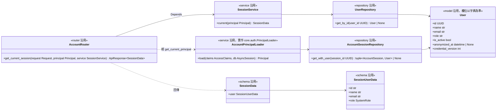
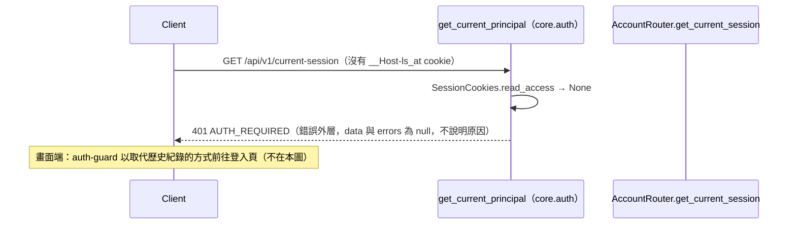
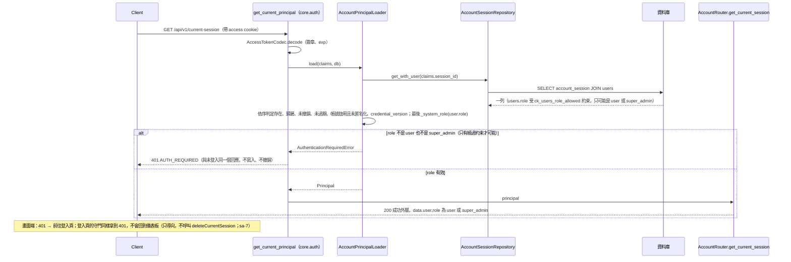
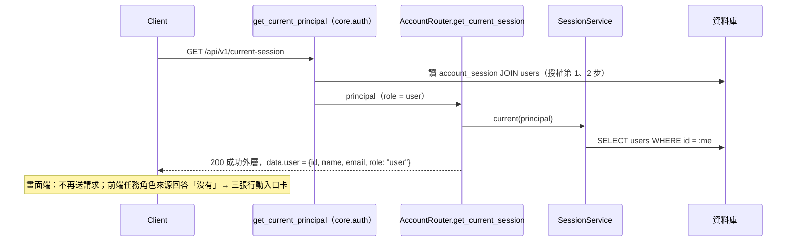
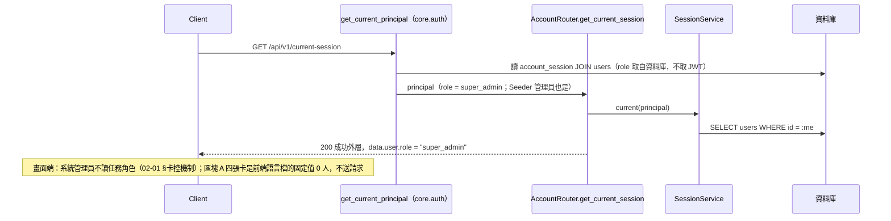
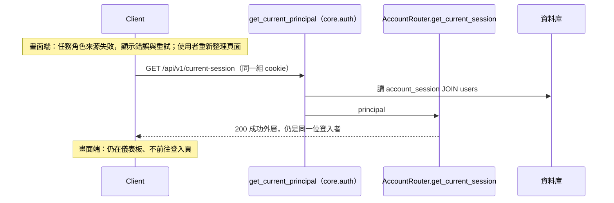

# System Design

本份是 change `dashboard-shell`（Issue #722）的後端系統設計，脈絡基準是同目錄的 `system-analysis.md`，已依 `clarification.md` 的決議（Q1、Q2 與「不需維護者決定」表）定稿。分層（`app/modules/<module>/` 模組內分層）、成功回應包一層 envelope、路徑前綴 `/api/v1` 都照定案寫，不列為待決。

## 設計結論

**本次後端不新增、不修改任何端點、模組、資料表或 `app/core/` 基礎建設**（clarification Q1、Q2 都採提案 A）。儀表板外殼這一次要的伺服器資料只有一樣，而且已存在：

| 儀表板要的東西                                                         | 來源                                                                 | 現況                                                                                                                                                                             |
| :--------------------------------------------------------------------- | :------------------------------------------------------------------- | :------------------------------------------------------------------------------------------------------------------------------------------------------------------------------- |
| 登入者的系統角色（決定全平台版面或讀任務角色；未登入、角色無效時導向） | `getCurrentSession`（`GET /api/v1/current-session`，`account` 模組） | 已有；每次從資料庫讀當下的系統角色，角色不是 `user`／`super_admin` 時回 `401 AUTH_REQUIRED`（`openspec/specs/auth-guard` Requirement「每一次操作都用當下的帳號狀態與系統角色」） |

其餘都不需要後端：頁首、行動入口卡的文字、卡片的去處、示範值標示、窄螢幕與鍵盤都是畫面行為；擋下說明由 07-01 經 router 的 navigation state 帶過來（sidebar-nav clarification Q4），不經後端。

### 已決議：任務角色的來源（sa-1，clarification Q1）

任務角色沿用**前端既有的單一任務角色來源**，本次不新增後端讀取；該來源要能提供讀取中、失敗（可重試）、完成三種狀態給儀表板用。正式環境立刻完成，等待與失敗只能用前端測試替身製造（骨架與讀取失敗的 Scenario 在前端驗）。#766 建好任務成員後，只換前端那一支來源，側欄與儀表板同時改變（`app-shell-sidebar` 的單一來源），屆時由 #766 定 path、operationId、權限鍵與「算哪些成員資格」。

**為什麼本次在 `main` 上每個人都確實沒有任務角色**：任務與任務成員歸 `task` 模組（`backend-modules.mdx` §預定模組與資料表歸屬），`task` 模組還沒有程式，`task_membership` 也還是字典裡的候選表（`data-table-dictionary.mdx` §五，沒有「已落地」標記）。沒有任務就沒有成員資格，「沒有任務角色」是現況的真實狀態，不是假資料。版面優先序（專案負責人 > 審核員 > 標記員）在前端以純函式決定，它不是授權，只是版面（02-01 §使用角色「任務角色只決定版面」）。

### 已決議：區塊 A 的示範值（sa-3，clarification Q2）

區塊 A 四張卡（`總用戶`、`專案負責人`、`標記員`、`審核員`）的值寫死在前端語言檔，**全部顯示 0 人**，不經後端。區塊 A 只在系統管理員版面出現，版面由 `getCurrentSession` 的 `role` 決定，`role` 只供顯示。沒有讀取就沒有載入與失敗狀態，sa-8 不成立。換成真實統計屬另案：要先以 `spec-writing` 改規格 02-01（Q4 明定算法另案定義）。

### 已決議：角色無效時的登入狀態（sa-7）

**只導向登入頁，不另外結束登入狀態；不會在登入頁與儀表板之間來回。** 後端現況已擋住，不改後端。系統角色無效在本平台的兩層都進不來：

1. **資料庫**：`users.role` 有 `CHECK (role IN ('user', 'super_admin'))`（Alembic revision `7bf0f909ce8f`，約束名 `ck_users_role_allowed`），SQLite 與 PostgreSQL 都強制，正常寫入存不進第三個值
2. **認證依賴**：即使資料庫被繞過，`AccountPrincipalLoader.load` 的 `_system_role` 對不在兩個值裡的角色丟 `AuthenticationRequiredError`，**每一個需要登入的請求**都回 `401 AUTH_REQUIRED`，與其他不能通行的原因同一個回應（`auth-guard` Requirement「不能通行時一律同一個回應」）

所以「角色無效」在後端看來就是「未登入」，畫面守門照 `auth-guard` 導向登入頁（規格 02-01 第 4 條只寫導向登入頁）；登入頁的守門用的是同一個 `getCurrentSession`，也拿到 `401`，不會來回。登入狀態那一列不被撤銷，但每個請求都 `401`，等於不能用，依 7 天與 90 天上限自然過期。

### 未採用的方案

- **新增 `dashboard` 模組的 `getTaskRoleSummary`（經 `task` 公開函式回「沒有」）**：clarification Q1 不採用。任務成員資料在 #766 之前不存在，端點只會固定回空集合，卻要先替 #766 定下 path、operationId、權限鍵與成員資格範圍，#766 要嘛沿用、要嘛 **BREAKING** 改掉；還要新增模組、改 `create_app`、`OPENAPI_TAGS`、independence 契約與常駐文件。不動後端讓本次範圍集中在畫面
- **新增 `getPlatformUserSummary` 回四個固定示範值**：clarification Q2 不採用。後端多一個端點不帶來任何真實資訊；不得借用待啟用的 `admin.platform_overview.view`，只能新寫第 4 步「呼叫者是系統管理員」條件，目前沒有實作者；還會讓系統管理員版面多出載入與失敗狀態（sa-8）。示範值本來就寫在畫面
- **角色無效時畫面先呼叫 `deleteCurrentSession`**：依 sa-7 的處理不採用。會在 `account_session` 記一筆 `logged_out=True`，而這不是使用者自己登出（規格 01-05 §登出紀錄只記真正的登出），且 `auth-guard` 要 MODIFIED。「認證依賴發現角色無效時直接撤銷」亦排除：違反 `PrincipalLoader` 只讀的契約，並讓 `GET` 有寫入
- **本次就建 `task_membership`、由後端算真實統計**：前者的 FK 拖著 `task`、`dataset_version` 與兩張版本表，等於做出 03-02 與 05；後者違反 02-01 Q4（算法另案定義）

## 分層與類別

**本次沒有新增或修改的後端類別。** 下圖只畫儀表板會碰到的既有類別，全部**沿用、無異動**；完整的 `account` 類別圖見 `docs/diagrams/architecture/backend-modules.mdx` §account。

- Router 只把 HTTP 轉成 service 呼叫並以 `ok(data, request)` 包 envelope；Router 不碰任何 repository
- 沒有寫入，所以沒有交易；service 不 commit

## 關鍵情境

下表把本次 Scenario 對到後端。只有與後端互動的 Scenario 畫 Sequence Diagram，其餘是畫面行為，沒有請求送到後端。本次儀表板只用 `getCurrentSession`（與守門、外殼共用同一份查詢快取），沒有其他請求。

| Scenario                                                                                                                                                                                                                                                                                                                                                      | 後端                                                                                                               | 圖                           |
| :------------------------------------------------------------------------------------------------------------------------------------------------------------------------------------------------------------------------------------------------------------------------------------------------------------------------------------------------------------ | :----------------------------------------------------------------------------------------------------------------- | :--------------------------- |
| 未登入時導向登入頁                                                                                                                                                                                                                                                                                                                                            | `getCurrentSession` 回 `401`（沿用）                                                                               | 有                           |
| 角色無效時導向登入頁                                                                                                                                                                                                                                                                                                                                          | `getCurrentSession` 回 `401`（沿用；sa-7）                                                                         | 有                           |
| 沒有任務角色的人拿到行動入口                                                                                                                                                                                                                                                                                                                                  | `getCurrentSession` 回 `role: "user"`；任務角色由前端來源回答「沒有」，不送請求                                    | 有                           |
| 系統管理員的平台使用者統計                                                                                                                                                                                                                                                                                                                                    | `getCurrentSession` 回 `role: "super_admin"`；區塊 A 是前端固定值 0 人，不送請求                                   | 有                           |
| 讀取任務角色時顯示骨架、讀完無縫換成實際內容、骨架與最終版面不同也直接切換                                                                                                                                                                                                                                                                                    | 無請求；由前端任務角色來源的「讀取中」狀態製造，以前端測試替身驗（Q1）                                             | 無                           |
| 讀取失敗顯示錯誤與重試、讀取失敗不改用其他版面、重試後再失敗仍留在錯誤畫面                                                                                                                                                                                                                                                                                    | 無請求；由前端來源的「失敗」狀態製造，以前端測試替身驗（Q1）                                                       | 無                           |
| 讀取失敗不清掉登入狀態                                                                                                                                                                                                                                                                                                                                        | 前端來源失敗時沒有任何請求，登入狀態不變；重新整理後 `getCurrentSession` 仍 `200`                                  | 有（只有重新整理後的那一段） |
| 儀表板不出現標準答案（本次部分）                                                                                                                                                                                                                                                                                                                              | 本次碰到的回應只有自己的帳號欄位                                                                                   | 無，見 §權限檢查點           |
| 頁首在每一種版面都顯示（部分）、行動入口卡文案與步驟、行動入口卡切換語言、三張卡的按鈕都走到模組入口頁、頁面內容隨語言一起換（部分）、缺少翻譯時不中斷互動、示範值標示出現在每一種版面（部分）、窄螢幕指標卡排兩欄（部分）、側欄收合時長標籤仍可讀（部分）、任何寬度都不需左右滑動（部分）、鍵盤可以走完整頁（部分）、從儀表板行動入口卡進入不被擋下（07-01） | 無；畫面行為。介面語言改變時 API client 已送 `Accept-Language`，本次碰到的錯誤訊息由既有 `LocaleMiddleware` 在地化 | 無                           |

圖中的參與者到 Router 回傳回應為止；回應之後畫面怎麼導向、顯示什麼屬 `ui-design.md`，以 `Note` 標「畫面端」而不畫。

### Scenario: 未登入時導向登入頁

### Scenario: 角色無效時導向登入頁

### Scenario: 沒有任務角色的人拿到行動入口

### Scenario: 系統管理員的平台使用者統計

### Scenario: 讀取失敗不清掉登入狀態

任務角色讀取失敗發生在前端來源，沒有請求到後端，後端不撤銷 `account_session`、不動 refresh token；下圖是使用者重新整理後的那一段。

## 常駐文件異動

本次無常駐文件異動。

- `docs/diagrams/architecture/backend-modules.mdx`：沒有新增或修改的模組、類別、主要流程或基礎建設。它已寫明 `dashboard` 模組未實作、沒有表、只呼叫 `task` 的 service，與本設計一致
- `docs/diagrams/architecture/error-codes.mdx`、`endpoint-authorization.mdx`：沒有新端點、新錯誤碼，也沒有改動既有端點的角色或遮蔽（屬 `api-contract.md` 的範圍，這裡先註明）

## 資料模型異動

本次無資料模型異動：不建表、不加欄位、不需要 Alembic migration。`data-table-dictionary.mdx` 與 `database-schema.er.json` 不改；`task_membership` 的建立屬 #766（03-03 成員管理）。

字典已把 02-01 讀的推導值記為「不進表」（§五 `task` 組不進表的推導值：任務角色摘要、完成率、審核覆蓋率），本次不改這個判斷。

## 權限檢查點

| 檢查點             | 層                                                                      | 判定                                                                                                                                                   | 本次                                                                                                 |
| :----------------- | :---------------------------------------------------------------------- | :----------------------------------------------------------------------------------------------------------------------------------------------------- | :--------------------------------------------------------------------------------------------------- |
| 是否登入、帳號狀態 | `get_current_principal`（`app/core/auth.py`，授權第 1 步）              | 只認 `__Host-ls_at` cookie；不能通行一律 `401 AUTH_REQUIRED`                                                                                           | 沿用；儀表板所有後端讀取都經過它                                                                     |
| 系統角色           | `AccountPrincipalLoader` 每次讀資料庫（第 2 步）；`users.role` 的 CHECK | 角色不是 `user`／`super_admin` → `401`（角色無效時導向登入頁）；全平台版面或讀任務角色依 `getCurrentSession` 的 `role` 決定，`role` 只供顯示、不是授權 | 沿用                                                                                                 |
| 進得了儀表板       | 畫面守門                                                                | 只看系統角色；「檢視儀表板」兩種系統角色固定開，畫面不讀矩陣                                                                                           | 沒有儀表板專屬端點，因此沒有後端的門；任務資料落地後，各端點自己的 `require_permission` 才是門       |
| 欄位遮蔽           | `SessionUserData` 的 allowlist                                          | `getCurrentSession` 只回自己的 `id`、`name`、`email`、`role`，密碼雜湊、Google 連結、憑證版本、Seeder 標記、登入狀態識別碼不在任何 schema              | 沒有依角色遮蔽的欄位：每個回應都只有呼叫者自己的資料，平台成員與系統管理員拿到同一組欄位             |
| 測試集答案隔離     | 回應 schema 的 allowlist                                                | 本次碰到的回應只有登入者自己的帳號欄位；**沒有任何任務、資料集、項目、標準答案或測試集辨識資訊**                                                       | 無風險。任務列與任務摘要（02-01 §這一頁看不到標準答案 第 4 條）屬 #733、#736，屆時由那兩張的設計證明 |

權限沒有超出 PRD §權限矩陣：「02 儀表板」平台成員 `R (o)`、系統管理員 `R`；本次只讀，沒有 C／E／D，平台成員只讀自己的身分。依任務角色那張表沒有「02 儀表板」這一列，本設計也沒有把任務角色當成任何一格權限：它只決定版面，在前端決定（Hard Rule 5：版面與卡片不依任務類型或輸出類型分支）。

## 技術待決問題

| 項目                                | 說明                                                                                                                                                                                                                                                                                                            |
| :---------------------------------- | :-------------------------------------------------------------------------------------------------------------------------------------------------------------------------------------------------------------------------------------------------------------------------------------------------------------- |
| 交易邊界                            | 本次沒有寫入，沒有交易（backend-agent-rules B4）                                                                                                                                                                                                                                                                |
| session 生命週期                    | 只用 API 的 async session（`get_db`）；沒有 worker，不涉及 worker 的 sync session                                                                                                                                                                                                                               |
| 效能                                | 儀表板沿用守門那一次 `getCurrentSession`（主鍵 JOIN），不多送請求                                                                                                                                                                                                                                               |
| 雙資料庫差異（T-3）                 | 本次沒有 migration。`ck_users_role_allowed` 在 SQLite 與 PostgreSQL 都由 Alembic 建立且都強制，行為相同。角色無效的 Scenario 在前端以假的工作階段驗，不在兩種資料庫繞過約束；後端若要驗 `_system_role`，在 unit 層以假的 loader                                                                                 |
| 既有程式的觀察（T-5，不在本次路徑） | `create_session_refresh` 先由 `SessionService.refresh` commit 輪替，router 再呼叫 `session_data(issued.user)` 檢查角色；角色無效時輪替已 commit 卻回 `401`、新 token 沒送出。因為 `ck_users_role_allowed` 擋住無效角色，正常資料下到不了；本次不呼叫也不修改這條路徑，只記錄，不另開 issue（clarification T-5） |
