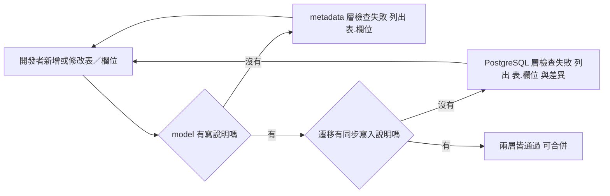

# System Analysis

> 本 change 是技術 change，`docs/specs/` 沒有對應的規格頁，也沒有業務流程、角色或權限差異。依 `openspec/config.yaml` context 與 spec-migration D4，追溯到 ADR 與規則文件的條號。因為要核對「5 張表、36 欄」，下文為了精確而點名資料表與工具，這是本 change 的對象本身，不是技術設計。

## 需求依據

| 來源                                                   | 章節／編號                                                                                                          | 摘要（一句）                                                                                                                   |
| :----------------------------------------------------- | :------------------------------------------------------------------------------------------------------------------ | :----------------------------------------------------------------------------------------------------------------------------- |
| GitHub issue #822（label-suite/label-suite）           | 背景、範圍 1-3、待辦六項                                                                                            | 實作已全數寫了英文說明（comment），但沒有任何自動檢查；要分「與資料庫無關的 metadata 層」與「PostgreSQL 實際寫入層」兩層檢查。 |
| `.claude/agents/dba.md`                                | §資料模型準則 最後一條（含 §Migration 準則「兩層都要能跑」、§檢查清單「每個欄位都有英文 `comment`」）               | 每個欄位加英文 comment，目前只靠 dba 自查。                                                                                    |
| `docs/development/rules/backend-agent-rules.mdx`       | 開頭「已建置／待建置」說明、B6（schema 只由 Alembic 管）、B7（雙資料庫的測試要求）                                  | 開頭列出已有 CI 檢查的條目，需補上本檢查；B6、B7 規範 migration 與兩層測試。                                                   |
| `docs/development/rules/testing-agent-rules.mdx`       | 開頭「在 CI 跑的」清單、T4（integration 的真實邊界）、T9（gate 表「migration 在 SQLite 與 PostgreSQL 兩層都能跑」） | 兩層各跑一輪 `uv run pytest`，`backend-postgres` 任何測試 skipped 即失敗。                                                     |
| ADR-003                                                | D7 資料庫分兩層                                                                                                     | Lite 層 SQLite、正式層 PostgreSQL，schema 只由 Alembic 管。                                                                    |
| `docs/diagrams/architecture/data-table-dictionary.mdx` | 開頭「已落地」說明                                                                                                  | 42 張候選表中只有 5 張已落地，其餘沒有 model；本檢查今天涵蓋的就是這 5 張，之後每落地一張自動納入。                            |
| `openspec/specs/database-migration/spec.md`            | 「遷移在兩種資料庫上可升可降可再升」等 requirement                                                                  | 既有契約要求遷移在兩層都可升降；本 change 是在它之上加「說明寫進資料庫」的檢查，不改它。                                       |

## 範圍

- 這次包含：
  - 新增 metadata 層檢查：與資料庫無關、SQLite 回合與 PostgreSQL 回合都會跑，斷言每張業務表與每個欄位的說明都非空。
  - 新增 PostgreSQL 層檢查（`postgres` 標記）：migration 升到最新後，查資料庫實際存的表說明與欄位說明，要求非空且與 model 的說明一致。
  - 失敗訊息列出缺說明的「表.欄位」。
  - 故意拿掉一個欄位說明，驗證兩層都失敗並指名該欄位（驗證完還原）。
  - `.claude/agents/dba.md` 與 `backend-agent-rules.mdx` 對應處註明此檢查已建置；`testing-agent-rules.mdx` 的已建置清單是否一併更新見待決問題 4。
- 這次不包含：
  - 不新增 lint 規則、不改既有 schema、不改任何既有 model 的說明文字。
  - 不改 `docs/specs/`、PRD、`design/prototype/`。
  - 不要求說明的語言或內容品質（「英文」仍靠 review，見待決問題 3）。
  - 不處理 SQLite 層的說明落地（SQLite 不支援，見下）。

### 事實核對（本 agent 親自驗證）

| 項目                        | 結果                                                                                                                                                                                                                                                                                                                                                                                                                                                |
| :-------------------------- | :-------------------------------------------------------------------------------------------------------------------------------------------------------------------------------------------------------------------------------------------------------------------------------------------------------------------------------------------------------------------------------------------------------------------------------------------------- |
| 業務表數與欄數              | 與 issue 相符：5 張、36 欄。逐表（表說明有／欄數／有說明的欄數）：`users` 14/14、`account_session` 7/7、`account_refresh_token` 7/7、`admin_role_permission` 5/5、`admin_role_permission_version` 3/3；合計 36。以匯入兩個模組的 model 後讀 metadata 核對。                                                                                                                                                                                         |
| SQLite 對說明的處理         | 建表 DDL 不含說明（實測建表後 `sqlite_master` 只有欄位與型別），反射表說明直接拋 `NotImplementedError`。所以 SQLite 回合只能檢查 metadata 層，不能查資料庫。                                                                                                                                                                                                                                                                                        |
| 既有遷移是否寫了說明        | 兩個建表遷移分別有 22、10 處 `comment=`；基準遷移不建表。PostgreSQL 的說明由遷移寫入，不是由 model 自動同步。                                                                                                                                                                                                                                                                                                                                       |
| 既有 drift 檢查是否涵蓋說明 | 未經實跑確認。`test_account_schema.py`、`test_admin_permission_schema.py` 的比對只開 `compare_type`（原始碼如此）。依 Alembic 原始碼（1.20.1，`alembic/autogenerate/compare/comments.py`），PostgreSQL 方言上 autogenerate 會比對表與欄位說明，因此既有 drift 測試可能已擋下「model 改了、遷移沒跟上」，本分析不作此假設。實作時以負向測試在 PostgreSQL 實跑證實（見 clarification Q1），結果寫進 PR，並據此決定規則文件怎麼描述既有 drift 的角色。 |

## 業務流程

不適用：本 change 沒有對應的 `docs/specs/` 規格頁，也沒有使用者角色參與的業務流程。以下只描述檢查在 CI 內的位置（開發者與 CI 的交接），不是業務流程。

SQLite 回合只跑 metadata 層；PostgreSQL 層在 SQLite 回合略過，在 `backend-postgres` job 必須執行（該 job 任何測試 skipped 即失敗）。

## 涉及角色

| 角色                                       | 在本 change 的動作                     |
| :----------------------------------------- | :------------------------------------- |
| 開發者（`dba`、`backend-developer`）       | 新增表或欄位時寫說明；檢查失敗時修正。 |
| CI（`backend-sqlite`、`backend-postgres`） | 自動跑兩層檢查。                       |
| 維護者                                     | 決定待決問題。                         |

不涉及產品角色（標記員、管理員等）與權限；沒有角色 × 動作矩陣，也沒有被遮蔽的資料。

## 分析重點

### 1. 哪些表算「業務表」、哪些要排除

- 納入：所有登錄在共用 metadata 的資料表（今天 5 張）。判斷標準建議是「登錄在 metadata 內」，不另維護白名單，這樣新落地的表自動被檢查，也符合 Hard Rule 5 的精神（不為個別表改核心程式）。
- 排除 `alembic_version`：它是 Alembic 自己建的版本紀錄表，不在 metadata 內，所以 metadata 層天然不涉及；但 PostgreSQL 層若改成「列舉資料庫內所有表」就會抓到它，必須明確排除。建議 PostgreSQL 層的表清單**只由 metadata 推出**，而不是反向列舉資料庫。
- 關聯表（association table）：目前 5 張都是一般 model，**沒有任何**純關聯表（無 `secondary` 或獨立 `Table(...)` 登錄在共用 metadata）。資料表字典的 42 張候選表未來可能出現純關聯表；它們若登錄在共用 metadata，就會被納入並要求說明，這是否是想要的行為見待決問題 2。
- 測試自己建的表：`backend/tests/integration/test_db.py` 以獨立的 metadata 建樣本表，不在共用 metadata 內，不受影響；但若任何測試把樣本表登錄進共用 metadata，檢查會誤判，需在設計中確認。

### 2. metadata 層是否涵蓋測試時匯入的所有 model

- 共用 metadata 只有在 model 模組被匯入後才有表。正式環境靠 `alembic/env.py` 掃描 `app.modules.*.models` 匯入；單元測試不會自動做這件事。
- 風險：新測試若只匯入共用基底就斷言，會得到空 metadata 而**空洞地通過**，漏掉全部的表（最嚴重的失敗模式：看起來有檢查、其實沒檢查）。
- 需要的保護：（a）檢查前以與 `env.py` 相同的規則匯入所有模組的 model；（b）斷言「被檢查的表集合非空」，並與已落地清單核對（至少今天 5 張）；（c）方式見待決問題 1。
- 既有的 `health` 模組沒有 model，這是正常的（模組只有在有表時才有 `models`），不算漏匯入。

### 3. PostgreSQL 層如何比對資料庫與 model 的說明

- 資料庫端：以 PostgreSQL 的 `obj_description`（表）與 `col_description`（欄）讀取實際存的說明；為了定位資料表，需要以表名取得它的 OID（例如以 `regclass` 轉換），並注意表所在的 schema（預設 `public`）。欄位以欄位序號對應，不可用名稱字串拼接成 SQL，需用參數綁定（Hard Rule 9 的精神，表名來自 metadata、非使用者輸入，但仍不建議字串拼接）。
- model 端：讀共用 metadata 的 `Table.comment` 與 `Column.comment`。
- 比對規則：資料庫端必須非空，且與 model 端字串完全相等；差異訊息要同時列出兩邊，方便判斷是 model 改了還是遷移漏了。
- 位置：沿用既有慣例，整合測試檔搭配 `@pytest.mark.postgres` 與 `TEST_DATABASE_URL` 未設時 skipif（`test_health.py` 已有 `requires_postgres` 寫法）。注意：`pyproject.toml` 宣告的 `postgres` 標記說明寫「skipped when TEST_DATABASE_URL is unset」，但實際的略過是各測試檔自己加 skipif，標記本身不會自動略過（見待決問題 5）。
- 資料庫狀態：升到最新後的資料庫（`migrated_engine`）；這層是唯讀查詢，不改資料。
- 離線 SQL 的替代方案：issue 背景提到用離線產生 DDL 驗證，但它不在 issue 範圍；本 change 以實際資料庫查詢為準，因為它才能證明「真的寫進去」。

### 4. 規則文件需要更新的位置

| 文件                                                   | 位置                                                                                              | 需要的更新                                                              |
| :----------------------------------------------------- | :------------------------------------------------------------------------------------------------ | :---------------------------------------------------------------------- |
| `.claude/agents/dba.md`                                | §資料模型準則「每個欄位加英文 `comment`」與 §檢查清單「每個欄位都有英文 `comment`」               | 註明「存在與否」已由 CI 的兩層測試自動檢查；「英文」與品質仍靠 review。 |
| `docs/development/rules/backend-agent-rules.mdx`       | 開頭「在 CI 跑的」清單；B6（schema 只由 Alembic 管）或 B7（雙資料庫測試）的檢查方式；文末決策紀錄 | 加入本檢查；決定放 B6 還是 B7 見待決問題 4。決策紀錄加一列。            |
| `docs/development/rules/testing-agent-rules.mdx`       | 開頭「在 CI 跑的」清單、T9 gate 表第五列                                                          | 視待決問題 4 的結論決定是否列出。                                       |
| `docs/diagrams/architecture/data-table-dictionary.mdx` | 不更新                                                                                            | 本 change 不改任何表與欄。                                              |

## 跨模組依賴

- 前置（已存在）：`account` 與 `admin` 兩個模組的 model 與遷移；`db_engine`、`migrated_engine` 與 `alembic_config` 測試夾具；`backend-postgres` job 與「任何測試 skipped 即失敗」的檢查（`scripts/check-junit-skips.mjs`）；`backend-sqlite` 回合只回報 skipped 數。
- 被依賴（後續）：之後每個新增資料表的 change（字典尚有 37 張候選表）會自動被這兩層檢查約束，新 model 漏寫說明就會讓 CI 失敗。這會改變後續 change 的實作成本，需在 `tasks.md` 與規則文件讓後續 agent 知道。
- 共用資料：共用 metadata（所有模組的 model 都登錄於此）。無資料庫資料的讀寫，PostgreSQL 層只讀系統目錄。
- 既有 capability：`database-migration`（遷移可升降）、`ci-quality-gates`、`agent-rule-enforcement`；本 change 是否新增 capability 或修改這些 spec，見待決問題 6。
- 進行中的其他 change：`openspec/changes/` 只有 `archive` 與本 change，沒有重疊或衝突。
- 覆蓋率：新增的測試檔會改變後端覆蓋率；`coverage` job 比對基準「只能持平或上升」，新增測試不會降低，但要確認不需調基準。

## 需求矛盾

- 規則文件之間無直接矛盾。
- 輕微不一致（記為待決問題 5）：`pyproject.toml` 的 `postgres` 標記說明（宣稱未設 `TEST_DATABASE_URL` 時略過）與實際作法（各測試檔自行 `skipif`，標記本身不略過）不一致；`testing-agent-rules.mdx` T9 與 `check-junit-skips.mjs` 的註解則以「`postgres` 標記的測試在 SQLite 回合略過」為前提。若新測試只加標記、不加 skipif，SQLite 回合會真的去連不存在的資料庫而失敗。
- issue 寫「`alembic_version` 不在 metadata 內，不受影響」：對 metadata 層成立，對 PostgreSQL 層只有在表清單由 metadata 推出時才成立（見分析重點 1）。

## 待決問題

狀態欄已依 `clarification.md` 更新；全部已決議或已定案，不再需要維護者回答。

| #   | 問題                                                                                                                                                                                                                                                                                                                                 | 影響                                                                                                                                                                                            | 狀態                                                                                                                         |
| :-- | :----------------------------------------------------------------------------------------------------------------------------------------------------------------------------------------------------------------------------------------------------------------------------------------------------------------------------------- | :---------------------------------------------------------------------------------------------------------------------------------------------------------------------------------------------- | :--------------------------------------------------------------------------------------------------------------------------- |
| 1   | metadata 層如何確保所有 model 都已匯入？選項：（a）測試內以與 `alembic/env.py` 相同的掃描規則匯入每個 `app.modules.*.models`；（b）把 `env.py` 的 `import_module_models` 抽成共用函式，測試與 `env.py` 共用；（c）只靠測試各自匯入。（來源：`backend/alembic/env.py`、`backend/tests/unit/` 現況；issue #822 範圍 1 未說明匯入方式） | 決定會不會漏表：選 (c) 可能空洞通過；選 (b) 要動 `alembic/env.py`（超出「只新增測試」的 issue 字面範圍），牽動 system-design 的檔案清單與 tasks。                                               | 已定案：技術預設（clarification「依上游建議定案的技術預設」：測試輔助模組照 `env.py` 的規則自己掃描，兩道護欄）              |
| 2   | 純關聯表（association table）是否也要求表與欄的說明？今天沒有此類表，但字典尚有 37 張候選表。若要求，規則一致；若豁免，需要一個明確的豁免機制與理由。（來源：issue #822 只說「業務表」未定義；`data-table-dictionary.mdx`）                                                                                                          | 決定 metadata 層是否需要豁免清單；有豁免清單就要像 `test_size_limits.py` 的例外表那樣設計「過期即失敗」的棘輪，並影響規則文件與 tasks。                                                         | 已決議：clarification Q3（一律要求，不設豁免機制）                                                                           |
| 3   | 檢查範圍是只檢查「說明非空」，還是也檢查「英文」（例如不含中日文字元）？dba.md 規定的是**英文**說明，issue 只要求非空。（來源：`.claude/agents/dba.md` §資料模型準則；issue #822 範圍 1）                                                                                                                                            | 若要檢查語言，要定義判斷規則（例如拒絕非 ASCII？但英文說明可能含引號、符號、`NFKC` 等合法字元），規則可能誤判，spec 的 Scenario 與失敗訊息都要加；若不檢查，規則文件要寫明「英文仍靠 review」。 | 已決議：clarification Q2（只檢查非空，英文仍靠 review）                                                                      |
| 4   | 規則文件的落點與範圍：本檢查在 `backend-agent-rules.mdx` 掛在 B6 還是 B7（或新增條號，這會牽動既有條號引用）？`testing-agent-rules.mdx` 開頭的「已建置」清單與 T9 gate 表是否也要更新？issue 只列 `dba.md` 與 `backend-agent-rules.mdx`。（來源：issue #822 待辦第五項；兩份規則文件開頭的已建置說明）                               | 影響 `tasks.md` 的文件異動清單；若漏改 testing-agent-rules，兩份文件對「CI 跑了什麼」的敘述會不一致，違反「不得宣稱未建成」的規則精神。                                                         | 已定案：技術預設（掛 `backend-agent-rules` B7，並同步 `testing-agent-rules.mdx` 已建置清單；T9 gate 表是否新增列視實作而定） |
| 5   | `postgres` 標記是否要由共用夾具自動在未設 `TEST_DATABASE_URL` 時略過（讓標記名實相符），還是沿用 `test_health.py` 的做法：每個測試檔自行 `skipif`？（來源：`backend/pyproject.toml` `[tool.pytest.ini_options]` 的標記說明；`backend/tests/integration/test_health.py` 的 `requires_postgres`）                                      | 自動略過要動 `backend/tests/conftest.py`，會影響所有 `postgres` 測試；沿用既有作法則只在新測試檔加 `skipif`，且需修正或接受標記說明文字不實。                                                   | 已定案：技術預設（沿用各檔 `skipif`，不改 `conftest.py`；`pyproject.toml` 標記說明一併修正）                                 |
| 6   | 要不要新增或修改 `openspec/specs/` 的 capability？候選：新增一個 capability，或在既有的 `database-migration`（遷移）或 `ci-quality-gates` 加 requirement。技術 change 無 `docs/specs/` 可追溯，requirement 來源要寫 ADR-003 D7、backend-agent-rules B6／B7、testing-agent-rules T4／T9。（來源：`openspec/specs/`）                  | 決定 planner 的 specs 輸出落點，以及 requirement 的追溯條號；歸入既有 capability 時要避免與其「基準遷移不建表」等 Scenario 衝突。                                                               | 已決議：clarification Q4（加進既有的 `database-migration`，不新增 capability）                                               |
| 7   | 說明字串比對的正規化：PostgreSQL 回傳的說明是否會與 model 字串有空白或換行差異（model 以多行字串串接的說明、尾端空白）？採完全相等，還是容許去除頭尾空白？（來源：issue #822 範圍 2 寫「內容與 model 的 `comment` 一致」未定義正規化）                                                                                               | 完全相等最嚴格但可能對無害的空白差異誤報；放寬則要寫明規則。影響 PostgreSQL 層測試的斷言與 Scenario。                                                                                           | 已定案：技術預設（完全相等；`None` 或 `strip()` 後為空視為缺漏）                                                             |
| 8   | 「故意拿掉一個欄位說明驗證會失敗」是人工驗證（一次性，記在驗收），還是要寫成自動測試（例如對一個臨時 metadata 的負向測試，證明檢查邏輯真的會失敗）？（來源：issue #822 待辦第四項；`test_entry_contracts.py` 以違規樣本驗證契約會失敗的既有作法）                                                                                    | 若要自動化，需要把檢查邏輯抽成可重用的函式以便餵入樣本，影響 design 與 tasks 的結構；若人工，只留在 `acceptance.md`，但之後檢查壞掉不會被發現。                                                 | 已定案：技術預設（負向驗證自動化；拿掉說明再還原的人工步驟列入 `acceptance.md`）                                             |

## 參考檔案

- GitHub issue #822
- `openspec/config.yaml`、`openspec/schemas/label-suite-sdd/templates/system-analysis.md`
- `.claude/agents/dba.md`
- `docs/development/rules/backend-agent-rules.mdx`（B6、B7、開頭已建置說明）
- `docs/development/rules/testing-agent-rules.mdx`（T4、T9、開頭已建置說明）
- `docs/development/adr/003-backend-architecture.mdx`（D7）
- `docs/diagrams/architecture/data-table-dictionary.mdx`
- `openspec/specs/database-migration/spec.md`
- `backend/app/core/db.py`（共用基底與命名規則）
- `backend/app/modules/account/models.py`、`backend/app/modules/admin/models.py`
- `backend/alembic/env.py`、`backend/alembic/versions/`（三個遷移）
- `backend/pyproject.toml`（pytest 設定與 `postgres` 標記）
- `backend/tests/conftest.py`、`backend/tests/integration/conftest.py`
- `backend/tests/integration/test_health.py`（`requires_postgres` 寫法）、`test_account_schema.py`、`test_admin_permission_schema.py`（既有 drift 比對）、`test_migrations.py`
- `.github/workflows/ci.yml`（`backend-sqlite`、`backend-postgres`）、`scripts/check-junit-skips.mjs`
