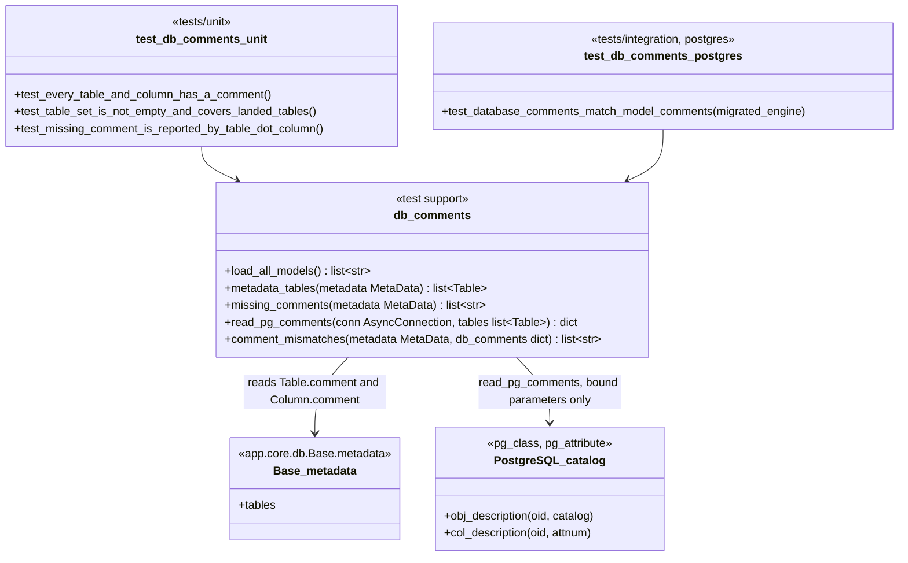
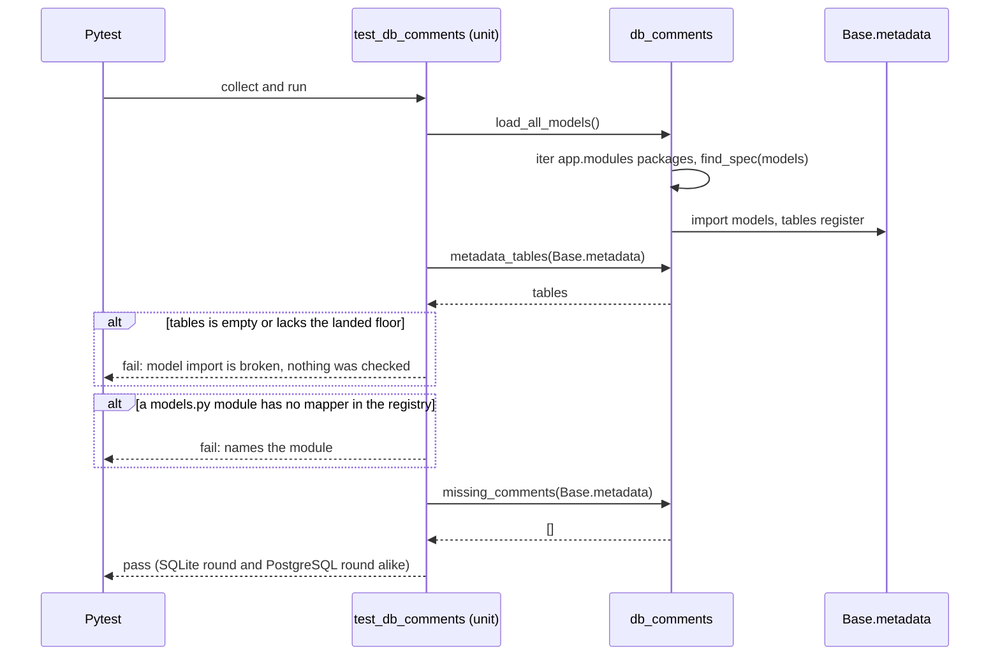
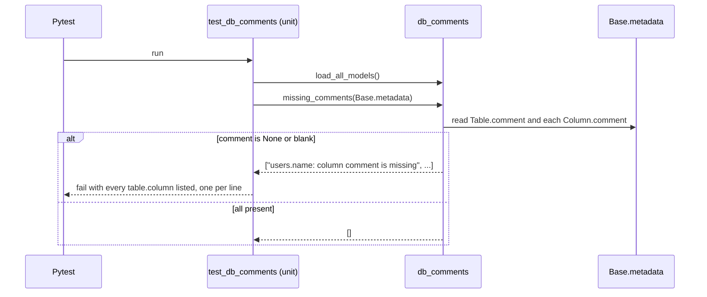
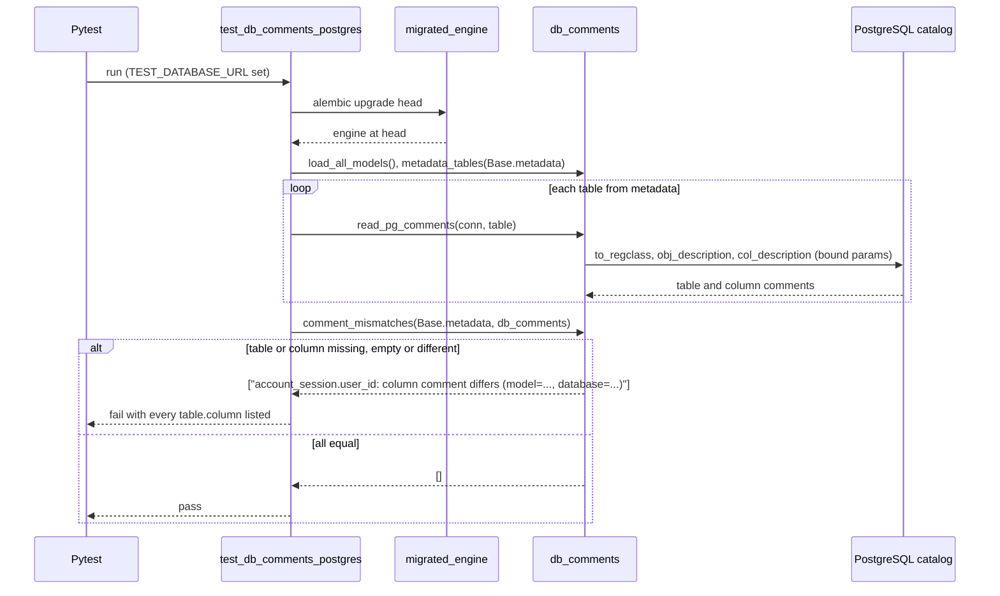
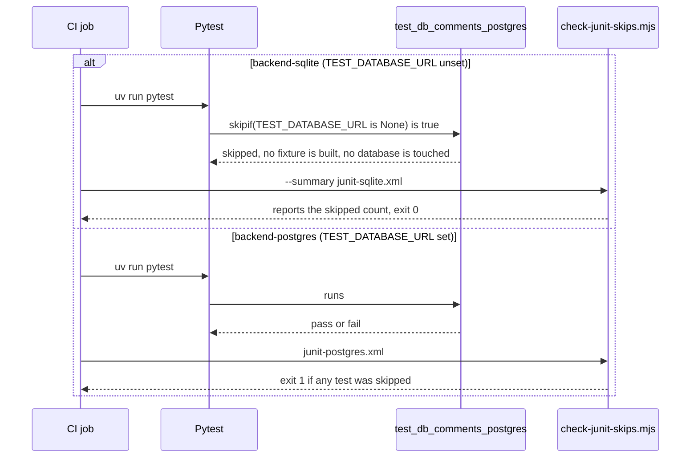
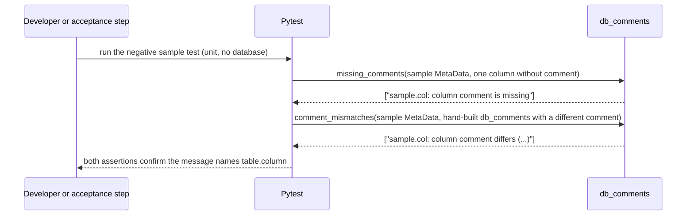

# System Design

> 本 change 只新增測試與規則文件，`backend/app/`、`backend/alembic/`、資料表與 API 都不動。因此沒有 Router、Service、Repository，也沒有執行期的類別；下面的 Class Diagram 畫的是**測試輔助模組的函式與它讀取的對象**，Sequence Diagram 畫的是 pytest 執行時的呼叫順序（pytest → 輔助函式 → metadata／資料庫），不是 HTTP 請求。

## 設計摘要

| 項目          | 設計                                                                                                                                                                                         |
| :------------ | :------------------------------------------------------------------------------------------------------------------------------------------------------------------------------------------- |
| metadata 層   | `backend/tests/unit/test_db_comments.py`，不連資料庫，SQLite 回合與 PostgreSQL 回合都跑。                                                                                                    |
| PostgreSQL 層 | `backend/tests/integration/test_db_comments_postgres.py`，標 `@pytest.mark.postgres`，用 `migrated_engine`，只讀系統目錄。                                                                   |
| 共用邏輯      | `backend/tests/support/db_comments.py`：匯入全部 model、取出表清單、比對、組失敗訊息。都是純函式，所以失敗路徑可以用樣本單元測試（延續 Q8）。                                                |
| 動到的正式碼  | 無。`alembic/env.py` 不動（見「model 匯入」的取捨）。`backend/pyproject.toml` 的 `postgres` 標記說明文字一併修正，只改文字（依 clarification 技術預設表「`postgres` 標記是否自動略過」列）。 |
| 規則文件      | `dba.md`、`backend-agent-rules.mdx`、`testing-agent-rules.mdx`（見「規則文件」）。                                                                                                           |

## 分層與類別

不適用 Router → Service → Repository：本 change 不新增或修改任何 `app/` 內的元件，也不新增端點。下圖是測試輔助模組與其使用者，`Base.metadata` 與 migration 後的資料庫是被讀取的對象；Model 只是被讀的 metadata，不重畫表間關聯（以 ER 為準）。



### 元件清單

| 元件                    | 路徑                                                     | 職責                                                                                                                                                                  |
| :---------------------- | :------------------------------------------------------- | :-------------------------------------------------------------------------------------------------------------------------------------------------------------------- |
| `db_comments`（新）     | `backend/tests/support/db_comments.py`                   | 無 `test_` 前綴，不被 pytest 收集（同 `tests/unit/import_tree.py` 的作法）。提供：匯入全部 `app.modules.<m>.models`；由 metadata 推出表清單；純函式的比對與訊息組裝。 |
| metadata 層測試（新）   | `backend/tests/unit/test_db_comments.py`                 | 呼叫 `load_all_models()` 後斷言表集合非空且涵蓋已落地的表，再斷言 `missing_comments()` 為空；另有負向樣本測試（延續 Q8）。                                            |
| PostgreSQL 層測試（新） | `backend/tests/integration/test_db_comments_postgres.py` | `pytestmark = pytest.mark.integration`，測試加 `@pytest.mark.postgres` 與 `skipif`；用 `migrated_engine` 讀實際說明，交給 `comment_mismatches()`。                    |
| 規則文件（改）          | 見「規則文件」                                           | 註明「說明存在與否」已有自動檢查。                                                                                                                                    |

### 介面約定

- `missing_comments` 與 `comment_mismatches` 回傳字串清單，每條一個違規，格式固定為 `<table>` 或 `<table>.<column>` 加原因；空清單代表通過。測試以 `assert not problems, "\n".join(problems)` 收斂，一次列出全部違規。
- `read_pg_comments` 回傳 `{table_name: (present, table_comment | None, {column_name: comment | None})}`，`present` 區分「表不存在」與「沒有說明」。
- 判定「缺說明」：`comment is None` 或 `comment.strip() == ""`。依據：PostgreSQL 與 Alembic 的 `_normalize_comment` 都把空字串當成沒有說明，空白字串視同缺漏較安全。

## model 匯入（metadata 層怎麼不空洞通過）

事實：`alembic/env.py` 的 `import_module_models()` 定義在模組層級，而該檔一匯入就執行 `context.config`、`fileConfig` 與 `run_migrations_*()`，**在 Alembic 環境之外無法匯入**，所以測試不能重用它。repo 內沒有其他可重用的掃描函式（`backend/` 內沒有其他 `iter_modules` 或 `import_module_models` 的使用）。

| 選項                                        | 做法                                                                                                                                                | 優點                                                 | 缺點／風險                                                                                                                                                                                                                         |
| :------------------------------------------ | :-------------------------------------------------------------------------------------------------------------------------------------------------- | :--------------------------------------------------- | :--------------------------------------------------------------------------------------------------------------------------------------------------------------------------------------------------------------------------------- |
| (a) 測試輔助函式照 `env.py` 的規則自己掃    | `db_comments.load_all_models()` 用 `pkgutil.iter_modules(app.modules.__path__)` 加 `importlib.util.find_spec(f"{name}.models")`，與 `env.py` 同規則 | 不動正式碼，符合 issue「只新增測試」；新模組自動納入 | 規則複製了一份；`env.py` 的規則改了，測試不會自動跟著改（規則漂移）                                                                                                                                                                |
| (b) 把掃描抽成共用函式，`env.py` 與測試共用 | 抽成可匯入的函式                                                                                                                                    | 單一來源，不漂移                                     | 放哪裡都有問題：`app/core` 不得 import `app.modules`（import-linter 契約 `Core does not depend on modules`）；放 `app/modules/__init__.py` 或新的頂層套件要動契約與 `import_tree.py`；也動到 `alembic/env.py`，超出 issue 字面範圍 |
| (c) 只靠測試各自匯入                        | 測試檔頂端寫 `import app.modules.account.models`                                                                                                    | 最簡單                                               | 新模組落地時沒人記得改，會**空洞通過**，等於沒有檢查；不採用                                                                                                                                                                       |

**已定案（見 clarification 技術預設表「model 怎麼確保都已匯入」列）：採 (a)，並採兩道護欄抵銷漂移風險**（不需要動正式碼）：

1. 表集合非空，且涵蓋「已落地底線」：`users`、`account_session`、`account_refresh_token`、`admin_role_permission`、`admin_role_permission_version`（子集比對，新增表不必改測試；缺任一張即失敗，擋住掃描規則壞掉的情況）。
2. 對檔案系統交叉核對：每個存在 `app/modules/<m>/models.py` 的模組，`Base.registry.mappers` 內必須至少有一個 mapper 的 `class_.__module__` 等於 `app.modules.<m>.models`。掃描規則漏掉模組時，直接指出模組名。

(b) 的取捨與 import 契約的衝突是 T1；已因採 (a) 而不發生（T1 已決議，見技術待決問題表）。`health` 模組沒有 `models`，`find_spec` 回 `None` 而略過，是正常情況，交叉核對只看有 `models.py` 的模組。

## PostgreSQL 層

### 表清單

只由 metadata 推出：`db_comments.metadata_tables(Base.metadata)` 回傳 `Base.metadata.sorted_tables`。**不列舉資料庫內的表**，所以 `alembic_version` 與任何非 model 的表都不會被抓到。

### 讀取（參數綁定，不拼接）

每張表兩次查詢，表名一律用綁定參數；名稱以 `dialect.identifier_preparer.format_table(table)` 轉成 `to_regclass` 看得懂的字串（必要時含引號與 schema），再當成一個參數傳入：

```sql
-- table comment; present = false means the table is not in the database
SELECT to_regclass(CAST(:qualified AS text)) IS NOT NULL AS present,
       obj_description(to_regclass(CAST(:qualified AS text)), 'pg_class') AS comment;

-- column comments of that table, by attribute number, dropped columns excluded
SELECT a.attname, col_description(a.attrelid, a.attnum) AS comment
FROM pg_attribute a
WHERE a.attrelid = to_regclass(CAST(:qualified AS text))
  AND a.attnum > 0 AND NOT a.attisdropped;
```

`to_regclass` 找不到表時回 `NULL` 而不是拋錯，所以「表不存在」與「表存在但沒說明」可以分辨；欄位說明用 `pg_attribute` 的屬性序號讀，不把欄位名拼進 SQL。這些 SQL 只在測試內以 `text()` 使用，不在 `app/`；`.semgrep/test-boundaries.yml` 的範圍不含 `text`，實作時仍要跑一次 `semgrep` 確認。

替代做法：`Inspector.get_table_comment()` 與 `get_columns()` 的 `comment` 在 PostgreSQL 上底層讀同樣的目錄，程式更短。依任務要求本設計寫成直接呼叫 `obj_description`、`col_description`，是否改用 Inspector 為 T2，已決議：直接查詢（見 clarification 技術預設表「讀取方式」列）。

### 比對

`comment_mismatches(metadata, db_comments)` 逐表、逐欄比對：

| 情況                  | 訊息                                                                     |
| :-------------------- | :----------------------------------------------------------------------- |
| 表不在資料庫          | `<table>: table not found in the database (migrations not applied?)`     |
| 資料庫的表說明為空    | `<table>: table comment is missing in the database`                      |
| 表說明與 model 不同   | `<table>: table comment differs (model=<...>, database=<...>)`           |
| 欄位不在資料庫        | `<table>.<column>: column not found in the database`                     |
| 資料庫的欄位說明為空  | `<table>.<column>: column comment is missing in the database`            |
| 欄位說明與 model 不同 | `<table>.<column>: column comment differs (model=<...>, database=<...>)` |

比對採**完全相等**（已定案，見 clarification 技術預設表「字串比對」列）：兩邊字串來源是同一段 Python 字串，PostgreSQL 原樣儲存，沒有已知的無害差異；放寬會掩蓋 migration 抄錯尾端空白之類的漂移。model 端說明本身缺漏時只報 `model comment is missing`，不比對內容。

### 與既有 drift 比對的關係（T6，已決議 Q1；system-analysis 的對應句依 clarification P2 交 sa 改寫）

system-analysis 寫「既有 drift 檢查不比對說明」。核對 Alembic 原始碼（`alembic/autogenerate/compare/comments.py`）後，**這一句與實際不符**：`compare_metadata` 在 `dialect.supports_comments` 為真時**一律**比對表說明與欄位說明，不需要額外選項；PostgreSQL 的 `supports_comments = True`，SQLite 為 `False`。因此 `test_account_schema.py` 與 `test_admin_permission_schema.py` 的 `drift == []` 斷言，在 `backend-postgres` 回合**很可能已經**擋下「model 與資料庫說明不同」或「model 有說明、資料庫沒有」。（只讀了原始碼，沒有在 PostgreSQL 上實跑，本機沒有 PostgreSQL。）**已決議（Q1，見 clarification Q1）：實作的第一步是以負向測試在 PostgreSQL 實跑，證實既有 drift 是否比對說明，結果寫進 PR，並決定規則文件對既有 drift 角色的措辭。** 在實跑證實之前，本設計不假設既有 drift 是否已擋下說明漂移。

drift 比對**抓不到**的洞：

- model 與資料庫兩邊都沒有說明（`_normalize_comment` 後都是 `None`，視為一致）：這是 metadata 層的工作。
- 沒有對應 drift 測試的表：目前只有 account 與 admin 兩個群組有 `*_schema.py`，之後新表若沒人寫 drift 測試，說明漂移不會被發現；PostgreSQL 層對**所有** metadata 內的表統一檢查。
- 失敗訊息：drift 回的是 Alembic 的 op 清單，不是「表.欄位」清單。

所以 PostgreSQL 層**不是補從零開始的洞**，而是把已有的零散保護統一成對所有表的檢查並改善訊息。

## 關鍵情境

情境名稱是暫定，等 planner 寫 specs 時以 Scenario 的名稱為準，兩邊要一致。

### Scenario: 所有表與欄位都有說明時 metadata 層通過



### Scenario: 缺少說明的欄位被 metadata 層擋下



### Scenario: PostgreSQL 實際說明缺漏或與 model 不一致時失敗



交易與連線：測試只讀，不 commit、不改資料與 schema，共用的 PostgreSQL 資料庫不會被污染；`migrated_engine` 是 API 用的 async engine，與 worker 的 sync session 無關（本 change 不涉及 worker）。

### Scenario: SQLite 回合略過 PostgreSQL 層而 CI 的略過檢查不變



作法與既有一致（`backend/tests/integration/test_health.py`）：同時加 `@pytest.mark.postgres` 與 `skipif(TEST_DATABASE_URL is None, ...)`。標記只供篩選，**真正讓 SQLite 回合略過的是 `skipif`**；只加標記會讓 SQLite 回合去連不存在的資料庫而失敗。`skipif` 在收集階段求值，被略過時 `migrated_engine` 夾具不會建立。

- `backend-sqlite`：該測試 skipped，`--summary` 只回報數字，綠燈。
- `backend-postgres`：`TEST_DATABASE_URL` 有設，測試實際執行，skipped 為 0，`check-junit-skips.mjs` 通過。若這個 job 的環境變數意外遺失，測試會 skipped 並讓 gate 失敗，正好暴露設定錯誤。
- 不用 `pytest.importorskip` 或夾具內 `pytest.skip()` 之類的動態略過，避免 PostgreSQL 回合因其他條件悄悄略過。

`TEST_DATABASE_URL` 來自 `tests.conftest`。`test_health.py` 在檔內定義了 `requires_postgres`；本設計在新檔同樣定義一行，不為此改 `conftest.py`（延續 Q5 的「自動略過」不在預設範圍）。T3 已決議（見 clarification 技術預設表「`requires_postgres`」列）：本檔自行定義一行，不改成共用。

### Scenario: 故意拿掉一個欄位說明時兩層都失敗並指名該欄位



已決議自動化（延續 Q8，見 clarification 技術預設表「負向驗證」列）：比對邏輯是純函式，不需要資料庫就能證明「真的會失敗、訊息指名欄位」，SQLite 回合也跑得到，之後檢查壞掉會被發現。issue 要求的「拿掉真實欄位說明再還原」仍列入 `acceptance.md` 的手動步驟（暫時改 `backend/app/modules/*/models.py`、跑兩層、再還原；PostgreSQL 層需 `TEST_DATABASE_URL`）。樣本一律用獨立的 `MetaData()`，**不登錄進共用 `Base.metadata`**。

## 常駐文件異動

本次無常駐文件異動。

- `backend-modules.mdx`：沒有新模組、沒有改任何模組的分層；「後端基礎建設」節「資料庫雙層」的 `model` 列寫「Alembic 自動載入，不必改 `env.py`」仍成立，因為本 change 不動 `env.py`。
- `error-codes.mdx`、`endpoint-authorization.mdx`：沒有端點與錯誤碼異動。

## 資料模型異動

本次無資料模型異動。不改任何表與欄，不新增 Alembic migration（沒有 down 可講），字典與 ER 不更新，`pnpm check:er` 不需要重跑。

雙資料庫差異（只與檢查有關，不是資料異動）：

| 項目                  | SQLite                                                        | PostgreSQL                                                                 |
| :-------------------- | :------------------------------------------------------------ | :------------------------------------------------------------------------- |
| 說明是否存在於資料庫  | 不存在；建表 DDL 不含說明，反射表說明拋 `NotImplementedError` | 存在，由遷移的 `comment=` 寫入，用 `obj_description`／`col_description` 讀 |
| 本次檢查              | 只跑 metadata 層                                              | metadata 層與 PostgreSQL 層都跑                                            |
| Alembic 的 drift 比對 | `supports_comments = False`，不比對說明                       | 一律比對說明                                                               |
| 空字串說明            | 不涉及                                                        | 不與「沒有說明」分別儲存（Alembic 也視為相同），所以空白視為缺漏           |

## 權限檢查點

不適用：沒有端點、角色與資料遮蔽，也不碰測試集答案（Hard Rule 6 無關；測試只讀 metadata 與 `pg_catalog`，不讀業務資料列）。Hard Rule 5：檢查以「登錄在 metadata 內的表」為準，不寫死個別表名，只有「已落地底線」一個子集斷言用到表名（新表不必改測試）。Hard Rule 9：表名與欄名全部用綁定參數，不拼接 SQL。

## 規則文件

實作由 tasks 負責，此處只定落點：

| 文件                                                   | 位置                                                                                                                                            | 更新                                                                                                                                         |
| :----------------------------------------------------- | :---------------------------------------------------------------------------------------------------------------------------------------------- | :------------------------------------------------------------------------------------------------------------------------------------------- |
| `.claude/agents/dba.md`                                | §資料模型準則第 44 行（每個欄位加英文 `comment`）與 §檢查清單第 89 行                                                                           | 註明「說明存在」「與資料庫一致」已由 CI 兩層測試檢查；「英文」與品質仍靠 review（已決議，見 clarification Q2：只查非空，英文不入自動檢查）。 |
| `docs/development/rules/backend-agent-rules.mdx`       | 第 16 行「在 CI 跑的」清單；B7 的「檢查方式」（已定案，見 clarification 技術預設表「規則文件落點」列）；決策紀錄加一列                          | 加入本檢查與兩個測試檔路徑；寫明 `backend-sqlite` 與 `backend-postgres` 各跑哪一層。                                                         |
| `docs/development/rules/testing-agent-rules.mdx`       | 第 15 行已建置清單；T9 gate 表第五列「migration 在 SQLite 與 PostgreSQL 兩層都能跑」（已定案，同見 clarification 技術預設表「規則文件落點」列） | 已定案：一併更新開頭的已建置清單，兩份文件對「CI 跑了什麼」才會一致；T9 gate 表第五列視實作是否新增 gate 而定。                              |
| `docs/diagrams/architecture/data-table-dictionary.mdx` | 不更新                                                                                                                                          | 不改表與欄。                                                                                                                                 |

## 更正：ADR-007 沒有雙資料庫條號（已由 clarification P1 處理）

system-analysis 的需求依據表把「雙資料庫兩輪」記為 ADR-007、條號待確認。逐條讀過 `docs/development/adr/007-testing-strategy.mdx`（D1 至 D5）：D1 三層測試分工、D2 覆蓋率、D3 前端測試位置、D4 正式 E2E、D5 測試報告；**沒有任何一條談雙資料庫兩輪、`postgres` 標記或略過檢查**（檔內唯一的 `postgres` 字樣在 e2e 的段落）。結論：**不得引用 ADR-007 的任何條號作為雙資料庫的依據。**

正確的上位依據：

- ADR-003 D7（資料庫分兩層）：兩層與 schema 只由 Alembic 管。
- `testing-agent-rules.mdx` T4：「SQLite 與 PostgreSQL 兩層各自跑完 migration」與兩輪的檢查方式；T9 gate 表第五列。
- `backend-agent-rules.mdx` B6、B7：migration 可升降；標 `postgres` 的測試在 `backend-sqlite` skipped、`backend-postgres` 任何測試 skipped 即失敗。
- 只有要引用「三層測試分工」（metadata 層屬 unit、PostgreSQL 層屬 integration）時，才引用 ADR-007 D1。

**已由 clarification P1 處理**：需求依據應改引 ADR-003 D7、`testing-agent-rules` T4／T9、`backend-agent-rules` B6／B7，ADR-007 D1 只在談三層分工時引用。system-analysis 的需求依據表（ADR-007 列）由 sa 依 P1 更正；本 agent 不改上游文件。

## 技術待決問題

system-analysis 的待決問題 1 至 8 原封延續（本表以「延續 N」稱呼，即 system-analysis 待決問題 N）。**已全數決議**，各列狀態欄註明決議位置。clarification 的 Q 編號與本表不同（例如 clarification Q1 對應本表 T6），以下分別標明來源。

| #      | 問題                                                                                                                                                                                                                             | 本設計的建議或處理                                                                                                                                                                                                        | 狀態               |
| :----- | :------------------------------------------------------------------------------------------------------------------------------------------------------------------------------------------------------------------------------- | :------------------------------------------------------------------------------------------------------------------------------------------------------------------------------------------------------------------------ | :----------------- |
| 延續 1 | 如何確保所有 model 已匯入                                                                                                                                                                                                        | **已定案**（clarification 技術預設表「model 怎麼確保都已匯入」列）：採 (a) 加兩道護欄，見「model 匯入」；(b) 受 `Core does not depend on modules` 契約限制而不採用；(c) 不採用                                            | 已決議             |
| 延續 2 | 純關聯表是否要求說明                                                                                                                                                                                                             | **已決議**（clarification Q3）：一律要求，不設豁免機制，也不另設「過期即失敗」清單                                                                                                                                        | 已決議             |
| 延續 3 | 是否檢查英文                                                                                                                                                                                                                     | **已決議**（clarification Q2）：只檢查非空與 PostgreSQL 層與 model 一致；英文不入自動檢查，仍靠 review                                                                                                                    | 已決議             |
| 延續 4 | 規則文件落點                                                                                                                                                                                                                     | **已定案**（clarification 技術預設表「規則文件落點」列）：掛 `backend-agent-rules` B7，並同步 `testing-agent-rules.mdx` 開頭的已建置清單；見「規則文件」                                                                  | 已決議             |
| 延續 5 | `postgres` 標記自動略過                                                                                                                                                                                                          | **已定案**（clarification 技術預設表「`postgres` 標記是否自動略過」列）：沿用各檔 `skipif`，不動 `conftest.py`；`pyproject.toml` 的標記說明文字與實際不符，依 clarification **併入本 change** 修正（只改文字）            | 已決議             |
| 延續 6 | 新增或修改哪個 capability                                                                                                                                                                                                        | **已決議**（clarification Q4）：加進既有的 `database-migration`（`## ADDED Requirements`），不新增 capability；技術依據寫 ADR-003 D7、B6／B7、T4／T9（**不要寫 ADR-007 的雙資料庫條號**，見上）                           | 已決議             |
| 延續 7 | 說明字串正規化                                                                                                                                                                                                                   | **已定案**（clarification 技術預設表「字串比對」列）：完全相等，缺漏判定用 `strip()`，見「比對」                                                                                                                          | 已決議             |
| 延續 8 | 負向驗證是否自動化                                                                                                                                                                                                               | **已定案**（clarification 技術預設表「負向驗證」列）：自動化，純函式加樣本測試，見最後一個 Scenario                                                                                                                       | 已決議             |
| T1     | 若選 (b)，共用函式放哪？`app/core` 不得 import `app.modules`；放 `app/modules/__init__.py` 或新頂層套件要改 `pyproject.toml` 的 import-linter 契約與 `tests/unit/import_tree.py`                                                 | 採 (a)，不發生（見 clarification 技術預設表「model 怎麼確保都已匯入」列）                                                                                                                                                 | 已決議             |
| T2     | PostgreSQL 層用直接的 `obj_description`／`col_description`，還是 `Inspector.get_table_comment`／`get_columns`（程式短，底層同源）？                                                                                              | 直接查詢；Inspector 可作實作時的交叉驗證（clarification 技術預設表「讀取方式」列）                                                                                                                                        | 已決議             |
| T3     | `requires_postgres` 各檔各定義一行，還是放進 `tests/support/` 共用？                                                                                                                                                             | 本檔自行定義一行，與 `test_health.py` 同寫法，不動既有檔（clarification 技術預設表「`requires_postgres`」列）                                                                                                             | 已決議             |
| T4     | 「已落地底線」的 5 張表名寫在測試裡是否可接受？子集斷言不影響新表，但表更名時要同步改                                                                                                                                            | 接受，作為防空洞通過的底線；更名本來就要改 migration 與測試（clarification 技術預設表「寫死 5 張表名」列）                                                                                                                | 已決議             |
| T5     | 失敗訊息格式（`<table>.<column>: <reason>`）要寫進 spec 的 Scenario，還是只留在 design？                                                                                                                                         | 寫進 Scenario：逐條列出 `表.欄位` 與原因（clarification 技術預設表「失敗訊息格式」列）                                                                                                                                    | 已決議             |
| T6     | Alembic `compare_metadata` 在 PostgreSQL 上**已經**一律比對說明（見「與既有 drift 比對的關係」），與 system-analysis 及 issue 的前提不同。PostgreSQL 層是否仍獨立新增，還是只加強 metadata 層並要求每個新表群組都有 drift 測試？ | **已決議（clarification Q1）**：照 issue 第 2 項獨立新增 PostgreSQL 層；理由是涵蓋所有表、不依賴有人記得寫 drift 測試、訊息指名欄位。實作的第一步是以負向測試在 PostgreSQL 實跑，證實既有 drift 是否比對說明，結果寫進 PR | 已決議             |
| T7     | `test_db_comments.py`（unit）直接 import `app.modules.*.models`，是否被 import-linter 或 `test_layer_boundaries.py` 判違規？tests 不在 `app` 根套件內，預期不受影響                                                              | 實作時以 `uv run lint-imports` 與該測試確認（clarification 技術預設表「import-linter」列，不需維護者決定）                                                                                                                | 已決議，實作時驗證 |

效能與交易：PostgreSQL 層對 5 張表各 2 條查詢，量級微不足道；42 張表也只是 84 條，必要時改成一條 `pg_class` join，不是本次需要處理。覆蓋率：新檔在 `tests/`，不計入 `app` 覆蓋，`coverage` job 的基準不需調整，tasks 註明跑一次確認。
