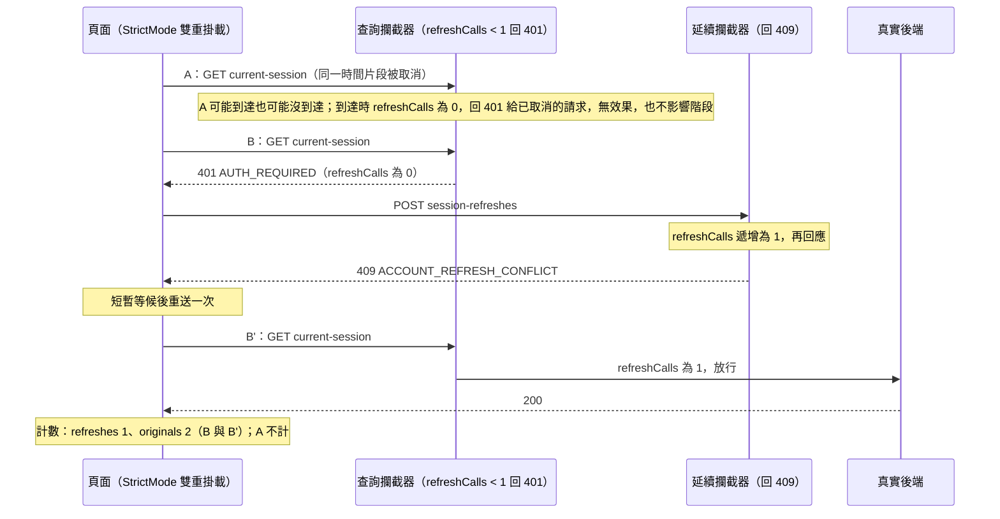
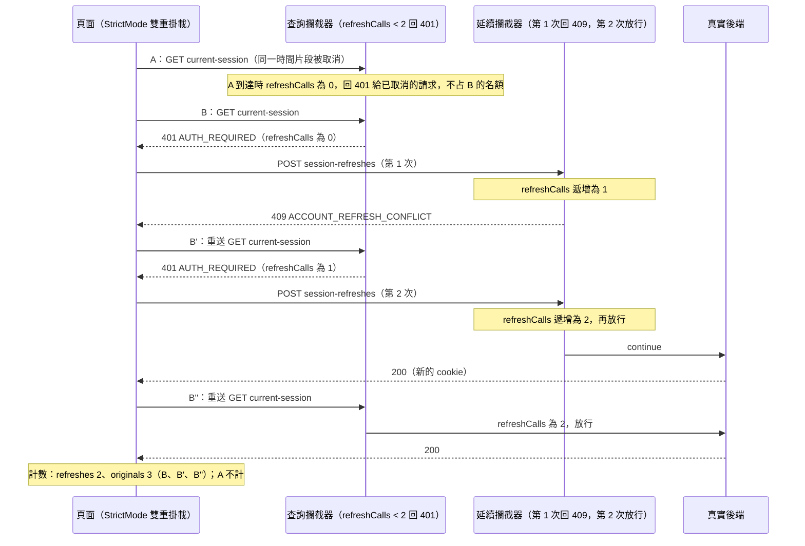

# System Design

> 本 change 是測試端修正：沒有後端變更、沒有 API 變更、沒有資料模型異動。下面各節照範本保留，後端專屬的節寫「不適用」並說明理由。設計的主體是「`e2e/account/session-guard.spec.ts` 的攔截器怎麼選回應、計數器怎麼數」，放在「測試端設計」一節。
> 依據：`system-analysis.md` §根因分析與證據（trace 證實：開發模式雙重掛載取消第一份登入狀態查詢，依「第幾個請求」選回應的攔截器把 401 用在已取消的那一份）。

## 分層與類別

不適用。本 change 不新增或修改任何 Router、Service、Repository、Model、Pydantic schema，所以沒有後端 Class Diagram 可畫。涉及的元件只有 E2E 檔案內的攔截器與計數器（見下節），它們不屬於後端分層。

## 測試端設計

### 現況缺陷

兩個測試的 `GET current-session` 攔截器都以**被叫的次數**（`queries === 1`、`queries <= 2`）決定回 401 還是放行。開發模式雙重掛載送出的第一份查詢（下稱 A，會被同步取消）若先進到攔截器，就占掉一個 401 名額；畫面實際使用的第二份（下稱 B）會拿到「往後挪一格」的回應，情境跑掉。計數器 `countFinished` 以 `requestfinished` 計，本來就不會數到 A，這一半是對的。

### 設計原則

攔截器的回應要是「情境所處階段」的函數，而不是「被叫順序」的函數。情境階段由**延續（refresh）攔截器**維護：它是這兩個測試裡唯一單調推進、且不會被雙重掛載取消的請求（延續不受取消影響，見 `frontend/src/api/session-refresh.ts`）。

### 選項比較

| 選項                                    | 做法                                                                                                                       | 優點                                                                                                      | 缺點                                                                                                             | 建議                                                    |
| :-------------------------------------- | :------------------------------------------------------------------------------------------------------------------------- | :-------------------------------------------------------------------------------------------------------- | :--------------------------------------------------------------------------------------------------------------- | :------------------------------------------------------ |
| **A（建議，已採用：clarification Q1）** | 以延續攔截器的呼叫次數當階段：查詢攔截器在「延續已被呼叫的次數 < N」時回 401，否則放行。測試 1 的 N 為 1；測試 2 的 N 為 2 | 與 A 是否進攔截器無關：A 與 B 都在第一次延續之前，都得到 401，B 的 401 不會被吃掉；斷言數值不動；不用等待 | 階段要在回應延續之前遞增（見「時序前提」）                                                                       | 是（已採用）                                            |
| B                                       | 在攔截器內判斷請求是否已取消，已取消就不計入名額                                                                           | 概念直接                                                                                                  | Playwright 在 `route` 階段沒有公開「這個請求已被取消」的資訊；`fulfill` 對已取消請求是否丟例外未驗證，不能當依據 | 否                                                      |
| C                                       | 只在 `route.fulfill` 成功後才計入 401 名額                                                                                 | 概念上「數完成的」                                                                                        | 同上，取決於未驗證的 Playwright 行為，各平台可能不同                                                             | 否                                                      |
| D                                       | 放寬斷言（例如 `refreshes()` 改 `>= 0`）或加 `waitForTimeout`                                                              | —                                                                                                         | 違反 `AGENTS.md`「Scope, once locked」與 T8                                                                      | 禁止                                                    |
| E（產品／環境端）                       | 讓開發模式不雙重掛載，或 E2E 改跑正式建置                                                                                  | 觸發條件消失                                                                                              | 屬 E2E 環境設計決定（system-analysis 待決 #3）；改變所有 spec 的測試前提                                         | 不在本 change；維持開發模式，已決議（clarification Q3） |

已決議（clarification Q1）：採設計 A，只改 `e2e/`，`frontend/` 不動。若要讓第一份查詢不送出（產品端改動），那是另一條路，已排除在本 change 之外。

### 設計 A 的細節

1. **階段計數器**：每個測試內有一個 `refreshCalls`（測試 2 原本就有；測試 1 新增，測試 3「重試仍失敗就帶回登入頁」原本就有，不動）。它只在延續攔截器內遞增，且在 `fulfill` 或 `continue` **之前**遞增。
2. **查詢攔截器規則**：`if (refreshCalls < N) 回 401 AUTH_REQUIRED，否則 route.continue()`。
   - 測試 1（N = 1）：延續被叫 0 次前的所有查詢（A、B）回 401；延續回 409 後，重送放行
   - 測試 2（N = 2）：延續被叫 0 次或 1 次時的查詢（A、B、第一次重送）回 401；第二次延續放行後，第二次重送放行
3. **時序前提**：重送一定發生在延續回應之後，而階段已在回應之前遞增，所以重送看到的階段是確定的。A 若遲到（取消在送出前、或攔截器處理中），它看到的階段只可能是 0，回 401 給已取消的請求不影響 B。
4. **共用 helper（可選，由 planner 決定）**：兩個測試的規則相同，只差 N，可抽成 `e2e/shared/api-stubs.ts` 的一個函式（例如 `failCurrentSessionUntilRefreshes`）；是否抽出屬 tasks 的粒度，不影響行為。若抽出，helper 的註解要寫明「依延續階段而非請求順序」與原因。
5. **計數器**：不改。`countFinished` 以 `requestfinished` 計，A 因被取消只會觸發 `requestfailed`，不被計入；B 的 401（被 `fulfill` 的回應）與重送都算完成。斷言維持：測試 1 `refreshes() = 1`、`originals() = 2`；測試 2 `refreshes() = 2`、`originals() = 3`；測試 3 不動（`refreshes() = 2`、`originals() = 2`）。
6. **不使用的手段**：不加 `waitForTimeout`、不放寬任何 `toBe`、不加 `retries` 或 `test.fixme`。
7. **同檔註解**：檔首「Counts are of finished requests」那段維持，補一句「stubs choose a response by refresh phase, never by request order」以免後人改回去（T11 附錄：間歇問題要有重現才能結案）。

### 驗證方式（給 acceptance 與 tasks 參考）

沿用 system-analysis 的重現指令：兩個測試各跑 `--repeat-each=30`（macOS 修前約一到三成失敗），修後要全過；CI Linux 由既有 `e2e` job 跑。#812 的 Windows 項目沒有執行環境可驗，見 system-analysis 待決 #2。

## 關鍵情境

後端沒有新 Scenario。下面兩張圖畫的是**測試情境**，目的是標出已取消的那一份請求去哪裡；參與者是 E2E 內的元件，不是後端分層，所以不用 Router／Service／Repository。圖中 A 是被雙重掛載取消的第一份查詢，B 是實際使用的第二份。

### Scenario: 慢的那個分頁自動重試一次

### Scenario: 重試不通時再延續一次就成功

## 常駐文件異動

本次無常駐文件異動

## 資料模型異動

本次無資料模型異動

## 權限檢查點

不適用。本 change 不新增或修改任何端點，沒有權限檢查與欄位遮蔽的變動。測試用的帳號與角色沿用既有 `createAccount()`；測試集答案隔離：這兩個測試只碰登入與延續端點，回應不含任何標準答案或測試集辨識資訊。

## 技術待決問題

1. **已決議：是否也動 `frontend/`。** 只改 `e2e/`，採設計 A。依據見 `clarification.md` Q1（2026-11-28）：trace 顯示產品行為照規格正確反應，根因在測試依請求序號回假回應；從產品端消除第一份查詢會牴觸 `frontend-api-client`「被中止的請求不計」，不併入本 change。
2. **已決議：Windows 驗證。** 本 PR 只寫 `Closes #804`，#812 保持開啟；合併後由維護者在 Windows 驗證，全過就關 #812，不過則在 #812 續查。依據見 `clarification.md` Q2（2026-11-28）。機制在 macOS 已證實，Windows 仍為推論。
3. **已決議：E2E 是否維持開發模式。** 維持開發模式，不在本 change 處理。依據見 `clarification.md` Q3（2026-11-28）。
4. **階段計數器的遞增位置**：必須在延續攔截器回應之前。這是設計 A 的唯一時序前提，已寫入細節 3；實作時若把遞增移到 `await` 之後，階段會晚一拍，重送可能看到舊階段。
5. 交易邊界、session 生命週期、效能：不適用（無後端變更）。
