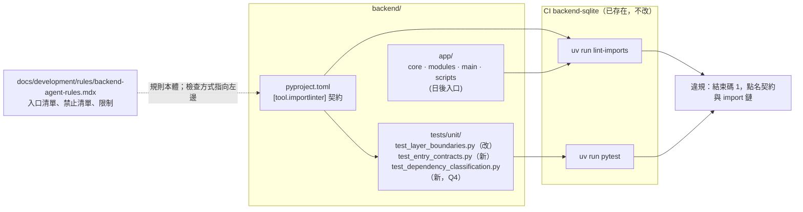
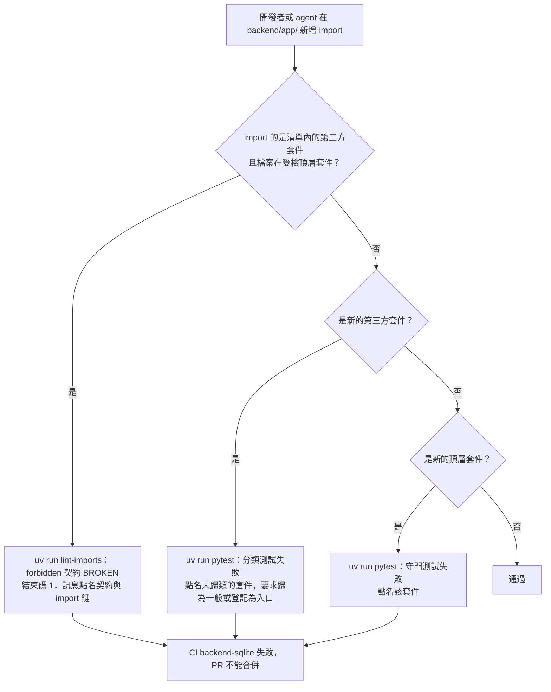
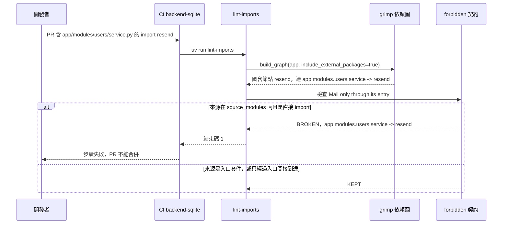
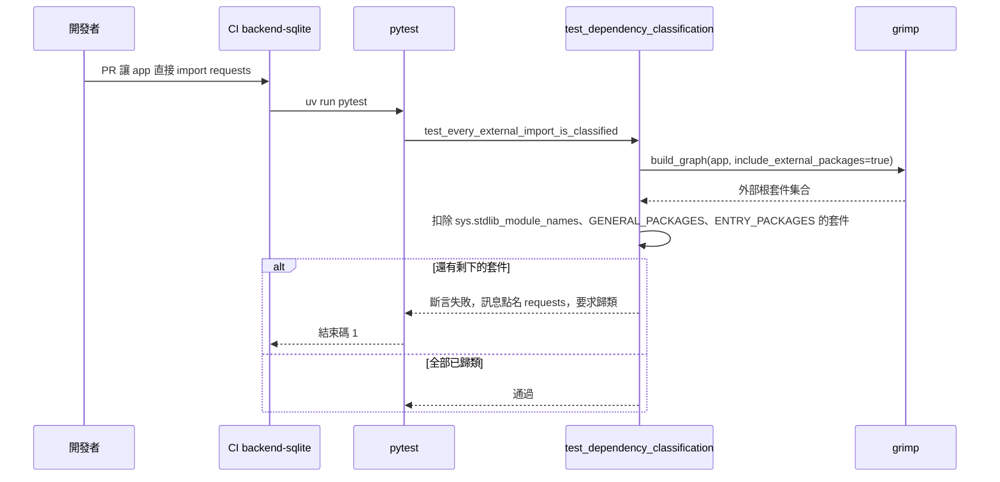
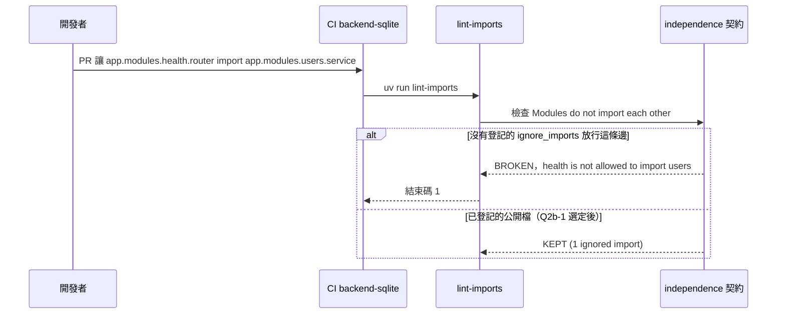

# System Design

本 change 是後端的機器檢查：沒有 Router、Service、Repository、Model 或 Pydantic schema，也沒有 API、資料表或 UI。範本的「分層與類別」與「關鍵情境」改寫成這類變更適用的內容：**機制的組成**（哪個檔案放哪條規則、在哪裡被呼叫）、**每個待決選項的設計與已驗證的限制**，以及**違規如何被擋下**的流程圖。

`system-analysis.md` 的 Q1 至 Q10 **尚未由維護者決議**（`clarification.md` 還沒寫）。本文件不替維護者選邊：每一題把選項怎麼落地、成本與已實測的限制寫清楚，並標「技術建議」。建議只是 sd 從實作面看的推薦，不是決定；維護者推翻某題時依 Q 編號回修。所有實測都在 worktree 外的暫存目錄（import-linter 2.17、grimp 3.20，與 `backend/uv.lock` 相同）與暫時複本上做，**沒有提交任何實驗檔**，repo 的 `app/`、`pyproject.toml`、`tests/` 都沒動。

## 分層與類別

### 先決發現：import-linter 做得到與做不到的事

下表是 sd 重跑 `uv run lint-imports` 與暫存設定檔的結果。**其中四條與 `system-analysis.md` 的敘述不同或補充了它**，改變選項的成本，所以放在最前面（標 **更正** 的兩條會讓原選項做不到原本寫的效果）。

| #   | 想做的事                                                                                                                               | 實測結果                                                                                                                                                                                                                                                                                                                                                                                                                                                                                                          | 對設計的影響                                                                                                |
| :-- | :------------------------------------------------------------------------------------------------------------------------------------- | :---------------------------------------------------------------------------------------------------------------------------------------------------------------------------------------------------------------------------------------------------------------------------------------------------------------------------------------------------------------------------------------------------------------------------------------------------------------------------------------------------------------- | :---------------------------------------------------------------------------------------------------------- |
| L1  | 擋第三方套件，套件根本沒裝（`resend`）                                                                                                 | `forbidden`、`forbidden_modules = ["resend", "smtplib"]`、`source_modules = ["app"]`：`KEPT`，命中 0。圖裡只要有人 `import resend` 就會出現 `resend` 節點，未安裝也一樣擋得到（在 `t` 樣本樹以 `import resend` 驗過，報 `app.modules.users.service -> resend`）                                                                                                                                                                                                                                                   | 契約可以在套件進相依之前先寫                                                                                |
| L2  | `source_modules = ["app"]` 加 `ignore_imports = ["app.integrations.mail -> resend"]`，入口模組還不存在                                 | `No matches for ignored import app.integrations.mail -> resend.`，**exit 1**；萬用字元 `app.integrations.** -> resend` 一樣報錯。`unmatched_ignore_imports_alerting` 是**契約層級**的選項，放在 `[tool.importlinter]` 根層沒有作用（試過，仍 exit 1）；放在契約內設 `"warn"` 為 `KEPT (1 warning)`、exit 0，設 `"none"` 為 `KEPT`、exit 0                                                                                                                                                                         | 入口不存在時不能用 `ignore_imports` 放行它；要用就得關掉「過期即報錯」，與 Q6-B 倚賴的行為衝突（見 Q3、Q6） |
| L3  | 不用 `ignore_imports`：`source_modules` 明列「入口以外的所有頂層套件」`["app.core", "app.modules", "app.main", "app.scripts"]`         | `KEPT`，不需要入口存在。代價：不在清單內的新頂層套件（例：`app/foo/`）完全不受檢，需要一個守門測試（見「契約設計」）                                                                                                                                                                                                                                                                                                                                                                                              | Q3 選項 A 的可行寫法（**更正**：sa 寫的「`source_modules = app` 日後補豁免」會踩到 L2）                     |
| L4  | **更正**：L3 的 forbidden 契約若入口在 `source_modules` 之外，而業務模組 import 入口、入口 import `resend`                             | 預設 `allow_indirect_imports = false` 會把 `main -> users.router -> users.service -> integrations.mail -> resend` 整條鏈報成違規，`exit 1`。加 `allow_indirect_imports = true` 後只剩**直接** import `resend` 的才報（`app.modules.users.service -> resend`）。本專案現有的 `Routers do not use the data layer`、`Data layer does not import HTTP` 兩條也用同一個旗標，理由相同                                                                                                                                   | 每一條入口契約都必須帶 `allow_indirect_imports = true`，否則入口一落地就誤報                                |
| L5  | **更正**：`protected`、`protected_modules = app.modules.*.service`、`allowed_importers = app.modules.*`，期待「只准同一個模組 import」 | 兩個模組的樣本樹中，`health.router` import `users.service`：`protected` 仍 `KEPT`（`allowed_importers` 的 `app.modules.*` 是「任一模組」，沒有「同一個」的反向參照）。能表達「模組之間互不 import」的是 **`independence`**，`modules = ["app.modules.*"]` 會展開成每個現有模組；同一個樣本 `BROKEN`：`app.modules.health is not allowed to import app.modules.users: app.modules.health.router -> app.modules.users.service`。`app.main` 同時 import 兩個模組的樣本是 `KEPT`（`independence` 只看列出的模組彼此） | Q5-B 的 `protected` 寫法擋不到跨模組 import，要用 `independence`（見 Q5）                                   |
| L6  | 只擋 router 被別的模組 import                                                                                                          | `protected_modules = ["app.modules.*.router"]`、`allowed_importers = ["app.main"]`：真樹 `KEPT`；樣本中 `health.service -> users.router` `BROKEN`，訊息 `Illegal imports of protected package app.modules.users.router`                                                                                                                                                                                                                                                                                           | 可用（router 沒有同模組 import 的需要，因為 layers 已禁止 service 往上 import router）                      |
| L7  | 頂層順序：`layers = ["app.main", "app.modules", "(app.integrations)", "app.core"]`，`app.integrations` 還不存在                        | 括號的**選用層**在不用 `containers` 時也成立：真樹 `KEPT`；不加括號報 `Missing layer 'app.integrations': module app.integrations does not exist.`。樣本樹裡 `integrations.mail -> modules.users.service` 報 `app.integrations is not allowed to import app.modules`；`core.base -> integrations.mail` 報 `app.core is not allowed to import app.integrations`                                                                                                                                                     | 若 Q2 選新頂層套件，契約可以現在就寫，不必等它存在                                                          |
| L8  | 外部套件只認根套件                                                                                                                     | 沿用 sa 的實測：擋不了 `urllib.request` 而放行 `urllib.parse`、擋不了 `from sqlalchemy import text`。**新實測**：把 `urllib` 放進 `forbidden_modules` 會命中 `app.core.config -> urllib`（`urllib.parse`），所以標準庫的 HTTP 客戶端（`urllib.request`、`http.client`）**無法**用 import-linter 單獨擋；`smtplib`、`socket`、`ssl` 可以（0 命中）                                                                                                                                                                 | 規則文件要寫明這條限制；「HTTP 客戶端」的禁止清單只列第三方（`httpx`、`requests`、`aiohttp`、`urllib3`）    |
| L9  | 擋「呼叫」而不是「import」                                                                                                             | 不可能：import-linter 只看 import 圖。S2 的「單一發 cookie 的 helper」（`response.set_cookie(...)` 是方法呼叫）、B3 的「`get_db` 是唯一建立 session 的地方」（`sqlalchemy.ext.asyncio` 併成 `sqlalchemy`）、CSRF middleware 的單一性都**不在** import-linter 的能力內                                                                                                                                                                                                                                             | Q1 的選項 B、C 裡沒有專屬第三方套件的項目，import-linter 不能機械檢查它們；見技術待決問題 N1                |
| L10 | 契約只看 `root_package = "app"`                                                                                                        | 沿用 sa：`tests/`、`alembic/` 不在圖中                                                                                                                                                                                                                                                                                                                                                                                                                                                                            | `alembic/` 若 `import` 了清單內的套件不會被抓（今天沒有，記入 N5）                                          |

以上全部在真樹複本（49 個檔、109 條依賴）與兩個模組的樣本樹上跑過。下面「契約設計」的整組設定在真樹上的結果：

```text
Module layers KEPT
Routers do not use the data layer KEPT
Core does not depend on modules KEPT
Data layer does not import HTTP KEPT
Mail only through its entry KEPT
Outbound HTTP only through its entry KEPT
OIDC only through its entry KEPT
Modules do not import each other KEPT
Only the assembly point imports routers KEPT
Top-level order KEPT

Contracts: 10 kept, 0 broken.
```

### 機制總覽



- **不新增 CI job、不改 `ci.yml`、`scripts/check.mjs`、`ci-workflow.test.mjs`、`check.test.mjs`**：契約都加在 `pyproject.toml`，既有的 `uv run lint-imports` 步驟照跑；新測試被既有的 `uv run pytest` 撿到（`testpaths = ["tests"]`）。
- **不新增 `app/` 檔案**（Q2 選 C 或 Q3 選 A 的前提）：入口今天一個都不存在，契約用 L3 的寫法。
- **不新增 Python 套件**：`grimp` 是 `import-linter` 的相依，已在鎖定檔；Q4 的分類測試直接 `import grimp`。

### 契約設計

本節的 TOML 是**草案**，用於說明每個選項落到哪個契約；實際內容由 `planner` 寫進 `specs` 與 `design`，`backend-developer` 寫進 `pyproject.toml`。契約名稱沿用現有風格（英文句子）。

**Q1：入口清單與禁止清單的對應。** 一個入口對應一條 `forbidden` 契約，禁止清單是「只有這個入口能 import 的第三方套件」。只有「有專屬第三方套件」的項目能機械檢查（L9）：

| 入口                               | 禁止清單（入口以外不得 import）                             | import-linter 能檢查嗎                 | 出自                     |
| :--------------------------------- | :---------------------------------------------------------- | :------------------------------------- | :----------------------- |
| 寄信                               | `resend`、`smtplib`、`aiosmtplib`                           | 能                                     | ADR-008 D3（Resend SDK） |
| Google OIDC                        | `authlib`                                                   | 能                                     | ADR-004 D4               |
| 對外 HTTP 客戶端                   | `httpx`、`requests`、`aiohttp`、`urllib3`（不含標準庫，L8） | 能（但 C2 未決，見下）                 | T6 §正例                 |
| 取得目前使用者（S1）               | 無專屬第三方套件；若用 JWT 套件則是它（今天沒有套件）       | 只能擋「JWT 套件」，擋不了「誰是入口」 | S1                       |
| 發 session cookie 的 helper（S2）  | 無（`set_cookie` 是方法呼叫）                               | **不能**（L9）                         | S2、ADR-004 D3           |
| CSRF middleware（ADR-004 D3）      | 無                                                          | **不能**（L9）                         | S2                       |
| 資料庫 session 取得（B3 `get_db`） | `sqlalchemy` 整包不可擋（今天 3 處合法使用）                | **不能**（L8、L9）                     | B3                       |

Q1 各選項對設計的影響：

| 選項                 | 契約數                                                                                   | 說明                                                                                                                                                                                                                                       |
| :------------------- | :--------------------------------------------------------------------------------------- | :----------------------------------------------------------------------------------------------------------------------------------------------------------------------------------------------------------------------------------------- |
| A 四項               | 3（寄信、OIDC、HTTP 客戶端各一）；「取得目前使用者」沒有可擋的套件，靠規則文件與分類測試 | 四項裡只有三項能機械檢查                                                                                                                                                                                                                   |
| B A 加三項           | 同 A                                                                                     | 新增的三項（cookie helper、CSRF、`get_db`）**import-linter 檢查不了**；只能寫進規則文件的清單並標「待建置」，或另用 Semgrep 擋方法呼叫（N1，**未驗證**）。若維護者要求「清單上的每一項都有機械檢查」，B 與 C 在 import-linter 範圍內做不到 |
| C B 加 Celery、Redis | 4–5（`celery`、`redis` 各一，套件今天都沒裝，L1 成立）                                   | Celery 進入點落在模組裡（ADR-003 D3、B9），入口位置要先定                                                                                                                                                                                  |
| D 只列今天有實作的   | 0 條新的第三方契約                                                                       | 今天唯一有實作的是 `get_db`，它不能被 import-linter 檢查（L8、L9），所以 D 會讓本 change 沒有任何會擋東西的新契約，工作項 2、5 退化成只改文件                                                                                              |

**C2 的設計含意（HTTP 客戶端）。** 若「每個整合自己包裝自己的 SDK」（sa 建議），HTTP 客戶端這一項只是「入口以外不得直接 `import httpx`」：寄信用 Resend SDK、OIDC 用 `authlib`（`authlib` 自己會用 `httpx`，那是它的內部相依，不在 `app` 圖裡）。若「共用一個 HTTP 客戶端」，則需要新增一個入口檔，Q2 要先定位置。技術上兩者差別只在 `forbidden` 契約是否有一個入口放行：沒有共用客戶端時，入口以外**所有**地方都不得 import `httpx`，連各整合的包裝也不得（整合要用 SDK 自己的傳輸），這會讓日後想直接用 `httpx` 呼叫第三方 REST 的整合被擋住；有共用客戶端時各整合經它走。維護者要決定，sd 不選。

**契約形狀：L3 的「明列來源」寫法（Q3 選項 A 的實際寫法）。**

```toml
# One contract per entry. The entry package is not listed in source_modules, so it may
# import its own SDK; every other top-level package may not. allow_indirect_imports is
# required: without it an entry that exists makes every importer of the entry fail (L4).
[[tool.importlinter.contracts]]
name = "Mail only through its entry"
type = "forbidden"
source_modules = ["app.core", "app.modules", "app.main", "app.scripts"]
forbidden_modules = ["resend", "smtplib", "aiosmtplib"]
allow_indirect_imports = true
```

`OIDC`、`Outbound HTTP` 同形，只換名稱與 `forbidden_modules`。這份寫法**在入口不存在、入口在 `app.integrations`（Q2-B）或 `app/` 下任何新頂層套件時都成立**，不必引用不存在的模組。它在 Q2-A（入口放 `app/core/` 裡的檔案）時**不成立**：`app.core` 在 `source_modules` 內，入口放行不了，要改用 `source_modules = ["app"]` 加 `ignore_imports`（L2），而入口不存在時只能 `unmatched_ignore_imports_alerting = "warn"`（見 Q3）。

**守門測試（L3 的缺口）。** 新的頂層套件（例：`app/foo/`）不在任何 `source_modules`，因此不受檢。測試 `test_every_top_level_package_is_classified`：`pkgutil.iter_modules(app.__path__)` 列出 `app` 的子套件與模組，每一個必須落在 `{core, modules, main, scripts}`（四個受檢者）或 `ENTRY_PACKAGES`（入口，測試裡的常數，初始為空）；不在就失敗並點名，訊息寫「新頂層套件要嘛加進受檢清單，要嘛登記為入口」。`ENTRY_PACKAGES` 的每個項目必須同時出現在**不在** `source_modules` 內的位置（測試檢查它沒有出現在任何入口契約的 `source_modules`），避免登記了卻仍被擋或仍被漏掉。

**Q5：模組之間（跨模組的單一入口）。**

```toml
[[tool.importlinter.contracts]]
name = "Modules do not import each other"
type = "independence"
modules = ["app.modules.*"]

[[tool.importlinter.contracts]]
name = "Only the assembly point imports routers"
type = "protected"
protected_modules = ["app.modules.*.router"]
allowed_importers = ["app.main"]
```

兩條在真樹與樣本樹都驗過（L5、L6）。**這取代 sa 的 Q5-B**（`protected` 加 `allowed_importers = app.modules.*`，L5 證明那樣擋不到跨模組）。`independence` 一次擋掉所有跨模組 import，包含 service、repository、schemas、router，所以日後第二個模組要用別的模組時（例如「取得目前使用者」，Q2）一定會碰到它：要嘛在該契約加 `ignore_imports = ["app.modules.** -> app.modules.users.deps"]`（樣本驗過：`**` 與 `*` 都能當 importer 那一側的寫法，只放行那一條邊，`health.service -> users.service` 仍 `BROKEN`），要嘛不走跨模組 import（Q2-D）。Q5-C（公開入口檔）在 `independence` 的做法就是上面那條 `ignore_imports`，所以「哪個檔是公開入口」是**那一行 ignore**，不必另設機制。Q5-A（不做）則完全不加這兩條。

**Q2-B 需要的頂層順序契約**（只有 Q2 選新頂層套件時才加；其他選項不加）：

```toml
[[tool.importlinter.contracts]]
name = "Top-level order"
type = "layers"
layers = ["app.main", "app.modules", "(app.integrations)", "app.core"]
```

驗過（L7）。它同時涵蓋「`app.integrations` 不得 import `app.modules`」與「`app.core` 不得 import `app.integrations`」。它與現有的 `Core does not depend on modules` 有重疊，**不取代**那一條（那是既有 Requirement「共用層不依賴業務模組」的字面實作，改它是改規格）。

### Q2：入口放在哪裡（影響最大，請維護者決定）

Q2 其實是兩個問題，sa 合在一起問，設計上要拆開，因為答案不同、牽動的決策紀錄也不同：

- **Q2a 對外整合（寄信、OIDC、HTTP 客戶端）放哪**：不需要查使用者資料，與業務無關。
- **Q2b 取得目前使用者放哪**：要查使用者表、判斷帳號狀態（S1），天生依賴使用者業務。

**先看 ADR-003 D3 怎麼寫、什麼時候要重新討論。** D3 的「決定」是：「一個業務模組一個資料夾 `app/modules/<module>/`，裡面放自己的 router、service、repository 與 schemas」；`backend-modules.mdx` 寫 `app/core/` 放「換一個業務也照樣需要的東西」。D3 的「什麼情況要重新討論」第一條：「`backend/` 的第一批模組合併之後，審查反覆發現**跨模組共用的 service 或 schema 沒有合適的位置**」。現況：只有一個模組（`health`），模組之間 import 是 0，審查**還沒**反覆發現這件事，所以這個條件**字面上還沒觸發**。但「取得目前使用者」會是第一個被**所有**需要登入的模組共用的 service，D3 與契約 `Core does not depend on modules` 合起來**沒有留位置給它**（放 `core` 要依賴使用者模組，被契約擋；放使用者模組要被別的模組 import，D3 沒說可以）。所以替 Q2b 選位置，等於**預先回答 D3 的重新討論條件**，而不是等條件被審查觸發。

任何**不是現有 D3 字面允許**的選項，決議後要做的文件變更（`backend-developer` 或 `planner` 在 apply 階段做，不是本 change 的 sd 能預先改）：

1. ADR-003 補一節（新的 D 或 D3 的修訂）記下新位置與理由，並在 D3 的「什麼情況要重新討論」那條標註已觸發與日期；
2. `docs/development/architecture.mdx` 的 ADR 效力總表對應列；
3. `docs/diagrams/architecture/backend-modules.mdx` 的「目錄」節與「`core/` 各模組」表；
4. `backend-agent-rules.mdx` §決策紀錄加一列。

| 選項                                                                                    | 位置                                                                                                                                                                                                                 | 現有契約                                                                                                                                                                                                                                                  | 要新增的契約                                                                                                                                                       | 要不要動 ADR-003 D3                                                                                                                                           | 成本與風險                                                                                                                                                                                                 |
| :-------------------------------------------------------------------------------------- | :------------------------------------------------------------------------------------------------------------------------------------------------------------------------------------------------------------------- | :-------------------------------------------------------------------------------------------------------------------------------------------------------------------------------------------------------------------------------------------------------- | :----------------------------------------------------------------------------------------------------------------------------------------------------------------- | :------------------------------------------------------------------------------------------------------------------------------------------------------------ | :--------------------------------------------------------------------------------------------------------------------------------------------------------------------------------------------------------- |
| **Q2a-1** 對外整合放 `app/core/<name>.py`                                               | `core/mail.py`、`core/oidc.py`、`core/http.py`                                                                                                                                                                       | 都成立（`core` 不 import `modules` 沒被破壞）。**實測**：`app/core/auth.py` import `app.modules.health.service` 報 `Core does not depend on modules BROKEN`，證明 core 只能放不依賴業務的東西，寄信本身（送出一封信）符合，信的內容與收件人由業務模組決定 | 入口在 `source_modules` 內，要用 `source_modules = ["app"]` 加 `ignore_imports`（L2）：入口不存在時只能 `"warn"`，之後入口落地時改回預設 `"error"`                 | **不需要**（落在 D3 與 `backend-modules.mdx` 對 `core/` 的字面定義內）                                                                                        | 入口還不存在時契約不能嚴格；`core/` 會從 12 個檔變多，`core/` 變成雜物間的風險由 `backend-modules.mdx`「新的共用基礎建設先找這張表」那句約束                                                               |
| **Q2a-2** 對外整合放新頂層套件 `app/integrations/`                                      | `integrations/mail.py` 等                                                                                                                                                                                            | 都成立；用「頂層順序」契約（L7）管它與 `core`、`modules` 的方向                                                                                                                                                                                           | `Top-level order`（選用層，現在就能寫）；L3 的 `source_modules` 不需列入它                                                                                         | **需要**（新增一個 D3 沒有的目錄概念）                                                                                                                        | 入口與基礎建設分開、`core` 保持小；多一個頂層概念要寫進三份文件；`core` 不得依賴 `integrations` 這條新限制是新的架構規則                                                                                   |
| **Q2a-3** 路徑留給第一個落地的 change                                                   | 不決定                                                                                                                                                                                                               | 不動                                                                                                                                                                                                                                                      | 只寫 L3 的禁止清單契約                                                                                                                                             | 不需要，但**第一個入口落地的 change 必須回答這題**，那時 D3 的條件很可能被審查觸發                                                                            | 本 change 沒有任何路徑決定；日後的 change 要同時做功能與架構決策                                                                                                                                           |
| **Q2b-1** 目前使用者放使用者模組的公開檔                                                | `app/modules/users/deps.py`（檔名舉例），其他模組的 router 直接 `import`                                                                                                                                             | 都成立                                                                                                                                                                                                                                                    | `independence`（Q5）加**一行** `ignore_imports` 放行該檔；已驗（`health.router -> users.deps` 在 ignore 後 `KEPT`，`health.service -> users.service` 仍 `BROKEN`） | **需要**：這是第一個跨模組 import，D3 只談模組內，沒有說模組之間可以 import；要寫明「跨模組只准經過登記的公開檔」                                             | 最直觀、不需要新機制；但每個需要登入的模組都依賴 `users`，`users` 一變所有模組受影響；`independence` 的 ignore 清單會逐步長大                                                                              |
| **Q2b-2** 反轉依賴：core 只定義「怎麼取得目前使用者」的介面，使用者模組實作，組裝時接上 | `app/core/auth.py`（`CurrentUser` 資料類別、`UserResolver` 的 `Protocol`、`get_current_user` dependency，從 cookie 取 token 再呼叫 resolver）；`app/modules/users/` 實作 resolver；`create_app` 把它放進 `app.state` | **全部不動**：`core` 不 import 任何模組，模組只 import `core`（和現在 `health` 一樣）。已驗證契約形狀（core 不 import 模組、`independence` 不需要任何 ignore）                                                                                            | 無（現有四條就夠，`Top-level order` 不需要）                                                                                                                       | **不需要** ADR-003 本文：core 仍是「換一個業務也照樣需要」的基礎建設（驗證 cookie、取使用者的介面與業務無關）；但 `backend-modules.mdx` 的 `core/` 表要加一列 | 多一層間接：resolver 在 `app.state`，缺少接線時要到執行期才發現，需要一個測試保證 `create_app` 有接上（今天沒有認證，無從預先驗證，**這一點 sd 未實作驗證**）；靜態型別靠 `Protocol`，mypy `--strict` 可驗 |
| **Q2b-3** 放行 `core -> modules.users` 的例外                                           | `core/auth.py` import 使用者模組                                                                                                                                                                                     | 要在 `Core does not depend on modules` 加 `ignore_imports = ["app.core.auth -> app.modules.users.service"]`                                                                                                                                               | 無                                                                                                                                                                 | **需要，而且是推翻已定案的 Requirement「共用層不依賴業務模組」**（`openspec/specs/backend-code-boundaries`）                                                  | 在 `core` 與 `users.service`（它又用 `core.db`）之間製造循環；sd **不建議**                                                                                                                                |

**sd 的技術建議（不是決定）**：Q2a 可選 Q2a-1（不動 ADR）或 Q2a-3（等第一個入口）；Q2b 可選 Q2b-2（不動 ADR 本文、保住既有契約）或 Q2b-1（最簡單，但要補 ADR）。與 sa 的建議（Q2 先選 C）一致的部分是：**今天沒有任何入口，契約用 L3 寫法就能先擋住第三方套件**，位置決定可以等第一個入口的 change；本 change 能做的是讓兩邊的契約都已驗證可行。兩個選項的成本差別是維護者的取捨：Q2b-2 把複雜度放在執行期接線，Q2b-1 把複雜度放在 ADR 與 `independence` 的例外清單。

### Q3：入口還不存在時契約怎麼寫

| 選項           | 設計                                                                                     | 驗證                                                                                                      | 取捨                                                                                                                                                                                                      |
| :------------- | :--------------------------------------------------------------------------------------- | :-------------------------------------------------------------------------------------------------------- | :-------------------------------------------------------------------------------------------------------------------------------------------------------------------------------------------------------- |
| A（sd 修正版） | L3：`source_modules` 明列入口以外的頂層套件，`allow_indirect_imports = true`，加守門測試 | 真樹 `KEPT`；樣本樹中業務模組、core、main 直接 import `resend` 都 `BROKEN`；入口套件 import `resend` 不報 | 不需新增任何 `app/` 檔案，入口落地時不必改契約；不能管「入口 A import 入口 B 的套件」（要這條時，入口落地的 change 再補 `source_modules = ["app"]` 加 `ignore_imports` 的契約，此時入口已存在，不會報錯） |
| A（sa 原版）   | `source_modules = ["app"]` 加對不存在入口的 `ignore_imports`                             | **做不到**（L2，exit 1），除非契約內設 `"warn"`                                                           | 只有 Q2a-1（入口在 `core`）時才需要                                                                                                                                                                       |
| B 只寫文件     | 不寫契約                                                                                 | —                                                                                                         | 工作項 2、5 沒有東西可證明                                                                                                                                                                                |
| C 先建空骨架   | 新增 `app/` 檔                                                                           | 可行                                                                                                      | 新增產品碼，骨架形狀等於 Q2 的決定                                                                                                                                                                        |

### Q4：防「清單上沒列到的新套件」

| 選項                                          | 設計                                                                                                                                                                                                 | 驗證                                                                                                                                                                                                                                                                                                                                                                | 取捨                                                                                                                                                                                         |
| :-------------------------------------------- | :--------------------------------------------------------------------------------------------------------------------------------------------------------------------------------------------------- | :------------------------------------------------------------------------------------------------------------------------------------------------------------------------------------------------------------------------------------------------------------------------------------------------------------------------------------------------------------------ | :------------------------------------------------------------------------------------------------------------------------------------------------------------------------------------------- |
| A 只用 forbidden                              | 上面的契約                                                                                                                                                                                           | 驗過                                                                                                                                                                                                                                                                                                                                                                | 新套件（例：另一個寄信 SDK）不在黑名單，契約看不見                                                                                                                                           |
| B（sa 版）讀 `[project].dependencies` 分類    | 比對相依名稱與分類表                                                                                                                                                                                 | 相依名稱不等於 import 名稱（`pydantic-settings` 的 import 名是 `pydantic_settings`）；用 `importlib.metadata.packages_distributions()` 可對回（真樹 8 個相依全部對得上），但依賴**已安裝**的環境；**相依今天是 8 個**（含 `aiosqlite`，sa 寫 7 個）；只看宣告的相依，**看不到傳遞相依被直接 import**（例：沒宣告但被 `fastapi` 帶進來的 `httpx` 被業務模組 import） | 容易漏                                                                                                                                                                                       |
| **D（sd 建議的變體）** 讀實際的 import 圖分類 | `grimp.build_graph("app", include_external_packages=True)` 取所有外部根套件，扣掉 `sys.stdlib_module_names`，剩下的每一個必須在 `GENERAL_PACKAGES`（一般套件，明列）或 `ENTRY_PACKAGES` 的套件集合內 | 真樹複本跑過：目前輸出 `[]`（`fastapi`、`pydantic`、`pydantic_settings`、`sqlalchemy`、`starlette` 歸一般）；把 `starlette` 從一般清單拿掉就回傳 `['starlette']`，證明未歸類會被點名                                                                                                                                                                                | 看的是**真正被 import 的東西**，傳遞相依也看得到；歸類表放在測試檔，約 15 行；`grimp` 的 API 是 import-linter 的內部相依，升級時要看一次（`uv.lock` 鎖住版本，升級由 Dependabot 的 PR 帶出） |

**技術建議**：A 加 D。B（讀宣告的相依）不建議，因為漏看傳遞相依，又需要名稱對照。D 還要多一個一致性檢查：`ENTRY_PACKAGES` 內每個套件都必須出現在某條入口契約的 `forbidden_modules`，反之亦然（兩份清單不得各說各話）。

### Q6：豁免的記法

選 B 的設計：沿用 import-linter 的 `ignore_imports`，加一個測試 `test_every_ignored_import_has_a_reason`：解析 `pyproject.toml`，要求每個契約的 `ignore_imports` 項目**前一行**有以 `#` 開頭的註解，且註解含來源（issue 編號或規則編號，例如 `#563` 或 `B12`）。註解由測試以文字讀取（`tomllib` 會丟掉註解，要自己掃檔案）。**過期即失敗**由 import-linter 預設的 `unmatched_ignore_imports_alerting = "error"` 提供，**前提是不對任何契約設 `"warn"`／`"none"`**：測試順便斷言契約裡沒有 `unmatched_ignore_imports_alerting` 這個鍵，否則 Q3 的 Q2a-1 變體（L2 的 `"warn"`）會悄悄關掉這道防線。因此 Q2a-1 與 Q6-B 一起選時，`"warn"` 只能出現在「入口尚未落地」的那一個契約，並附註解寫明「落地時移除」，測試以白名單放行這一條。Q6-A 不加任何機制；Q6-C（比照 #561 的 `EXEMPTIONS` 表）在 import-linter 上沒有對應的原生機制，要自己再寫一份表與同步測試，sd 不建議。

### Q9：測試如何改

**現況的兩個硬編碼**（`backend/tests/unit/test_layer_boundaries.py`）：

1. `assert "4 kept, 0 broken" in result.stdout`：新增契約就會失敗。改成 `f"{len(load_contracts())} kept, 0 broken"`（從 `pyproject.toml` 讀契約數，與子行程輸出對得上），**另加**一個斷言契約名稱的集合與 `EXPECTED_CONTRACTS` 相同。只比數字，契約被悄悄刪掉一條、同時又被加了一條時抓不到；比名稱集合，改契約要同步改一個清單，是刻意的摩擦。
2. `uncovered_modules()` 只認 `Module layers`、`Routers…`、`Data layer…` 三個契約的模式：新契約若用 `app.modules.*` 通配（`independence`、`protected`），任何新模組都自動涵蓋，不必擴充；但 `uncovered_modules` 要多驗證「`independence` 的 `modules` 含 `app.modules.*`」與「`protected` 的 `protected_modules` 含 `app.modules.*.router`」，否則有人把通配改成明列單一模組時新模組會漏檢。

**檔案切分**（#561 B11：檔案行數 400，排除空白行與 `#` 開頭的行；現有 `test_layer_boundaries.py` 187 行含空白）：

| 檔案                                                       | 異動                                                                                | 預估行數（排除空白與註解） | 內容                                           |
| :--------------------------------------------------------- | :---------------------------------------------------------------------------------- | :------------------------- | :--------------------------------------------- |
| `tests/unit/import_tree.py`（新）                          | 把 `write`、`build_tree`、`run_lint_imports`、`append` 抽出來                       | 約 50                      | 兩個測試檔共用                                 |
| `tests/unit/test_layer_boundaries.py`                      | 改 import、改契約數斷言、擴充 `uncovered_modules`                                   | 約 150（比現在略少）       | 原有分層測試                                   |
| `tests/unit/test_entry_contracts.py`（新）                 | 入口契約、`independence`、`protected` 的違規樣本，守門測試，`ENTRY_PACKAGES` 一致性 | 約 120                     | 約 14 個 case，每個 0.1 秒                     |
| `tests/unit/test_dependency_classification.py`（新，Q4-D） | 分類測試與對 tmp 樹的失敗樣本                                                       | 約 60                      | 純函式 `unclassified_imports(root)` 加三個測試 |

四個檔都遠低於 400。若維護者要求「不新增檔案」，把新測試放進 `test_layer_boundaries.py` 約 270 行，仍在上限內，但那個檔會同時管分層與入口兩件事。**技術建議**：切開，因為契約名稱與覆蓋函式是兩組不同的規則，審查時才看得出哪個測試對應哪條規則。

**樣本的 case**（Q9 選 A 的常駐樣本；以 `build_tree` 加 `append` 的方式，沿用現有做法）：

| case                                                                   | 預期                                                                             |
| :--------------------------------------------------------------------- | :------------------------------------------------------------------------------- |
| 業務模組的 service import `resend`、`httpx`、`authlib`、`smtplib` 各一 | `Mail…／Outbound HTTP…／OIDC… BROKEN`，訊息含 `app.modules.<m>.service -> <pkg>` |
| `app.core` 的檔、`app.main` import `httpx`                             | `BROKEN`                                                                         |
| 樹中含 `app/integrations/mail.py`（入口）import `resend`               | 通過（證明入口放行）                                                             |
| 業務模組 import 入口、入口 import `resend`                             | 通過（`allow_indirect_imports` 有效，防回歸）                                    |
| 模組 A 的 router import 模組 B 的 service                              | `Modules do not import each other BROKEN`                                        |
| `app.main` 同時 import 兩個模組的 router                               | 通過                                                                             |
| 模組 A 的 service import 模組 B 的 router                              | `Only the assembly point imports routers BROKEN`                                 |
| 樹中新增 `app/stray/__init__.py`                                       | 守門測試失敗並點名 `stray`                                                       |
| 在 tmp 樹的某檔 `import requests`，`requests` 不在任何清單             | `unclassified_imports` 回傳 `['requests']`                                       |

**對真樹的證明**：issue 工作項 5 要求「先對刻意違規的樣本確認會失敗」，常駐樣本滿足；`acceptance.md` 另記一次人工步驟（在暫存複本放一個違規檔、跑 `lint-imports` 看到非零結束碼）供抽查，不是必要路徑。

### Q7、Q8、Q10：只影響文件與設定，不需要新機制

- **Q7**（規則怎麼寫）：B12 的檢查方式寫「契約名稱、禁止清單、`pyproject.toml` 位置、樣本測試與分類測試」；B1 的檢查方式補一句「入口與跨模組的契約見 B12」。契約**不要**在 B12 與 B1 各抄一份表：B12 是清單與禁止清單的唯一來源，B1 只指向它。`agent-rules.mdx` R2、`testing-agent-rules.mdx` T9 表的「import 邊界」列、ADR-003 D3 §後果都已指向 B1 的檢查方式，B1 指向 B12 即可，這三處不必逐一改文字，只在狀態段與條數同步。
- **Q8**（Semgrep）：不動 `.semgrep/`。設計上兩套機制不相通（Semgrep 掃 `tests/`、import-linter 掃 `app/`），選 B 時要讓 Semgrep 規則「`app` 的目標一律禁止，除了入口模組清單」，而入口清單屬於本 change 的 `ENTRY_PACKAGES`，Semgrep 讀不到 Python 常數，會變成兩份清單；若選 B，要在 Semgrep 規則裡複製一份並以測試核對（sd 不建議，沒有任何入口可被替換）。
- **Q10**（範圍）：不加機制。B5 的待建置說明加一句「import-linter 只能擋整個套件，擋不了 `text`」（L8）。

### 違規如何被擋下



## 關鍵情境

`openspec/specs/` 的 Scenario 名稱要等 `planner` 寫 `specs` 才定案；下面三個先以「驗收時要能證明什麼」命名，`planner` 對齊時依實際 Scenario 名稱改標題（沿用 #561、#562 的做法）。

### Scenario: 業務模組直接 import 入口套件時 lint-imports 失敗



### Scenario: 新增未歸類的第三方套件時分類測試失敗



### Scenario: 第二個模組跨模組 import 時 lint-imports 失敗



## 常駐文件異動

本次**尚未改**常駐文件，原因是改什麼取決於維護者在 clarification 的決議（Q2 決定 `backend-modules.mdx` 要不要動）。`planner` 在 `design`／`tasks` 階段把下表轉成任務，`backend-developer` 或 `technical-writer` 在 apply 階段改。

| 文件                                                                       | 節                                                                                   | 何時改                                                | 摘要                                                                                                                                                                                            |
| :------------------------------------------------------------------------- | :----------------------------------------------------------------------------------- | :---------------------------------------------------- | :---------------------------------------------------------------------------------------------------------------------------------------------------------------------------------------------- |
| `docs/diagrams/architecture/backend-modules.mdx`                           | 「後端基礎建設」→ 目錄、`core/` 各模組、新增業務模組的檢查清單                       | Q2 選任何有位置的選項（Q2a-1、Q2a-2、Q2b-1、Q2b-2）時 | 新位置與用途；檢查清單加一項「新模組自動受 `independence` 與 `protected` 檢查，跨模組要用別的模組時先走 Q2b 登記的公開檔」。**Q2 選延後（Q2a-3）時，只在檢查清單加一項**，目錄與 `core/` 表不動 |
| `docs/development/adr/003-backend-architecture.mdx`                        | D3 的「什麼情況要重新討論」、新增一節                                                | Q2 選 Q2a-2、Q2b-1 時                                 | 見上方「Q2」的四項文件變更；這是 ADR 的決策，由維護者確認後記，不由 sd 預先寫                                                                                                                   |
| `docs/development/rules/backend-agent-rules.mdx`                           | 文首條數與狀態段、新增 B12、B1 的檢查方式、§附錄來源對照、§決策紀錄、B5 的待建置說明 | Q7 選 A                                               | 屬 `docs/development/`，不是 `docs/diagrams/architecture/` 常駐文件，列在這裡是為了不漏                                                                                                         |
| `docs/diagrams/architecture/error-codes.mdx`、`endpoint-authorization.mdx` | —                                                                                    | 不改                                                  | 無 API 變更                                                                                                                                                                                     |

## 資料模型異動

無。沒有新表、欄位、索引或 Alembic migration，所以沒有 down 可否還原的問題，也沒有 SQLite 與 PostgreSQL 的差異；`docs/diagrams/architecture/data-table-dictionary.mdx` 與 `database-schema.er.json` 都不動，不需要跑 `pnpm check:er`。

## 權限檢查點

無。沒有端點、角色或權限；測試集答案隔離（Hard Rule 6）不適用，因為不新增任何標記員能到達的程式或回應。

## 技術待決問題

| #   | 問題                                                                                                                                                                                                                                                                                                                                                                                | 影響                                                                                        | 建議                                                                                                                                       |
| :-- | :---------------------------------------------------------------------------------------------------------------------------------------------------------------------------------------------------------------------------------------------------------------------------------------------------------------------------------------------------------------------------------- | :------------------------------------------------------------------------------------------ | :----------------------------------------------------------------------------------------------------------------------------------------- |
| N1  | Q1 選 B 或 C 時，cookie helper、CSRF middleware、`get_db` 這三項**不能被 import-linter 檢查**（L9）。是接受「寫進清單，檢查標待建置」，還是用 Semgrep 擋方法呼叫（例如 `.set_cookie(`、`create_async_engine(` 只准出現在指定檔案，Semgrep 的 `pattern-not-inside` 或路徑排除可以表達，**sd 尚未用 Semgrep 驗證**）？後者超出 issue #563 的六個工作項，也是 #562 的 Semgrep 範圍之外 | 決定 Q1 選項 B／C 是否「每一項都有機械檢查」；影響 `.semgrep/label-suite.yml` 與 `tasks.md` | 先接受標待建置、不擴大範圍；維護者若要機械檢查，另開 change 並先驗證 Semgrep 的表達力                                                      |
| N2  | **更正 sa 的事實**：`protected` 加 `allowed_importers = app.modules.*` 擋不到跨模組 import（L5），Q5-B 要改用 `independence`                                                                                                                                                                                                                                                        | Q5 的選項 B、C 的實際契約；Q2b-1 要在 `independence` 加 ignore，而不是在 `protected` 加例外 | 已在上面採用；請 `planner` 在 specs 以 `independence` 寫 Requirement；`clarification` 引用 Q5 時用本文件的契約                             |
| N3  | **更正 sa 的事實**：入口不存在時，`source_modules = ["app"]` 加 `ignore_imports` 會 exit 1（L2）；sa 的 Q3-A 要改成 L3 的寫法才成立。另：`[project].dependencies` 今天是 8 個（含 `aiosqlite`），不是 7 個                                                                                                                                                                          | Q3 的選項 A、Q4 的相依數                                                                    | 採 L3；數字更正                                                                                                                            |
| N4  | Q2b-2（反轉依賴）的接線（`create_app` 把 resolver 放進 `app.state`）今天**沒有任何認證程式可驗證**，sd 只驗了契約形狀（core 不 import 模組、`independence` 不需要 ignore），沒驗執行期接線與 mypy 的結果                                                                                                                                                                            | Q2b-2 的風險評估                                                                            | 若維護者傾向 Q2b-2，由第一個認證 change 的 `design` 驗證；本 change 不實作                                                                 |
| N5  | `alembic/`、`tests/` 不在 import 圖（L10）；若 `alembic/env.py` 日後 import 入口套件（例如寄信）不會被抓                                                                                                                                                                                                                                                                            | 規則文件要寫明適用範圍只有 `backend/app/`                                                   | 寫進 B12 的「適用路徑」：`backend/app/**`；不擴大                                                                                          |
| N6  | 入口落地後，禁止清單要補「入口 A 不得 import 入口 B 的套件」時，要把該契約改成 `source_modules = ["app"]` 加 `ignore_imports`（入口存在後不報錯）；改契約的規則是什麼（一個 change 加一條入口，還是批次）沒有定                                                                                                                                                                     | 日後入口落地的 change 的 tasks 範本                                                         | 在 B12 的「例外」寫「入口落地時，在同一個 change 裡把該入口的契約升級並更新 `ENTRY_PACKAGES`」                                             |
| N7  | 契約 `Top-level order`（Q2a-2 才需要）與 `Core does not depend on modules` 重疊，是否讓前者取代後者                                                                                                                                                                                                                                                                                 | 是否改既有 Requirement「共用層不依賴業務模組」                                              | 不取代；重疊不是錯誤                                                                                                                       |
| N8  | 標準庫的 HTTP 客戶端（`urllib.request`、`http.client`）無法用 import-linter 單獨擋（L8）：業務程式可以用 `urllib.request` 繞過整套禁止清單                                                                                                                                                                                                                                          | 「HTTP 客戶端單一入口」的檢查強度                                                           | 寫進 B12 的「尚未檢查」；Ruff 的 `S310`（`urllib.urlopen` 的 audit）已在 `S` 規則集內，能擋 `urlopen`，但擋不了所有寫法，**sd 未逐項驗證** |

## 受 system-analysis 待決問題影響的設計項（彙整）

| Q   | sd 的設計影響                                                                                                                                         | 技術建議（不是決定）                                                   |
| :-- | :---------------------------------------------------------------------------------------------------------------------------------------------------- | :--------------------------------------------------------------------- |
| Q1  | 決定入口契約的數量（A、B：3 條；C：4–5 條；D：0 條）與規則文件的清單；B、C 裡有三項 import-linter 檢查不了（L9、N1）                                  | 清單可以照 sa 的 B，但寫明哪幾項「檢查：待建置」                       |
| Q2  | 拆成 Q2a、Q2b；決定契約要不要加 `Top-level order`、`source_modules` 的寫法（入口在 `core` 時不能用 L3）、是否牽動 ADR-003 D3 與 `backend-modules.mdx` | Q2a-1 或 Q2a-3、Q2b-2 或 Q2b-1；位置決定可延後，不影響本 change 的契約 |
| Q3  | sa 原版寫法做不到（L2、N3）；L3 是實際可行的寫法                                                                                                      | A（L3 版）                                                             |
| Q4  | A 加 D（實際 import 圖分類，優於讀 `[project].dependencies`）；新增 `test_dependency_classification.py`                                               | A 加 D                                                                 |
| Q5  | 用 `independence` 與 `protected`（router 只給 `app.main`）；sa 的 `protected` 寫法擋不到跨模組（N2）                                                  | B（改寫成 `independence`）                                             |
| Q6  | B 要加「ignore 註解必帶理由與來源」的測試，並斷言契約不得設 `unmatched_ignore_imports_alerting`（白名單例外見 Q6 節）；與 Q2a-1 的 `"warn"` 會衝突    | B；Q2a-1 與 Q6-B 一起選時要注意白名單                                  |
| Q7  | B12 是清單與禁止清單的唯一來源，B1 只指向它；`backend-modules.mdx` 看 Q2                                                                              | A、X、P（同 sa）                                                       |
| Q8  | 不動 `.semgrep/`；兩套機制不相通                                                                                                                      | A                                                                      |
| Q9  | 改「4 kept」硬編碼為契約數加契約名稱集合；抽出共用 helper；新增兩個測試檔，皆遠低於 400 行                                                            | A（常駐樣本）                                                          |
| Q10 | 只在 B5 的待建置旁加一句限制說明                                                                                                                      | A                                                                      |
