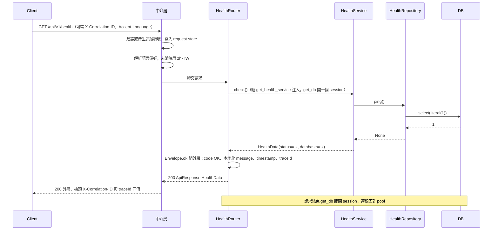
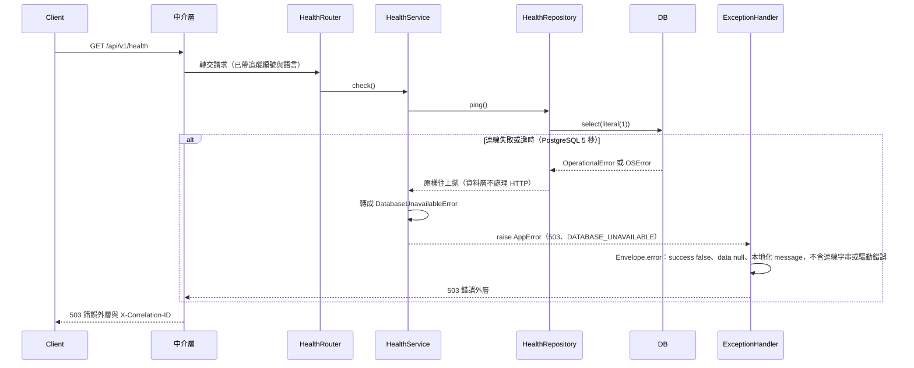
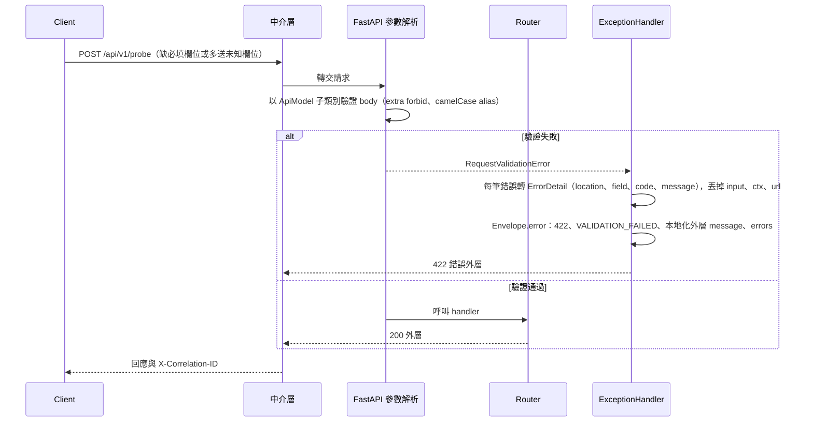
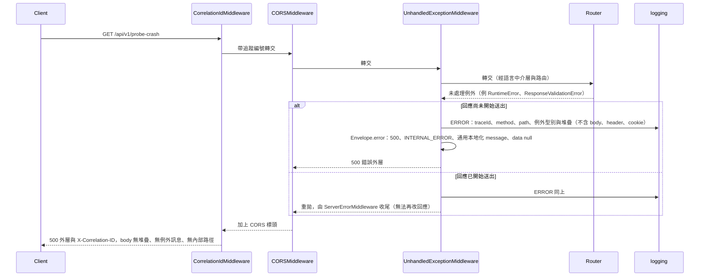
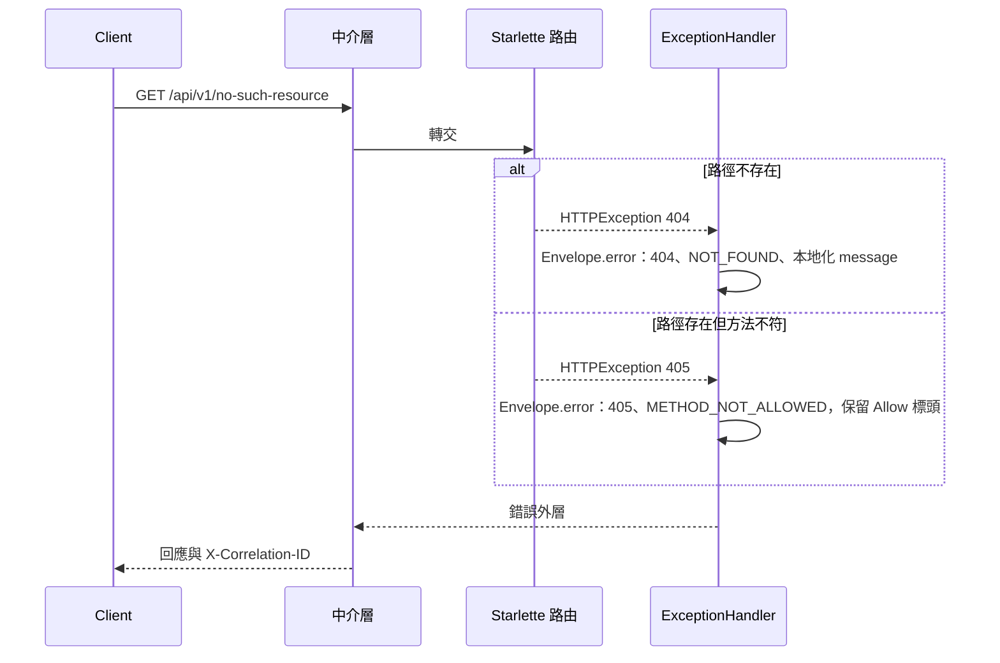
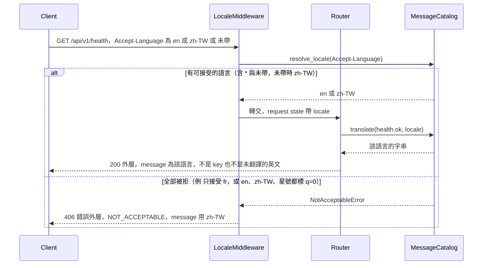
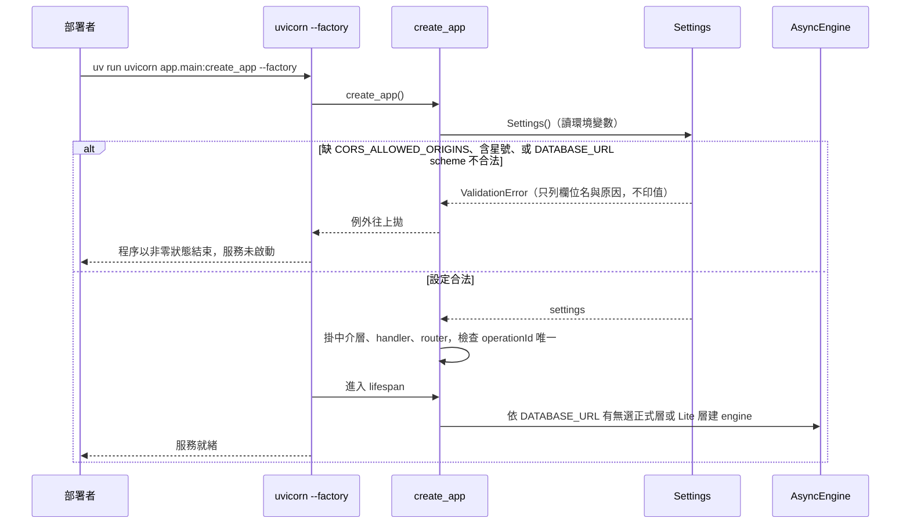
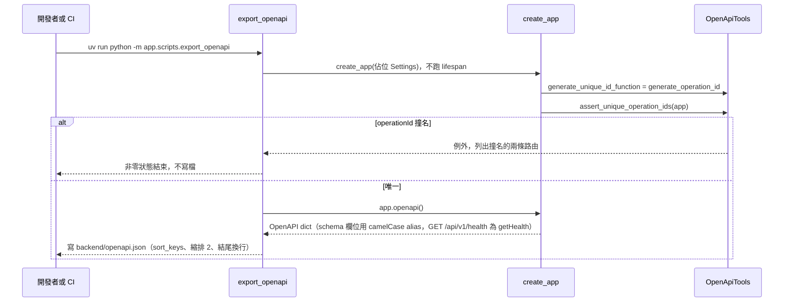
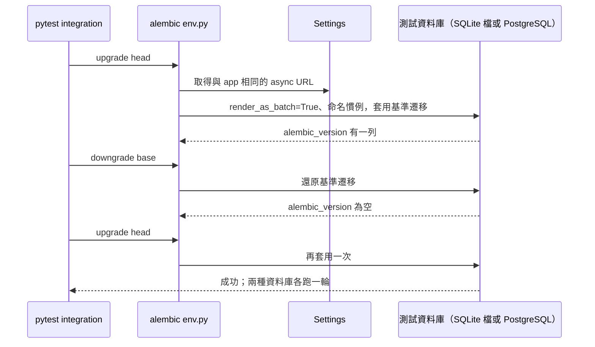

# System Design

本文把 `system-analysis.md` 的能力清單轉成 `backend/` 骨架的技術藍圖。本 change 沒有 `docs/specs/` 規格（spec-migration D4），設計依據追溯到 ADR 與規則條號。

三件已裁定的事照裁定寫、不列待決（維護者 2026-11-10，`architecture.mdx` §決策紀錄）：**模組內分層** `app/modules/<module>/`、成功回應**包一層 envelope**、路徑前綴 **`/api/v1`**。envelope 的六個欄位與 camelCase 依 #503（2026-11-20）。

system-analysis 的 16 條待決問題與 4 條需求矛盾**仍待 clarification 停點由維護者決定**。凡牽涉到的設計點，本文寫出建議的預設做法並標「待 clarification 待決 N」，不當成定案；對照表在 [§技術待決問題](#技術待決問題)。

## 分層與類別

### 目錄結構

```text
backend/
├─ pyproject.toml               uv 專案；依賴一律 uv add（Hard Rule 3）
├─ alembic.ini                  script_location、檔名模板
├─ alembic/
│  ├─ env.py                    async 執行；URL 與 app 共用同一個推導函式
│  ├─ script.py.mako
│  └─ versions/                 空的基準遷移（待 clarification 待決 13）
├─ openapi.json                 匯出的介面描述檔（位置見 §技術待決問題 新增 N2）
├─ app/
│  ├─ main.py                   create_app(settings) 組裝入口；uvicorn 以 --factory 啟動
│  ├─ core/                     全站共用，不屬任何業務模組
│  │  ├─ config.py              Settings（B10 的唯一設定入口）
│  │  ├─ db.py                  engine、sessionmaker、get_db、Base 與命名慣例
│  │  ├─ schemas.py             ApiModel、ApiResponse、ErrorResponse、ErrorDetail、PaginatedResponse、PaginationParams
│  │  ├─ envelope.py            成功與錯誤外層的組裝函式
│  │  ├─ errors.py              AppError 家族與 exception handler 註冊
│  │  ├─ middleware.py          CorrelationIdMiddleware、LocaleMiddleware、UnhandledExceptionMiddleware
│  │  ├─ i18n.py                Accept-Language 解析與訊息目錄（待 clarification 待決 2）
│  │  └─ openapi.py             generate_operation_id、唯一性檢查、匯出
│  ├─ i18n/
│  │  ├─ zh-TW/messages.json    外層 message 字串（architecture.mdx §i18n 兩層）
│  │  └─ en/messages.json
│  ├─ scripts/
│  │  └─ export_openapi.py      uv run python -m app.scripts.export_openapi
│  └─ modules/
│     └─ health/                第一個模組資料夾（待 clarification 待決 14）
│        ├─ router.py
│        ├─ service.py          含 get_health_service 依賴工廠
│        ├─ repository.py
│        └─ schemas.py
└─ tests/
   ├─ conftest.py               依 TEST_DATABASE_URL 選資料庫、對測試庫跑 alembic upgrade head
   ├─ unit/
   └─ integration/
```

- `app/core/` 放全站共用的基礎設施，B10 的適用路徑 `backend/app/core/config*` 即據此；業務邏輯一律在 `app/modules/<module>/`（ADR-003 D3）。
- **依賴工廠放在 service 模組**：`get_health_service(db)` 在 `service.py` 裡建構 `HealthRepository` 再注入 `HealthService`。這樣 `router.py` 只 import `service` 與 `schemas`，import 方向是 `router → service → repository`，#506 的分層 import 檢查（B1 檢查方式）可以照這個方向寫契約。之後每個模組照抄。
- `app.main` 不在模組頂層呼叫 `create_app()`：uvicorn 用 `uvicorn app.main:create_app --factory` 啟動，import 時不讀環境變數，測試與匯出指令才能自己傳入 `Settings`。

### 請求穿過的層（由外而內）

Starlette 的堆疊固定是 `ServerErrorMiddleware` → 使用者中介層 → `ExceptionMiddleware` → 路由。本次的使用者中介層依下列順序（第一個最外層）：

| 順序 | 元件                                              | 職責                                                                                                                              | 依據                                          |
| :--- | :------------------------------------------------ | :-------------------------------------------------------------------------------------------------------------------------------- | :-------------------------------------------- |
| 1    | `CorrelationIdMiddleware`（純 ASGI）              | 取得或產生追蹤編號，寫進 `scope["state"]` 與 contextvar，回應時加 `X-Correlation-ID` 標頭；放最外層，連 preflight 與 500 都帶得到 | A6、A7；待 clarification 待決 7               |
| 2    | `CORSMiddleware`                                  | 來源逐一列出，`expose_headers` 含 `X-Correlation-ID` 讓瀏覽器讀得到                                                               | Hard Rule 7、S2；待 clarification 待決 3      |
| —    | （01-01 登入插入：認證、CSRF）                    | 本次不實作，只留位置                                                                                                              | architecture.mdx §後端分層 九站               |
| 3    | `UnhandledExceptionMiddleware`（純 ASGI）         | 攔下未處理例外，回 `500` 外層、不露堆疊，寫一筆含追蹤編號的 log                                                                   | A7、07-01 §卡控機制；待 clarification 待決 16 |
| 4    | `LocaleMiddleware`（純 ASGI，只作用在 `/api/v1`） | 解析 `Accept-Language` 寫進 `scope["state"]`；全部被拒回 `406` 外層                                                               | A8；待 clarification 待決 2                   |
| —    | Starlette `ExceptionMiddleware`                   | 執行註冊的 handler：`AppError`、`RequestValidationError`、`HTTPException`（404、405）                                             | A7                                            |
| —    | 路由 → Router → Service → Repository              | 模組內分層                                                                                                                        | B1、ADR-003 D3                                |

未處理例外**不**交給 Starlette 的 `ServerErrorMiddleware` 處理，理由是它位在所有使用者中介層外面：由它產生的 `500` 不會再經過 CORS 與追蹤編號中介層，瀏覽器會看到 CORS 錯誤而讀不到外層，回應也沒有 `X-Correlation-ID`。所以本次自己的 `UnhandledExceptionMiddleware` 放在 CORS 內側，`ServerErrorMiddleware` 只剩最後保險。中介層一律寫成純 ASGI，不用 `BaseHTTPMiddleware`，避免 contextvar 在 task 之間斷掉與串流回應被緩衝。

### Class Diagram

```mermaid
classDiagram
  direction TB

  class HealthRouter {
    <<router>>
    +get_health(request: Request, service: HealthService) ApiResponse~HealthData~
  }
  class HealthService {
    <<service>>
    -repository: HealthRepository
    +check() HealthData
  }
  class get_health_service {
    <<dependency>>
    +get_health_service(db: AsyncSession) HealthService
  }
  class HealthRepository {
    <<repository>>
    -session: AsyncSession
    +ping() None
  }
  class HealthData {
    <<schema>>
    +status: str
    +database: str
  }

  class ApiModel {
    <<schema base>>
    +model_config: ConfigDict
  }
  class ApiResponse~T~ {
    <<schema>>
    +success: bool
    +code: str
    +message: str
    +data: Optional~T~
    +timestamp: datetime
    +trace_id: str
  }
  class ErrorResponse {
    <<schema>>
    +errors: Optional~list~ErrorDetail~~
  }
  class ErrorDetail {
    <<schema>>
    +location: str
    +field: str
    +code: str
    +message: str
  }
  class PaginatedResponse~T~ {
    <<schema>>
    +items: list~T~
    +total: int
    +limit: int
    +offset: int
    +has_more() bool
    +total_pages() int
    +next_offset() Optional~int~
  }
  class PaginationParams {
    <<schema query>>
    +limit: int
    +offset: int
  }

  class Envelope {
    <<module>>
    +ok(data: T, request: Request, message_key: str) ApiResponse~T~
    +error(status_code: int, code: str, message_key: str, request_state: State, errors: Optional~list~ErrorDetail~~) JSONResponse
  }
  class AppError {
    <<exception>>
    +status_code: int
    +code: str
    +message_key: str
    +params: dict
  }
  class NotFoundError {
    <<exception>>
  }
  class NotAcceptableError {
    <<exception>>
  }
  class DatabaseUnavailableError {
    <<exception>>
  }
  class ErrorHandlers {
    <<module>>
    +register_exception_handlers(app: FastAPI) None
    +handle_app_error(request: Request, exc: AppError) JSONResponse
    +handle_validation_error(request: Request, exc: RequestValidationError) JSONResponse
    +handle_http_exception(request: Request, exc: HTTPException) JSONResponse
  }
  class CorrelationIdMiddleware {
    <<middleware>>
    +__call__(scope: Scope, receive: Receive, send: Send) None
    -accept_or_generate(raw: Optional~str~) str
  }
  class LocaleMiddleware {
    <<middleware>>
    +__call__(scope: Scope, receive: Receive, send: Send) None
  }
  class UnhandledExceptionMiddleware {
    <<middleware>>
    +__call__(scope: Scope, receive: Receive, send: Send) None
  }
  class MessageCatalog {
    <<module>>
    +resolve_locale(accept_language: Optional~str~) str
    +translate(key: str, locale: str, params: dict) str
  }

  class Settings {
    <<config>>
    +database_url: Optional~str~
    +sqlite_path: Path
    +cors_allowed_origins: list~str~
    +cors_allow_credentials: bool
    +async_database_url() str
    +is_lite() bool
  }
  class Database {
    <<module>>
    +create_engine(settings: Settings) AsyncEngine
    +create_sessionmaker(engine: AsyncEngine) async_sessionmaker
    +get_db(request: Request) AsyncIterator~AsyncSession~
  }
  class Base {
    <<model>>
    +metadata: MetaData
  }
  class AppFactory {
    <<module>>
    +create_app(settings: Optional~Settings~) FastAPI
    -lifespan(app: FastAPI) AsyncIterator~None~
  }
  class OpenApiTools {
    <<module>>
    +generate_operation_id(route: APIRoute) str
    +assert_unique_operation_ids(app: FastAPI) None
    +export_openapi(app: FastAPI, output: Path) None
  }

  HealthRouter --> HealthService : Depends
  HealthRouter ..> get_health_service : Depends
  get_health_service ..> HealthRepository : 建構
  get_health_service ..> Database : get_db
  HealthService --> HealthRepository
  HealthService ..> DatabaseUnavailableError : raises
  HealthRepository ..> Base : 同一個 engine

  HealthRouter ..> Envelope : ok()
  HealthRouter ..> HealthData
  HealthData --|> ApiModel
  ApiResponse --|> ApiModel
  ErrorResponse --|> ApiResponse
  ErrorDetail --|> ApiModel
  PaginatedResponse --|> ApiModel
  PaginationParams --|> ApiModel

  NotFoundError --|> AppError
  NotAcceptableError --|> AppError
  DatabaseUnavailableError --|> AppError
  ErrorHandlers ..> Envelope : error()
  ErrorHandlers ..> AppError
  UnhandledExceptionMiddleware ..> Envelope : error()
  LocaleMiddleware ..> MessageCatalog
  LocaleMiddleware ..> NotAcceptableError
  Envelope ..> MessageCatalog

  AppFactory ..> Settings
  AppFactory ..> Database
  AppFactory ..> ErrorHandlers
  AppFactory ..> CorrelationIdMiddleware
  AppFactory ..> LocaleMiddleware
  AppFactory ..> UnhandledExceptionMiddleware
  AppFactory ..> OpenApiTools
  AppFactory ..> HealthRouter : include_router
  Database ..> Settings
```



本次沒有業務 Model；`Base` 只畫屬性 `metadata`（帶約束命名慣例），表間關聯以 ER 為準，本次不新增。

### 元件清單

| 元件                                                              | 層            | 職責                                                                                                                                                                                                       | 依據                                                                                       |
| :---------------------------------------------------------------- | :------------ | :--------------------------------------------------------------------------------------------------------------------------------------------------------------------------------------------------------- | :----------------------------------------------------------------------------------------- |
| `create_app(settings)`                                            | 組裝          | 建 `Settings`（沒傳入時從環境變數）、掛中介層與 handler、`include_router`、設 `generate_unique_id_function`、跑 operationId 唯一性檢查；lifespan 建立與釋放 engine。正式執行、測試 harness、匯出指令都走它 | T4「harness 與 production 共用同一個 app 組裝函式」、B10                                   |
| `Settings`                                                        | 設定          | Pydantic Settings，集中驗證；缺必要設定或格式不合法就拋 `ValidationError`，啟動失敗。錯誤訊息只列欄位名與原因，不印值                                                                                      | B10、S9；待 clarification 待決 1                                                           |
| `Database`（`create_engine`、`get_db`）                           | 資料存取基礎  | 依 `Settings` 推導 async URL、建 engine 與 sessionmaker；`get_db` 一個請求一個 `AsyncSession`，例外時 rollback，結束關閉；**不 commit**                                                                    | ADR-003 D7、B3、B4                                                                         |
| `Base`                                                            | Model 基底    | `DeclarativeBase`，`MetaData(naming_convention=...)` 讓約束名在兩種資料庫一致、batch 模式能找到約束                                                                                                        | B6、ADR-003 D7                                                                             |
| `ApiModel`                                                        | schema 基底   | `ConfigDict(alias_generator=to_camel, populate_by_name=True, from_attributes=True, extra="forbid")`，全專案一處設定                                                                                        | A2、#503 裁定 3                                                                            |
| `ApiResponse[T]`                                                  | schema        | 外層六欄 `success`、`code`、`message`、`data`、`timestamp`、`traceId`                                                                                                                                      | A1、ADR-003 D5、#503                                                                       |
| `ErrorResponse`、`ErrorDetail`                                    | schema        | 錯誤外層；`422` 另帶 `errors`                                                                                                                                                                              | A7                                                                                         |
| `PaginatedResponse[T]`、`PaginationParams`                        | schema        | 七個欄位，後三個用 `computed_field` 由前四個推導；`limit` 預設 20、`1..100`，`offset` 預設 0、`>= 0`                                                                                                       | A3                                                                                         |
| `Envelope.ok`／`Envelope.error`                                   | 回應組裝      | 填入 `timestamp`、`traceId`、依 locale 翻好的 `message`；Router 與 handler 共用，Service 不碰                                                                                                              | A1、A7、A8；architecture.mdx §後端分層「Service 不組 HTTP 回應、不自己讀 Accept-Language」 |
| `AppError` 家族                                                   | 例外          | Service 只丟領域例外（帶 `status_code`、`code`、`message_key`），不丟 `HTTPException`                                                                                                                      | B1「資料層不處理 HTTP」、A7                                                                |
| `register_exception_handlers`                                     | 錯誤處理      | `AppError`、`RequestValidationError`、`HTTPException` 轉成錯誤外層                                                                                                                                         | A7                                                                                         |
| 三個中介層                                                        | 橫切          | 見上一節的順序表                                                                                                                                                                                           | A6、A7、A8、S2                                                                             |
| `MessageCatalog`                                                  | i18n          | 解析 `Accept-Language`（q-value、`*`、`q=0`），fallback `zh-TW`，從 `app/i18n/<lang>/messages.json` 取字                                                                                                   | A8、architecture.mdx §i18n 兩層；待 clarification 待決 2                                   |
| `generate_operation_id`                                           | OpenAPI       | 從 method 與路徑算「動詞加資源」，不讀函式名                                                                                                                                                               | A1                                                                                         |
| `export_openapi`                                                  | OpenAPI       | 用固定的佔位 `Settings` 呼叫 `create_app`，不跑 lifespan、不連資料庫，輸出排序過的 JSON                                                                                                                    | A4、A5                                                                                     |
| `HealthRouter`／`HealthService`／`HealthRepository`／`HealthData` | 模組 `health` | 第一個模組，示範完整分層；`ping()` 用 `select(literal(1))`，不用 `text()`                                                                                                                                  | B1、B5；待 clarification 待決 10、11、14                                                   |

### 關鍵設計細節

**外層與 camelCase**（A1、A2、#503）

- Python 欄位 snake_case，JSON 由 `ApiModel` 的 alias generator 轉成 camelCase；FastAPI 預設 `response_model_by_alias=True`，OpenAPI schema 也用 alias，所以 #504 驗收第 6 項可直接掃 `openapi.json`。
- 泛型外層在 OpenAPI 的元件名預設是 `ApiResponse_HealthData_`，Orval 產出的型別名會很難讀。建議覆寫 `ApiResponse.model_parametrized_name`，讓 `ApiResponse[HealthData]` 的元件名成為 `HealthDataResponse`，`ApiResponse[PaginatedResponse[TaskItem]]` 成為 `TaskItemPageResponse`。實際命名由 `api-contract` 定（§技術待決問題 新增 N3）。
- `timestamp`：建議 ISO 8601、UTC、毫秒、`Z` 結尾（例 `2026-11-20T08:15:30.123Z`），在 `Envelope` 組裝時取 `datetime.now(UTC)`（待 clarification 待決 8）。
- `code`：建議成功固定 `OK`；錯誤碼 `UPPER_SNAKE_CASE`，通用碼不加前綴，模組專屬碼加模組前綴（例 `TASK_NAME_DUPLICATED`）。第一批通用碼：`VALIDATION_FAILED`（422）、`NOT_FOUND`（404）、`METHOD_NOT_ALLOWED`（405）、`NOT_ACCEPTABLE`（406）、`INTERNAL_ERROR`（500）、`DATABASE_UNAVAILABLE`（503）（待 clarification 待決 6）。

**422 的逐欄位錯誤**（A7）

- `RequestValidationError.errors()` 每一筆轉成 `ErrorDetail`：`location` 取 `loc[0]`（`body`、`query`、`path`、`header`），`field` 是其餘 `loc` 用 `.` 串起（Pydantic 的 `loc` 已是 alias，所以是呼叫端送出的 camelCase 名），`code` 取 Pydantic 的 `type`（例 `missing`、`extra_forbidden`），`message` 取 Pydantic 的 `msg`。
- **不帶 Pydantic 的 `input`、`ctx`、`url`**：`input` 會把呼叫端送來的原值回顯，之後的端點可能含密碼或答案內容。
- `errors` 內的 `message` 屬 A8 的明文例外，不本地化；外層的 `message` 仍依 locale 翻譯。

**追蹤編號**（建議預設，待 clarification 待決 7）

- 標頭 `X-Correlation-ID` 與外層 `traceId` 用同一個值。
- 呼叫端自帶的值只在符合 `^[A-Za-z0-9-]{8,64}$` 時沿用，其餘一律丟棄並產生 UUID4，不回 `400`（Hard Rule 9：外部輸入先驗證才進 log 與回應）。
- 值寫進 `scope["state"]["correlation_id"]` 與 contextvar，handler、log 都從這裡取。

**設定與啟動失敗**（建議預設，待 clarification 待決 1、3）

| 環境變數                 | 型別                   | 必要 | 驗證                                                                                              | 預設                    |
| :----------------------- | :--------------------- | :--- | :------------------------------------------------------------------------------------------------ | :---------------------- |
| `CORS_ALLOWED_ORIGINS`   | 逗號分隔的 origin 清單 | 是   | 每一項都要是 `http(s)://host[:port]`、不帶路徑；拒絕 `*`、空清單                                  | 無                      |
| `CORS_ALLOW_CREDENTIALS` | bool                   | 否   | —                                                                                                 | `true`（建議，待決 3）  |
| `DATABASE_URL`           | PostgreSQL URL         | 否   | 只接受 `postgresql` 系列 scheme；`postgresql://` 與 `postgresql+asyncpg://` 都正規化成 `+asyncpg` | 無（沒設就走 Lite）     |
| `SQLITE_PATH`            | 路徑                   | 否   | —                                                                                                 | `./data/label_suite.db` |

- `CORS_ALLOWED_ORIGINS` 是唯一的必要設定，這也讓 #504 驗收第 5 項有東西可驗；「clone 後不必設定就能跑」由 #506 的 `.env.example` 與 compose 預設值補上（需求矛盾 3）。
- 沒有 env 前綴，與 `architecture.mdx` 既有的 `DATABASE_URL`、`GOOGLE_CLIENT_ID` 一致。
- `CORSMiddleware` 的 `allow_methods` 明列 `GET, POST, PUT, PATCH, DELETE, OPTIONS`，`allow_headers` 明列 `Content-Type, Accept-Language, X-Correlation-ID`（01-01 再加 CSRF header），不用 `*`。

**資料庫與 session**（ADR-003 D7、B3、B4）

- engine 在 lifespan 建立、存在 `app.state`，關閉時 `dispose()`；不放模組頂層全域（B3 反例）。
- `get_db` 的形狀：`async with sessionmaker() as session`，例外時 `rollback` 後重拋，離開時關閉；**交易由 Service 擁有**，`get_db` 與 Repository 都不 commit（B4）。健康檢查唯讀，不 commit。
- Lite：`sqlite+aiosqlite:///<SQLITE_PATH>`，啟動時建立父目錄；在 sync engine 的 `connect` 事件設 `PRAGMA foreign_keys=ON`，讓之後的外鍵在 SQLite 也生效。
- 正式：`postgresql+asyncpg://...`，`connect_args={"timeout": 5}` 讓資料庫連不上時健康檢查在有限時間內回應。
- **API 與 worker 的 session 分離**：本次只有 API 的 async session。worker 的同步 URL 推導（去掉 `+aiosqlite`、`+asyncpg` 換 `+psycopg2`）與同步 sessionmaker 留給第一個 Celery change，不預先建（ADR-003 D8、B3）。

**operationId**（A1）

- `generate_operation_id(route)` 的規則：去掉 `/api/v1` 前綴，取最後一個非參數的路徑段當資源，轉成 PascalCase；動詞依 method 與回應形狀決定：
  - `GET` 且 `response_model` 是 `ApiResponse[PaginatedResponse[...]]` → `list` 加複數資源（`listTasks`）
  - 其他 `GET` → `get` 加單數資源（`getTask`、`getHealth`）
  - `POST` → `create`；`PUT`／`PATCH` → `update`；`DELETE` → `delete`，皆加單數資源
- 單複數轉換用 `app/core/openapi.py` 內的一條簡單規則加一張不規則字表，不另加套件。
- 用回應形狀而不是路徑判斷 `list` 與 `get`，是因為 `/health` 這類單例資源沒有路徑參數，光看路徑會被誤判成集合。
- `create_app` 在 `include_router` 之後跑 `assert_unique_operation_ids`，撞名就啟動失敗，unit 測試同時鎖住。撞名時要怎麼加父資源（A1 要求加在契約裡、但產生處仍只有這個函式）本次沒有實例，見 §技術待決問題 新增 N1。
- 本次唯一端點 `GET /api/v1/health` → `getHealth`。

**介面描述檔匯出**（A4、A5 前半段）

- `uv run python -m app.scripts.export_openapi [--output PATH]`，預設輸出 `backend/openapi.json`（待 clarification 新增 N2）。
- 用固定的佔位 `Settings`（例 `cors_allowed_origins=["http://localhost"]`）呼叫 `create_app`，不跑 lifespan、不連資料庫，所以不需要任何環境變數。
- 輸出 `sort_keys=True`、縮排 2、結尾換行，讓 #505 與 #506 的 drift 比對穩定。

**未處理例外的 log**（建議預設，待 clarification 待決 16）

- 用標準函式庫 `logging` 寫一筆 `ERROR`：`traceId`、method、path、例外型別與堆疊。
- 不記 request body、query、header、cookie（S9）；這不是可觀測性（ADR-008 D4 不做的是監控、指標與錯誤追蹤服務），只是讓部署者能用回應裡的 `traceId` 找到原因。

**測試**（ADR-007 D1、T1、T4、B7）

- 測試資料庫：有 `TEST_DATABASE_URL` 就用 PostgreSQL，沒有就用 `tmp_path` 下的 SQLite 檔（不用 `:memory:`，多連線會看到不同的庫）。兩種資料庫各跑一次 `uv run pytest`。
- 測試庫的 schema 一律 `alembic upgrade head` 建立，不用 `create_all`（B6）。
- integration 用 `httpx.AsyncClient(transport=ASGITransport(app))` 打 `create_app(test_settings)` 產生的 app，中介層與 handler 與正式環境相同（T4）。
- 驗證失敗與未處理例外需要一條會觸發它們的路由，而本次唯一的端點沒有輸入、也不會丟例外。建議在測試 fixture 對 `create_app()` 產生的 app 額外 `include_router` 一個只存在於 `tests/` 的探測 router（一條帶 body 的 `POST`、一條會丟 `RuntimeError` 的 `GET`）。這是在同一個組裝之上多加路由，不少任何中介層，不算 T4 禁止的「harness 比 production 寬鬆」。見 §技術待決問題 新增 N4。
- unit：`ApiModel` 的 camelCase 與 `extra="forbid"`、`PaginatedResponse` 的推導（含 `total=0`、`offset >= total`）、`generate_operation_id` 的對照表與撞名檢查、`Settings` 的驗證（缺 `CORS_ALLOWED_ORIGINS`、含 `*`、`DATABASE_URL` scheme 錯誤）、`resolve_locale` 的 q-value 規則、追蹤編號的接受與丟棄。
- integration：每個 [§關鍵情境](#關鍵情境) 至少一條；遷移的 `upgrade → downgrade → upgrade`；請求結束後 pool 的 checked-out 連線回到 0（B3 檢查方式）。

## 關鍵情境

本 change 的 `specs/` 尚未寫出（由 `planner` 在 clarification 之後產生）。下列情境名稱依 #504 §驗收條件 與 system-analysis §業務流程 擬定，**`planner` 寫 spec 的 `#### Scenario:` 時請沿用同一組名稱**，讓 Sequence Diagram 與 spec 對得上（`rules.system-design`）。

參與者到 Router 回傳回應為止。本次沒有認證依賴，`中介層` 代表上一節順序表的追蹤編號、CORS、未處理例外與語言四層。

### Scenario: 健康檢查回傳完整外層與追蹤編號



### Scenario: 資料庫無法連線時健康檢查回 503 外層

待 clarification 待決 11。建議預設：健康檢查實際 ping 資料庫，連不上回 `503`、`DATABASE_UNAVAILABLE`，不回 `200` 加降級欄位。



### Scenario: 請求驗證失敗回 422 外層與逐欄位錯誤

本次唯一的端點沒有輸入，這張圖以測試探測路由為例（§技術待決問題 新增 N4）；之後每個帶 body 的端點走同一條路。



### Scenario: 未處理例外回 500 外層且不露出堆疊



### Scenario: 不存在的路徑回 404 外層



### Scenario: 回應訊息依語言偏好本地化

待 clarification 待決 2。建議預設：本次就實作 A8 的解析規則與兩種語系的訊息目錄。



### Scenario: 缺必要設定時啟動失敗



### Scenario: 匯出的介面描述檔為小駝峰且操作識別名符合動詞加資源



### Scenario: 資料庫遷移在兩種資料庫上可升可降

待 clarification 待決 13。建議預設：建立一個不含任何操作的基準遷移。



本次沒有狀態轉換，不畫 `stateDiagram-v2`。

## 資料模型異動

本次無資料模型異動。#504 §不包含 明列「任何業務資料表」，system-analysis §共用的資料 也確認不建表，所以 `docs/diagrams/architecture/data-table-dictionary.mdx` 與 `database-schema.er.json` 都不動，不必跑 `pnpm check:er`。

以下是遷移的基礎設定，不屬資料模型異動，列出來是因為之後每個模組的遷移都會建在它上面：

| 項目              | 建議做法                                                                                                                                                                                                                              | 依據                                               |
| :---------------- | :------------------------------------------------------------------------------------------------------------------------------------------------------------------------------------------------------------------------------------ | :------------------------------------------------- |
| 約束命名慣例      | `ix: ix_%(column_0_label)s`、`uq: uq_%(table_name)s_%(column_0_name)s`、`ck: ck_%(table_name)s_%(constraint_name)s`、`fk: fk_%(table_name)s_%(column_0_name)s_%(referred_table_name)s`、`pk: pk_%(table_name)s`，設在 `Base.metadata` | B6；SQLite 的 batch 模式重建表時要靠約束名找到約束 |
| `render_as_batch` | `env.py` 一律設 `True`。在 PostgreSQL 上 batch 操作照常發出 `ALTER`，只有 SQLite 會重建表，所以兩種資料庫用同一份遷移檔                                                                                                               | ADR-003 D7                                         |
| 檔名模板          | `file_template = %%(year)d%%(month).2d%%(day).2d_%%(hour).2d%%(minute).2d_%%(rev)s_%%(slug)s`，依時間排序                                                                                                                             | #504 §包含                                         |
| `env.py` 的 URL   | 與 app 共用 `Settings.async_database_url()`，以 async engine 跑 `run_sync`；不另讀環境變數                                                                                                                                            | B10                                                |
| model 的收集      | `env.py` 用 `pkgutil` 掃 `app.modules.*.models` 自動 import，新模組不必改 `env.py`                                                                                                                                                    | B6                                                 |
| `compare_type`    | `True`，autogenerate 時偵測型別變更；產物仍要人工讀過，確認沒有非預期的 `DROP`（B6 正例）                                                                                                                                             | B6                                                 |
| 基準遷移          | 一個空的 revision，`upgrade` 與 `downgrade` 都不做事；**down 可完全還原**（只移除 `alembic_version` 那一列）。待 clarification 待決 13                                                                                                | B6、T4                                             |

SQLite 與 PostgreSQL 在本次碰得到的差異：

| 面向     | SQLite（Lite）                     | PostgreSQL（正式） | 本次處理                                                                      |
| :------- | :--------------------------------- | :----------------- | :---------------------------------------------------------------------------- |
| 驅動     | `aiosqlite`                        | `asyncpg`          | `Settings.async_database_url()` 一處推導                                      |
| 外鍵     | 預設不檢查                         | 預設檢查           | `connect` 事件設 `PRAGMA foreign_keys=ON`                                     |
| DDL 交易 | 多數 `ALTER` 不支援，要重建表      | 支援交易內 DDL     | `render_as_batch=True`                                                        |
| 連線失敗 | 幾乎不會（檔案），父目錄不存在才會 | 網路或服務停止     | 啟動時建父目錄；PostgreSQL 連線逾時 5 秒                                      |
| 並發寫入 | 單一寫入者                         | 多寫入者           | 本次沒有寫入；JSON／JSONB、日期與並發的雙庫測試由第一個建表的 change 補（B7） |

## 權限檢查點

本次**沒有任何受保護的能力**：沒有登入、沒有角色、沒有欄位遮蔽，所有呼叫端拿到的內容相同（system-analysis §涉及的角色）。PRD §權限矩陣 不適用，也沒有超出它的地方。

| 檢查點                                                | 本次                                                                                                         | 之後由誰接上                |
| :---------------------------------------------------- | :----------------------------------------------------------------------------------------------------------- | :-------------------------- |
| 認證 dependency（驗 httpOnly cookie 裡的 access JWT） | 不實作；中介層順序表留了位置                                                                                 | 規格 01-01 登入             |
| CSRF middleware                                       | 不實作；`allow_headers` 之後補 CSRF header                                                                   | 規格 01-01 登入             |
| 授權四步（architecture.mdx §授權四步）                | 不實作                                                                                                       | 第一個有受保護端點的 change |
| 欄位遮蔽                                              | 無；所有回應 schema 都明列欄位，不回 ORM 物件（A2）                                                          | 各模組的 Router             |
| `GET /api/v1/health`                                  | 公開，不需登入。認證上線後是否仍公開待 clarification 待決 12，建議維持公開並在 01-01 的 S10 矩陣標成刻意公開 | 規格 01-01 登入             |

骨架為之後的權限檢查先定好兩件事：

- **看不到的資源回 404**：`NotFoundError` 與路由不存在的 404 用同一個 `NOT_FOUND` 碼與同一句訊息，之後「刻意隱藏」與「真的不存在」從外層分不出來（A7）。
- **Service 不丟 `HTTPException`**：權限以外的業務卡控丟 `AppError`，由 handler 轉外層，資料層不處理 HTTP（B1）。

**測試集答案隔離**：本次不碰任務、資料集或答案，**無直接風險**。骨架是之後所有端點的出口，先在這一層擋住三條間接外洩路徑：

1. 未處理例外的 `500` 外層只放通用訊息，不含例外訊息、堆疊或內部路徑，例外的細節只進伺服器 log（A7、07-01 §卡控機制）。
2. `422` 的 `errors` 不帶 Pydantic 的 `input`，不回顯呼叫端送來的值。
3. 回應一律經明列欄位的 schema 序列化，沒有回 ORM 物件的路徑（A2、S4）。

## 技術待決問題

### system-analysis 待決問題與需求矛盾的處理

全部延續到 clarification，由維護者在那個停點決定；本文只寫建議預設。

| 待決           | 主題                       | 本文的建議預設                                                                                                            | 寫在                                                                   |
| :------------- | :------------------------- | :------------------------------------------------------------------------------------------------------------------------ | :--------------------------------------------------------------------- |
| 1（含矛盾 3）  | 必要設定                   | 只有 `CORS_ALLOWED_ORIGINS` 必要；免設定即可啟動由 #506 的 `.env.example` 與 compose 預設值補                             | §關鍵設計細節「設定與啟動失敗」                                        |
| 2（含矛盾 4）  | `message` 本地化           | 本次實作 A8：解析規則、`zh-TW` 與 `en` 兩份訊息目錄、`406`                                                                | `LocaleMiddleware`、`MessageCatalog`、情境「回應訊息依語言偏好本地化」 |
| 3              | CORS 帶憑證                | `allow_credentials=True`，origins、methods、headers 都明列                                                                | §關鍵設計細節「設定與啟動失敗」                                        |
| 4              | PostgreSQL 由誰提供        | 本次以本機 `docker run postgres:16` 加 `TEST_DATABASE_URL` 驗收，指令寫進 `acceptance.md`；#506 再換成 compose 與 CI 服務 | §關鍵設計細節「測試」                                                  |
| 5              | `pyproject.toml` 初始版號  | 建議 `0.0.0`，表示尚未 release；第一次 `chore(release)` 再與 `CITATION.cff` 對齊                                          | —                                                                      |
| 6              | `code` 規則                | 成功 `OK`；`UPPER_SNAKE_CASE`；通用碼無前綴、模組碼加模組前綴；第一批六個                                                 | §關鍵設計細節「外層與 camelCase」                                      |
| 7              | 追蹤編號                   | 標頭與 `traceId` 同值；自帶值符合格式才沿用，否則重新產生                                                                 | §關鍵設計細節「追蹤編號」                                              |
| 8              | `timestamp` 格式           | ISO 8601、UTC、毫秒、`Z`                                                                                                  | §關鍵設計細節「外層與 camelCase」                                      |
| 9              | 覆蓋率基準                 | 本次加 `pytest-cov` 產出報告，數字記在 `acceptance.md`；門檻與不得下降由 #506 建                                          | —                                                                      |
| 10（含矛盾 2） | 健康檢查的回應形狀         | 有明確的 `HealthData` 與 `response_model`，放進 `openapi.json`                                                            | `HealthData`、情境「健康檢查回傳完整外層與追蹤編號」                   |
| 11             | 健康檢查碰資料庫           | 實際 ping；連不上回 `503`、`DATABASE_UNAVAILABLE`                                                                         | 情境「資料庫無法連線時健康檢查回 503 外層」                            |
| 12             | 認證上線後健康檢查是否公開 | 維持公開，01-01 在 S10 矩陣標成刻意公開                                                                                   | §權限檢查點                                                            |
| 13             | 空的基準遷移               | 建立；`up`、`down` 都不做事，可完全還原                                                                                   | §資料模型異動、情境「資料庫遷移在兩種資料庫上可升可降」                |
| 14             | 健康檢查當第一個模組       | 放 `app/modules/health/`，走完整的 router、service、repository、schemas 四件，給 #506 的分層檢查當對象                    | §目錄結構                                                              |
| 15（含矛盾 1） | `ruff`、`mypy --strict`    | 本次建立設定並列進 `openspec/config.yaml`；import 方向、drift、覆蓋率門檻與 Semgrep 歸 #506                               | 見下方「`openspec/config.yaml` 要補的指令」                            |
| 16             | 未處理例外的 log           | 寫一筆含 `traceId` 的 `ERROR`，不記 body、header、cookie                                                                  | §關鍵設計細節「未處理例外的 log」                                      |

`openspec/config.yaml` 的 `operations.apply.guidance` 要補的後端指令（#504 驗收第 7 項；lint 與型別兩條取決於待決 15）：

- `cd backend && uv run pytest`（SQLite）
- `cd backend && TEST_DATABASE_URL=postgresql+asyncpg://... uv run pytest`（PostgreSQL）
- `cd backend && uv run ruff check . && uv run ruff format --check .`
- `cd backend && uv run mypy --strict app`
- `cd backend && uv run python -m app.scripts.export_openapi`（重產後 `git diff --exit-code backend/openapi.json`）

### 本文新發現的待決問題

| #   | 問題                                                                                                                                                                                                                   | 影響                                                                   | 建議                                                                                                                                                                                          |
| :-- | :--------------------------------------------------------------------------------------------------------------------------------------------------------------------------------------------------------------------- | :--------------------------------------------------------------------- | :-------------------------------------------------------------------------------------------------------------------------------------------------------------------------------------------- |
| N1  | operationId 撞名時，A1 要求「在 `api-contract.md` 把名字加上父資源」，但同時要求產生處只有 `generate_unique_id_function`、不得逐個覆寫。函式只看得到單一路由，不知道別的路由是否同名，契約裡寫的父資源要怎麼回到函式？ | 第一個巢狀資源出現時的命名機制；本次沒有實例，不卡本次                 | 本次只做「撞名就啟動失敗」；撞名的解法等第一次撞名的 change 再定，屆時候選是「巢狀路徑一律加父資源」或「在 `openapi.py` 維護一張集中的撞名表」，兩者都只有一個產生處                          |
| N2  | 匯出的 `openapi.json` 放哪裡、是否提交進 repo？                                                                                                                                                                        | #505 Orval 的輸入路徑；A5 要求契約、`openapi.json` 與產物同一個 commit | 放 `backend/openapi.json` 並提交；由 #505 確認 Orval 讀這個路徑                                                                                                                               |
| N3  | 泛型外層在 OpenAPI 的元件名（`ApiResponse_HealthData_` 對 `HealthDataResponse`）                                                                                                                                       | Orval 產出的 TypeScript 型別名；之後改名是對前端的破壞性變更           | 覆寫 `model_parametrized_name`，命名規則由 `api-contract` 定下                                                                                                                                |
| N4  | 驗證失敗與未處理例外的 integration 測試需要觸發它們的路由，本次唯一的端點兩者都觸發不了                                                                                                                                | #504 驗收第 3、4 項怎麼驗                                              | 只在 `tests/` 定義探測 router，掛在 `create_app()` 產生的同一個 app 上；不在正式程式留測試端點。這是在同一個組裝上多加路由、不少任何中介層，屬 T4 允許的方向，但仍請 clarification 確認可接受 |
| N5  | `ServerErrorMiddleware` 位在 CORS 外面，由它產生的 `500` 沒有 CORS 標頭；跨來源的前端只會看到 CORS 錯誤                                                                                                                | 未處理例外時前端能否顯示通用錯誤並附 `traceId`（A7）                   | 已在設計中以 CORS 內側的 `UnhandledExceptionMiddleware` 處理；回應已開始送出時無法補救，只能由 log 追查。列出來供 `code-reviewer` 與 #505 知悉，不需維護者決定                                |
| N6  | `/docs`、`/redoc`、`/openapi.json` 這三條 FastAPI 內建路由在正式部署是否關閉？它們不在 `/api/v1` 底下，也不套外層                                                                                                      | 正式環境是否公開 API 結構；不卡本次驗收                                | 本次維持 FastAPI 預設開啟；正式環境是否關閉交給 #506 的部署設定決定                                                                                                                           |

### 交易、session 與效能

- **交易邊界**：Service 擁有交易（B4）；`get_db` 只負責開關與例外時 rollback。本次健康檢查唯讀，沒有 commit。
- **session 生命週期**：API 一個請求一個 `AsyncSession`，由 `get_db` 依賴管理；worker 的同步 session 本次不建，留給第一個 Celery change，兩者不共用 engine（B3）。
- **效能**：健康檢查每次都打資料庫，若之後被負載平衡器高頻輪詢，PostgreSQL 連線池會被占用。本次不處理，等 #506 定下健康檢查的輪詢頻率時再評估是否拆出不碰資料庫的 liveness 端點。PostgreSQL 連不上時，請求最多等 5 秒（`connect_args` 逾時）。
