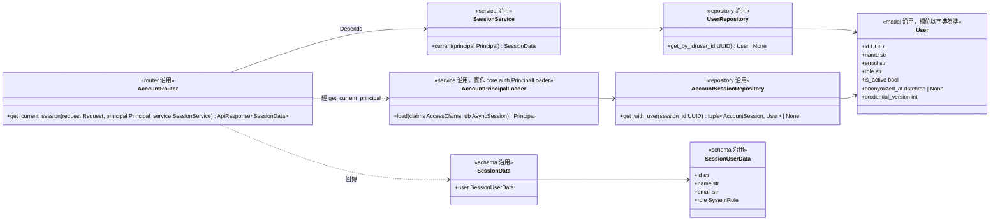
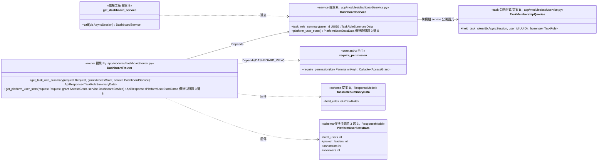
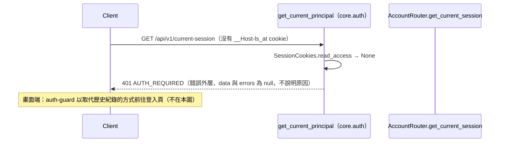
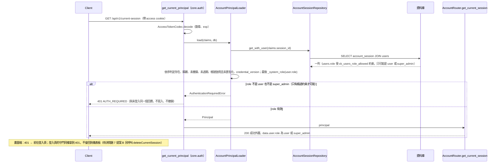
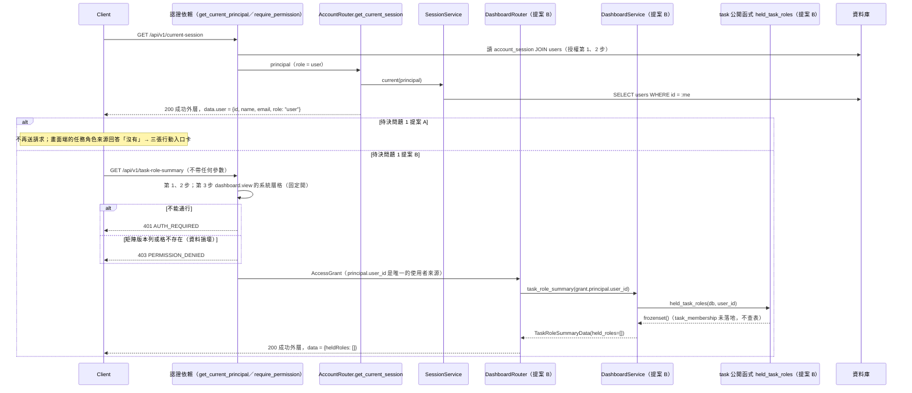
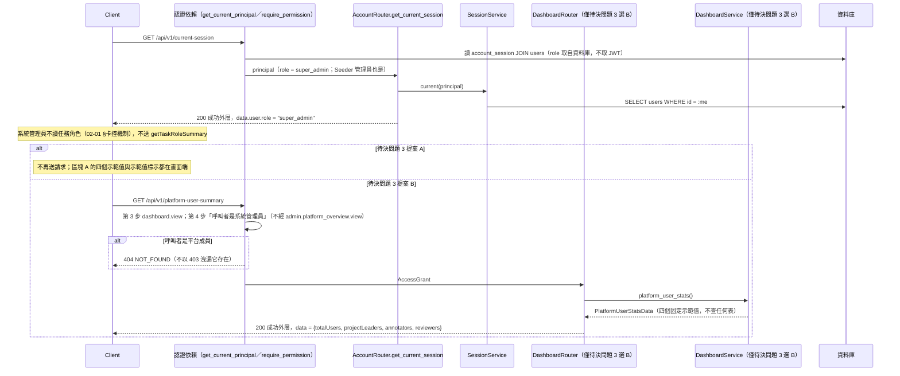
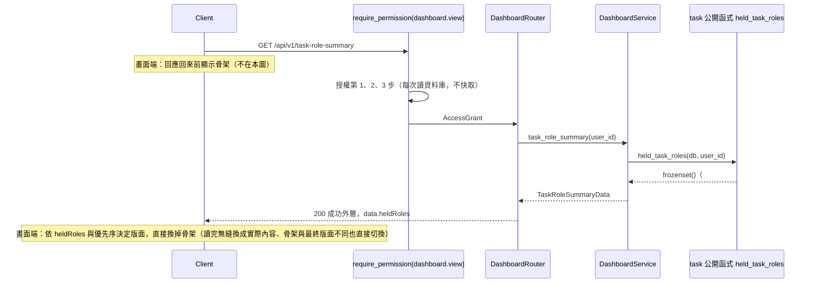
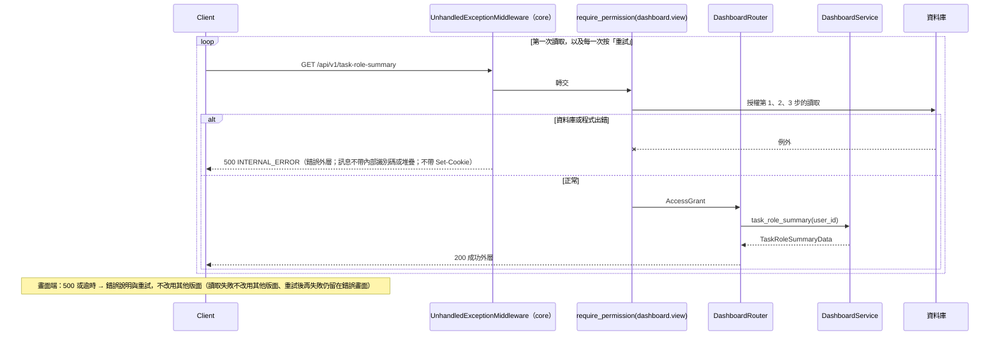
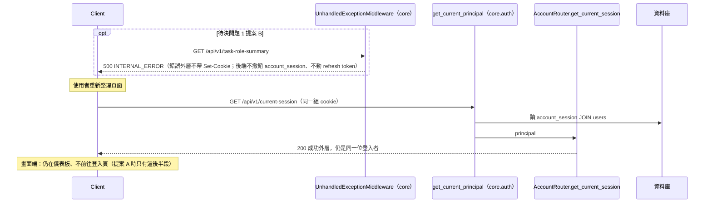

# System Design

本份是 change `dashboard-shell`（Issue #722）的後端系統設計，脈絡基準是同目錄的 `system-analysis.md`。分層（`app/modules/<module>/` 模組內分層）、成功回應包一層 envelope、路徑前綴 `/api/v1` 都照定案寫，不列為待決。

## 設計結論

**在最可能的答案之下（待決問題 1、3 都選 A），本次後端不新增、不修改任何端點、模組、資料表或 `app/core/` 基礎建設。** 儀表板外殼這一次要的伺服器資料只有一樣，而且已存在：

| 儀表板要的東西                                                         | 來源                                                                 | 現況                                                                                                                                                                             |
| :--------------------------------------------------------------------- | :------------------------------------------------------------------- | :------------------------------------------------------------------------------------------------------------------------------------------------------------------------------- |
| 登入者的系統角色（決定全平台版面或讀任務角色；未登入、角色無效時導向） | `getCurrentSession`（`GET /api/v1/current-session`，`account` 模組） | 已有；每次從資料庫讀當下的系統角色，角色不是 `user`／`super_admin` 時回 `401 AUTH_REQUIRED`（`openspec/specs/auth-guard` Requirement「每一次操作都用當下的帳號狀態與系統角色」） |

其餘都不需要後端：頁首、行動入口卡的文字、卡片的去處、示範值標示、窄螢幕與鍵盤都是畫面行為；擋下說明由 07-01 經 router 的 navigation state 帶過來（sidebar-nav clarification Q4），不經後端。

會讓後端出現工作的只有兩題，本份把它們寫成**提案**，各列替代方案與後果，由 clarification 拍板：

| 待決問題                      | 提案 A（建議）                                     | 提案 B                                                                              | 被排除的做法                                                                                         |
| :---------------------------- | :------------------------------------------------- | :---------------------------------------------------------------------------------- | :--------------------------------------------------------------------------------------------------- |
| 1 任務角色從哪裡讀            | 沿用前端單一任務角色來源的固定回答，不新增後端讀取 | 新增 `dashboard` 模組的一個讀取端點，經 `task` 的公開函式回答（本次一律為「沒有」） | 本次就建 `task_membership`：它的 FK 拖著 `task`、`dataset_version`、兩張版本表，等於做出 03-02 與 05 |
| 3 區塊 A 的四個示範值從哪裡來 | 畫面上的固定示範值，不經後端                       | 由後端回固定示範值                                                                  | 由後端算真實統計：違反 02-01 Q4（算法另案定義）；三張卡要讀 `task_membership`，它不存在              |

兩題都選 A 時，待決問題 8（系統管理員的載入狀態）自動消失；待決問題 7（角色無效時要不要結束登入狀態）三個提案都不需要後端改動，見 §待決問題 7 的提案。待決問題 2、4、5、6、9 只影響畫面、文案或移交，不影響本份。

### 待決問題 1 的提案：任務角色的來源

**為什麼本次在 `main` 上每個人都確實沒有任務角色**：任務與任務成員歸 `task` 模組（`backend-modules.mdx` §預定模組與資料表歸屬），`task` 模組還沒有程式，`task_membership` 也還是字典裡的候選表（`data-table-dictionary.mdx` §五，沒有「已落地」標記）。沒有任務就沒有成員資格，「沒有任務角色」是現況的真實狀態，不是假資料。這與 sidebar-nav 的 system-design §設計結論、clarification Q1 一致。

| 面向                             | 提案 A：沿用前端固定回答（建議）                                                                           | 提案 B：新增後端讀取，本次回答「沒有」                                                                                                                                                                                                                                                     |
| :------------------------------- | :--------------------------------------------------------------------------------------------------------- | :----------------------------------------------------------------------------------------------------------------------------------------------------------------------------------------------------------------------------------------------------------------------------------------- |
| 後端工作                         | 無                                                                                                         | 新 `dashboard` 模組（router、service，沒有 repository、沒有表）加一個端點；新 `task` 模組只有一個公開函式，沒有表時回空集合；`create_app` 掛 `dashboard` router、`OPENAPI_TAGS` 加 `dashboard`；`backend/pyproject.toml` 的 independence 契約加 `dashboard` → `task` 一條 `ignore_imports` |
| 和 `backend-modules.mdx` 的關係  | 不動                                                                                                       | 符合 §02-01 儀表板怎麼取資料（`dashboard` 沒有表、只呼叫 `task` 的 service）與 §預期的跨模組呼叫 第 5 列；要先改常駐文件（見 §常駐文件異動）                                                                                                                                               |
| 骨架與讀取失敗（Scenario 11–17） | 前端來源要從同步改成有「讀取中／失敗／完成」三態的形狀；正式環境立刻完成，等待與失敗只能用前端測試替身製造 | 有真的請求、真的等待；失敗仍要用測試替身或 E2E 攔截製造（`500` 不會自然發生）。兩個提案驗收時都靠替身製造失敗，差別在骨架是否在正式環境真的出現                                                                                                                                            |
| 和 #766 的關係                   | #766 接上讀取時只換前端那一支來源，側欄與儀表板同時改變（`app-shell-sidebar` 的單一來源）                  | 先替 #766 定下 path、operationId、權限鍵與「算哪些成員資格」（sidebar-nav clarification Q1 已把這幾件交給 #766：SD-2、SD-5）；#766 要嘛沿用、要嘛 **BREAKING** 改掉                                                                                                                        |
| 後端裡的固定回答                 | 無                                                                                                         | `task` 的公開函式在表不存在時回空集合，等於把「沒有」寫死在後端，直到 #766 換成查表                                                                                                                                                                                                        |
| 權限                             | 不涉及                                                                                                     | 見下方提案 B 的權限                                                                                                                                                                                                                                                                        |

**提案 B 的形狀**（只在 clarification 選 B 時才實作；正式的欄位與錯誤碼由 `api-contract.md` 寫）：

- 位置：`app/modules/dashboard/`；`task` 側只有 `app/modules/task/service.py` 的一個公開函式，沒有 router、不掛進 app（同 `admin` 目前的做法）
- 端點：`GET /api/v1/task-role-summary`，operationId 依 `generate_operation_id` 的規則算出 `getTaskRoleSummary`（最後一個非參數段 `task-role-summary`，動詞 `get`），與既有的 8 個 operationId（`getHealth` 與 `account` 的 7 個）不重複；路徑不插模組段 `dashboard`（api-agent-rules A1）
- 回應 `data`：`heldRoles`，任務角色名稱的陣列（`project_leader`／`reviewer`／`annotator` 的子集合，依矩陣欄序排列，沒有就是 `[]`）。**不帶任務 ID、任務名稱或筆數**——版面只需要「有沒有」，與 sidebar-nav 提案形狀、前端 `TaskRoleAnswer.heldRoles` 一致。規格 02-01 §資料欄位 把它寫成三個計數，但那一列「使用者看到」是「不直接顯示」，計數大於 0 與集合包含該角色對版面的決定等價；要回計數時改成 `projectLeaderTaskCount`、`reviewerTaskCount`、`annotatorTaskCount` 三個非負整數，由 `api-contract.md` 二選一
- 版面優先序（專案負責人 > 審核員 > 標記員）在前端以純函式決定，不在後端：它不是授權，只是版面（02-01 §使用角色「任務角色只決定版面」）
- 只讀呼叫者自己：使用者 ID 只取 `AccessGrant.principal.user_id`，不接受任何 path、query 或 body 參數
- 「算哪些成員資格」（只算 `active`？排除已封存任務？）在 `task_membership` 存在前沒有作用，由 #766 定；本次的函式簽章不預設答案

**提案 B 的權限**：掛 `require_permission(PermissionKey.DASHBOARD_VIEW)`（系統層、兩種系統角色的格固定開，`app/core/permissions.py`）。替代做法是只掛 `get_current_principal`（sidebar-nav 提案 SD-5 的寫法，方便側欄日後共用）；選後者時這個端點不經授權第 3 步，`endpoint-authorization.mdx` 要寫明「只認身分、只讀自己」。兩者都不超出 PRD §權限矩陣「02 儀表板」平台成員 `R (o)`、系統管理員 `R`。系統管理員呼叫也放行（回他自己的角色），只是畫面不呼叫（02-01 §卡控機制「系統管理員……不讀任務角色」）。

### 待決問題 3 的提案：區塊 A 的示範值

| 面向           | 提案 A：畫面上的固定示範值（建議）                                                                | 提案 B：後端回固定示範值                                                                                                                                                                                                 |
| :------------- | :------------------------------------------------------------------------------------------------ | :----------------------------------------------------------------------------------------------------------------------------------------------------------------------------------------------------------------------- |
| 後端工作       | 無                                                                                                | `dashboard` 模組多一個端點，回四個寫死的整數                                                                                                                                                                             |
| 權限           | 不涉及；區塊 A 只在系統管理員版面出現，版面由 `getCurrentSession` 的 `role` 決定，`role` 只供顯示 | 不得用「檢視全平台統計」（`admin.platform_overview.view`，`enabled=False`；02-01 §使用角色 末二條）。只能掛 `dashboard.view` 再加一個第 4 步條件「呼叫者是系統管理員」，平台成員回 `404`；這個條件目前沒有實作者，要新寫 |
| 待決問題 8     | 消失：沒有讀取就沒有載入與失敗                                                                    | 出現：系統管理員版面要有自己的載入與失敗狀態，規格沒定                                                                                                                                                                   |
| 換成真實統計時 | 前端換成讀取，後端屆時另開                                                                        | 換掉回應的值；但真實統計要 `dashboard` → `account` 一條跨模組呼叫（`backend-modules.mdx` §預期的跨模組呼叫「不算進 5 條」那一列），以及另案定義的算法                                                                    |
| 資訊量         | 示範值本來就寫在畫面，後端多一個端點不帶來任何真實資訊                                            | 同左，只是多一次請求                                                                                                                                                                                                     |

由後端算真實的 `總用戶` 看起來做得到（`users` 已落地），但 02-01 §系統管理員看到的四個區塊 末條註與 Q4 明定八張都是示範值、算法另案定義，`專案負責人`／`標記員`／`審核員` 三張又要讀不存在的 `task_membership`；要改成真實統計須先以 `spec-writing` 改規格，不在本次。

### 待決問題 7 的提案：角色無效時的登入狀態

**後端現況已擋住，三個提案都不改後端。** 系統角色無效在本平台的兩層都進不來：

1. **資料庫**：`users.role` 有 `CHECK (role IN ('user', 'super_admin'))`（Alembic revision `7bf0f909ce8f`，約束名 `ck_users_role_allowed`），SQLite 與 PostgreSQL 都強制，正常寫入存不進第三個值
2. **認證依賴**：即使資料庫被繞過，`AccountPrincipalLoader.load` 的 `_system_role` 對不在兩個值裡的角色丟 `AuthenticationRequiredError`，**每一個需要登入的請求**都回 `401 AUTH_REQUIRED`，與其他不能通行的原因同一個回應（`auth-guard` Requirement「不能通行時一律同一個回應」）

所以「角色無效」在後端看來就是「未登入」，畫面守門照 `auth-guard` 導向登入頁；登入頁的守門用的是同一個 `getCurrentSession`，也拿到 `401`，**不會**在儀表板與登入頁之間來回（system-analysis 待決問題 7 擔心的迴圈不成立）。

| 提案                                       | 做法                                                                                                                           | 後果                                                                                                                                                |
| :----------------------------------------- | :----------------------------------------------------------------------------------------------------------------------------- | :-------------------------------------------------------------------------------------------------------------------------------------------------- |
| A（建議）：只導向                          | 沿用現況，後端與 `auth-guard` 都不改                                                                                           | 登入狀態那一列不被撤銷，但每個請求都 `401`，等於不能用，依 7 天與 90 天上限自然過期；cookie 留在瀏覽器                                              |
| B：畫面導向前先呼叫 `deleteCurrentSession` | 既有端點（`DELETE /api/v1/current-session`，`204`，讀 refresh cookie、不需要 principal），清掉三個 cookie 並撤銷那一段登入狀態 | 後端不改；但會在 `account_session` 記一筆 `logged_out=True`，而這不是使用者自己登出（規格 01-05 §登出紀錄只記真正的登出）；`auth-guard` 要 MODIFIED |
| 被排除：認證依賴發現角色無效時直接撤銷     | 在 `AccountPrincipalLoader.load` 裡寫入                                                                                        | 違反 `PrincipalLoader` 只讀的契約（`app/core/auth.py`），而且讓 `GET` 有寫入                                                                        |

## 分層與類別

**提案 A 之下本次沒有新增或修改的後端類別。** 第一張圖只畫儀表板會碰到的既有類別，全部**沿用、無異動**；完整的 `account` 類別圖見 `docs/diagrams/architecture/backend-modules.mdx` §account。

下圖是**提案 B**（待決問題 1 選 B）才會新增的類別，本次在選定前不實作。區塊 A 的提案 B（待決問題 3）只在 `DashboardRouter`、`DashboardService` 各多一個方法，以虛線註記。`task` 側沒有 repository 與 model：`task_membership` 落地前公開函式回空集合，#766 落地時才加 repository 與 model（欄位以字典為準）。

- Router 只把 HTTP 轉成 service 呼叫並以 `ok(data, request)` 包 envelope；Router 不碰任何 repository
- `DashboardService` 沒有自己的表與 repository，只呼叫 `task` 的 service 公開函式（ADR-003 D12；`backend-modules.mdx` §02-01 儀表板怎麼取資料）
- 沒有寫入，所以沒有交易；service 不 commit

## 關鍵情境

下表把本次 24 條 Scenario 對到後端。只有與後端互動的 Scenario 畫 Sequence Diagram，其餘是畫面行為，沒有請求送到後端。

| Scenario                                                                                                                                                                                                                                                                                                                                                      | 後端                                                                                                               | 圖                              |
| :------------------------------------------------------------------------------------------------------------------------------------------------------------------------------------------------------------------------------------------------------------------------------------------------------------------------------------------------------------ | :----------------------------------------------------------------------------------------------------------------- | :------------------------------ |
| 未登入時導向登入頁                                                                                                                                                                                                                                                                                                                                            | `getCurrentSession` 回 `401`（沿用）                                                                               | 有                              |
| 角色無效時導向登入頁                                                                                                                                                                                                                                                                                                                                          | `getCurrentSession` 回 `401`（沿用；待決問題 7）                                                                   | 有                              |
| 沒有任務角色的人拿到行動入口                                                                                                                                                                                                                                                                                                                                  | `getCurrentSession` 回 `role: "user"`；提案 B 另有 `getTaskRoleSummary` 回 `heldRoles: []`                         | 有                              |
| 系統管理員的平台使用者統計                                                                                                                                                                                                                                                                                                                                    | `getCurrentSession` 回 `role: "super_admin"`，不讀任務角色；區塊 A 依待決問題 3                                    | 有                              |
| 讀取任務角色時顯示骨架                                                                                                                                                                                                                                                                                                                                        | 只有提案 B 有請求；提案 A 由前端來源的「讀取中」狀態製造                                                           | 有（提案 B）                    |
| 讀完無縫換成實際內容、骨架與最終版面不同也直接切換                                                                                                                                                                                                                                                                                                            | 同「讀取任務角色時顯示骨架」的成功分支；切換是畫面行為                                                             | 併入「讀取任務角色時顯示骨架」  |
| 讀取失敗顯示錯誤與重試、讀取失敗不改用其他版面                                                                                                                                                                                                                                                                                                                | 只有提案 B 有請求；`500` 錯誤外層                                                                                  | 有（提案 B）                    |
| 重試後再失敗仍留在錯誤畫面                                                                                                                                                                                                                                                                                                                                    | 重送同一個請求，仍是 `500`                                                                                         | 併入「讀取失敗顯示錯誤與重試」  |
| 讀取失敗不清掉登入狀態                                                                                                                                                                                                                                                                                                                                        | 錯誤回應不帶 `Set-Cookie`，登入狀態不變；重新整理後 `getCurrentSession` 仍 `200`                                   | 有（提案 B；提案 A 只有後半段） |
| 儀表板不出現標準答案（本次部分）                                                                                                                                                                                                                                                                                                                              | 本次碰到的回應只有自己的帳號欄位與（提案 B）角色名稱                                                               | 無，見 §權限檢查點              |
| 頁首在每一種版面都顯示（部分）、行動入口卡文案與步驟、行動入口卡切換語言、三張卡的按鈕都走到模組入口頁、頁面內容隨語言一起換（部分）、缺少翻譯時不中斷互動、示範值標示出現在每一種版面（部分）、窄螢幕指標卡排兩欄（部分）、側欄收合時長標籤仍可讀（部分）、任何寬度都不需左右滑動（部分）、鍵盤可以走完整頁（部分）、從儀表板行動入口卡進入不被擋下（07-01） | 無；畫面行為。介面語言改變時 API client 已送 `Accept-Language`，本次碰到的錯誤訊息由既有 `LocaleMiddleware` 在地化 | 無                              |

圖中的參與者到 Router 回傳回應為止；回應之後畫面怎麼導向、顯示什麼屬 `ui-design.md`，以 `Note` 標「畫面端」而不畫。

### Scenario: 未登入時導向登入頁

### Scenario: 角色無效時導向登入頁

### Scenario: 沒有任務角色的人拿到行動入口

### Scenario: 系統管理員的平台使用者統計

### Scenario: 讀取任務角色時顯示骨架

只在待決問題 1 選 B 時有後端互動；選 A 時骨架由前端任務角色來源的「讀取中」狀態製造，沒有請求。

### Scenario: 讀取失敗顯示錯誤與重試

只在待決問題 1 選 B 時有後端互動。逾時是用戶端的判斷，後端沒有對應的回應；伺服器錯誤是下圖的 `500`。

### Scenario: 讀取失敗不清掉登入狀態

## 常駐文件異動

本次無常駐文件異動（依待決問題 1、3 的提案 A）。

- `docs/diagrams/architecture/backend-modules.mdx`：提案 A 沒有新增或修改的模組、類別、主要流程或基礎建設。它已寫明 `dashboard` 模組未實作、沒有表、只呼叫 `task` 的 service，與本設計一致
- 若 clarification 選待決問題 1 或 3 的提案 B，`sd` 在 clarification 之後、specs 之前回修本份，並**先改** `backend-modules.mdx`：§模組一覽 加 `dashboard`（與只提供公開函式的 `task`）一列、§預定模組與資料表歸屬 的 `dashboard`／`task` 兩列改現況、新增 `dashboard` 一節（分層表、Class 圖、主要 Sequence 圖）、§已知限制 註明 `task` 公開函式在 `task_membership` 落地前回空集合、§決策紀錄 加一列；`api-contract.md` 同步改 `error-codes.mdx` 與 `endpoint-authorization.mdx`
- `docs/diagrams/architecture/error-codes.mdx`、`endpoint-authorization.mdx`：提案 A 沒有新端點、新錯誤碼，也沒有改動既有端點的角色或遮蔽（屬 `api-contract.md` 的範圍，這裡先註明）

## 資料模型異動

本次無資料模型異動。所有未被排除的提案都不建表、不加欄位、不需要 Alembic migration：提案 A 不碰後端；提案 B 的 `dashboard` 沒有表，`task` 的公開函式在 `task_membership` 落地前不查表。`data-table-dictionary.mdx` 與 `database-schema.er.json` 不改；`task_membership` 的建立屬 #766（03-03 成員管理）。

字典已把 02-01 讀的推導值記為「不進表」（§五 `task` 組不進表的推導值：任務角色摘要、完成率、審核覆蓋率），本次不改這個判斷。

## 權限檢查點

| 檢查點                 | 層                                                                      | 判定                                                                                                                                                                                                  | 本次                                                                                                  |
| :--------------------- | :---------------------------------------------------------------------- | :---------------------------------------------------------------------------------------------------------------------------------------------------------------------------------------------------- | :---------------------------------------------------------------------------------------------------- |
| 是否登入、帳號狀態     | `get_current_principal`（`app/core/auth.py`，授權第 1 步）              | 只認 `__Host-ls_at` cookie；不能通行一律 `401 AUTH_REQUIRED`                                                                                                                                          | 沿用；儀表板所有後端讀取都經過它                                                                      |
| 系統角色               | `AccountPrincipalLoader` 每次讀資料庫（第 2 步）；`users.role` 的 CHECK | 角色不是 `user`／`super_admin` → `401`（角色無效時導向登入頁）；全平台版面或讀任務角色依 `getCurrentSession` 的 `role` 決定，`role` 只供顯示、不是授權                                                | 沿用                                                                                                  |
| 進得了儀表板           | 畫面守門                                                                | 只看系統角色；「檢視儀表板」兩種系統角色固定開，畫面不讀矩陣                                                                                                                                          | 提案 A 沒有儀表板專屬端點，因此沒有後端的門；任務資料落地後，各端點自己的 `require_permission` 才是門 |
| 任務角色讀取（提案 B） | `require_permission(DASHBOARD_VIEW)`（第 3 步，系統層）                 | 兩種系統角色的格固定開；格或版本列不存在 → `403 PERMISSION_DENIED`；不接受使用者 ID 參數，只讀 `principal.user_id` 自己的成員資格，不涉及第 2b 步（不是任務範圍的操作）                               | 僅提案 B；替代為只掛 `get_current_principal`                                                          |
| 區塊 A（提案 B）       | `require_permission(DASHBOARD_VIEW)` 加第 4 步「呼叫者是系統管理員」    | 平台成員 → `404`；**不經**待啟用的 `admin.platform_overview.view`（02-01 §使用角色；06-02 §五個已登錄、待啟用的鍵 第 10 條）                                                                          | 僅待決問題 3 選 B                                                                                     |
| 欄位遮蔽               | `SessionUserData` 的 allowlist；提案 B 的 `TaskRoleSummaryData`         | `getCurrentSession` 只回自己的 `id`、`name`、`email`、`role`，密碼雜湊、Google 連結、憑證版本、Seeder 標記、登入狀態識別碼不在任何 schema；提案 B 只回角色名稱，不回任務 ID、任務名稱、筆數或他人資料 | 沒有依角色遮蔽的欄位：每個回應都只有呼叫者自己的資料，平台成員與系統管理員拿到同一組欄位              |
| 測試集答案隔離         | 回應 schema 的 allowlist                                                | 本次碰到的回應只有登入者自己的帳號欄位，以及（提案 B）角色名稱的集合或固定示範值；**沒有任何任務、資料集、項目、標準答案或測試集辨識資訊**，標記員從角色名稱推不出哪些項目是測試集                    | 無風險。任務列與任務摘要（02-01 §這一頁看不到標準答案 第 4 條）屬 #733、#736，屆時由那兩張的設計證明  |

權限沒有超出 PRD §權限矩陣：「02 儀表板」平台成員 `R (o)`、系統管理員 `R`；本次只讀，沒有 C／E／D，平台成員只讀自己的身分（與提案 B 的自己的任務角色）。依任務角色那張表沒有「02 儀表板」這一列，本設計也沒有把任務角色當成任何一格權限：它只決定版面，在前端決定（Hard Rule 5：版面與卡片不依任務類型或輸出類型分支）。

## 技術待決問題

| 項目                           | 說明                                                                                                                                                                                                                                                                                                                                  |
| :----------------------------- | :------------------------------------------------------------------------------------------------------------------------------------------------------------------------------------------------------------------------------------------------------------------------------------------------------------------------------------ |
| 交易邊界                       | 本次沒有寫入；提案 B 也只讀，service 不 commit（backend-agent-rules B4）。待決問題 7 的提案 B 用的 `deleteCurrentSession` 由既有 `SessionService.logout` 擁有 commit                                                                                                                                                                  |
| session 生命週期               | 只用 API 的 async session（`get_db`）；沒有 worker，不涉及 worker 的 sync session                                                                                                                                                                                                                                                     |
| 效能                           | 提案 A：儀表板沿用守門那一次 `getCurrentSession`（主鍵 JOIN），不多送請求。提案 B：每次進儀表板多一次請求，授權第 3 步讀一次矩陣（不快取，ADR-004 D6），公開函式不查表；#766 落地後是一次 `task_membership` 依 `user_id` 的查詢，要有 `user_id` 開頭的索引（屬 #766 的字典與 migration）                                              |
| 提案 B 的 `401` 算不算讀取失敗 | 規格的讀取失敗是「伺服器錯誤或逾時」；`401` 表示登入狀態真的不能用，應走既有的 session 換發與守門路徑，而不是儀表板的錯誤畫面。由 `api-contract.md` 與 `ui-design.md` 寫明                                                                                                                                                            |
| 雙資料庫差異                   | 本次沒有 migration。`ck_users_role_allowed` 在 SQLite 與 PostgreSQL 都由 Alembic 建立且都強制，角色無效時導向登入頁在兩種資料庫行為相同；整合測試要製造無效角色時，只能在 SQLite 以 `PRAGMA ignore_check_constraints` 或在 PostgreSQL 暫時停用約束，或改在 unit 層以假的 loader 驗 `_system_role`——建議後者，兩種資料庫都不必繞過約束 |
| 既有程式的觀察（不在本次路徑） | `create_session_refresh` 先由 `SessionService.refresh` commit 輪替，router 再呼叫 `session_data(issued.user)` 檢查角色；角色無效時輪替已 commit 卻回 `401`、新 token 沒送出。因為 `ck_users_role_allowed` 擋住無效角色，正常資料下到不了；本次不呼叫也不修改這條路徑，只記錄，不另開 issue                                            |
