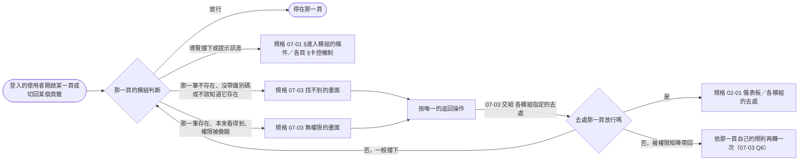

# System Analysis

## 需求依據

依 `openspec/config.yaml` 的需求依據順序：角色、權限上限與模組劃分以 PRD 為準；本頁的業務規則以規格 07-03 為準；其餘依 PRD 其餘內容 ＞ `docs/` 其他文件 ＞ `openspec/`。

| 來源                                                                           | 章節／編號                                                                                                                    | 摘要（一句）                                                                                                                             |
| :----------------------------------------------------------------------------- | :---------------------------------------------------------------------------------------------------------------------------- | :--------------------------------------------------------------------------------------------------------------------------------------- |
| Issue #721                                                                     | §使用情境／功能範圍、§驗收條件；留言「Ready gate：畫面已核可」（維護者 2026-11-27）                                           | 本單只做「無權限與找不到兩種畫面，以及導回儀表板的出口」；範圍內 07-03 的 Scenario 全部通過；畫面已過 Ready gate                         |
| Epic #713                                                                      | §一句話、§子 issue                                                                                                            | 共用介面外殼；本單排在 #720（側欄）之後、#722（儀表板外殼）之前                                                                          |
| `docs/specs/00-prd.mdx`                                                        | §使用者角色 §角色清單（Seeder 管理員「權限同系統管理員」）                                                                    | 三種會看到這兩種畫面的系統角色；沒有「訪客」                                                                                             |
| `docs/specs/00-prd.mdx`                                                        | §使用者角色 §權限矩陣「07 共用介面」列與表下第 3 條                                                                           | 平台成員與系統管理員都是 `R/E (o)`，`E (o)` 只作用在自己的偏好；這兩種畫面只用到 `R`                                                     |
| `docs/specs/00-prd.mdx`                                                        | §Site Map 第 229 行「無權限與找不到（所有登入的使用者）」                                                                     | 07-03 不是獨立頁面，所有登入的使用者都可能看到                                                                                           |
| `docs/specs/00-prd.mdx`                                                        | §模組架構與串接 §跨模組流程「06 修改角色權限 → 03、04、05 依新的權限顯示與擋下操作」                                          | 權限被撤銷的來源在 06，擋下的地方在 03、04、05                                                                                           |
| 規格 07-03                                                                     | 全頁（§目標、§使用角色、§業務流程、§規格 四節、§卡控機制、§邊界情況、§驗收標準 11 條、§待釐清（0 題）、§已確認決議 Q1～Q6）   | 已定案；定義兩種整頁畫面的分工、組成、返回操作規則，不定「何時顯示」與「去處」                                                           |
| 規格 07-03                                                                     | §規格 › 兩種畫面的分工 第 1～5 條；§已確認決議 Q2                                                                             | 找不到＝那一筆不存在或沒帶識別碼；無權限＝存在、本來看得到、權限被撤銷；本來就不該知道它存在 → 找不到                                    |
| 規格 07-03                                                                     | §規格 › 畫面的組成 第 1～6 條與兩則註；§已確認決議 Q3                                                                         | 標題、說明、唯一一個寫出去處的返回操作；字面與頁首、麵包屑由各模組定                                                                     |
| 規格 07-03                                                                     | §規格 › 返回操作的去處 第 1～3 條；§已確認決議 Q4、Q6                                                                         | 去處由各模組的規格指定，必須是使用者一定進得去的落點                                                                                     |
| 規格 07-03                                                                     | §規格 › 不在本頁範圍 第 1～5 條；§已確認決議 Q5                                                                               | 提示訊息擋下、導覽擋下、空狀態、載入失敗、何時顯示、識別碼格式都不在本頁                                                                 |
| 規格 07-03                                                                     | §規格 › 資料欄位「那一筆的識別碼」                                                                                            | 只來自網址、不寫入資料庫、只顯示識別碼本身                                                                                               |
| 規格 07-03                                                                     | 頁首「參考畫面」；§已確認決議 Q1                                                                                              | 沒有獨立 prototype；畫面以 `task-detail.html`（`notFoundTitle`／`forbiddenTitle`）與 `annotation-list.html`（`notFoundTitle`）的狀態為準 |
| `docs/specs/07-shared/index.mdx`                                               | §Logic Flow 分段四第 3 條（`D7 否 → P3`）、分段五（P3 → D9 → X11／P3）、「沒畫的進入」                                        | 本模組裡把人送到這兩種畫面的只有工作頁籤；其他入口歸各模組                                                                               |
| 規格 07-01                                                                     | §目前位置 第 1 條；§進入模組的條件 第 3 條；§業務流程「從側欄進入模組」E2 與結果                                              | 每頁恰一個目前位置；導覽擋下回儀表板並顯示說明，不是這兩種畫面                                                                           |
| 規格 07-02                                                                     | §規格 › 權限或資料失效 第 1～4 條；§業務流程「切換頁籤」E1                                                                    | 切回時沒有權限 → 無權限，任務被刪 → 找不到，不自動關閉、不自動恢復                                                                       |
| 規格 03-03                                                                     | §規格 › 誰進得來、誰看得到哪些分頁 第 4 條；§共用任務標頭 第 8 條（07-03 引用）                                               | 目前唯一定義「權限被撤銷 → 無權限面板、回任務列表」的頁面                                                                                |
| 規格 04-01                                                                     | §路由上下文與回退 第 6、7 條（07-03、07-shared §Logic Flow 引用）                                                             | 標記清單沒帶任務／任務查不到 → 回儀表板的找不到                                                                                          |
| 規格 07-04                                                                     | §邊界情況（07-shared §Logic Flow 缺口一引用）                                                                                 | 點通知進去之後的畫面由 07-03 定義                                                                                                        |
| `docs/specs/glossary.mdx`                                                      | `term.platform-member`、`term.system-admin`、`term.seeder-admin`、`term.task-role`、`term.task`                               | 角色與「那一筆」的用語                                                                                                                   |
| `openspec/specs/auth-guard`                                                    | Requirement「根路徑與不存在的路徑依登入狀態導向」（來源註「規格 07-03（之後以找不到頁取代）」）、「未登入的訪客被帶回登入頁」 | 未知路徑目前一律導向 `/` 再依登入狀態導向                                                                                                |
| `openspec/specs/frontend-routing`                                              | Requirement「開發頁只在開發模式註冊且不經過守門」「每頁設定瀏覽器標題」                                                       | 未知路徑兩種建置都依登入狀態導向；每個有畫面的頁要有瀏覽器標題                                                                           |
| `openspec/specs/app-shell-sidebar`                                             | Requirement「每頁只有一個目前位置」「導覽項依系統角色顯示」                                                                   | 每個登入後頁面恰對到一個導覽項                                                                                                           |
| `openspec/specs/permission-authorization`                                      | Requirement「任務範圍的操作要有生效中的任務成員身分」「授權要過資源條件」「授權拒絕的回應不外露內部資訊」                     | 後端已分出「拒絕（無權限）」與「看不到就當不存在（找不到）」兩種回應                                                                     |
| `openspec/specs/user-management`                                               | Requirement「沒有權限的訪客導向可用的頁面」                                                                                   | 06-01 的平台成員被導向儀表板，不顯示這兩種畫面                                                                                           |
| `openspec/changes/archive/2026-11-27-sidebar-nav/clarification.md`             | Q2、Q4                                                                                                                        | 落點頁不存在時沿用導回暫時落點、不新增「建置中」頁；擋下說明顯示在落點頁頂端                                                             |
| `openspec/changes/archive/*login-auth-guard*/clarification.md`                 | Q16 U7                                                                                                                        | 未知路徑導向 `/`，「07-03 完成時取代」                                                                                                   |
| `docs/diagrams/architecture/frontend-routes.mdx`                               | §路由「其他路徑」列、側欄導覽項說明                                                                                           | 「其他路徑」寫「規格 07-03 的找不到頁完成時取代這一條」；側欄導覽項連到最終路徑、未註冊時經 `/` 回暫時落點                               |
| `docs/development/rules/frontend-agent-rules.mdx`                              | F8（每個資料區塊四種狀態，`403` 顯示無權限說明、不給重試）                                                                    | 區塊層的無權限狀態，和 07-03 的整頁畫面是兩件事                                                                                          |
| `docs/development/rules/security-agent-rules.mdx`                              | 對照表「`403` vs `404`：對無權限者隱藏存在時偏好 `404`」（沿用）                                                              | 與 07-03 Q2 同向                                                                                                                         |
| `docs/development/adr/003-backend-architecture.mdx`                            | D14（任務成員歸 `task` 模組）                                                                                                 | 任務與任務成員資料尚不存在，由 03 的單提供                                                                                               |
| `design/system/components/state-panel.md`、`design/system/design-gaps.md` G-48 | §結構；G-48 狀態（#423）                                                                                                      | 現有「取代區塊」的狀態元件只定義成功／錯誤兩種；標記清單沒帶任務時標題已改為「尚未選擇任務」                                             |

## 範圍

本頁的業務是「兩種畫面長什麼樣、返回操作要守哪些規則」；**什麼時候顯示由各模組定**（07-03 §不在本頁範圍 第 4 條），而目前 `main` 上沒有任何一頁會定址到「那一筆」。所以下面把 07-03 的 11 條 Scenario 分成兩類：畫面本身的規則（本單）與需要某個模組真的擋下使用者才驗得到的觸發（接手單）。這個切法是暫定的，見待決問題 1。

### 這次包含

- 兩種整頁畫面（找不到、無權限）的共同骨架：標題、說明、唯一一個寫出去處的返回操作；沒有送出、儲存、重試（07-03 §畫面的組成 第 1～6 條）
- 找不到的兩種說明：帶識別碼與「未指定」（07-03 §找不到的畫面 第 1、2 條）；無權限的說明要讓人知道可以找誰（§無權限的畫面 第 1 條）
- 兩種畫面取代內容區，不在空白清單或空白詳情上加一行字（§找不到的畫面 第 3 條、§無權限的畫面 第 2 條）
- 識別碼只顯示本身、過長或帶奇怪字元時仍讀得懂，不顯示那一筆的任何內容（§資料欄位、§邊界情況「識別碼」）
- 「本來就不該知道它存在」與「兩種條件同時成立」都落到找不到（§兩種畫面的分工 第 3 條、§已確認決議 Q2）——本單只到「拒絕的種類決定顯示哪一種畫面」這一層
- 返回儀表板的出口（Issue #721 指定）；三種系統角色看到同一套結構
- 兩種畫面在中英文都有字面；外觀與側欄照 #720 的外殼

### 這次不包含

| 項目                                                                | 依據                                                                                                | 接手                               |
| :------------------------------------------------------------------ | :-------------------------------------------------------------------------------------------------- | :--------------------------------- |
| 任務詳情的「權限被撤銷 → 無權限面板、回任務列表」與找不到的實際觸發 | 規格 03-03 §誰進得來 第 4 條、§共用任務標頭 第 8 條                                                 | #763                               |
| 標記清單沒帶任務／任務查不到的實際觸發與「回儀表板」                | 規格 04-01 §路由上下文與回退 第 6、7 條                                                             | #773                               |
| 頁籤切回時權限或資料已失效 → 兩種畫面、不自動關閉、不自動恢復       | 規格 07-02 §權限或資料失效 第 1～4 條；07-03 §無權限的畫面 第 3 條、§邊界情況「和工作頁籤一起出現」 | #725                               |
| 被權限矩陣帶回的那一頁也擋下他時再轉一次                            | 07-03 §返回操作的去處 第 3 條例外、§已確認決議 Q6；規格 03-01 §誰看得到哪些任務                     | #730                               |
| 點通知進去之後顯示這兩種畫面                                        | 規格 07-04 §邊界情況                                                                                | #740                               |
| 用提示訊息擋下、導覽擋下、空狀態、載入失敗                          | 07-03 §不在本頁範圍 第 1～3 條、§已確認決議 Q5                                                      | 各頁自己的單                       |
| 識別碼的長度、允許字元與格式                                        | 07-03 §不在本頁範圍 第 5 條                                                                         | 擁有那一筆的模組（任務編號：#763） |
| 各模組的字面、頁首與麵包屑要不要留                                  | 07-03 §畫面的組成 兩則註                                                                            | 各模組的單                         |
| 改 `docs/specs/`、`docs/specs/00-prd.mdx`、`design/prototype/`      | AGENTS.md §What `/sdd` authorizes；Issue #721 §需求目標                                             | —                                  |

### 驗收標準的範圍盤點（規模檢查）

07-03 §驗收標準 共 11 條，暫定 9 條在本單、2 條移交；遠低於 75 條，不需要拆單。

| #   | Scenario                               | 本單         | 說明                                                                               |
| :-- | :------------------------------------- | :----------- | :--------------------------------------------------------------------------------- |
| 1   | 正向：那一筆不存在時顯示找不到         | 是（畫面層） | 識別碼帶進說明、返回操作寫出去處；用真正的任務驗在 #763／#773                      |
| 2   | 正向：權限被撤銷時顯示無權限           | 是（畫面層） | 說明提到可以找誰；真正的撤銷情境在 #763                                            |
| 3   | 反向：不得用空白內容代替找不到         | 是（畫面層） | 畫面取代內容區                                                                     |
| 4   | 反向：兩種畫面不得互換                 | 是（判斷層） | 「拒絕」與「找不到」兩種回應各自對到一種畫面                                       |
| 5   | 邊界：網址沒帶識別碼                   | 是           | 「未指定」那一種說明                                                               |
| 6   | 反向：本來就不該知道它存在時顯示找不到 | 是（判斷層） | 後端已把這種情況回成找不到（`permission-authorization`），本單只要不把它畫成無權限 |
| 7   | 邊界：兩種條件同時成立                 | 是（判斷層） | 同上                                                                               |
| 8   | 邊界：識別碼很長或帶著奇怪的字元       | 是           | 只顯示識別碼本身、讀得懂、不被當成內容解讀                                         |
| 9   | 邊界：返回之後仍被擋下                 | 否           | 本單的去處是儀表板，登入者一定進得去，觸發不了；交 #763（回任務列表的那一種）      |
| 10  | 邊界：被權限矩陣帶回的那一頁也擋下他   | 否           | 例子是 03-01 的再轉一次，交 #730                                                   |
| 11  | 權限：每一種角色都看得到同一套結構     | 是           | 平台成員、系統管理員、Seeder 管理員                                                |

「畫面層」「判斷層」的 Scenario 在本單要有可觸發的入口才驗得到，入口是什麼見待決問題 1、2。

## 業務流程

不適用：依規格 07-03 §業務流程（「這一頁不是一段操作流程……什麼時候顯示哪一種由各模組自己的規格決定」）。

這兩種畫面的進入與返回分散在多份規格，所以補一張串接圖，只展開交界處；模組之間的交接以 PRD §跨模組流程（06 修改角色權限 → 03、04、05 擋下）為準，與 07-shared §Logic Flow 分段四、分段五一致。

| 規格       | 業務流程                      | 本次涉及                                      |
| :--------- | :---------------------------- | :-------------------------------------------- |
| 規格 07-03 | §業務流程（不適用）           | 畫面內容與返回操作                            |
| 規格 07-02 | §業務流程「切換頁籤」E1       | 不涉及（#725），只標出交界                    |
| 規格 03-03 | §業務流程（進入任務詳情）     | 不涉及（#763），只標出交界                    |
| 規格 04-01 | §業務流程（進到標記清單）     | 不涉及（#773），只標出交界                    |
| 規格 07-01 | §業務流程「從側欄進入模組」E2 | 不涉及；導覽擋下不是這兩種畫面                |
| 規格 02-01 | §業務流程                     | 返回儀表板的落點（目前是暫時落點，#722 取代） |

- `M` 是各模組的判斷（03-03、04-01、07-02 的頁籤切回、07-04 的通知點擊），本單不實作任何一個
- 本單的返回去處是儀表板；儀表板對每個登入者都放行，所以 `R 否` 兩條在本單不會發生（Scenario 9、10 移交的理由）

## 跨模組依賴

### 需要先存在的

| 依賴                                                                   | 狀態                             | 對本單的影響                                                                                   |
| :--------------------------------------------------------------------- | :------------------------------- | :--------------------------------------------------------------------------------------------- |
| 登入後外殼與側欄（#720，`app-shell-sidebar`、`appearance-mode`）       | 已合併                           | 兩種畫面畫在外殼的內容區；外殼要求每頁恰一個目前位置（見待決問題 4）                           |
| 登入守門（#719，`auth-guard`）                                         | 已合併                           | 07-03 只給登入後的使用者；未登入開未知路徑仍回登入頁                                           |
| 授權的「拒絕」與「找不到」兩種回應（#755，`permission-authorization`） | 已合併                           | 後端已把「不是成員」「看不到」回成找不到、矩陣格關回成拒絕；目前只有系統管理的帳號讀取會回拒絕 |
| 儀表板（02-01，#722）                                                  | **不存在**；同一路徑上是暫時落點 | 「回儀表板」實際回到的是暫時落點（見待決問題 3）                                               |
| 任何會定址到「那一筆」的頁面（任務詳情、標記清單）                     | **不存在**（#763、#773）         | 本單範圍內的 Scenario 沒有真實觸發點（見待決問題 1）                                           |

### 會被後續功能依賴的

- #763 任務詳情、#773 標記清單、#725 工作頁籤、#740 通知、#730 任務列表：都會沿用本單的兩種畫面骨架，各自給字面、去處與觸發條件
- #722 儀表板外殼：blocked-by 本單；儀表板取代暫時落點後，「回儀表板」的落點自然換成真正的儀表板

### 共用的資料

- 不讀寫任何業務資料；唯一的資料是網址帶來的識別碼，只在這次瀏覽存在、不寫入資料庫（07-03 §資料欄位）
- 使用者偏好（語言、外觀、側欄收合）沿用 #720，屬 PRD §權限矩陣「07 共用介面」的 `E (o)`

### 角色與權限

| 角色          | 看得到這兩種畫面      | 返回操作 | 會被遮蔽的資料                                                                               |
| :------------ | :-------------------- | :------- | :------------------------------------------------------------------------------------------- |
| 平台成員      | 是（R）               | 有，一個 | 那一筆的任何內容；只顯示識別碼本身                                                           |
| 系統管理員    | 是（R）               | 有，一個 | 同上；系統管理員沒有隱含任何任務角色（`permission-authorization`），看不到的任務一樣是找不到 |
| Seeder 管理員 | 是（R，同系統管理員） | 有，一個 | 同上                                                                                         |
| 未登入的訪客  | 否；先被帶回登入頁    | —        | —                                                                                            |

任務角色不影響看不看得到，只影響出現哪一種（07-03 §使用角色）。兩種畫面都沒有任何 C／E／D 動作。

### 兩條硬規則的交界

- Hard Rule 6（測試集答案不外露）：畫面只顯示識別碼本身，不顯示那一筆的任何內容；後端讀標準答案的操作一律回找不到，不讓畫面透露那裡有答案
- Hard Rule 9（輸入驗證）：識別碼來自網址、是使用者可控的輸入，顯示時只能當文字，07-03 §邊界情況「識別碼過長或含奇怪字元」對應這一條
- Hard Rule 5（任務設定驅動）：不適用，兩種畫面不依任務類型分支

## 需求矛盾

1. **未知路徑該不該換成找不到，三處說法不一。** `auth-guard`「根路徑與不存在的路徑依登入狀態導向」的來源註、login-auth-guard clarification Q16 U7 與 `frontend-routes.mdx`「其他路徑」列都寫「07-03 的找不到頁完成時取代這一條」；但規格 07-03 §兩種畫面的分工 第 1 條定義的找不到是「網址帶的識別碼查不到，或網址根本沒帶識別碼」，講的是「那一筆」，沒有涵蓋「這個網址根本不是一個頁面」；而 sidebar-nav clarification Q2 決定「落點頁還不存在時沿用現行的導回暫時落點」，`frontend-routes.mdx` 也寫側欄導覽項連到最終路徑、未註冊時經 `/` 回暫時落點。若把未知路徑換成找不到，側欄上任務管理、個人設定、系統管理等還沒做的項目點下去都會變成找不到。→ 待決問題 2
2. **返回去處：07-03 不定全站去處，Issue #721 卻指定儀表板。** 07-03 §返回操作的去處 第 1 條與 Q4 明定「去處由各模組自己的規格指定，本頁不統一指定」；Issue #721 寫「導回儀表板的出口」。在模組頁都還不存在時，「回儀表板」只能是不屬於任何模組的通用去處，沒有一份規格指定它。→ 待決問題 3
3. **通用畫面的目前位置與外殼規則。** `app-shell-sidebar`「每頁只有一個目前位置」要求每個登入後頁面恰對到一個導覽項；07-03 的畫面是「既有頁面裡的狀態」，跟著所在頁面的導覽項走，但不屬於任何模組的通用找不到（若矛盾 1 決定要做）沒有所屬導覽項。→ 待決問題 4
4. **（範圍外，只記錄）** 07-03 §找不到的畫面 的「現況」註說 `annotation-list.html` 沒帶任務時用的是 `notFoundTitle`，但 `design-gaps.md` G-48（#423）已把那種情況的標題改成「尚未選擇任務」，與 07-03 §找不到的畫面 第 2 條「網址沒帶識別碼時顯示找不到的畫面」字面上有落差。該頁屬 04-01，交 #773 處理；本單不受影響。

## 待決問題

| #   | 問題                                                                                                                                                                                                                                                                                                                                                                                                                                                                                                                                                                                                                                                                                                                                                                                                                       | 影響                                                                                                                                                                                                                                                                                   | 狀態 |
| :-- | :------------------------------------------------------------------------------------------------------------------------------------------------------------------------------------------------------------------------------------------------------------------------------------------------------------------------------------------------------------------------------------------------------------------------------------------------------------------------------------------------------------------------------------------------------------------------------------------------------------------------------------------------------------------------------------------------------------------------------------------------------------------------------------------------------------------------- | :------------------------------------------------------------------------------------------------------------------------------------------------------------------------------------------------------------------------------------------------------------------------------------- | :--- |
| 1   | 本單範圍內的 9 條 Scenario 要從哪裡觸發、怎麼驗收？目前沒有任何頁面會定址到「那一筆」（任務詳情 #763、標記清單 #773 都不存在），前端也沒有任何頁面處理後端的拒絕回應；後端目前唯一會回「拒絕」的是系統管理的帳號讀取，而 06-01 對平台成員的規則是導向儀表板、不是無權限畫面。選項：A 本單只做兩種畫面的共用骨架，在元件層級（含元件展示頁）驗 9 條，觸發與端到端驗收交給 #763／#773／#725；B 另加一條不屬於任何模組的通用入口（例如未知路徑，見問題 2）讓找不到可端到端驗收，無權限仍只在元件層驗；C 本單延到第一個真實觸發頁（#763）一起做。（來源：Issue #721 §驗收條件；規格 07-03 §不在本頁範圍 第 4 條；`user-management`「沒有權限的訪客導向可用的頁面」；`permission-authorization`；衝突點：驗收條件要求 Scenario 全部通過，但沒有可觸發它們的頁面）                                                               | 決定 `acceptance.md` 能不能用 E2E 驗、§範圍 的 9 條是否要再移交；牽動 sd 的元件與判斷層切法、ui-ux 的畫面清單與元件展示頁、planner 的 specs 與 tasks（是否有 E2E 任務），以及 #763／#773 要不要回頭補驗                                                                                | 待決 |
| 2   | 沒有註冊的網址（登入後）要不要改顯示找不到？選項：A 維持現狀，未知路徑仍經 `/` 回暫時落點，找不到只用在「那一筆」；B 未知路徑改顯示找不到，側欄上還沒做的導覽項改成各自先註冊一條暫時的導回（不新增畫面），維持 sidebar-nav Q2 的行為；C 未知路徑改顯示找不到，接受側欄上還沒做的導覽項暫時落到找不到。三案下未登入的人開未知路徑都仍回登入頁（07-03 §使用角色「未登入的訪客」）。（來源：`auth-guard`「根路徑與不存在的路徑依登入狀態導向」來源註、login-auth-guard clarification Q16 U7、`frontend-routes.mdx` §路由「其他路徑」與側欄說明、sidebar-nav clarification Q2、規格 07-03 §兩種畫面的分工 第 1 條；衝突點：三處預告由 07-03 取代未知路徑，07-03 本身只定義「那一筆」，而 #720 的導覽依賴未知路徑回暫時落點）                                                                                                  | B、C 要改 `auth-guard` 與 `frontend-routing`（MODIFIED）並回改 `frontend-routes.mdx` 的「其他路徑」列；C 還會讓 #720 已驗收的「導覽項連到最終路徑」行為變成找不到；牽動 sd、ui-ux（多一個通用找不到的畫面與字面）、planner（delta 範圍）；A 則要把三處「之後取代」的預告改成「不取代」 | 待決 |
| 3   | 「回儀表板」作為返回去處的依據是什麼、字面誰定？07-03 Q4 不指定全站去處、字面由各模組決定（§畫面的組成 第一則註），但本單的通用畫面不屬於任何模組，Issue #721 指定回儀表板；而儀表板目前是暫時落點（卡片寫「你已登入」，#722 才換成真正的儀表板）。維護者 2026-11-27 核可的畫面 artifact 沒有存在 repo 或 issue 裡，ui-ux 對不到核可的字面。選項：A 以 Issue #721 與核可的 artifact 為依據，請維護者提供或確認 artifact 的字面，由 ui-ux 抄進 `ui-design.md`；B 用 `spec-writing` 在 07-03 補一條「不屬於任何模組的通用畫面去處是儀表板」與通用字面；C 本單不定通用去處與字面，只做讓各模組傳入去處與字面的骨架。（來源：規格 07-03 §返回操作的去處 第 1 條、§已確認決議 Q4、§畫面的組成 第一則註；Issue #721 §使用情境與第 1 則留言；衝突點：Issue 指定去處與字面來源，規格明定不由本頁統一，核可的畫面不在可讀取的位置） | 決定 ui-ux 的字面與畫面以什麼為準、design-reviewer 能不能核對 artifact；B 會牽動 `docs/specs/07-shared/03-denied-and-not-found.mdx`（需維護者走 `spec-writing`）；C 會讓 Scenario 1、2、11 的「標出去處的返回操作」在本單只能以測試用去處驗                                            | 待決 |
| 4   | 不屬於任何模組的通用找不到（若問題 2 選 B 或 C）在側欄上哪一個導覽項是目前位置？選項：A 不標任何目前位置，並以 MODIFIED 放寬 `app-shell-sidebar`「每頁只有一個目前位置」對這一頁的要求；B 標成「儀表板」，因為返回去處是儀表板；C 沿用使用者上一頁的目前位置。（來源：`app-shell-sidebar`「每頁只有一個目前位置」；規格 07-01 §目前位置 第 1 條；`frontend-routes.mdx`「缺宣告時測試失敗」；衝突點：規格與契約要求每頁恰一個目前位置，通用頁沒有所屬模組）                                                                                                                                                                                                                                                                                                                                                                 | 只在問題 2 選 B、C 時成立；A 要出 `app-shell-sidebar` 的 delta；牽動 sd 的路由宣告、ui-ux 的側欄狀態、planner 的 specs                                                                                                                                                                 | 待決 |
| 5   | 前端收到後端的「拒絕」與「找不到」時，要不要由共用層統一轉成這兩種整頁畫面？07-03 §不在本頁範圍 第 4 條說何時顯示由各模組決定；`frontend-agent-rules` F8 要求每個資料區塊自己處理無權限（`403`）狀態、不給重試，那是區塊層、不是整頁。選項：A 本單只提供畫面，轉換規則由各模組在自己的單決定；B 本單同時定一條共用的轉換規則（拒絕 → 無權限、找不到 → 找不到），各模組只決定要不要用整頁；C 交給 #763 第一個使用者時再定。（來源：規格 07-03 §不在本頁範圍 第 4 條、§已確認決議 Q2；`frontend-agent-rules` F8；`permission-authorization`「授權要過資源條件」；衝突點：Scenario 4、6、7 屬判斷層，本單要不要擁有那一層沒有依據）                                                                                                                                                                                           | 決定 Scenario 4、6、7 是留在本單還是移交 #763；牽動 sd 的分層（共用轉換放哪裡）、planner 的 specs 與 tasks                                                                                                                                                                             | 待決 |

## 參考檔案

- `docs/specs/07-shared/03-denied-and-not-found.mdx`
- `docs/specs/07-shared/index.mdx`
- `docs/specs/07-shared/01-sidebar.mdx`（§目前位置、§進入模組的條件）
- `docs/specs/07-shared/02-workspace-tabs.mdx`（§權限或資料失效）
- `docs/specs/00-prd.mdx`（§使用者角色、§權限矩陣、§Site Map、§跨模組流程）
- `docs/specs/glossary.mdx`
- `design/prototype/pages/task-management/task-detail.html`（`notFoundTitle`、`forbiddenTitle` 兩組鍵與 `#taskNotFound`、`#taskForbidden`，唯讀）
- `design/prototype/pages/annotation/annotation-list.html`（`notFoundTitle`、`notFoundNoTaskMessage`，唯讀）
- `design/system/components/state-panel.md`、`design/system/design-gaps.md` G-48
- `openspec/specs/auth-guard/spec.md`、`openspec/specs/frontend-routing/spec.md`、`openspec/specs/app-shell-sidebar/spec.md`、`openspec/specs/appearance-mode/spec.md`、`openspec/specs/permission-authorization/spec.md`、`openspec/specs/user-management/spec.md`
- `openspec/changes/archive/2026-11-27-sidebar-nav/clarification.md`（Q2、Q4）
- `openspec/changes/archive/` 下 login-auth-guard 的 `clarification.md`（Q16 U7）
- `frontend/src/app/router.tsx`（`*` 路由）
- `docs/diagrams/architecture/frontend-routes.mdx`（§路由「其他路徑」）
- `docs/development/rules/frontend-agent-rules.mdx`（F8）、`docs/development/rules/security-agent-rules.mdx`（`403` vs `404` 對照）
- `docs/development/adr/003-backend-architecture.mdx`（D14）
- Issue #721、Epic #713、#722、#763、#773、#725、#730、#740
