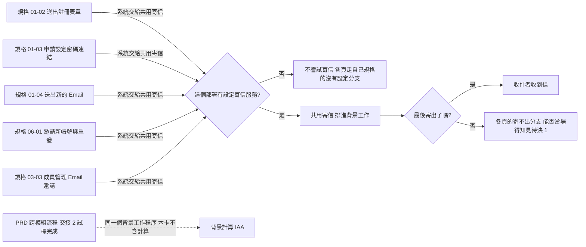
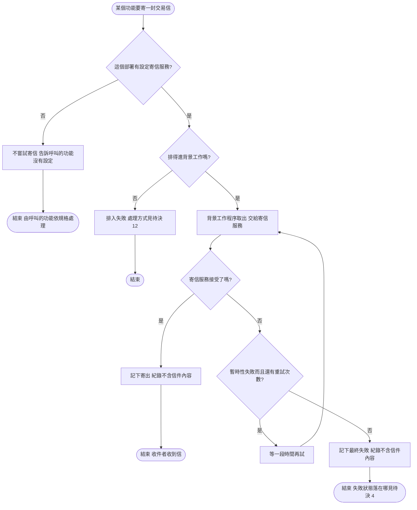

# System Analysis

本 change 是 issue #756「共用：寄信服務與背景工作」：平台第一個背景工作程序與它的佇列，加上一個所有功能共用的「寄一封交易信」能力。它是 `AGENTS.md` Size gate「Shared infrastructure first」拆出來的共用基礎建設卡，**沒有對應的規格頁驗收列**；依 spec-migration D4，需求追溯到 ADR 與規則文件的條號，規格頁只用來確認「有設定／沒有設定寄信服務」對使用者的意義。

> 文中「背景工作服務」指 ADR-003 D8 選定的 Celery 加 Redis，「寄信服務」指 ADR-008 D3 選定的 Resend；「寄信金鑰」指部署者設定的寄信服務金鑰（`architecture.mdx` §部署與維運「寄信」列）。

## 需求依據

依 `openspec/config.yaml` 的需求依據順序：角色與範圍以 PRD 為準；其餘以維護者指定的 issue、ADR 與規則文件為準；規格頁只作消費端行為的參照。

| 來源                                             | 章節／編號                                                                                                                                                                                                                                                                                                                                                                      | 摘要（一句）                                                                                                                                                                 |
| :----------------------------------------------- | :------------------------------------------------------------------------------------------------------------------------------------------------------------------------------------------------------------------------------------------------------------------------------------------------------------------------------------------------------------------------------ | :--------------------------------------------------------------------------------------------------------------------------------------------------------------------------- |
| issue #756                                       | §使用情境、§驗收條件 1–4                                                                                                                                                                                                                                                                                                                                                        | 建立背景工作程序與佇列、經寄信服務寄交易信的共用函式；沒設寄信金鑰時依既有行為處理；寄信排進背景工作、失敗可重試、不把信件內容寫進 log；本機與 CI 都能起，兩種資料庫層都能跑 |
| issue #753                                       | 2026-11-27 檢查點「拆法已核准」D3                                                                                                                                                                                                                                                                                                                                               | IAA 在試標完成時排進背景計算，所以 #767（I7）依賴本卡（I2）                                                                                                                  |
| `AGENTS.md`                                      | Project Board §Size gate「Shared infrastructure first」                                                                                                                                                                                                                                                                                                                         | 多個功能共用、尚不存在的基礎建設（舉例就是「mail delivery with Celery」）先獨立開卡，以 blocked-by 排在第一個消費者之前                                                      |
| PRD `docs/specs/00-prd.mdx`                      | §系統情境（Resend 列）、§角色清單（平台成員列）、§範圍內「帳號」                                                                                                                                                                                                                                                                                                                | 寄信服務是可選外部系統，寄註冊驗證信、忘記密碼信、設定密碼信與任務邀請信；沒設金鑰時設定密碼連結改印在伺服器 log、關閉自行註冊與自行換 Email                                 |
| PRD                                              | §跨模組流程 交接 2                                                                                                                                                                                                                                                                                                                                                              | 試標完成後「資料集算出那一回合的 IAA」——背景計算的消費者，不在本卡                                                                                                           |
| ADR-003                                          | D8 非同步任務用 Celery 加 Redis                                                                                                                                                                                                                                                                                                                                                 | 背景工作與佇列的選型、Redis 兼三職、重新討論條件含「評分之外出現必須保證不掉的工作」                                                                                         |
| ADR-003                                          | D7 資料庫分兩層                                                                                                                                                                                                                                                                                                                                                                 | worker 在同步執行緒，資料庫連線字串由 API 的推導；Lite 資料 volume 之後要讓 worker 一起掛                                                                                    |
| ADR-003                                          | D3、D10、D12、D13                                                                                                                                                                                                                                                                                                                                                               | task 進入點落在模組裡、背景結果寫入冪等、跨模組只走 service、稽核寫入在 core                                                                                                 |
| ADR-008                                          | D2 後端與 worker 共用一個 image                                                                                                                                                                                                                                                                                                                                                 | worker 不另寫建置產物，套件宣告在同一份相依清單                                                                                                                              |
| ADR-008                                          | D3 寄信用 Resend，沒設 key 時把連結印到 log                                                                                                                                                                                                                                                                                                                                     | 寄信金鑰可選；沒設時設定密碼連結印在伺服器 log、Lite 的 log 視為敏感、關閉自行註冊                                                                                           |
| ADR-008                                          | D10 worker 收到 SIGTERM 先做完手上的任務                                                                                                                                                                                                                                                                                                                                        | warm shutdown、收工寬限大於 300 秒                                                                                                                                           |
| ADR-007                                          | D4 正式 E2E 放根目錄 §背景                                                                                                                                                                                                                                                                                                                                                      | e2e 要同時起後端、資料庫、Redis、worker 與前端                                                                                                                               |
| `architecture.mdx`                               | §技術選型、§容器視圖、§資料庫雙層、§非同步任務、§部署與維運（本機與 CI、寄信、停機、image）                                                                                                                                                                                                                                                                                     | 六個容器兩層不變；「信由 API 直接寄還是送進 `default` 佇列由 worker 寄，本文沒有規定，留給後端設計」；佇列與重試參數；CI 的 PostgreSQL job 沒有 Redis                        |
| `architecture.mdx`                               | §待決、§決策紀錄 2026-11-10、2026-11-26（#683、#704）                                                                                                                                                                                                                                                                                                                           | §待決 現在只剩第 1 列（個人 repo ADR 修訂）；「沒設寄信 key 時的自行註冊」已由 #683 裁定為關閉，不是本卡的待決                                                               |
| backend-agent-rules                              | B4 交易的擁有層                                                                                                                                                                                                                                                                                                                                                                 | 外部呼叫與派送都在 commit 之後；寄信失敗與派送失敗各要有明確補償路徑                                                                                                         |
| backend-agent-rules                              | B9 Celery 的界線                                                                                                                                                                                                                                                                                                                                                                | 只傳可序列化識別資訊、重試有界且數字已定（三次、60／180／540 秒）、task 冪等、結果與失敗狀態寫進資料庫；長時間工作走 `scoring`、雜務走 `default`                             |
| backend-agent-rules                              | B10 設定與 secret、B12 單一入口（第 1 項寄信、第 3 項對外 HTTP）                                                                                                                                                                                                                                                                                                                | 設定集中驗證、可選整合的降級要維護者確認；寄信套件只能經寄信入口使用，第一個入口落地的 change 要同時升級契約                                                                 |
| security-agent-rules                             | S9 稽核、脫敏與保留；S6 受控答案表與 worker 的讀取邊界                                                                                                                                                                                                                                                                                                                          | log 不帶 PII 與 secret，降級印出的連結本身是敏感資料、不得進一般 log 管道；worker 是唯一讀測試集答案的程序                                                                   |
| testing-agent-rules                              | T6 外部替身設在邊界上                                                                                                                                                                                                                                                                                                                                                           | 寄信服務的替身放在 HTTP 客戶端那一層，不在 service 內 mock「寄信」本身；降級路徑本身要有測試                                                                                 |
| `docs/diagrams/architecture/backend-modules.mdx` | §已知限制（寄信降級那一段）、§設定（寄信金鑰列）                                                                                                                                                                                                                                                                                                                                | 降級連結的 logger 名稱或獨立管道「留給寄信的 change 決定」；後端目前只看寄信金鑰有沒有設                                                                                     |
| 規格 06-01                                       | §業務流程 邀請新帳號（E1a、E1b、A1）、§卡控機制、§已確認決議 Q6、Q9–Q11                                                                                                                                                                                                                                                                                                         | 沒設寄信服務：建立帳號、連結進伺服器紀錄、告知管理員；設了但寄失敗：不建立帳號、保留表單；重發失敗原連結仍有效、不留異動紀錄                                                 |
| 規格 01-02                                       | §業務流程 開啟註冊頁（E1、E2）、送出註冊表單；§已確認決議 Q10                                                                                                                                                                                                                                                                                                                   | 沒設寄信服務關閉自行註冊；有設時一律顯示「驗證信已寄出」，已有帳號的 Email 收到說明信、畫面無差別                                                                            |
| 規格 01-03                                       | §規格 第 7 條、§已確認決議 Q5                                                                                                                                                                                                                                                                                                                                                   | 寄不出信與沒設寄信服務都顯示同一句通用訊息；沒設時連結仍產生、留在伺服器紀錄                                                                                                 |
| 規格 01-04                                       | §業務流程 送出新的 Email（E2）、§已確認決議 Q21–Q23                                                                                                                                                                                                                                                                                                                             | 沒設寄信服務時「變更」不可點；設了但寄不出驗證信：可重試的說明、不建立待驗證請求                                                                                             |
| 規格 03-03                                       | §成員管理 第 9–11 條、§已確認決議 Q50、Q51                                                                                                                                                                                                                                                                                                                                      | 專案負責人以 Email 邀請成員，「寄成功之後」受邀者以「邀請中」出現                                                                                                            |
| `openspec/specs/`                                | container-runtime「前端服務是唯一公開入口」、runtime-config「寄信服務只看有沒有設定」、backend-code-boundaries「寄信套件只能經寄信入口使用」、ci-quality-gates「後端測試在兩種資料庫各跑一輪」「容器編排驗證的步驟與失敗條件」、workspace-commands「dev 起本機前後端開發伺服器」、e2e-testing「e2e 是根目錄的獨立套件」、server-logging「伺服器紀錄不含請求內容」、health-check | 本卡會碰到的既有可測契約，關係見 §跨模組依賴                                                                                                                                 |

## 範圍

- 這次包含（issue #756 的驗收條件，以及為了達成它們必須一起改的地方）：
  - **背景工作程序與佇列**：兩層編排都多出佇列服務與背景工作程序，與 API 共用同一個建置產物（ADR-008 D2）；背景工作程序收到停機訊號時先做完手上的工作（ADR-008 D10）；本機與 CI 都能把它們起起來（驗收 1）
  - **共用的寄信能力**：任何功能都經同一個入口寄一封交易信，入口是 B12 單一入口清單第 1 項的第一次落地；寄信排進背景工作、由背景工作程序寄出（驗收 2，排入方式的範圍見待決 1）
  - **重試**：暫時性失敗有界重試（驗收 2，政策見待決 2、3）
  - **沒有設定寄信服務時不嘗試寄信**（驗收 3）：沿用既有的「有沒有設定」判斷（runtime-config「寄信服務只看有沒有設定」），不呼叫外部寄信服務；連結印到 log 這件事歸誰見待決 8
  - **log 脫敏**：寄信成功、失敗、重試、不寄的紀錄都不含信件內容（驗收 2，邊界見待決 9）
  - **兩種資料庫層都能跑**：Lite（SQLite）與正式（PostgreSQL）兩層的編排都含背景工作程序並能啟動；背景工作程序要不要在本卡就接上資料庫見待決 6
  - 既有契約裡「兩層編排不得含佇列或背景工作服務」的條文與 CI 結構檢查要跟著改寫（見 §跨模組依賴）
- 這次不包含（由消費者各自的 change 做）：
  - 任何一封具體的信：註冊驗證信與「已有帳號」說明信（#723，規格 01-02）、設定密碼與忘記密碼信（#724，規格 01-03）、換 Email 驗證信（#727，規格 01-04）、邀請與重發設定密碼信及「信未寄出」標記（#728，規格 06-01）、任務 Email 邀請（#766，規格 03-03）
  - 各頁在「沒設寄信服務」與「寄失敗」時的畫面、訊息、是否建立資料、異動紀錄——這些都在各自規格頁，本卡只提供讓它們做得到的能力
  - 一次性連結的產生、有效期、作廢與申請頻率（01-03 每小時 5 次、01-04 每 60 秒一次）
  - IAA 計算與它的待算／算完／算失敗狀態（#767、#784）；本卡只提供背景工作程序與佇列
  - 通知設定裡的「電子郵件」通道（規格 01-04 §通知設定、規格 07-04）——不在 issue 列出的消費者裡，見待決 15
  - 排程工作（ADR-008 D7 的每日清除、ADR-003 D4 後果的補送）；本卡不起排程程序，除非待決 4 的答案需要
  - 登入失敗鎖定的計數（ADR-004 D7，#726）：它也用同一個 Redis，但計數本身歸 #726
  - 任何畫面、`docs/specs/` 與 `design/prototype/` 的改動

### 涉及角色

本卡沒有畫面，也沒有新的業務動作，所以**不涉及 PRD §權限矩陣**，沒有角色 × 動作的差異、也沒有被遮蔽或唯讀的資料。和它有關的人與系統：

| 角色或對象                             | 和本卡的關係                                                                                     | 來源                                          |
| :------------------------------------- | :----------------------------------------------------------------------------------------------- | :-------------------------------------------- |
| 部署者                                 | 決定要不要設定寄信金鑰；起兩層編排（多了佇列與背景工作程序）；沒設金鑰時從伺服器紀錄取出連結轉交 | PRD §系統情境；ADR-008 D3                     |
| 寄信的功能（系統內部）                 | 註冊、設定密碼、換 Email、邀請帳號、任務邀請各自呼叫共用寄信能力                                 | issue #756 §使用情境；PRD §系統情境 Resend 列 |
| 收件者（訪客、受邀的使用者、平台成員） | 收到信；本卡不決定信的內容與語言（見待決 11）                                                    | 規格 01-02、01-03、01-04、06-01、03-03        |
| 系統管理員                             | 間接：06-01 要他知道「信沒有寄出」，那是 #728 的畫面，但「寄失敗」能不能當場知道取決於待決 1     | 規格 06-01 Q9–Q11                             |
| 寄信服務（外部，可選）                 | 實際送信；沒設金鑰時完全不被呼叫                                                                 | ADR-008 D3                                    |

測試集答案不外露（Hard Rule 6）：背景工作程序是唯一讀測試集答案的程序（S6），寄信工作與評分工作共用這個程序，所以**寄信的參數、信件內容與寄信 log 都不得帶任何答案或測試集辨識資訊**；本卡的信件都是帳號與邀請類，正常不會碰到答案，但這條界線要寫進 spec delta。任務設定驅動（Hard Rule 5）與本卡無關：寄信與任務類型無涉。

## 業務流程

本卡的需求依據不是 `docs/specs/`（技術 change，spec-migration D4），共用寄信能力本身沒有規格書的業務流程章節，所以下面畫它的完整流程；各消費者的業務流程只引用、不重畫。

| 規格       | 業務流程                               | 本次涉及                                                                          |
| :--------- | :------------------------------------- | :-------------------------------------------------------------------------------- |
| 規格 01-02 | §業務流程 `開啟註冊頁`、`送出註冊表單` | 只涉及交界：E1／E2 的「有沒有設定寄信服務」判斷，主流程「寄出驗證信」那一步       |
| 規格 01-03 | §業務流程（申請重設密碼）              | 只涉及交界：寄出連結信；寄不出與沒設定都顯示同一句（§規格 第 7 條）               |
| 規格 01-04 | §業務流程 `送出新的 Email`             | 只涉及交界：E2 沒設定時不可點；主流程「寄驗證信到新信箱」；Q23 寄不出時不建立請求 |
| 規格 06-01 | §業務流程 `邀請新帳號`                 | 只涉及交界：主流程「寄出設定密碼信」、A1 重發、E1a 沒設定、E1b 設定了但寄失敗     |
| 規格 03-03 | §成員管理 第 9–11 條（Email 邀請）     | 只涉及交界：「寄出」與「寄成功之後」以「邀請中」出現                              |
| PRD        | §跨模組流程 交接 2                     | 只涉及「背景工作程序已存在」這個前提；IAA 計算本身不在本卡                        |

### 串接圖：消費者交給共用寄信能力

交界說明：

- 「有沒有設定寄信服務」的判斷只有一個（runtime-config「寄信服務只看有沒有設定」；規格 01-02 §註冊頁 的說明「登入頁、註冊頁與註冊的送出共用同一個判斷」），本卡沿用、不另起一個
- 01-02、01-04 在「沒有設定」時根本不會走到寄信（入口已關閉）；06-01、01-03 在「沒有設定」時仍產生連結，連結去伺服器紀錄（06-01 E1a、01-03 Q5）
- 「寄不出」那一支：06-01 E1b 與 01-04 Q23 要求送出當下就知道結果；01-02、01-03 的畫面刻意不因寄信結果而不同。這兩種需求怎麼由同一個背景寄信能力滿足，見 §需求矛盾 1、待決 1

### 共用寄信能力的完整流程

- 起點：某個功能（見串接圖）要寄一封信；終點有四個：沒有設定、寄出、最終失敗、排不進背景工作
- 決策節點的判準（哪些失敗算暫時性、重試幾次、等多久）見待決 2；寄出前背景工作程序被停機時依 ADR-008 D10 先做完手上的再退
- 本流程沒有規格書落點，依 sa 規則要建議補回文件，見待決 16

## 跨模組依賴

**需要先存在的（都已存在）**

- #722（02-01 儀表板外殼）已關閉，是本卡唯一的 blocked-by
- 設定的單一入口已經有「寄信服務有沒有設定」的判斷，登入頁設定已經依它回報 `selfRegistrationEnabled`（runtime-config「寄信服務只看有沒有設定」、account-login「登入頁設定只回兩個部署開關」）；本卡沿用，不能改變它的語意
- B12 的寄信入口契約已經在檢查（backend-code-boundaries「寄信套件只能經寄信入口使用」），但**入口本身還不存在**；本卡是第一個入口落地的 change，依 B12「例外」欄要在同一個 change 裡把入口登記進契約（新頂層套件或 core 內二擇一，由 sd 決定）
- 共用建置產物、Lite 資料 volume、兩層編排的固定網段與受信任代理位址都已存在（container-runtime）；新增的服務要放進同一個網段，而且不得發布主機埠

**本卡會改寫的既有契約（spec delta 要 MODIFIED，不是新增）**

- container-runtime「前端服務是唯一公開入口」寫著「兩層編排 MUST NOT 含 Redis 或 worker 服務」與對應 Scenario；CI `compose` job 的「Assert the structure of both orchestration files」步驟也斷言沒有佇列與背景工作服務，`docker-compose.prod.yml` 開頭註解同樣這麼寫。這條原本是 Epic #502 的範圍排除（infra-compose-e2e-ci clarification Q2），不是長期決定，與 `architecture.mdx` §容器視圖 的六個容器不衝突，但三處要一起改
- container-runtime「Lite 資料保存在具名 volume」與 `architecture.mdx` §資料庫雙層：背景工作程序若在 Lite 層接資料庫，必須掛同一個 volume（待決 6）
- container-runtime「設定範例檔列出所有設定且不含 secret」：若新增佇列位址、寄件人等設定，`.env.example` 要列出（待決 10）；`.env.example` 目前寫著「For now the backend only checks whether it is set」，本卡之後就不只是這樣
- ci-quality-gates「後端測試在兩種資料庫各跑一輪」：兩個後端 job 目前都沒有 Redis（`architecture.mdx` §部署與維運「本機與 CI」）；e2e-testing「e2e 是根目錄的獨立套件」與 workspace-commands「dev 起本機前後端開發伺服器」都只起後端與前端開發伺服器。這三處怎麼面對背景工作見待決 5
- health-check 目前只查資料庫；佇列或背景工作程序要不要進健康判定見待決 13
- server-logging「伺服器紀錄不含請求內容」只涵蓋請求；寄信紀錄的脫敏是新的範圍（待決 9），沒有設定時印出的連結要不要走獨立管道見待決 8

**會依賴本卡的**

| 消費者                    | 依賴什麼                                              | 來源             |
| :------------------------ | :---------------------------------------------------- | :--------------- |
| #723 01-02 註冊           | 寄驗證信與「已有帳號」說明信；blocked-by 本卡         | issue #756、#723 |
| #724 01-03 設定密碼       | 寄忘記密碼與設定密碼連結信                            | issue #756       |
| #727 01-04 個人設定       | 寄換 Email 驗證信；要求寄不出時當場知道（Q23）        | issue #756       |
| #728 06-01 使用者管理     | 寄設定密碼信與重發；要求寄不出時當場知道並回滾（E1b） | issue #756       |
| #766 03-03（三）成員管理  | 寄任務 Email 邀請；blocked-by 本卡                    | issue #756、#766 |
| #767 IAA 計算介面         | 背景工作程序與佇列（`scoring` 佇列）；blocked-by 本卡 | #753 D3、#767    |
| #726 01-05 登入狀態與安全 | 同一個 Redis 當登入失敗計數                           | ADR-004 D7       |

**共用的資料**：寄信本身不讀寫任何業務模組的資料；呼叫的功能把收件者與要寄的內容交過來。是否新增一份「寄信紀錄」由待決 4 決定，若新增，它含收件者 Email（PII），保留與匿名化要照 B8、ADR-008 D7。

**進行中的其他 change**：`openspec/changes/` 只有本 change，沒有重疊。

## 需求矛盾

1. **「寄信排進背景工作」與「寄不出時當場告知並回滾」**
   - issue #756 §驗收條件 2 寫「寄信函式排進背景工作，失敗可重試」；B4 禁止「把寄完信再 commit 當成預設做法」，要求寄信放在 commit 之後
   - 規格 06-01 §業務流程 E1b、§卡控機制、§驗收標準「新增時郵件服務無法寄信」「重發時郵件服務無法寄信」與 Q6：設定了寄信服務但寄不出時，**不建立帳號、表單保留**；重發失敗則原連結仍有效、不留異動紀錄。規格 01-04 Q23 與驗收「寄不出驗證信時可以重試」：寄不出時**不建立待驗證請求**、新 Email 欄保留
   - 這兩頁都要求送出的那一刻就知道「寄不出」；排進背景工作後，第一次失敗要等重試（B9 的退避是 60、180、540 秒）才算最終失敗，畫面早已回應
   - `architecture.mdx` §容器視圖 與 ADR-008 D3 明寫「信由 API 直接寄出還是送進 `default` 佇列由 worker 寄，本文沒有規定，留給後端設計決定」，issue 則選了後者
   - 依 config 的需求依據順序，業務行為以 `docs/specs/` 為準，但 issue 是維護者指定的需求文件；本分析不選邊，列為待決 1
   - 已決議（clarification Q1，2026-11-28）：兩種方式並存，`send_now` 用於 06-01、01-04，`enqueue` 用於 01-02、01-03、03-03；規格頁不改。
2. **寄信失敗的補償是「把連結印在 log」還是「不建立」**
   - backend-agent-rules B4「失敗補償要寫明」：「寄信失敗照寄信降級的做法（連結印在伺服器 log）」；`backend-modules.mdx` §已知限制 也寫「寄信失敗時把設定密碼連結印在 log 的降級做法」
   - ADR-008 D3、`architecture.mdx` §部署與維運「寄信」列、規格 06-01 Q9 與 §卡控機制：印 log 只用於**沒有設定寄信服務**；**設定了但寄失敗**是故障，不建立帳號（06-01 E1b）
   - 同時 issue #756 §驗收條件 2 要求失敗時「不外洩信件內容到 log」，若照 B4 字面在寄失敗時印出連結，就與這條相反
   - B4 與 `backend-modules.mdx` 的寫法看起來是把「沒設定」與「寄失敗」混成一句；要不要改那兩份文件、改成什麼，列為待決 7
   - 已決議（clarification Q2，2026-11-28）：以 ADR-008 D3 與 06-01 為準，只有沒設定寄信服務才印連結；設了但寄送失敗回報呼叫端、不印連結；B4 與 `backend-modules.mdx` 隨本卡修正。

## 待決問題

| #   | 問題                                                                                                                                                                                                                                                                                                                                                                                                                                                                                                                                                                                                                   | 影響                                                                                                                                                                                                                                                                                  | 狀態                                                                                                                                                                                                                                       |
| :-- | :--------------------------------------------------------------------------------------------------------------------------------------------------------------------------------------------------------------------------------------------------------------------------------------------------------------------------------------------------------------------------------------------------------------------------------------------------------------------------------------------------------------------------------------------------------------------------------------------------------------------- | :------------------------------------------------------------------------------------------------------------------------------------------------------------------------------------------------------------------------------------------------------------------------------------ | :----------------------------------------------------------------------------------------------------------------------------------------------------------------------------------------------------------------------------------------- |
| 1   | 寄信一律排進背景工作，還是共用能力同時提供「當場寄出並回報結果」與「排進背景工作」兩種方式？（來源：issue #756 §驗收條件 2；規格 06-01 §業務流程 E1b、§卡控機制、Q6；規格 01-04 Q23；B4；`architecture.mdx` §容器視圖 末段；衝突點：見 §需求矛盾 1）可選：(a) 全部背景寄出，06-01 與 01-04 的寄不出分支要先用 `spec-writing` 改規格（維護者擁有）；(b) 兩種方式並存：06-01、01-04 用當場寄出，01-02、01-03、03-03 用背景寄出（01-02、01-03 的畫面本來就不因寄信結果而不同，背景寄出還能讓回應時間不透露 Email 是否存在）；(c) 排進背景工作但呼叫端在有限時間內等結果                                                   | 決定共用寄信入口的形狀與 sd 的 system-design、api-contract；決定 #727、#728 能不能照現行規格實作，或要先改 06-01、01-04；決定重試（待決 2）適用於哪一種方式；決定沒設定時的連結會出現在 API 還是背景工作程序的 log，部署者要看哪個容器                                                | 已決議（clarification Q1，2026-11-28）：兩種方式並存：`send_now` 用於 06-01、01-04，`enqueue` 用於 01-02、01-03、03-03；規格頁不改。                                                                                                       |
| 2   | 寄信的重試政策：沿用 B9 的「最多三次、退避 60／180／540 秒」，還是寄信另訂？哪些失敗算暫時性而重試（寄信服務暫時不可用、逾時、限流），哪些直接算最終失敗（金鑰無效、收件地址被拒、內容被拒）？（來源：backend-agent-rules B9「既定界線」寫「不要另訂」，但那組數字與 300 秒上限是為評分訂的；`architecture.mdx` §非同步任務 參數表；ADR-008 D3 的免費額度每日 100 封；衝突點：B9 未區分評分與雜務）                                                                                                                                                                                                                    | 決定 spec delta 的重試 Scenario 與測試；決定一封信最晚多久才算最終失敗（三次退避合計約 13 分鐘），進而影響待決 1 的 (c) 是否可行；金鑰無效時若照重試會浪費額度                                                                                                                        | 已決議（clarification 技術預設表「重試政策與重複寄送」列，2026-11-28）：沿用 B9 的三次、60／180／540 秒；連線錯誤、逾時、429、5xx 為暫時性，其餘 4xx 直接最終失敗。                                                                        |
| 3   | 重試可能讓同一封信寄出兩次（寄信服務已收下但回應遺失時）：接受收件者偶爾收到重複的信，還是要求每封信帶冪等識別讓寄信服務去重？（來源：B9「task 冪等」；ADR-003 D10 只處理寫結果的冪等；衝突點：寄信是外部副作用，B9 的冪等寫法以「結果表唯一鍵」為例，套不到寄信）                                                                                                                                                                                                                                                                                                                                                     | 決定寄信入口要不要產生並保存每封信的識別；若要保存則牽動待決 4；影響 sd 設計與測試                                                                                                                                                                                                    | 已決議（clarification 技術預設表「重試政策與重複寄送」列，2026-11-28）：每封信帶 `Idempotency-Key: <mail_id>` 由寄信服務去重；apply 前查證其有效期。                                                                                       |
| 4   | 寄信的最終失敗狀態要落在哪裡？B9 要求「結果與失敗狀態寫進資料庫」，但目前沒有任何寄信紀錄。本卡要新增一份「寄信紀錄」（含收件者 Email，屬 PII），還是只留不含內容的 log、由各消費者在自己的資料上記狀態？（來源：B9 正例與禁止欄；B8；ADR-008 D7；S9）                                                                                                                                                                                                                                                                                                                                                                 | 若新增：本卡要有資料庫遷移、兩層測試（B7）、欄位說明、保留與匿名化規則，`dba` 要加入；若不新增：要在 spec delta 寫明寄信 task 對 B9 的例外與理由                                                                                                                                      | 已決議（clarification Q3，2026-11-28）：不新增資料表；最終失敗只留一行不含內容的 log，寫進 spec delta 為 B9 的例外；接受連結在 worker 取走前短暫停在 Redis。                                                                               |
| 5   | Redis 與背景工作程序在三種跑法下怎麼處理：(1) 兩層容器編排；(2) 本機 `pnpm run dev`；(3) CI 的 `backend-sqlite`、`backend-postgres` 與 e2e 預設跑法？（來源：`architecture.mdx` §容器視圖「資料庫層只換驅動與檔案位置，容器不變」——表示 Lite 層也要有 Redis 與 worker；§部署與維運「本機與 CI」寫 CI 的 PostgreSQL job 沒有 Redis；ADR-003 D8 後果「本機開發除了 uvicorn 還要跑 `celery worker`」；ADR-003 D8 不採用「跑在 web server 同一個行程」的選項 D；workspace-commands、e2e-testing 只起前後端；衝突點：容器編排的答案已由架構決定，但本機與 CI 有沒有「不經佇列、在同一程序直接執行」的模式沒有任何文件決定） | 決定 `pnpm run dev` 要不要多起 Redis 與 worker（以及開發者是否要自備 Redis）；決定 CI 兩個後端 job 要不要加 Redis service container、e2e 要不要起 worker；決定測試能否驗到「真的經過佇列」；影響 workspace-commands、ci-quality-gates、e2e-testing 三份契約與 `local-development.mdx` | 已決議（clarification 技術預設表「本機、CI、e2e 的背景工作」列，2026-11-28）：兩層容器一律真 Redis 加 worker；`pnpm run dev` 與 e2e 預設 eager；CI 後端 job 不加 Redis，以 `.apply()` 加 `httpx` 替身測；`DATABASE_URL` 有設就拒絕 eager。 |
| 6   | 「SQLite 與 PostgreSQL 兩種資料庫層都能跑」對本卡的意思：只要背景工作程序在兩層編排都起得來，還是本卡就要接好它的同步資料庫連線（由 API 的連線推導、Lite 掛同一個 volume、正式層需要同步驅動套件）？（來源：issue #756 §驗收條件 1；ADR-003 D7 後果；`architecture.mdx` §資料庫雙層 摺疊區「驅動與設定存放」；衝突點：寄信工作本身可能不碰資料庫，第一個真的需要 worker 連資料庫的是 #767）                                                                                                                                                                                                                            | 決定本卡要不要新增同步驅動相依、掛 Lite volume、寫兩層連線測試；不做則 #767 承接，本卡的驗收 1 要寫明只驗啟動                                                                                                                                                                         | 已決議（clarification 技術預設表「「兩層都能跑」的範圍」列，2026-11-28）：本卡只保證 worker 在兩層都起得來，Lite 掛同一個 volume；同步驅動與同步 session 留給 #767。                                                                       |
| 7   | B4「失敗補償要寫明」與 `backend-modules.mdx` §已知限制 把「寄信失敗」的補償寫成「連結印在伺服器 log」，與 ADR-008 D3、06-01 Q9（只有沒設定才印 log，寄失敗是故障）不一致：要不要改那兩份文件，改成什麼？（來源：§需求矛盾 2）                                                                                                                                                                                                                                                                                                                                                                                          | 決定本卡的最終失敗路徑能不能印連結（與 issue 驗收 2「不外洩信件內容」直接相關）；若要改文件，屬 `docs/development/` 的修訂，需另開或併入 PR                                                                                                                                           | 已決議（clarification Q2，2026-11-28）：以 ADR-008 D3 與 06-01 為準，只有沒設定寄信服務才印連結；設了但寄送失敗回報呼叫端、不印連結；B4 與 `backend-modules.mdx` 隨本卡修正（tasks 排入）。                                                |
| 8   | 「沒有設定寄信服務時不嘗試寄信」之外，把連結印到伺服器紀錄這件事由誰做：共用寄信能力（收到「沒有設定」就把連結印出），還是各消費者（06-01、01-03）自己印？那條敏感紀錄要不要走獨立的 logger 或管道？（來源：issue #756 §驗收條件 3；ADR-008 D3；S9 反例「不得再帶進一般 log 管道」；`backend-modules.mdx` §已知限制「logger 名稱或獨立管道留給寄信的 change 決定」；B10 禁止「在未決的情況下自行把密碼或重設連結印出來」；衝突點：「寄信的 change」沒有指明是本卡還是 #728／#724）                                                                                                                                     | 決定共用寄信入口的回傳與責任分界；決定 server-logging 要不要新增一條「敏感紀錄」的 requirement；影響 #724、#728 的範圍                                                                                                                                                                | 已決議（clarification Q5，2026-11-28）：是否印連結由各功能決定；入口提供 `record_unsent_link`，寫進專用 logger `app.mail.unsent_link`（`propagate=False`）。                                                                               |
| 9   | 寄信相關的 log 可以寫什麼？收件者 Email 依 S9 是 PII 不得寫入；主旨、信的種類、寄信服務回的識別碼與錯誤碼可不可以寫？可否寫遮蔽過的收件地址（例如只留網域）？寄信服務的錯誤訊息若回顯收件地址要怎麼處理？（來源：issue #756 §驗收條件 2「不外洩信件內容到 log」；S9；server-logging「伺服器紀錄不含請求內容」；衝突點：「信件內容」的邊界沒有定義）                                                                                                                                                                                                                                                                    | 決定 spec delta 的脫敏 Scenario（例如以 canary 字串驗證收件地址、連結、內文都不出現）；決定出事時部署者能從 log 查到多少                                                                                                                                                              | 已決議（clarification Q5，2026-11-28）：一般 log 只寫 mailId、類型、次數、結果、固定原因、`excType`、寄信服務的訊息 id；收件者與寄信服務的錯誤本文都不寫；`httpx`、`httpcore` 的 logger 固定 WARNING。                                     |
| 10  | 有設定寄信金鑰時，還需要哪些設定、缺了怎麼辦：寄件人地址（寄信服務要求已驗證的寄件網域）要不要和金鑰「一起設或都不設」，比照 Google 三個設定的做法？信裡連結的對外網址（目前只有 Google 回調網址，沒有通用的公開網址設定）由本卡還是第一個寄連結的消費者引入？佇列位址要不要成為設定、預設值為何？（來源：B10；runtime-config「其餘設定都有預設值」；container-runtime「設定範例檔列出所有設定且不含 secret」；`architecture.mdx` §部署與維運「Google 登入」列；衝突點：沒有任何文件定義這些設定）                                                                                                                     | 決定 runtime-config、container-runtime 的 delta 與 `.env.example`；決定只設金鑰、沒設寄件人的部署是「拒絕啟動」還是「視為沒有設定寄信服務」，後者會改變 01-02 的自行註冊入口                                                                                                          | 已決議（clarification Q6，2026-11-28）：新增 `MAIL_FROM`，與 `RESEND_API_KEY` 全有或全無；`REDIS_URL` 只給一個；信中連結的對外網址由第一個寄連結的功能單引入。                                                                             |
| 11  | 信用哪種語言寫、內容由誰定：規格頁都沒有定義信件的語言、寄件人名稱與內文（只有 01-02 定了畫面文案）。共用寄信能力要不要帶語言參數，還是語言由各消費者決定、本卡只寄已組好的內容？（來源：規格 01-02、01-03、01-04、06-01、03-03 皆無；`architecture.mdx` §i18n 兩層 只涵蓋回應訊息；衝突點：缺漏，不是矛盾）                                                                                                                                                                                                                                                                                                           | 決定共用寄信入口的參數；若需要規格定義信件內容與語言，屬 `spec-writing` 的工作，牽動 #723、#724、#727、#728、#766                                                                                                                                                                     | 已決議（clarification 技術預設表「語言參數」列，2026-11-28）：入口只寄組好的內容，不帶語言參數。                                                                                                                                           |
| 12  | 排不進背景工作（Redis 暫時不可用）時怎麼辦，以及 Redis 掛掉造成佇列中的信遺失是否可接受？B4 要求派送失敗「由該筆資料的狀態欄留在待派送，由排程補送或人工重送，不得靜默吞掉」，但寄信沒有狀態欄；ADR-003 D8 接受 Redis 單實例偶爾掉 task，重新討論條件是「評分之外出現必須保證不掉的工作」。註冊驗證信與設定密碼信算不算「必須保證不掉」？（來源：B4；ADR-003 D8 §什麼情況要重新討論；ADR-008 D10 只收斂 worker 重啟那一種）                                                                                                                                                                                            | 決定共用寄信入口在排入失敗時回什麼給呼叫的功能（直接報錯、改為當場寄出、或記成待補送）；若判定為「必須不掉」，會觸發 ADR-003 D8 的重新討論；與待決 1、4 連動                                                                                                                          | 已決議（clarification Q4，2026-11-28）：`enqueue` 丟 `MailQueueUnavailableError`，由各功能決定怎麼告知使用者；不自動改成當場寄；以 socket 逾時 2 秒與發送重試上限壓住最壞情況。                                                            |
| 13  | 佇列服務與背景工作程序要不要納入健康判定？目前 health-check 只查資料庫，編排以後端健康為前端啟動條件；佇列或 worker 掛掉時，健康檢查要不要回不健康、`docker compose up --wait` 要不要等它們？（來源：health-check「健康檢查實際查詢資料庫並回報可用」；container-runtime「容器健康檢查」「前端在後端健康後才啟動」；ADR-008 D4 本期不做監控；衝突點：缺漏）                                                                                                                                                                                                                                                            | 決定 health-check 與 container-runtime 的 delta、CI `compose` job 的等待條件；若健康檢查改查 Redis，會改變既有公開行為                                                                                                                                                                | 已決議（clarification 技術預設表「健康檢查」列，2026-11-28）：API 健康檢查不變；`redis`、`worker` 各有容器 healthcheck。                                                                                                                   |
| 14  | 寄信服務的 SDK：用寄信服務的官方 Python SDK，還是經既有的對外 HTTP 入口直接呼叫寄信服務的 HTTP API？（來源：ADR-008 D3 選項 A 把「有官方 SDK」列為好處；B12 單一入口清單第 1 項把 `resend` 列入禁止清單，暗示預期用 SDK；testing-agent-rules T6 要求替身放在 HTTP 客戶端那一層——SDK 內部用哪個 HTTP 套件決定替身放哪；`dependency-audit` 的 `pip-audit` 任何已知弱點都失敗；後端已有 `httpx` 相依；衝突點：沒有文件決定，兩條路都符合現行規則）                                                                                                                                                                        | 決定新增的相依套件與 B12 契約、`import_tree.py` 的登記方式；決定 T6 替身的位置與寫法；SDK 若帶入新的 HTTP 套件，對外 HTTP 入口契約的歸類要一起看                                                                                                                                      | 已決議（clarification Q7，2026-11-28）：以既有 `httpx` 呼叫 Resend HTTP API，不新增 SDK；`celery`、`kombu`、`redis` 歸一般套件；`resend` 維持禁止。                                                                                        |
| 15  | 通知設定裡的「電子郵件」通道（規格 01-04 §通知設定 第 2 條、規格 07-04 §這一頁定什麼、不定什麼 第 4 條與 §不在本頁範圍 第 4 條）以及 `backend-modules.mdx` §跨模組 第 1 列「寄你被分配標記／審核清單前讀通知開關」，是不是本卡之後的消費者？issue #756 只列了 01-02、01-03、01-04、06-01、03-03 與 IAA。（來源：issue #756 §使用情境；規格 01-04、07-04；衝突點：缺漏）                                                                                                                                                                                                                                                | 若是消費者，共用寄信入口要能承受批次或較高頻率的寄送（影響待決 2 的額度考量）；不影響本卡的驗收，但影響 sd 的介面設計                                                                                                                                                                 | 已決議（clarification 技術預設表「07-04 電子郵件通道」列，2026-11-28）：入口以單封信設計，07-04 成為消費者時再評估。                                                                                                                       |
| 16  | 共用寄信能力的業務流程（本文 §業務流程 第二張圖）沒有規格書落點。依 sa 規則應建議以 `spec-writing` 補回規格書，但本 change 沒有對應規格頁（spec-migration D4），`docs/specs/` 只寫業務面：要不要補、補在哪（規格書、`architecture.mdx` §非同步任務，或只留在本 change）？（來源：sa 業務流程寫法；spec-migration D4；衝突點：缺漏）                                                                                                                                                                                                                                                                                    | 只影響文件落點，不影響本卡的實作與驗收                                                                                                                                                                                                                                                | 已決議（clarification 技術預設表「共用寄信流程的落點」列，2026-11-28）：補在 `architecture.mdx` §非同步任務，不進 `docs/specs/`。                                                                                                          |
| 17  | 規格 03-03 的 Email 邀請沒有定義「沒有設定寄信服務」與「寄不出」時的行為；PRD §系統情境 只說沒設金鑰時「設定密碼連結」改印在 log，沒有涵蓋任務邀請信。（來源：規格 03-03 §成員管理 第 9–11 條、§已確認決議 Q50、Q51；PRD §系統情境 Resend 列；衝突點：缺漏）                                                                                                                                                                                                                                                                                                                                                           | 不改變本卡的範圍；影響 #766 能否實作，可能需要先以 `spec-writing` 補 03-03。記在這裡是為了讓那個停點一次看到所有寄信消費者的缺口                                                                                                                                                      | 已決議（clarification「告知」節，2026-11-28）：不影響本卡；#766 動工前由維護者以 `spec-writing` 補 03-03。                                                                                                                                 |

## 參考檔案

- `openspec/config.yaml`（`context`）
- `openspec/schemas/label-suite-sdd/templates/system-analysis.md`
- `AGENTS.md`（Project Board §Size gate、Hard Rules 5、6、8）
- issue #756、#753（2026-11-27 檢查點 D3）、#712、#723、#766、#767、#722
- `docs/specs/00-prd.mdx`（§角色清單、§範圍內、§系統情境、§跨模組流程、§模組依賴）
- `docs/specs/01-account/02-register.mdx`、`03-reset-password.mdx`、`04-profile.mdx`
- `docs/specs/06-admin/01-user-management.mdx`
- `docs/specs/03-task-management/03-task-detail.mdx`（§成員管理、Q50、Q51）
- `docs/specs/07-shared/04-notification-events.mdx`
- `docs/development/architecture.mdx`（§技術選型、§容器視圖、§資料庫雙層、§非同步任務、§部署與維運、§待決、§決策紀錄）
- `docs/development/adr/003-backend-architecture.mdx`（D3、D7、D8、D10、D12、D13）
- `docs/development/adr/004-auth-and-security.mdx`（D7）
- `docs/development/adr/007-testing-strategy.mdx`（D4）
- `docs/development/adr/008-deployment-and-operations.mdx`（D2、D3、D7、D10）
- `docs/development/rules/backend-agent-rules.mdx`（B4、B7、B8、B9、B10、B12）
- `docs/development/rules/security-agent-rules.mdx`（S6、S9）
- `docs/development/rules/testing-agent-rules.mdx`（T6）
- `docs/diagrams/architecture/backend-modules.mdx`（§已知限制、§設定、§跨模組）
- `docs/development/workflow/local-development.mdx`
- `openspec/specs/container-runtime/spec.md`、`runtime-config/spec.md`、`account-login/spec.md`、`user-management/spec.md`、`backend-code-boundaries/spec.md`、`server-logging/spec.md`、`ci-quality-gates/spec.md`、`workspace-commands/spec.md`、`e2e-testing/spec.md`、`health-check/spec.md`
- `backend/app/core/config.py`、`backend/app/core/log_safety.py`、`backend/pyproject.toml`、`backend/tests/unit/import_tree.py`、`backend/Dockerfile`
- `docker-compose.yml`、`docker-compose.prod.yml`、`.env.example`、`.github/workflows/ci.yml`（`backend-sqlite`、`backend-postgres`、`compose` job）
