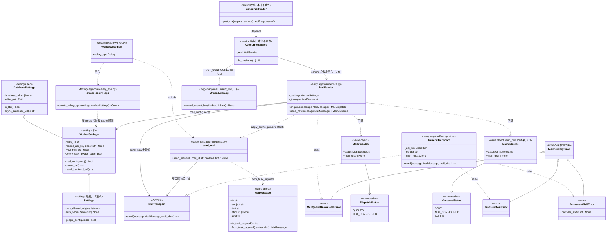
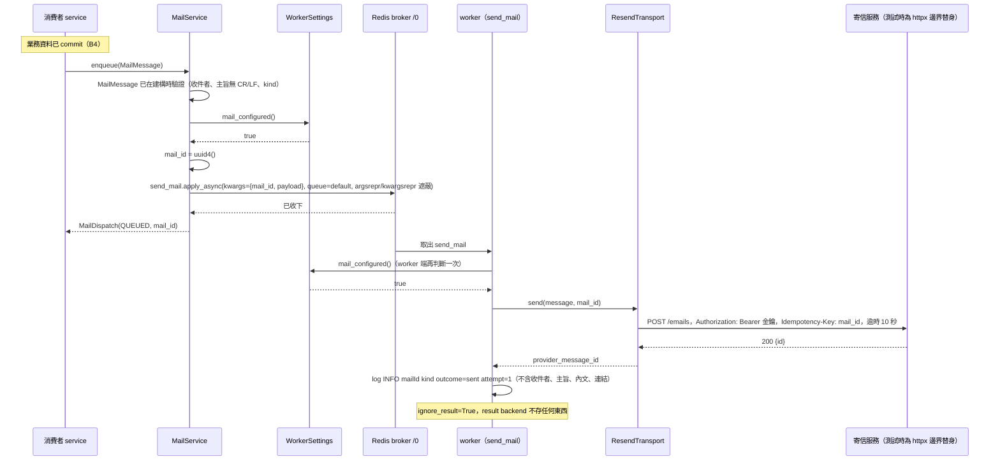
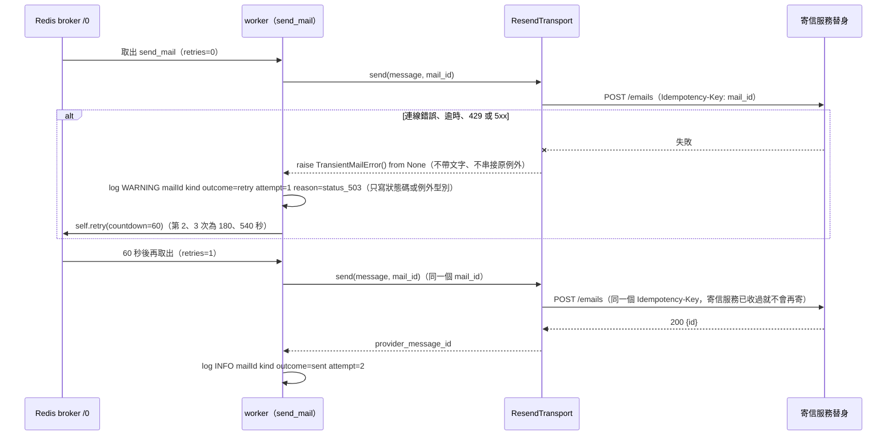
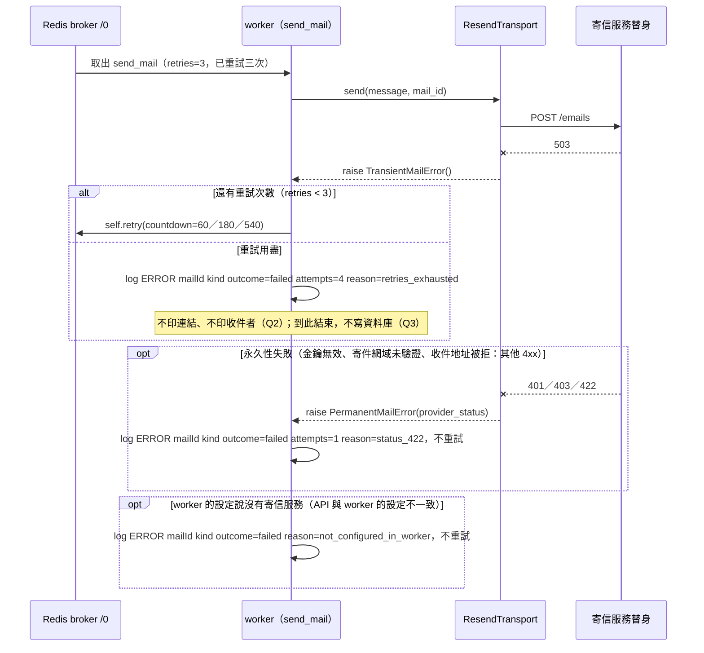
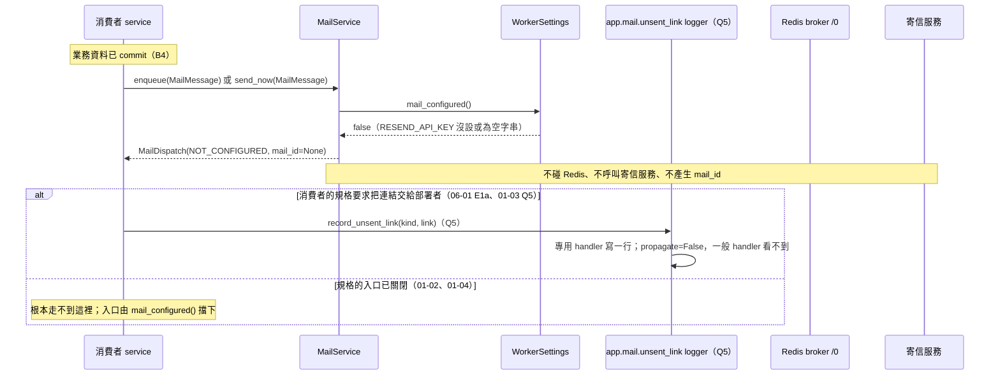
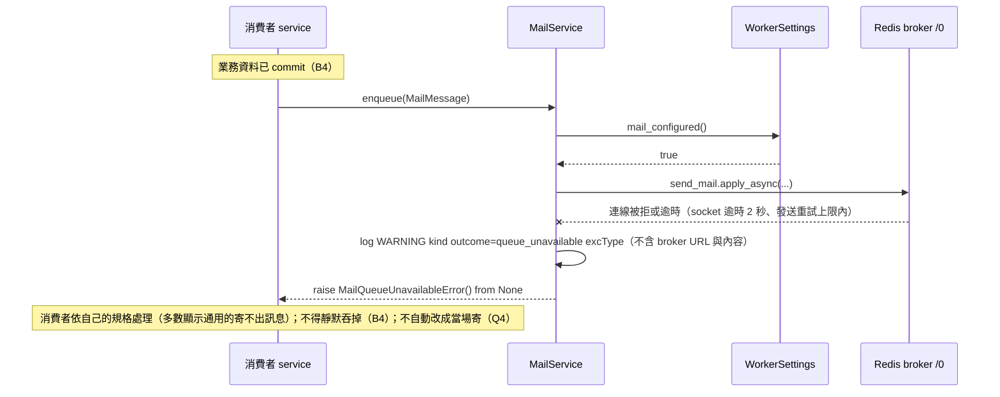
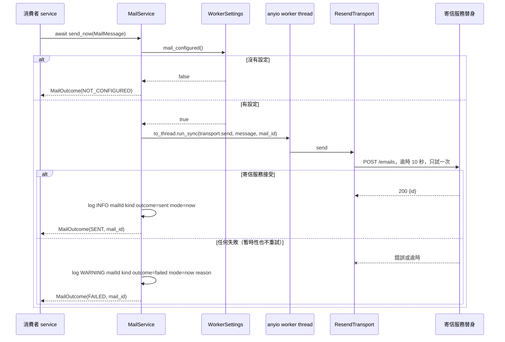

# System Design

本 change 是 issue #756：平台第一個背景工作程序（Celery worker）與它的佇列（Redis），加上所有功能共用的寄信入口。它沒有新的 HTTP 端點、沒有畫面、沒有權限矩陣的格；需求追溯到 ADR 與規則條號（spec-migration D4），脈絡基準是同目錄的 `system-analysis.md`。

`system-analysis.md` 的兩項需求矛盾與 17 個待決問題，以及本文原本列的技術待決 T1 至 T11，**已全部在 `clarification.md` 決議或定案**（Q1 至 Q8、技術預設表、P1 至 P3）；本文只留採用的設計，被捨棄的做法各留一行。

## 設計前提與骨架

### 已定案、照寫的部分

| 項目                                                                    | 依據                                                | 本設計怎麼用                                                                                                                                                     |
| :---------------------------------------------------------------------- | :-------------------------------------------------- | :--------------------------------------------------------------------------------------------------------------------------------------------------------------- |
| Celery 加 Redis 7，Redis 兼 broker `/0`、result backend `/1`、快取 `/2` | ADR-003 D8；`architecture.mdx` §非同步任務          | 只用 `/0` 與 `/1`；`/2` 留給快取與 #726 的登入失敗計數                                                                                                           |
| 佇列只有 `scoring` 與 `default`，雜務走 `default`                       | B9 既定界線；`architecture.mdx` §非同步任務         | 寄信 task 固定送 `default`；worker 同時聽兩個佇列                                                                                                                |
| warm shutdown、不設 `task_acks_late`、`stop_grace_period` 大於 300 秒   | ADR-008 D10；`architecture.mdx` §部署與維運「停機」 | worker 設 `stop_grace_period: 330s`                                                                                                                              |
| worker 與 backend 共用一個 image，套件宣告在同一份 `pyproject.toml`     | ADR-008 D2                                          | worker 服務沿用 `x-backend-image`，只換 `command`                                                                                                                |
| task 只收可序列化資料、重試有界、冪等                                   | B9                                                  | 寄信 task 收一個 JSON 可序列化的 dict；冪等靠寄信服務的冪等鍵（技術預設表）                                                                                      |
| 交易由 service 擁有；寄信與派送都在 commit 之後                         | B4                                                  | 寄信入口不碰資料庫交易；呼叫端 commit 後才呼叫它                                                                                                                 |
| 寄信套件只能經寄信入口使用；第一個入口落地要同時升級契約                | B12 單一入口清單第 1 項與「例外」欄                 | 採 B12 的 (a) 寫法：新的頂層入口套件 `app/mail/`，登記進 `ENTRY_TOP_LEVEL_PACKAGES`，契約不加 `ignore_imports`（與 `app/oidc/` 相同）                            |
| 「寄信服務有沒有設定」只有一個判斷                                      | runtime-config「寄信服務只看有沒有設定」            | `mail_configured()` 的判斷移到 `WorkerSettings`，語意改為 `RESEND_API_KEY` 與 `MAIL_FROM` 兩者都設才算有設定；只設一個在啟動時 `ConfigError`（Q6）；回應形狀不變 |
| 模組內分層 `app/modules/<module>/`、envelope、`/api/v1`                 | `architecture.mdx` §後端分層、§API 契約             | 本卡不新增業務模組，也不新增端點；這三項不受影響                                                                                                                 |

### 骨架：六個新元件

```text
backend/app/
├─ core/
│  ├─ config.py          改：新增 WorkerSettings 一層（Redis 位址、寄信設定），Settings 改繼承它
│  └─ celery_app.py      新：create_celery_app(settings) 組 Celery；佇列、序列化、重試上限、log 接線
├─ mail/                 新：寄信的 B12 入口套件（頂層套件，與 app/oidc/ 同一種寫法）
│  ├─ __init__.py        對外只匯出 MailService、MailMessage、結果型別與錯誤
│  ├─ message.py         MailMessage：一封已組好的交易信（收件者、主旨、純文字、可選 HTML、種類）
│  ├─ service.py         MailService：呼叫端唯一用的門面；先判斷有沒有設定，再排入（`enqueue`）或當場寄（`send_now`）
│  ├─ transport.py       ResendTransport：唯一碰寄信服務的地方；回應分類成暫時性／永久性失敗
│  ├─ tasks.py           send_mail：寄信的 Celery task（shared_task），重試 60／180／540 秒
│  └─ unsent_link.py     沒有設定寄信服務時，專用 logger 記下連結（Q5）
├─ worker.py             新：worker 的組裝點（相當於 API 的 main.py）；`celery -A app.worker worker`
└─ main.py               改：create_app 建 Celery app 並設為預設、把 MailService 放進 app.state
```

答案決定了：`MailService` 有 `enqueue` 與 `send_now` 兩個公開方法（Q1）、task 參數帶整封信（Q3）、eager 只在本機與 e2e 打開（技術預設表）、`ResendTransport` 底下是 `httpx`（Q7）。

## 分層與類別

FastAPI 的分層仍是 Router → Service → Repository／Model；寄信入口站在 **Service 之下、與 Repository 平行**的位置：只有消費者的 service 會呼叫它，router 不碰它，它也不碰資料庫（Q3）。圖中 `ConsumerRouter`／`ConsumerService` 代表 #723、#724、#727、#728、#766 各自的模組，本卡不實作。



### 元件與職責

| 元件                 | 位置                      | 職責                                                                                                                                                                                                                                                                                                                                                    | 不做                                                                                             |
| :------------------- | :------------------------ | :------------------------------------------------------------------------------------------------------------------------------------------------------------------------------------------------------------------------------------------------------------------------------------------------------------------------------------------------------ | :----------------------------------------------------------------------------------------------- |
| `WorkerSettings`     | `app/core/config.py`      | API 與 worker 都要的設定：`REDIS_URL`、`RESEND_API_KEY`、`MAIL_FROM`（Q6）、eager 開關（技術預設表）；`mail_configured()` 的判斷移到這一層，語意為 `RESEND_API_KEY` 與 `MAIL_FROM` 兩者都設；只設一個啟動時 `ConfigError`（Q6）；回應形狀不變                                                                                                           | 不含 `CORS_ALLOWED_ORIGINS`、`AUTH_SECRET`、Google：worker 不需要，worker 容器也就不必帶這些設定 |
| `create_celery_app`  | `app/core/celery_app.py`  | 建 Celery：broker 與 result backend 由 `REDIS_URL` 推導（`/0`、`/1`），`task_default_queue="default"`、`task_queues` 只有 `default` 與 `scoring`，序列化只收 JSON（`accept_content=["json"]`），`result_expires=86400`，`worker_hijack_root_logger=False` 並在 `setup_logging` signal 呼叫既有的 `configure_logging`，broker 連線與發送都有短逾時（Q4） | 不 import 任何 task 或模組（core 不依賴模組）；task 清單由組裝點以字串帶入                       |
| `app/worker.py`      | 頂層                      | worker 的組裝點：`load_settings(WorkerSettings)`、`create_celery_app`、`include=["app.mail.tasks"]`；之後 #767 在這裡加 `app.modules.task.tasks`                                                                                                                                                                                                        | 不定義 task                                                                                      |
| `MailService`        | `app/mail/service.py`     | 呼叫端唯一用的門面。先看 `mail_configured()`，沒設定就回 `NOT_CONFIGURED`、完全不碰佇列與寄信服務；有設定就產生 `mail_id`（UUID4）並排入 `default`（`send_now` 則當場寄，Q1）。`app.state.mail_service` 由 `create_app` 放入，消費者的依賴工廠從那裡取                                                                                                  | 不 commit、不開交易、不組信的內容與語言、不印連結（Q5）                                          |
| `MailMessage`        | `app/mail/message.py`     | 一封已組好的信；建構時驗證：`to` 經 `core.email_identity.normalize_email` 且不超過 254 字元、`subject` 1–200 字元且**不得含 CR、LF**（擋標頭注入，Hard Rule 9）、`text` 必填、`html` 可選、`kind` 符合 `^[a-z][a-z0-9_]{0,31}$`（只用來寫 log，不是任務類型，與 Hard Rule 5 無涉）                                                                      | 不帶任何答案或測試集資訊（見 §權限檢查點）                                                       |
| `ResendTransport`    | `app/mail/transport.py`   | 唯一碰寄信服務的地方（B12 入口第 1 項）；同步 `httpx.Client`、逾時 10 秒（與 `GoogleOidcClient` 的 `_TIMEOUT_SECONDS` 同值）、帶 `Idempotency-Key: <mail_id>`；把結果分成成功（回寄信服務的訊息 id）、`TransientMailError`、`PermanentMailError`，丟出時 `from None`，不串接原例外                                                                      | 不重試（重試是 task 的事）、不寫 log 以外的狀態、不把寄信服務的回應本文帶出去                    |
| `send_mail`          | `app/mail/tasks.py`       | `shared_task(bind=True, ignore_result=True)`；重建 `MailMessage`、在 worker 端**再判斷一次** `mail_configured()`（API 與 worker 設定不一致時當成永久失敗）、呼叫 transport；`TransientMailError` 依 `[60, 180, 540][self.request.retries]` 呼叫 `self.retry`，最多三次；寫一行不含內容的結果紀錄                                                        | 不碰資料庫（Q3）、不讀答案、不回傳任何值                                                         |
| 錯誤型別             | `app/mail/`               | 全部不帶訊息文字：Celery 的失敗紀錄會印出例外的 `str()`，所以例外本身必須是空的                                                                                                                                                                                                                                                                         | 不繼承 `AppError`：它們不會直接變成 HTTP 回應，消費者自己決定要回什麼                            |
| `record_unsent_link` | `app/mail/unsent_link.py` | logger `app.mail.unsent_link`，`propagate=False`、自己一個 handler，一般 handler 永遠看不到這條                                                                                                                                                                                                                                                         | 不在一般 log 管道出現（S9 反例）                                                                 |

### 依賴方向與 import 契約

| 方向                                 | 允許嗎     | 怎麼守                                                                                                                                                     |
| :----------------------------------- | :--------- | :--------------------------------------------------------------------------------------------------------------------------------------------------------- |
| `app.modules.*.service` → `app.mail` | 允許       | 入口契約 `allow_indirect_imports = true`，業務模組間接到 `httpx` 不算違規（`test_business_module_using_the_entry_is_an_allowed_indirect_import` 已有樣本） |
| `app.modules.*.router` → `app.mail`  | 不該有     | 現有契約不擋；新增一條 forbidden 契約「router 不得 import `app.mail`」（寄信必須在 service commit 之後，技術預設表 T6）                                    |
| `app.mail` → `httpx`                 | 允許       | `app/mail/` 登記進 `ENTRY_TOP_LEVEL_PACKAGES`，不在三條入口契約的 `source_modules` 內（B12 例外 (a)）                                                      |
| `app.mail` → `app.modules`           | 禁止       | **新增**一條 forbidden 契約「Mail entry does not import modules」：入口不得往上碰業務模組，也就碰不到答案表（Hard Rule 6，見 §權限檢查點）                 |
| `app.core.celery_app` → `celery`     | 允許       | `celery`、`kombu`、`redis` 加進 `test_dependency_classification.py` 的 `GENERAL_PACKAGES`（不新增 B12 入口，Q7）                                           |
| `app.worker`                         | 新頂層模組 | 依 `test_entry_contracts.py` 的守門測試，它必須列進三條入口契約的 `source_modules`（與 `app.main` 相同），`CHECKED_PACKAGES` 同步                          |

`import_tree.py` 的 `ENTRY_THIRD_PARTY[MAIL]` 維持 `{"resend", "smtplib", "aiosmtplib"}`：即使 `ResendTransport` 用 `httpx`（Q7），也不放寬寄信套件的禁令。B12「尚未檢查」第 4 項（入口 A import 入口 B 的套件）在這裡第一次出現：`app/mail/` 直接用 `httpx`，而 B12 第 3 項說「每個整合自己的包裝就是它的入口，不另設共用 HTTP 層」，所以這是被允許的寫法，不需要經另一個入口。

## 會改變結構的決議

以下四題原本並列選項，現已由 clarification 決議；只留採用的設計與一行被捨棄的做法。

### 當場寄與排入並存（Q1）

`MailService` 同時提供 `enqueue()` 與 `send_now()`：

- `enqueue`：排入 `default` 佇列，依重試政策重送；01-02、01-03、03-03 用它（01-02、01-03 的回應也不隨寄信結果改變，用 `enqueue` 讓回應時間不透露 Email 是否存在）
- `send_now`：只試一次、不重試，在 API 行程以 `anyio.to_thread.run_sync` 跑同一個 `ResendTransport.send`（與 `core/passwords.py` 把 argon2 放進 worker thread 同一種做法），回 `SENT`／`NOT_CONFIGURED`／`FAILED`；06-01 E1b、01-04 Q23 用它
- 依據：`architecture.mdx` §容器視圖 與 ADR-008 D3 把「API 寄或 worker 寄」留給後端設計；`send_now` 是單次、有 10 秒上限的 HTTP 呼叫，放在 thread 不卡 event loop，不屬 ADR-003 D8 排除的行程內 `BackgroundTasks`
- 捨棄：只有 `enqueue`（做不到「當場知道寄不出」，須改規格頁）；排入後限時等結果（佔住請求、與 `ignore_result` 衝突）
- 對消費者的代價：06-01 E1b「寄不出則不建立帳號」與 B4「不在 DB 交易裡做外部呼叫、不把寄完信再 commit 當預設」之間，#728 要在「先 commit 再補償刪除」與「援用 B4『預設』二字的例外」擇一，屬 #728 的設計；本卡只保證 `send_now` 不在任何交易裡被呼叫也能用

### 最終失敗不新增表（Q3）

最終失敗只寫一行不含內容的 log（`mailId`、`kind`、`outcome=failed`、`reason`），`ignore_result=True`，無 migration。spec delta 寫明寄信 task 對 B9「結果與失敗狀態寫進資料庫」「只傳識別資訊」的例外與理由；接受連結在 worker 取走前短暫停在 Redis（不發布埠、ack 後即刪、`argsrepr` 遮蔽、`ignore_result`）。出事時從 worker log 以 `mailId` 查，消費者要追蹤就自己存 `enqueue()` 回的 `mail_id`。

捨棄：寄信紀錄表（多一張含 PII 的表、一次性連結落地）；各消費者以 `link_error` 回呼自己的資料（入口多一套回呼協定與跨模組 import 規則）。

### 跑法：容器真佇列，dev 與 e2e 預設 eager（技術預設表）

- 兩層容器一律加 `redis` 與 `worker`（`architecture.mdx` §容器視圖「資料庫層只換驅動與檔案位置，容器不變」）
- `pnpm run dev` 與 e2e 預設 `CELERY_TASK_ALWAYS_EAGER=true`（只有 `dev.mjs` 與 Playwright `webServer.env` 帶，兩份編排檔不傳）；想走真佇列的開發者清掉它、自備 Redis、另開 `celery -A app.worker worker`
- 護欄：`WorkerSettings` 在 `DATABASE_URL` 有設時拒絕 eager（`ConfigError`），CI `compose` job 斷言兩層的 backend 與 worker 都沒有此變數，eager 因此到不了容器
- CI `backend-sqlite`／`backend-postgres` 不加 Redis：以 `send_mail.apply(kwargs=…)` 測 task 本體（會經參數驗證），以 `monkeypatch` 在 `httpx.Client.send` 換掉寄信服務（與 `tests/support/google_oidc.py` 同一種寫法）；`enqueue` 以 eager 加「參數可 JSON 序列化」的斷言測
- eager 在 async 路由裡：`enqueue` 偵測到 eager 時以 `anyio.to_thread.run_sync` 執行 `apply_async`；非 eager 時照 ADR-003 D8 直接呼叫，不另包 executor（Q4）
- 捨棄：一律真 Redis（每個開發者多一個外部服務、Windows 要另寫 `--pool=solo` 分支）；一律 eager（不經序列化、測不出參數錯誤、退避看不到）

### 以 `httpx` 呼叫寄信服務（Q7）

`ResendTransport` 以既有的 `httpx` 呼叫 Resend 的 `POST /emails`，不新增 SDK。`celery`、`kombu`、`redis` 歸一般套件，不新增 B12 入口。

- 直接看 HTTP 狀態碼分類：連線錯誤、逾時、`429`、`5xx` 為暫時性；其他 `4xx`（金鑰無效、寄件網域未驗證、收件地址被拒）為永久性
- 冪等鍵與重試分類寫在 HTTP 層；測試替身在 `httpx.Client.send`
- 不新增相依，`pip-audit` 的面不變（ADR-008 D8）；不引入 SDK 的模組層全域金鑰（B3、B10）
- 捨棄：官方 `resend` SDK（多一到兩個套件、模組層全域金鑰）。ADR-008 D3 提到 SDK 優點的句子隨本卡補一句現行做法

## 關鍵情境

本卡沒有規格頁的驗收標準（spec-migration D4），下列標題是提議給 planner 寫 spec delta 時沿用的 Scenario 名稱；spec 定稿後若改名，本節跟著改。本卡沒有端點，所以每張圖從「消費者的 service 在 commit 之後呼叫寄信入口」畫起，畫到寄信入口把結果交回消費者的 service、或 worker 寫完最後一行紀錄為止；消費者的 router 與回應不在本卡範圍。worker 端的參與者畫到寄信服務的替身為止。

### Scenario: 排入背景工作的信寄出成功



### Scenario: 暫時性失敗後重試寄出



### Scenario: 重試用盡記為最終失敗



### Scenario: 沒有設定寄信服務時不嘗試寄信



### Scenario: 佇列無法連線時排入失敗



### Scenario: 當場寄出並回報結果



## 容器、跑法與 CI

### 兩層編排

兩份編排檔各加兩個服務；`frontend` 不變。

| 服務      | Lite（`docker-compose.yml`）                                                                                                                                                                                                                                                                                                                                                                                                                                                                                                                                                                                      | 正式（`docker-compose.prod.yml`）                  |
| :-------- | :---------------------------------------------------------------------------------------------------------------------------------------------------------------------------------------------------------------------------------------------------------------------------------------------------------------------------------------------------------------------------------------------------------------------------------------------------------------------------------------------------------------------------------------------------------------------------------------------------------------- | :------------------------------------------------- |
| `redis`   | `redis:7-alpine`；不發布埠；healthcheck `redis-cli ping`；不掛 volume（ADR-003 D8 接受 Redis 單實例掉訊息）；不設 `maxmemory`（`architecture.mdx` §非同步任務）                                                                                                                                                                                                                                                                                                                                                                                                                                                   | 同左                                               |
| `worker`  | `<<: *backend-image`；`command: ["celery", "-A", "app.worker", "worker", "-Q", "default,scoring", "--concurrency", "2"]`；環境變數 `REDIS_URL`、`RESEND_API_KEY`、`MAIL_FROM`、`LOG_LEVEL`、`SQLITE_PATH`（與 `backend` 同值，預設 `${SQLITE_PATH:-./data/label_suite.db}`，指向共用 volume 內的檔案）；掛 `label-suite-data:/app/data`（`architecture.mdx` §資料庫雙層 已要求；Lite 掛同一個 volume，同步驅動留給 #767）；`depends_on: redis service_healthy, migrate service_completed_successfully`；`stop_grace_period: 330s`；healthcheck `celery -A app.worker inspect ping -d celery@$$HOSTNAME`；不發布埠 | 同左，資料庫改帶 `*database-url`，不掛 Lite volume |
| `backend` | 加 `REDIS_URL: redis://redis:6379`、寄件人；`depends_on` 加 `redis: service_healthy`                                                                                                                                                                                                                                                                                                                                                                                                                                                                                                                              | 同左                                               |

`frontend` 仍只等 `backend` 健康；`worker` 掛掉不影響網站是否起得來（技術預設表：API 健康檢查不變）。兩個新服務都在既有固定網段的 `ip_range` 內動態配位，不影響 `frontend` 釘住的位址與 `FORWARDED_ALLOW_IPS`。

### 三處要一起改寫的「不得有 Redis 或 worker」

| 位置                                                                                         | 現在                                                               | 改成                                                                                                                                                                                       |
| :------------------------------------------------------------------------------------------- | :----------------------------------------------------------------- | :----------------------------------------------------------------------------------------------------------------------------------------------------------------------------------------- |
| `openspec/specs/container-runtime/spec.md`「前端服務是唯一公開入口」                         | 「兩層編排 MUST NOT 含 Redis 或 worker 服務」與 Scenario 的 AND 句 | spec delta MODIFIED：兩層 SHALL 各含 `redis` 與 `worker`，兩者 MUST NOT 發布主機埠；新增一條 requirement 寫 worker 共用後端 image、`stop_grace_period` 大於 300 秒、Lite 層掛同一個 volume |
| `.github/workflows/ci.yml` `compose` job「Assert the structure of both orchestration files」 | `select(test("redis                                                | worker"))                                                                                                                                                                                  | length == 0` | 改斷言：`redis` 與 `worker` 都存在且沒有 `ports`；`worker.image == backend.image`；`worker.stop_grace_period` 大於 300 秒；Lite 的 `worker` 掛 `label-suite-data`；兩層的 `backend` 與 `worker` 都帶 `RESEND_API_KEY` 與寄件人、都**沒有** `CELERY_TASK_ALWAYS_EAGER` |
| `docker-compose.prod.yml` 開頭註解                                                           | 「Neither tier contains Redis or a worker.」                       | 改寫成兩層都含 `redis` 與 `worker`                                                                                                                                                         |

另外 `compose` job 在兩層 `up --wait` 之後多一步：`docker compose exec worker celery -A app.worker inspect ping` 回 OK（確認 worker 連得上 broker）。真的送一封信經佇列到假寄信服務需要在編排網路內放一個假的寄信服務端點（T8 已定案：本卡只驗 `inspect ping`，整封信的驗證交給第一個消費者的 e2e）。

### 本機、CI 後端 job、e2e（技術預設表）

| 跑法                                    | 變更                                                                                                                                                                                   |
| :-------------------------------------- | :------------------------------------------------------------------------------------------------------------------------------------------------------------------------------------- |
| `pnpm run dev`（`scripts/dev.mjs`）     | 程式不改；`.env.example`「Local development」段落加 `CELERY_TASK_ALWAYS_EAGER=true` 與說明；`docs/development/workflow/local-development.mdx` 寫「想走真佇列時怎麼起 Redis 與 worker」 |
| CI `backend-sqlite`、`backend-postgres` | 不加 Redis service container；新增的測試都不需要 broker                                                                                                                                |
| e2e `playwright.config.ts`              | `webServer.env` 加 `CELERY_TASK_ALWAYS_EAGER=true`；`E2E_TARGET=compose` 時走容器裡的真 worker                                                                                         |

### session 與交易邊界

| 項目       | 做法                                                                                                                                                                                                                                                                                                                                                                                                          |
| :--------- | :------------------------------------------------------------------------------------------------------------------------------------------------------------------------------------------------------------------------------------------------------------------------------------------------------------------------------------------------------------------------------------------------------------ |
| API        | 沿用 `get_db` 一個請求一個 `AsyncSession`；寄信入口不拿 session                                                                                                                                                                                                                                                                                                                                               |
| worker     | 寄信 task 不開 session。第一個要資料庫的 task（#767 的 IAA）才引入同步 session 與它的驅動：Lite 去掉 `+aiosqlite`，正式推導 `postgresql+psycopg2`（`architecture.mdx` §資料庫雙層、B3）。本卡不放同步 session 工廠，留給 #767（技術預設表）                                                                                                                                                                   |
| 交易       | 消費者 service commit 之後才呼叫 `enqueue`／`send_now`（B4）；寄信入口內部沒有交易                                                                                                                                                                                                                                                                                                                            |
| event loop | `enqueue` 非 eager 時直接 `apply_async`（ADR-003 D8）；broker 連不上時最壞阻塞約 socket 逾時加發送重試的總和，所以 `create_celery_app` 設 `broker_transport_options={"socket_connect_timeout": 2, "socket_timeout": 2}` 與 `task_publish_retry_policy={"max_retries": 2, "interval_start": 0, "interval_step": 0.5, "interval_max": 1}`，把最壞情況壓在數秒內（Q4）；`send_now` 與 eager 一律進 worker thread |

## log 脫敏（S9）與 Hard Rule 6

### 寄信相關紀錄可以寫什麼

下表是 clarification Q5 的決議，以一行 `key=value` 寫在既有 `KeyValueFormatter` 的 `msg` 裡。

| 可以寫                                                                                                                                                                                                                                                                                                                                        | 不可以寫                                                                                                                               |
| :-------------------------------------------------------------------------------------------------------------------------------------------------------------------------------------------------------------------------------------------------------------------------------------------------------------------------------------------- | :------------------------------------------------------------------------------------------------------------------------------------- |
| `mailId`（UUID4，入口自己產生）、`kind`、`attempt`／`attempts`、`outcome`（`queued`、`sent`、`retry`、`failed`、`not_configured`、`queue_unavailable`）、`mode`（`queued`／`now`）、`reason`（固定字彙：`status_<HTTP 狀態碼>`、`timeout`、`connect_error`、`retries_exhausted`、`not_configured_in_worker`）、`excType`、寄信服務回的訊息 id | 收件者（完整或遮蔽後都不寫，含網域；Q5）、主旨、內文、連結、寄件人、金鑰、寄信服務回應的本文或錯誤訊息（可能回顯收件地址）、broker URL |

做法：

- 入口的錯誤型別都不帶文字，丟出時 `from None`。理由：Celery 自己的失敗紀錄格式是 `Task <name>[<id>] <description>: <exc>`，會印出例外的 `str()`；重試紀錄也會印 `Retry in 60s: <exc>`
- `apply_async` 帶 `argsrepr="()"`、`kwargsrepr="{redacted}"`：Celery 在 DEBUG 等級的 `Received task` 紀錄、`celery inspect active` 與事件裡用的是這兩個欄位，不是原始參數
- `ignore_result=True`：task 不回傳值，result backend 不存任何寄信資料；Celery 的 `succeeded in …s: None` 也就只印 `None`
- worker 設 `worker_hijack_root_logger=False`，在 `setup_logging` signal 呼叫既有的 `configure_logging`，worker 的紀錄與 API 一樣經 `KeyValueFormatter`（第三方帶 `exc_info` 時只寫 `excType`）
- `httpx` 的 logger 在 INFO 會印出請求的 URL（`HTTP Request: POST https://api.resend.com/emails "HTTP/1.1 200 OK"`），不含金鑰與本文；比照 `sqlalchemy` 把 `httpx`、`httpcore` 加進 `PINNED_WARNING_LOGGERS`，`LOG_LEVEL=DEBUG` 時也不會印出標頭（DEBUG 的 `httpcore` 會寫送出的標頭，含 `Authorization`）
- 測試用 canary：同一封信的收件者、主旨、內文、連結各放一段獨特字串，跑完成功、重試、最終失敗、不寄、排入失敗五條路徑後，斷言 `caplog` 與 worker 的紀錄都找不到任何一段 canary

### 沒有設定時的連結

連結由誰印、印到哪（Q5）：由消費者決定要不要印，呼叫入口提供的 `record_unsent_link(kind, link)`。它用專用 logger `app.mail.unsent_link`：`propagate=False`、自己一個寫 stderr 的 handler、固定格式，一般 handler 與之後任何接在 root 上的 log 管道都看不到它（S9 反例「不得再帶進一般 log 管道」）。捨棄：寫進權限 `0o600` 的檔案（PRD 與 ADR-008 D3 寫的是「印在伺服器 log」）。

### Hard Rule 6：答案不進寄信參數與紀錄

worker 是唯一讀測試集答案的程序（S6），寄信 task 與之後的評分 task 共用它。本卡用三道擋：

1. **結構**：新增 import 契約「Mail entry does not import modules」——`app.mail` 不得 import `app.modules`，所以寄信入口與 task 在 import 圖上就到不了答案表與 `load_answers()`
2. **參數**：`MailMessage` 只有收件者、主旨、純文字、HTML、種類五個欄位，全是消費者組好的字串；task 參數就是這五個欄位加 `mail_id`，沒有任何資料庫識別碼可以讓 task 回頭查資料
3. **紀錄**：上表的「可以寫」不含任何內容欄位，canary 測試覆蓋全部五條路徑

剩下擋不了的是「消費者把答案組進信的內容」：本卡的消費者都是帳號與邀請類信件，不會碰到答案；spec delta 要寫一條「寄信參數與寄信紀錄 MUST NOT 含標準答案或測試集辨識資訊」的 requirement，讓每個消費者的 change 在 clarification 第 10 面向對它負責。

## 常駐文件異動

依呼叫方的限制，本次規劃只寫 `system-design.md` 與 `api-contract.md` 兩份檔案，**下列常駐文件沒有在規劃階段先改**；clarification 技術預設表（T10）已定案由 apply 的對應 task 改，排在實作群組最後一個 task 之前，tasks.md 要列出來，design-reviewer 以本節為準核對。

- 常駐文件：`docs/diagrams/architecture/backend-modules.mdx`

| 節                                       | 異動 | 摘要                                                                                                                                                                                               |
| :--------------------------------------- | :--- | :------------------------------------------------------------------------------------------------------------------------------------------------------------------------------------------------- |
| §後端基礎建設 §目錄                      | 改   | 加 `app/mail/`（寄信入口套件）、`app/worker.py`（worker 組裝點）、`app/core/celery_app.py`；目錄判斷表加 `app/mail/` 一列（B12 (a) 寫法、替身在 `httpx.Client.send`）                              |
| §後端基礎建設 §`core/` 各模組            | 改   | `config.py` 的主要介面加 `WorkerSettings`，`mail_configured()` 移到它；新增 `celery_app.py` 一列                                                                                                   |
| §後端基礎建設 新增「背景工作與寄信」一節 | 新   | 寄信入口的分層表、Class 圖（本文 §分層與類別 的入口部分）、主要 Sequence 圖（排入成功、重試、沒有設定）；Celery 的佇列、重試、log 接線、eager 開關                                                 |
| §後端基礎建設 §log 安全規則              | 改   | 加寄信紀錄的欄位規則、`argsrepr` 遮蔽、`httpx`／`httpcore` 固定 `WARNING`；**刪掉**末段「寄信失敗時把設定密碼連結印在 log」與「logger 名稱或獨立管道留給寄信的 change 決定」，改寫成 Q2、Q5 的決議 |
| §後端基礎建設 §設定                      | 改   | 兩層變三層；新增 `REDIS_URL`、`MAIL_FROM`、`CELERY_TASK_ALWAYS_EAGER` 三列；`RESEND_API_KEY` 列改寫（不再「只看有沒有設」）                                                                        |
| §後端基礎建設 §新增業務模組的檢查清單    | 改   | 加一項：模組要寄信時經 `app.state.mail_service`，commit 之後才呼叫；模組要新增 Celery task 時在 `app/worker.py` 的 `include` 登記                                                                  |
| §測試輔助                                | 改   | 加寄信服務的替身（`tests/support/` 下，換 `httpx.Client.send`）                                                                                                                                    |
| §已知限制                                | 改   | 加「Redis 單實例掉訊息時，佇列中的信會遺失」（ADR-003 D8）                                                                                                                                         |
| §決策紀錄                                | 加列 | 一列一筆本次異動                                                                                                                                                                                   |

- 常駐文件：`docs/development/architecture.mdx`（技術架構，不是 `docs/diagrams/architecture/`，但同樣要改）

| 節                                       | 異動 | 摘要                                                                                                                  |
| :--------------------------------------- | :--- | :-------------------------------------------------------------------------------------------------------------------- |
| §容器視圖 末段                           | 改   | 「信由 API 直接寄出還是送進 `default` 佇列由 worker 寄，本文沒有規定」改成 Q1 的決議（兩者並存）                      |
| §後端分層 層表「Celery task」列          | 改   | 「評分、IAA 計算、匯出等長時間工作」加上雜務（寄信）走 `default`，與 B9 既定界線一致                                  |
| §非同步任務                              | 改   | 加寄信 task 的段落（不經 `submission`、冪等靠冪等鍵、失敗狀態只留 log，Q3）；共用寄信流程補在這裡（技術預設表）       |
| §部署與維運「本機與 CI」「寄信」「停機」 | 改   | 兩層多 `redis` 與 `worker`；CI `compose` job 的新斷言；寄信列加寄件人設定與「設定了但寄失敗」與「沒設定」的分界（Q2） |
| §決策紀錄                                | 加列 | 本次決議                                                                                                              |

- 規則文件與 ADR（`docs/development/`，由 technical-writer 在 apply 改）

| 文件                                                     | 異動       | 摘要                                                                                                                                                                |
| :------------------------------------------------------- | :--------- | :------------------------------------------------------------------------------------------------------------------------------------------------------------------ |
| `rules/backend-agent-rules.mdx` B4「失敗補償要寫明」     | Q2         | 「寄信失敗照寄信降級的做法（連結印在伺服器 log）」改成「沒設定才印連結；設定了但寄失敗回報給消費者」                                                                |
| `rules/backend-agent-rules.mdx` B3、B9「適用路徑」       | Q8         | 「Celery 進入點落在 `app/modules/<module>/`」加上「共用基礎建設的 task 落在它的入口套件」                                                                           |
| `rules/backend-agent-rules.mdx` B9「結果與失敗狀態落地」 | Q3         | 寫明寄信 task 的例外與理由                                                                                                                                          |
| `rules/backend-agent-rules.mdx` B12                      | 改         | 「例外」欄的「今天 `backend/app/` 沒有任何入口」已不符現況（`app/oidc/` 已落地），本卡再加 `app/mail/`；「尚未檢查」第 4 項補上 `app/mail/` 直接用 `httpx` 是允許的 |
| `adr/003-backend-architecture.mdx`                       | Q8         | 加一條決定（共用基礎建設的 task 位置）；D8 不改                                                                                                                     |
| `adr/008-deployment-and-operations.mdx` D3               | Q1、Q2、Q7 | 「信由 API 還是 worker 寄出」的指向改成 Q1 的決議；補一句現行做法是 `httpx` 而非 SDK；後果補「設定了但寄失敗不印連結」                                              |

## 資料模型異動

本次無資料模型異動（clarification Q3：不新增表，最終失敗只留 log）。字典、ER 與 Alembic migration 都不動。捨棄：寄信紀錄表（outbox），因為會多一張含 PII 的表並讓一次性連結落地。

## 權限檢查點

本卡沒有端點、沒有畫面、沒有 PRD §權限矩陣 的格，所以沒有新的授權判斷，也沒有依角色遮蔽的欄位。

| 層                         | 檢查什麼                                                                                                                                                                     |
| :------------------------- | :--------------------------------------------------------------------------------------------------------------------------------------------------------------------------- |
| 消費者的 router 與 service | 照各自規格做授權四步；呼叫寄信入口之前，誰能觸發這封信已經判斷完（例如只有系統管理員能邀請帳號，06-01）                                                                      |
| 寄信入口（`MailService`）  | 不做授權：它不讀寫任何業務資料，只寄消費者交來的內容；只檢查「這個部署有沒有設定寄信服務」與 `MailMessage` 的欄位驗證                                                        |
| 寄信 task                  | B9 要求 task「在自己的行程裡重新查權限與資料版本」，那是對「依識別碼回頭讀業務資料」的 task；寄信 task 不帶識別碼、不讀資料，沒有東西可重查。spec delta 要寫明這個例外與理由 |
| 測試集答案                 | 見 §log 脫敏 的「Hard Rule 6」：import 契約讓入口到不了答案表、task 參數只有五個內容欄位、紀錄不含內容；標記員能到達的端點本卡一個都沒有新增                                 |

## 待決問題的處置（全部已決議或已定案）

`system-analysis.md` 的 17 題與兩項需求矛盾，全部已在 `clarification.md` 處理；下表只標落在骨架的哪一處。

| #           | 結論                                                                                                                                             | 出處               | 落點                                                        |
| :---------- | :----------------------------------------------------------------------------------------------------------------------------------------------- | :----------------- | :---------------------------------------------------------- |
| 1（矛盾 1） | 已決議：`send_now` 與 `enqueue` 並存；06-01、01-04 用前者，01-02、01-03、03-03 用後者                                                            | Q1                 | `MailService.send_now`                                      |
| 2           | 已定案：沿用 B9 的三次、60／180／540 秒；連線錯誤、逾時、`429`、`5xx` 為暫時性，其他 `4xx` 直接最終失敗                                          | 技術預設表         | `send_mail`、`ResendTransport`                              |
| 3           | 已定案：每封信帶 `Idempotency-Key: <mail_id>`，由寄信服務去重；apply 前查證其有效期                                                              | 技術預設表         | `ResendTransport.send`                                      |
| 4           | 已決議：不新增表，最終失敗只留一行無內容的 log                                                                                                   | Q3                 | 無                                                          |
| 5           | 已定案：容器真佇列，dev 與 e2e 預設 eager，後端測試用 `.apply()` 加 HTTP 邊界替身，`DATABASE_URL` 有設就拒絕 eager                               | 技術預設表         | `WorkerSettings.celery_task_always_eager`、CI `compose` job |
| 6           | 已定案：本卡只保證 worker 在兩層都起得來、Lite 層掛同一個 volume；同步驅動與 session 留給 #767                                                   | 技術預設表         | 兩份編排檔的 `worker`                                       |
| 7（矛盾 2） | 已決議：只有沒設定寄信服務才印連結；設了但寄失敗回報給呼叫端，不印；B4 與 `backend-modules.mdx` 隨本卡修正                                       | Q2                 | 規則文件、常駐文件                                          |
| 8           | 已決議：是否印連結由各功能決定；入口提供 `record_unsent_link` 與專用 logger `app.mail.unsent_link`（`propagate=False`）                          | Q5                 | `app/mail/unsent_link.py`                                   |
| 9           | 已決議：一般 log 只寫 `mailId`、類型、次數、結果、固定字彙原因、`excType`、寄信服務訊息 id；收件者連網域都不寫，寄信服務錯誤本文不寫             | Q5                 | §log 脫敏                                                   |
| 10          | 已決議：新增 `MAIL_FROM`，與 `RESEND_API_KEY` 全有或全無，只設一個就 `ConfigError`；`REDIS_URL` 只給一個；連結對外網址由第一個寄連結的功能單引入 | Q6                 | `WorkerSettings`、`.env.example`                            |
| 11          | 已定案：入口只寄組好的內容，不帶語言參數                                                                                                         | 技術預設表         | `MailMessage`                                               |
| 12          | 已決議：`enqueue` 排不進就丟 `MailQueueUnavailableError`，不自動改成當場寄                                                                       | Q4                 | `MailService.enqueue`                                       |
| 13          | 已定案：API 健康檢查不變；`redis`、`worker` 各有容器 healthcheck                                                                                 | 技術預設表         | 編排檔                                                      |
| 14          | 已決議：以 `httpx` 呼叫 Resend HTTP API，不新增 SDK                                                                                              | Q7                 | `ResendTransport`                                           |
| 15          | 已定案：入口以單封信設計，07-04 成為消費者時再評估                                                                                               | 技術預設表         | 無                                                          |
| 16          | 已定案：補在 `architecture.mdx` §非同步任務，不進 `docs/specs/`                                                                                  | 技術預設表         | 常駐文件                                                    |
| 17          | 告知：03-03 缺定義不影響本卡，#766 動工前由維護者以 `spec-writing` 補                                                                            | clarification 告知 | 無                                                          |

## 技術待決問題（全部已決議）

以下是 sd 新增的題目；全部已在 `clarification.md` 決議或定案，沒有待決。

| #   | 結論                                                                                                                                                                       | 出處                     |
| :-- | :------------------------------------------------------------------------------------------------------------------------------------------------------------------------- | :----------------------- |
| T1  | 已決議：寄信 task 放入口套件 `app/mail/tasks.py`；B3、B9 的適用路徑文字隨本卡修正。捨棄：`app/modules/mail/`、`app/core/`                                                  | clarification Q8         |
| T2  | 已定案：新增 `WorkerSettings`，worker 不要求 `CORS_ALLOWED_ORIGINS`、`AUTH_SECRET`                                                                                         | clarification 技術預設表 |
| T3  | 已決議：`celery`、`kombu`、`redis` 歸一般套件，不新增 B12 入口；`ENTRY_THIRD_PARTY[MAIL]` 維持禁止 `resend`、`smtplib`、`aiosmtplib`。捨棄：把背景工作列為 B12 第 8 項入口 | clarification Q7         |
| T4  | 已決議：接受連結在 worker 取走前短暫停在 Redis（不發布埠、ack 後即刪、`argsrepr` 遮蔽、`ignore_result`）；B9「只傳識別資訊」的例外寫進 spec delta。捨棄：把內容存進資料庫  | clarification Q3         |
| T5  | 已決議：維持 ADR-003 D8 不另包 executor，以 socket 逾時 2 秒與發送重試上限壓住最壞情況；不觸發 D8 重新討論。捨棄：`enqueue` 一律包進 thread                                | clarification Q4         |
| T6  | 已定案：router 不得 import `app.mail`；`app.mail` 不得 import `app.modules`；`app/worker.py` 列進三條入口契約與 `CHECKED_PACKAGES`                                         | clarification 技術預設表 |
| T7  | 已定案：`--concurrency 2`，healthcheck 每 30 秒 `inspect ping`                                                                                                             | clarification 技術預設表 |
| T8  | 已定案：CI `compose` 只驗 worker `inspect ping`；整封信經佇列的驗證交給第一個消費者的 e2e                                                                                  | clarification 技術預設表 |
| T9  | 已定案：本卡不把 worker 放進 `dev.mjs`；Windows 走真佇列時用 `--pool=solo`，寫進 `local-development.mdx`                                                                   | clarification 技術預設表 |
| T10 | 已定案：常駐文件由 apply 的 task 更新，排在實作群組最後一個 task 之前（見 §常駐文件異動）                                                                                  | clarification 技術預設表 |
| T11 | 已決議：`httpx`、`httpcore` 的 logger 固定 `WARNING`（DEBUG 的 `httpcore` 會印出 `Authorization` 標頭）                                                                    | clarification Q5         |
