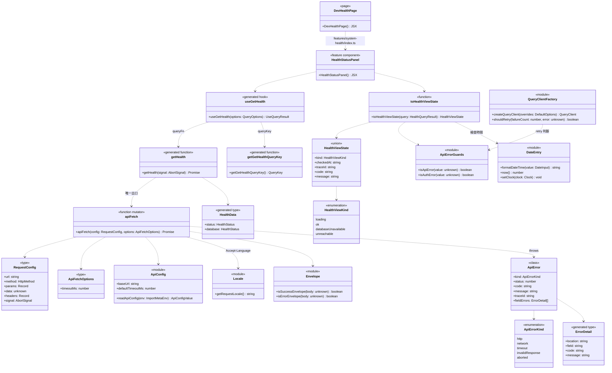
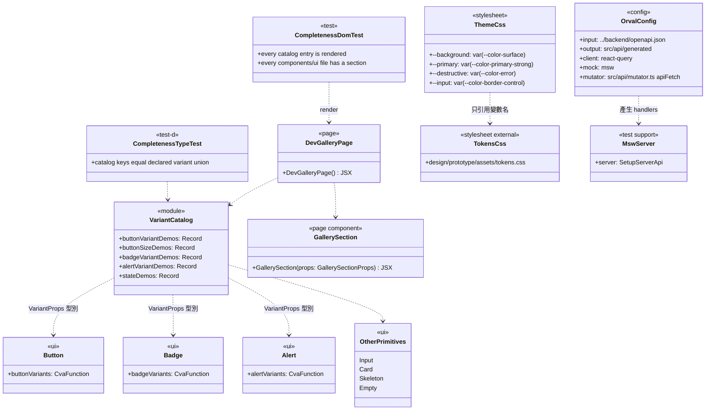
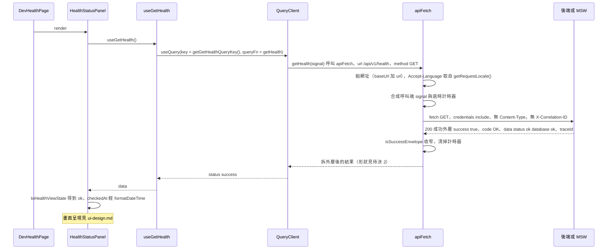
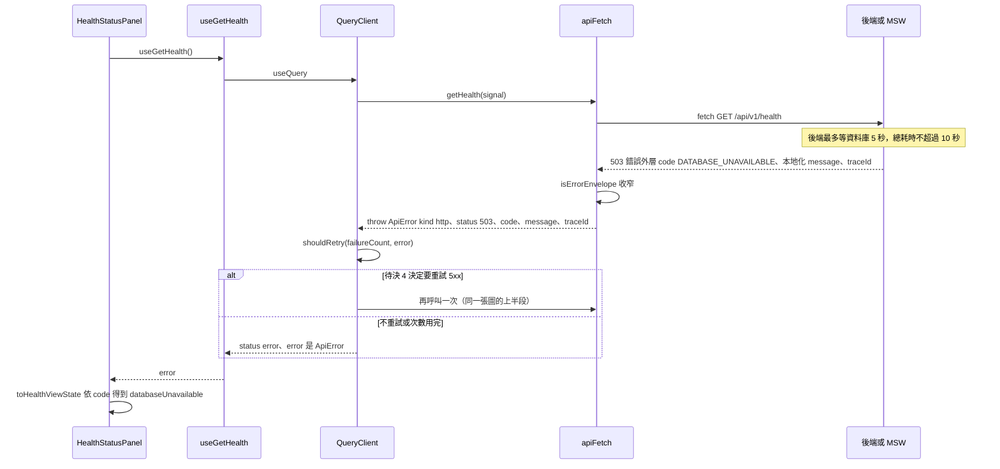
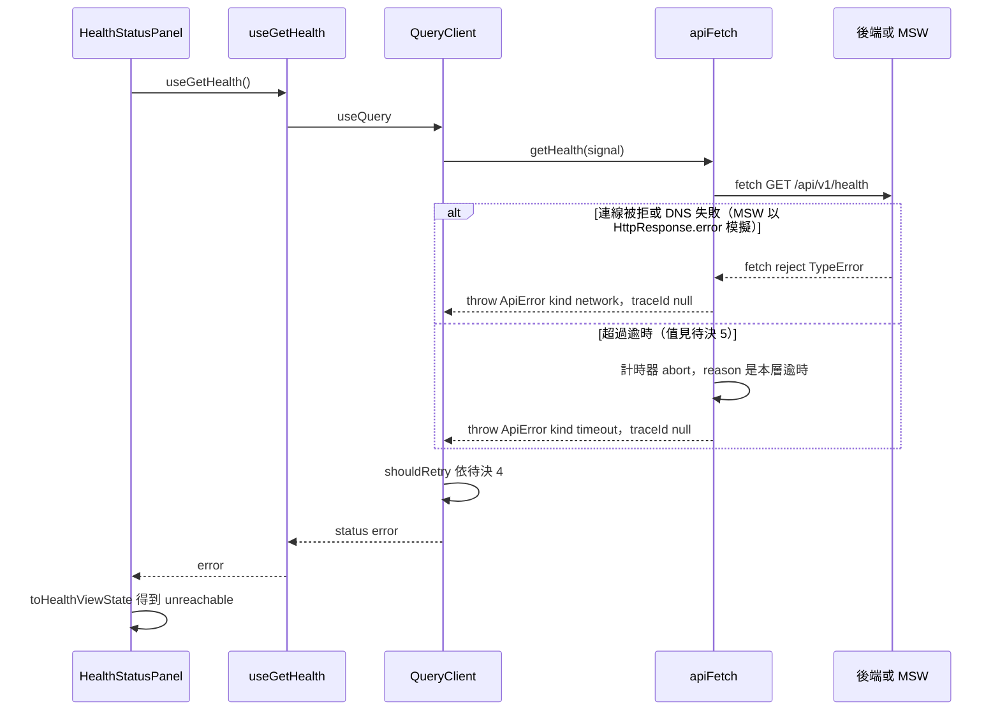
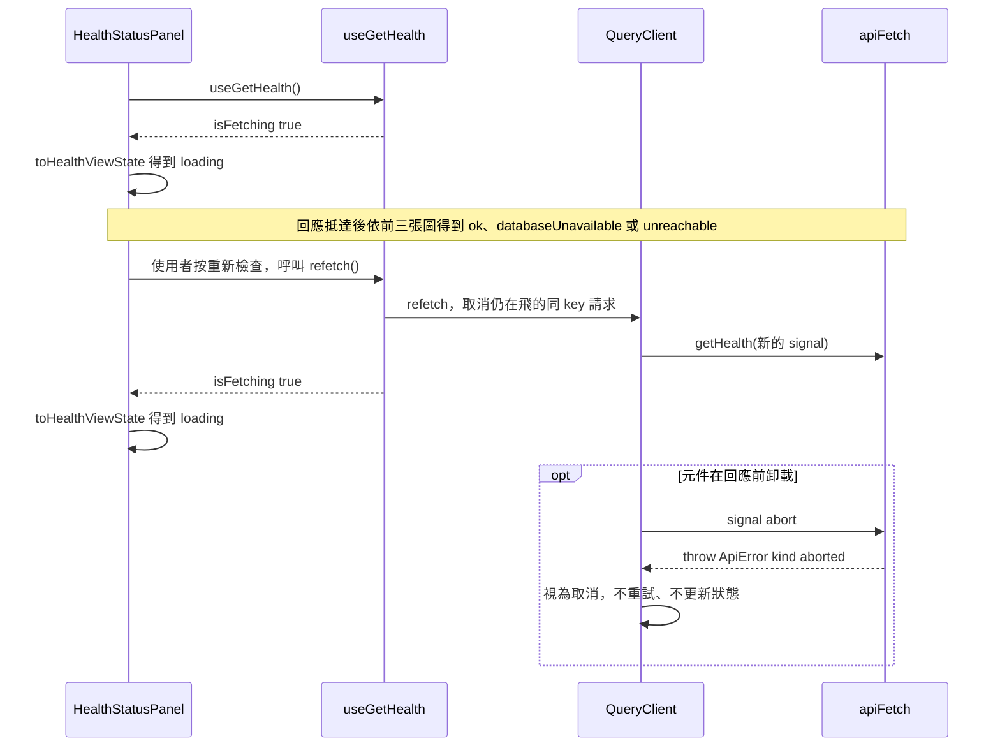
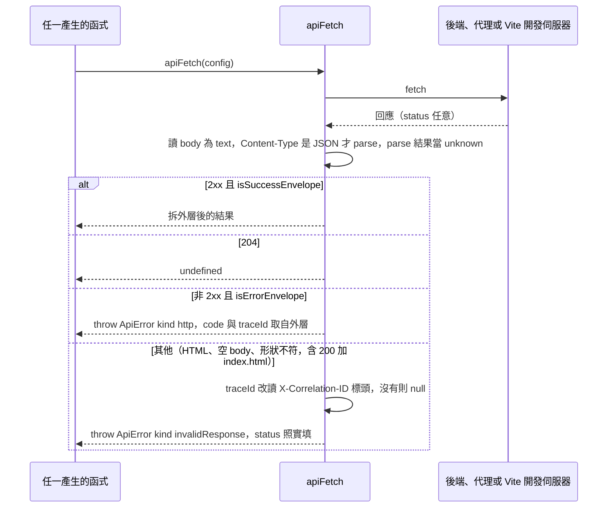
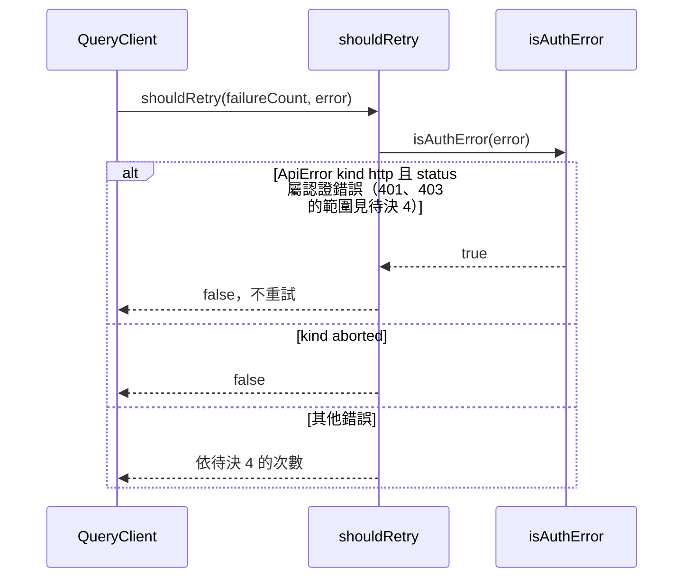
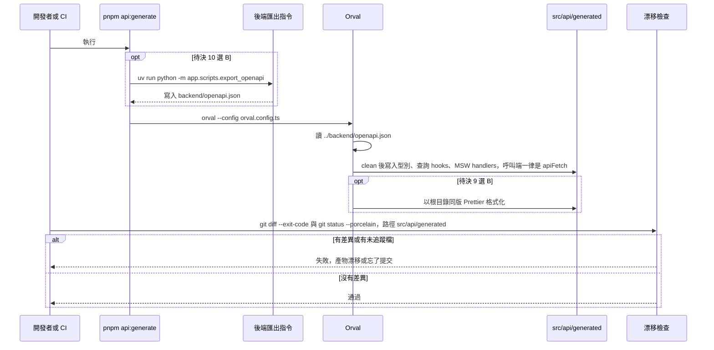
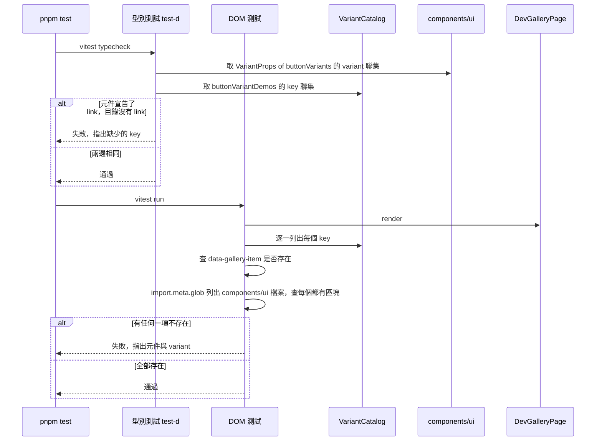

# System Design

本文把 `system-analysis.md` 的能力清單轉成 `frontend/` 骨架的技術藍圖。本 change 只動前端，**沒有後端程式、介面描述檔與資料模型的異動**；需要後端配合的地方都記成待決，不在這裡設計。本 change 沒有 `docs/specs/` 規格（spec-migration D4），設計依據追溯到 ADR 與規則條號。

schema 範本是為後端寫的（Router → Service → Repository／Model）。本文照範本的章節走，但「分層」換成前端的七層（F1、ADR-005 D2），每個關鍵情境的循序圖畫到「產生的查詢 hook 把結果交回呼叫它的元件、元件算出要顯示哪一種狀態」為止，不畫畫面；畫面長相屬 `ui-design.md`。

已定案、照寫不再列待決的事：

- 後端契約的三件裁定（維護者 2026-11-10）：路徑前綴 `/api/v1`、成功回應包一層 envelope、後端模組內分層。前端只消費它們。
- envelope 六欄 `{ success, code, message, data, timestamp, traceId }`、錯誤套同一個外層、JSON 一律 camelCase、不用 Storybook 改用元件展示頁、日期套件用 day.js 只在 `src/lib/date.ts` 使用（#503 裁定 1–5，2026-11-20）。
- 兩頁的畫面 artifact（`Main.dc.html`、`Gallery.dc.html`）已核可（維護者 2026-11-20）。

system-analysis 的 16 條待決與 6 條需求矛盾**本文一條都不替維護者決定**。設計依賴其中某一條的地方，本文把選項與各自的影響寫出來、標「待決 #n」，留給 clarification 停點；本文另外發現的問題記成 N1–N8，見 [§技術待決問題](#技術待決問題)。

## 分層與類別

### 目錄結構

```text
frontend/
├─ package.json                  pnpm 專案；版號 0.0.0（後端 clarification Q7，Hard Rule 4）；工作區結構見待決 #8
├─ index.html
├─ vite.config.ts                Vite、@vitejs/plugin-react、@tailwindcss/vite、路徑別名 @ → src
├─ vitest.config.ts              environment jsdom、setupFiles、typecheck（完整性的型別測試）
├─ tsconfig.json                 strict 加額外旗標，見「型別檢查」
├─ eslint.config.js              flat config；分層、禁用 any、單一入口的 lint
├─ orval.config.ts               input ../backend/openapi.json → src/api/generated/
├─ components.json               shadcn/ui CLI 設定（aliases 指向 @/components/ui、@/lib/utils）
├─ public/                       （待決 #7 選 B 時才有 mockServiceWorker.js）
└─ src/
   ├─ main.tsx                   createRoot 與 import styles；歸 app 層
   ├─ app/                       組裝層，可 import 全部
   │  ├─ app.tsx                 AppProviders 包住 RouterProvider
   │  ├─ providers.tsx           QueryClientProvider
   │  ├─ query-client.ts         createQueryClient、shouldRetry
   │  └─ router.tsx              createAppRouter；開發用路由的掛法見待決 #1
   ├─ pages/
   │  ├─ dev-health/             /dev/health：只組合 features/system-health
   │  └─ dev-gallery/            /dev/gallery：元件展示頁、variant 目錄與完整性測試
   ├─ features/
   │  └─ system-health/          健康檢查的業務元件與四種狀態的對應；index.ts 是公開邊界
   ├─ components/ui/             shadcn/ui 原語（Button、Input、Badge、Alert、Card、Skeleton、Empty），不知道業務
   ├─ api/
   │  ├─ mutator.ts              apiFetch（唯一出口）、ErrorType、BodyType
   │  ├─ api-error.ts            ApiError 與 isApiError、isAuthError
   │  ├─ envelope.ts             外層的型別 guard 與 EnvelopeData 型別
   │  ├─ config.ts               readApiConfig：base URL 與預設逾時
   │  └─ generated/              Orval 產物，不手改、不納入 lint 與覆蓋率分母
   ├─ lib/
   │  ├─ utils.ts                cn()（shadcn 慣例）
   │  ├─ date.ts                 day.js 單一入口與可注入的時鐘
   │  └─ locale.ts               請求要送的語言偏好（待決 #6）
   ├─ styles/
   │  ├─ index.css               Tailwind 入口、引入 tokens.css 與 theme.css、深色 variant
   │  └─ theme.css               shadcn 語意變數 → tokens.css 的對照層
   └─ test/                      測試支援，不是第八層：只被 *.test.ts(x) 與 vitest setup import
      ├─ setup.ts                jest-dom matcher、MSW server 的 listen／resetHandlers／close
      ├─ msw-server.ts           setupServer(...產生的 handlers)
      └─ envelope-fixtures.ts    以產生的型別組成功與錯誤外層，給測試覆寫 handler 用
```

- **`src/main.tsx` 歸 app 層**：Vite 的慣例入口放在 `src/` 根，只做 `createRoot(...).render(<App />)` 與 `import './styles/index.css'`，lint 把它當 app。
- **`src/test/` 不是第八層**：F1 的七層表沒有它；它只放測試支援，lint 規則寫成「只有 `*.test.ts(x)`、`*.test-d.ts` 與 `vitest.config.ts` 可以 import 它」，產品碼 import 它就失敗，因此不會讓 MSW 與 faker 進正式 bundle。測試檔本身照 ADR-007 D3 與原始碼放同目錄。
- **健康檢查做成一個 feature**：F1 允許 `pages/` 直接呼叫產物，但本頁是後續功能 change 照抄的範本（#505 §需求目標），所以走完整的「page → feature 的 `index.ts` → feature 元件 → 產生的 hook → 唯一出口」，給 #506 的分層檢查一個實際對象。這和後端把健康檢查做成完整四件模組（後端 clarification 結論 14）同一個理由。
- 頁面目錄名用 `dev-` 前綴，讓「開發用」在檔案層級就看得出來；路徑仍是 `/dev/health`、`/dev/gallery`（#505 維護者留言）。

### 分層與允許的 import

依 F1 的分層表寫成 ESLint 規則（`eslint-plugin-boundaries`，元素型別對到下表）；檢查在本機與 apply 時跑，CI job 屬 #506。

| 層         | 位置                       | 可以 import                                         | 本次的內容                    | 依據           |
| :--------- | :------------------------- | :-------------------------------------------------- | :---------------------------- | :------------- |
| app        | `src/app/`、`src/main.tsx` | 全部                                                | router、provider、QueryClient | F1、ADR-005 D2 |
| pages      | `src/pages/<page>/`        | features（只能經 `index.ts`）、components、api、lib | 兩個開發用頁面                | F1             |
| features   | `src/features/<feature>/`  | components、api、lib；不得 import 別的 feature      | `system-health`               | F1             |
| components | `src/components/ui/`       | lib                                                 | 七個原語                      | F1、ADR-005 D3 |
| api        | `src/api/`                 | lib                                                 | 唯一出口、錯誤型別、產物      | F1、A6         |
| lib        | `src/lib/`                 | 無（只靠第三方）                                    | `cn`、日期、語言偏好          | F1、F10        |
| styles     | `src/styles/`              | 無                                                  | Tailwind 入口與對照層         | F1、F6         |
| test 支援  | `src/test/`                | api、lib                                            | MSW server 與外層 fixture     | T6；本文       |

同一份 ESLint 設定另外放這幾條，都是把本次範圍內的條文變成機械檢查，不另立新規則：

| 規則                                                                                                        | 擋什麼                     | 依據            |
| :---------------------------------------------------------------------------------------------------------- | :------------------------- | :-------------- |
| `@typescript-eslint/no-explicit-any`、`no-non-null-assertion`、`no-unsafe-*`（strictTypeChecked）           | `any`、`!`、未收窄的外部值 | F2、Hard Rule 7 |
| `react-hooks/rules-of-hooks`、`exhaustive-deps`                                                             | 條件式呼叫 hook、依賴缺漏  | F3              |
| `no-restricted-imports`：`dayjs`、`dayjs/*` 只准 `src/lib/date.ts`                                          | 日期套件散落各處           | F10             |
| `no-restricted-globals` `fetch` 與 `no-restricted-imports` `axios`：限 `pages/`、`features/`、`components/` | 繞過唯一出口               | A6              |
| `no-restricted-imports`：`msw`、`@faker-js/faker`、`src/test/**`、`src/api/generated/**/*.msw` 只准測試檔   | 替身進正式 bundle          | T6；本文        |
| `ignores: ['src/api/generated/**']`                                                                         | 產物不受 lint 約束         | F2 例外 2、A4   |

### Class Diagram：契約鏈（健康檢查一條請求走過的單元）

TypeScript 的模組與函式以 `<<module>>`、`<<function>>`、`<<hook>>` 標示；產物以 `<<generated>>` 標示，它的實際名稱由 Orval 依 `operationId` `getHealth` 產生（`useGetHealth`、`getHealth`、`getGetHealthQueryKey`、`getGetHealthMockHandler`），本文寫的是預期名稱，以實際產出為準。



### Class Diagram：元件展示頁、對照層與產生管線



本次沒有業務 Model 與資料表，classDiagram 不畫 Model。

### 元件清單

| 元件                                   | 層         | 職責                                                                                                                                                                                                                                                                                      | 依據                              |
| :------------------------------------- | :--------- | :---------------------------------------------------------------------------------------------------------------------------------------------------------------------------------------------------------------------------------------------------------------------------------------- | :-------------------------------- |
| `apiFetch(config, options?)`           | api        | Orval 的 mutator，前端唯一的 HTTP 出口。集中 base URL、`credentials: 'include'`、`Accept-Language`、`AbortSignal`、逾時、拆外層、把錯誤轉成 `ApiError`。CSRF 標頭與 `401` 換發屬 01-01，本次不留空殼                                                                                      | A6、A7、S2、ADR-003 D6            |
| `ErrorType<E>`、`BodyType<B>`          | api        | 從 `mutator.ts` 匯出，Orval 會用它們當產生 hook 的錯誤與 body 型別：`ErrorType<E> = ApiError`，所以**每一個**產生的 hook 的 `error` 都是 `ApiError`，不是 `unknown` 或產物的 `ErrorResponse`                                                                                              | A7、F2                            |
| `ApiError`                             | api        | 單一錯誤型別，`kind` 區分五種來源；`status`、`code`、`traceId`、`fieldErrors` 在沒有值時是 `null`。`message` 在 `kind: 'http'` 時是後端已本地化的外層 `message`（A8 不透明字串），其他 kind 是英文診斷字串（A7 例外）                                                                     | A7、A8                            |
| `isApiError`、`isAuthError`            | api        | type guard；`isAuthError` 判定「認證錯誤」，涵蓋哪些 status 見待決 #4                                                                                                                                                                                                                     | A7、F2                            |
| `isSuccessEnvelope`、`isErrorEnvelope` | api        | 把回應 body 當 `unknown` 收窄；不符合外層形狀就是 `invalidResponse`，不靠型別斷言                                                                                                                                                                                                         | F2、A7                            |
| `EnvelopeData<T>`                      | api        | 型別層的拆外層：`T extends { data: infer D } ? D : T`。產生的函式寫成 `apiFetch<HealthDataResponse>(...)`，回傳型別就變成 `HealthData`，產物不必改、也沒有型別說謊。回傳形狀見待決 #2                                                                                                     | A6、F2；N3                        |
| `readApiConfig(env)`                   | api        | 讀 `VITE_API_BASE_URL`（可空，空值代表同源相對路徑），驗證是 `http(s)` 絕對網址且不以 `/` 結尾，不合法就在啟動時丟錯；預設逾時是常數（值見待決 #5）。此變數會被打包進前端，**不是祕密**                                                                                                   | A6、Hard Rule 8、9                |
| `getRequestLocale()`                   | lib        | 回傳要送的語言偏好；本次的值見待決 #6。放 `lib/` 讓之後 07-01 的語言切換只改這裡                                                                                                                                                                                                          | A6、A8                            |
| `createQueryClient(overrides?)`        | app        | 建 `QueryClient`，`retry` 用 `shouldRetry`；`overrides` 只給測試傳入（例如測試要確認重試行為時保留預設、其他測試可關掉重試以免等待）。正式只建一次，放在 `providers.tsx` 的模組層級                                                                                                       | A7、A9                            |
| `shouldRetry(failureCount, error)`     | app        | `isAuthError(error)` 一律回 `false`；其他錯誤的次數見待決 #4；`kind: 'aborted'` 回 `false`                                                                                                                                                                                                | A7、#505 §包含                    |
| `createAppRouter()`                    | app        | `createBrowserRouter`；兩條開發用路徑以 `lazy` 載入；是否只在 `import.meta.env.DEV` 掛載見待決 #1；根路徑與找不到頁面見待決 #15                                                                                                                                                           | ADR-005 D1、#505                  |
| `DevHealthPage`                        | pages      | 只渲染 `HealthStatusPanel`，不呼叫 hook                                                                                                                                                                                                                                                   | F1                                |
| `HealthStatusPanel`                    | features   | 呼叫 `useGetHealth()`，把查詢結果交給 `toHealthViewState`，依結果選畫面；「重新檢查」呼叫 `refetch()`。畫面長相屬 `ui-design.md`                                                                                                                                                          | F3、F8、A9                        |
| `toHealthViewState(query)`             | features   | 純函式：查詢狀態 → 四種狀態之一。`isFetching` → `loading`；成功 → `ok`；`ApiError` 且 `code === 'DATABASE_UNAVAILABLE'` → `databaseUnavailable`；`kind` 是 `network` 或 `timeout` → `unreachable`；其餘歸哪一種見待決 #3。依 `code` 而不是 `status` 判斷，因為 `503` 之後可能有別的錯誤碼 | F8、A7「不得用錯誤字串猜 status」 |
| `formatDateTime`、`now`、`setClock`    | lib        | day.js 加 utc、timezone 外掛的唯一 import 處；顯示依瀏覽者裝置時區；測試以 `setClock` 或 `vi.setSystemTime` 固定「現在」                                                                                                                                                                  | F10、#503 裁定 5                  |
| `cn()`                                 | lib        | `clsx` 加 `tailwind-merge`，shadcn 慣例                                                                                                                                                                                                                                                   | ADR-005 D3                        |
| `components/ui/*`                      | components | shadcn/ui 原語；是否為了 artifact 的 variant 修改原始碼見待決 #11                                                                                                                                                                                                                         | ADR-005 D3、F6                    |
| `VariantCatalog`                       | pages      | 每個有 variant 的原語一份 `Record<宣告的 variant, 展示>`，key 型別來自 `VariantProps<typeof xxxVariants>`，**不手抄 variant 清單**；沒有 cva 的原語（Input 的三種狀態、Card 的三個區塊、Skeleton、Empty）由目錄自己宣告                                                                   | ADR-005 D3；N1                    |
| `GallerySection`                       | pages      | 一個原語一個區塊，每個展示項目帶 `data-gallery-item="<component>:<axis>:<value>"`，給完整性測試查                                                                                                                                                                                         | ADR-005 D3                        |
| `styles/theme.css`                     | styles     | shadcn 語意變數指向 tokens.css 的變數名（`--background: var(--color-surface)` 等），再以 `@theme inline` 接到 Tailwind 的 `--color-*`；**沒有任何色碼**                                                                                                                                   | F6、ADR-005 D4                    |
| `styles/index.css`                     | styles     | `@import "tailwindcss"`、引入 tokens.css 與 theme.css、`@custom-variant dark` 吃 `[data-theme="dark"]`；tokens.css 的引入方式見 N2                                                                                                                                                        | F6、ADR-005 D4                    |
| `orval.config.ts`                      | 設定       | 一份 config：`input` 指向 `../backend/openapi.json`；`output` 用 `client: 'react-query'`、`mock: true`（MSW）、`clean: true`（舊檔不殘留，A4 的「加檔」也算手改）、`override.mutator` 指向 `apiFetch`、`override.query.signal: true`；格式化選項見待決 #9                                 | A4、A5、ADR-003 D6                |
| `src/test/msw-server.ts`、`setup.ts`   | test 支援  | `setupServer` 載入 Orval 產生的 handlers；測試以 `server.use(...)` 覆寫成 `503` 外層或 `HttpResponse.error()`，**不改產物**；`onUnhandledRequest: 'error'`，沒被攔到的請求讓測試失敗                                                                                                      | T6、A4                            |
| `src/test/envelope-fixtures.ts`        | test 支援  | `errorEnvelope({ status, code, message, traceId })` 等，回傳型別是產物的 `ErrorResponse`，欄位改名時測試會在型別檢查失敗；不含任何答案或真實身分                                                                                                                                          | T6、Hard Rule 6                   |

### 關鍵設計細節

#### 唯一出口的處理順序

`apiFetch` 由 Orval 產生的函式呼叫；它不知道任何 `operationId`，所以之後新增端點不必改它（Hard Rule 5 的精神：新增不改核心）。

1. 以 `readApiConfig` 的 `baseUrl` 加上產物給的 `url`（已含 `/api/v1`）組網址，`params` 用 `URLSearchParams` 序列化。
2. 標頭：`Accept-Language` 一律帶（值來自 `getRequestLocale()`）；`Content-Type: application/json` **只在有 body 時**加，`GET` 不觸發 preflight（A6 摺疊區塊）。**不送 `X-Correlation-ID`**：讓後端產生，連不上後端時就沒有追蹤編號，與 artifact 狀態 4「traceId 無（請求沒有送達）」一致。
3. `credentials: 'include'`（A6、S2）。這一層是唯一設定它的地方，元件不自己帶（S2 指派的測試）。
4. 取消與逾時：把呼叫端的 `signal`（TanStack Query 傳入）與逾時計時器合成一個 `AbortController`；用自己寫的小函式而不是 `AbortSignal.any`，因為測試環境 jsdom 的支援不一定齊（N6）。以 abort 的 `reason` 分辨是呼叫端取消還是逾時。計時器與監聽在 `finally` 清掉（F3 的 cleanup）。
5. 送出 `fetch`。依結果分類成下表，**每一條都轉成 `ApiError`**，元件看不到原生的 `TypeError`、`DOMException` 或 `Response`。
6. 成功時依 [§回傳形狀](#回傳形狀待決-2) 拆外層後回傳。

| 情況                                             | 判斷方式                         | `kind`                     | `status` | `code`        | `traceId`                                  | `message`                    |
| :----------------------------------------------- | :------------------------------- | :------------------------- | :------- | :------------ | :----------------------------------------- | :--------------------------- |
| `2xx` 且 body 是成功外層                         | `isSuccessEnvelope`              | （不丟錯）                 | —        | —             | —                                          | —                            |
| `204`                                            | status                           | （不丟錯，回 `undefined`） | —        | —             | —                                          | —                            |
| 非 `2xx` 且 body 是錯誤外層                      | `isErrorEnvelope`                | `http`                     | 回應的   | 外層的 `code` | 外層的 `traceId`                           | 外層的 `message`（已本地化） |
| 非 JSON、空 body、或 JSON 但不是外層（含 `2xx`） | 兩個 guard 都不成立              | `invalidResponse`          | 回應的   | `null`        | 回應標頭 `X-Correlation-ID`，沒有則 `null` | 英文診斷字串                 |
| `fetch` 拒絕且不是 abort                         | 捕捉到的值不是 abort             | `network`                  | `null`   | `null`        | `null`                                     | 英文診斷字串                 |
| 逾時                                             | abort reason 是本層的逾時        | `timeout`                  | `null`   | `null`        | `null`                                     | 英文診斷字串                 |
| 呼叫端取消                                       | abort reason 來自呼叫端的 signal | `aborted`                  | `null`   | `null`        | `null`                                     | 英文診斷字串                 |

- `invalidResponse` 涵蓋「代理回了 HTML」與「`VITE_API_BASE_URL` 沒設，請求打到 Vite 開發伺服器、SPA fallback 回 `200` 加 `index.html`」兩種實際會遇到的情況。它是否要在健康檢查頁獨立呈現，見待決 #3。
- 讀 `X-Correlation-ID` 標頭在跨來源時需要後端 `expose_headers`；後端已經公開這個標頭（主規格 `request-correlation`「瀏覽器可以讀到追蹤編號」），不需要後端改動。
- `aborted` 不會被顯示：TanStack Query 取消查詢時自己處理，`shouldRetry` 對它回 `false`。

#### 回傳形狀（待決 #2）

#505 要唯一出口拆外層，但 artifact 的「正常」狀態要顯示 `traceId`。設計上影響範圍只在 `EnvelopeData<T>` 這個型別與 `apiFetch` 的最後一步，但它決定**之後每一個產生 hook 的 `data` 型別**，日後再改屬 A10 的破壞性變更，所以要在本次定。

| 選項                                                                                                                     | `useGetHealth().data` 的型別               | 健康檢查頁「正常」的 `traceId` | 代價                                                                                                       |
| :----------------------------------------------------------------------------------------------------------------------- | :----------------------------------------- | :----------------------------- | :--------------------------------------------------------------------------------------------------------- |
| A 只回 `data`                                                                                                            | `HealthData`                               | 拿不到；畫面要偏離 artifact    | 最貼 #505 原文；「正常」狀態少一欄，要維護者同意畫面偏離                                                   |
| B 回 `{ data, meta }`，`meta` 是 `{ code, message, timestamp, traceId }`                                                 | `{ data: HealthData; meta: ResponseMeta }` | 有                             | 所有呼叫端都寫 `query.data.data`；`select` 可以攤平，但每個 hook 都要寫                                    |
| C 只回 `data`，`meta` 經另一條路交給呼叫端（例如 `apiFetch` 接受 `onMeta` 回呼，或把 meta 掛在不可列舉的 symbol 屬性上） | `HealthData`                               | 有，但只有需要的頁面去拿       | 多一條非標準通道；symbol 屬性會被 TanStack Query 的 structural sharing 丟掉，回呼要經產物的 `options` 傳入 |

選項 A 的「檢查時間」改用 TanStack Query 的 `dataUpdatedAt`（瀏覽器時間）；B、C 可以用伺服器的 `timestamp`。哪個時間才是「檢查時間」也一起由 #2 決定。

#### TanStack Query 的預設值（待決 #4）

| 設定                                | 本次的值                                                                             | 理由                                                                                                   |
| :---------------------------------- | :----------------------------------------------------------------------------------- | :----------------------------------------------------------------------------------------------------- |
| `queries.retry`                     | `shouldRetry`                                                                        | 認證錯誤一律不重試（#505、A7）                                                                         |
| `shouldRetry` 對其他錯誤            | **待決 #4**：A 全部不重試／B 只重試 `network`、`timeout`、`5xx` 一次／C 沿用預設三次 | B 與 C 會讓「資料庫無法連線」最慢要等 `(1 + 次數) × 10 秒` 才出現；A 最快，但暫時性斷線沒有緩衝        |
| `isAuthError` 涵蓋                  | **待決 #4**：`401` 與 `403` 都算，或只有 `401`                                       | A7 已定 `403` 不重試，所以不管哪個選項，`403` 都不重試；差別只在 01-01 實作 `401` 換發時的旗標從哪裡來 |
| `mutations.retry`                   | `false`                                                                              | 寫入不自動重送；本次沒有 mutation，先定下來免得 01-01 各自決定                                         |
| `staleTime`、`refetchOnWindowFocus` | 沿用預設（`0`、`true`）                                                              | 本次沒有理由偏離；各功能需要時在自己的 hook options 覆寫                                               |

`QueryClient` 在 `providers.tsx` 建一次。登出時的 `queryClient.clear()`（A9）屬 01-01。

#### 逾時（待決 #5）

主規格 `health-check`：資料庫連線最多等 5 秒、總耗時不超過 10 秒。前端逾時若短於 10 秒，資料庫不可用會先在前端逾時，被誤判成「連不到後端」。候選：A 15 秒（剛好蓋過後端上限）／B 30 秒（給之後較慢的查詢留空間）。不管選哪個，`ApiFetchOptions.timeoutMs` 讓個別請求覆寫，之後的匯出、評分查詢在自己的 change 設，不改預設。

#### 語言偏好（待決 #6）

A6、A8 要唯一出口送 `Accept-Language`，但 #505 §包含 沒有語系層。`getRequestLocale()` 是接縫，三個選項只差它的內容與本次多不多一塊：

| 選項                                                                  | `getRequestLocale()`                                       | 本次多出的範圍                                   |
| :-------------------------------------------------------------------- | :--------------------------------------------------------- | :----------------------------------------------- |
| A 建語系層（`react-i18next`，`zh-TW`、`en` 兩份、依模組分 namespace） | 回目前 i18next 的語言                                      | 語系初始化、兩頁的介面文字進語系檔、測試         |
| B 不建語系層，固定送 `zh-TW`                                          | 常數 `'zh-TW'`（07-01 §邊界情況 沒設定過語言就是繁體中文） | 無；07-01 時改這一個函式                         |
| C 不建語系層，送瀏覽器的 `navigator.languages`                        | 由瀏覽器語言組 q 值                                        | 無；但瀏覽器語言是英文時後端回英文、介面卻是中文 |

#### Orval 管線（待決 #9、#10，N3）

- `orval.config.ts` 是唯一的產生設定；產物整個資料夾由 Orval 擁有（`clean: true`），不手改、不加檔（A4）。
- 產生的 hook 型別依賴 `EnvelopeData<T>` 能穿過 Orval 產生的程式。Orval 的 react-query 產物以 `Awaited<ReturnType<typeof getHealth>>` 推導 `data` 型別，所以只要產生的 `getHealth` **沒有**被 Orval 加上明確的回傳型別註記，`apiFetch` 的回傳型別就會一路傳到 hook；這要在實作第一步以實際版本確認（N3）。
- 格式化（待決 #9）：CI 的 `format` job 跑 `prettier --check .`，會檢查 `frontend/` 底下所有 `.ts`、`.tsx`，包括產物；pre-commit 的 lint-staged 規則（`.lintstagedrc.mjs`）**不含** `ts`、`tsx`，所以提交時不會改寫產物，但 CI 會擋下沒格式化的產物（這是需求矛盾 #3 的精確形狀）。候選：A 把 `frontend/src/api/generated/` 加進 `.prettierignore`，比照 `backend/openapi.json`／B 讓 Orval 輸出後用同一版 Prettier 格式化（`output.prettier: true` 或 `hooks.afterAllFilesWrite`），產物本身就是格式化後的樣子。B 要求 `frontend/` 與根目錄用同一版 Prettier，連動待決 #8。
- 一條指令的範圍（待決 #10）：候選 A `pnpm api:generate` 只跑 Orval，讀已提交的 `backend/openapi.json`；從後端匯出到 Orval 的整條指令放根目錄、屬 #506／B `pnpm api:generate` 先跑 `uv run python -m app.scripts.export_openapi` 再跑 Orval，前端指令會依賴 Python 工具鏈。

#### 網路替身（待決 #7）

測試一律用 `msw/node` 的 `setupServer`，在 `src/test/setup.ts` 啟停。待決 #7 只決定**開發時**要不要能在瀏覽器切到替身：

| 選項           | 多出的東西                                                                                                                                                                                                                                        |
| :------------- | :------------------------------------------------------------------------------------------------------------------------------------------------------------------------------------------------------------------------------------------------ |
| A 只在測試用   | 無                                                                                                                                                                                                                                                |
| B 開發時也能用 | `public/mockServiceWorker.js`（MSW CLI 產生，要比照產物不手改並排除 Prettier）、`VITE_API_MOCKING` 開關、在 `main.tsx` 以 `import.meta.env.DEV` 守住的動態 import、一個切換四種情境的方式（例如網址參數）；`src/test/` 的 lint 例外要放寬給這一處 |

#### 開發用路由（待決 #1、#15）

| 選項                                        | 做法                                                                                                 | #506「容器起來後健康檢查頁顯示成功」                                                 |
| :------------------------------------------ | :--------------------------------------------------------------------------------------------------- | :----------------------------------------------------------------------------------- |
| A 只在開發環境（artifact 假設 1）           | `if (import.meta.env.DEV)` 才把兩條路由加進 route 陣列；Vite 在正式建置把整段與 `lazy` 的 chunk 剪掉 | 容器裡打不到；#506 要改驗收方式（例如直接打 `/api/v1/health`，或 e2e 跑 dev server） |
| B 以建置旗標開關（`VITE_ENABLE_DEV_PAGES`） | 同 A，但條件換成旗標；#506 的容器建置打開                                                            | 可以；但正式建置要記得關，多一個會出錯的設定                                         |
| C 健康檢查頁進正式建置、元件展示頁只在開發  | 健康檢查無條件掛載，元件展示頁仍以 `DEV` 守住                                                        | 可以；正式環境多一頁公開的狀態頁                                                     |

根路徑與找不到的路徑（待決 #15）：候選 A 根路徑導向 `/dev/health`（開發時）／B 根路徑與 `*` 都顯示一個最小的「找不到頁面」／C 本次不處理、交給 01-01。選 A 時正式建置的根路徑仍要有東西，所以 A 要搭配 B 或 C。

不管選哪個，正式建置之後以 `pnpm build` 的產出檢查 `dist/` 不含 `msw`、`@faker-js/faker` 與（選 A 時）`/dev/` 的字串，作為 acceptance 的一步。

#### 本機開發的跨來源

依 ADR-005 D1 §後果「開發時單頁應用與 API 在不同 origin，FastAPI 的 CORS 要明確列出 `allow_origins`」：開發時前端在 Vite（`http://localhost:5173`，`server.strictPort: true` 固定埠號），以 `VITE_API_BASE_URL=http://localhost:8000` 直接打後端，**不設 Vite proxy**。後端 `CORS_ALLOWED_ORIGINS` 要含 `http://localhost:5173`。後端已允許 `Accept-Language`、`Content-Type`、`X-Correlation-ID` 三個請求標頭並公開 `X-Correlation-ID`，`allow_credentials=True`，不需要後端改動。正式環境由 Nginx 同源服務，`VITE_API_BASE_URL` 留空。兩個變數的範例值交給 #506 寫進 `.env.example`。

不用 proxy 的理由：proxy 會讓開發時看不到 CORS 與 `expose_headers` 的問題，等到 01-01 的 cookie 認證才發現；ADR-005 已經寫明開發時是跨來源。

#### Token 對照層（待決 #14，N2）

- `theme.css` 只寫「shadcn 語意變數 → tokens.css 變數名」，**不寫任何色值**（F6）。tokens.css 自己在 `html[data-theme="dark"]` 重新定義同名變數，所以**對照層不需要深色分支**：`--background: var(--color-surface)` 在深色下自動解析到深色的 `--color-surface`。深色要做的只剩 `@custom-variant dark (&:where([data-theme="dark"], [data-theme="dark"] *))`，讓 `dark:` utility 吃同一個屬性（ADR-005 D4）。
- 待決 #14 因此縮小成「元件展示頁要不要提供切換 `data-theme` 的開關來驗證」，對照層本身的深色是免費的。若某個 shadcn 變數在深色要對到**另一個** tokens.css 變數，才需要深色分支，到時在 `ui-design.md` 的 token 落點表逐一列出（F6 摺疊區塊第 1 點）。
- 映射清單（哪個 shadcn 變數對到哪個 tokens.css 變數、`--color-cta` 這類 shadcn 沒有的語意走哪一條）屬 `ui-design.md`（F6 第 1 點明文要求），本文不重寫。
- tokens.css 的引入方式見 N2：直接 `@import` 會一併帶進 Google Fonts 的外部 `@import url(...)`、`body` 與標題的全域樣式，以及會覆蓋 Tailwind v4 `rounded-*`、`font-sans` 的 `--radius-*`、`--font-sans`（F6 摺疊區塊第 2 點）。

#### 元件展示頁的完整性測試（待決 #11，N1）

「宣告的 variant」要有一個執行期拿得到、又不必手抄的來源。shadcn 的元件以 `cva` 宣告 variant，而 `cva` 回傳的函式**不公開**它的設定，執行期列舉不到。本文的設計分兩半，兩半合起來才擋得住漏寫：

1. **宣告 → 目錄（型別測試）**：`VariantCatalog` 的每一份都寫成 `satisfies Record<NonNullable<VariantProps<typeof buttonVariants>['variant']>, Demo>`。元件多宣告一個 variant，目錄少一個 key 就是型別錯誤。為了讓 `pnpm test` 也失敗（不只 `pnpm typecheck`），以 Vitest 的型別測試（`*.test-d.ts`，`expectTypeOf<keyof typeof buttonVariantDemos>().toEqualTypeOf<ButtonVariant>()`）鎖住。
2. **目錄 → 畫面（DOM 測試）**：render `DevGalleryPage`，對目錄裡每一個 key 斷言 `[data-gallery-item="button:variant:<key>"]` 存在；另以 `import.meta.glob('/src/components/ui/*.tsx')` 列出原語檔案，斷言每一個都有對應的區塊，新增原語沒放進展示頁也會失敗。

這是 render 出來的 DOM 斷言，不是 grep 原始碼，T3 的「自證測試」不適用；但第 1 半是型別層檢查，依 T3 要標成型別測試、不當成功能驗收的唯一依據。這個做法**不需要改 shadcn 原始碼**。另一個做法（N1 選項 B）是在每個原語匯出 `as const` 的 variant 陣列讓 `cva` 從它建，執行期就能列舉，但要改 shadcn 的原始碼，連動待決 #11。

不論 #11 怎麼決定，artifact 本身就已經要求改原語：Button 的 `cta` 與 loading、Badge 的 success／warning／error／info／neutral、Alert 的四種都不是 shadcn 預設有的 variant；另外 shadcn 預設的 Button 有 `link`，artifact 只列六種且示意圖把 `link` 當成「漏寫」的例子（N5）。

#### 型別檢查

`tsconfig` 開 `strict`，另開 `noUncheckedIndexedAccess`、`noImplicitOverride`、`noFallthroughCasesInSwitch`、`noUnusedLocals`、`noUnusedParameters`、`verbatimModuleSyntax`。`src/api/generated/` 也在型別檢查範圍內，`skipLibCheck` 救不了它，所以**旗標要選 Orval 產物編得過的**：`exactOptionalPropertyTypes` 與 Orval 產生的 options 型別常衝突，本次不開（N4）。型別檢查指令是 `tsc -b`（各 tsconfig 設 `noEmit`）。

#### 測試

| 測試                                                  | 層          | 驗什麼                                                                                                                             | 依據                 |
| :---------------------------------------------------- | :---------- | :--------------------------------------------------------------------------------------------------------------------------------- | :------------------- |
| `api/mutator.test.ts`                                 | unit        | 上表七種情況各一；請求帶 `credentials: 'include'` 與 `Accept-Language`；`GET` 沒有 `Content-Type`；base URL 組合；逾時以假時鐘推進 | A6、A7、S2           |
| `app/query-client.test.ts`                            | unit        | 認證錯誤不重試；`aborted` 不重試；其他錯誤依待決 #4 的結果                                                                         | A7                   |
| `features/system-health/to-health-view-state.test.ts` | unit        | 查詢狀態到四種狀態的對應；四種以外的回應依待決 #3                                                                                  | F8                   |
| `features/system-health/health-status-panel.test.tsx` | integration | 經 MSW、真的 `QueryClient` 與 `apiFetch`，四種狀態各一；「重新檢查」回到載入中                                                     | #505 驗收第 3 項、T6 |
| `pages/dev-gallery/*.test-d.ts`、`*.test.tsx`         | unit        | 完整性的兩半                                                                                                                       | #505 驗收第 4 項     |
| `lib/date.test.ts`                                    | unit        | 同一個 UTC 時間點在不同時區下的顯示；不依賴真實時間                                                                                | F10                  |

「真實後端下顯示對應狀態」（#505 驗收第 3 項的另一半）本次以 `acceptance.md` 的人工步驟驗：SQLite 啟動後端 → 正常；`DATABASE_URL` 指向不存在的 PostgreSQL → 資料庫無法連線；停掉後端 → 連不到後端。自動化的那一半屬 #506 的 e2e。覆蓋率見待決 #13：選擇產出時用 `@vitest/coverage-v8`，`exclude` 產物、`src/test/`、設定檔（T10）。

#### 專案結構與要補進 `openspec/config.yaml` 的指令（待決 #8）

| 選項                                         | 安裝與 lockfile                                        | 指令寫法                          |
| :------------------------------------------- | :----------------------------------------------------- | :-------------------------------- |
| A `frontend/` 是獨立的 pnpm 專案             | `cd frontend && pnpm install`，自己的 `pnpm-lock.yaml` | `cd frontend && pnpm <script>`    |
| B 根目錄 `pnpm-workspace.yaml` 收 `frontend` | 根目錄一次 `pnpm install`，共用根目錄的 lockfile       | `pnpm --filter frontend <script>` |

不論哪個選項，`frontend/package.json` 提供這幾個 script，並依 #505 驗收第 5 項以「動到 `frontend/` 時」的形式補進 `operations.apply.guidance`（以選項 A 的寫法示意）：

- `cd frontend && pnpm lint`
- `cd frontend && pnpm typecheck`
- `cd frontend && pnpm test`（含型別測試）
- `cd frontend && pnpm build`
- `cd frontend && pnpm api:generate && git diff --exit-code -- src/api/generated && test -z "$(git status --porcelain -- src/api/generated)"`（比照後端的契約漂移指令；範圍依待決 #10）

## 關鍵情境

規格（`specs/**/spec.md`）還沒寫；以下標題是本文提議的 Scenario 名稱，planner 寫 spec 時沿用同一個名字。每張圖畫到 `toHealthViewState` 或測試斷言得出結果為止，不畫畫面。`Net` 參與者在測試時是 MSW 的 handler，在人工驗收時是真的後端，兩者在 `apiFetch` 看來沒有差別（T6：替身設在網路邊界）。

### Scenario: 後端與資料庫正常時健康檢查頁顯示正常



### Scenario: 資料庫無法連線時健康檢查頁顯示資料庫無法連線



### Scenario: 連不到後端時健康檢查頁顯示連不到後端



### Scenario: 健康檢查頁在等待回應時顯示載入中並可重新檢查



### Scenario: 唯一出口把非外層回應轉成單一錯誤型別



### Scenario: 認證錯誤不重試

本次沒有需要認證的端點，這張圖以測試裡的 `ApiError` 直接驗 `shouldRetry`；01-01 的 `401` 換發與重送會插在 `apiFetch` 內，不改這裡。



### Scenario: 一條指令由介面描述檔重產呼叫層



### Scenario: 元件展示頁的完整性測試擋下漏寫的 variant



## 資料模型異動

本次無資料模型異動。不讀寫任何業務資料，資料表字典、ER 與 Alembic migration 都不動。

## 權限檢查點

- **本次沒有受保護的能力**，PRD §權限矩陣 的角色碰不到任何東西（system-analysis §涉及的角色）。唯一呼叫的端點 `GET /api/v1/health` 是刻意公開的（主規格 `health-check`「健康檢查刻意公開」，後端 clarification Q4），所有呼叫端拿到的內容相同，沒有遮蔽欄位。權限沒有超出矩陣。
- **前端不做授權**：本次沒有路由守衛（屬 01-01），也不把角色放進任何前端狀態（F4、S3）。唯一出口設 `credentials: 'include'`、不讀也不存任何 token（S2）；01-01 之後的授權仍一律由後端判定，前端只依 `403`、`404` 呈現。
- **測試集答案不外露（Hard Rule 6）**：本次不碰任務、資料集與答案。MSW 的 handler 由 Orval 依介面描述檔產生，`src/test/envelope-fixtures.ts` 只組健康檢查的外層，沒有任何答案或測試集辨識資訊（T6）。延續到後續的風險：產生的 MSW handler 會照介面描述檔裡的**每一個**回應 schema 產假資料，所以「標記員可達的回應不含答案」要靠後端 S5 讓那些 schema 本來就沒有答案欄位，前端無法、也不應該在這一層補救。
- **任務設定驅動（Hard Rule 5）**：唯一出口、錯誤型別、QueryClient 都不認識任何 `operationId` 或任務類型，新增端點只靠重產。元件展示頁之後要列標記 widget（ADR-005 D3）時，widget 的 variant 要依設定的 output type 來自 widget 自己的宣告，完整性測試沿用本次「從宣告推導、不手抄清單」的做法，不在測試裡寫死任一種任務。

## 技術待決問題

### system-analysis 待決問題與需求矛盾的處理

本文不替維護者決定。下表寫出每一條在設計上的落點與候選，狀態全部維持「待決」，交給 clarification 停點。

| 待決           | 主題                          | 設計上的落點                                                         | 候選（詳見各節）                                                                                               | 狀態 |
| :------------- | :---------------------------- | :------------------------------------------------------------------- | :------------------------------------------------------------------------------------------------------------- | :--- |
| 1（含矛盾 1）  | 兩頁進不進正式建置            | `createAppRouter` 的掛載條件；`dist/` 的檢查                         | A 只在 DEV／B 建置旗標／C 健康檢查頁進正式、展示頁只在 DEV                                                     | 待決 |
| 2（含矛盾 2）  | 拆外層後成功時給不給 meta     | `EnvelopeData<T>` 與 `apiFetch` 最後一步；所有 hook 的 `data` 型別   | A 只回 data／B 回 `{ data, meta }`／C data 加另一條 meta 通道                                                  | 待決 |
| 3              | 四種狀態以外的回應            | `toHealthViewState` 的其餘分支；`ApiError.kind` 已能區分             | 例：`invalidResponse` 與 `404`／`405`／`406`／`500` 歸「連不到後端」、或新增第五種「回應異常」（要改核可畫面） | 待決 |
| 4              | 重試政策與「認證錯誤」範圍    | `shouldRetry`、`isAuthError`                                         | A 全不重試／B 只重試 network、timeout、5xx 一次／C 預設三次；`isAuthError` 含不含 `403`                        | 待決 |
| 5              | 請求逾時                      | `readApiConfig` 的預設；`ApiFetchOptions.timeoutMs`                  | A 15 秒／B 30 秒；都必須大於後端的 10 秒                                                                       | 待決 |
| 6              | 語系層與送出的語言            | `getRequestLocale()`                                                 | A 建 react-i18next／B 固定 `zh-TW`／C 用瀏覽器語言                                                             | 待決 |
| 7              | 網路替身用在哪                | `src/test/` 與（B 時）`main.tsx`、`public/`                          | A 只測試／B 開發時也可切換                                                                                     | 待決 |
| 8              | 獨立專案或工作區              | 安裝方式、lockfile、`config.yaml` 指令寫法、Prettier 版本來源        | A 獨立專案／B 根目錄 pnpm workspace                                                                            | 待決 |
| 9（含矛盾 3）  | 產物與 Prettier               | `.prettierignore` 或 `orval.config.ts`                               | A 排除產物／B Orval 輸出後用同版 Prettier 格式化；另見 N7                                                      | 待決 |
| 10             | 一條命令的範圍                | `api:generate` script                                                | A 只跑 Orval、整條鏈屬 #506／B 先匯出再 Orval                                                                  | 待決 |
| 11（含矛盾 6） | 為 artifact 改 shadcn 原始碼  | `components/ui/` 的 Button、Badge、Alert；完整性測試的宣告來源       | 允許改原語原始碼加 variant／不改、改用包一層的元件；`cta` 的 token 落點另由 `ui-design.md` 列                  | 待決 |
| 12（含矛盾 4） | 開發頁顯示內部資料            | `HealthStatusPanel` 顯示 `code`、`traceId`；要不要做共用錯誤元件     | 開發頁視為例外、不做共用元件／同時做一個業務頁共用的錯誤顯示元件並定露出欄位                                   | 待決 |
| 13             | 覆蓋率基準                    | `vitest.config.ts` 的 coverage 設定與 `acceptance.md`                | 本次產出並記基準（分母排除產物）／交給 #506                                                                    | 待決 |
| 14             | 深色範圍                      | 已縮小：對照層的深色由 tokens.css 自動提供，只剩展示頁要不要切換開關 | 展示頁加 `data-theme` 切換／本次不加                                                                           | 待決 |
| 15             | 根路徑與找不到頁面            | `createAppRouter` 的 `/` 與 `*`                                      | A 導向 `/dev/health`／B 最小的找不到頁面／C 交給 01-01                                                         | 待決 |
| 16（含矛盾 5） | `rules.ui-design` 的 ADR 編號 | `openspec/config.yaml`（本 change 本來就要改它）                     | 順手改成 ADR-005／另開 issue                                                                                   | 待決 |

`system-analysis` §跨模組依賴 交給本文決定的一件事已定：**開發時前端與後端跨來源、不用 proxy**，依據 ADR-005 D1，見 [§本機開發的跨來源](#本機開發的跨來源)。

### 本文新發現的待決問題

| #   | 問題                                                                                                                                                                                                                                                                                                                                                                                                                                                                                                                                                                                                                                                                                                                                                    | 影響                                                                                       | 狀態                                                                    |
| :-- | :------------------------------------------------------------------------------------------------------------------------------------------------------------------------------------------------------------------------------------------------------------------------------------------------------------------------------------------------------------------------------------------------------------------------------------------------------------------------------------------------------------------------------------------------------------------------------------------------------------------------------------------------------------------------------------------------------------------------------------------------------ | :----------------------------------------------------------------------------------------- | :---------------------------------------------------------------------- |
| N1  | 完整性測試的「宣告的 variant」從哪裡來？`cva` 執行期不公開設定。選項 A：型別推導（`VariantProps` 加 `satisfies Record`）加 Vitest 型別測試加 DOM 測試，不改 shadcn 原始碼，但「宣告→目錄」那一半是型別層檢查／選項 B：每個原語匯出 `as const` 的 variant 陣列、`cva` 從它建，執行期可列舉，但要改原語原始碼（連動待決 #11）                                                                                                                                                                                                                                                                                                                                                                                                                             | 完整性測試的寫法；#505 驗收第 4 項「測試能擋下」由型別測試擋算不算數（T3）                 | 待決，連動 #11                                                          |
| N2  | tokens.css 不能改（`design/` 不在範圍），但直接 `@import` 會帶進：Google Fonts 的外部 `@import url(...)`（本機離線與 Lite 部署會讀不到、開發時對外連線）、`body` 與 `h1`–`h3`、`.display`、`code` 的全域樣式、以及 `--radius-sm/md/lg/xl` 與 `--font-sans`（不在 cascade layer 裡，會蓋過 Tailwind v4 theme layer 的同名變數：`rounded-md` 由 6px 變 8px、`rounded-lg` 由 8px 變 12px、`rounded-xl` 由 12px 變 16px，`font-sans` 換成 Inter）。選項：A 全檔引入並在 PR 列出被改的 utility（F6 第 2 點的要求）／B 以 `@import ... layer(tokens)` 引入，排在 Tailwind 的 `theme` layer 之前，全域樣式與 radius 退到 Tailwind 之下，但外部字型仍會載入／C 建置時只抽出 `:root` 與 `html[data-theme="dark"]` 的自訂屬性（多一支小的 Vite 外掛，產物不提交） | 對照層的引入方式；所有 `rounded-*` 與字型的實際長相；外部連線；`ui-design.md` 的字型與圓角 | 待決（需要維護者決定能不能接受外部字型與全域樣式；與 `ui-design` 同步） |
| N3  | `EnvelopeData<T>` 要能穿過 Orval 產生的程式：前提是 Orval 產生的請求函式不加明確回傳型別。若實際版本會加，備案是 Orval 的 `input.override.transformer` 在產生前把 200 回應的 schema 換成 `data` 那一層，但那會讓產物與介面描述檔的形狀不一致                                                                                                                                                                                                                                                                                                                                                                                                                                                                                                            | 待決 #2 不論選哪個都受影響；實作第一步要先以實際版本確認                                   | 技術風險，apply 第一組確認；確認失敗時回到 clarification                |
| N4  | 型別檢查「最嚴格」的範圍：`exactOptionalPropertyTypes` 常與 Orval 產物衝突，產物在 `src/` 內、`skipLibCheck` 不涵蓋。本文提議不開它，其他額外旗標照開                                                                                                                                                                                                                                                                                                                                                                                                                                                                                                                                                                                                   | `tsconfig` 的旗標清單；之後若要開，得把產物移出型別檢查範圍                                | 提議，可由 clarification 以「不需維護者決定」結論收下                   |
| N5  | artifact 的 Button 只列六種 variant，而 shadcn 預設的 Button 宣告七種（多 `link`），示意圖又拿 `link` 當「漏寫就失敗」的例子。要刪掉 `link`（改原語）還是展示頁補上 `link`（畫面多一格）？                                                                                                                                                                                                                                                                                                                                                                                                                                                                                                                                                              | `components/ui/button.tsx` 的內容；展示頁的格數；完整性測試的第一個實例                    | 待決，連動 #11                                                          |
| N6  | 合成 signal 用自寫的小函式而不是 `AbortSignal.any`，理由是 jsdom 的支援不一定齊；若實作時確認 jsdom 與目標瀏覽器都支援，可改用標準 API                                                                                                                                                                                                                                                                                                                                                                                                                                                                                                                                                                                                                  | `apiFetch` 的一小段實作                                                                    | 提議，實作時確認                                                        |
| N7  | `.lintstagedrc.mjs` 只格式化 `json,md,yml,yaml,css,js,mjs`，不含 `ts,tsx`；`frontend/` 的手寫 `.ts`、`.tsx` 在提交時不會被格式化，卻會被 CI 的 `prettier --check .` 擋下。要不要在本 change 把 `ts,tsx` 加進 lint-staged（同時決定產物是否排除，見待決 #9）？                                                                                                                                                                                                                                                                                                                                                                                                                                                                                           | 每個前端提交的開發體驗；`.lintstagedrc.mjs` 是否在本 change 的修改範圍                     | 待決                                                                    |
| N8  | 元件展示頁的「Token 對照」區塊要顯示「shadcn 變數 ← tokens.css 變數」。對照的唯一來源是 `styles/theme.css`，但 F1 不讓 `pages/` import `styles/`；在 TS 再寫一份對照就是兩個真相。選項：A 以 `?raw` 讀 `theme.css` 解析 `--x: var(--y)`，lint 為這一頁開一個具名例外／B 只顯示語意變數名與執行期 `getComputedStyle` 解析出的值，不顯示 tokens.css 的名字（畫面偏離 artifact）／C 對照改成 TS 資料、由建置產生 CSS                                                                                                                                                                                                                                                                                                                                       | 展示頁的 Token 區塊與它的測試；F1 是否開例外                                               | 待決（與 `ui-design` 同步）                                             |

### 快取、生命週期與效能

範本的「交易與 session」對前端換成這幾件：

- **快取生命週期**：`QueryClient` 一個應用一個，建在 `providers.tsx` 的模組層級；測試每一個測試建一個新的，避免測試之間共用快取。登出與換帳號的 `clear()` 屬 01-01（A9）。
- **請求生命週期**：每個請求的計時器與 signal 監聽在 `apiFetch` 的 `finally` 釋放；元件卸載時 TanStack Query 會 abort，`apiFetch` 轉成 `aborted`、不重試。
- **正式 bundle**：MSW、faker 與產生的 `*.msw.ts` 只被測試 import，lint 擋住產品碼引用；開發用頁面以 `lazy` 載入，選待決 #1 的 A 時整段被剪掉。以 `pnpm build` 後檢查 `dist/` 驗證。
- **健康檢查頁的最慢回應時間**：大約是「後端 10 秒上限 × (1 + 重試次數)」，再受前端逾時截斷；待決 #4 與 #5 要一起決定，否則「資料庫無法連線」可能被逾時誤判成「連不到後端」。
- **建置與容器**：`styles/index.css` 引用 `frontend/` 之外的 `design/prototype/assets/tokens.css`。Vite 的 CSS `@import` 在建置時內嵌，不受 `server.fs.allow` 限制；但 #506 的前端 Docker build context 必須包含 `design/prototype/assets/`，這件事要交給 #506。
