# System Design

本文把 `system-analysis.md` 的能力清單轉成 `frontend/` 骨架的技術藍圖。本 change 只動前端，**沒有後端程式、介面描述檔與資料模型的異動**；需要後端配合的地方都記在待決，不在這裡設計。本 change 沒有 `docs/specs/` 規格（spec-migration D4），設計依據追溯到 ADR 與規則條號。

schema 範本是為後端寫的（Router → Service → Repository／Model）。本文照範本的章節走，但「分層」換成前端的七層（F1、ADR-005 D2），每個關鍵情境的循序圖畫到「產生的查詢 hook 把結果交回呼叫它的元件、元件算出要顯示哪一種狀態」為止，不畫畫面；畫面長相屬 `ui-design.md`。

已定案、照寫不再列待決的事：

- 後端契約的三件裁定（維護者 2026-11-10）：路徑前綴 `/api/v1`、成功回應包一層 envelope、後端模組內分層。前端只消費它們。
- envelope 六欄 `{ success, code, message, data, timestamp, traceId }`、錯誤套同一個外層、JSON 一律 camelCase、不用 Storybook 改用元件展示頁、日期套件用 day.js 只在 `src/lib/date.ts` 使用（#503 裁定 1–5，2026-11-20）。
- 兩頁的畫面 artifact（`Main.dc.html`、`Gallery.dc.html`）已核可（維護者 2026-11-20），元件展示頁的「淺色／深色」切換在第 4 版確認。
- **clarification 的 Q1–Q19 已由維護者於 2026-11-20 全部決議**（含規劃審閱後 Q18 的補充決議：時間一律依瀏覽者裝置時區顯示，不固定換算），本文依決議改寫，不再保留選項；原本的待決 SA-1–SA-16、N1–N8、UI-1–UI-7、C1–C6 在 [§技術待決問題](#技術待決問題) 標為已決並指向對應的 Q。

## 分層與類別

### 目錄結構

```text
（根目錄）
├─ pnpm-workspace.yaml             新增：packages: [frontend]；一份 pnpm-lock.yaml（Q7）
├─ .prettierignore                 加 frontend/src/api/generated/（Q8）
└─ .lintstagedrc.mjs               加 ts,tsx（Q8）

frontend/
├─ package.json                    workspace 套件；版號 0.0.0（後端 clarification Q7，Hard Rule 4）
├─ index.html
├─ vite.config.ts                  Vite、@vitejs/plugin-react、@tailwindcss/vite、extractTokens 外掛、路徑別名 @ → src
├─ vitest.config.ts                environment jsdom、setupFiles、coverage（v8，排除 generated，無門檻，Q12）
├─ tsconfig.json                   strict 加額外旗標，見「型別檢查」
├─ eslint.config.js                flat config；分層、禁用 any、單一入口的 lint
├─ orval.config.ts                 input ../backend/openapi.json → src/api/generated/
├─ components.json                 shadcn/ui CLI 設定（aliases 指向 @/components/ui、@/lib/utils）
├─ build/
│  └─ extract-tokens.ts            Vite 外掛：只抽 tokens.css 的自訂屬性（Q15）；有單元測試
└─ src/
   ├─ main.tsx                     createRoot；import 'virtual:design-tokens.css' 與 styles；歸 app 層
   ├─ app/                         組裝層，可 import 全部
   │  ├─ app.tsx                   AppProviders 包住 RouterProvider
   │  ├─ providers.tsx             QueryClientProvider、I18nextProvider
   │  ├─ query-client.ts           createQueryClient（retry 一律 false）
   │  └─ router.tsx                createAppRouter；開發用路由只在 import.meta.env.DEV 註冊（Q1、Q14）
   ├─ pages/
   │  ├─ dev-health/               /dev/health：只組合 features/system-health
   │  └─ dev-gallery/              /dev/gallery：元件展示頁、variant 目錄、主題切換、Token 對照（?raw）；入口模組載入時註冊 devGallery
   ├─ features/
   │  └─ system-health/            健康檢查的業務元件與四種狀態的對應；index.ts 是公開邊界，模組載入時註冊 systemHealth
   ├─ components/ui/               shadcn/ui 原語（Button、Input、Badge、Alert、Card、Skeleton、Empty）；每個有 variant 的原語匯出 as const 陣列（Q9）
   ├─ api/
   │  ├─ mutator.ts                apiFetch（唯一出口）、ErrorType、BodyType、ApiResponse
   │  ├─ api-error.ts              ApiError 與 isApiError、isAuthError
   │  ├─ envelope.ts               外層的型別 guard
   │  ├─ config.ts                 readApiConfig：base URL 與預設逾時 15 秒
   │  └─ generated/                Orval 產物，不手改、不納入 lint、Prettier 與覆蓋率分母
   ├─ lib/
   │  ├─ utils.ts                  cn()（shadcn 慣例）
   │  ├─ date.ts                   day.js 單一入口，只匯出 formatDevCheckTime
   │  ├─ abort.ts                  composeSignals：合成 AbortSignal（Q19 N6）
   │  └─ i18n/                     react-i18next 語系層（Q5）
   │     ├─ index.ts               i18n 實例、initI18n（只載 common）、registerNamespace、getCurrentLanguage
   │     ├─ resolve-language.ts    resolveLanguage(navigatorLanguage)：zh 開頭 → zh-TW，其餘 → en
   │     └─ locales/               zh-TW、en 各一份，依模組分 namespace（common、systemHealth、devGallery）；index.ts 只 import common，systemHealth 由 features/system-health/index.ts、devGallery 由 pages/dev-gallery 入口 import
   ├─ styles/
   │  ├─ index.css                 Tailwind 入口、深色 variant、引入 theme.css（不引入 tokens.css 全檔，Q15）
   │  └─ theme.css                 shadcn 與語意變數 → tokens.css 變數的對照層，淺色與深色兩個區塊（Q9、Q13）
   └─ test/                        測試支援，不是第八層：只被「測試檔」import（定義見下方說明）
      ├─ setup.ts                  jest-dom matcher、MSW server 的 listen／resetHandlers／close、initI18n 只載 common 並設為 zh-TW
      ├─ msw-server.ts             setupServer(...產生的 handlers)
      └─ envelope-fixtures.ts      以產生的型別手組成功與錯誤外層（Q19 C1–C3）
```

- **`src/main.tsx` 歸 app 層**：Vite 的慣例入口放在 `src/` 根，只做 `createRoot(...).render(<App />)`、初始化語系與 import 樣式，lint 把它當 app。
- **`src/test/` 不是第八層**：F1 的七層表沒有它；它只放測試支援，產品碼 import 它就失敗，因此不會讓 MSW 與 faker 進正式 bundle（Q6）。測試檔本身照 ADR-007 D3 與原始碼放同目錄。
- **「測試檔」的定義（lint 邊界共用）**：本文與 ESLint 設定說的「測試檔」一律指這三類，lint 規則的 `files` 以同一組 glob 寫一次、各條規則共用：
  - `**/*.test.ts`、`**/*.test.tsx`（與原始碼同目錄的測試）
  - `src/test/**`（測試支援本身，例如 `setup.ts`、`msw-server.ts`、`envelope-fixtures.ts` 彼此 import 與 import `msw`）
  - `vitest.config.ts`

  只有測試檔可以 import `msw`、`@faker-js/faker`、`src/test/**` 與 Orval 產生的 mock 檔。**Orval 產生的 mock 檔有兩種，一律稱 `*.msw.ts` 與 `*.faker.ts`**（都在 `src/api/generated/` 底下）：`*.msw.ts` 放 handler，`*.faker.ts` 放 import `@faker-js/faker` 的 response mock，`*.msw.ts` 從它 re-export。本文、lint 規則與 api-contract 都用這兩個寫法。

- **健康檢查做成一個 feature**：F1 允許 `pages/` 直接呼叫產物，但本頁是後續功能 change 照抄的範本（#505 §需求目標），所以走完整的「page → feature 的 `index.ts` → feature 元件 → 產生的 hook → 唯一出口」，給 #506 的分層檢查一個實際對象。這和後端把健康檢查做成完整四件模組（後端 clarification 結論 14）同一個理由。
- 頁面目錄名用 `dev-` 前綴，讓「開發用」在檔案層級就看得出來；路徑仍是 `/dev/health`、`/dev/gallery`（#505 維護者留言）。
- **語系層放 `lib/i18n/`**：`api/` 的 `apiFetch` 要讀目前語言，F1 允許 api 與 features 都 import lib，所以語系放 lib 讓依賴方向合法；lib 只靠第三方（i18next、react-i18next）。

### 分層與允許的 import

依 F1 的分層表寫成 ESLint 規則（`eslint-plugin-boundaries`，元素型別對到下表）；檢查在本機與 apply 時跑，CI job 屬 #506。

| 層         | 位置                       | 可以 import                                         | 本次的內容                           | 依據           |
| :--------- | :------------------------- | :-------------------------------------------------- | :----------------------------------- | :------------- |
| app        | `src/app/`、`src/main.tsx` | 全部                                                | router、provider、QueryClient        | F1、ADR-005 D2 |
| pages      | `src/pages/<page>/`        | features（只能經 `index.ts`）、components、api、lib | 兩個開發用頁面                       | F1             |
| features   | `src/features/<feature>/`  | components、api、lib；不得 import 別的 feature      | `system-health`                      | F1             |
| components | `src/components/ui/`       | lib                                                 | 七個原語                             | F1、ADR-005 D3 |
| api        | `src/api/`                 | lib                                                 | 唯一出口、錯誤型別、產物             | F1、A6         |
| lib        | `src/lib/`                 | 無（只靠第三方）                                    | `cn`、日期、AbortSignal 合成、語系層 | F1、F10        |
| styles     | `src/styles/`              | 無                                                  | Tailwind 入口與對照層                | F1、F6         |
| test 支援  | `src/test/`                | api、lib                                            | MSW server 與外層 fixture            | T6；本文       |

同一份 ESLint 設定另外放這幾條，都是把本次範圍內的條文變成機械檢查，不另立新規則：

| 規則                                                                                                                                            | 擋什麼                                                                     | 依據            |
| :---------------------------------------------------------------------------------------------------------------------------------------------- | :------------------------------------------------------------------------- | :-------------- |
| `@typescript-eslint/no-explicit-any`、`no-non-null-assertion`、`no-unsafe-*`（strictTypeChecked）                                               | `any`、`!`、未收窄的外部值                                                 | F2、Hard Rule 7 |
| `react-hooks/rules-of-hooks`、`exhaustive-deps`                                                                                                 | 條件式呼叫 hook、依賴缺漏                                                  | F3              |
| `no-restricted-imports`：`dayjs`、`dayjs/*` 只准 `src/lib/date.ts`                                                                              | 日期套件散落各處                                                           | F10             |
| `no-restricted-globals` `fetch` 與 `no-restricted-imports` `axios`：限 `pages/`、`features/`、`components/`                                     | 繞過唯一出口                                                               | A6              |
| `no-restricted-imports`：`msw`、`@faker-js/faker`、`src/test/**`、`src/api/generated/**/*.msw.ts`、`src/api/generated/**/*.faker.ts` 只准測試檔 | 替身進正式 bundle（Q6）；「測試檔」見上方定義                              | T6；本文        |
| F1 的 `pages/` 不得 import `styles/`，**只對 `pages/dev-gallery/` 的 `?raw` 讀 `styles/theme.css` 具名放行**                                    | 展示頁 Token 對照的唯一資料來源（Q16）；規則檔內以註解寫明理由，不開其他口 | F1、F6；本文    |
| `ignores: ['src/api/generated/**']`                                                                                                             | 產物不受 lint 約束                                                         | F2 例外 2、A4   |

### Class Diagram：契約鏈（健康檢查一條請求走過的單元）

TypeScript 的模組與函式以 `<<module>>`、`<<function>>`、`<<hook>>` 標示；產物以 `<<generated>>` 標示，它的實際名稱由 Orval 依 `operationId` `getHealth` 產生（`useGetHealth`、`getHealth`、`getGetHealthQueryKey`、`getGetHealthMockHandler`），本文寫的是預期名稱，以實際產出為準。

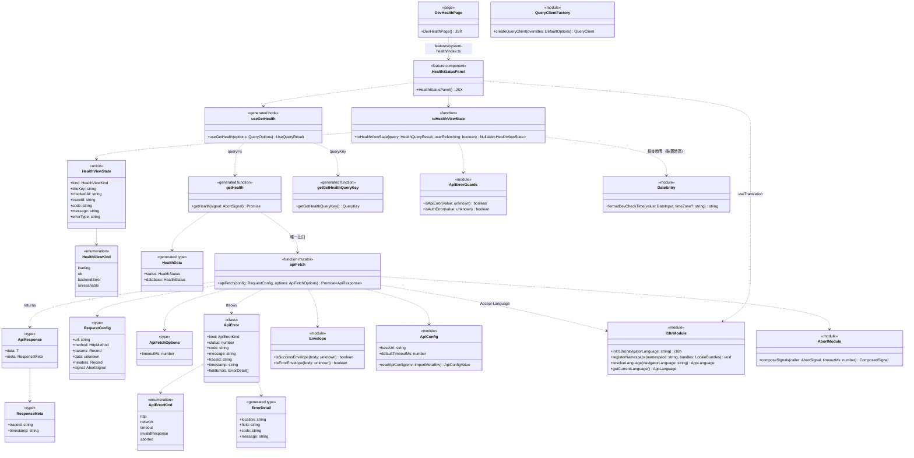

### Class Diagram：元件展示頁、對照層與產生管線

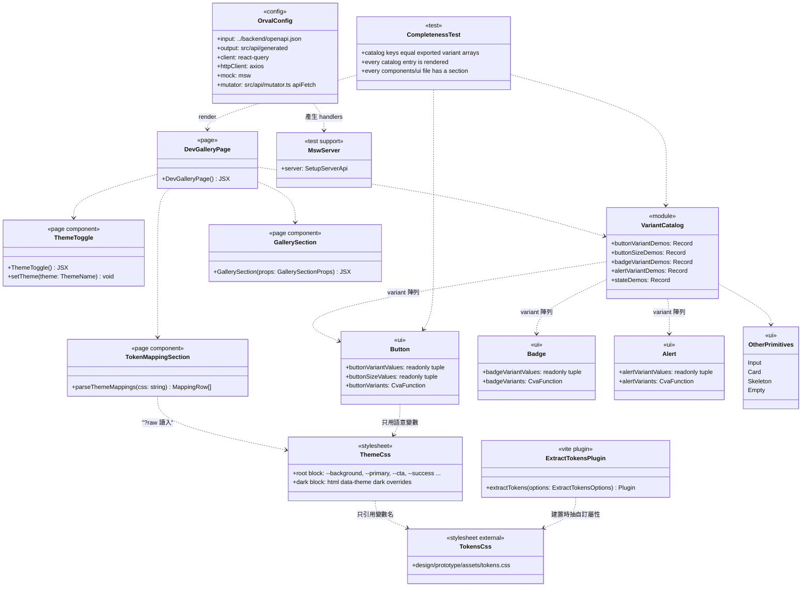

本次沒有業務 Model 與資料表，classDiagram 不畫 Model。

### 元件清單

| 元件                                       | 層         | 職責                                                                                                                                                                                                                                                                                                                                                                                                                                                                                                                                                                                                                                                                                                                                                                                                                                                                                                                                                    | 依據                                                          |
| :----------------------------------------- | :--------- | :------------------------------------------------------------------------------------------------------------------------------------------------------------------------------------------------------------------------------------------------------------------------------------------------------------------------------------------------------------------------------------------------------------------------------------------------------------------------------------------------------------------------------------------------------------------------------------------------------------------------------------------------------------------------------------------------------------------------------------------------------------------------------------------------------------------------------------------------------------------------------------------------------------------------------------------------------ | :------------------------------------------------------------ |
| `apiFetch(config, options?)`               | api        | Orval 的 mutator，前端唯一的 HTTP 出口。集中 base URL、`credentials: 'include'`、`Accept-Language`（取自 `getCurrentLanguage()`）、`AbortSignal`、15 秒逾時、拆外層、把錯誤轉成 `ApiError`。成功回 `{ data, meta: { traceId, timestamp } }`（Q2）。CSRF 標頭與 `401` 換發屬 01-01，本次不留空殼                                                                                                                                                                                                                                                                                                                                                                                                                                                                                                                                                                                                                                                         | A6、A7、S2、ADR-003 D6；Q2、Q4、Q5                            |
| `ErrorType<E>`、`BodyType<B>`              | api        | 從 `mutator.ts` 匯出，Orval 會用它們當產生 hook 的錯誤與 body 型別：`ErrorType<E> = ApiError`，所以**每一個**產生的 hook 的 `error` 都是 `ApiError`，不是 `unknown` 或產物的 `ErrorResponse`                                                                                                                                                                                                                                                                                                                                                                                                                                                                                                                                                                                                                                                                                                                                                            | A7、F2                                                        |
| `ApiResponse<T>`、`ResponseMeta`           | api        | 型別層的拆外層：`T extends { data: infer D } ? { data: D; meta: ResponseMeta } : T`；`ResponseMeta = { traceId: string; timestamp: string }`。產生的函式寫成 `apiFetch<HealthDataResponse>(...)`，回傳型別變成 `{ data: HealthData; meta }`，產物不必改、也沒有型別說謊                                                                                                                                                                                                                                                                                                                                                                                                                                                                                                                                                                                                                                                                                 | A6、F2；Q2；N3                                                |
| `ApiError`                                 | api        | 單一錯誤型別，`kind` 區分五種來源；`status`、`code`、`traceId`、`timestamp`、`fieldErrors` 在沒有值時是 `null`。`message` 在 `kind: 'http'` 時是後端已本地化的外層 `message`（A8 不透明字串），其他 kind 是英文診斷字串（A7 例外）                                                                                                                                                                                                                                                                                                                                                                                                                                                                                                                                                                                                                                                                                                                      | A7、A8；Q2                                                    |
| `isApiError`、`isAuthError`                | api        | type guard；`isAuthError` 只認 `kind: 'http'` 且 `status === 401`（`403` 是無權限不是未登入，留給 01-01）                                                                                                                                                                                                                                                                                                                                                                                                                                                                                                                                                                                                                                                                                                                                                                                                                                               | A7、F2；Q4                                                    |
| `isSuccessEnvelope`、`isErrorEnvelope`     | api        | 把回應 body 當 `unknown` 收窄；不符合外層形狀就是 `invalidResponse`，不靠型別斷言。`isErrorEnvelope` 對 `errors` 缺鍵視同 `null`                                                                                                                                                                                                                                                                                                                                                                                                                                                                                                                                                                                                                                                                                                                                                                                                                        | F2、A7；Q19 C4                                                |
| `readApiConfig(env)`                       | api        | 讀 `VITE_API_BASE_URL`（可空，空值代表同源相對路徑），驗證是 `http(s)` 絕對網址且不以 `/` 結尾，不合法就在啟動時丟錯；預設逾時常數 `15_000` ms。此變數會被打包進前端，**不是祕密**                                                                                                                                                                                                                                                                                                                                                                                                                                                                                                                                                                                                                                                                                                                                                                      | A6、Hard Rule 8、9；Q4                                        |
| `initI18n(navigatorLanguage)`              | lib        | 建立 i18next 實例（react-i18next），**初始化時只載入 `common` namespace**（zh-TW 與 en 兩份）；初始語言由 `resolveLanguage` 決定；**沒有切換控制項**，執行期不改語言（測試以 `i18n.changeLanguage` 指定）                                                                                                                                                                                                                                                                                                                                                                                                                                                                                                                                                                                                                                                                                                                                               | architecture.mdx §i18n 兩層、07-01；Q5                        |
| `registerNamespace(namespace, bundles)`    | lib        | 以 `i18n.addResourceBundle(lng, namespace, bundles[lng], true, true)` 為 zh-TW 與 en 註冊一個 namespace（`deep`、`overwrite` 皆為 `true`），重複註冊不報錯。呼叫點：`features/system-health/index.ts` 在模組載入時註冊 `systemHealth`，`pages/dev-gallery` 的入口註冊 `devGallery`，兩者只被開發模式的 lazy 路由 import，所以語言檔跟著開發路由的 chunk 走、正式建置一併剪除；`src/test/setup.ts` **不**註冊這兩個 namespace，測試經 import 這兩個公開入口在模組載入時取得                                                                                                                                                                                                                                                                                                                                                                                                                                                                              | Q1、Q5                                                        |
| `resolveLanguage(navigatorLanguage)`       | lib        | 純函式：`zh` 開頭（`zh`、`zh-TW`、`zh-CN`…不分大小寫）→ `zh-TW`，其餘 → `en`；空字串或 `undefined` → `en`                                                                                                                                                                                                                                                                                                                                                                                                                                                                                                                                                                                                                                                                                                                                                                                                                                               | Q5                                                            |
| `getCurrentLanguage()`                     | lib        | 回傳 i18n 實例目前語言（`zh-TW` 或 `en`），`apiFetch` 用它當 `Accept-Language`，與介面語言一致。取代原先固定 `zh-TW` 或 `getRequestLocale` 接縫的想法                                                                                                                                                                                                                                                                                                                                                                                                                                                                                                                                                                                                                                                                                                                                                                                                   | A6、A8；Q5                                                    |
| `composeSignals(caller, timeoutMs)`        | lib        | 自寫的小函式：合成呼叫端 signal 與逾時計時器，回傳 `{ signal, cleanup, reason() }`，以 reason 分辨取消與逾時；jsdom 與目標瀏覽器都支援 `AbortSignal.any` 時改用標準 API                                                                                                                                                                                                                                                                                                                                                                                                                                                                                                                                                                                                                                                                                                                                                                                 | F3；Q19 N6                                                    |
| `createQueryClient(overrides?)`            | app        | 建 `QueryClient`；`queries.retry: false`、`mutations.retry: false`（不自動重試）；`overrides` 只給測試傳入。正式只建一次，放在 `providers.tsx` 的模組層級                                                                                                                                                                                                                                                                                                                                                                                                                                                                                                                                                                                                                                                                                                                                                                                               | A7、A9；Q4                                                    |
| `createAppRouter()`                        | app        | `createBrowserRouter`；兩條開發用路徑以 `lazy` 載入，**只在 `import.meta.env.DEV` 才加進 route 陣列**，正式建置由 Vite 剪除（兩頁的 `systemHealth`、`devGallery` 語言檔跟著 lazy chunk 一起剪除）；DEV 時 `/` 與 `*` 都 `Navigate` 到 `/dev/health`，正式建置只有空殼（首頁與找不到頁面由 01-01 設計）                                                                                                                                                                                                                                                                                                                                                                                                                                                                                                                                                                                                                                                  | ADR-005 D1、#505；Q1、Q14                                     |
| `DevHealthPage`                            | pages      | 只渲染 `HealthStatusPanel`，不呼叫 hook                                                                                                                                                                                                                                                                                                                                                                                                                                                                                                                                                                                                                                                                                                                                                                                                                                                                                                                 | F1                                                            |
| `HealthStatusPanel`                        | features   | 呼叫 `useGetHealth()`，把查詢結果與「使用者按了重新檢查」的旗標交給 `toHealthViewState`，依結果選畫面；文字一律走 `useTranslation('systemHealth')`，不寫死字串。「重新檢查」按鈕在 `isFetching` 為真時設 `aria-disabled="true"` 並忽略點擊，不在飛行中呼叫 `refetch()`，因此 `refetch()` 預設的 `cancelRefetch` 永遠不會取消進行中的請求；按下時設旗標並呼叫 `refetch()`，該次請求結束（成功或失敗）後清掉旗標。畫面長相屬 `ui-design.md`                                                                                                                                                                                                                                                                                                                                                                                                                                                                                                               | F3、F8、A9；Q5、Q19 UI-7                                      |
| `toHealthViewState(query, userRefetching)` | features   | 純函式，回傳 `HealthViewState \| null`。**判定順序**：（1）錯誤是 `kind: 'aborted'` 的 `ApiError` → `null`，`HealthStatusPanel` 保留前一次畫出的狀態；首次載入就被取消時前一次就是載入中，所以維持 `loading`；（2）`isPending`，或 `isFetching` 且 `userRefetching`（由使用者按「重新檢查」觸發）→ `loading`；背景更新（`isFetching` 但不是使用者觸發）不切回載入中（UI-7）；（3）成功 → `ok`，`checkedAt` 取自 `meta.timestamp`；`ApiError` 且 `kind: 'http'`（任何錯誤外層）→ `backendError`，`titleKey` 在 `code === 'DATABASE_UNAVAILABLE'` 時是資料庫無法連線，其餘是通用「後端回報錯誤」；`network`、`timeout`、`invalidResponse` → `unreachable`，`errorType` 直接是 `network` 或 `timeout`（`invalidResponse` 與其他非外層歸 `network`）                                                                                                                                                                                                        | F8、A7「不得用錯誤字串猜 status」；Q3、Q19 UI-7、design.md D6 |
| `formatDevCheckTime(value, timeZone?)`     | lib        | `src/lib/date.ts` 是 day.js（`utc`、`timezone` 外掛）的唯一 import 處，**只匯出這一個函式**。伺服器時間（UTC 字串）一律換成**瀏覽者裝置的時區**顯示，**不寫死任何時區、不做固定的 Asia/Taipei 換算**（F10；Q18 補充決議）。`timeZone` 可選，未指定時取裝置時區 `Intl.DateTimeFormat().resolvedOptions().timeZone`；輸出開發頁的檢查時間 `YYYY-MM-DD HH:mm:ss（UTC±H）`，括號內是該時間點在該時區的實際偏移（台灣裝置顯示「UTC+8」、紐約裝置顯示「UTC-5」；零偏移 `UTC+0`、非整點 `UTC+5:30`；日光節約時間前後依時間點計算）。業務頁格式 `YYYY-MM-DD HH:mm`（`brand.md`）的函式由第一個業務頁的 change 加。`HealthStatusPanel` 不接受時區 prop，一律用裝置時區。測試以參數注入時區；「未指定時採用裝置時區」以 `vi.spyOn(Intl.DateTimeFormat.prototype, 'resolvedOptions')` 只覆寫回傳的 `timeZone`，**不得替換 `Intl.DateTimeFormat` 建構子**（day.js 的 timezone 外掛靠 `formatToParts`）；不靠 `TZ` 環境變數；需要固定「現在」時用 `vi.setSystemTime` | F10、#503 裁定 5；Q18、design.md D12                          |
| `cn()`                                     | lib        | `clsx` 加 `tailwind-merge`，shadcn 慣例                                                                                                                                                                                                                                                                                                                                                                                                                                                                                                                                                                                                                                                                                                                                                                                                                                                                                                                 | ADR-005 D3                                                    |
| `components/ui/*`                          | components | shadcn/ui 原語；**允許修改原始碼加 variant**（Q9）。只用語意變數（`bg-cta`、`text-success`…），不綁 tokens.css 命名；Button 刪掉 `link`，只留 artifact 的六種（Q10）；有 variant 的原語匯出 `as const` 陣列（`buttonVariantValues` 等），`cva` 以它建                                                                                                                                                                                                                                                                                                                                                                                                                                                                                                                                                                                                                                                                                                   | ADR-005 D3、F6；Q9、Q10                                       |
| `VariantCatalog`                           | pages      | 每個有 variant 的原語一份 `Record<variant, 展示>`，key 型別取自匯出陣列的元素型別（`satisfies Record<ButtonVariant, Demo>`），**不手抄 variant 清單**；沒有 cva 的原語（Input 的三種狀態、Card 的三個區塊、Skeleton、Empty）由目錄自己宣告                                                                                                                                                                                                                                                                                                                                                                                                                                                                                                                                                                                                                                                                                                              | ADR-005 D3；Q9                                                |
| `GallerySection`                           | pages      | 一個原語一個區塊，每個展示項目帶 `data-gallery-item="<component>:<axis>:<value>"`，給完整性測試查                                                                                                                                                                                                                                                                                                                                                                                                                                                                                                                                                                                                                                                                                                                                                                                                                                                       | ADR-005 D3                                                    |
| `ThemeToggle`                              | pages      | 展示頁標題列右側的「淺色／深色」切換，只改 `<html data-theme>`，預設淺色、**不記住選擇**（重新整理回淺色）；健康檢查頁不加                                                                                                                                                                                                                                                                                                                                                                                                                                                                                                                                                                                                                                                                                                                                                                                                                              | Q13                                                           |
| `TokenMappingSection`                      | pages      | 以 `import raw from '@/styles/theme.css?raw'` 讀入並以 `parseThemeMappings` 解析 `--x: var(--y)` 的清單顯示；lint 對這一個檔案具名放行（Q16）                                                                                                                                                                                                                                                                                                                                                                                                                                                                                                                                                                                                                                                                                                                                                                                                           | F1、F6；Q16                                                   |
| `extractTokens()`                          | build      | Vite 外掛：建置與開發時讀 `design/prototype/assets/tokens.css`，只保留 `:root` 與 `html[data-theme="dark"]` 規則中的自訂屬性（`--*`），以虛擬模組 `virtual:design-tokens.css` 提供給 `main.tsx`；**不載入外部字型、不套元素規則、產物不提交**。圓角與字型仍以 tokens.css 的值為準                                                                                                                                                                                                                                                                                                                                                                                                                                                                                                                                                                                                                                                                       | F6、ADR-005 D4；Q15                                           |
| `styles/theme.css`                         | styles     | `:root` 區塊：shadcn 語意變數與 `--cta`、`--success`、`--warning`、`--info` 等指向 tokens.css 變數名；`html[data-theme="dark"]` 區塊：對照到深色時要換成另一個 tokens.css 變數的項目；再以 `@theme inline` 接到 Tailwind 的 `--color-*`（**必須用 `inline`**，理由見 §Token 對照層與 tokens.css 的引入）；**沒有任何色碼**                                                                                                                                                                                                                                                                                                                                                                                                                                                                                                                                                                                                                              | F6、ADR-005 D4；Q9、Q13                                       |
| `styles/index.css`                         | styles     | `@import "tailwindcss"`、引入 theme.css、`@custom-variant dark (&:where([data-theme="dark"], [data-theme="dark"] *))`；變數來自 `extractTokens`，不 `@import` tokens.css 全檔                                                                                                                                                                                                                                                                                                                                                                                                                                                                                                                                                                                                                                                                                                                                                                           | F6、ADR-005 D4；Q15                                           |
| `orval.config.ts`                          | 設定       | 一份 config：`input` 指向 `../backend/openapi.json`；`output` 用 `client: 'react-query'`、`httpClient: 'axios'`（只決定產生的呼叫形狀，不引入 axios，Q20）、`mock: true`（產生 `*.msw.ts` 與 `*.faker.ts`）、`clean: true`、`override.mutator` 指向 `apiFetch`、`override.query.signal: true`；不做 Prettier 格式化（產物進 `.prettierignore`）                                                                                                                                                                                                                                                                                                                                                                                                                                                                                                                                                                                                         | A4、A5、ADR-003 D6；Q8                                        |
| `src/test/msw-server.ts`、`setup.ts`       | test 支援  | `setupServer` 載入 Orval 產生的 handlers（比對 `*/api/v1/health`，前面是萬用字元，不受 base URL 影響）；測試以 `server.use(...)` 加入比對絕對網址 `http://localhost:8000/api/v1/health` 的 handler（`vitest.config.ts` 的 `test.env` 設 `VITE_API_BASE_URL`，design D11），覆寫成固定 fixture（`200`、`503`）或 `HttpResponse.error()`，**不改產物**；`use()` 優先，base URL 組錯的請求會落到產生的 handler 拿到 faker 資料，fixture `traceId` 的斷言因而失敗；base URL 組合另由 `mutator.test.ts` 對 `buildRequestUrl` 單元測試；`onUnhandledRequest: 'error'`；`setup.ts` 以 `initI18n` 只載 `common` 並預設 `zh-TW`（不註冊其他 namespace），需要英文的測試自己 `changeLanguage('en')`                                                                                                                                                                                                                                                               | T6、A4；Q5、Q6、Q19 C1                                        |
| `src/test/envelope-fixtures.ts`            | test 支援  | `successEnvelope`、`errorEnvelope({ status, code, message, traceId })` 手組，回傳型別是產物的 `HealthDataResponse`／`ErrorResponse`，欄位改名時測試會在型別檢查失敗；回應帶 `X-Correlation-ID` 與 `Content-Language` 標頭；不含任何答案或真實身分                                                                                                                                                                                                                                                                                                                                                                                                                                                                                                                                                                                                                                                                                                       | T6、Hard Rule 6；Q19 C1–C3                                    |

### 關鍵設計細節

#### 唯一出口的處理順序

`apiFetch` 由 Orval 產生的函式呼叫；它不知道任何 `operationId`，所以之後新增端點不必改它（Hard Rule 5 的精神：新增不改核心）。

1. 以 `readApiConfig` 的 `baseUrl` 加上產物給的 `url`（已含 `/api/v1`）組網址，`params` 用 `URLSearchParams` 序列化。
2. 標頭：`Accept-Language` 一律帶，值是 `getCurrentLanguage()`（與介面語言一致，Q5）；`Content-Type: application/json` **只在有 body 時**加，`GET` 不觸發 preflight（A6 摺疊區塊）。**不送 `X-Correlation-ID`**：讓後端產生，連不上後端時就沒有追蹤編號，與 artifact 狀態 4「traceId 無（請求沒有送達）」一致。
3. `credentials: 'include'`（A6、S2）。這一層是唯一設定它的地方，元件不自己帶（S2 指派的測試）。
4. 取消與逾時：`composeSignals(callerSignal, timeoutMs)` 把呼叫端的 `signal`（TanStack Query 傳入）與 15 秒計時器合成一個 signal（Q4、Q19 N6）；以 abort 的 `reason` 分辨是呼叫端取消還是逾時。計時器與監聽在 `finally` 清掉（F3 的 cleanup）。**不自動重試**（Q4）。
5. 送出 `fetch`。依結果分類成下表，**每一條都轉成 `ApiError`**，元件看不到原生的 `TypeError`、`DOMException` 或 `Response`。
6. 成功時回 `{ data, meta: { traceId, timestamp } }`，`meta` 取自成功外層（Q2）。

| 情況                                             | 判斷方式                         | `kind`                     | `status` | `code`        | `traceId`                                  | `timestamp`        | `message`                    |
| :----------------------------------------------- | :------------------------------- | :------------------------- | :------- | :------------ | :----------------------------------------- | :----------------- | :--------------------------- |
| `2xx` 且 body 是成功外層                         | `isSuccessEnvelope`              | （不丟錯）                 | —        | —             | —                                          | —                  | —                            |
| `204`                                            | status                           | （不丟錯，回 `undefined`） | —        | —             | —                                          | —                  | —                            |
| 非 `2xx` 且 body 是錯誤外層                      | `isErrorEnvelope`                | `http`                     | 回應的   | 外層的 `code` | 外層的 `traceId`                           | 外層的 `timestamp` | 外層的 `message`（已本地化） |
| 非 JSON、空 body、或 JSON 但不是外層（含 `2xx`） | 兩個 guard 都不成立              | `invalidResponse`          | 回應的   | `null`        | 回應標頭 `X-Correlation-ID`，沒有則 `null` | `null`             | 英文診斷字串                 |
| `fetch` 拒絕且不是 abort                         | 捕捉到的值不是 abort             | `network`                  | `null`   | `null`        | `null`                                     | `null`             | 英文診斷字串                 |
| 逾時（15 秒）                                    | abort reason 是本層的逾時        | `timeout`                  | `null`   | `null`        | `null`                                     | `null`             | 英文診斷字串                 |
| 呼叫端取消                                       | abort reason 來自呼叫端的 signal | `aborted`                  | `null`   | `null`        | `null`                                     | `null`             | 英文診斷字串                 |

- `invalidResponse` 涵蓋「代理回了 HTML」與「`VITE_API_BASE_URL` 沒設，請求打到 Vite 開發伺服器、SPA fallback 回 `200` 加 `index.html`」兩種實際會遇到的情況。依 Q3，健康檢查頁把它與「不是外層的回應」一併歸〔連不到後端〕。
- 讀 `X-Correlation-ID` 標頭在跨來源時需要後端 `expose_headers`；後端已經公開這個標頭（主規格 `request-correlation`「瀏覽器可以讀到追蹤編號」），不需要後端改動。
- `aborted` 不會被顯示：TanStack Query 取消查詢時自己處理，且本來就不重試；若 `aborted` 仍到達 `toHealthViewState`，它回 `null`，`HealthStatusPanel` 保留前一次畫出的狀態（首次載入被取消時維持載入中）。
- 逾時 15 秒大於後端健康檢查的 10 秒總上限，所以資料庫無法連線（後端最多 5 秒回 `503`）不會被誤判成連不到後端（Q4）。`ApiFetchOptions.timeoutMs` 讓個別請求覆寫，之後的匯出、評分查詢在自己的 change 設，不改預設。

#### 回傳形狀（已決，Q2）

`apiFetch` 回傳 `{ data, meta: { traceId, timestamp } }`，`ApiError` 也帶 `timestamp`，成功與錯誤同形，呼叫端好處理。它決定**之後每一個產生 hook 的 `data` 型別**（`useGetHealth().data` 是 `{ data: HealthData; meta: ResponseMeta }`），所以日後再改屬 A10 的破壞性變更。呼叫端寫 `query.data.data`；需要攤平時在自己的 hook options 用 `select`。「檢查時間」取伺服器的 `meta.timestamp`，不用瀏覽器的 `dataUpdatedAt`。`code` 與 `message` 不進 `meta`（成功時沒有畫面需要，之後加欄位是非破壞性變更）。

#### TanStack Query 的預設值（已決，Q4）

| 設定                                | 本次的值                | 理由                                                                                   |
| :---------------------------------- | :---------------------- | :------------------------------------------------------------------------------------- |
| `queries.retry`                     | `false`                 | 不自動重試：頁面有「重新檢查」按鈕，自動重試只會拉長等待（Q4）                         |
| `mutations.retry`                   | `false`                 | 寫入不自動重送；本次沒有 mutation，先定下來免得 01-01 各自決定                         |
| `isAuthError` 涵蓋                  | 只有 `401`              | `403` 是無權限不是未登入，留給 01-01；`401` 換發的旗標之後由 01-01 從它取得            |
| `staleTime`、`refetchOnWindowFocus` | 沿用預設（`0`、`true`） | 本次沒有理由偏離；背景更新不顯示載入中（UI-7）；各功能需要時在自己的 hook options 覆寫 |

`QueryClient` 在 `providers.tsx` 建一次。登出時的 `queryClient.clear()`（A9）屬 01-01。因為不重試，原本的 `shouldRetry` 不存在；之後某個功能要重試時，在自己的 hook options 加 `retry`，並以 `isAuthError` 排除 `401`。

#### 語系層（已決，Q5）

- 本次就建 react-i18next：資源為 `zh-TW` 與 `en` 兩份，依模組分 namespace（`common`、`systemHealth`、`devGallery`）。兩頁的介面文字都走翻譯鍵，**不寫死中文字串**。
- **載入方式**：`initI18n` 只載 `common`。`systemHealth` 由 `features/system-health/index.ts`、`devGallery` 由 `pages/dev-gallery` 的入口，在模組載入時以 `registerNamespace`（內部是 `i18n.addResourceBundle`）加入。兩者只被開發模式的 lazy 路由 import，正式建置剪除開發路由時兩份語言檔一併被 tree-shake，正式 bundle 不含開發頁的文字（Q1）。因為註冊發生在模組頂層、早於元件 render，`useTranslation('systemHealth')` 第一次 render 就拿得到資源，不需要 Suspense 等待語言檔。
- 測試：`src/test/setup.ts` 只以 `initI18n` 初始化 `common`，**不**註冊 `systemHealth`、`devGallery`。feature 與 page 的測試 import 公開入口（`features/system-health/index.ts`、`pages/dev-gallery` 的入口），入口在模組載入時註冊自己的 namespace，與正式執行走同一條路，不必經路由。
- 語言由 `navigator.language` 決定：`resolveLanguage` 把 `zh` 開頭對到 `zh-TW`，其餘對到 `en`。**畫面不加切換控制項**，切換器留給之後的業務版面（07-01）。
- `Accept-Language` 與介面語言一致：`apiFetch` 讀 `getCurrentLanguage()`。後端錯誤外層的 `message` 因此依同一語言本地化，前端仍原樣顯示（A8）。
- 測試：`src/test/setup.ts` 預設 `zh-TW`；要驗英文的測試自己 `changeLanguage('en')`，並在 `afterEach` 還原。`resolveLanguage` 與每個 namespace 兩份語言檔鍵集一致各有單元測試。

#### Orval 管線（已決，Q8、Q20）

- `orval.config.ts` 是唯一的產生設定；產物整個資料夾由 Orval 擁有（`clean: true`），不手改、不加檔（A4）。
- 產生的 hook 型別依賴 `ApiResponse<T>` 能穿過 Orval 產生的程式。Orval 的 react-query 產物以 `Awaited<ReturnType<typeof getHealth>>` 推導 `data` 型別，所以只要產生的 `getHealth` **沒有**被 Orval 加上明確的回傳型別註記，`apiFetch` 的回傳型別就會一路傳到 hook；N3 在 apply 第一組以 Orval 8.48.0 實測（Q20）：不指定 `httpClient` 時，`react-query` client 產生 fetch 式呼叫 `apiFetch(url, RequestInit)`，並把 `getHealth` 註記成 `Promise<getHealthResponse>`（`{ data, status }` 加 `headers` 的聯集），蓋掉 `ApiResponse<T>`，產物也編不過。因此 `orval.config.ts` 設 `httpClient: "axios"`：產生的呼叫變成 `apiFetch<HealthDataResponse>({ url, method, signal }, options)`、沒有回傳註記，正好是 `RequestConfig` 加 `ApiFetchOptions` 的形狀，`ApiResponse<T>` 一路傳到 `useGetHealth`。這個設定**只決定產生的呼叫形狀**：產物不 `import axios`，`axios` 不是依賴，lint 禁用 `axios` 的規則不變。`input.override.transformer` 仍排除（會讓產物與介面描述檔的形狀不一致）。
- 格式化：`frontend/src/api/generated/` 進根目錄 `.prettierignore`，產物維持 Orval 原樣，漂移檢查才準；`.lintstagedrc.mjs` 加上 `ts,tsx`，手寫 `.ts` 在 commit 時就格式化，CI 的 `prettier --check` 不會意外擋下。
- 一條指令的範圍：`pnpm api:generate`（`frontend/package.json` 的 script）**只讀已提交的 `backend/openapi.json` 跑 Orval**，不依賴 Python 工具鏈；從後端匯出到 Orval 的整條鏈由 #506 的根目錄指令串起。

#### 網路替身（已決，Q6）

測試一律用 `msw/node` 的 `setupServer`，在 `src/test/setup.ts` 啟停。MSW、faker 與 Orval 產生的 `*.msw.ts`、`*.faker.ts` **只給測試用**：lint 擋住產品碼 import，正式 bundle 不含，開發時不提供瀏覽器端的替身（沒有 `mockServiceWorker.js`、沒有切換開關）。要看錯誤狀態就關掉後端或資料庫。

#### 開發用路由（已決，Q1、Q14）

`createAppRouter` 以 `if (import.meta.env.DEV)` 才把兩條路由與 `/`、`*` 的導向加進 route 陣列；Vite 在正式建置把整段與 `lazy` 的 chunk 剪掉，兩頁各自的語言檔（`systemHealth`、`devGallery`）只被 lazy 模組 import，也一起剪掉。正式建置只有空殼。後果：

- #506 在容器裡不能打開健康檢查頁，改以後端 `/api/v1/health` 驗證，或把 E2E 跑在開發伺服器上（寫入 design.md 的跨 change 依賴）。
- 以 `pnpm build` 的產出檢查 `dist/` 不含 `msw`、`@faker-js/faker` 與 `/dev/` 字串，作為 acceptance 的一步。

#### 本機開發的跨來源

依 ADR-005 D1 §後果「開發時單頁應用與 API 在不同 origin，FastAPI 的 CORS 要明確列出 `allow_origins`」：開發時前端在 Vite（`http://localhost:5173`，`server.strictPort: true` 固定埠號），以 `VITE_API_BASE_URL=http://localhost:8000` 直接打後端，**不設 Vite proxy**。後端 `CORS_ALLOWED_ORIGINS` 要含 `http://localhost:5173`。後端已允許 `Accept-Language`、`Content-Type`、`X-Correlation-ID` 三個請求標頭並公開 `X-Correlation-ID`，`allow_credentials=True`，不需要後端改動。正式環境由 Nginx 同源服務，`VITE_API_BASE_URL` 留空。兩個變數的範例值交給 #506 寫進 `.env.example`。

不用 proxy 的理由：proxy 會讓開發時看不到 CORS 與 `expose_headers` 的問題，等到 01-01 的 cookie 認證才發現；ADR-005 已經寫明開發時是跨來源。

#### Token 對照層與 tokens.css 的引入（已決，Q9、Q13、Q15、Q16）

- **引入方式（Q15）**：不 `@import` tokens.css 全檔（會帶進 Google Fonts 外部連線、`body` 與標題的襯線全域樣式，並以不在 cascade layer 的 `--radius-*`、`--font-sans` 蓋過 Tailwind 同名變數）。改由 `extractTokens` 外掛在建置時只抽出 `:root` 與 `html[data-theme="dark"]` 的自訂屬性，以虛擬模組 `virtual:design-tokens.css` 提供，產物不提交。圓角與字型仍以 tokens.css 的值為準（即 `rounded-*` 與 `font-sans` 會跟著 tokens.css 的變數）。代價是多一支外掛要測：測試涵蓋「只留自訂屬性」「丟棄元素規則與 `@import url(...)`」「同時保留淺色與深色兩個區塊」「tokens.css 缺少時建置失敗」。
- **對照層（Q9、Q13）**：`theme.css` 只寫「語意變數 → tokens.css 變數名」，**不寫任何色值**（F6）。除 shadcn 的語意變數外，新增 `--cta`、`--success`、`--warning`、`--info` 等 artifact 需要而 shadcn 沒有的語意變數；原語只用語意變數，不直接引用 tokens.css 的名字。`:root` 區塊對應淺色，`html[data-theme="dark"]` 區塊對應深色：tokens.css 在深色下已重新定義同名變數，所以多數項目不必另寫；只有深色要指向**另一個** tokens.css 變數的項目才進深色區塊，逐一列在 `ui-design.md` 的 token 落點表（F6 摺疊區塊第 1 點）。再以 `@theme inline` 接到 Tailwind 的 `--color-*`，`dark:` utility 吃 `@custom-variant dark`。
- **隱性依賴：Tailwind 的 `--color-*` 與 tokens.css 的 `--color-*` 同名空間（必須用 `@theme inline`）**：Tailwind v4 的 theme 變數以 `--color-<name>` 命名（例如 `@theme inline { --color-primary: var(--primary); }`），而 tokens.css 自己也以 `--color-*` 命名，兩邊會出現同名變數（以目前的 tokens.css 計，至少 `--color-primary`、`--color-secondary`、`--color-accent`、`--color-border`、`--color-cta`、`--color-success`、`--color-info` 重名）。`extractTokens` 產出的 tokens 變數**不在任何 cascade layer**，Tailwind 的 theme 變數在 `@layer theme`，依 cascade layer 規則**未分層的 tokens.css 一定贏**。所以若用一般的 `@theme`（utility 編成 `var(--color-primary)`），`bg-primary` 會讀到 tokens.css 的 `--color-primary`，對照層被繞過，深色區塊的改寫也失效。`@theme inline` 讓 utility 直接編成 `var(--primary)`，不經過同名的 `--color-*`，才不受衝突影響。這是本文的明確約束：`theme.css` 接 Tailwind 時**只能用 `@theme inline`**，拿掉 `inline` 會讓多數語意色悄悄變成 tokens.css 的原值；`theme.css` 內以註解寫明這個依賴。之後在 `@theme inline` 新增 `--color-*` 時，同名與否都不影響 utility，但**不得**在元件裡直接寫 `var(--color-*)`（那會讀到 tokens.css 的值）。
- **展示頁的 Token 對照（Q16）**：`TokenMappingSection` 以 Vite `?raw` 讀 `styles/theme.css` 並解析變數清單，對照表永遠與檔案一致；lint 對這一個檔案具名放行並在規則檔註明理由，其他頁仍受 F1 約束。
- **深色驗證（Q13）**：展示頁標題列右側的切換只改 `<html data-theme>`，預設淺色、不記住選擇，與 tokens.css 的預設一致。
- 映射清單的內容屬 `ui-design.md`，本文不重寫。

#### 元件展示頁的完整性測試（已決，Q9、Q10）

「宣告的 variant」的來源是**每個有 variant 的原語匯出的 `as const` 陣列**（`buttonVariantValues`、`buttonSizeValues`、`badgeVariantValues`、`alertVariantValues`），`cva` 的 `variants` 從它建出（例如 `Object.fromEntries`），陣列是單一宣告來源。完整性測試在**執行期**比對，兩層：

1. **宣告 → 目錄（執行期）**：`expect(Object.keys(buttonVariantDemos).sort()).toEqual([...buttonVariantValues].sort())`，其餘軸同理。目錄的型別另以 `satisfies Record<ButtonVariant, Demo>` 讓 `tsc` 也提早報錯（`ButtonVariant = (typeof buttonVariantValues)[number]`）。
2. **目錄 → 畫面（DOM）**：render `DevGalleryPage`，對目錄裡每一個 key 斷言 `[data-gallery-item="button:variant:<key>"]` 存在；另以下面的檔案清單與對照表斷言每個原語檔案都有區塊，新增原語沒放進展示頁也會失敗。

**原語檔案清單**：以 `import.meta.glob(['/src/components/ui/*.tsx', '!/src/components/ui/*.test.tsx'])` 列出，排除與原語同目錄的測試檔（ADR-007 D3），否則 `button.test.tsx` 會被當成一個沒有區塊的原語。

**檔案 → 展示頁區塊 id 的對照表**：寫在測試檔內的一份明確常數（`Record<檔名, sectionId>`），不從檔名推導，因為有多對一。測試斷言三件事：glob 列出的每個檔名都在表裡（新增原語沒登記就失敗）；表裡的每個檔名都真的存在（刪掉原語沒清表也失敗）；每個 sectionId 在 render 後的 DOM 裡都有 `section#<id>`。區塊 id 與 `ui-design.md` §`/dev/gallery` 的錨點一致：

| 原語檔案       | 展示頁區塊 id | 說明                                                       |
| :------------- | :------------ | :--------------------------------------------------------- |
| `button.tsx`   | `#button`     | 一對一                                                     |
| `input.tsx`    | `#input`      | 一對一                                                     |
| `badge.tsx`    | `#badge`      | 一對一                                                     |
| `alert.tsx`    | `#alert`      | 一對一                                                     |
| `card.tsx`     | `#card`       | 一對一                                                     |
| `skeleton.tsx` | `#states`     | **多對一**：Skeleton 與 Empty 共用「Skeleton · Empty」區塊 |
| `empty.tsx`    | `#states`     | **多對一**：同上                                           |

`#tokens`（Token 對照）不對應任何原語檔案，不在表內。原語在根目錄以 `pnpm dlx shadcn@4.23.0 add <components> --cwd frontend --yes` 加入（`pnpm --dir` 不會改變 CLI 的工作目錄）；shadcn CLI 若隨原語帶進其他檔案，apply 時照同一規則登記到它實際展示的區塊，不得為了讓測試通過而把檔案移出 `components/ui/`。表外的檔名一律讓測試失敗。

這是 render 出來的 DOM 與執行期陣列斷言，不是 grep 原始碼，T3 的「自證測試」不適用；「宣告→展示」真的被測到，不再只靠型別層。Button 的 `link` 刪掉（Q10），只宣告 artifact 的六種；之後需要時再加，展示頁一起補。`architecture.mdx` 寫「shadcn 元件不改寫」那句與 Q9 衝突，另開 `[Docs]` issue 改準，不在本 change 改。

#### 型別檢查

`tsconfig` 開 `strict`，另開 `noUncheckedIndexedAccess`、`noImplicitOverride`、`noFallthroughCasesInSwitch`、`noUnusedLocals`、`noUnusedParameters`、`verbatimModuleSyntax`。`src/api/generated/` 也在型別檢查範圍內，`skipLibCheck` 救不了它，所以**旗標要選 Orval 產物編得過的**：`exactOptionalPropertyTypes` 與 Orval 產生的 options 型別常衝突，**不開**（Q19 N4），其他嚴格旗標照開。型別檢查指令是 `tsc -b`（各 tsconfig 設 `noEmit`）。

#### 測試

| 測試                                                  | 層          | 驗什麼                                                                                                                                                                                                                                                                                                                                                                     | 依據                               |
| :---------------------------------------------------- | :---------- | :------------------------------------------------------------------------------------------------------------------------------------------------------------------------------------------------------------------------------------------------------------------------------------------------------------------------------------------------------------------------- | :--------------------------------- |
| `api/mutator.test.ts`                                 | unit        | 上表七種情況各一（含 `timestamp`）；成功回 `{ data, meta }`；請求帶 `credentials: 'include'` 與 `Accept-Language`（zh-TW 與 en 各一）；`GET` 沒有 `Content-Type`；base URL 組合；15 秒逾時以假時鐘推進；無自動重試                                                                                                                                                         | A6、A7、S2；Q2、Q4、Q5             |
| `api/api-error.test.ts`                               | unit        | `isAuthError` 只有 `401` 為真，`403` 為假                                                                                                                                                                                                                                                                                                                                  | A7；Q4                             |
| `app/query-client.test.ts`                            | unit        | `retry` 為 `false`（失敗後只呼叫一次）                                                                                                                                                                                                                                                                                                                                     | A7；Q4                             |
| `lib/abort.test.ts`                                   | unit        | 呼叫端取消、逾時、清理三種                                                                                                                                                                                                                                                                                                                                                 | F3；Q19 N6                         |
| `lib/i18n/*.test.ts`                                  | unit        | `resolveLanguage` 對八個輸入 `zh-TW`、`zh-CN`、`zh`、`ZH-hk`、`en-US`、`ja`、空字串、沒有值（依序得 `zh-TW` ×4、`en` ×4）；每個 namespace 兩份語言檔鍵集一致（`import.meta.glob` 直接讀語言檔，不經 i18next 實例）；`registerNamespace` 重複呼叫不出錯                                                                                                                     | Q5                                 |
| `build/extract-tokens.test.ts`                        | unit        | 外掛只留 `:root` 與深色區塊的自訂屬性，丟棄元素規則與外部 `@import`                                                                                                                                                                                                                                                                                                        | Q15                                |
| `features/system-health/to-health-view-state.test.ts` | unit        | 查詢狀態到四種狀態的對應；任何錯誤外層歸 `backendError`、標題只有 `DATABASE_UNAVAILABLE` 用專屬標題；非外層回應歸 `unreachable`；`aborted` 回 `null`                                                                                                                                                                                                                       | F8；Q3                             |
| `features/system-health/health-status-panel.test.tsx` | integration | import `features/system-health/index.ts`（入口註冊 `systemHealth`），經 MSW、真的 `QueryClient` 與 `apiFetch`，四種狀態各一（zh-TW），並以英文跑一次；「重新檢查」回到載入中、背景更新（測試以 `queryClient.refetchQueries` 觸發）不切回載入中；請求進行中按鈕是 `aria-disabled` 且點擊不送出第二個請求                                                                    | #505 驗收第 3 項、T6；Q5、Q19 UI-7 |
| `pages/dev-gallery/*.test.tsx`                        | unit        | import `pages/dev-gallery` 的入口（註冊 `devGallery`）；完整性的兩層（含檔案 → 區塊 id 對照表的三條斷言）；主題切換改 `<html data-theme>` 且預設淺色；Token 對照與 `theme.css` 一致                                                                                                                                                                                        | #505 驗收第 4 項；Q9、Q13、Q16     |
| `app/router.test.tsx`                                 | unit        | DEV 時 `/` 與未知路徑導向 `/dev/health`                                                                                                                                                                                                                                                                                                                                    | Q1、Q14                            |
| `lib/date.test.ts`                                    | unit        | 以時區參數注入 `Asia/Taipei`、`America/New_York`、`UTC`、`Asia/Kolkata`，同一個 UTC 時間點顯示各自的當地時間與偏移（`（UTC+8）`、`（UTC-5）`、`（UTC+0）`、`（UTC+5:30）`）；以 `vi.spyOn(Intl.DateTimeFormat.prototype, 'resolvedOptions')` 覆寫回傳的 `timeZone` 測「未指定時採用裝置時區」（不替換建構子）；不靠 `TZ` 環境變數；需要固定「現在」時用 `vi.setSystemTime` | F10；Q18、D12                      |

「真實後端下顯示對應狀態」（#505 驗收第 3 項的另一半）本次以 `acceptance.md` 的人工步驟驗：SQLite 啟動後端 → 正常；`DATABASE_URL` 指向不存在的 PostgreSQL → 資料庫無法連線；停掉後端 → 連不到後端。自動化的那一半屬 #506 的 e2e。**覆蓋率（Q12）**：`vitest --coverage`（`@vitest/coverage-v8`）產報告，`exclude` 產物 `src/api/generated/`、`src/test/`、設定檔；數字記進 `acceptance.md` 當第一次基準，**不設門檻、不擋 CI**。

#### 專案結構與要補進 `openspec/config.yaml` 的指令（已決，Q7、Q8）

採根目錄 pnpm workspace：新增 `pnpm-workspace.yaml`（`packages: [frontend]`），`frontend/` 是 workspace 套件，共用根目錄一份 `pnpm-lock.yaml` 與同一版 Prettier；根目錄 `pnpm install` 一次裝好，`scripts/setup.sh` 不必多一步（ADR-002 選的 pnpm 本來就支援 workspace）。

`frontend/package.json` 提供這幾個 script，並依 #505 驗收第 5 項以「動到 `frontend/` 時」的形式補進 `operations.apply.guidance`：

- `pnpm --filter frontend lint`
- `pnpm --filter frontend typecheck`
- `pnpm --filter frontend test`（含覆蓋率報告時用 `test:coverage`）
- `pnpm --filter frontend build`
- `pnpm --filter frontend api:generate && git diff --exit-code -- frontend/src/api/generated && test -z "$(git status --porcelain -- frontend/src/api/generated)"`（比照後端的契約漂移指令；`api:generate` 只讀 `backend/openapi.json`）

## 關鍵情境

規格（`specs/**/spec.md`）還沒寫；以下標題是本文提議的 Scenario 名稱，planner 寫 spec 時沿用同一個名字。每張圖畫到 `toHealthViewState` 或測試斷言得出結果為止，不畫畫面。`Net` 參與者在測試時是 MSW 的 handler，在人工驗收時是真的後端，兩者在 `apiFetch` 看來沒有差別（T6：替身設在網路邊界）。

### Scenario: 後端與資料庫正常時健康檢查頁顯示正常

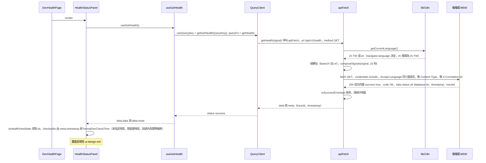

### Scenario: 資料庫無法連線時健康檢查頁顯示資料庫無法連線

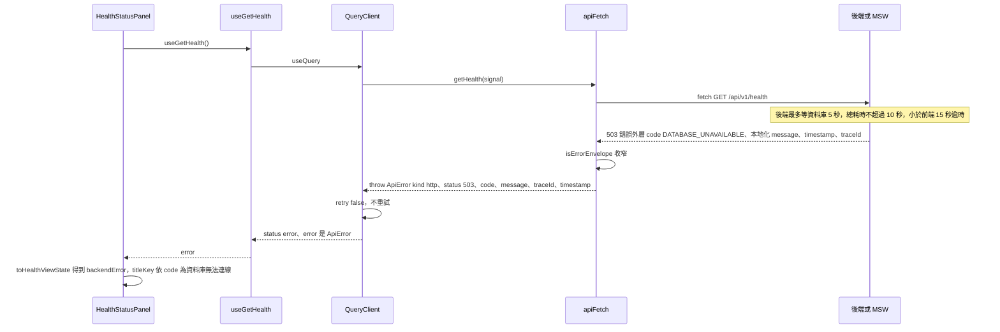

### Scenario: 後端回報其他錯誤時健康檢查頁顯示通用的後端錯誤

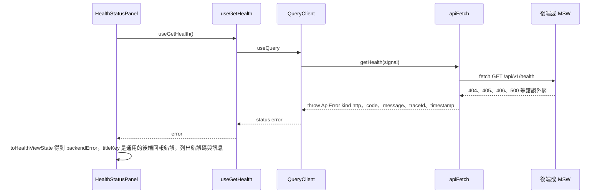

### Scenario: 連不到後端時健康檢查頁顯示連不到後端

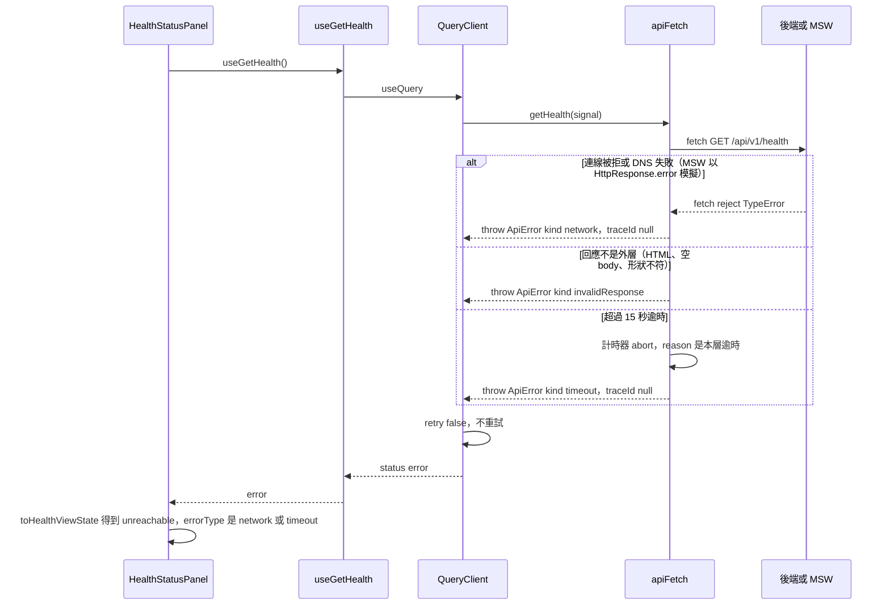

### Scenario: 健康檢查頁在等待回應時顯示載入中並可重新檢查

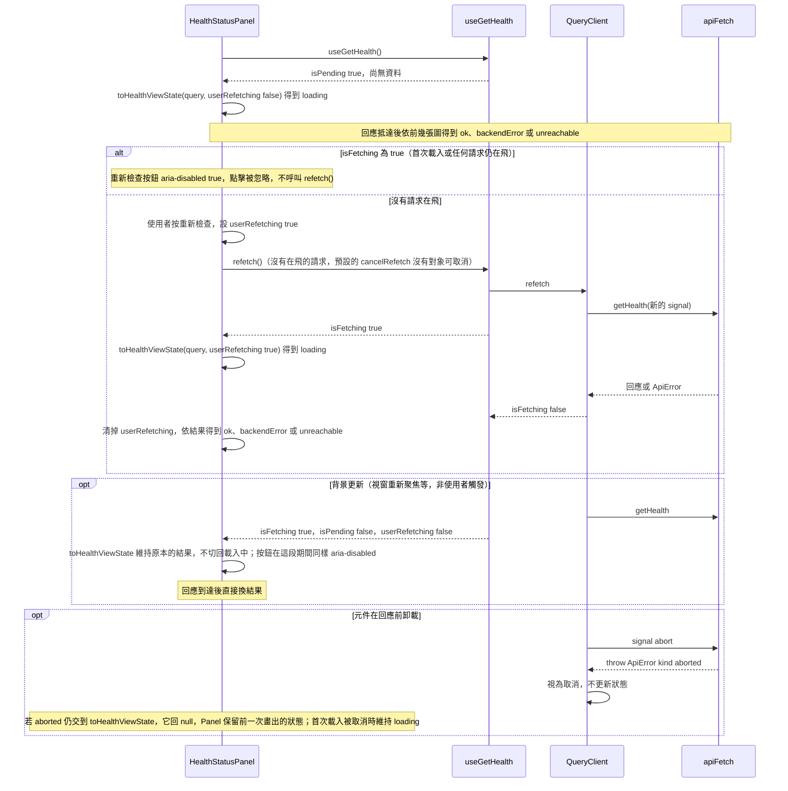

### Scenario: 唯一出口把非外層回應轉成單一錯誤型別

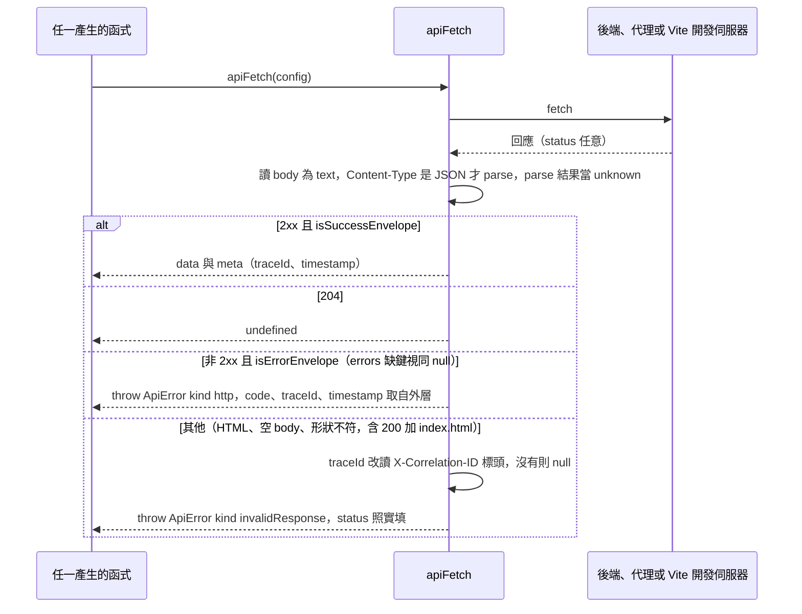

### Scenario: 失敗後不自動重試且認證錯誤只認 401

本次沒有需要認證的端點，這張圖以測試裡的 `ApiError` 直接驗；01-01 的 `401` 換發與重送會插在 `apiFetch` 內，不改這裡。

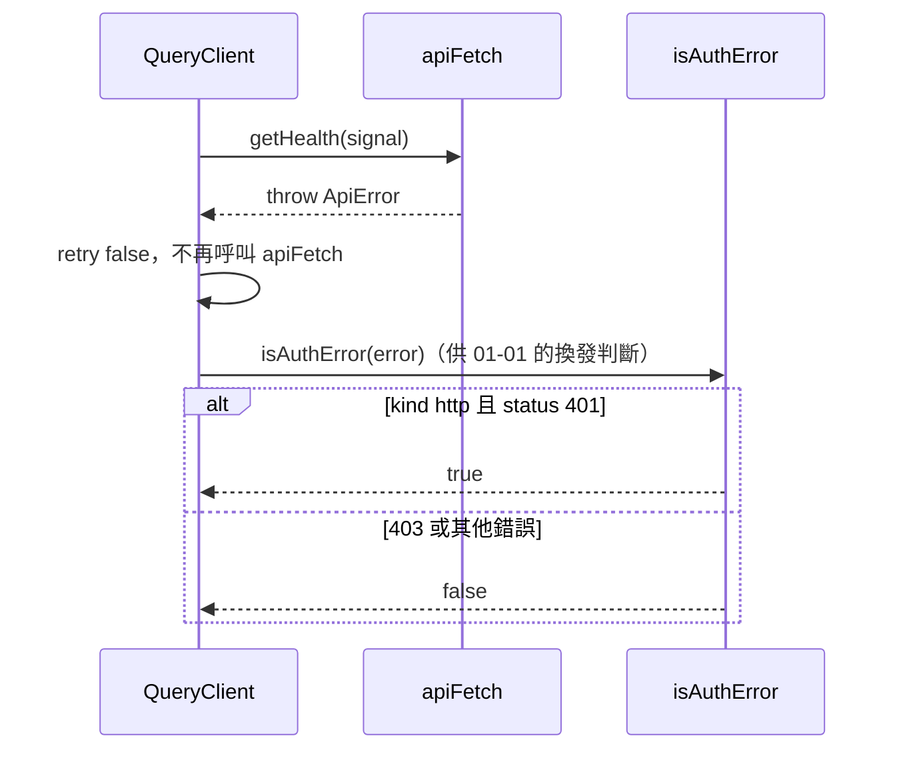

### Scenario: 兩頁只在開發模式註冊並導向健康檢查頁

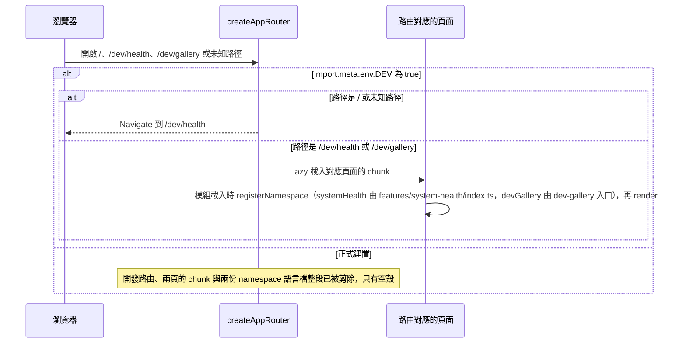

### Scenario: 介面語言依瀏覽器語言決定且請求語言一致

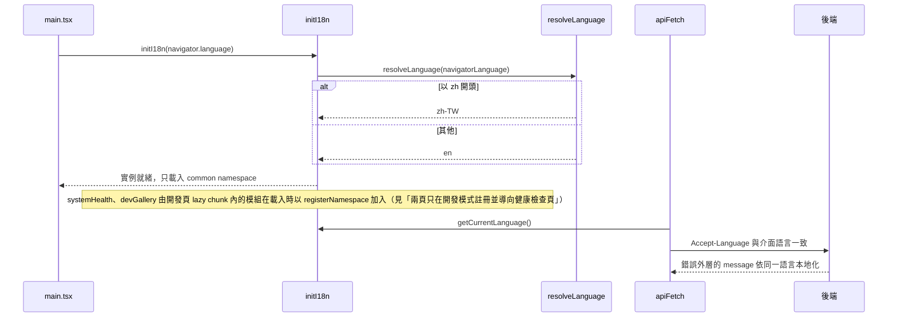

### Scenario: 一條指令由介面描述檔重產呼叫層

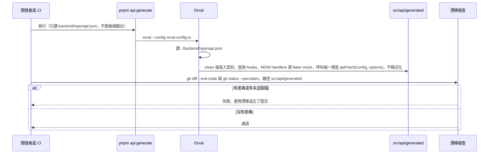

### Scenario: 元件展示頁的完整性測試擋下漏寫的 variant

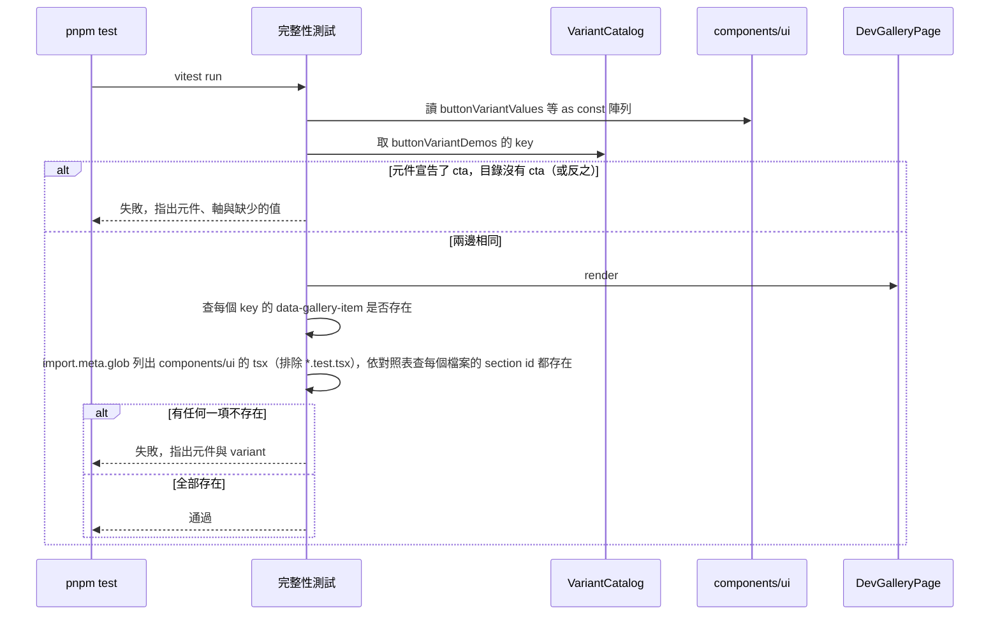

### Scenario: 元件展示頁切換淺色與深色

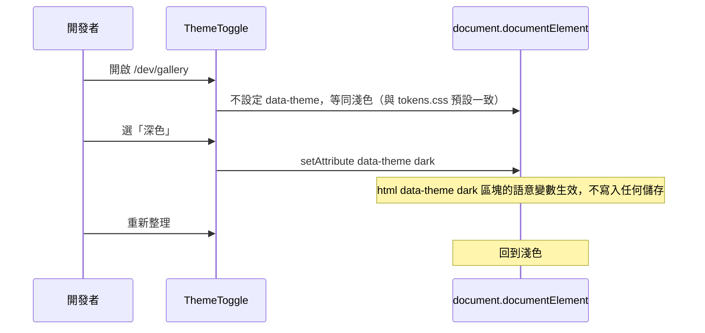

## 資料模型異動

本次無資料模型異動。不讀寫任何業務資料，資料表字典、ER 與 Alembic migration 都不動。

## 權限檢查點

- **本次沒有受保護的能力**，PRD §權限矩陣 的角色碰不到任何東西（system-analysis §涉及的角色）。唯一呼叫的端點 `GET /api/v1/health` 是刻意公開的（主規格 `health-check`「健康檢查刻意公開」，後端 clarification Q4），所有呼叫端拿到的內容相同，沒有遮蔽欄位。權限沒有超出矩陣。
- **前端不做授權**：本次沒有路由守衛（屬 01-01），也不把角色放進任何前端狀態（F4、S3）。唯一出口設 `credentials: 'include'`、不讀也不存任何 token（S2）；01-01 之後的授權仍一律由後端判定，前端只依 `403`、`404` 呈現。
- **開發頁顯示內部資料**：兩個開發用頁面是 07-01「不出現系統內部資料」的例外，照 artifact 顯示錯誤碼、traceId 與設定名（Q11）；本次不做業務頁共用的錯誤元件，留到 01-01 依 07-01 設計。
- **測試集答案不外露（Hard Rule 6）**：本次不碰任務、資料集與答案。MSW 的 handler 由 Orval 依介面描述檔產生，`src/test/envelope-fixtures.ts` 只組健康檢查的外層，沒有任何答案或測試集辨識資訊（T6）。延續到後續的風險：產生的 MSW handler 會照介面描述檔裡的**每一個**回應 schema 產假資料，所以「標記員可達的回應不含答案」要靠後端 S5 讓那些 schema 本來就沒有答案欄位，前端無法、也不應該在這一層補救。
- **任務設定驅動（Hard Rule 5）**：唯一出口、錯誤型別、QueryClient 都不認識任何 `operationId` 或任務類型，新增端點只靠重產。元件展示頁之後要列標記 widget（ADR-005 D3）時，widget 的 variant 要依設定的 output type 來自 widget 自己的宣告，完整性測試沿用本次「從匯出陣列推導、不手抄清單」的做法，不在測試裡寫死任一種任務。

## 技術待決問題

**clarification 的 Q1–Q19 已於 2026-11-20 全部決議，下面兩張表的每一條都已解決，無新增待決。**

### system-analysis 待決問題與需求矛盾的處理

| 待決           | 主題                          | 決議                                                                                                | 依據 | 狀態   |
| :------------- | :---------------------------- | :-------------------------------------------------------------------------------------------------- | :--- | :----- |
| 1（含矛盾 1）  | 兩頁進不進正式建置            | 只在 Vite 開發模式註冊路由，正式建置剪除；#506 改以後端 `/api/v1/health` 或開發伺服器驗證           | Q1   | 已決   |
| 2（含矛盾 2）  | 拆外層後成功時給不給 meta     | `apiFetch` 回 `{ data, meta: { traceId, timestamp } }`；`ApiError` 也帶 `timestamp`                 | Q2   | 已決   |
| 3              | 四種狀態以外的回應            | 所有錯誤外層走錯誤版面（通用標題）；非外層歸〔連不到後端〕，「錯誤類型」顯示 `network` 或 `timeout` | Q3   | 已決   |
| 4              | 重試政策與「認證錯誤」範圍    | 不自動重試；`isAuthError` 只認 401                                                                  | Q4   | 已決   |
| 5              | 請求逾時                      | 15 秒                                                                                               | Q4   | 已決   |
| 6              | 語系層與送出的語言            | 建 react-i18next，zh-TW 與 en，語言依 `navigator.language`，無切換器，`Accept-Language` 與介面一致  | Q5   | 已決   |
| 7              | 網路替身用在哪                | 只給測試用，lint 擋產品碼                                                                           | Q6   | 已決   |
| 8              | 獨立專案或工作區              | 根目錄 pnpm workspace                                                                               | Q7   | 已決   |
| 9（含矛盾 3）  | 產物與 Prettier               | `generated/` 進 `.prettierignore`；lint-staged 加 `ts,tsx`                                          | Q8   | 已決   |
| 10             | 一條命令的範圍                | `api:generate` 只讀 `backend/openapi.json` 跑 Orval                                                 | Q8   | 已決   |
| 11（含矛盾 6） | 為 artifact 改 shadcn 原始碼  | 允許改 `components/ui/`；語意變數放對照層；匯出 `as const` 陣列，測試在執行期比對                   | Q9   | 已決   |
| 12（含矛盾 4） | 開發頁顯示內部資料            | 兩頁是例外；不做業務頁共用錯誤元件                                                                  | Q11  | 已決   |
| 13             | 覆蓋率基準                    | 產報告、排除 generated、記第一次基準，不設門檻                                                      | Q12  | 已決   |
| 14             | 深色範圍                      | 對照層含深色；展示頁加淺色／深色切換，不記住選擇                                                    | Q13  | 已決   |
| 15             | 根路徑與找不到頁面            | DEV 時 `/` 與未知路徑導向 `/dev/health`；正式建置只有空殼                                           | Q14  | 已決   |
| 16（含矛盾 5） | `rules.ui-design` 的 ADR 編號 | apply 時改成 ADR-005                                                                                | P1   | 已處理 |

`system-analysis` §跨模組依賴 交給本文決定的一件事已定：**開發時前端與後端跨來源、不用 proxy**，依據 ADR-005 D1，見 [§本機開發的跨來源](#本機開發的跨來源)。

### 本文新發現的待決問題

| #   | 問題                                 | 決議                                                                                                          | 依據 | 狀態 |
| :-- | :----------------------------------- | :------------------------------------------------------------------------------------------------------------ | :--- | :--- |
| N1  | 完整性測試的「宣告的 variant」來源   | 每個原語匯出 `as const` 陣列、`cva` 從它建，測試在執行期比對；允許改原語原始碼                                | Q9   | 已決 |
| N2  | tokens.css 的引入方式                | 小 Vite 外掛在建置時只抽 `:root` 與深色區塊的自訂屬性，不載入外部字型與元素規則；圓角與字型以 tokens.css 為準 | Q15  | 已決 |
| N3  | `ApiResponse<T>` 能否穿過 Orval 產物 | apply 第一組實測不通過，改設 `httpClient: "axios"` 後通過                                                     | Q20  | 已決 |
| N4  | `exactOptionalPropertyTypes`         | 不開，其他嚴格旗標照開                                                                                        | Q19  | 已決 |
| N5  | Button 的 `link` variant             | 刪掉，只宣告 artifact 的六種                                                                                  | Q10  | 已決 |
| N6  | 合成 signal                          | 自寫 `composeSignals`；jsdom 與目標瀏覽器都支援 `AbortSignal.any` 時改用標準 API                              | Q19  | 已決 |
| N7  | lint-staged 要不要加 `ts,tsx`        | 加上                                                                                                          | Q8   | 已決 |
| N8  | 展示頁 Token 對照的資料來源          | `?raw` 讀 `styles/theme.css`，lint 具名放行這一個檔案                                                         | Q16  | 已決 |

### 快取、生命週期與效能

範本的「交易與 session」對前端換成這幾件：

- **快取生命週期**：`QueryClient` 一個應用一個，建在 `providers.tsx` 的模組層級；測試每一個測試建一個新的，避免測試之間共用快取。登出與換帳號的 `clear()` 屬 01-01（A9）。
- **請求生命週期**：每個請求的計時器與 signal 監聽在 `apiFetch` 的 `finally` 釋放；元件卸載時 TanStack Query 會 abort，`apiFetch` 轉成 `aborted`。
- **正式 bundle**：MSW、faker 與產生的 `*.msw.ts`、`*.faker.ts` 只被測試 import，lint 擋住產品碼引用；開發用頁面以 `lazy` 載入且只在 `import.meta.env.DEV` 註冊，正式建置整段被剪掉，`systemHealth`、`devGallery` 的語言檔只被這兩個 lazy 模組 import，一併剪掉。以 `pnpm build` 後檢查 `dist/` 驗證。
- **健康檢查頁的最慢回應時間**：不重試，最慢是前端逾時 15 秒，大於後端 10 秒上限，資料庫無法連線不會被誤判成連不到後端（Q4）。
- **建置與容器**：`extractTokens` 外掛讀 `frontend/` 之外的 `design/prototype/assets/tokens.css`，#506 的前端 Docker build context 必須包含 `design/prototype/assets/`，這件事要交給 #506。
- **交給 #506 的另一件**：`.env.example` 要有 `CORS_ALLOWED_ORIGINS=http://localhost:5173` 與 `VITE_API_BASE_URL=http://localhost:8000`；容器內改以後端 `/api/v1/health` 驗證（Q1）。
