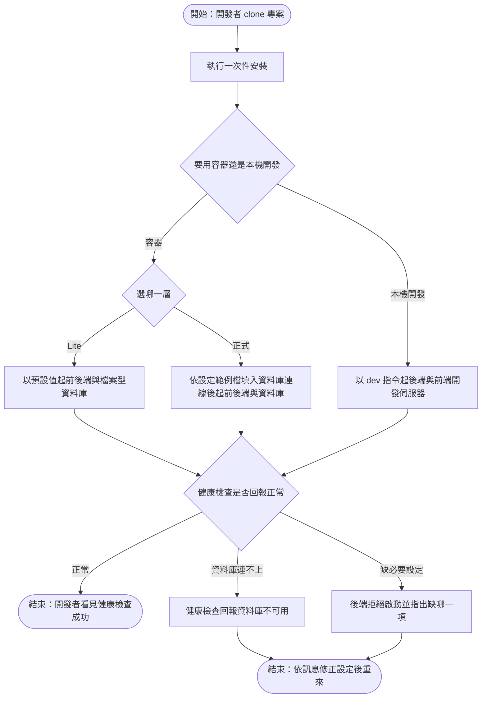
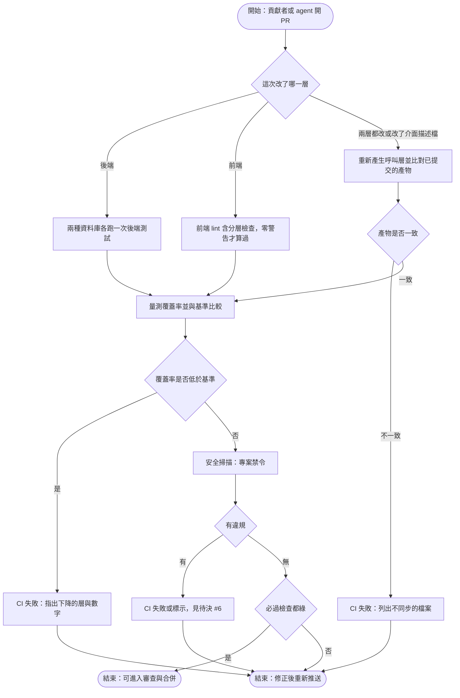

# System Analysis

本 change 是 Epic #502 的最後一張子單（#506）：把 #504 後端骨架與 #505 前端骨架串成「一條指令就能重現的執行環境」，並讓規則文件裡標「待建置」的幾道機械檢查真的在 CI 跑起來。它沒有 `docs/specs/` 規格可追溯；依 `openspec/config.yaml` 的 context（維護者 2026-11-20 裁定，#503）與 `docs/development/workflow/spec-migration.mdx` D4（foundation 屬技術規範，不寫 `docs/specs/`），需求追溯到 ADR 與規則文件的條號。

本文只寫需求面：要達成什麼、依據哪一條、和誰交接、哪裡互相矛盾。工具名稱只在需求文件本身就以它命名時出現（例如 ADR-008 D8 指名 Semgrep、#506 指名 Docker Compose），怎麼實作留給 `system-design`。

## 需求依據

依 context 的需求依據順序：維護者指定的需求文件（本次是 Issue #506 與其留言、Epic #502）＞ `docs/specs/`（本次無）＞ `docs/` 其他需求文件（ADR、規則文件、`architecture.mdx`）＞ `openspec/`。

| 來源                                                                                       | 章節／編號                                                                                      | 摘要（一句）                                                                                                                                                                            |
| :----------------------------------------------------------------------------------------- | :---------------------------------------------------------------------------------------------- | :-------------------------------------------------------------------------------------------------------------------------------------------------------------------------------------- |
| Issue #506                                                                                 | §使用情境／功能範圍「包含」七項                                                                 | 根目錄 Lite 與正式兩份容器編排、`.env.example`、根目錄四條指令、`e2e/` 骨架、CI 的五類檢查                                                                                              |
| Issue #506                                                                                 | §需求目標                                                                                       | 規則文件裡標「待建置」的檢查，至少把列出的幾項改成真的會跑                                                                                                                              |
| Issue #506                                                                                 | §驗收條件 1–6                                                                                   | 容器起得來且健康檢查顯示成功；契約沒重產、覆蓋率下降、分層 import 違規時 CI 失敗；Semgrep 在 CI 執行；文件的「待建置」改成實際檢查方式                                                  |
| Issue #506 留言（2026-11-21）                                                              | 「折進本單：前端的檢查目前完全不在 CI 裡」                                                      | 前端的 lint、型別檢查、測試都不在 CI；`pnpm lint` 沒有 `--max-warnings 0`；分層測試會在 `src/pages/` 留下探針檔；歸在驗收條件 4 之下                                                    |
| Epic #502                                                                                  | §範圍「不包含」、§需求目標、§承接的延後條文                                                     | 不含認證、業務模組、Celery／Redis、可觀測性；承接 ADR-007 覆蓋率以第一次測得的值當基準、ADR-008 D8 後端程式建立後接 Semgrep                                                             |
| ADR-003                                                                                    | D1 §考慮過的選項 A、§後果                                                                       | 一條 `docker compose up` 重現整個系統；CI 用 `hashFiles()` 條件判斷，各層逐步加入                                                                                                       |
| ADR-003                                                                                    | D3 §後果「import 檢查要等 `backend/` 存在」                                                     | 後端模組內分層的 import 方向目前只靠審查                                                                                                                                                |
| ADR-003                                                                                    | D7 §背景、選項 E                                                                                | clone 後一條指令三分鐘內跑起來、不必手動設定資料庫；預設 Lite、設定後走正式層                                                                                                           |
| ADR-005                                                                                    | D2 §後果                                                                                        | 前端分層表可寫成機械 lint 規則（檢查待建置）                                                                                                                                            |
| ADR-007                                                                                    | D1                                                                                              | 測試只分 unit、integration、e2e；e2e 是真瀏覽器加真前後端，CI 要兩個 runner                                                                                                             |
| ADR-007                                                                                    | D2                                                                                              | 覆蓋率只管「每張 PR 不得低於基準」與五項關鍵路徑 90% 分支覆蓋；分母排除產物、migration、設定檔                                                                                          |
| ADR-007                                                                                    | D4                                                                                              | 正式 e2e 放根目錄 `e2e/[module]/[page].spec.ts`，CI job 可單獨排程                                                                                                                      |
| ADR-008                                                                                    | D1                                                                                              | Compose 是預設 runtime，Nginx 是唯一公開入口                                                                                                                                            |
| ADR-008                                                                                    | D2                                                                                              | 後端與 worker 共用 image；前端建置後由反向代理服務靜態檔                                                                                                                                |
| ADR-008                                                                                    | D8 §決定、§什麼情況要重新討論                                                                   | CI 先做相依套件掃描（前後端門檻 high）；Semgrep「等有程式再接」，後端程式建立後重新討論                                                                                                 |
| ADR-008                                                                                    | D10                                                                                             | 容器的收工寬限：worker 大於 300 秒、backend 30 秒                                                                                                                                       |
| `architecture.mdx`                                                                         | §技術選型「目錄結構（目標）」                                                                   | 根目錄 `docker-compose.yml`（Lite，預設 SQLite）與 `docker-compose.prod.yml`（PostgreSQL 全套）、`e2e/shared/fixtures/`                                                                 |
| `architecture.mdx`                                                                         | §容器視圖                                                                                       | 一個部署六個容器，只有 Nginx 對外                                                                                                                                                       |
| `architecture.mdx`                                                                         | §資料庫雙層                                                                                     | Lite 層的資料目錄必須是持久化 volume                                                                                                                                                    |
| `architecture.mdx`                                                                         | §部署與維運 表「本機與 CI」「CI 安全掃描」及摺疊區「安全掃描與分支推進」                        | CI 用 service container 起 PostgreSQL；Semgrep 上線時至少蓋 CORS 萬用來源與寫死的 secret 兩條禁令                                                                                       |
| `testing-agent-rules.mdx`                                                                  | T1                                                                                              | 三層的位置與指令；e2e 位置與命名可由 CI 路徑規則檢查（待建置）                                                                                                                          |
| `testing-agent-rules.mdx`                                                                  | T4、T5                                                                                          | integration 要在兩種資料庫各跑完 migration；e2e 帳密以設定檔與共用 fixture 為單一來源                                                                                                   |
| `testing-agent-rules.mdx`                                                                  | T8                                                                                              | e2e 的選擇器、`baseURL` 集中、條件式等待、一個 spec 一條旅程                                                                                                                            |
| `testing-agent-rules.mdx`                                                                  | T9                                                                                              | 開發前要落實的七個自動 gate，並寫「七項的實作全歸 #111」                                                                                                                                |
| `testing-agent-rules.mdx`                                                                  | T10 §例外                                                                                       | 骨架期「不得下降」以第一次測得的基準為準；「不得下降」要 CI 記住基準                                                                                                                    |
| `testing-agent-rules.mdx`                                                                  | T11                                                                                             | 不得為了讓 CI 變綠而關規則、刪測試、加 skip；被跳過的項目要寫出來                                                                                                                       |
| `backend-agent-rules.mdx`                                                                  | B1 §檢查方式、§例外                                                                             | 後端分層 import 方向可機械擋住（待建置）；唯讀健康檢查端點不在此列                                                                                                                      |
| `backend-agent-rules.mdx`                                                                  | B6、B7 §檢查方式                                                                                | migration 升降升、雙資料庫測試要 CI 兩條 job（待建置）                                                                                                                                  |
| `backend-agent-rules.mdx`                                                                  | B10                                                                                             | 缺必要設定就啟動失敗                                                                                                                                                                    |
| `frontend-agent-rules.mdx`                                                                 | F1、F2、F3 §檢查方式                                                                            | 前端分層、型別嚴格、Hooks 規則可寫成機械檢查（文件仍標待建置）                                                                                                                          |
| `api-agent-rules.mdx`                                                                      | A5                                                                                              | 一條命令走完「後端匯出 → 前端重產」；CI 重產並比對，有差異即失敗（待建置）                                                                                                              |
| `security-agent-rules.mdx`                                                                 | S2 §檢查方式                                                                                    | CORS 萬用來源已列在 Semgrep 禁令                                                                                                                                                        |
| `AGENTS.md`                                                                                | Hard Rule 3、7、8；§Agent Rules Index 第四段；§Required Behaviors 第一條                        | uv／pnpm；禁止 CORS 萬用來源與寫死的 secret；「`backend/`、`frontend/`、`e2e/` 還不存在、多數檢查待建置」；clone 後跑 `scripts/setup.sh` 與 `pnpm install`                              |
| `openspec/config.yaml`                                                                     | `operations.apply.guidance` 第 106–116 行                                                       | 前後端的 lint、型別、測試、建置、契約漂移、雙資料庫測試的本機指令（由 #504、#505 補上）                                                                                                 |
| `openspec/specs/frontend-api-codegen`                                                      | Requirement「產物進版控且不同步時檢查失敗」                                                     | 不同步時檢查以非 0 結束；目前只有本機指令執行                                                                                                                                           |
| `openspec/specs/frontend-code-boundaries`                                                  | Requirement「依分層限制 import 方向」                                                           | 違反時 lint MUST 失敗並指出檔案與層別                                                                                                                                                   |
| `openspec/specs/frontend-routing`                                                          | Requirement「兩頁只在開發模式註冊」「正式建置不含開發頁與測試替身」                             | 健康檢查頁不進正式建置                                                                                                                                                                  |
| `openspec/specs/health-check`、`runtime-config`、`database-migration`、`api-schema-export` | 全部 requirement                                                                                | 容器與 CI 要呼叫的後端行為：健康檢查查資料庫、允許來源為唯一必要設定、遷移在兩種資料庫可升可降、匯出不需環境變數與資料庫                                                                |
| 歸檔 `2026-11-20-backend-skeleton`                                                         | `clarification.md` Q1、Q5、Q6、Q8、N6；`system-design.md` §健康檢查效能；`acceptance.md` 附註 3 | 交給 #506：`.env.example` 與 compose 預設值、CI 的 PostgreSQL、覆蓋率門檻、分層檢查對象、`/docs` 正式環境開關、健康檢查輪詢頻率、access log 格式                                        |
| 歸檔 `2026-11-20-frontend-skeleton`                                                        | `clarification.md` Q1、Q7、Q8、Q12；`design.md` §跨 change 依賴                                 | 交給 #506：容器內改以後端健康檢查驗證或把 e2e 跑在開發伺服器上、build context 含 `design/prototype/assets/`、`.env.example` 兩個值、根目錄串起「匯出 → 重產」、CI 前端 job 與覆蓋率門檻 |
| 進行中 change `fix-pages-root-layer-classification`（#528）                                | `proposal.md`、`specs/frontend-code-boundaries`                                                 | 補上「分不出層的檔案 lint 失敗」；程式已合併（PR #532），change 尚未歸檔                                                                                                                |

第一次測得的覆蓋率（T10 §例外 的基準來源）：後端 97%（`backend-skeleton/acceptance.md` 第 338 行，732 statements、24 miss）；前端 Statements 98.98%、Branches 92.85%（`frontend-skeleton/acceptance.md` 第 254 行，分母只含被測試載入的 43 個檔案）。

## 範圍

- 這次包含（Issue #506 §包含、驗收條件 1–6，加 2026-11-21 留言）：
  - Lite 層的容器編排：預設 SQLite，clone 後不必設定就能起前後端（ADR-003 D7、#504 Q1 交接）
  - 正式層的容器編排：PostgreSQL
  - 設定範例檔：列出每個設定、Lite 能直接用的預設值、不含任何 secret（Hard Rule 8、B10）
  - 根目錄四條指令：setup、dev、契約同步（後端匯出 → 前端重產，A5）、check
  - 根目錄 `e2e/` 骨架與一條健康檢查的全端旅程（ADR-007 D4、T1、T8）
  - CI：
    - 兩種資料庫各跑一次後端測試（B7、T4）
    - 介面描述檔與前端產物的不同步比對（A5）
    - 覆蓋率基準與「不得下降」（ADR-007 D2、T10）
    - 分層 import 方向檢查：前端（F1）與後端（B1），T9 的「import 邊界」gate 兩邊都列
    - 前端 lint 在 CI 上會因被降級成警告的規則而失敗（留言第 1 點）
    - Semgrep（ADR-008 D8、`architecture.mdx` §部署與維運 的兩條禁令）
  - 文件：`AGENTS.md` 與規則文件裡這次建成的檢查，從「待建置」改為實際的檢查方式（驗收條件 6）
- 這次不包含：
  - 認證與權限 guard、任何業務模組（Epic #502 §不包含）
  - Celery、Redis、worker 容器（Epic #502 §不包含）；ADR-008 D10 的 worker 收工寬限因此也不適用
  - 可觀測性（Epic #502 §不包含、ADR-008 D4）
  - 五項關鍵路徑 90% 分支覆蓋的實際量測：那五項的程式都還不存在（ADR-007 D2），本次只能建「不得下降」；是否先留位置見待決 #7
  - 正式部署（Cloudflare TLS 模式、備份）：ADR-008 待決 1、7 註明「在做正式部署的 change 時」
  - Agent hook（#111 的 H1–H6）：本次只動 CI 與根目錄指令，不接 Claude／Codex 的 hook
  - 修改 `design/prototype/`：前端容器建置只**讀取** `design/prototype/assets/`，不改它
- 未定是否包含（見待決問題）：Nginx 是否進 Lite 編排（#2）、e2e 是否每張 PR 在 CI 跑（#3）、前端型別檢查與後端 lint／型別檢查是否進 CI（#4）、相依套件掃描（#5）

### 涉及的角色

這是開發基礎建設，角色是「誰在使用這套環境與檢查」，不是產品的四種使用者角色（PRD §角色）。

| 角色                       | 在本 change 能做的事                                                                                                                                                          |
| :------------------------- | :---------------------------------------------------------------------------------------------------------------------------------------------------------------------------- |
| 維護者                     | 決定哪些 CI 檢查列為合併必過（`main` ruleset 目前只有 `commit-messages`、`docs-site`、`format`、`specs` 四項，#509）；決定待決問題；擁有 `docs/specs/` 與 `design/prototype/` |
| 貢獻者（人）               | clone 後用 setup、dev 指令起環境；用容器編排起整套服務；提交前用 check 指令自查；開 PR                                                                                        |
| coding agent（SDD 各角色） | 依 `openspec/config.yaml` 的指令自查；PR 由 CI 擋下時修正，不得關規則或刪測試讓 CI 變綠（T11）                                                                                |
| CI                         | 每張 PR 跑檢查並以失敗擋住違規；不得因本機 hook 通過而省略（T9 §禁止）                                                                                                        |
| 部署者（Lite 或正式層）    | 依設定範例檔與兩份編排檔起服務；Lite 層的 log 視為敏感（ADR-008 D3）                                                                                                          |

角色 × 動作：

| 動作                               | 維護者       | 貢獻者      | coding agent               | CI     |
| :--------------------------------- | :----------- | :---------- | :------------------------- | :----- |
| 起本機環境（setup、dev、容器編排） | 可           | 可          | 可                         | 不適用 |
| 跑 check 指令自查                  | 可           | 可          | 必須（config.yaml）        | 不適用 |
| 跑 CI 檢查                         | 不適用       | 不適用      | 不適用                     | 必須   |
| 改 CI 檢查內容                     | 可           | 透過 PR     | 透過 PR，依 tasks.md       | 不適用 |
| 把 CI 檢查列為合併必過（ruleset）  | **僅維護者** | 不可        | 不可（不在 `/sdd` 授權內） | 不適用 |
| 降低門檻、關規則、加 skip 讓 CI 過 | 須明確決定   | 不可（T11） | 不可（T11）                | 不適用 |

被遮蔽或唯讀的資料：設定範例檔不得含真實 secret；正式層資料庫密碼由環境變數提供（Hard Rule 8）。CI 的 log 不得印出 secret。`e2e/shared/fixtures/` 不得放測試集答案（Hard Rule 6、T6 檢查方式）；本次的健康檢查旅程不碰任何答案資料。

Hard Rule 5（任務設定驅動）與 Hard Rule 6（測試集答案不外露）：本 change 不碰任務設定與答案資料，兩條在行為上不適用；clarification 第 9、10 面向可直接記「不適用」。

## 業務流程

規格書的業務流程：不適用。本 change 沒有 `docs/specs/` 規格（spec-migration D4、Epic #502、#506 §流程），沒有可引用的「業務流程」章節。依 sa 的寫法表，需求依據不是 `docs/specs/` 時在這裡畫完整流程；但**不建議**用 `spec-writing` 把流程補回規格書，因為 D4 已裁定 foundation 類技術規範不寫 `docs/specs/`。

下面兩張圖分別是「開發者從 clone 到跑起來」與「一張 PR 怎麼被檢查」。節點用需求語意命名。

### 流程一：從 clone 到看見健康檢查成功

說明：

- 「健康檢查成功」在容器裡看的是什麼，`frontend-skeleton` Q1 留了兩個做法，還沒有選定（待決 #1）。
- 「容器」那一支是否經過唯一公開入口（反向代理），待決 #2。
- 缺必要設定那條例外依 B10 與 `runtime-config`「允許來源是必要設定且不得含萬用字元」。

### 流程二：一張 PR 的檢查

說明：

- 「這次改了哪一層」的判斷依 ADR-003 D1 的 `hashFiles()`，但它原本的語意是「該層目錄存在才跑」，現在兩層都已存在；是否改成「這次有改到才跑」見待決 #9。
- 分層檢查違規、Hooks 規則違規、被降級成警告的規則都在「前端 lint」那一步失敗（留言第 1 點、`frontend-code-boundaries`）。後端分層檢查同樣落在後端那一支（B1），圖上不另拆節點。
- e2e 是否在這條流程裡跑，見待決 #3；相依套件掃描是否在「安全掃描」裡，見待決 #5。

## 跨模組依賴

這裡的「模組」是 repo 的頂層區塊與前後幾張 change。

### 需要先存在的

| 前置                                                                          | 狀態                                 | 本 change 用到什麼                                                                                                                                                                                                  |
| :---------------------------------------------------------------------------- | :----------------------------------- | :------------------------------------------------------------------------------------------------------------------------------------------------------------------------------------------------------------------ |
| #504 後端骨架（歸檔 `2026-11-20-backend-skeleton`）                           | 已合併、已歸檔                       | 健康檢查端點、雙資料庫的測試指令（標 `postgres` 的測試在沒設測試資料庫時跳過）、遷移指令、介面描述檔匯出指令、`app/modules/health/` 當後端分層檢查的對象（#504 Q8）、唯一必要設定 `CORS_ALLOWED_ORIGINS`（#504 Q1） |
| #505 前端骨架（歸檔 `2026-11-20-frontend-skeleton`）                          | 已合併、已歸檔                       | 前端 lint（含分層規則）、型別檢查、測試與覆蓋率、建置、重產指令；根目錄 pnpm workspace（#505 Q7）；開發用健康檢查頁只在開發模式出現（#505 Q1）                                                                      |
| #528 `fix-pages-root-layer-classification`                                    | 程式已合併（PR #532），change 未歸檔 | 「分不出層的檔案 lint 失敗」的規則與 `frontend/build/eslint-config.test.ts` 的真實檔案案例；本 change 若也修改 `frontend-code-boundaries`，歸檔時要以它歸檔後的主規格為基準                                         |
| `main` ruleset（#509）                                                        | 四項必過檢查                         | 新加的 CI job 不會自動變成必過；改 ruleset 是維護者的動作（待決 #10）                                                                                                                                               |
| 現有 CI 的四個 job 與 Git hooks（`scripts/setup.sh`、commit-msg、pre-commit） | 存在                                 | 新 job 加在旁邊，不能讓既有四個 job 失效；根目錄 setup 指令和 `scripts/setup.sh` 的關係見待決 #11                                                                                                                   |

### 交接的限制（`system-design` 要承接，不是待決問題）

- 前端容器建置要讀到 `design/prototype/assets/`，否則前端的 token 擷取讓建置失敗（`frontend-skeleton` design D8、§跨 change 依賴）。
- `frontend/build/eslint-config.test.ts` 在 `src/pages/` 寫入真實探針檔再以 `finally` 清除；被硬殺時會殘留 `boundary-probe.tsx`，讓同一個工作目錄後續的 lint 失敗。它寫不進暫存目錄（分層依磁碟路徑判定）。CI 的步驟順序要讓殘留檔不影響後續步驟（留言第 2 點）。
- CI 上的前端 lint 必須在規則被降成警告時失敗：要嘛零警告，要嘛明確只收 error（留言第 1 點）。前端目前全專案零警告（`fix-pages-root-layer-classification` tasks 3.1）。
- 前端覆蓋率分母要排除產物目錄（ADR-007 D2、#505 Q12）；後端分母要排除 migration 與設定檔。
- 後端遷移不需要允許來源設定（`backend-skeleton` system-design §設定與啟動失敗：遷移只讀資料庫設定），CI 與容器跑遷移時可利用這點。
- 兩種資料庫的測試：沒設測試資料庫時 PostgreSQL 測試會跳過；CI 的 PostgreSQL 那一輪必須是 0 skipped，否則等於沒跑（T11、`openspec/config.yaml` 第 113 行）。
- 介面描述檔匯出不需環境變數與資料庫（`api-schema-export`），所以「契約同步」指令與 CI 的不同步比對都不必起服務。
- e2e 依 T8：`baseURL` 集中、不寫死埠號、條件式等待、一個 spec 一條旅程；依 ADR-007 D4：`e2e/` 是獨立套件，有自己的相依（是否納入現有 pnpm workspace 由 `system-design` 決定，不違反 #505 Q7）。

### 會被後續依賴的

| 後續                                 | 依賴本 change 的什麼                                                                                                                         |
| :----------------------------------- | :------------------------------------------------------------------------------------------------------------------------------------------- |
| 規格 01-01 登入（第一個功能 change） | CI 的雙資料庫測試、覆蓋率基準、分層檢查與 Semgrep 都會開始擋它；e2e 骨架是它第一條角色旅程的起點（`e2e/shared/fixtures/` 的 `storageState`） |
| 之後每個模組                         | 根目錄 check 指令與 CI 是交付前的自查依據（T11 evidence）                                                                                    |
| #111 Agent hook                      | H3、H7 要呼叫的共用檢查器；本次建的 check 指令可能是它們的轉接對象（`agent-hook-contract.mdx` H7）                                           |
| 第一個背景工作的 change              | 在本次的編排檔上加 Redis 與 worker 容器（ADR-008 D10 的收工寬限屆時才適用）                                                                  |

## 需求矛盾

| #   | 矛盾                                                                                                                                                                                                                                                                              | 來源                                                                                                                                                                                                                   | 牽動                                                                                               |
| :-- | :-------------------------------------------------------------------------------------------------------------------------------------------------------------------------------------------------------------------------------------------------------------------------------- | :--------------------------------------------------------------------------------------------------------------------------------------------------------------------------------------------------------------------- | :------------------------------------------------------------------------------------------------- |
| 1   | 驗收條件 1 要「`docker compose up` 能起前後端，health check **頁**顯示成功」，但健康檢查頁只在開發模式註冊、正式建置剪除；維護者在 #505 Q1 裁定「#506 在容器裡改以後端健康檢查驗證，或把 e2e 跑在開發伺服器上」，兩個做法沒有選定，Issue 本文的驗收字句也沒有跟著改               | #506 §驗收條件 1；`frontend-skeleton/clarification.md` Q1；`openspec/specs/frontend-routing` 兩條 requirement                                                                                                          | 待決 #1                                                                                            |
| 2   | ADR-008 D8 的決定是「CI **先做**相依套件掃描、Semgrep 延後」；#506 列了 Semgrep，卻沒有列相依套件掃描。T9 的第七個 gate 是「依賴、secret 與 CORS 掃描」三者一起                                                                                                                   | `adr/008-deployment-and-operations.mdx` D8；`testing-agent-rules.mdx` T9 表第 7 列；#506 §包含                                                                                                                         | 待決 #5                                                                                            |
| 3   | #504 Q6 裁定後端 `ruff`、`mypy --strict` 「只在本機與 apply 檢查時跑，不加 CI job」；但 T9 把 Python lint 與型別檢查列為開發前要落實的 gate，2026-11-21 留言又指出前端的型別檢查與測試不在 CI、「全靠本機自律」。留言把範圍歸在「分層 import」驗收項下，沒有明說型別檢查進不進 CI | `backend-skeleton/clarification.md` Q6；`testing-agent-rules.mdx` T9 表第 1、2 列；#506 留言（2026-11-21）「查證」段                                                                                                   | 待決 #4                                                                                            |
| 4   | T9 寫「七項的實作全歸 #111」（#111 仍 open，§2b 第二項就是 coverage gate）；Epic #502 與 #506 把分層 import、不同步比對、覆蓋率、Semgrep 排給 #506。#504 Q6 已決定這四項歸 #506，但 T9 的文字與 #111 的勾選項都還沒更新                                                           | `testing-agent-rules.mdx` T9；Issue #111 §2b；Epic #502 §需求目標；`backend-skeleton/clarification.md` Q6                                                                                                              | 待決 #13                                                                                           |
| 5   | ADR-003 D1 寫「所有服務（前端、後端、資料庫、Redis、Celery）由同一份 `docker-compose.yml` 啟動」，`architecture.mdx` §容器視圖 寫一個部署六個容器、只有 Nginx 對外（ADR-008 D1）；Epic #502 排除 Celery／Redis，#506 只說「起前後端」，沒有說唯一公開入口在不在這次的編排裡       | `adr/003-backend-architecture.mdx` D1 §背景；`adr/008-deployment-and-operations.mdx` D1；`architecture.mdx` §容器視圖；Epic #502 §不包含；#506 §包含                                                                   | 待決 #2                                                                                            |
| 6   | #505 交給 #506 的 `.env.example` 值（前端來源 `localhost:5173`、前端呼叫後端 `localhost:8000`）假設前後端分開兩個來源；若容器裡經唯一公開入口同源服務（ADR-008 D1），這兩個值在容器裡不成立                                                                                       | `frontend-skeleton/design.md` §跨 change 依賴；`adr/008-deployment-and-operations.mdx` D1                                                                                                                              | 待決 #2                                                                                            |
| 7   | 規則文件的開頭仍寫「`backend/`、`frontend/`、`e2e/` 目前不存在」，F1、F2、F3、A5、B2 的檢查方式仍標「待建置」，但 #504、#505 已在本機建成其中幾項（只差 CI）；驗收條件 6 只說「已建成的檢查」改寫，沒有說涵蓋 #504、#505 建的那些，也沒有說開頭那句過時的敘述要不要改             | `AGENTS.md` §Agent Rules Index 第四段；`agent-rules.mdx`、`api-agent-rules.mdx`、`backend-agent-rules.mdx`、`frontend-agent-rules.mdx`、`security-agent-rules.mdx`、`testing-agent-rules.mdx` 開頭段；#506 §驗收條件 6 | 待決 #12                                                                                           |
| 8   | B1 §例外 說唯讀健康檢查端點「不在此列」，#504 Q8 卻把健康檢查做成完整四件的模組，當 #506 分層檢查的對象。兩者不衝突於行為（健康檢查照樣遵守方向），但 B1 的例外字句會讓人以為分層檢查應該略過健康檢查模組                                                                         | `backend-agent-rules.mdx` B1 §例外；`backend-skeleton/clarification.md` Q8                                                                                                                                             | 已由 #504 Q8 決定：健康檢查模組照四件分層、是檢查對象；不另列待決，由 `system-design` 讓檢查涵蓋它 |
| 9   | ADR-008 D8 與 `architecture.mdx` §部署與維運 寫「SAST（Semgrep）等有程式再接」；本次接上之後，這兩處的「延後」字句會過時，ADR 的決策紀錄是否要加一列也沒有交代                                                                                                                    | `adr/008-deployment-and-operations.mdx` D8 §決定、§什麼情況要重新討論；`architecture.mdx` §部署與維運 表「CI 安全掃描」                                                                                                | 待決 #12                                                                                           |

## 待決問題

依本專案的規則，下列問題都記在這裡、不在規劃中途停下來問；由 clarification 在那個停點一次問完。「影響」欄寫出會牽動的產出，維護者決議後由原撰寫角色回修。

| #   | 問題                                                                                                                                                                                                                                                                                                                                                                                                                                                                              | 影響                                                                                                                                                                        | 狀態 |
| :-- | :-------------------------------------------------------------------------------------------------------------------------------------------------------------------------------------------------------------------------------------------------------------------------------------------------------------------------------------------------------------------------------------------------------------------------------------------------------------------------------- | :-------------------------------------------------------------------------------------------------------------------------------------------------------------------------- | :--- |
| 1   | 驗收條件 1 的「健康檢查顯示成功」在容器裡驗什麼：(a) 直接看後端健康檢查回報正常，或 (b) 把 e2e 跑在前端開發伺服器上、看健康檢查頁顯示正常？兩者都要，還是擇一？Issue 本文的驗收字句要不要跟著改？（來源：#506 §驗收條件 1；`frontend-skeleton/clarification.md` Q1；`openspec/specs/frontend-routing`；衝突點：健康檢查頁不在正式建置裡，Q1 給了兩個做法但沒選）                                                                                                                  | `system-design` 的容器拓撲與前端容器是開發伺服器還是正式建置；e2e 旅程的目標網址與 CI 是否要起前端開發伺服器；`acceptance.md` 的人工驗收步驟；spec delta 的 Scenario 怎麼寫 | 待決 |
| 2   | Lite 與正式兩份編排檔裡，有沒有唯一公開入口（反向代理服務前端正式建置、轉發後端），還是這次只起後端與前端（加正式層的資料庫）？正式層的編排檔是否同樣排除 Redis 與 worker？（來源：ADR-008 D1、D2；`architecture.mdx` §容器視圖、§部署與維運 表「image」；ADR-003 D1；Epic #502 §不包含；#506 §包含；衝突點：見需求矛盾 5、6）                                                                                                                                                    | 編排檔的服務清單與對外埠；設定範例檔的允許來源與前端呼叫位址兩個值；前端容器建置方式；`system-design` 的部署圖；與待決 #1 互相牽動                                          | 待決 |
| 3   | e2e 要不要每張 PR 在 CI 跑？跑的話用哪一層資料庫、是否列為必過？還是這次只建骨架與本機指令？（來源：#506 §包含 的「e2e 骨架」不在 CI 清單裡；ADR-007 D1 §後果「CI 要兩個 job」、D4「CI job 可單獨排程」、D1 §重新討論「e2e 耗時讓 PR 回饋變慢」；衝突點：Issue 沒有說 e2e 在不在 CI）                                                                                                                                                                                             | CI 的 job 清單與耗時；是否要在 CI 起整套服務；`tasks.md` 的 e2e 群組範圍；ruleset 必過清單（待決 #10）                                                                      | 待決 |
| 4   | 除了 lint（含分層），前端的型別檢查、後端的 `ruff` 與 `mypy --strict` 要不要進 CI？若要，是否推翻 #504 Q6「不加 CI job」的裁定？（來源：`backend-skeleton/clarification.md` Q6；`testing-agent-rules.mdx` T9 表第 1、2 列；#506 留言（2026-11-21）；衝突點：見需求矛盾 3）                                                                                                                                                                                                        | CI job 的步驟；驗收條件 6 要把哪些「待建置」改掉（B2、F2）；`openspec/config.yaml` 的指令是否要註明「CI 也跑」                                                              | 待決 |
| 5   | ADR-008 D8 決定先做的相依套件掃描（後端 `pip-audit --fail-on high`、前端 `pnpm audit --prod --audit-level high`）這次要不要一起接？（來源：`adr/008-deployment-and-operations.mdx` D8 §決定；`architecture.mdx` §部署與維運 表「CI 安全掃描」；`testing-agent-rules.mdx` T9 表第 7 列；#506 §包含 沒有列；衝突點：見需求矛盾 2）                                                                                                                                                  | CI 的安全掃描 job 範圍；沒有修補版本的 high 弱點會讓 CI 失敗、需要逐筆 ignore 的流程（ADR-008 D8 §後果）；驗收條件 6 的文件改寫範圍                                         | 待決 |
| 6   | Semgrep 發現違規時是讓 CI **失敗**，還是只**執行並回報**？規則集是只有 `architecture.mdx` 指名的兩條專案禁令，還是再加一份註冊表規則集（ADR-008 D8 選項 C 的描述）？掃描範圍只有後端，還是前後端都掃？（來源：#506 §驗收條件 5「Semgrep 在 CI 執行」；`architecture.mdx` §部署與維運 摺疊區「Semgrep 上線時至少要蓋兩條專案禁令」；ADR-008 D8 選項 C；衝突點：驗收字句只要求「執行」，沒有要求擋下）                                                                              | Semgrep job 是否列為必過；註冊表規則集可能在既有程式上報出待處理的發現，要不要在本次清掉；spec delta 的 Scenario（「違規時 CI 失敗」或「CI 有執行並產出報告」）             | 待決 |
| 7   | 覆蓋率的「不得下降」怎麼定義：(a) 和 PR 的 base 分支在 CI 上量到的值比，或 (b) 和 repo 裡記錄的固定基準比、每次上升時更新；允許多少誤差（例如 0 或小數點後一位）；前後端各自一個基準，還是只管後端？五項關鍵路徑 90% 分支覆蓋這次要不要先留好位置（目前那五項的程式都不存在）？（來源：ADR-007 D2；`testing-agent-rules.mdx` T10 §正例、§例外、§檢查方式「需要 CI 記住基準」；Epic #502 §承接的延後條文；衝突點：規則只說「不低於基準」，沒有定義基準怎麼存、怎麼更新、誤差多少） | 覆蓋率 job 的設計與基準存放；之後每張 PR 是否會因四捨五入誤差失敗；驗收條件 3 怎麼驗；01-01 登入（認證屬五項之一）是否一上線就受 90% 約束                                   | 待決 |
| 8   | 前端覆蓋率目前的分母只含「被測試載入過的檔案」（`src/main.tsx` 沒有測試匯入就不在分母內），所以新增一個完全沒測的檔案不會讓覆蓋率下降。分母要不要改成涵蓋所有前端原始碼（仍排除產物、測試輔助與設定檔）？（來源：`frontend-skeleton/acceptance.md` 第 254 行；ADR-007 D2「分母排除 Orval 產物、Alembic migration 與設定檔」；衝突點：不得下降的 gate 擋不住「整個檔案沒有測試」）                                                                                                 | 前端基準數字會改變（改後可能低於 98.98%）；覆蓋率 job 的設定；驗收條件 3 的可信度                                                                                           | 待決 |
| 9   | ADR-003 D1 說 CI 用 `hashFiles()` 條件判斷各層是否執行，原意是「該層目錄存在才跑」；兩層現在都存在，這個條件是否改成「這次 PR 有改到該層才跑」？若改成依變更路徑跳過，被跳過的 job 對必過檢查的意義是什麼？（來源：`adr/003-backend-architecture.mdx` D1 選項 A；#506 §包含「前後端 job 用 `hashFiles()` 條件判斷是否執行」；衝突點：條件在兩層都存在後恆真，Issue 沒有說要不要依變更路徑判斷）                                                                                   | CI 的觸發條件與耗時；只改文件的 PR 是否也要跑後端雙資料庫測試；與待決 #10 的必過清單互相牽動                                                                                | 待決 |
| 10  | 本次新增的 CI job 哪些要列為 `main` 的必過檢查？ruleset 由維護者修改，是在本 PR 合併前、合併後，還是另開 issue？（來源：#509 已套用四項必過；AGENTS.md §What `/sdd` authorizes 不含改 repo 設定；衝突點：驗收條件 2–4 寫「CI 失敗」，但 CI 失敗若不是必過檢查，PR 仍能合併）                                                                                                                                                                                                      | 驗收條件 2–4 是否真的「擋住」違規；`acceptance.md` 怎麼記錄這一項；是否需要另開 issue 追蹤 ruleset 變更                                                                     | 待決 |
| 11  | 根目錄四條指令的語意：setup 是包住現有的 `scripts/setup.sh`（並加上安裝前後端相依），還是取代它（`AGENTS.md` §Required Behaviors 第一條要跟著改）？dev 是起本機的前後端開發伺服器，還是起容器？check 要跑哪些檢查，是否包含需要 PostgreSQL 的那一輪？（來源：#506 §包含「根目錄指令：setup、dev、契約同步、check」；`scripts/setup.sh`；`AGENTS.md` §Required Behaviors；`openspec/config.yaml` 第 106–116 行；衝突點：Issue 只列名稱，沒有定義內容）                             | 根目錄 `package.json` 的指令內容；`AGENTS.md` 與 `openspec/config.yaml` 是否要改；貢獻者的上手步驟與 `acceptance.md` 的人工步驟                                             | 待決 |
| 12  | 驗收條件 6 的文件改寫範圍：(a) 只改本次建成的檢查；(b) 連 #504、#505 已在本機建成、只差 CI 的那幾條（F1、F2、F3、A5、B2）一起改；(c) 是否同時改掉各文件開頭「`backend/`、`frontend/`、`e2e/` 目前不存在」與 `AGENTS.md` §Agent Rules Index 第四段的過時敘述；(d) ADR-008 D8 與 `architecture.mdx` §部署與維運 的「Semgrep 延後」要不要改、ADR 決策紀錄要不要加一列？（來源：#506 §驗收條件 6；需求矛盾 7、9；衝突點：驗收字句沒有界定「已建成」的範圍）                           | `technical-writer` 的工作量與 `tasks.md` 的文件群組；改動的檔案數（六份規則文件、`AGENTS.md`、ADR-008、`architecture.mdx`）；本 PR 是否仍是單一目的                         | 待決 |
| 13  | T9「七項的實作全歸 #111」與 #111 §2b 的 coverage gate 勾選項怎麼處理：本 change 合併後改 T9 的歸屬字句，並在 #111 勾掉或註記 §2b 第二項？還是 #111 那一項留給 hook 串接（hook 呼叫同一個覆蓋率檢查）？（來源：`testing-agent-rules.mdx` T9；Issue #111 §2b；`backend-skeleton/clarification.md` Q6；衝突點：見需求矛盾 4）                                                                                                                                                        | T9 的改寫（併入待決 #12 的範圍）；#111 的剩餘範圍；避免兩張 issue 各做一次覆蓋率檢查                                                                                        | 待決 |
| 14  | 後端內建的互動式 API 文件與介面描述路由，在正式層的編排裡要不要關閉？（來源：`backend-skeleton/clarification.md` N6「正式環境是否關閉交給 #506」；`backend-skeleton/proposal.md` 第 34 行；衝突點：交接了但 #506 本文沒有列）                                                                                                                                                                                                                                                     | 正式層編排檔或後端設定是否多一項；新增設定會牽動 `runtime-config` 的「其餘設定都有預設值」                                                                                  | 待決 |
| 15  | 容器的健康檢查若輪詢後端健康檢查端點，每次都會查資料庫；輪詢頻率訂多少，要不要拆出不碰資料庫的存活檢查？（來源：`backend-skeleton/system-design.md` §交易、session 與效能「等 #506 定下健康檢查的輪詢頻率時再評估」；`openspec/specs/health-check`「健康檢查實際查詢資料庫並回報可用」；衝突點：交接了但 #506 本文沒有列）                                                                                                                                                        | 編排檔的健康檢查設定；若拆端點，會新增一個 API（`api-contract.md`）與一個 spec delta，超出本 change 目前的範圍                                                              | 待決 |
| 16  | 後端存取紀錄會印出完整的查詢字串；log 格式在本次的編排裡定，還是留給 01-01 登入？（來源：`backend-skeleton/acceptance.md` 附註 3「建議 01-01 或 #506 部署設定時決定 access log 的格式（S9）」；`security-agent-rules.mdx` S9；ADR-008 D3「Lite 層的 log 視為敏感」；衝突點：歸屬在兩張單之間沒有定）                                                                                                                                                                              | 編排檔與後端啟動參數；01-01 的範圍                                                                                                                                          | 待決 |

## 參考檔案

需求依據：

- Issue #506（本文與 2026-11-21 留言、issue-dispatch 檢查點留言）、Epic #502、Issue #111、Issue #509（ruleset）
- `AGENTS.md`（Hard Rules、§SDD Workflow、§What `/sdd` authorizes、§Required Behaviors、§Agent Rules Index）
- `openspec/config.yaml`（context、`rules.system-analysis`、`operations.apply.guidance`）
- `docs/development/adr/003-backend-architecture.mdx`（D1、D3、D7）
- `docs/development/adr/005-frontend-architecture.mdx`（D2）
- `docs/development/adr/007-testing-strategy.mdx`（D1–D4）
- `docs/development/adr/008-deployment-and-operations.mdx`（D1、D2、D3、D8、D10、§待決）
- `docs/development/architecture.mdx`（§技術選型、§容器視圖、§API 契約、§資料庫雙層、§前端、§測試分層、§部署與維運）
- `docs/development/rules/testing-agent-rules.mdx`（T1、T4、T5、T8–T11）
- `docs/development/rules/backend-agent-rules.mdx`（B1、B2、B6、B7、B10）
- `docs/development/rules/frontend-agent-rules.mdx`（F1、F2、F3）
- `docs/development/rules/api-agent-rules.mdx`（A5）
- `docs/development/rules/security-agent-rules.mdx`（S2、S9）
- `docs/development/rules/agent-rules.mdx`（開頭段、檢查方式）
- `docs/development/rules/agent-hook-contract.mdx`（H7、共用檢查器）
- `docs/development/workflow/spec-migration.mdx`（D4）

既有 capability（`openspec/specs/`）：

- `frontend-api-codegen`、`frontend-code-boundaries`、`frontend-routing`、`dev-health-page`
- `health-check`、`runtime-config`、`database-migration`、`api-schema-export`

歸檔與進行中的 change：

- `openspec/changes/archive/2026-11-20-backend-skeleton/`（`system-analysis.md`、`clarification.md`、`system-design.md`、`proposal.md`、`design.md`、`acceptance.md`）
- `openspec/changes/archive/2026-11-20-frontend-skeleton/`（`system-analysis.md`、`clarification.md`、`design.md`、`proposal.md`、`tasks.md`、`acceptance.md`）
- `openspec/changes/fix-pages-root-layer-classification/`（`proposal.md`、`tasks.md`、`specs/frontend-code-boundaries/`）

現況：

- `.github/workflows/ci.yml`（四個 job：`commit-messages`、`docs-site`、`format`、`specs`，都不碰 `backend/`、`frontend/`）
- 根目錄 `package.json`、`pnpm-workspace.yaml`、`scripts/setup.sh`
- `backend/pyproject.toml`（測試標記 `integration`、`postgres`；沒有分層 import 檢查工具）
- `frontend/package.json`（`lint` 是 `eslint .`，沒有零警告限制）、`frontend/eslint.config.js`、`frontend/build/eslint-config.test.ts`
