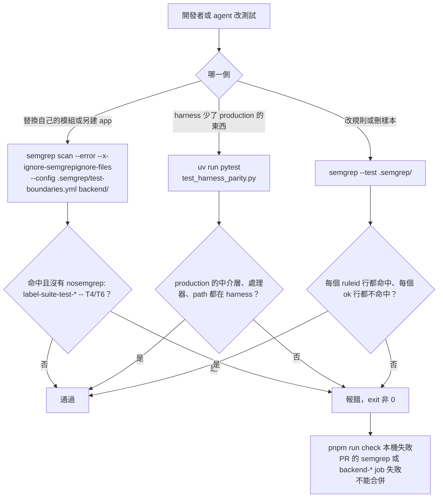
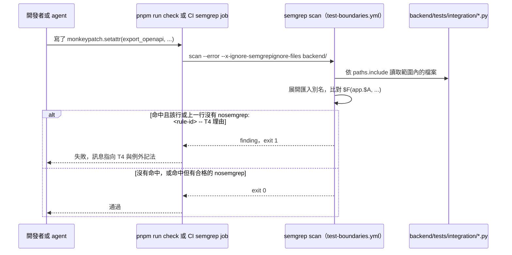
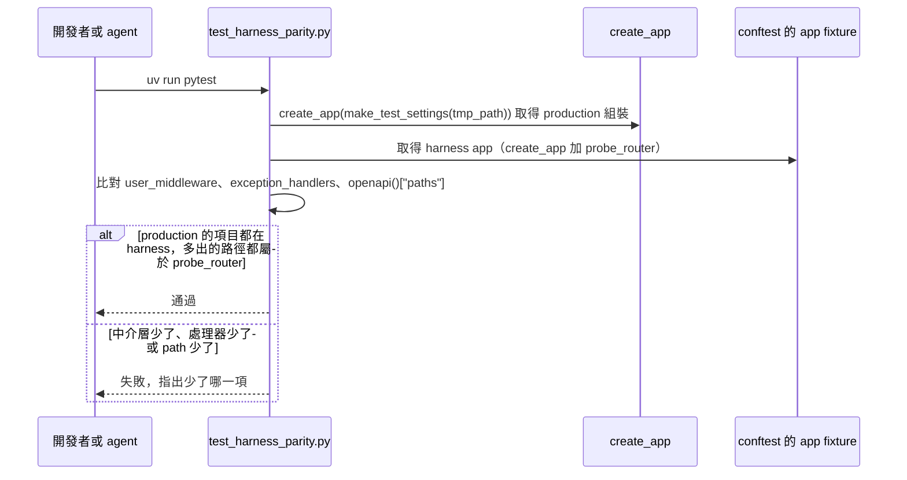
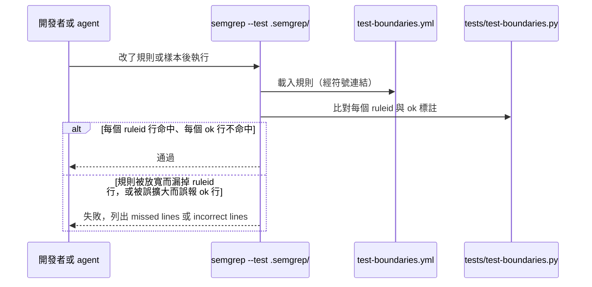

# System Design

本 change 是測試規範的機器檢查：沒有 Router、Service、Repository、Model 或 Pydantic schema，也沒有 API、資料表或 UI。範本的「分層與類別」「關鍵情境」改寫成這類變更適用的內容：**機制的組成**（哪個檔案放哪條規則、在哪裡被呼叫）與**違規如何被擋下**的流程圖。

system-analysis 的 10 個待決問題**不由本文件決定**（它們是維護者的問題，由 clarification 問答）。本文件的做法是：每個選項只要會改變設計，就寫出該選項下的機制、已實測的表達力與成本，並給技術建議；標「建議」的不是決議。所有實測都在 worktree 外的暫存目錄與暫時檔案上做，沒有提交（方法與輸出見各節「已驗證」）。

## 分層與類別

### 先決發現：現在的 `semgrep scan` 根本沒有掃 `tests/`

這一條改變 Q4 選項 A 的成本，所以放在最前面。

**已驗證**（映像 `semgrep/semgrep:1.186.0`，與 CI 相同；掃描對象是 `origin/main` 的 `backend/ frontend/ e2e/` 複本，無 `.semgrepignore`）：

| 指令                                                                                                  | 掃到的檔案                    | 其中 `tests/` 下的檔案 |
| :---------------------------------------------------------------------------------------------------- | :---------------------------- | :--------------------- |
| `semgrep scan --config .semgrep/label-suite.yml backend/ frontend/ e2e/`（CI 現行指令）               | 104                           | **0**                  |
| 同上，repo 根目錄加一個只列 `node_modules/`、`.venv/` 的 `.semgrepignore`（取代 Semgrep 內建預設）    | 143                           | 29                     |
| `semgrep scan --config <新規則> --x-ignore-semgrepignore-files backend/`                              | 53（`backend/` 全部，含測試） | 12                     |
| `semgrep scan --config <新規則> backend/tests/integration/`（以目錄為目標，沒有 `.semgrepignore`）    | **0**                         | 0                      |
| `semgrep scan --config <新規則> backend/tests/integration/test_export_openapi.py`（以單一檔案為目標） | 1                             | 1                      |

原因：Semgrep 在沒有 `.semgrepignore` 時套用內建預設，預設忽略 `tests/`、`test/`、`build/` 等目錄；目錄目標也逃不掉，只有逐檔指定才會掃。sa 寫「Semgrep 對 `backend/` 的掃描範圍已含 `tests/`」**不成立**，這條要更正（見「技術待決問題」N1）。這代表 Q4 選 A 時，**規則寫對還不夠，掃描範圍也要先改**，有兩條路，成本不同：

| 做法                                                     | 做什麼                                                               | 副作用（已驗證）                                                                                                                                                                                                                                                                                    |
| :------------------------------------------------------- | :------------------------------------------------------------------- | :-------------------------------------------------------------------------------------------------------------------------------------------------------------------------------------------------------------------------------------------------------------------------------------------------- |
| S1 repo 根目錄新增 `.semgrepignore`                      | 只列真正要排除的（`node_modules/`、`.venv/` 等），取代內建預設       | **既有規則的範圍一起變大**：`label-suite-hardcoded-secret` 對新納入的檔案報 4 個（`backend/tests/integration/test_app_assembly.py:126`、`backend/tests/probe.py:23`、`backend/tests/unit/test_envelope.py:175`、`frontend/build/extract-tokens.ts:23`），要修或加 `nosemgrep`，超出本 change 的目的 |
| S2 另開一個 CI 步驟，用 `--x-ignore-semgrepignore-files` | 新規則放獨立檔案，只由新步驟載入；該步驟加上這個旗標，只掃要掃的路徑 | 既有的 `semgrep scan` 步驟與 `label-suite.yml` 不動，既有規則的範圍不變。代價：`--x-` 開頭是實驗旗標，穩定性只有映像固定版本 1.186.0 保證，升級 Semgrep 時要重驗                                                                                                                                    |

**建議 S2**（只在 Q4 選 A 時有意義）：本 change 的目的是擋替身，不是順便把既有 secret 規則的涵蓋面擴大。S1 的 4 個新命中是真實的既有問題，但屬於本 change 呼叫路徑之外，依 AGENTS.md「Anything outside that code path is only reported and gets its own issue」應另開 issue（見 N1）。若維護者選 S1，4 個命中要在本 change 內處理或另開 issue 後以 `nosemgrep` 暫放。

### 機制總覽（Q4 選項 A：Semgrep；其餘選項見後）

| 關卡                       | 規則落點                                                                             | 本機呼叫                                              | CI 呼叫                                                   | 擋下的內容                                                                                                              |
| :------------------------- | :----------------------------------------------------------------------------------- | :---------------------------------------------------- | :-------------------------------------------------------- | :---------------------------------------------------------------------------------------------------------------------- |
| 替換自己模組的寫法         | 新檔 `.semgrep/test-boundaries.yml`（見下「規則集」）                                | `pnpm run check --with-semgrep`（新增一個指令，見下） | `semgrep` job 新增一個步驟（見下「掃描指令」）            | 在 integration、`conftest.py`、`probe.py`、`factories/` 以 monkeypatch／patch／`dependency_overrides` 換掉 `app` 的東西 |
| harness 另建 app           | 同檔：`label-suite-test-own-app-factory`（靜態）                                     | 同上                                                  | 同上                                                      | 在上述範圍出現 `FastAPI(...)`／`Starlette(...)`                                                                         |
| harness 與 production 同構 | `backend/tests/integration/test_harness_parity.py`（行為測試，Q6 選項 C）            | `pnpm run check` 的 `backend-sqlite` 步驟內的 pytest  | `backend-sqlite`、`backend-postgres` job 既有的 pytest    | 工廠建好後事後被拆掉東西（中介層少了、處理器少了、路由少了）                                                            |
| 規則仍然有效               | `.semgrep/tests/test-boundaries.py`（Semgrep 樣本，Q8 選項 B）加行為測試內的突變案例 | `semgrep --test .semgrep/`、`uv run pytest`           | `semgrep` job 既有的 `--test` 步驟、`backend-*` 的 pytest | 規則被改寬鬆、樣本被刪                                                                                                  |

新增檔案：`.semgrep/test-boundaries.yml`、`.semgrep/tests/test-boundaries.yml`（指向 `../test-boundaries.yml` 的符號連結，沿用 `label-suite.yml` 的做法）、`.semgrep/tests/test-boundaries.py`、`backend/tests/integration/test_harness_parity.py`；改動：`.github/workflows/ci.yml` 的 `semgrep` job 多一個步驟、`scripts/check.mjs` 的 `--with-semgrep` 多一個指令（`scripts/tests/check.test.mjs` 逐字比對 CI 與本機指令，兩處同步改）。**為什麼獨立一個規則檔**：(1) `label-suite.yml` 的既有步驟用預設忽略規則，新規則需要不同的掃描旗標（上節 S2），規則檔分開才能用不同指令載入；(2) `--config .semgrep/` 會讓每條規則載入兩次（ci.yml 註解已寫），所以兩個檔案都必須用明確檔名載入；(3) 規則集的生命週期（隨 T4／T6 演進）與 secret、CORS 兩條安全規則不同。

掃描指令（CI 與本機逐字相同）：

```text
semgrep --test .semgrep/
semgrep scan --error --x-ignore-semgrepignore-files --config .semgrep/test-boundaries.yml backend/
```

規則內以 `paths.include` 限定範圍（錨定寫法 `/backend/tests/integration/`，不寫會被 Semgrep 警告「將來解讀為錨定」）：

```yaml
paths:
  include:
    - /backend/tests/integration/
    - /backend/tests/conftest.py
    - /backend/tests/probe.py
    - /backend/tests/factories/
```

**已驗證**：這份 `include` 掛在規則上，對 `origin/main` 掃描只在 `backend/tests/integration/test_export_openapi.py` 命中（見下表），`tests/unit/` 的 3 個字串目標與 7 個 mock 物件、5 個 `FastAPI(` 都不報；`semgrep --test` **不套用 `paths`**（樣本檔放哪裡都會被測到，已驗證），所以 `paths` 的效果不會被樣本證明（見 N2）。`factories/` 目錄今天不存在，`include` 對不存在的目錄不報錯（已驗證，T5 規定它存在時才有東西可掃）。

### 規則集與 Q1 選項的對照

下表每一列都是一條已寫出並以 `semgrep --test` 驗證過的規則（規則本文見「規則本文（已驗證）」）。**Q1 的選項只是「啟用哪幾條」**，所以選項保持開放：

| 規則 id（建議命名）                     | 擋什麼                                                                                                                                                             | 啟用於 Q1 選項   | 在 `origin/main` 的 integration／conftest／probe 命中                             |
| :-------------------------------------- | :----------------------------------------------------------------------------------------------------------------------------------------------------------------- | :--------------- | :-------------------------------------------------------------------------------- |
| `label-suite-test-self-mock-string`     | `monkeypatch.setattr／setitem／delattr／delitem`、`patch(...)`、`patch.object／dict／multiple` 的第一個參數是以 `app` 或 `app.` 開頭的字串（含 f-string 與單引號） | A、B、C、D       | **0**                                                                             |
| `label-suite-test-self-mock-object`     | 同一批方法的第一個參數是**從 `app` 匯入的物件**（`from app… import x`、`import app.x as y`、`import app.x` 後的 `app.x.…`），含一到五層屬性                        | B、D（C 見下）   | **4**（`test_export_openapi.py:138、139、194、195`）                              |
| `label-suite-test-dependency-overrides` | `<app>.dependency_overrides[...] = …`、`.update(...)`、`.setdefault(...)`、`.pop(...)`、整個重新指派，以及 `monkeypatch.setitem／patch.dict` 指到它                | A、B、C、D       | **0**（`dependency_overrides` 今天全 repo 0 處，規則是預防性的）                  |
| `label-suite-test-any-patch`            | **任何** `setattr／setitem／delattr／delitem／patch／patch.object／patch.dict`，不看目標                                                                           | C（取代 object） | **6**（4 個 `export_openapi` 加 `test_app_assembly.py:336、417` 的 `sys.stderr`） |
| `label-suite-test-mock-objects`         | `MagicMock(...)`、`AsyncMock(...)`、`Mock(...)`、`create_autospec(...)`、`mocker.Mock／MagicMock／AsyncMock／patch`，與 `unittest.mock` 的匯入                     | D                | **0**（unit 層有 7 處 `MagicMock`／`AsyncMock`，不在適用範圍）                    |
| `label-suite-test-own-app-factory`      | `FastAPI(...)`、`fastapi.FastAPI(...)`、`Starlette(...)`、`starlette.applications.Starlette(...)`                                                                  | Q6 的 A／B       | **0**（`tests/unit/` 內 5 處、`backend/app/main.py` 1 處不在範圍）                |

以 Q1 的四個選項換算：A = 字串規則加 `dependency-overrides`；B = A 加 `self-mock-object`；C = `any-patch` 加 `dependency-overrides`（`any-patch` 已涵蓋字串與物件）；D = B 加 `mock-objects`。命中數與 sa 的量測逐項一致（A 0、B 4、C 6、D 4），**已用 `backend/` 的實際掃描對上**。

**重點結論，回答「Semgrep 能不能表達 Q1-B」：能。** 關鍵是 Semgrep 的 Python 解析會**把匯入別名展開成完整路徑再比對**：樣本檔裡 `from app.scripts import export_openapi` 之後的 `export_openapi`，會被 `$F(app.$A.$B, ...)` 這條樣式視為 `app.scripts.export_openapi` 而命中；`import app.scripts.export_openapi as eo` 的 `eo`、`from app import main as app_main` 的 `app_main`、`from app.core.config import Settings` 的 `Settings.model_config` 都一樣。不需要 `pattern-inside` 追蹤匯入，也不需要 `metavariable` 去比對「這個名字從哪裡來」。我先寫了 `pattern-inside: from $M import $OBJ ...` 加 `metavariable-regex: ^app` 的版本，結果對 `import app.main` 這種寫法抓不到，改成讓 Semgrep 的別名展開直接做，更短也更準。

### 規則本文（已驗證）

下列內容放進 `.semgrep/test-boundaries.yml`；`message` 在實作時補上 T4／T6 的條文與例外記法。接收者（`monkeypatch`、`m`、`mp`、`pytest.MonkeyPatch()`、`mocker`）用同一條 `metavariable-regex` 涵蓋，**開頭要自己錨 `^`**：Semgrep 的 `metavariable-regex` 是從字串開頭比對，`(^|\.)` 這種寫法在實測會漏掉 `m.setattr`，改成 `^(.*\.)?(...)$` 才通過。

```yaml
rules:
  - id: label-suite-test-self-mock-object
    message: >-
      Integration tests must not replace an object imported from app (T4).
      Replace an external boundary instead (T6), or record an exemption with
      a reason.
    severity: ERROR
    languages: [python]
    paths:
      include:
        [
          /backend/tests/integration/,
          /backend/tests/conftest.py,
          /backend/tests/probe.py,
          /backend/tests/factories/,
        ]
    patterns:
      - pattern-either:
          - pattern: $F(app.$A, ...)
          - pattern: $F(app.$A.$B, ...)
          - pattern: $F(app.$A.$B.$C, ...)
          - pattern: $F(app.$A.$B.$C.$D, ...)
          - pattern: $F(app.$A.$B.$C.$D.$E, ...)
      - metavariable-regex:
          metavariable: $F
          regex: ^(.*\.)?(setattr|setitem|delattr|delitem|patch(\.(object|dict|multiple))?)$

  - id: label-suite-test-self-mock-string
    # same severity and paths as above
    languages: [python]
    patterns:
      - pattern-either:
          - pattern: $F("$T", ...)
          - pattern: $F(f"...", ...)
      - metavariable-regex:
          metavariable: $F
          regex: ^(.*\.)?(setattr|setitem|delattr|delitem|patch(\.(dict|multiple))?)$
      - pattern-regex: \(\s*[a-z]?["']app(\.|["'])

  - id: label-suite-test-dependency-overrides
    # same severity and paths as above
    languages: [python]
    pattern-either:
      - pattern: $APP.dependency_overrides[$K] = $V
      - pattern: $APP.dependency_overrides.update(...)
      - pattern: $APP.dependency_overrides.setdefault(...)
      - pattern: $APP.dependency_overrides.pop(...)
      - pattern: $APP.dependency_overrides = $V
      - pattern: monkeypatch.setitem($APP.dependency_overrides, ...)
      - pattern: patch.dict($APP.dependency_overrides, ...)

  - id: label-suite-test-own-app-factory
    # same severity and paths as above
    languages: [python]
    pattern-either:
      - pattern: FastAPI(...)
      - pattern: fastapi.FastAPI(...)
      - pattern: Starlette(...)
      - pattern: starlette.applications.Starlette(...)
```

**已驗證的樣本結果**（`semgrep --test`，映像 1.186.0，我的暫時樣本，每個 `ruleid` 命中、每個 `ok` 不命中）：

```text
self-mock-object（獨立規則檔）：1/1: ✓ All tests passed
self-mock-string 加 dependency-overrides：2/2: ✓ All tests passed
own-app-factory、any-patch、mock-objects：3/3: ✓ All tests passed
```

以上三次是各自的暫時規則檔與樣本；之後把接收者正規式改成最終採用的 `^(.*\.)?(…)$` 版本再各驗一次，結果相同（通過）。

**會命中**：`monkeypatch.setattr(export_openapi, "DEFAULT_OUTPUT", …)`（`from app.scripts import export_openapi`）、`monkeypatch.setattr(eo, …)`（`import … as eo`）、`monkeypatch.setattr(app_main, …)`、`monkeypatch.setattr(Settings, …)`、`monkeypatch.setattr(Settings.model_config, …)`、`monkeypatch.setitem(export_openapi.TABLE, …)`、`mocker.patch.object(export_openapi, …)`、`patch.object(Settings, …)`、`mock.patch.object(Settings, …)`、`monkeypatch.setattr(app.main, …)`（`import app.main`）、`monkeypatch.setattr(app.main.create_app, …)`、`with monkeypatch.context() as m: m.setattr(export_openapi, …)`、`pytest.MonkeyPatch().setattr(Settings, …)`、`setattr(Settings, …)`；字串形式的 `"app.main.x"`、`'app.main.x'`、`f"app.{name}.x"`、`mocker.patch("app.…")`、`patch("app.…")`（含裝飾器與 `with`）、`mock.patch(...)`、`unittest.mock.patch(...)`、`mocker.patch.dict("app.…", {})`、`monkeypatch.delattr("app.main.x")`、`monkeypatch.setitem("app.main.x", …)`；`app.dependency_overrides[...] = …`、`.update`、整個重新指派、`client.app.dependency_overrides[...] = …`。

**不會命中（刻意）**：`monkeypatch.setattr(sys, "stderr", …)`、`monkeypatch.setattr("sys.stderr", …)`、`monkeypatch.setattr("application.x", …)`（只以 `app` 加點或整個等於 `app` 才算）、`monkeypatch.setenv／chdir`、`patch("httpx.AsyncClient.send")`、`patch.object(httpx.AsyncClient, "send")`、`@router.patch("/items")`（HTTP PATCH 路由裝飾器，sa 預警的誤報在這裡不發生，因為接收者與第一個參數都必須符合）、`value = app.dependency_overrides`（只讀取）。

**已驗證的限制（寫進規則文件與樣本，不假裝擋得住）**：

| 繞過方式                                                                                   | 結果                                                                                                                                                   | 處理                                                                                                                       |
| :----------------------------------------------------------------------------------------- | :----------------------------------------------------------------------------------------------------------------------------------------------------- | :------------------------------------------------------------------------------------------------------------------------- |
| 先指派給區域變數再傳入：`target = export_openapi; monkeypatch.setattr(target, …)`          | **擋不住**（Semgrep 沒有跨敘述的名稱追蹤）                                                                                                             | 靠審查；樣本以未標註的行記為「已知漏洞」，萬一日後 Semgrep 能擋，樣本會失敗而提醒我們改成 `ruleid`                         |
| 字串在別處組出來：`target = "app." + "main.x"; monkeypatch.setattr(target, …)`             | **擋不住**                                                                                                                                             | 同上                                                                                                                       |
| 先把 `dependency_overrides` 取成區域變數再寫入：`ov = app.dependency_overrides; ov[k] = v` | **擋不住**                                                                                                                                             | 同上                                                                                                                       |
| fixture 名稱就叫 `app`（`conftest.py` 的 `app` fixture 是 `FastAPI` 實例，不是套件）       | **誤報**：`monkeypatch.setattr(app.router, …)` 會被當成 `app.` 套件命中；`monkeypatch.setattr(app, …)`（單獨一個 `app`）不命中                         | 這個誤報的方向是安全的：改寫 harness 組出來的 app 本來就是 T4 要擋的事；若將來要精確區分，需改 fixture 名稱，不在本 change |
| 把 `export_openapi` 的輸出路徑常數允許（Q3-C）                                             | **可表達**：在 `self-mock-object` 加 `pattern-not: $F(export_openapi, "DEFAULT_OUTPUT", ...)` 與 `"DOCS_COPY_OUTPUT"` 兩條，樣本通過，其他屬性仍然命中 | 規則以「目標名稱」做 allowlist，常數搬家時要改規則；見「例外的記法」                                                       |

### 例外的記法（Q7）

三種做法，**已實測前兩種**：

| 做法                                                                           | 實測結果                                                                                                                                                                                 | 對 Q3 的意義                                                                           |
| :----------------------------------------------------------------------------- | :--------------------------------------------------------------------------------------------------------------------------------------------------------------------------------------- | :------------------------------------------------------------------------------------- |
| B 行內 `# nosemgrep: <rule-id> -- T4 <理由>`                                   | 寫在同一行尾端、或寫在**上一行**都能抑制（兩種都已驗證）；只指名**別的規則 id** 不會抑制本規則（已驗證，所以必須寫對 id）；**裸的 `# nosemgrep`（沒有 id）會抑制該行所有規則**（已驗證） | 每個例外一行，在 diff 看得到、reviewer 看得到理由                                      |
| C 規則內 allowlist：`pattern-not` 指名目標（見上表最後一列）或 `paths.exclude` | `pattern-not` 已驗證；`paths.exclude` 與已驗證的 `paths.include` 是同一個機制，沒另外跑                                                                                                  | 例外集中在規則檔；`paths.exclude` 是整檔放行，範圍大；`pattern-not` 範圍精確但綁死名稱 |
| A 無例外                                                                       | 不需要設計                                                                                                                                                                               | Q3 只剩「改測試」一條路                                                                |

**Semgrep 無法自己強制「理由要引用 T4／T6」。** 我試了用一條 `languages: [generic]` 的 `pattern-regex` 規則去抓「`nosemgrep` 後面沒有 `-- T4|T6`」的註解，結果：裸的 `# nosemgrep` 同時抑制了這條守衛自己（已驗證，該行的守衛命中不出現在預設輸出，加 `--disable-nosem` 才出現）。因此「例外必須有理由」只有三條路，**請維護者在 Q7 一併決定**：

| 強制理由的做法                                                                                                                                                              | 成本                                                                                                                                   | 技術建議                                                                                     |
| :-------------------------------------------------------------------------------------------------------------------------------------------------------------------------- | :------------------------------------------------------------------------------------------------------------------------------------- | :------------------------------------------------------------------------------------------- |
| (i) 只靠審查，在 `testing-agent-rules.mdx` 寫明格式，reviewer 查                                                                                                            | 零；但裸 `nosemgrep` 會悄悄放行（規則文件寫「不得使用裸 `nosemgrep`」）                                                                |                                                                                              |
| (ii) `backend/tests/unit/test_semgrep_exemptions.py`：走訪 `tests/**/*.py` 找 `nosemgrep`，斷言每一個都指名 `label-suite-test-*` 的規則 id 且有 `-- T4`／`-- T6` 與非空理由 | 約 20 行、僅用 `re` 與 `pathlib`；在兩個後端 job 都會跑；測試檔本身要內建「不合格樣本會失敗」的案例（同 `test_size_limits.py` 的做法） | **建議 (ii)**：它讓 Q7 的「理由要引用條號」成為可檢查而不是口頭約定，且不依賴 Semgrep 的行為 |
| (iii) `nosemgrep` 全面禁用，例外只能用規則內 allowlist（Q7-C）                                                                                                              | 例外要改規則檔，PR 變大                                                                                                                |                                                                                              |

`AGENTS.md` 與 S 系列規則沒有禁止 `nosemgrep`，所以這是設計選擇，不是衝突。Q7 的「`nosemgrep` 不得用在 `tests/integration/` 以外」（sa 的建議）：規則本身的 `paths.include` 已經只掃這些路徑，其他地方的 `nosemgrep` 對本規則沒有作用，不需要額外機制；但 (ii) 的測試會掃整個 `tests/`，順便擋住「在別處放無意義的 `nosemgrep`」。

### 「harness 與 production 共用同一個 app 組裝函式」（Q6）

三種守法，可並用（sa 建議 B 加 C）：

| 選項                  | 機制                                                                                                                                                                                                        | 已驗證                                                                                                                                                                                      |
| :-------------------- | :---------------------------------------------------------------------------------------------------------------------------------------------------------------------------------------------------------- | :------------------------------------------------------------------------------------------------------------------------------------------------------------------------------------------ |
| A 結構測試（pytest）  | 掃 `conftest.py` 與 `tests/integration/**` 的語法樹：不得有 `FastAPI(`、`app` fixture 必須呼叫 `create_app`                                                                                                 | 可做，但與 B 重複，且多一個 pytest 檔                                                                                                                                                       |
| B 靜態規則（Semgrep） | `label-suite-test-own-app-factory`（上表）擋 `FastAPI(`／`Starlette(`；另可加 `label-suite-test-app-fixture-uses-create-app`：`def app(...)` 的本體必須含 `$X = create_app(...)`，否則命中（`pattern-not`） | `FastAPI(` 規則已驗證：`FastAPI()`、`FastAPI(title=…)`、`fastapi.FastAPI()`、`Starlette()` 命中，`create_app(...)`、`router.include_router(...)` 不命中；`app` fixture 規則已驗證，限制見下 |
| C 行為測試（pytest）  | `backend/tests/integration/test_harness_parity.py`：用同一份 `make_test_settings(tmp_path)` 各建一個 `create_app(...)`，一個加上 `probe_router` 當 harness，比對兩者                                        | 見下節，比對的三個面向已在 worktree 以腳本驗證可行，輸出如下                                                                                                                                |

`app` fixture 規則的限制（已驗證）：`pattern-not` 要寫成 `$X = create_app(...)`（本體有一條把 `create_app(...)` 指派給變數的敘述）才認；寫成 `<... create_app(...) ...>` 的「出現在任何地方」形式實測**不成立**（把合格的 fixture 也報了）；`return create_app(...)` 那種寫法要另補一條 `pattern-not`，且規則綁死函式名稱 `app`，fixture 改名就失效。**所以建議這條只當輔助，不當唯一防線，真正的防線是 C。**

**C 的設計**：

| 比對項         | 怎麼比                                                                                                                                       | 已驗證（本機執行，worktree 內暫時腳本，已刪除）                                                                                      |
| :------------- | :------------------------------------------------------------------------------------------------------------------------------------------- | :----------------------------------------------------------------------------------------------------------------------------------- |
| 中介層         | `[m.cls for m in app.user_middleware]` 的**順序**與內容相等                                                                                  | `['CorrelationIdMiddleware', 'CORSMiddleware', 'AccessLogMiddleware', 'UnhandledExceptionMiddleware', 'LocaleMiddleware']`，兩邊相等 |
| 例外處理器     | `set(app.exception_handlers)` 相等                                                                                                           | 兩邊各 4 個，相等                                                                                                                    |
| 路由與 OpenAPI | 用 `app.openapi()["paths"]`：production 的每個 path 都在 harness 中且該 path 的內容逐字相等；harness 多出的 path 必須全部屬於 `probe_router` | harness 多出 `/api/v1/items/{item_id}`、`/api/v1/probe` 等探針路徑，production 的 path 沒有任何缺少                                  |

**不能用 `app.routes` 比較**：本專案的 FastAPI 版本把掛上去的 router 包成 `_IncludedRouter`，`app.routes` 只有 6 個 vs 5 個項目、拿不到 path（已驗證：用 `path` 屬性做集合比對得到 0 個差異，是假陰性）。比對一定要走 `openapi()["paths"]`。

**比的是「組裝」不是「設定值」**：`make_test_settings` 刻意與 production 預設不同（`api_docs_enabled=True`、固定的 CORS 來源、SQLite 路徑），所以兩邊都用同一份測試設定建 app，比的是工廠有沒有被繞過，不是 production 預設值；若要驗 production 預設，那是 `test_app_assembly.py` 已有的工作。

**探針路由算不算「比 production 多」**：T4 禁止「比 production 寬鬆」，加路由屬持平或更嚴（它不放寬任何驗證）。比對規則寫成「production ⊆ harness，且 harness 多出的 ⊆ 探針路徑」，等於 sa 建議的「只加不減」。**這要寫進 T4 的例外格**（Q6 附帶，`testing-agent-rules.mdx` 的任務）。

**持久的失敗樣本（Q8 對應）**：比對邏輯寫成 `assert_same_assembly(production, harness, allowed_extra_paths)` 這個函式，同檔再有三個突變測試：(1) 對 harness 用 `app.user_middleware.pop()` 後 `app.middleware_stack = None`，斷言函式丟出錯誤；(2) 從 `app.exception_handlers` 刪一個 key，斷言丟錯；(3) 多出一個不屬於探針的路徑，斷言丟錯。這樣「行為測試本身仍然有牙齒」也被測試守住。

### 持久的失敗樣本（Q8 選項 B）

Semgrep 通道已內建：`.semgrep/tests/test-boundaries.py` 以 `# ruleid:`／`# ok:` 標出每條規則該中與不該中的行，CI 現行的 `semgrep --test .semgrep/` 步驟會自動納入新檔（它用符號連結找到規則檔，所以**必須**新增 `.semgrep/tests/test-boundaries.yml` 指向 `../test-boundaries.yml`，否則 `--test` 會找不到規則）。樣本直接取自上面「已驗證的樣本結果」的暫時檔，並加上：

- 一組「已知漏洞」行（區域變數別名、字串拼接），**不標註**，這樣若 Semgrep 日後能擋，`--test` 會報「incorrect lines」而提醒更新；
- 每個 `nosemgrep` 形式各一行：同行有 id 與理由（`ok`）、上一行有 id 與理由（`ok`）、只指名別的規則（`ruleid`，仍然命中）；
- `.semgrep/tests/test-boundaries.ts` 僅在 Q5 選到前端時才建。

`.semgrep/` 目錄不在 CI 掃描範圍（`backend/ frontend/ e2e/`），所以違規樣本本身不會讓掃描失敗。**注意 `semgrep --test` 不套用 `paths`**（已驗證），因此樣本證明的是「樣式」，不是「掃描範圍」，範圍的證明見 N2。

### Q4 其他選項怎麼落地（技術比較，不決定）

| 選項                                | 能不能表達 Q1-B 的「從 `app` 匯入」                                                       | 落點與成本                                                                                                                                                                                  |
| :---------------------------------- | :---------------------------------------------------------------------------------------- | :------------------------------------------------------------------------------------------------------------------------------------------------------------------------------------------ |
| A Semgrep（上述）                   | **能**（已驗證，見上），三個已驗證的限制：區域變數別名、字串拼接、fixture 名 `app` 的誤報 | 新增 3 個檔案加 CI 與 `check.mjs` 各一處；有 S1／S2 的掃描範圍問題（上節）；不佔用後端測試 job                                                                                              |
| B pytest 結構測試（`ast`）          | 能，且可處理區域變數別名（用 `ast` 追蹤賦值），表達力最好                                 | `backend/tests/unit/test_no_self_mocks.py`（沿用 `test_layer_boundaries.py` 的做法），不需要改掃描範圍、CI、`check.mjs`；但在 `backend-sqlite` 與 `backend-postgres` 各跑一次，且前端不可用 |
| C 獨立腳本（`scripts/check-*.mjs`） | 要自己寫 Python 語法樹解析，或用正則（會誤報 `.patch(` 路由裝飾器，sa 已預警）            | 要新增腳本、腳本測試、CI 步驟、`check.mjs` 步驟、`check.test.mjs` 步驟數斷言；成本最高                                                                                                      |

**技術建議：A 為主**，理由是 Semgrep 已經能表達 Q1-B 且樣本機制現成。唯一的重大成本是上節的掃描範圍（S2 的實驗旗標）。若維護者不接受實驗旗標或想擋區域變數別名，B 是合理的退路：它不需要 S1／S2、表達力更強，代價是兩個後端 job 各跑一次與前端不可用。**兩者可並存**：A 負責靜態樣式與 `FastAPI(`，B 不必另建。

### 前端（Q5）

**已驗證**：TypeScript 的 `vi.mock("@/…")`、`vi.mock("../…")`、`vi.doMock("./…")`、`vi.mock(import("@/…"))` 能用 `pattern-either` 加 `metavariable-regex: ^(@/|\.{1,2}/)` 擋下，`vi.mock("react-router")` 不報（1/1 通過）。`languages: [typescript]` 與既有 `label-suite-hardcoded-secret` 同在一個規則檔不會互相干擾。命中數今天是 0。

問題不在 Semgrep 的表達力，而在**範圍**：前端 integration 與 unit 同目錄同副檔名，規則只能掛在 `**/*.test.ts(x)` 全部，連 unit 一起擋（Q5-B 的成本）。Q5-A（不納入）不需要設計；Q5-B 在新規則檔加一條 TypeScript 規則加 `.semgrep/tests/test-boundaries.ts`，另有同一個掃描範圍問題（`frontend/**/*.test.ts` 今天同樣被預設忽略規則排除，其中 `frontend/build/` 也是）。Q5-C 需要改 T1（為前端 integration 測試定義命名），超出本 change。`vi.spyOn(globalThis, "fetch")`（Q5-D）：樣式可寫（`vi.spyOn(globalThis, "fetch", ...)`），但沒有可區分 unit 與 integration 的路徑，**建議不寫**，與 sa 一致。

### 違規如何被擋下



## 關鍵情境

本 change 沒有 Router 到 DB 的請求流程，沒有規格書「驗收標準」可對應（見 system-analysis §需求依據）。下面三個情境用 specs 可能採用的 Scenario 名稱；若 `planner` 的名稱不同，以 specs 為準。

### Scenario: 替換自己模組的 integration 測試被 Semgrep 擋下



### Scenario: harness 缺少 production 的中介層時對照測試失敗



### Scenario: 規則被誤改寬鬆時樣本測試失敗



## 常駐文件異動

本次無常駐文件異動。`docs/diagrams/architecture/backend-modules.mdx` 描述後端模組的分層與 `app/core/` 的基礎建設，這次沒有新增模組，也沒有動 `app/`；harness 的組裝（`tests/conftest.py`）不在該文件的範圍。要改的是規則文件（`testing-agent-rules.mdx` 的 T4、T6 與文首狀態段，Q9），那是 `tasks.md` 的文件任務，不是常駐文件。

## 資料模型異動

本次無資料模型異動。沒有資料表、欄位、索引或 Alembic migration，字典與 ER 都不動；SQLite 與 PostgreSQL 的差異只在 `test_harness_parity.py`：它不連資料庫（比對的是 app 物件，不執行 lifespan），所以兩個資料庫上的結果相同，不需要為它分兩輪。

## 權限檢查點

不涉及。沒有端點、角色或欄位遮蔽。測試集答案隔離：本 change 不新增標記員能到達的程式、不改任何回應；樣本與規則都是合成的程式碼，不含答案資料。規則本身的目的之一是**防止**日後有人用 `monkeypatch` 繞過答案隔離的授權路徑（T4 反例）。

## 技術待決問題

以下是設計過程中浮現的技術問題，不是維護者要決定的業務問題。與 system-analysis 的 Q1 至 Q10 重疊的部分，本節只註明「設計受影響之處」，不重複選項。

| #   | 問題                                                                                                                                                                                   | 影響                                                                                                                              | 建議與成本                                                                                                                                                                                                                                                                                                                  |
| :-- | :------------------------------------------------------------------------------------------------------------------------------------------------------------------------------------- | :-------------------------------------------------------------------------------------------------------------------------------- | :-------------------------------------------------------------------------------------------------------------------------------------------------------------------------------------------------------------------------------------------------------------------------------------------------------------------------- |
| N1  | 現行 `semgrep scan` 不掃任何 `tests/`（0 個測試檔，見「先決發現」），sa 的「掃描範圍已含 `tests/`」不成立；`.semgrepignore` 或 `--x-ignore-semgrepignore-files` 二選一                 | 動到 Q4 選項 A 的 CI 與 `check.mjs`；S1 會讓既有 secret 規則新增 4 個命中（3 個後端測試與 `frontend/build/extract-tokens.ts:23`） | **建議 S2**（獨立規則檔加獨立步驟加實驗旗標，既有規則不動）；若選 S1，4 個既有命中是本 change 呼叫路徑之外的問題，應另開 issue，不在這裡改（AGENTS.md「只回報」）                                                                                                                                                           |
| N2  | `semgrep --test` 不套用規則的 `paths`，所以樣本無法證明「掃描範圍」（例如 `conftest.py` 有被納入）                                                                                     | Q8：持久證據只涵蓋樣式，不涵蓋範圍                                                                                                | 範圍的證明用一次性證據：acceptance 暫時在 `backend/tests/conftest.py` 與 `backend/tests/probe.py` 各放一行違規、跑 CI 指令、貼出輸出再還原（我已在暫存複本對 `integration/` 做過，輸出見 §已驗證）。若要持久，需另設 fixture 目錄並讓 `paths.include` 改用 `**/tests/integration/` 並在 CI 加預期失敗的步驟，成本高，不建議 |
| N3  | Semgrep 無法強制「`nosemgrep` 要有理由並引用 T4／T6」（裸 `nosemgrep` 會抑制守衛自己）                                                                                                 | Q7 的「理由」只能靠審查或額外測試                                                                                                 | **建議** `test_semgrep_exemptions.py`（約 20 行，見「例外的記法」）；不做則在規則文件寫「不得使用裸 `nosemgrep`」並靠審查，需維護者決定                                                                                                                                                                                     |
| N4  | 規則接收者用 `^(.*\.)?(setattr\|…)$` 涵蓋任何名字的 monkeypatch 物件；**第一個參數必須是從 `app` 展開的名稱**才命中，所以誤報面小，但 fixture `app.router` 會誤判                      | Q1-B、Q1-D 的精確度                                                                                                               | 接受（誤報方向安全）；不為此改 fixture 名稱                                                                                                                                                                                                                                                                                 |
| N5  | 三個繞過手法（區域變數別名、字串拼接、取出 `dependency_overrides` 再寫入）Semgrep 擋不住                                                                                               | Q1 的「機械擋下」不是完整的；若要完整需 Q4-B（pytest `ast`）                                                                      | 接受並在規則文件與樣本寫明已知漏洞；若維護者要求完整擋下，改走 Q4-B 或加做 B 並存                                                                                                                                                                                                                                           |
| N6  | `test_harness_parity.py` 不連資料庫、不跑 lifespan，比的是 app 物件；若 harness 與 production 的差異藏在 lifespan（例如資料庫引擎建立方式）則比不到                                    | Q6-C 的涵蓋範圍                                                                                                                   | 接受：lifespan 是同一個函式 `_lifespan`（`app/main.py`），由 `create_app` 掛上，harness 不另建；若日後 `conftest.py` 自己傳 `lifespan=`，靜態規則 `own-app-factory` 與 `create_app` 簽章會擋下                                                                                                                              |
| N7  | `backend/tests/unit/test_size_limits.py` 已存在且有 400 行檔案長度測試（#561）；新增的測試檔每個都要 ≤ 400 行，`test_harness_parity.py` 與 `test_semgrep_exemptions.py` 要各自控制長度 | tasks 的檔案拆分                                                                                                                  | 不構成問題（預估各 80 至 150 行）；記在 tasks                                                                                                                                                                                                                                                                               |

交易邊界、session 生命週期與效能疑慮：不適用。`semgrep --test` 與新增的掃描指令在本機（映像）各約數秒到十餘秒，在 CI 上已有 `semgrep` job，多一個步驟不構成效能疑慮；行為測試不連資料庫，毫秒級。

## 受 system-analysis 待決問題影響的設計項（彙整）

| 待決 | 設計受影響之處                                                                                                                                            |
| :--- | :-------------------------------------------------------------------------------------------------------------------------------------------------------- |
| Q1   | 決定啟用哪幾條規則（上表）；選項保持開放，每個選項的命中數已實測                                                                                          |
| Q2   | `paths.include` 的內容；`conftest.py`、`probe.py`、`factories/` 今天命中 0，納入沒有成本；日後新增邊界層時改為 `pattern-not` allowlist 或 `paths.exclude` |
| Q3   | 選 A 要改測試與可能的產品碼；選 B 用行內 `nosemgrep`（4 處，每處 id 加 T4 加理由）；選 C 用 `pattern-not` allowlist（已驗證可表達）                       |
| Q4   | 選 A 有 S1／S2 的掃描範圍問題（N1）；選 B 沒有但前端不可用且兩個後端 job 各跑一次；選 C 成本最高                                                          |
| Q5   | 選 A 不需設計；選 B／C 的 Semgrep 樣式已驗證，範圍問題與 N1 相同                                                                                          |
| Q6   | 靜態規則（Semgrep 的 `own-app-factory`）加行為測試（`test_harness_parity.py`），兩者互補；比對面向與探針路由的處理已驗證                                  |
| Q7   | `nosemgrep` 行為已實測；理由強制見 N3                                                                                                                     |
| Q8   | Semgrep 樣本自帶持久證明（樣式）；範圍證明是一次性（N2）；行為測試內含突變案例                                                                            |
| Q9   | 設計新增一個 capability 的內容：規則集、樣本、行為測試、例外記法；T9 表不動                                                                               |
| Q10  | 不影響設計                                                                                                                                                |
