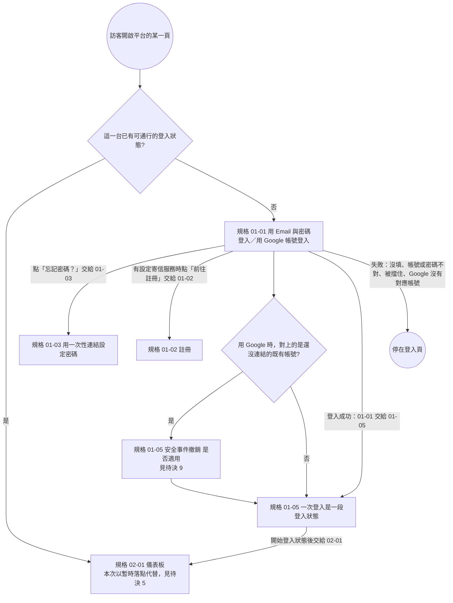
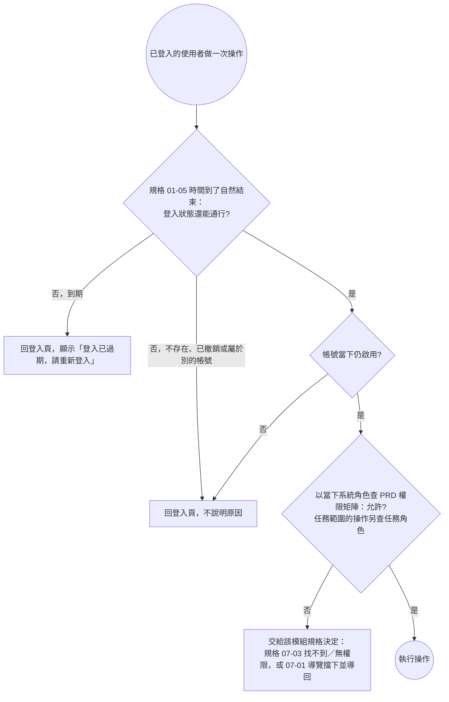

# System Analysis

本份是 change `login-auth-guard`（Issue #719，Epic #712 帳號）的系統分析。它只寫業務面：需求依據、範圍、角色、流程串接、跨模組依賴、矛盾與待決問題。技術設計、資料模型、介面與畫面細節分別交給 `system-design`、`api-contract`、`ui-design`。

## 需求依據

依 `openspec/config.yaml` 的需求依據順序：角色、權限上限、範圍與模組劃分以 PRD 為準；業務規則以維護者指定的需求文件（Issue #719）與 `docs/specs/` 規格書為準，規格與 Issue 說法不同時以規格為準（Issue #719 §需求目標 也這樣寫）；其餘依 PRD 其他內容 ＞ `docs/` 其他文件 ＞ `openspec/`。

| 來源                                                                                                                                             | 章節／編號                                                                                                 | 摘要（一句）                                                                                                                                                                                                 |
| :----------------------------------------------------------------------------------------------------------------------------------------------- | :--------------------------------------------------------------------------------------------------------- | :----------------------------------------------------------------------------------------------------------------------------------------------------------------------------------------------------------- |
| Issue #719                                                                                                                                       | §使用情境／功能範圍、§驗收條件                                                                             | 實作 01-01 的帳號密碼登入、Google 登入（只登入或綁定既有帳號）、記住我、登入狀態，以及之後每個模組共用的認證與權限守門；登入後導向儀表板，02-01 完成前先導向暫時落點；並建立 #111 拆出的認證與權限覆蓋率門檻 |
| Epic #712                                                                                                                                        | 本文                                                                                                       | 帳號 Epic 的五張子單（01-01、01-02、01-03、01-05、01-04）依產品順序以 blocked-by 串接，一次派一張                                                                                                            |
| PRD `docs/specs/00-prd.mdx`                                                                                                                      | §使用者角色 §角色清單                                                                                      | 平台成員、系統管理員、Seeder 管理員三種系統角色；任務角色另計，系統角色不代表任務成員身分                                                                                                                    |
| PRD                                                                                                                                              | §使用者角色 §權限矩陣                                                                                      | 「01 帳號」對兩種系統角色都是 `R/E (o)`；兩張表是預設值也是上限；規格的使用角色只能更嚴                                                                                                                      |
| PRD                                                                                                                                              | §專案範圍 §範圍內                                                                                          | Email 與密碼登入；登入頁的 Google SSO 本期接上；登入狀態與安全                                                                                                                                               |
| PRD                                                                                                                                              | §專案範圍 §假設與限制                                                                                      | 平台部署時由部署者建立 Seeder 管理員                                                                                                                                                                         |
| PRD                                                                                                                                              | §Site Map                                                                                                  | 未登入時可到登入、註冊、設定密碼三頁；登入後從側欄進入，儀表板是第一頁；01-05、07-01、07-03 不是獨立頁面                                                                                                     |
| PRD                                                                                                                                              | §模組架構與串接 §模組依賴                                                                                  | 06 停用帳號、變更系統角色會影響 01–05：停用後登入狀態失效，角色變更從下一次操作起生效                                                                                                                        |
| 規格 01-01 `docs/specs/01-account/01-login.mdx`                                                                                                  | 全頁（已定案；§待釐清 寫明沒有未決問題）                                                                   | 登入頁、Email 與密碼登入、Google 登入、語言切換、螢幕寬度、卡控、邊界與 41 條 Scenario；§已確認決議 Q1–Q9                                                                                                    |
| 規格 01-01                                                                                                                                       | §已確認決議 Q1、Q2                                                                                         | 帳號不存在、密碼錯誤、帳號停用三種都顯示同一句；連續失敗 10 次擋 30 分鐘                                                                                                                                     |
| 規格 01-01                                                                                                                                       | §已確認決議 Q3、Q7                                                                                         | 已登入的人開登入頁直接到儀表板；登入成功去儀表板                                                                                                                                                             |
| 規格 01-01                                                                                                                                       | §已確認決議 Q4                                                                                             | 本期就接上 Google 登入                                                                                                                                                                                       |
| 規格 01-01                                                                                                                                       | §規格 › 用 Google 帳號登入 第 4 條、§卡控機制、§邊界情況（#705）                                           | 沒有對應帳號，或沒有已連結帳號而 Google 回報 Email 未驗證，一律回登入頁顯示同一句，不建立帳號、不導向註冊                                                                                                    |
| 規格 01-05 `docs/specs/01-account/05-login-state.mdx`                                                                                            | 全頁（已定案）                                                                                             | 登入狀態的期限與判定、登出、撤銷、延續與疑似盜用、嘗試次數、Email 識別、沒有本地密碼的帳號                                                                                                                   |
| 規格 01-05                                                                                                                                       | §已確認決議 Q1、Q2、Q3、Q4                                                                                 | 絕對上限 90 天、閒置 7 天、登入失敗 10 次擋 30 分鐘、被動登出的兩句訊息                                                                                                                                      |
| 規格 01-05                                                                                                                                       | §已確認決議 Q11、§規格 › 每一次操作都用最新的身分判定                                                      | 每次操作以當下的系統角色與帳號狀態判定                                                                                                                                                                       |
| 規格 01-05                                                                                                                                       | §已確認決議 Q14、§規格 › Email 的識別規則                                                                  | Email 先正規化再判重，254 字上限在正規化後計算，登入也適用                                                                                                                                                   |
| 規格 01-05                                                                                                                                       | §已確認決議 Q18                                                                                            | Google 不能建立帳號；「沒有對應帳號」的定義：沒有任何帳號連結這個 Google 帳號、也沒有 Email 相同的既有帳號                                                                                                   |
| 規格 01-05                                                                                                                                       | §規格 › 四種改動讓所有裝置重新登入、§已確認決議 Q7                                                         | 「連結 Google 帳號成功」讓所有裝置失效並清掉本地密碼，這個動作由 01-04 第五個區塊擁有                                                                                                                        |
| 規格 01-02 `docs/specs/01-account/02-register.mdx`                                                                                               | §已確認決議 Q10                                                                                            | 沒有設定寄信服務時關閉自行註冊；登入頁、註冊頁與後端共用同一個「有沒有設定寄信服務」的判斷；Google 不能建立帳號（只作邊界）                                                                                  |
| 規格 01-03 `docs/specs/01-account/03-reset-password.mdx`                                                                                         | 頁首                                                                                                       | 「忘記密碼？」的去處（只作邊界）                                                                                                                                                                             |
| 規格 01-04 `docs/specs/01-account/04-profile.mdx`                                                                                                | §規格 › 連結 Google 帳號                                                                                   | 個人設定第五個區塊擁有「連結 Google 帳號」，連結成功清掉本地密碼並讓所有裝置失效（只作邊界）                                                                                                                 |
| 規格 02-01 `docs/specs/02-dashboard/01-dashboard.mdx`                                                                                            | §業務流程「進入儀表板拿到自己的版面」E1                                                                    | 未登入或系統角色無效時導向登入頁（登入後的落點，本次尚不存在）                                                                                                                                               |
| 規格 07-01 `docs/specs/07-shared/01-sidebar.mdx`                                                                                                 | §規格 › 登出、§規格 › 切換語言與外觀                                                                       | 登出控制項在側欄；登入後的語言切換與持久化由 07-01 擁有                                                                                                                                                      |
| 規格 07-03 `docs/specs/07-shared/03-denied-and-not-found.mdx`                                                                                    | §規格 › 兩種畫面的分工、§已確認決議 Q2、Q6                                                                 | 不該知道存在的東西顯示「找不到」；被權限矩陣帶回的頁面再擋時依該頁規則再轉一次                                                                                                                               |
| 術語表 `docs/specs/glossary.mdx`                                                                                                                 | `term.login-state`、`term.system-role`、`term.platform-member`                                             | 登入狀態、系統角色、平台成員的定義                                                                                                                                                                           |
| ADR-004 `docs/development/adr/004-auth-and-security.mdx`                                                                                         | D1、D2、D3、D4、D5、D6、D7                                                                                 | 身分只來自伺服器發的登入憑證；每次從資料庫讀當下角色與狀態；防跨站偽造；Google 直接整合、沒設定時按鈕退回不動作；綁定既有帳號的條件；權限矩陣是授權的必要輸入；登入失敗鎖定用共用計數服務                    |
| 技術架構 `docs/development/architecture.mdx`                                                                                                     | §認證與授權、§授權四步、§Google SSO、§i18n 兩層、§測試分層                                                 | ADR-004 的落地做法（本份只引用、不展開）                                                                                                                                                                     |
| 安全規則 `docs/development/rules/security-agent-rules.mdx`                                                                                       | S1、S2、S3、S4                                                                                             | 身分來源、跨站防護位置、授權四段順序、遮蔽在伺服器端                                                                                                                                                         |
| 測試規則 `docs/development/rules/testing-agent-rules.mdx`                                                                                        | T9、T10                                                                                                    | T10 關鍵路徑五項（認證、授權與權限檢查、答案隔離、評分、IAA 計算）達 90% 分支覆蓋，目前「尚未檢查」；T9 第 6 項授權回歸未建                                                                                  |
| Issue #111                                                                                                                                       | 本文 §2b 第二項（2026-11-26 對照）、2026-11-26 留言                                                        | 「不得下降」已由 #506 落地；「五項關鍵路徑 90% 分支」仍未建，本文寫它留在 #111                                                                                                                               |
| 產品路線圖 `docs/product/roadmap.mdx`                                                                                                            | §排序依據 第 2 條                                                                                          | 01-01 先做，接著 07-01、07-03、02-01 外殼，再回頭做 01-02、01-03、07-02、01-05、01-04                                                                                                                        |
| 候選資料表字典 `docs/diagrams/architecture/data-table-dictionary.mdx`                                                                            | §二 帳號組（權威頁 01-05）、「平台帳號」的待決兩欄                                                         | 帳號與登入狀態的候選欄位；目前沒有任何一張表已落地                                                                                                                                                           |
| 既有 capability `openspec/specs/user-management/spec.md`                                                                                         | Requirement「沒有權限的訪客導向可用的頁面」「Seeder 管理員只能由初始化指令建立」「停用帳號並撤銷登入狀態」 | 06-01 的可測契約，已要求未登入者導向登入頁、Seeder 只由初始化指令建立                                                                                                                                        |
| 既有 capability `openspec/specs/ci-quality-gates/spec.md`                                                                                        | Requirement「覆蓋率不得低於基準」「覆蓋率的量測範圍」                                                      | 覆蓋率只做了「不得下降」，沒有關鍵路徑門檻                                                                                                                                                                   |
| 既有 capability `openspec/specs/frontend-routing/spec.md`、`frontend-i18n`、`response-localization`、`trusted-proxy-client-ip`、`runtime-config` | 各 Requirement                                                                                             | 前端只有開發頁、正式建置是空殼；訊息依語言回應；來源位址的信任規則；設定只來自環境變數                                                                                                                       |

### 現況盤點（先搜尋的結果）

- 這是第一個產品模組。伺服器端只有健康檢查一個模組，共用基礎建設有設定、資料庫連線、回應包裝、錯誤、語系、請求追蹤與存取紀錄；**沒有任何認證、授權或跨站防護的共用元件**
- 資料庫 schema 只有一個空的起點版本，**一張業務表都沒有**；資料表字典也明寫「目前一張都沒有落地」
- 畫面端只有兩個開發用頁面；正式建置對任何網址都不顯示內容。路由檔的註解寫「首頁與找不到頁屬於 01-01」
- 兩種部署編排（Lite 與正式）都**沒有** ADR-004 D7 指定的共用計數服務，也沒有寄信服務與 Google 的設定項
- 進行中的 change 只有本 change，沒有重疊或衝突

### 參考檔案

- `docs/specs/00-prd.mdx`、`docs/specs/glossary.mdx`、`docs/specs/index.mdx`
- `docs/specs/01-account/01-login.mdx`、`02-register.mdx`、`03-reset-password.mdx`、`04-profile.mdx`、`05-login-state.mdx`
- `docs/specs/02-dashboard/01-dashboard.mdx`
- `docs/specs/07-shared/01-sidebar.mdx`、`03-denied-and-not-found.mdx`
- `docs/development/adr/004-auth-and-security.mdx`、`docs/development/architecture.mdx`
- `docs/development/rules/security-agent-rules.mdx`、`docs/development/rules/testing-agent-rules.mdx`
- `docs/diagrams/architecture/data-table-dictionary.mdx`
- `docs/product/roadmap.mdx`
- `design/prototype/pages/account/login.html`
- `openspec/specs/user-management/spec.md`、`openspec/specs/ci-quality-gates/spec.md`、`openspec/specs/frontend-routing/spec.md`
- `backend/app/core/`、`backend/app/modules/health/`、`backend/alembic/versions/`、`frontend/src/app/router.tsx`、`docker-compose.yml`、`docker-compose.prod.yml`、`coverage-baseline.json`
- Issue #719、#712、#111、#726

## 範圍

- 這次包含：
  - 規格 01-01 全頁：登入頁、用 Email 與密碼登入（必填檢查、同一句失敗訊息、送出中凍結、失敗不清空、平台沒回應的可重試說明、密碼顯示切換）、用 Google 帳號登入（含 #705 的「沒有對應帳號」與「Email 未驗證」同一句）、登入頁的語言切換、三種螢幕寬度
  - 登入成功後開始一段登入狀態（01-05 §一次登入是一段登入狀態），以及登入時適用的 01-05 規則：Email 正規化後比對、沒有本地密碼的帳號不能用密碼登入、停用帳號不能登入（含 Google）
  - 已登入的人開登入頁直接到落點（01-01 Q3）
  - 之後每個模組共用的守門：每一次操作都確認登入狀態仍可通行、帳號仍啟用、以當下的系統角色判定（01-05 §每一次操作都用最新的身分判定、Q11）；不能通行時帶回登入頁且不說明原因（01-05 §不能通行的登入狀態不說明原因）；畫面端對未登入者的頁面守門
  - 登入後的暫時落點（02-01 完成前），以及 02-01 外殼完成時改回的約定
  - #111 拆出的覆蓋率門檻中「認證」與「授權與權限檢查」兩項關鍵路徑（testing-agent-rules T10）
- 這次不包含：
  - 註冊（01-02，#723）、用一次性連結設定密碼（01-03，#724）、個人設定與其第五個區塊「連結 Google 帳號」（01-04，#727）；本次只保留登入頁上通往它們的入口
  - 側欄與登出控制項（07-01）、無權限與找不到兩種整頁畫面（07-03）、儀表板的版面（02-01）
  - 使用者管理與 Seeder 初始化（06-01）、角色權限矩陣的設定畫面（06-02）
  - 答案隔離、評分、IAA 計算三項關鍵路徑的覆蓋率門檻（仍屬 #111）
  - 01-05 中與登入當下無關的部分是否在本次，見待決問題 2

### 角色與權限

角色名稱依 PRD §角色清單。登入頁在登入之前，PRD §權限矩陣管的是登入之後的功能，所以「未登入的訪客」對不到矩陣的任何一列（01-01 §使用角色）。

| 動作                       | 未登入的訪客                   | 平台成員                                                               | 系統管理員 | Seeder 管理員                 |
| :------------------------- | :----------------------------- | :--------------------------------------------------------------------- | :--------- | :---------------------------- |
| 開啟登入頁                 | 可（只讀這一頁本身的內容）     | 直接到落點，不顯示登入頁                                               | 同左       | 同左                          |
| 用 Email 與密碼登入        | 可送出；成功與否取決於帳號     | —                                                                      | —          | —                             |
| 用 Google 帳號登入         | 可；只登入或綁定既有帳號       | —                                                                      | —          | —                             |
| 透過登入頁建立帳號         | 不可（Google 與 Email 都不能） | —                                                                      | —          | —                             |
| 通過守門做登入後的操作     | 不可，帶回登入頁               | 依 PRD §權限矩陣「依系統角色」與「依任務角色」兩張表，以當下的角色判定 | 同左       | 同系統管理員（PRD §角色清單） |
| 看到或登出別人的某一台裝置 | 不可                           | 不可                                                                   | 不可       | 不可（01-05 Q5）              |

被遮蔽或刻意不揭露的資訊：

- 登入失敗不說是帳號不存在、密碼錯誤還是帳號停用；被擋住 30 分鐘的訊息同樣不透露帳號存不存在（01-01 Q1、Q2；01-05 Q3）
- Google 登入失敗的那一句不說是沒有帳號還是 Email 未驗證，也不說平台有沒有這個 Email（01-01 §用 Google 帳號登入、01-05 Q18）
- 登入狀態不能通行時不說明原因、不帶出那段登入狀態或帳號的任何資訊（01-05 §不能通行的登入狀態不說明原因）
- 未登入的訪客讀不到任何業務資料；本次沒有任何標記員能到達、可能帶出標準答案的畫面或資料（Hard Rule 6 在本次不適用，但守門是日後答案隔離檢查所在的共用位置，見跨模組依賴）
- 本次的行為與任務類型無關，沒有寫死任何任務類型（Hard Rule 5 不適用）

## 業務流程

| 規格       | 業務流程                                    | 本次涉及                                                                           |
| :--------- | :------------------------------------------ | :--------------------------------------------------------------------------------- |
| 規格 01-01 | §業務流程 `用 Email 與密碼登入`             | 全部（主流程、A1、E1、E2）                                                         |
| 規格 01-01 | §業務流程 `用 Google 帳號登入`              | 全部（主流程、E1、E2）                                                             |
| 規格 01-01 | §業務流程 `切換語言`                        | 全部（只限登入頁；登入後由 07-01 擁有）                                            |
| 規格 01-05 | §業務流程 `時間到了自然結束`                | 主流程、A1、A2：守門每次操作做的判定；延續失敗的處理見待決問題 2                   |
| 規格 01-05 | §業務流程 `自己登出這一台`                  | 不在本次（登出控制項屬 07-01）；見待決問題 2、5                                    |
| 規格 01-05 | §業務流程 `安全事件撤銷`                    | 只涉及「登入頁的 Google 自動綁定是否等於連結 Google 成功」這一個交界，見待決問題 9 |
| 規格 02-01 | §業務流程 `進入儀表板拿到自己的版面`        | 只涉及交界：登入成功的落點、E1 未登入導回登入頁；儀表板本身不在本次                |
| 規格 07-03 | §業務流程：不適用（依規格 07-03 §業務流程） | 只涉及交界：守門判定為「找不到」或「無權限」之後由各模組決定顯示哪一種             |

本次涉及多份規格，以下兩張串接圖只展開交界處的交接與判斷；每份規格自己的流程以規格書為準，不在這裡重畫。

**串接圖一：從開啟平台到進入落點**

**串接圖二：登入後每一次操作的共用守門**

- 串接圖二的「查 PRD 權限矩陣」在本次怎麼做（直接用 PRD 預設值，或已讀取 06-02 的可設定矩陣），見待決問題 11
- 未登入的訪客直接開某一頁、登入後要回到原本那一頁還是一律去落點，見待決問題 10

## 跨模組依賴

**本次需要先存在、但目前不存在的**

| 需要的東西                           | 擁有者                                                                                                                   | 現況                                             | 影響                                                                            |
| :----------------------------------- | :----------------------------------------------------------------------------------------------------------------------- | :----------------------------------------------- | :------------------------------------------------------------------------------ |
| 至少一個可以登入的帳號               | 06-01 的 Seeder 初始化（既有 capability `user-management`「Seeder 管理員只能由初始化指令建立」）、01-02 註冊、06-01 邀請 | 三條路都排在本次之後（路線圖 §排序依據 第 2 條） | 沒有帳號就沒有任何一條「登入成功」的 Scenario 能被驗收，見待決問題 4            |
| 登入成功的落點：儀表板               | 02-01 外殼                                                                                                               | 不存在；排在 07-01、07-03 之後                   | 本次用暫時落點，見待決問題 5                                                    |
| 「忘記密碼？」與「前往註冊」的去處   | 01-03、01-02                                                                                                             | 不存在                                           | 兩條 Scenario 與「登入頁顯示完整的登入入口」的驗收方式受影響，見待決問題 6      |
| 「這個部署有沒有設定寄信服務」的判斷 | 01-02 Q10 規定三處共用同一個判斷                                                                                         | 不存在                                           | 登入頁要依它顯示或隱藏註冊那一列，見待決問題 6                                  |
| Google 的部署設定                    | ADR-004 D4                                                                                                               | 沒有設定項；Lite 預設沒有                        | 沒設定時按鈕的行為規格沒寫，見待決問題 8                                        |
| 登入失敗次數的共用計數               | ADR-004 D7 指定的共用計數服務                                                                                            | 兩種部署編排都沒有這個服務                       | 見待決問題 3                                                                    |
| 無權限與找不到的整頁畫面             | 07-03                                                                                                                    | 不存在；排在 07-01 之後                          | 本次守門只產生判定結果，畫面怎麼呈現由 07-03 定；本次沒有登入後的業務頁面會用到 |
| 登出控制項                           | 07-01 側欄                                                                                                               | 不存在                                           | 本次交付後到 07-01 之前，使用者沒有登出的方式，見待決問題 5                     |

**本次交付、之後會被依賴的**

- 共用守門（伺服器端每次操作的判定、畫面端對未登入者的頁面守門）：07-01、07-03、02-01 起的每一個登入後頁面都靠它；06-01 的既有 capability 已要求「未登入者導向登入頁」「以當下角色判定」，與本次一致
- 守門是日後**答案隔離**、任務歸屬與狀態、指派與審核者身分等附加條件的檢查位置（ADR-004 D6、architecture §授權四步 第 4 步、security-agent-rules S3）；本次不實作這些條件，但要讓它們之後接得上而不必改守門本身
- 一段登入狀態的紀錄：01-05（撤銷、延續、保留與清除）、04-01／04-02（工時與責任歷程引用登入狀態）、06-01（停用帳號撤銷所有登入狀態）都會讀寫它
- 帳號上的「是否連結 Google、連結的是哪一個 Google 帳號」「有沒有本地密碼」：01-04 第五個區塊與密碼區塊、01-05 §沒有本地密碼的帳號都會讀寫

**共用的資料**

- 帳號：Email（正規化後判重）、本地密碼（可以沒有）、系統角色、帳號狀態、與 Google 帳號的連結；權威頁是 01-05 §資料欄位
- 登入狀態：開始時間、最後一次使用的時間、是否已失效、登出時間、登入來源資訊；權威頁是 01-05 §資料欄位
- 語言偏好：登入頁記住的選擇，登入後沿用（01-01 §語言切換 第 3 條；登入後由 07-01 擁有）

**與既有 capability 的關係**

- `user-management`：本次的守門要滿足它已寫的「讀取帳號須具備目前的系統管理員角色」「沒有權限的訪客導向可用的頁面」所依賴的前提（以當下角色判定、未登入導向登入頁）；本次不修改它的 Requirement
- `ci-quality-gates`：覆蓋率 Requirement 只有「不得下降」；本次要新增關鍵路徑門檻，屬於這個 capability 的修改
- `frontend-routing`：目前正式建置是空殼、開發模式的首頁導向開發頁；本次加入登入頁與守門會改到它的路由行為
- `response-localization`、`frontend-i18n`：登入失敗與被動登出的訊息依語言顯示，沿用既有機制

## 需求矛盾

| #   | 矛盾                                                                                                                                                                                                                                                                                                            | 來源                                                                                            | 處理                                                                                                                                                              |
| :-- | :-------------------------------------------------------------------------------------------------------------------------------------------------------------------------------------------------------------------------------------------------------------------------------------------------------------- | :---------------------------------------------------------------------------------------------- | :---------------------------------------------------------------------------------------------------------------------------------------------------------------- |
| C1  | Issue #719 列了「記住我」，但規格 01-01（含 §規格、§資料欄位、41 條 Scenario）、01-05 與 prototype `design/prototype/pages/account/login.html` 都沒有這個控制項；01-05 Q1、Q2 把每一段登入狀態的期限固定為 90 天與 7 天，沒有依使用者選擇而變的長短                                                             | Issue #719 §使用情境；規格 01-01 §登入頁 第 2 條；規格 01-05 §登入狀態能撐多久                  | 依需求依據順序以規格為準，Issue 本身也寫「規格與本單說法不同時以規格為準」；仍列為待決問題 1，請維護者確認是否從範圍拿掉                                          |
| C2  | 登入失敗鎖定的歸屬：規格 01-01 §用 Email 與密碼登入 第 15 條與 Scenario「連續失敗十次被擋住」屬 01-01；ADR-004 D7 寫「登入鎖定的實作屬帳號模組 01-05 的 change」                                                                                                                                                | 規格 01-01；ADR-004 D7 §決定                                                                    | 待決問題 3                                                                                                                                                        |
| C3  | Google 未設定時：ADR-004 D4 與 architecture §Google SSO 寫「沒設定時按鈕退回不動作」；規格 01-01 Q4 與 §用 Google 帳號登入 第 2 條寫「本期真的能用」、第 1 條寫按鈕一定在，規格沒有寫部署沒設定 Google 時使用者看到什麼                                                                                         | ADR-004 D4；規格 01-01                                                                          | 待決問題 8                                                                                                                                                        |
| C4  | 登入頁的 Google 自動綁定：ADR-004 D5 與 architecture §Google SSO 寫 Google 回報 Email 已驗證時自動綁定既有帳號，同時清掉本地密碼、撤銷所有登入狀態；規格 01-01 的流程只寫「確認身分後進入儀表板」；規格 01-05 把「連結 Google 帳號成功」列為撤銷全部裝置（含目前這一台）的事件，且由 01-04 第五個區塊擁有（Q7） | ADR-004 D5；規格 01-01 §業務流程 用 Google 帳號登入；規格 01-05 §四種改動讓所有裝置重新登入、Q7 | 待決問題 9                                                                                                                                                        |
| C5  | 候選資料表字典的帳號組，把「Google 帳號的識別」「憑證版本」「Seeder 標記」三者以「沒有規格依據就不留」排除；但規格 01-05 Q18（2026-11-26）已定「有帳號連結這個 Google 帳號」且不看 Email 是否相同，ADR-004 D2、D5 要求憑證版本，PRD §角色清單 與既有 capability `user-management` 要求 Seeder 不能被停用或降級  | 字典 §二「平台帳號」的待決兩欄；規格 01-05 Q18；ADR-004 D2、D5；PRD §角色清單                   | 字典是候選規劃，與規格不一致時以規格為準（字典開頭自己這樣寫）；建議由 `sd` 依 `rules.system-design` 先改字典與 ER，屬明確問題（P），列為待決問題 12 以便停點確認 |
| C6  | 覆蓋率門檻的歸屬：Issue #719 §驗收條件 寫「#111 拆出的覆蓋率門檻在本單建立」；Issue #111 本文 §2b 第二項（2026-11-26 對照）寫「五項關鍵路徑 90% 分支仍未建……本項留在 #111」                                                                                                                                     | Issue #719；Issue #111                                                                          | 待決問題 13                                                                                                                                                       |
| C7  | Issue #726（01-05）的範圍寫「登入狀態紀錄與裝置管理」，規格 01-05 Q5 已定不提供裝置清單、不能遠端登出某一台                                                                                                                                                                                                     | Issue #726 §使用情境；規格 01-05 Q5                                                             | 不影響本次的行為，只影響本次與 #726 的邊界劃分（待決問題 2）；記錄供 #726 的 `sa` 處理                                                                            |

## 待決問題

| #   | 問題                                                                                                                                                                                                                                                                                                                                                                                                                        | 影響                                                                                                                                                                                                                                                       | 狀態                  |
| :-- | :-------------------------------------------------------------------------------------------------------------------------------------------------------------------------------------------------------------------------------------------------------------------------------------------------------------------------------------------------------------------------------------------------------------------------- | :--------------------------------------------------------------------------------------------------------------------------------------------------------------------------------------------------------------------------------------------------------- | :-------------------- |
| 1   | 「記住我」要不要做？（來源：Issue #719 §使用情境；衝突點：規格 01-01、01-05 與 prototype 都沒有這個控制項，01-05 Q1、Q2 把期限固定為 90 天與 7 天，見 C1）。若要做，須先以 `spec-writing` 改 01-01 與 01-05 並畫面 artifact 過 Ready gate                                                                                                                                                                                   | 登入頁有沒有多一個控制項（`ui-design`）；登入狀態的期限是否依選擇而變（`system-design`、specs 的 01-05 相關 Scenario）；不做則本次範圍與 Issue 字面不同，需在 proposal 註明                                                                                | 待決                  |
| 2   | 01-05 的哪些部分在本次、哪些留給 #726？（來源：Issue #719「session」、Issue #726「登入狀態紀錄」、規格 01-05 全頁；衝突點：登入一定會開始一段登入狀態，但 01-05 還有 90 天／7 天兩條期限、延續與多分頁競爭、疑似盜用全部登出、被動登出的兩句訊息（Q4，顯示在登入頁）、自己登出這一台、撤銷事件、Email 正規化、紀錄保留與每日清除，而 #726 排在 07-02 之後很久才做）                                                         | 決定本次 specs 要涵蓋 01-05 的哪幾條 Scenario；若期限與延續不在本次，本次交付的登入狀態要嘛沒有期限、要嘛先用暫時規則，`system-design` 的登入狀態模型與 `api-contract` 的延續流程都會不同；登入頁要不要顯示「登入已過期」「驗證失敗」兩句（`ui-design`）   | 待決                  |
| 3   | 登入失敗 10 次擋 30 分鐘在本次做嗎？「同一個人」以什麼認定？（來源：規格 01-01 §用 Email 與密碼登入 第 15 條、Scenario「連續失敗十次被擋住」；ADR-004 D7 寫屬 01-05 的 change，並指定共用計數服務，而兩種部署編排都沒有這個服務；規格只寫「同一個人」，沒有寫是同一個帳號、同一個來源，還是兩者——以帳號認定時任何人都能故意把別人鎖住 30 分鐘）                                                                             | 本次 specs 是否含該 Scenario；是否要新增部署服務（Lite 的「零前置條件」會被改變）或改用別的計數方式（需回頭改 ADR-004 D7）；被擋住時的訊息與畫面（`ui-design`）；`api-contract` 的錯誤碼                                                                   | 待決                  |
| 4   | 本次交付時，第一個可以登入的帳號從哪裡來？（來源：PRD §假設與限制「部署時由部署者建立 Seeder 管理員」；既有 capability `user-management`「Seeder 管理員只能由初始化指令建立」屬 06-01；01-02 註冊與 06-01 邀請都排在本次之後；衝突點：沒有任何建立帳號的路，「登入成功進入儀表板」等 Scenario 無法驗收，部署者也登不進去）                                                                                                  | 是否把 Seeder 初始化指令提前到本次（會實作 06-01 的一條既有 Requirement，範圍變大）；或只在測試與驗收用測試資料建立帳號（正式部署仍登不進去）；影響 `tasks.md` 的群組與 `acceptance.md` 的人工驗收步驟                                                     | 待決                  |
| 5   | 02-01 完成前的「暫時落點」長什麼樣、誰看得到？（來源：Issue #719「登入後導向儀表板；02-01 尚未完成前導向暫時落點」；規格 01-01 Q3、Q7 寫儀表板；衝突點：暫時落點的內容、是否顯示登入者身分、有沒有登出方式都沒有依據；登出控制項屬 07-01，本次交付到 07-01 之前使用者登不出去）                                                                                                                                             | 會新增一個不在規格與 prototype 裡的畫面（依 AGENTS.md Ready gate，畫面改動要先給維護者看 artifact）；`ui-design` 的頁面清單；改回儀表板時的切換點（是 02-01 外殼的 change 負責改，還是本次預留）；是否在暫時落點放登出（會提前實作 07-01／01-05 的一部分） | 待決                  |
| 6   | 登入頁上「忘記密碼？」與「前往註冊」在 01-03、01-02 還不存在時怎麼處理？「這個部署有沒有設定寄信服務」的共用判斷由本次建立嗎？（來源：規格 01-01 §登入頁 第 4、6、7、10 條與 Scenario「點忘記密碼前往重設」「點前往註冊」「登入頁顯示完整的登入入口」「沒有設定寄信服務時登入頁不顯示前往註冊」；規格 01-02 Q10 第 1 條要求三處共用同一個判斷）                                                                             | 連結指向尚未存在的頁面（會落到找不到）或暫時隱藏（與規格的完整入口不符）；四條 Scenario 本次能否驗收；本次是否新增寄信服務的部署設定項（`system-design`、`runtime-config` capability）                                                                     | 待決                  |
| 7   | 已登入的人開登入頁時的「直接前往儀表板」，在本次是否也走暫時落點？（來源：規格 01-01 §登入頁 第 9 條、Q3、Scenario「已登入的人開登入頁直接進儀表板」）                                                                                                                                                                                                                                                                      | 該 Scenario 的 Then 要怎麼寫成可驗收；與待決問題 5 一起決定                                                                                                                                                                                                | 待決                  |
| 8   | 部署沒有設定 Google 時，登入頁的「使用 Google 帳號繼續」怎麼呈現、點下去發生什麼？（來源：ADR-004 D4、architecture §Google SSO「沒設定時按鈕退回不動作」；規格 01-01 §用 Google 帳號登入 第 1、2 條、Q4；見 C3。Lite 部署預設沒有 Google 設定，CI 與 e2e 也不能真的連 Google）                                                                                                                                              | 規格可能要補一條（須走 `spec-writing`）；`ui-design` 的按鈕狀態；「點 Google 帳號登入」等五條 Google Scenario 在自動化驗收中如何代替真的 Google                                                                                                            | 待決                  |
| 9   | 在登入頁用 Google 登入、Google 回報 Email 已驗證、對上一個還沒連結 Google 的既有帳號時，算不算 01-05 的「連結 Google 帳號成功」？（來源：ADR-004 D5、architecture §Google SSO 的自動綁定；規格 01-01 §業務流程 用 Google 帳號登入 只寫進入儀表板；規格 01-05 §四種改動讓所有裝置重新登入 第 1–3 條、Q7；見 C4）若算：該帳號其他裝置是否全部失效、本地密碼是否清掉、剛完成登入的這一台是否保留、使用者是否被告知密碼已被清掉 | 規格 01-01 可能要補流程與 Scenario（須走 `spec-writing`）；`system-design` 的登入交易範圍；`ui-design` 是否需要告知訊息；若不算，則與 ADR-004 D5 不一致，要回頭改 ADR                                                                                      | 待決                  |
| 10  | 未登入的訪客直接開某個登入後頁面，登入後回到原本那一頁，還是一律去落點？（來源：規格 01-01 §登入頁 第 8 條、Q7 只寫登入成功去儀表板；規格 02-01 E1 與 capability `user-management` 只寫未登入導向登入頁；沒有任何規格寫「回到原頁」）                                                                                                                                                                                       | 畫面端頁面守門的行為；若要回原頁，須補規格並處理「原頁不可信的外部網址」；e2e 的跨頁旅程                                                                                                                                                                   | 待決                  |
| 11  | 本次的共用守門要做到授權四步的哪一步？（來源：ADR-004 D6、architecture §授權四步、security-agent-rules S3 要求權限矩陣是必要的授權輸入；矩陣的設定與資料由 06-02 擁有，排在很後面；PRD §權限矩陣 寫兩張表是預設值也是上限）                                                                                                                                                                                                 | 本次只做「已登入、帳號啟用、當下系統角色」三項，還是同時建立以 PRD 預設值為內容的權限矩陣與權限鍵登錄；`system-design` 的守門結構、資料模型（是否提前建立矩陣相關資料）；06-02 之後要不要回修                                                              | 待決                  |
| 12  | 候選資料表字典排除的「Google 帳號的識別」「憑證版本」「Seeder 標記」三項，本次由 `sd` 依規格與 ADR 補回字典與 ER 即可，還是需要維護者另外確認？（來源：見 C5）                                                                                                                                                                                                                                                              | `system-design` 的「資料模型異動」節與 `dba` 的 task；若不補，01-05 Q18 的「已連結的帳號 Email 不同仍能登入」與 ADR-004 D2 的「憑證變更下一個請求就生效」做不出來                                                                                          | 待決（建議作 P 處理） |
| 13  | 覆蓋率門檻在本次的範圍：只建「認證」「授權與權限檢查」兩項的 90% 分支門檻，還是連同另外三項的空殼一起建？畫面端的頁面守門算不算進「認證」？#111 本文那一項由誰改寫歸屬？（來源：Issue #719 §驗收條件；Issue #111 §2b 第二項；testing-agent-rules T10 正例與「尚未檢查」；見 C6。Issue #111 本文寫「此時建只會是空路徑清單的 gate，本文禁止空實作冒充完成」）                                                                | `ci-quality-gates` capability 的 spec delta；`tasks.md` 是否含 CI 與門檻清單的群組；T10 的「尚未檢查」那一行與 #111 本文要不要在本次 PR 同步改                                                                                                             | 待決                  |
