# System Design

本份是 change `login-auth-guard`（Issue #719）的後端技術藍圖：把 `system-analysis.md` 的範圍轉成 Router、Service、Repository、Model 與 schema，畫出每個關鍵 Scenario 的 Sequence Diagram，並寫出資料模型異動與權限檢查點。端點的欄位、錯誤碼與 operationId 由 `api-contract.md` 定，本份只寫到「哪一層做什麼」；圖中的路徑與錯誤碼已依 `api-contract.md` 同步。

三件已裁定的事照裁定寫：模組內分層 `app/modules/<module>/`、成功回應包一層 envelope、路徑前綴 `/api/v1`。`system-analysis.md` 的 13 個待決與本份的 N1–N3、PL1 已由維護者在 clarification 停點逐題決定（2026-11-26，[#719 的決定表](https://github.com/label-suite/label-suite/issues/719#issuecomment-7187190476)），本份照決定寫，見 [§維護者的決定](#維護者的決定2026-11-26)。第 12 題當明確問題（P）處理，字典與 ER 已改。

## 分層與類別

### 目錄

```text
backend/app/
├─ core/                       全站共用；不得 import app.modules（契約 Core does not depend on modules）
│  ├─ auth.py                  新增：Principal、SystemRole、PrincipalLoader、get_current_principal、AuthenticationRequiredError
│  ├─ tokens.py                新增：AccessClaims、AccessTokenCodec、new_opaque_token、hash_token、sign_payload、verify_payload
│  ├─ cookies.py               新增：SessionCookies（發與清 cookie 的唯一 helper）
│  ├─ csrf.py                  新增：CsrfMiddleware、CsrfFailedError
│  ├─ passwords.py             新增：PasswordHasher（argon2id）
│  ├─ email_identity.py        新增：normalize_email、MAX_EMAIL_LENGTH
│  ├─ auth_secret.py           新增：resolve_auth_secret（Lite 層沒設 AUTH_SECRET 時產生並存進資料 volume）
│  ├─ db.py                    修改：加 UtcDateTime
│  └─ config.py                修改：AUTH_SECRET（正式層必填、Lite 層可省略）、GOOGLE_*、RESEND_API_KEY（只看有沒有設）
├─ oidc/                       新增：Google OIDC 的頂層入口套件（B12 的 (a) 寫法），唯一 import authlib 的地方
│  └─ google.py                GoogleOidcClient、GoogleIdentity、GoogleOidcError（測試替身不在這裡，見 T7）
├─ scripts/create_seeder.py    新增：建立第一位 Seeder 管理員的初始化指令（06-01、capability user-management）
├─ modules/account/            新增業務模組
│  ├─ router.py
│  ├─ service.py
│  ├─ repository.py
│  ├─ models.py
│  ├─ schemas.py
│  └─ errors.py
└─ main.py                     修改：解析 AUTH_SECRET、掛 account router、加 CsrfMiddleware、把 AccountPrincipalLoader 放進 app.state
```

`get_current_principal` 放在 `core`，因為之後每個模組都要用、而業務模組彼此不能 import（契約 `Modules do not import each other`）；但讀帳號與登入狀態的表屬於 `account` 模組，`core` 又不能 import 模組。所以 `core/auth.py` 只定義 `PrincipalLoader` 這個 Protocol，`account` 模組的 `AccountPrincipalLoader` 實作它，由組裝點 `app.main` 放進 `app.state.principal_loader`。這是滿足兩條既有 import 契約的最小做法，不是預留的抽象。

### 元件清單

| 層         | 元件                                                                                                                                                                            | 新增／修改 | 職責                                                                                                                                                                                    |
| :--------- | :------------------------------------------------------------------------------------------------------------------------------------------------------------------------------ | :--------- | :-------------------------------------------------------------------------------------------------------------------------------------------------------------------------------------- |
| Router     | `account.router`：`get_login_options`、`create_session`、`get_session`、`refresh_session`、`delete_session`、`get_google_authorization`、`create_google_session`                | 新增       | HTTP 轉接：組 `SourceInfo`（來源位址與 User-Agent，截斷）、呼叫 service、經 `SessionCookies` 寫或清 cookie、用 `ok()` 包外層；`delete_session` 回 `204`（envelope 的明文例外，無 body） |
| 依賴       | `core.auth.get_current_principal`                                                                                                                                               | 新增       | 授權四步的第 1、2 步：驗 access cookie、交給 `PrincipalLoader` 讀資料庫、回 `Principal`；任何一項不成立都丟同一個 `AuthenticationRequiredError`                                         |
| Service    | `PasswordLoginService`                                                                                                                                                          | 新增       | Email 與密碼登入；擁有登入那一筆交易                                                                                                                                                    |
| Service    | `GoogleLoginService`                                                                                                                                                            | 新增       | 產生 Google 授權網址與流程 cookie；完成時先在交易外向 Google 換 token，再在交易內找帳號、依 ADR-004 D5 自動綁定、開始登入狀態                                                           |
| Service    | `SessionService`                                                                                                                                                                | 新增       | 一段登入狀態的開始、延續（輪替 refresh token、寬限、疑似盜用）、登出與全部撤銷；期限規則集中在 `SessionPolicy`                                                                          |
| Service    | `AccountPrincipalLoader`                                                                                                                                                        | 新增       | 實作 `core.auth.PrincipalLoader`；一次查詢讀登入狀態與帳號，依序判定，**不寫入**                                                                                                        |
| Service    | `LoginOptionsService`                                                                                                                                                           | 新增       | 回登入頁要的兩個開關：`google_configured()` 與 `mail_configured()`；不碰資料庫                                                                                                          |
| Repository | `UserRepository`、`AccountSessionRepository`、`RefreshTokenRepository`                                                                                                          | 新增       | 只查與寫，不 commit；延續的「消耗」用條件式 `UPDATE ... WHERE consumed_at IS NULL` 加 rowcount，兩種資料庫行為相同                                                                      |
| Model      | `User`、`AccountSession`、`AccountRefreshToken`                                                                                                                                 | 新增       | 三張都依字典（`account_refresh_token` 由維護者 N1 決定新增）                                                                                                                            |
| Schema     | `LoginRequest`、`GoogleSessionRequest`（`RequestModel`）；`SessionData`、`SessionUserData`、`LoginOptionsData`、`GoogleAuthorizationData`（`ResponseModel`）                    | 新增       | request 只收 camelCase、拒絕未宣告欄位；response 明列欄位                                                                                                                               |
| 錯誤       | `InvalidCredentialsError`、`GoogleLoginRejectedError`、`GoogleFlowInvalidError`、`GoogleUnavailableError`、`SessionExpiredError`、`SessionInvalidError`、`RefreshConflictError` | 新增       | 繼承 `AppError`；碼與 HTTP 狀態由 `api-contract.md` 定                                                                                                                                  |
| 基礎建設   | `AccessTokenCodec`、`SessionCookies`、`CsrfMiddleware`、`PasswordHasher`、`normalize_email`、`UtcDateTime`、`Settings`                                                          | 新增或修改 | 見上面的目錄                                                                                                                                                                            |
| 入口       | `app.oidc.google.GoogleOidcClient`                                                                                                                                              | 新增       | 用 `authlib` 產生授權網址、以 PKCE 換 token、驗 `id_token`（簽章、`iss`、`aud`、`exp`、`nonce`）；回 `GoogleIdentity(subject, email, email_verified)`                                   |
| 指令       | `app.scripts.create_seeder`、`SeederService`                                                                                                                                    | 新增       | 建立第一位 Seeder 管理員；冪等；密碼只從互動輸入或標準輸入讀，見 [§Seeder 初始化指令](#seeder-初始化指令)                                                                               |
| 基礎建設   | `core.auth_secret.resolve_auth_secret`                                                                                                                                          | 新增       | `AUTH_SECRET` 的來源：有設就用；Lite 層沒設就讀或產生資料 volume 裡的檔案；正式層沒設就啟動失敗，見 [§`AUTH_SECRET` 的來源](#auth_secret-的來源)                                        |

### Class Diagram

Model 只畫屬性；表間關聯與多重性以 ER（`docs/diagrams/architecture/database-schema.er.json`）為準，這裡不重畫。

```mermaid
classDiagram
  direction TB
  class AccountRouter {
    <<router>>
    +get_login_options(request Request, service LoginOptionsService) ApiResponse~LoginOptionsData~
    +create_session(request Request, body LoginRequest, service PasswordLoginService) ApiResponse~SessionData~
    +get_session(request Request, principal Principal, service SessionService) ApiResponse~SessionData~
    +refresh_session(request Request, service SessionService) ApiResponse~SessionData~
    +delete_session(request Request, service SessionService) Response
    +get_google_authorization(request Request, service GoogleLoginService) ApiResponse~GoogleAuthorizationData~
    +create_google_session(request Request, body GoogleSessionRequest, service GoogleLoginService) ApiResponse~SessionData~
  }
  class PasswordLoginService {
    <<service>>
    -_users UserRepository
    -_sessions SessionService
    -_hasher PasswordHasher
    -_db AsyncSession
    +login(email str, password str, source SourceInfo) IssuedSession
  }
  class GoogleLoginService {
    <<service>>
    -_oidc GoogleOidcClient
    -_users UserRepository
    -_sessions SessionService
    -_db AsyncSession
    +begin() GoogleAuthorization
    +complete(code str, state str, flow_cookie str, source SourceInfo) IssuedSession
  }
  class SessionService {
    <<service>>
    -_sessions AccountSessionRepository
    -_tokens RefreshTokenRepository
    -_codec AccessTokenCodec
    -_db AsyncSession
    +start(user User, source SourceInfo, now datetime) IssuedSession
    +current(principal Principal) SessionData
    +refresh(raw_refresh str, now datetime) IssuedSession
    +logout(raw_refresh str, now datetime) None
    +revoke_all(user_id UUID, now datetime) int
  }
  class SessionPolicy {
    <<value>>
    ABSOLUTE_LIMIT 90 days
    IDLE_LIMIT 7 days
    ACCESS_TTL 15 minutes
    REFRESH_GRACE 30 seconds
    MAX_GRACE_REISSUE 1
    +refresh_expiry(started_at datetime, now datetime) datetime
    +access_expiry(started_at datetime, now datetime) datetime
    +is_expired(started_at datetime, last_seen_at datetime, now datetime) bool
  }
  class AccountPrincipalLoader {
    <<service>>
    +load(claims AccessClaims, db AsyncSession) Principal
  }
  class SeederService {
    <<service>>
    -_users UserRepository
    -_hasher PasswordHasher
    -_db AsyncSession
    +find_existing(email str) SeederCheck
    +create(email str, name str, password str) User
  }
  class LoginOptionsService {
    <<service>>
    -_settings Settings
    +get() LoginOptionsData
  }
  class IssuedSession {
    <<value>>
    +access_token str
    +refresh_token str
    +csrf_token str
    +user User
  }
  class SourceInfo {
    <<value>>
    +address str
    +user_agent str
  }
  class UserRepository {
    <<repository>>
    +get_by_email(normalized str) User | None
    +get_by_google_subject(subject str) User | None
    +get_seeder() User | None
    +add(user User) None
  }
  class AccountSessionRepository {
    <<repository>>
    +add(row AccountSession) None
    +get_with_user(session_id UUID) SessionWithUser | None
    +touch(session_id UUID, at datetime) None
    +revoke(session_id UUID, at datetime, logged_out bool) None
    +revoke_all_for_user(user_id UUID, at datetime) int
  }
  class RefreshTokenRepository {
    <<repository>>
    +add(row AccountRefreshToken) None
    +get_by_hash(token_hash str) AccountRefreshToken | None
    +consume_if_unused(token_id UUID, at datetime) bool
    +reissue_if_below(token_id UUID, limit int) bool
  }
  class User {
    <<model>>
    +id UUID
    +email str
    +name str
    +contact_info str
    +avatar_url str | None
    +hashed_password str | None
    +role str
    +is_active bool
    +created_at datetime
    +updated_at datetime
    +anonymized_at datetime | None
    +google_subject str | None
    +credential_version int
    +is_seeder bool
  }
  class AccountSession {
    <<model>>
    +id UUID
    +user_id UUID
    +started_at datetime
    +last_seen_at datetime
    +revoked_at datetime | None
    +logged_out_at datetime | None
    +source_info str | None
  }
  class AccountRefreshToken {
    <<model>>
    +id UUID
    +session_id UUID
    +token_hash str
    +issued_at datetime
    +expires_at datetime
    +consumed_at datetime | None
    +reissue_count int
  }
  class LoginRequest {
    <<schema>>
    +email str
    +password str
  }
  class GoogleSessionRequest {
    <<schema>>
    +code str
    +state str
  }
  class SessionData {
    <<schema>>
    +user SessionUserData
  }
  class SessionUserData {
    <<schema>>
    +id str
    +name str
    +email str
    +role SystemRole
  }
  class LoginOptionsData {
    <<schema>>
    +google_enabled bool
    +self_registration_enabled bool
  }
  class GoogleAuthorizationData {
    <<schema>>
    +authorization_url str
  }
  class Principal {
    <<core>>
    +user_id UUID
    +session_id UUID
    +role SystemRole
  }
  class PrincipalLoader {
    <<core protocol>>
    +load(claims AccessClaims, db AsyncSession) Principal
  }
  class get_current_principal {
    <<core dependency>>
    +get_current_principal(request Request, db AsyncSession) Principal
  }
  class AccessTokenCodec {
    <<core>>
    +issue(user_id UUID, session_id UUID, credential_version int, role SystemRole, expires_at datetime) str
    +decode(token str, now datetime) AccessClaims
    +decode_ignoring_expiry(token str) AccessClaims
  }
  class SessionCookies {
    <<core>>
    +set_session(response Response, issued IssuedSession) None
    +set_oidc_flow(response Response, value str) None
    +clear(response Response) None
    +read_access(request Request) str | None
    +read_refresh(request Request) str | None
    +read_oidc_flow(request Request) str | None
  }
  class CsrfMiddleware {
    <<core middleware>>
    +__call__(scope, receive, send) None
  }
  class PasswordHasher {
    <<core>>
    +hash(raw str) str
    +verify(hashed str, raw str) bool
    +verify_dummy(raw str) None
  }
  class GoogleOidcClient {
    <<entry app.oidc>>
    +authorization_url(state str, nonce str, code_verifier str) str
    +exchange(code str, code_verifier str, nonce str) GoogleIdentity
  }
  class GoogleIdentity {
    <<entry app.oidc>>
    +subject str
    +email str
    +email_verified bool
  }
  AccountRouter --> PasswordLoginService : Depends
  AccountRouter --> GoogleLoginService : Depends
  AccountRouter --> SessionService : Depends
  AccountRouter --> LoginOptionsService : Depends
  AccountRouter ..> get_current_principal : Depends
  AccountRouter ..> SessionCookies : 寫與清 cookie
  PasswordLoginService --> UserRepository
  PasswordLoginService --> SessionService
  PasswordLoginService ..> PasswordHasher
  GoogleLoginService --> GoogleOidcClient
  GoogleLoginService --> UserRepository
  GoogleLoginService --> SessionService
  SeederService --> UserRepository
  SeederService ..> PasswordHasher
  SessionService --> AccountSessionRepository
  SessionService --> RefreshTokenRepository
  SessionService ..> SessionPolicy
  SessionService ..> AccessTokenCodec
  SessionService ..> IssuedSession : 回傳
  AccountPrincipalLoader ..|> PrincipalLoader
  AccountPrincipalLoader --> AccountSessionRepository
  AccountPrincipalLoader ..> SessionPolicy
  get_current_principal ..> PrincipalLoader : app.state
  get_current_principal ..> AccessTokenCodec
  get_current_principal ..> Principal : 回傳
  UserRepository ..> User
  AccountSessionRepository ..> AccountSession
  RefreshTokenRepository ..> AccountRefreshToken
  SessionData --> SessionUserData
  GoogleOidcClient ..> GoogleIdentity : 回傳
```

`IssuedSession.user` 只供 Router 組 `SessionUserData`（`id`、`name`、`email`、`role` 四欄；暫時落點要顯示名字、Email 與系統角色），不會整個序列化。`Principal` 不帶 `credential_version`、Email 或任何可以拿去推定身分的東西。

### 登入狀態與 refresh token 的狀態

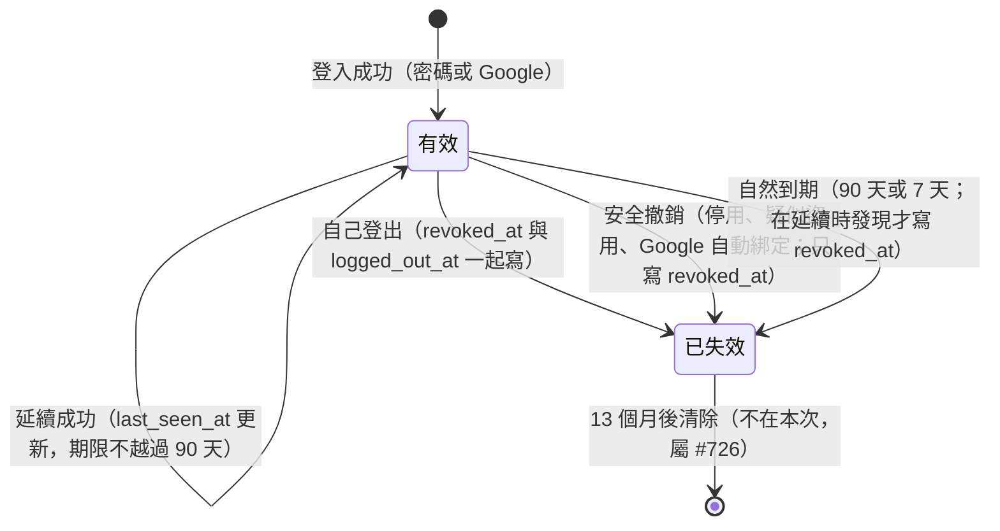

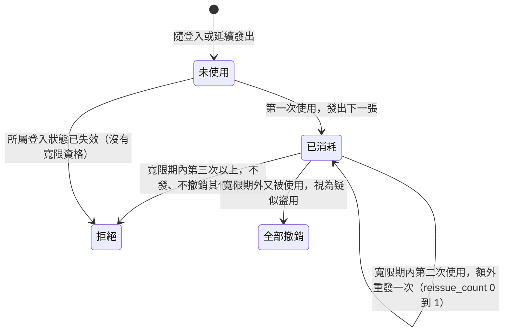

狀態轉移的判斷只在 `SessionService`（backend-agent-rules B1）。

### 交易邊界與 session 生命週期

| 流程              | 交易                                                                                                                                                                 | 交易外的動作                                                                                      |
| :---------------- | :------------------------------------------------------------------------------------------------------------------------------------------------------------------- | :------------------------------------------------------------------------------------------------ |
| Email 與密碼登入  | `PasswordLoginService.login` 一筆：新增 `account_session` 與第一張 refresh token，commit                                                                             | 無。登入失敗鎖定不在本次（#726），插入點見 [§登入失敗鎖定的插入點](#登入失敗鎖定的插入點不在本次) |
| Google 登入完成   | `GoogleLoginService.complete` 一筆：找帳號、自動綁定（寫 `google_subject`、清 `hashed_password`、`credential_version` 加一、撤銷全部登入狀態）、新增登入狀態，commit | 向 Google 換 token 與驗 `id_token` 在交易**之前**，失敗就不開交易                                 |
| 延續              | `SessionService.refresh` 一筆：條件式消耗、新增下一張、更新 `last_seen_at`，commit；疑似盜用時改成撤銷全部，commit 後再丟錯                                          | 無                                                                                                |
| 守門              | 不寫入，只讀；`get_db` 的 session 在請求結束時關閉                                                                                                                   | 無                                                                                                |
| 登出              | `SessionService.logout` 一筆：`revoked_at` 與 `logged_out_at` 一起寫，commit                                                                                         | 無                                                                                                |
| Seeder 初始化指令 | `SeederService.create` 一筆：新增帳號（角色 `super_admin`、啟用、`is_seeder = true`、密碼雜湊），commit                                                              | 指令自己開 engine 與一個 `AsyncSession`，結束就 dispose；不經 `get_db`                            |

- API 一律用 `get_db` 的 `AsyncSession`，一個請求一個；Seeder 指令一次執行一個 session；本次沒有 worker 端，不開同步 session（B3）
- Repository 不 commit（B4）；`get_db` 遇例外 rollback，所以 service 在丟錯前要先 commit 的只有「疑似盜用時撤銷全部」這一種，程式註解要寫明為什麼

### Seeder 初始化指令

依維護者 sa-4，本次提前實作 capability `user-management` 的「Seeder 管理員只能由初始化指令建立」（06-01）。資料庫層的保護（擋住停用、降級、清除標記）仍屬 06-01 的 change（「Seeder 管理員受到保護」）。

| 項目       | 做法                                                                                                                                                                                                                                                                                                   |
| :--------- | :----------------------------------------------------------------------------------------------------------------------------------------------------------------------------------------------------------------------------------------------------------------------------------------------------- |
| 入口       | `uv run python -m app.scripts.create_seeder --email <Email> --name <顯示名稱>`；容器裡是 `docker compose run --rm -it backend python -m app.scripts.create_seeder --email ... --name ...`。只有部署者在主機上執行得到，沒有任何 HTTP 端點能建立 Seeder                                                 |
| 讀設定     | 只用 `DatabaseSettings`（與 Alembic 相同），不需要 `CORS_ALLOWED_ORIGINS` 或 `AUTH_SECRET`；資料庫要先 `alembic upgrade head`                                                                                                                                                                          |
| 密碼怎麼給 | **不收命令列參數、不讀環境變數**（會留在 shell 歷史與 `ps`／`docker inspect`）。標準輸入是終端機時用 `getpass` 問兩次並比對；加 `--password-stdin` 時從標準輸入讀一行（給自動化，例 `printf '%s\n' "$PW" \| ... --password-stdin`）。不內建預設密碼                                                    |
| 密碼規則   | 與 01-02 Q5 同一套（至少 8 個字元，含大寫、小寫與數字）；不合就以退出碼 2 結束、不寫入                                                                                                                                                                                                                 |
| Email      | 經 `normalize_email`，超過 254 字或格式不對就退出碼 2                                                                                                                                                                                                                                                  |
| 冪等       | 先查 `UserRepository.get_seeder()` 與 `get_by_email()`：已有 Seeder 且 Email 相同 → 印「已存在，未變更」、退出碼 0，**不問密碼、不改密碼**；已有 Seeder 但 Email 不同 → 退出碼 2「已有另一位 Seeder 管理員」；Email 屬於一般帳號 → 退出碼 2「這個 Email 已有帳號，初始化只建立全新帳號」，不提升該帳號 |
| 交易       | `SeederService.create` 在一筆交易寫入帳號、密碼雜湊、`role = super_admin`、`is_active = true`、`is_seeder = true`；兩個人同時執行時，`users` 的部分唯一索引（`is_seeder` 為 true 至多一列）與 `email` 唯一限制讓第二個失敗，指令把 `IntegrityError` 轉成同上的退出碼 2                                 |
| 輸出       | 成功印一行「已建立 Seeder 管理員 <Email>」到標準輸出；**任何輸出與 log 都不含密碼或雜湊**；錯誤訊息只寫原因                                                                                                                                                                                            |
| 異動紀錄   | capability `user-management` 的「每次帳號異動都寫入異動紀錄」管的是系統管理員在 06-01 的操作；`audit_events` 本次不建，初始化不寫異動紀錄，交給 06-01 決定是否回補                                                                                                                                     |
| 文件       | 實作時在 `docs/development/workflow/local-development.mdx` 的 §用 Docker Compose 起整套 與 §前後端分開起 各加一步「建立第一位系統管理員」（兩種執行方式各一行指令，說明密碼會被詢問兩次、不會顯示），§環境變數 註明這支指令不需要額外的變數；部署文件同樣補一步                                        |

### `AUTH_SECRET` 的來源

依維護者 PL1：Lite 層沒設就首次啟動時自動產生並存進資料 volume，之後重用；正式層仍要明確設定。

| 項目               | 做法                                                                                                                                                                                                                                                                                                                                                                                                           |
| :----------------- | :------------------------------------------------------------------------------------------------------------------------------------------------------------------------------------------------------------------------------------------------------------------------------------------------------------------------------------------------------------------------------------------------------------- |
| 判斷層級           | 沿用 `DatabaseSettings.is_lite()`：沒設 `DATABASE_URL` 就是 Lite 層                                                                                                                                                                                                                                                                                                                                            |
| 有設 `AUTH_SECRET` | 兩層都直接用（至少 32 字元，否則 `ConfigError`）；不讀也不寫檔案                                                                                                                                                                                                                                                                                                                                               |
| 正式層沒設         | `ConfigError("AUTH_SECRET: required when DATABASE_URL is set")`，啟動失敗                                                                                                                                                                                                                                                                                                                                      |
| Lite 層沒設        | `resolve_auth_secret` 讀 `SQLITE_PATH` 同一個目錄下的 `auth_secret`（容器裡是 `/app/data/auth_secret`，在具名 volume `label-suite-data` 裡）：存在就讀；不存在就用 `secrets.token_urlsafe(48)` 產生，先寫同目錄的暫存檔（`os.open` 帶 `O_CREAT \| O_EXCL`、權限 `0o600`），再以 `os.link` 放到目標名稱——目標已存在時 `link` 失敗，代表另一個 worker 先寫好了，改讀它的值，所以多個 worker 同時啟動也只會有一把 |
| 權限               | 檔案 `0o600`，擁有者是容器的 `app` 使用者（uid 10001）；讀到的檔案權限比 `0o600` 寬時先 `chmod 0o600` 再用，並記一筆 WARNING                                                                                                                                                                                                                                                                                   |
| 什麼時候變         | 只有刪掉 volume（或刪掉檔案）才會變；變了之後所有既有的登入狀態都驗不過，等於全部登出，這是預期的                                                                                                                                                                                                                                                                                                              |
| 啟動 log           | 一行 INFO，只寫來源與路徑：首次 `AUTH_SECRET not set; generated a new secret at /app/data/auth_secret`，之後 `AUTH_SECRET not set; using the secret stored at /app/data/auth_secret`；**不印值、長度或雜湊**                                                                                                                                                                                                   |
| 誰呼叫             | `create_app` 在 `load_settings` 之後、建任何元件之前呼叫一次，把結果放進 `Settings` 的 `auth_secret`；`export_openapi` 的佔位設定直接帶一個測試值，不碰檔案。`migrate` 容器與 Seeder 指令都不需要它                                                                                                                                                                                                            |
| 三把金鑰           | 由這把秘密以 HMAC 加用途標籤各自衍生：access JWT、CSRF token、Google 流程 cookie                                                                                                                                                                                                                                                                                                                               |
| 文件               | `.env.example` 註明 Lite 層可以不設、正式層必填；`backend-modules.mdx` §設定 已寫                                                                                                                                                                                                                                                                                                                              |

## 關鍵情境

每張圖從中介層之後畫起（請求管線見常駐文件 `backend-modules.mdx` §請求管線），畫到 Router 回傳回應為止，不畫畫面；Seeder 指令的三張圖畫到指令結束。標題是規格書「驗收標準」的 Scenario 名稱；01-01 的寫 01-01，01-05 的寫 01-05，06-01 的寫 06-01。

沒有獨立畫圖、但走同一條路的 Scenario：

| Scenario                                                                                        | 走哪一張圖                        | 為什麼不另畫                                   |
| :---------------------------------------------------------------------------------------------- | :-------------------------------- | :--------------------------------------------- |
| 01-01「沒有設定寄信服務時 Google 沒有對應帳號仍是同一句」                                       | 「Google 帳號沒有對應的平台帳號」 | 後端在那條路**不讀**寄信設定，兩者是同一條序列 |
| 01-01「失敗時不清空已填的內容」「送出後平台沒有回應」與送出中、密碼顯示、語言切換、螢幕寬度各條 | 無後端序列                        | 畫面行為，見 `ui-design.md`                    |
| 01-05「持續使用會延長閒置那條線」                                                               | 「延長不會越過絕對上限」          | 同一次延續，只差 `last_seen_at` 是否接近 90 天 |

### Scenario: 登入成功進入儀表板

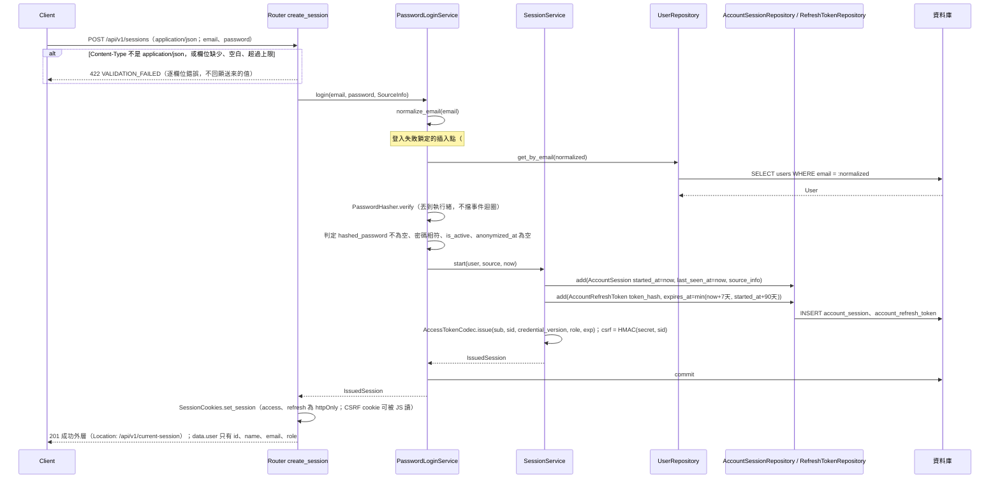

落點是前端的事：後端只回登入成功（`201`），前端一律導向落點 `/dashboard/dashboard`（維護者 sa-10）；02-01 外殼完成前那是最小佔位頁，顯示名字、Email 與系統角色，加一顆呼叫 `deleteCurrentSession` 的登出鈕（sa-5／7，畫面已過 Ready gate）。

### Scenario: 帳號或密碼不對

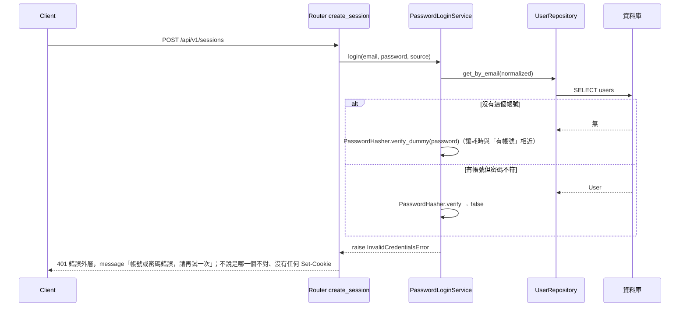

### Scenario: 停用的帳號無法登入

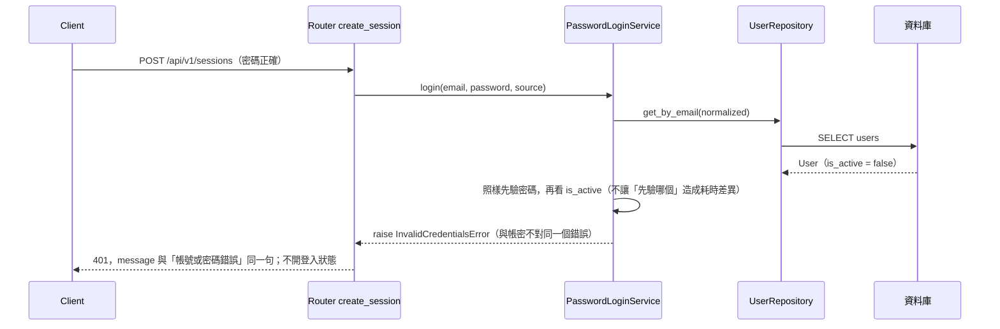

`anonymized_at` 有值（已匿名化）的帳號走同一個分支。

### Scenario: 登入不檢查密碼組成規則

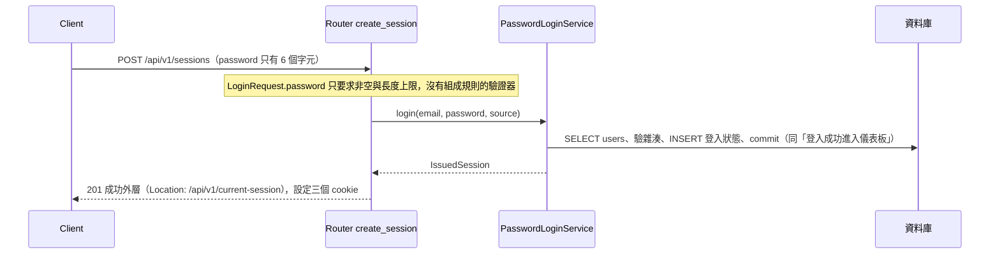

### Scenario: 用大寫寫自己的 Email 登入

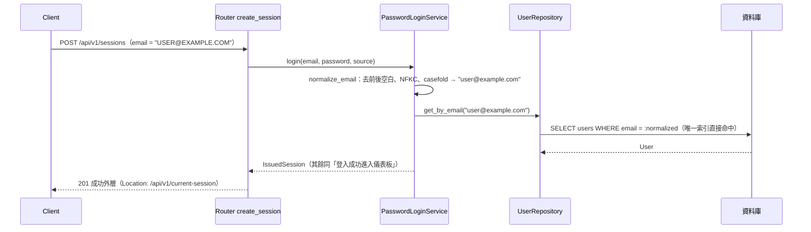

`users.email` 存的就是正規化之後的值，所以比對不依賴資料庫的 `lower()`；兩種資料庫結果相同（01-05 Q14）。

### Scenario: 正規化後超過上限就拒絕

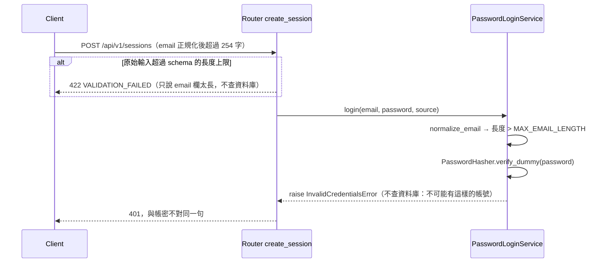

登入這條路「擋下」的樣子是帳密不對；註冊、邀請與換 Email 擋下時的訊息由各自的 change 定。原始輸入的 schema 上限（建議 320 字）只為了限制 payload 大小（Hard Rule 9），由 `api-contract.md` 定數字。

### Scenario: 沒有本地密碼的人只能用 Google

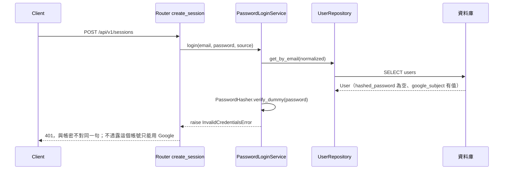

### 登入失敗鎖定的插入點（不在本次）

維護者 sa-3：登入失敗鎖定（01-01「連續失敗十次被擋住」、01-05「登入連續失敗十次被擋」）**不在本次**，交給 #726；本次不建計數、不建錯誤碼、不畫序列。這裡只記插入點，讓 #726 不必改動既有流程的形狀：

- 檢查：`PasswordLoginService.login` 正規化 Email 之後、查帳號之前；被擋住時不查帳號、不驗密碼
- 記錄失敗：丟 `InvalidCredentialsError` 之前；登入成功：commit 之後清除
- 三者都在資料庫交易之外（B4）
- 「同一個人」：維護者已定將來以**帳號加來源位址**認定；來源位址依 `FORWARDED_ALLOW_IPS` 的信任規則取得（uvicorn 改寫後的 `scope["client"]`）
- 計數放哪裡（ADR-004 D7 的 Redis）與錯誤碼都由 #726 定

### Scenario: 點 Google 帳號登入

Google 的回調網址指向**前端**的路由，前端再把 `code` 與 `state` 送給後端；這樣兩個端點都是一般的 JSON 與 envelope，不需要 `302`（理由見 [§技術待決](#技術待決) T1）。

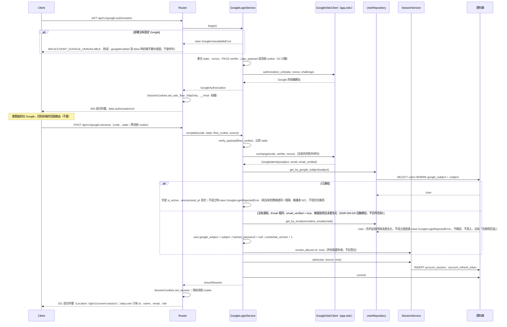

### Scenario: Google 驗證沒通過回到登入頁

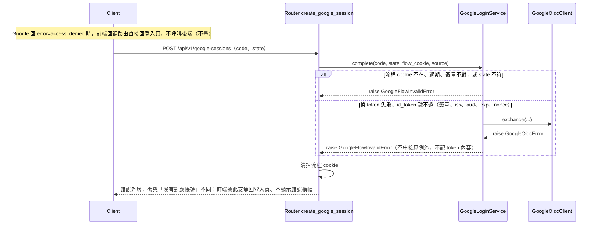

### Scenario: Google 帳號沒有對應的平台帳號

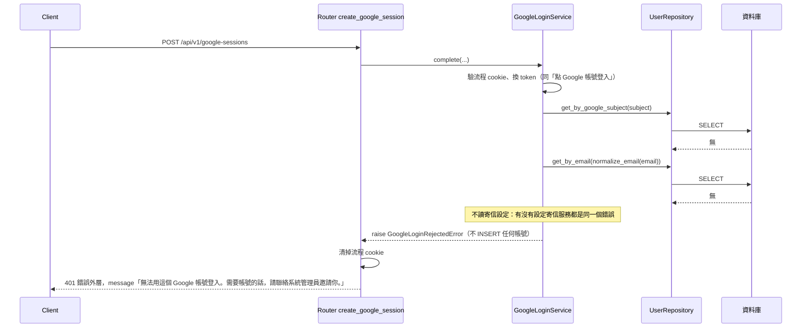

### Scenario: Google 回報 Email 未驗證

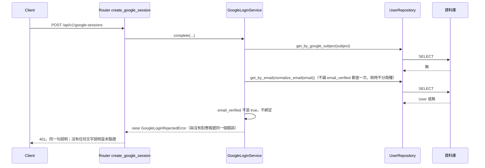

### Scenario: 已連結 Google 的帳號 Email 不同仍能登入

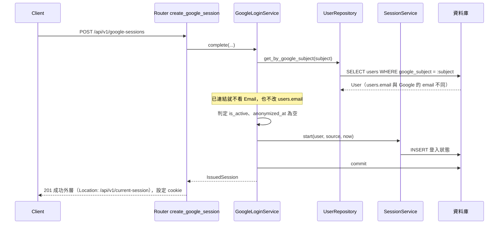

### Scenario: 已登入的人開登入頁直接進儀表板

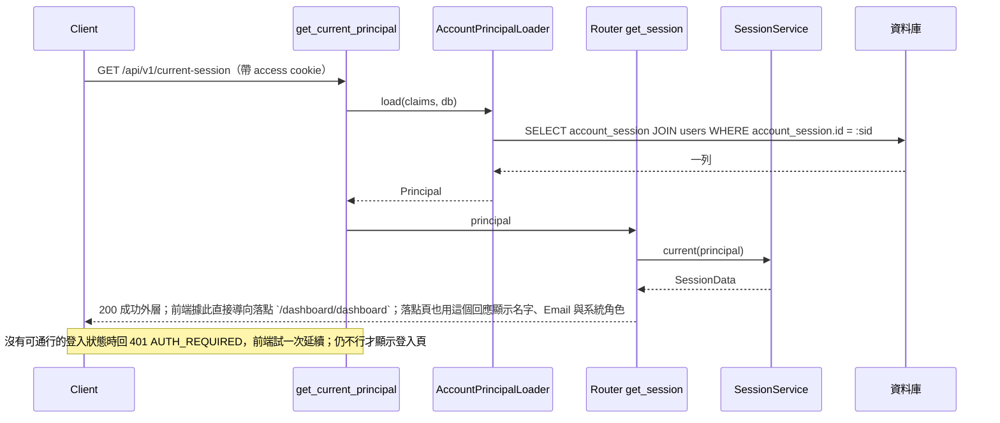

### Scenario: 沒有設定寄信服務時登入頁不顯示前往註冊

本次建立「有沒有設定寄信服務」的共用判斷（維護者 sa-6）；01-02 的 change 直接沿用。

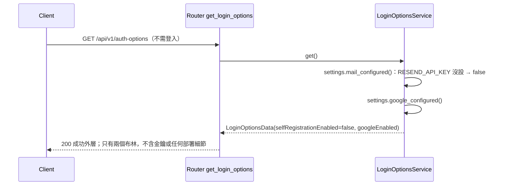

### Scenario: 不能通行的登入狀態不說明原因

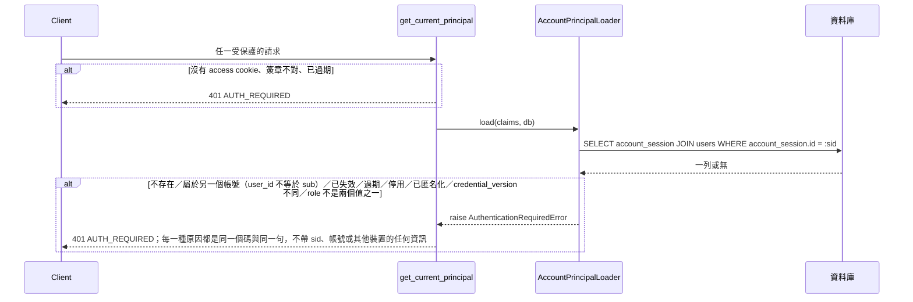

延續端點拒絕時也一樣不說明原因。請求**沒有** refresh cookie 時回 `AUTH_REQUIRED`（從沒登入過的訪客不該看到被動登出的句子）；帶著 cookie 但不能用時才分兩種碼讓前端選 01-05 Q4 的兩句：時間到了（`SessionExpiredError`）與其他（`SessionInvalidError`）。

### Scenario: 角色變更從下一次操作起生效

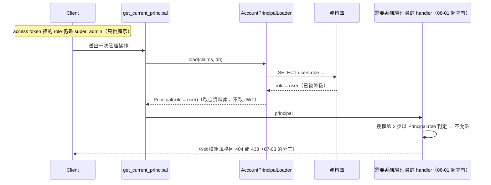

本次沒有需要系統管理員的端點；這張圖驗的是守門交出的 `Principal.role` 一定是資料庫當下的值。測試以一個只在測試掛載的探測路由代替 `H`。角色變更**不撤銷**登入狀態、也不加 `credential_version`（維護者 N3，以規格 01-05 為準；security-agent-rules S4 另由文件 PR 改寫）。

### Scenario: 停用帳號讓所有裝置立刻失效

**本次只驗守門那一半**：本次沒有停用帳號的端點，停用時把 `credential_version` 加一並撤銷所有登入狀態（security-agent-rules S4）屬 06-01 的 change。本次的測試在 setup 直接把 `is_active` 改成 false、`credential_version` 加一並寫 `revoked_at`，模擬 06-01 做完的結果，再驗舊 cookie 的下一次操作回 `401`。

停用這個動作屬 06-01；本次負責「停用之後，每一條路都進不來」。

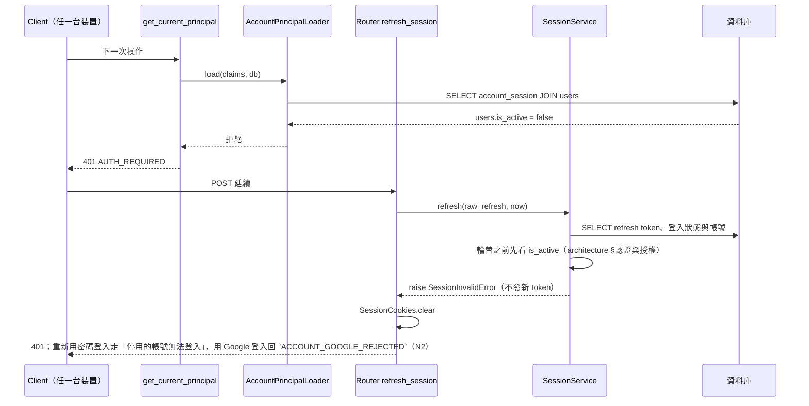

### Scenario: 重新啟用不恢復舊的登入狀態

同上，本次只驗守門那一半：重新啟用（`is_active` 改回 true）屬 06-01，但停用時 `credential_version` 已加一、登入狀態已寫 `revoked_at`，所以重新啟用之後舊 cookie 仍驗不過。測試在 setup 模擬停用後再啟用，驗舊 cookie 回 `401`。

```mermaid
sequenceDiagram
  participant C as Client（停用前的 cookie）
  participant A as get_current_principal
  participant P as AccountPrincipalLoader
  participant DB as 資料庫
  Note over DB: 測試 setup：credential_version 已加一、revoked_at 已寫、is_active 已改回 true
  C->>A: GET /api/v1/current-session
  A->>P: load(claims, db)
  P->>DB: SELECT account_session JOIN users
  DB-->>P: revoked_at 有值；users.credential_version 不等於 claims.credential_version
  P-->>A: 拒絕
  A-->>C: 401 AUTH_REQUIRED；延續也回 401 ACCOUNT_SESSION_INVALID，使用者要重新登入
```

### Scenario: 達到絕對上限就要重新登入

```mermaid
sequenceDiagram
  participant C as Client
  participant R as Router refresh_session
  participant S as SessionService
  participant Q as AccountSessionRepository / RefreshTokenRepository
  participant DB as 資料庫
  Note over C: 守門已因 started_at + 90 天 ≤ now 回 401，前端改試延續
  C->>R: POST 延續（帶 refresh cookie）
  R->>S: refresh(raw_refresh, now)
  S->>Q: get_by_hash(hash_token(raw))
  Q->>DB: SELECT account_refresh_token JOIN account_session JOIN users
  DB-->>Q: 一列
  S->>S: SessionPolicy.is_expired：started_at + 90 天 ≤ now
  S->>Q: revoke(session_id, now, logged_out=false)（自然到期，不記登出）
  S->>DB: commit
  S-->>R: raise SessionExpiredError
  R->>R: SessionCookies.clear
  R-->>C: 401 錯誤外層，前端顯示「登入已過期，請重新登入」
```

### Scenario: 閒置超過限制就要重新登入

```mermaid
sequenceDiagram
  participant C as Client
  participant R as Router refresh_session
  participant S as SessionService
  participant Q as AccountSessionRepository / RefreshTokenRepository
  participant DB as 資料庫
  C->>R: POST 延續（隔了 7 天以上才回來）
  R->>S: refresh(raw_refresh, now)
  S->>Q: get_by_hash(...)
  Q->>DB: SELECT
  DB-->>Q: 一列（last_seen_at + 7 天 ≤ now；refresh token 本身也已過 expires_at）
  S->>Q: revoke(session_id, now, logged_out=false)
  S->>DB: commit
  S-->>R: raise SessionExpiredError
  R->>R: SessionCookies.clear
  R-->>C: 401，前端顯示「登入已過期，請重新登入」
```

### Scenario: 延長不會越過絕對上限

```mermaid
sequenceDiagram
  participant C as Client
  participant R as Router refresh_session
  participant S as SessionService
  participant Q as AccountSessionRepository / RefreshTokenRepository
  participant DB as 資料庫
  C->>R: POST 延續（距 started_at + 90 天只剩一天）
  R->>S: refresh(raw_refresh, now)
  S->>Q: get_by_hash(...)、consume_if_unused(token_id, now)
  Q->>DB: UPDATE account_refresh_token SET consumed_at = :now WHERE id = :id AND consumed_at IS NULL
  DB-->>Q: 1 列
  S->>S: 新 refresh token 的 expires_at = min(now + 7 天, started_at + 90 天)；access 的 exp = min(now + 15 分鐘, started_at + 90 天)
  S->>Q: add(新 refresh token)、touch(session_id, now)
  Q->>DB: INSERT、UPDATE account_session SET last_seen_at = :now
  S->>DB: commit
  S-->>R: IssuedSession
  R->>R: SessionCookies.set_session（cookie 的 Max-Age 同樣不越過那條線）
  R-->>C: 201 成功外層（Location: /api/v1/current-session）
```

### Scenario: 兩個分頁同時延續不會互相踢掉

兩個分頁共用同一組 cookie，所以帶的是同一張 refresh token。

```mermaid
sequenceDiagram
  participant A as 分頁 A
  participant B as 分頁 B
  participant R as Router refresh_session
  participant S as SessionService
  participant Q as RefreshTokenRepository
  participant DB as 資料庫
  A->>R: POST 延續（token T）
  B->>R: POST 延續（同一張 T，幾乎同時）
  R->>S: refresh(T)（A）
  S->>Q: consume_if_unused(T)
  Q->>DB: 條件式 UPDATE
  DB-->>Q: 1 列（A 搶到）
  S->>DB: INSERT T2、commit
  R-->>A: 201，Set-Cookie T2
  R->>S: refresh(T)（B）
  S->>Q: consume_if_unused(T)
  DB-->>Q: 0 列（已被 A 消耗）
  S->>S: now - consumed_at ≤ 寬限 30 秒
  S->>Q: reissue_if_below(T, limit=1)
  Q->>DB: UPDATE ... SET reissue_count = reissue_count + 1 WHERE id = :id AND reissue_count < 1
  DB-->>Q: 1 列
  S->>DB: INSERT T3（同一段登入狀態）、commit
  R-->>B: 201，Set-Cookie T3；沒有任何登入狀態被撤銷
```

「只有一個取得新的」解讀成「只有一段登入狀態」：T2 與 T3 屬於同一個 `sid`，沒有開新的登入狀態，也沒有踢掉任何裝置。這個解讀交給 specs 寫成可測的 Then（見 [§技術待決](#技術待決) T4）。

### Scenario: 同一次延續用第三次就不給

```mermaid
sequenceDiagram
  participant C as Client
  participant R as Router refresh_session
  participant S as SessionService
  participant Q as RefreshTokenRepository
  participant DB as 資料庫
  C->>R: POST 延續（T 已被用過兩次，仍在寬限期內）
  R->>S: refresh(T)
  S->>Q: consume_if_unused(T)
  DB-->>Q: 0 列
  S->>Q: reissue_if_below(T, limit=1)
  DB-->>Q: 0 列（reissue_count 已是 1）
  S-->>R: raise RefreshConflictError（不撤銷任何登入狀態）
  R-->>C: 409 ACCOUNT_REFRESH_CONFLICT；不清 cookie（同一台的另一個分頁可能剛拿到新的）
```

### Scenario: 疑似被盜用時所有裝置一起登出

```mermaid
sequenceDiagram
  participant C as Client
  participant R as Router refresh_session
  participant S as SessionService
  participant Q as AccountSessionRepository / RefreshTokenRepository
  participant DB as 資料庫
  C->>R: POST 延續（T 在寬限期外又被使用）
  R->>S: refresh(T)
  S->>Q: consume_if_unused(T)
  DB-->>Q: 0 列
  S->>S: now - consumed_at > 寬限
  S->>Q: revoke_all_for_user(user_id, now)
  Q->>DB: UPDATE account_session SET revoked_at = :now WHERE user_id = :uid AND revoked_at IS NULL
  S->>DB: commit（先 commit 再丟錯，否則 get_db 會 rollback 掉撤銷）
  S-->>R: raise SessionInvalidError
  R->>R: SessionCookies.clear
  R-->>C: 401，前端顯示「驗證失敗，請重新登入」；不記登出
```

### Scenario: 安全撤銷的登入狀態沒有寬限資格

```mermaid
sequenceDiagram
  participant C as Client
  participant R as Router refresh_session
  participant S as SessionService
  participant Q as RefreshTokenRepository
  participant DB as 資料庫
  C->>R: POST 延續（所屬登入狀態已因登出或安全事件失效）
  R->>S: refresh(T)
  S->>Q: get_by_hash(T)
  Q->>DB: SELECT ... JOIN account_session
  DB-->>Q: account_session.revoked_at 有值
  S->>S: 先看登入狀態是否已失效，才看寬限與重用（已失效就不進盜用判定）
  S-->>R: raise SessionInvalidError（不撤銷其他裝置）
  R->>R: SessionCookies.clear
  R-->>C: 401
```

### Scenario: 從這一台登出只影響這一台

登出端點在本次（sa-2、sa-5／7）；呼叫它的是落點頁的登出鈕，07-01 的側欄之後也呼叫同一個端點。

```mermaid
sequenceDiagram
  participant C as Client（裝置 A）
  participant R as Router delete_session
  participant S as SessionService
  participant Q as AccountSessionRepository / RefreshTokenRepository
  participant DB as 資料庫
  C->>R: DELETE /api/v1/current-session（帶 refresh cookie）
  R->>S: logout(raw_refresh, now)
  S->>Q: get_by_hash(hash_token(raw))
  Q->>DB: SELECT
  DB-->>Q: 一列，登入狀態有效
  S->>Q: revoke(session_id, now, logged_out=true)
  Q->>DB: UPDATE account_session SET revoked_at = :now, logged_out_at = :now WHERE id = :sid
  S->>DB: commit
  R->>R: SessionCookies.clear
  R-->>C: 204（envelope 的明文例外：無 body）；裝置 B 的登入狀態不受影響
```

### Scenario: 登入狀態已經不能驗證時登出

```mermaid
sequenceDiagram
  participant C as Client
  participant R as Router delete_session
  participant S as SessionService
  participant DB as 資料庫
  C->>R: DELETE /api/v1/current-session（refresh cookie 不在或查不到）
  R->>S: logout(None 或查不到的值, now)
  S->>DB: SELECT（cookie 不在時不查）
  S-->>R: 不寫任何東西、不記登出
  R->>R: SessionCookies.clear
  R-->>C: 204；不聲稱伺服器端已失效
```

### Scenario: 部署者建立第一位 Seeder 管理員

06-01 的驗收標準；capability `user-management`「Seeder 管理員只能由初始化指令建立」。

```mermaid
sequenceDiagram
  participant D as 部署者（終端機）
  participant X as create_seeder 指令
  participant S as SeederService
  participant U as UserRepository
  participant DB as 資料庫
  D->>X: --email admin@example.org --name 管理員
  X->>X: load_settings(DatabaseSettings)；建 engine 與一個 AsyncSession
  X->>S: find_existing(email)
  S->>U: get_seeder()、get_by_email(normalized)
  U->>DB: SELECT users
  DB-->>U: 都沒有
  S-->>X: 可以建立
  X->>D: getpass 問兩次密碼（不回顯）
  D-->>X: 密碼
  X->>X: 比對兩次相同、符合 01-02 Q5 的規則
  X->>S: create(email, name, password)
  S->>S: PasswordHasher.hash
  S->>U: add(User role=super_admin, is_active=true, is_seeder=true)
  U->>DB: INSERT users
  S->>DB: commit
  X-->>D: 「已建立 Seeder 管理員 admin@example.org」，退出碼 0；不印密碼
```

### Scenario: 重複執行初始化

```mermaid
sequenceDiagram
  participant D as 部署者（終端機）
  participant X as create_seeder 指令
  participant S as SeederService
  participant DB as 資料庫
  D->>X: 以同一個 --email 再執行一次
  X->>S: find_existing(email)
  S->>DB: SELECT users（Seeder 與這個 Email）
  DB-->>S: 已有 Seeder，Email 相同
  S-->>X: 已存在
  X-->>D: 「已存在，未變更」，退出碼 0；不問密碼、不寫入
  Note over D,DB: 以另一個 Email 執行時：退出碼 2「已有另一位 Seeder 管理員」，不寫入
```

### Scenario: 以既有帳號執行初始化

```mermaid
sequenceDiagram
  participant D as 部署者（終端機）
  participant X as create_seeder 指令
  participant S as SeederService
  participant DB as 資料庫
  D->>X: --email 指向一般帳號 E
  X->>S: find_existing(email)
  S->>DB: SELECT users
  DB-->>S: 沒有 Seeder；E 存在且 is_seeder = false
  S-->>X: 不可建立
  X-->>D: 退出碼 2「這個 Email 已有帳號，初始化只建立全新帳號」；E 的角色、狀態與登入狀態都不動
```

## 常駐文件異動

- 常駐文件：`docs/diagrams/architecture/backend-modules.mdx`

| 節                                   | 異動 | 摘要                                                                                                                                                                                       |
| :----------------------------------- | :--- | :----------------------------------------------------------------------------------------------------------------------------------------------------------------------------------------- |
| 模組一覽                             | 修改 | 加 `account` 一列；「目前只有 `health`」改成兩個模組                                                                                                                                       |
| account                              | 新增 | 分層表、Class 圖、兩張主要 Sequence 圖（登入成功、每一次操作的身分判定）；七個端點的 operationId；`SeederService`；Google 綁定、延續、登出依維護者 2026-11-26 的決定，登入失敗鎖定不在本次 |
| 後端基礎建設 §目錄                   | 修改 | 加頂層入口套件 `app/oidc/` 與 `app/scripts/create_seeder.py`                                                                                                                               |
| 後端基礎建設 §`core/` 各模組         | 修改 | 新增 `auth.py`、`auth_secret.py`、`tokens.py`、`cookies.py`、`csrf.py`、`passwords.py`、`email_identity.py` 七列；`config.py` 加兩個判斷方法；`db.py` 加 `UtcDateTime`                     |
| 後端基礎建設 §請求管線               | 修改 | 加 `CsrfMiddleware`（第 5a 層，在 `LocaleMiddleware` 內側）；認證寫明是端點依賴不是中介層；CORS 允許的標頭加 `X-CSRF-Token`                                                                |
| 後端基礎建設 §錯誤怎麼對到 envelope  | 修改 | 加 `403 CSRF_FAILED` 與 `401 AUTH_REQUIRED` 兩列（碼以 `api-contract.md` 與 `error-codes.mdx` 為準）                                                                                       |
| 後端基礎建設 §設定                   | 修改 | 加 `AUTH_SECRET`（正式層必填；Lite 層沒設時自動產生並存進資料 volume）、三個 `GOOGLE_*`（一起設或一起不設）、`RESEND_API_KEY`（只看有沒有設）                                              |
| 後端基礎建設 §新增業務模組的檢查清單 | 修改 | 加「需要登入的端點掛 `get_current_principal`，角色取 `Principal.role`」                                                                                                                    |
| 已知限制                             | 修改 | 「認證、授權與 CSRF」縮成「授權四步的第 3、4 步」；「登入失敗鎖定」指向 #726                                                                                                               |
| 決策紀錄                             | 新增 | 一列，指向 #719                                                                                                                                                                            |

## 資料模型異動

- 字典：`docs/diagrams/architecture/data-table-dictionary.mdx`
- ER：`docs/diagrams/architecture/database-schema.er.json`
- `pnpm check:er`：通過（`check-er-data: dictionary, diagram, landed revisions, spec entries and both kinds of line citation agree`）

| 表                      | 異動                                                                                             | 欄位／索引                                                                                                                                                                                                                                                                                            | 波及的表（依字典 FK 與被參照）                                                                                                                                                                      | Alembic migration 可逆                                                    | SQLite 與 PostgreSQL 的差異                                                                                                                                                                                                                                                                                                                                                                                                                                                    |
| :---------------------- | :----------------------------------------------------------------------------------------------- | :---------------------------------------------------------------------------------------------------------------------------------------------------------------------------------------------------------------------------------------------------------------------------------------------------- | :-------------------------------------------------------------------------------------------------------------------------------------------------------------------------------------------------- | :------------------------------------------------------------------------ | :----------------------------------------------------------------------------------------------------------------------------------------------------------------------------------------------------------------------------------------------------------------------------------------------------------------------------------------------------------------------------------------------------------------------------------------------------------------------------- |
| `users`                 | 新建（字典既有候選表首次落地）；字典同時**收回三欄**、**改一個唯一限制**、**加一個部分唯一索引** | 收回 `google_subject`（`varchar(255)`，可空，唯一）、`credential_version`（`integer`，系統寫入，預設 0，CHECK `>= 0`）、`is_seeder`（`boolean`，系統寫入，預設 false；部分唯一索引 `WHERE is_seeder`，至多一位 Seeder）；`email` 的唯一限制從 `lower(email)` 改成對**存入的正規化值**；其餘欄位照字典 | 被參照：`account_session.user_id`（RESTRICT）、`account_password_token`、`account_email_change_request`、`account_notification_preference`（CASCADE）及其他組；本次只建 `account_session` 這一條 FK | 可逆：down 刪表；表是新建的，down 會丟掉其中的帳號（已部署之後不再 down） | `uuid`：PG 原生，SQLite 存 `CHAR(32)`（SQLAlchemy `Uuid`）；`timestamptz`：PG 存時區，SQLite 存不帶時區的文字，一律經 `UtcDateTime` 讀寫成 UTC；`boolean`：SQLite 存 0／1；`varchar(254)` 的長度 SQLite 不檢查，由 `normalize_email` 擋；名稱長度 CHECK 用兩邊都有的 `length()`；可空的唯一欄（`google_subject`）兩邊都允許多個 NULL；部分唯一索引兩邊都支援（`postgresql_where` 與 `sqlite_where` 各寫一次）；`email` 不用表達式索引，避免 SQLite `lower()` 只轉 ASCII 的差異 |
| `account_session`       | 新建（字典既有候選表首次落地）                                                                   | 照字典：PK `id`；`user_id` FK → `users.id` RESTRICT 並建索引；`logged_out_at` 的 CHECK；`(user_id, id)` 另供複合 FK 父鍵的唯一限制                                                                                                                                                                    | 父：`users`；日後被 `task_work_interval`、`annotation_history_event` 參照（不在本次）                                                                                                               | 可逆：down 先刪本表再刪 `users`                                           | CHECK 的時間比較：PG 比較 `timestamptz`，SQLite 比較文字；`UtcDateTime` 固定寫成同一格式（ISO 8601、UTC），文字比較的結果才與時間順序相同                                                                                                                                                                                                                                                                                                                                      |
| `account_refresh_token` | **新表**（維護者 N1 決定）                                                                       | PK `id uuid`；`session_id` FK → `account_session.id` CASCADE 並建索引；`token_hash char(64)` 唯一（原文不入庫）；`issued_at`、`expires_at`、`consumed_at`（可空）；`reissue_count smallint` 預設 0，CHECK 0–1。token family 就是它所屬的登入狀態                                                      | 父：`account_session`；沒有被參照                                                                                                                                                                   | 可逆：down 最先刪本表                                                     | 兩種資料庫都用條件式 `UPDATE ... WHERE consumed_at IS NULL`（與 `reissue_count < 1`）加 rowcount 判定誰搶到，不依賴 `SELECT ... FOR UPDATE`（SQLite 不支援）；SQLite 的寫入本來就序列化，PG 由列鎖保證條件式更新只成功一次；`smallint` 在 SQLite 是 INTEGER                                                                                                                                                                                                                    |

**字典與 ER 的其他配套異動**：§一 的欄數、表數與 D7 說明（41 → 42 張、360 → 370 欄、41 → 42 個單欄 FK；本專案不收的原始欄位 6 → 3；`account` 組 6 → 7 張）、`users` 的寫入者、讀取權限（三個認證欄位任何回應都不帶）與不可變、§十 統計、變更紀錄；ER 的 `meta.description` 與 `users`、`account_refresh_token` 兩張表同步。

**Migration**：一個 Alembic revision（`down_revision` 是基準 `0dfb129ee036`）依序建 `users`、`account_session`、`account_refresh_token`，down 反序刪除；`render_as_batch` 照常開啟。migration 不建任何帳號，第一個帳號由 [§Seeder 初始化指令](#seeder-初始化指令) 建立（不得由 migration 自動建立，capability `user-management`）。`is_seeder` 的資料庫層保護（擋住清除與停用的觸發器）屬 06-01 的 change（「Seeder 管理員受到保護」），本次只建欄位與部分唯一索引。

## 權限檢查點

| 層                                           | 檢查                                                                                                                                                                                                                                                                                                                                                                                                           | 適用                                                   |
| :------------------------------------------- | :------------------------------------------------------------------------------------------------------------------------------------------------------------------------------------------------------------------------------------------------------------------------------------------------------------------------------------------------------------------------------------------------------------- | :----------------------------------------------------- |
| `CorsMiddleware`                             | 來源逐一列出（Hard Rule 7），本次只多允許 `X-CSRF-Token` 標頭                                                                                                                                                                                                                                                                                                                                                  | 全部                                                   |
| `CsrfMiddleware`                             | 寫入請求**帶著** access cookie（`__Host-ls_at`）時，要 `X-CSRF-Token` 與 CSRF cookie 相同且等於 `HMAC(secret, sid)`（`sid` 取自 access token，驗簽章、不看是否過期）；**沒有** access cookie 的寫入不驗，交給路由（沒有可借用的身分，需要登入的端點由守門回 `401`）。放行清單四條：Email 與密碼登入、Google 登入完成、延續、登出（理由見 T2；`design.md` D3、`specs/csrf-protection`；維護者 2026-11-26 確認） | 本次與之後所有 `POST`／`PUT`／`PATCH`／`DELETE`        |
| `get_current_principal`（授權第 1 步）       | 登入狀態存在、屬於 `sub`、未失效、未過 90 天與 7 天；帳號啟用、未匿名化；`credential_version` 相同                                                                                                                                                                                                                                                                                                             | `GET /api/v1/current-session` 與之後所有需要登入的端點 |
| 同上（授權第 2 步）                          | 系統角色取自資料庫，只接受 `user` 與 `super_admin`；不讀 JWT 的 `role`                                                                                                                                                                                                                                                                                                                                         | 同上                                                   |
| 授權第 3、4 步                               | **本次不建**（維護者 sa-11）；權限矩陣留給 06-02，第一個需要權限矩陣或附加條件（含答案隔離）的端點要先補上                                                                                                                                                                                                                                                                                                     | —                                                      |
| `PasswordLoginService`、`GoogleLoginService` | 帳號啟用、未匿名化；密碼登入要求有本地密碼；Google 只登入或綁定既有帳號，不建立帳號；停用或已匿名化的帳號用 Google 也回同一個拒絕碼（N2）                                                                                                                                                                                                                                                                      | 兩條登入                                               |
| `SessionService.refresh`                     | 輪替之前先讀帳號狀態，停用就拒絕、不發新 token                                                                                                                                                                                                                                                                                                                                                                 | 延續                                                   |

**未登入的訪客**能到的只有登入頁設定、兩條登入、Google 授權網址與登出；**Seeder 初始化**不是端點，只有在主機上執行指令的部署者做得到；它們不讀、不回任何業務資料。PRD §權限矩陣管的是登入之後的功能，這幾條對不到矩陣的任何一列（規格 01-01 §使用角色），本次**沒有放寬**任何一格。

**欄位遮蔽**：唯一回帳號資料的是 `SessionUserData`，明列 `id`（字串）、`name`、`email`、`role` 四欄，都是登入者**自己的**資料（PRD 01 帳號 `R/E (o)`）；`hashed_password`、`google_subject`、`credential_version`、`is_seeder`、`source_info` 一律不回，不是遮蔽成某個值，而是不在 schema 裡。登入失敗、Google 拒絕、守門拒絕的錯誤外層只帶碼與本地化的 `message`，不帶帳號是否存在、是否停用、`sid` 或其他裝置的資訊。

**測試集答案隔離**：本次沒有任何端點讀或回任務、資料集或標記資料，所以沒有答案外露的風險（每個端點都是「無」）。守門是日後答案隔離檢查所在的位置（授權第 4 步）；本次交出的 `Principal` 只有 `user_id`、`session_id`、`role`，第 4 步之後接在它後面，不必改守門本身。

**任務設定驅動**：本次的行為與任務類型無關，沒有寫死任何任務類型（Hard Rule 5 不適用）。

## 維護者的決定（2026-11-26）

`system-analysis.md` 的待決與本份的 N1–N3、PL1，維護者在 clarification 停點逐題決定（[#719 的決定表](https://github.com/label-suite/label-suite/issues/719#issuecomment-7187190476)；落點畫面另見[確認紀錄](https://github.com/label-suite/label-suite/issues/719#issuecomment-7187214559)）。本份已照下表寫，不再有提案。

| #       | 決定                                                                                                       | 落在本份哪裡                                                                                  |
| :------ | :--------------------------------------------------------------------------------------------------------- | :-------------------------------------------------------------------------------------------- |
| sa-1    | 不做「記住我」；期限固定 90 天與 7 天                                                                      | `SessionPolicy`                                                                               |
| sa-2    | 期限、延續（含多分頁與疑似盜用）、被動登出兩個錯誤碼、登出端點都在本次                                     | `SessionService`；延續與登出的各張序列                                                        |
| sa-3    | 登入失敗鎖定不在本次，交給 #726；「同一個人」將來以帳號加來源位址認定                                      | [§登入失敗鎖定的插入點](#登入失敗鎖定的插入點不在本次)，不建任何程式                          |
| sa-4    | 本次提前做建立第一位 Seeder 管理員的指令                                                                   | [§Seeder 初始化指令](#seeder-初始化指令) 與三張 06-01 序列                                    |
| sa-5／7 | 落點 `/dashboard/dashboard` 是最小佔位頁，顯示名字、Email 與系統角色，加登出鈕；已登入的人開登入頁也去這裡 | `SessionUserData` 加 `email`；登出端點                                                        |
| sa-6    | 本次建立「有沒有設定寄信服務」的共用判斷                                                                   | `Settings.mail_configured()`、`LoginOptionsService`                                           |
| sa-8    | 沒設定 Google 時前端不顯示 Google 按鈕與「或」分隔線                                                       | `googleEnabled`；授權網址端點的 `409` 只是防呆                                                |
| sa-9    | 登入頁 Google 自動綁定照 ADR-004 D5，不另外告知                                                            | `GoogleLoginService.complete` 的綁定分支                                                      |
| sa-10   | 登入後一律去落點                                                                                           | 後端不收 `returnTo`                                                                           |
| sa-11   | 守門只做授權第 1、2 步；矩陣留給 06-02                                                                     | `get_current_principal`                                                                       |
| sa-12   | 字典三欄當 P 處理                                                                                          | [§資料模型異動](#資料模型異動)                                                                |
| sa-13   | 覆蓋率門檻只建「認證」與「授權與權限檢查」兩項，附路徑清單；#111 本文之後改寫                              | 路徑清單見下                                                                                  |
| N1      | refresh token 存在新表 `account_refresh_token`                                                             | 字典、ER 與 [§資料模型異動](#資料模型異動)                                                    |
| N2      | 停用或已匿名化的帳號用 Google 登入，與「沒有對應帳號」同一個碼與同一句                                     | `GoogleLoginRejectedError`                                                                    |
| N3      | 角色變更不撤銷登入狀態；守門每次從資料庫讀角色。security-agent-rules S4 另由文件 PR 改寫                   | 「角色變更從下一次操作起生效」                                                                |
| PL1     | Lite 層沒設 `AUTH_SECRET` 時首次啟動自動產生並存進資料 volume；正式層仍要明確設定                          | [§`AUTH_SECRET` 的來源](#auth_secret-的來源)                                                  |
| U6      | 前端查守門時連不上或 `5xx`，當成未登入，回登入頁並顯示「沒回應」那句                                       | 後端不需要新東西：`getCurrentSession` 失敗只有 `401 AUTH_REQUIRED` 與通用的 `5xx`，前端分得開 |

**覆蓋率門檻的後端路徑清單**（sa-13，testing-agent-rules T10 的「認證」與「授權與權限檢查」）：`app/core/auth.py`、`app/core/auth_secret.py`、`app/core/tokens.py`、`app/core/cookies.py`、`app/core/csrf.py`、`app/core/passwords.py`、`app/core/email_identity.py`、`app/modules/account/service.py`、`app/oidc/google.py`。前端的路徑由 `ui-design.md` 列。答案隔離、評分、IAA 三項不建空殼，仍屬 #111，#111 本文之後改寫成兩項已由 #719 建立。

### 技術待決

這些不需要維護者決定，記下設計上的取捨，交給 `planner` 與 `design-reviewer` 核對。

| #   | 項目                                                        | 決定與理由                                                                                                                                                                                                                                                                                                                                                                                                                                                                                                                                                                                                                                                           |
| :-- | :---------------------------------------------------------- | :------------------------------------------------------------------------------------------------------------------------------------------------------------------------------------------------------------------------------------------------------------------------------------------------------------------------------------------------------------------------------------------------------------------------------------------------------------------------------------------------------------------------------------------------------------------------------------------------------------------------------------------------------------------- |
| T1  | Google 回調不用 `302`                                       | envelope 的例外只有 `204`、檔案與串流三種（architecture §API 契約），`302` 不在其中。改成 Google 回到**前端**的回調路由，前端再呼叫 `POST /api/v1/google-sessions`；授權網址也以 JSON 回給前端。`code` 出現在前端網址是 SPA 加 PKCE 的標準做法：verifier 留在後端的 httpOnly 流程 cookie，單獨拿到 `code` 換不到 token。代價是前端多一條回調路由。`ui-design.md` 已對齊：前端回調路由是 `/account/google/callback`（`GoogleCallbackPage`），`GOOGLE_REDIRECT_URI` 指向它；`302` 沒有成為 envelope 的例外                                                                                                                                                             |
| T2  | 哪些寫入端點不驗 double-submit CSRF                         | 兩層。（1）**沒有 access cookie** 的寫入一律不驗：跨站偽造借用的是瀏覽器自動帶的登入 cookie，沒有它就沒有可借用的身分（`design.md` D3）。（2）**放行清單四條**：Email 與密碼登入、Google 登入完成、延續、登出——前三條在 session 之前或 access token 過期之後，沒有可綁定的 `sid`，三條都只收 `application/json`，跨站表單送不出、`fetch` 必定觸發 CORS 預檢，由逐一列出的來源擋下；Google 那條另有 `state` 與 PKCE 擋登入 CSRF；登出用 `DELETE`，跨站同樣要預檢，而且登入狀態不能驗證時也要能清 cookie。放行清單寫死在 `CsrfMiddleware`，端點不自己處理（S2）。維護者 2026-11-26 確認這個範圍                                                                        |
| T3  | `last_seen_at` 只在延續時更新                               | 守門不寫入，每個請求省一次寫；代價是閒置的起算點最多比實際最後一次操作早 15 分鐘（一張 access token 的效期），相對於 7 天可忽略                                                                                                                                                                                                                                                                                                                                                                                                                                                                                                                                      |
| T4  | 「只有一個取得新的」的解讀                                  | 01-05 Q13 寫寬限期內「最多額外重發一次」、Scenario「同一次延續用第三次就不給」也預設第二次有發；所以第二次使用會拿到同一段登入狀態的另一張 token。Scenario「兩個分頁同時延續不會互相踢掉」的「只有一個取得新的」解讀成「只有一段登入狀態」，交給 specs 寫成可測的 Then                                                                                                                                                                                                                                                                                                                                                                                               |
| T5  | 寬限期 30 秒                                                | 規格把秒數交給實作（01-05 §多個分頁同時延續 的備註）；30 秒取自個人 repo ADR-021 的修訂（ADR-004 附錄記為不收、由各 change 決定），寫在 `SessionPolicy`，specs 不寫死                                                                                                                                                                                                                                                                                                                                                                                                                                                                                                |
| T6  | 密碼雜湊用 argon2id，驗證丟到執行緒                         | 雜湊一次約數十毫秒，直接在 async handler 裡算會擋住事件迴圈；帳號不存在時跑一次假驗證，耗時不洩漏帳號存在與否                                                                                                                                                                                                                                                                                                                                                                                                                                                                                                                                                        |
| T7  | 新的第三方套件                                              | `pyjwt`（JWT）、`argon2-cffi`（密碼）、`authlib`（OIDC，只在 `app/oidc/`，用 `authlib.integrations.httpx_client.AsyncOAuth2Client` 這個 async client）；`authlib` 的 async client 靠 `httpx`，所以 **`httpx` 從 dev group 移到 runtime 相依**（`uv add httpx`，再 `uv remove --dev httpx`）。在 `tests/unit/test_dependency_classification.py` 歸類、在 `import_tree.py` 登記入口套件 `oidc`；`httpx` 已是「對外 HTTP 客戶端」入口（B12 第 3 項）管的套件，`app/oidc/` 經 `authlib` 間接使用不違規。測試替身不放在 app 裡：測試以 `monkeypatch` 替換 `httpx.AsyncClient.send`，回應假的 token 端點與 JWKS（`design.md` D5）。本次不加 `redis`（登入失敗鎖定在 #726） |
| T8  | `AUTH_SECRET` 的兩層差別                                    | 正式層必填、沒有預設值（B10、Hard Rule 8）；Lite 層依 PL1 自動產生，值只存在資料 volume 的 `0o600` 檔案，不進 image、不進 `.env`、不進 log。`.env.example` 寫明兩層的差別與產生方式                                                                                                                                                                                                                                                                                                                                                                                                                                                                                  |
| T9  | `Secure` 與 `__Host-` cookie 只在 HTTPS 或 `localhost` 有效 | Lite 經 `http://localhost` 使用沒問題；用區網 IP 的純 HTTP 開啟時瀏覽器不會存 cookie、登不進去。這是部署限制，寫進部署文件，不放寬 cookie 屬性                                                                                                                                                                                                                                                                                                                                                                                                                                                                                                                       |
| T10 | 守門每個請求多一次查詢                                      | ADR-004 D2 已接受；一次以主鍵 JOIN `account_session` 與 `users`。之後若要快取，必須維持立即撤銷（D2 的後果）                                                                                                                                                                                                                                                                                                                                                                                                                                                                                                                                                         |
| T11 | `service.py` 的行數                                         | 四個 service 加一個 loader 可能超過 B11 的 400 行；超過時把 `service` 改成套件（`service/__init__.py` 匯出），import-linter 的層仍是 `app.modules.account.service`，不新增未受層契約管的檔案                                                                                                                                                                                                                                                                                                                                                                                                                                                                         |
