# System Design

本份是 change `login-auth-guard`（Issue #719）的後端技術藍圖：把 `system-analysis.md` 的範圍轉成 Router、Service、Repository、Model 與 schema，畫出每個關鍵 Scenario 的 Sequence Diagram，並寫出資料模型異動與權限檢查點。端點的欄位、錯誤碼與 operationId 由 `api-contract.md` 定，本份只寫到「哪一層做什麼」；圖中的路徑與錯誤碼已依 `api-contract.md` 同步。

三件已裁定的事照裁定寫，不再列成待決：模組內分層 `app/modules/<module>/`、成功回應包一層 envelope、路徑前綴 `/api/v1`。`system-analysis.md` 的 13 個待決問題中，需要維護者決定的寫成**提案**（見 [§待決問題與提案](#待決問題與提案)），設計上把每一題做成一個清楚的接縫：選哪一個方案，只影響接縫那一側，不必改守門本身。第 12 題依 sa 的建議當明確問題（P）處理，已先改字典與 ER。

## 分層與類別

### 目錄

```text
backend/app/
├─ core/                       全站共用；不得 import app.modules（契約 Core does not depend on modules）
│  ├─ auth.py                  新增：Principal、SystemRole、PrincipalLoader、get_current_principal、AuthenticationRequiredError
│  ├─ tokens.py                新增：AccessClaims、AccessTokenCodec、new_opaque_token、hash_token、sign_payload、verify_payload
│  ├─ cookies.py               新增：SessionCookies（發與清 cookie 的唯一 helper）
│  ├─ csrf.py                  新增：CsrfMiddleware、CsrfFailedError
│  ├─ passwords.py             新增：PasswordHasher（argon2id）
│  ├─ email_identity.py        新增：normalize_email、MAX_EMAIL_LENGTH
│  ├─ db.py                    修改：加 UtcDateTime
│  └─ config.py                修改：AUTH_SECRET、GOOGLE_*、RESEND_API_KEY（只看有沒有設）
├─ oidc/                       新增：Google OIDC 的頂層入口套件（B12 的 (a) 寫法），唯一 import authlib 的地方
│  └─ google.py                GoogleOidcClient、GoogleIdentity、GoogleOidcError，以及測試替身 FakeGoogleOidcClient
├─ modules/account/            新增業務模組
│  ├─ router.py
│  ├─ service.py
│  ├─ repository.py
│  ├─ models.py
│  ├─ schemas.py
│  └─ errors.py
└─ main.py                     修改：掛 account router、加 CsrfMiddleware、把 AccountPrincipalLoader 放進 app.state
```

`get_current_principal` 放在 `core`，因為之後每個模組都要用、而業務模組彼此不能 import（契約 `Modules do not import each other`）；但讀帳號與登入狀態的表屬於 `account` 模組，`core` 又不能 import 模組。所以 `core/auth.py` 只定義 `PrincipalLoader` 這個 Protocol，`account` 模組的 `AccountPrincipalLoader` 實作它，由組裝點 `app.main` 放進 `app.state.principal_loader`。這是滿足兩條既有 import 契約的最小做法，不是預留的抽象。

### 元件清單

| 層         | 元件                                                                                                                                                                                                           | 新增／修改 | 職責                                                                                                                                                                                    |
| :--------- | :------------------------------------------------------------------------------------------------------------------------------------------------------------------------------------------------------------- | :--------- | :-------------------------------------------------------------------------------------------------------------------------------------------------------------------------------------- |
| Router     | `account.router`：`get_login_options`、`create_session`、`get_session`、`refresh_session`、`delete_session`、`get_google_authorization`、`create_google_session`                                               | 新增       | HTTP 轉接：組 `SourceInfo`（來源位址與 User-Agent，截斷）、呼叫 service、經 `SessionCookies` 寫或清 cookie、用 `ok()` 包外層；`delete_session` 回 `204`（envelope 的明文例外，無 body） |
| 依賴       | `core.auth.get_current_principal`                                                                                                                                                                              | 新增       | 授權四步的第 1、2 步：驗 access cookie、交給 `PrincipalLoader` 讀資料庫、回 `Principal`；任何一項不成立都丟同一個 `AuthenticationRequiredError`                                         |
| Service    | `PasswordLoginService`                                                                                                                                                                                         | 新增       | Email 與密碼登入；擁有登入那一筆交易                                                                                                                                                    |
| Service    | `GoogleLoginService`                                                                                                                                                                                           | 新增       | 產生 Google 授權網址與流程 cookie；完成時先在交易外向 Google 換 token，再在交易內找帳號、（提案）綁定、開始登入狀態                                                                     |
| Service    | `SessionService`                                                                                                                                                                                               | 新增       | 一段登入狀態的開始、延續（輪替 refresh token、寬限、疑似盜用）、登出與全部撤銷；期限規則集中在 `SessionPolicy`                                                                          |
| Service    | `AccountPrincipalLoader`                                                                                                                                                                                       | 新增       | 實作 `core.auth.PrincipalLoader`；一次查詢讀登入狀態與帳號，依序判定，**不寫入**                                                                                                        |
| Service    | `LoginOptionsService`                                                                                                                                                                                          | 新增       | 回登入頁要的兩個開關：`google_configured()` 與 `mail_configured()`；不碰資料庫                                                                                                          |
| Repository | `UserRepository`、`AccountSessionRepository`、`RefreshTokenRepository`                                                                                                                                         | 新增       | 只查與寫，不 commit；延續的「消耗」用條件式 `UPDATE ... WHERE consumed_at IS NULL` 加 rowcount，兩種資料庫行為相同                                                                      |
| Model      | `User`、`AccountSession`、`AccountRefreshToken`                                                                                                                                                                | 新增       | 前兩張依字典；第三張是提案（待決 N1）                                                                                                                                                   |
| Schema     | `LoginRequest`、`GoogleSessionRequest`（`RequestModel`）；`SessionData`、`SessionUserData`、`LoginOptionsData`、`GoogleAuthorizationData`（`ResponseModel`）                                                   | 新增       | request 只收 camelCase、拒絕未宣告欄位；response 明列欄位                                                                                                                               |
| 錯誤       | `InvalidCredentialsError`、`GoogleLoginRejectedError`、`GoogleFlowInvalidError`、`GoogleUnavailableError`、`SessionExpiredError`、`SessionInvalidError`、`RefreshConflictError`、（提案）`LoginThrottledError` | 新增       | 繼承 `AppError`；碼與 HTTP 狀態由 `api-contract.md` 定                                                                                                                                  |
| 基礎建設   | `AccessTokenCodec`、`SessionCookies`、`CsrfMiddleware`、`PasswordHasher`、`normalize_email`、`UtcDateTime`、`Settings`                                                                                         | 新增或修改 | 見上面的目錄                                                                                                                                                                            |
| 入口       | `app.oidc.google.GoogleOidcClient`                                                                                                                                                                             | 新增       | 用 `authlib` 產生授權網址、以 PKCE 換 token、驗 `id_token`（簽章、`iss`、`aud`、`exp`、`nonce`）；回 `GoogleIdentity(subject, email, email_verified)`                                   |

### Class Diagram

Model 只畫屬性；表間關聯與多重性以 ER（`docs/diagrams/architecture/database-schema.er.json`）為準，這裡不重畫。

```mermaid
classDiagram
  direction TB
  class AccountRouter {
    <<router>>
    +get_login_options(request Request, service LoginOptionsService) ApiResponse~LoginOptionsData~
    +create_session(request Request, body LoginRequest, service PasswordLoginService) ApiResponse~SessionData~
    +get_session(request Request, principal Principal, service SessionService) ApiResponse~SessionData~
    +refresh_session(request Request, service SessionService) ApiResponse~SessionData~
    +delete_session(request Request, service SessionService) Response
    +get_google_authorization(request Request, service GoogleLoginService) ApiResponse~GoogleAuthorizationData~
    +create_google_session(request Request, body GoogleSessionRequest, service GoogleLoginService) ApiResponse~SessionData~
  }
  class PasswordLoginService {
    <<service>>
    -_users UserRepository
    -_sessions SessionService
    -_hasher PasswordHasher
    -_db AsyncSession
    +login(email str, password str, source SourceInfo) IssuedSession
  }
  class GoogleLoginService {
    <<service>>
    -_oidc GoogleOidcClient
    -_users UserRepository
    -_sessions SessionService
    -_db AsyncSession
    +begin() GoogleAuthorization
    +complete(code str, state str, flow_cookie str, source SourceInfo) IssuedSession
  }
  class SessionService {
    <<service>>
    -_sessions AccountSessionRepository
    -_tokens RefreshTokenRepository
    -_codec AccessTokenCodec
    -_db AsyncSession
    +start(user User, source SourceInfo, now datetime) IssuedSession
    +current(principal Principal) SessionData
    +refresh(raw_refresh str, now datetime) IssuedSession
    +logout(raw_refresh str, now datetime) None
    +revoke_all(user_id UUID, now datetime) int
  }
  class SessionPolicy {
    <<value>>
    ABSOLUTE_LIMIT 90 days
    IDLE_LIMIT 7 days
    ACCESS_TTL 15 minutes
    REFRESH_GRACE 30 seconds
    MAX_GRACE_REISSUE 1
    +refresh_expiry(started_at datetime, now datetime) datetime
    +access_expiry(started_at datetime, now datetime) datetime
    +is_expired(started_at datetime, last_seen_at datetime, now datetime) bool
  }
  class AccountPrincipalLoader {
    <<service>>
    +load(claims AccessClaims, db AsyncSession) Principal
  }
  class LoginOptionsService {
    <<service>>
    -_settings Settings
    +get() LoginOptionsData
  }
  class IssuedSession {
    <<value>>
    +access_token str
    +refresh_token str
    +csrf_token str
    +user User
  }
  class SourceInfo {
    <<value>>
    +address str
    +user_agent str
  }
  class UserRepository {
    <<repository>>
    +get_by_email(normalized str) User | None
    +get_by_google_subject(subject str) User | None
  }
  class AccountSessionRepository {
    <<repository>>
    +add(row AccountSession) None
    +get_with_user(session_id UUID) SessionWithUser | None
    +touch(session_id UUID, at datetime) None
    +revoke(session_id UUID, at datetime, logged_out bool) None
    +revoke_all_for_user(user_id UUID, at datetime) int
  }
  class RefreshTokenRepository {
    <<repository>>
    +add(row AccountRefreshToken) None
    +get_by_hash(token_hash str) AccountRefreshToken | None
    +consume_if_unused(token_id UUID, at datetime) bool
    +reissue_if_below(token_id UUID, limit int) bool
  }
  class User {
    <<model>>
    +id UUID
    +email str
    +name str
    +contact_info str
    +avatar_url str | None
    +hashed_password str | None
    +role str
    +is_active bool
    +created_at datetime
    +updated_at datetime
    +anonymized_at datetime | None
    +google_subject str | None
    +credential_version int
    +is_seeder bool
  }
  class AccountSession {
    <<model>>
    +id UUID
    +user_id UUID
    +started_at datetime
    +last_seen_at datetime
    +revoked_at datetime | None
    +logged_out_at datetime | None
    +source_info str | None
  }
  class AccountRefreshToken {
    <<model 提案 N1>>
    +id UUID
    +session_id UUID
    +token_hash str
    +issued_at datetime
    +expires_at datetime
    +consumed_at datetime | None
    +reissue_count int
  }
  class LoginRequest {
    <<schema>>
    +email str
    +password str
  }
  class GoogleSessionRequest {
    <<schema>>
    +code str
    +state str
  }
  class SessionData {
    <<schema>>
    +user SessionUserData
  }
  class SessionUserData {
    <<schema>>
    +id str
    +name str
    +role SystemRole
  }
  class LoginOptionsData {
    <<schema>>
    +google_enabled bool
    +self_registration_enabled bool
  }
  class GoogleAuthorizationData {
    <<schema>>
    +authorization_url str
  }
  class Principal {
    <<core>>
    +user_id UUID
    +session_id UUID
    +role SystemRole
  }
  class PrincipalLoader {
    <<core protocol>>
    +load(claims AccessClaims, db AsyncSession) Principal
  }
  class get_current_principal {
    <<core dependency>>
    +get_current_principal(request Request, db AsyncSession) Principal
  }
  class AccessTokenCodec {
    <<core>>
    +issue(user_id UUID, session_id UUID, credential_version int, role SystemRole, expires_at datetime) str
    +decode(token str, now datetime) AccessClaims
    +decode_ignoring_expiry(token str) AccessClaims
  }
  class SessionCookies {
    <<core>>
    +set_session(response Response, issued IssuedSession) None
    +set_oidc_flow(response Response, value str) None
    +clear(response Response) None
    +read_access(request Request) str | None
    +read_refresh(request Request) str | None
    +read_oidc_flow(request Request) str | None
  }
  class CsrfMiddleware {
    <<core middleware>>
    +__call__(scope, receive, send) None
  }
  class PasswordHasher {
    <<core>>
    +hash(raw str) str
    +verify(hashed str, raw str) bool
    +verify_dummy(raw str) None
  }
  class GoogleOidcClient {
    <<entry app.oidc>>
    +authorization_url(state str, nonce str, code_verifier str) str
    +exchange(code str, code_verifier str, nonce str) GoogleIdentity
  }
  class GoogleIdentity {
    <<entry app.oidc>>
    +subject str
    +email str
    +email_verified bool
  }
  AccountRouter --> PasswordLoginService : Depends
  AccountRouter --> GoogleLoginService : Depends
  AccountRouter --> SessionService : Depends
  AccountRouter --> LoginOptionsService : Depends
  AccountRouter ..> get_current_principal : Depends
  AccountRouter ..> SessionCookies : 寫與清 cookie
  PasswordLoginService --> UserRepository
  PasswordLoginService --> SessionService
  PasswordLoginService ..> PasswordHasher
  GoogleLoginService --> GoogleOidcClient
  GoogleLoginService --> UserRepository
  GoogleLoginService --> SessionService
  SessionService --> AccountSessionRepository
  SessionService --> RefreshTokenRepository
  SessionService ..> SessionPolicy
  SessionService ..> AccessTokenCodec
  SessionService ..> IssuedSession : 回傳
  AccountPrincipalLoader ..|> PrincipalLoader
  AccountPrincipalLoader --> AccountSessionRepository
  AccountPrincipalLoader ..> SessionPolicy
  get_current_principal ..> PrincipalLoader : app.state
  get_current_principal ..> AccessTokenCodec
  get_current_principal ..> Principal : 回傳
  UserRepository ..> User
  AccountSessionRepository ..> AccountSession
  RefreshTokenRepository ..> AccountRefreshToken
  SessionData --> SessionUserData
  GoogleOidcClient ..> GoogleIdentity : 回傳
```

`IssuedSession.user` 只供 Router 組 `SessionUserData`（`id`、`name`、`role` 三欄），不會整個序列化。`Principal` 不帶 `credential_version`、Email 或任何可以拿去推定身分的東西。

### 登入狀態與 refresh token 的狀態

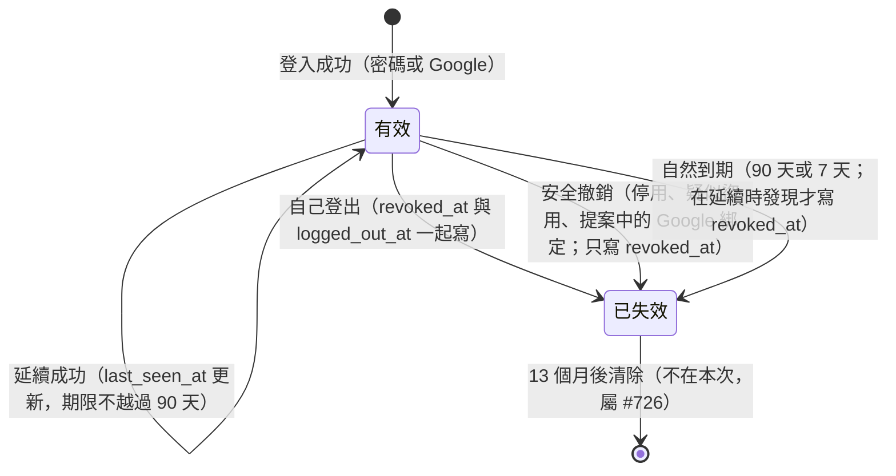

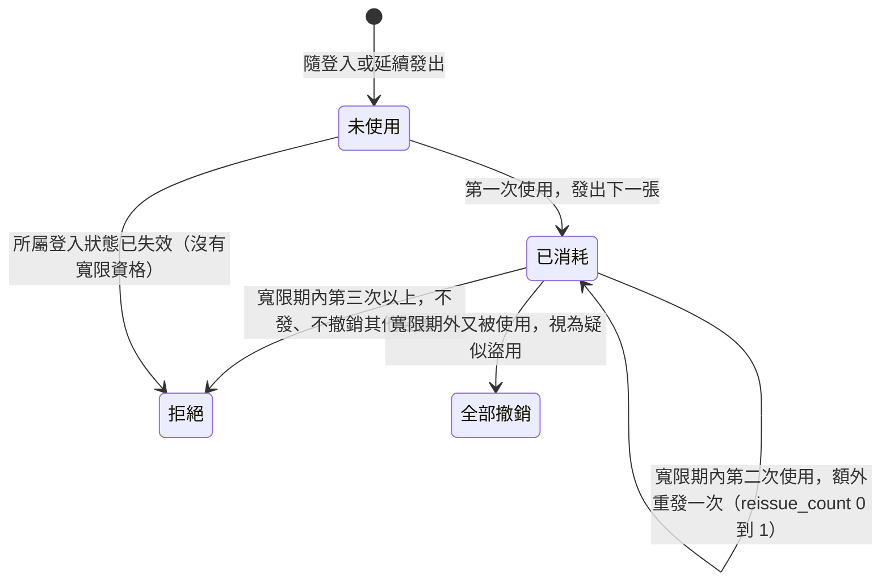

狀態轉移的判斷只在 `SessionService`（backend-agent-rules B1）。

### 交易邊界與 session 生命週期

| 流程             | 交易                                                                                                                                                                     | 交易外的動作                                                                   |
| :--------------- | :----------------------------------------------------------------------------------------------------------------------------------------------------------------------- | :----------------------------------------------------------------------------- |
| Email 與密碼登入 | `PasswordLoginService.login` 一筆：新增 `account_session` 與第一張 refresh token，commit                                                                                 | （提案）登入失敗鎖定的查與記，放在交易前與 commit 後（B4：交易內不做外部呼叫） |
| Google 登入完成  | `GoogleLoginService.complete` 一筆：找帳號、（提案）綁定（寫 `google_subject`、清 `hashed_password`、`credential_version` 加一、撤銷全部登入狀態）、新增登入狀態，commit | 向 Google 換 token 與驗 `id_token` 在交易**之前**，失敗就不開交易              |
| 延續             | `SessionService.refresh` 一筆：條件式消耗、新增下一張、更新 `last_seen_at`，commit；疑似盜用時改成撤銷全部，commit 後再丟錯                                              | 無                                                                             |
| 守門             | 不寫入，只讀；`get_db` 的 session 在請求結束時關閉                                                                                                                       | 無                                                                             |
| 登出             | `SessionService.logout` 一筆：`revoked_at` 與 `logged_out_at` 一起寫，commit                                                                                             | 無                                                                             |

- API 一律用 `get_db` 的 `AsyncSession`，一個請求一個；本次沒有 worker 端，不開同步 session（B3）
- Repository 不 commit（B4）；`get_db` 遇例外 rollback，所以 service 在丟錯前要先 commit 的只有「疑似盜用時撤銷全部」這一種，程式註解要寫明為什麼

## 關鍵情境

每張圖從中介層之後畫起（請求管線見常駐文件 `backend-modules.mdx` §請求管線），畫到 Router 回傳回應為止，不畫畫面。標題是規格書「驗收標準」的 Scenario 名稱；01-01 的寫 01-01，01-05 的寫 01-05。屬於提案的 Scenario 在標題下註明依哪一題的哪個方案。

沒有獨立畫圖、但走同一條路的 Scenario：

| Scenario                                                                                        | 走哪一張圖                        | 為什麼不另畫                                   |
| :---------------------------------------------------------------------------------------------- | :-------------------------------- | :--------------------------------------------- |
| 01-01「沒有設定寄信服務時 Google 沒有對應帳號仍是同一句」                                       | 「Google 帳號沒有對應的平台帳號」 | 後端在那條路**不讀**寄信設定，兩者是同一條序列 |
| 01-01「失敗時不清空已填的內容」「送出後平台沒有回應」與送出中、密碼顯示、語言切換、螢幕寬度各條 | 無後端序列                        | 畫面行為，見 `ui-design.md`                    |
| 01-05「持續使用會延長閒置那條線」                                                               | 「延長不會越過絕對上限」          | 同一次延續，只差 `last_seen_at` 是否接近 90 天 |

### Scenario: 登入成功進入儀表板

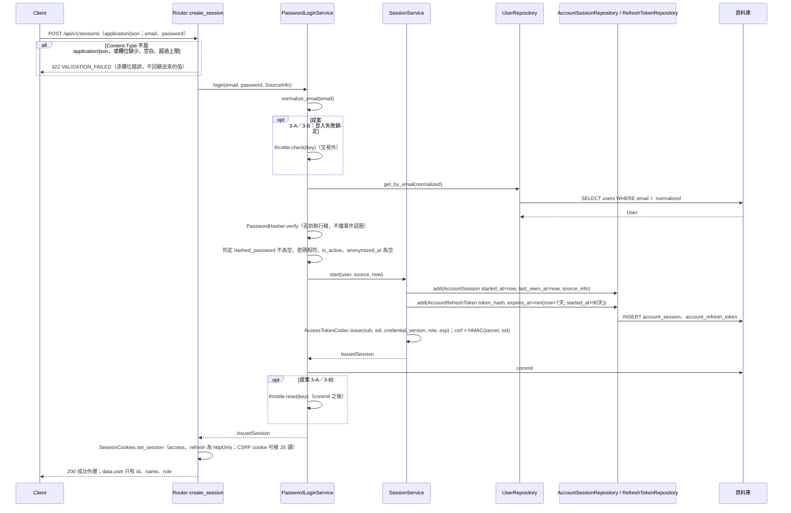

落點是前端的事：後端只回登入成功，前端導向 `/`，由前端路由決定是儀表板還是暫時落點（待決 5、7）。

### Scenario: 帳號或密碼不對

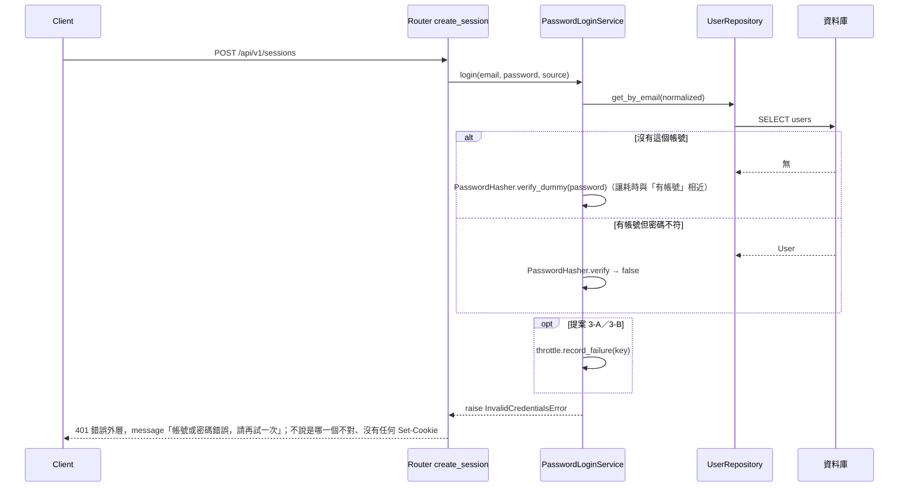

### Scenario: 停用的帳號無法登入

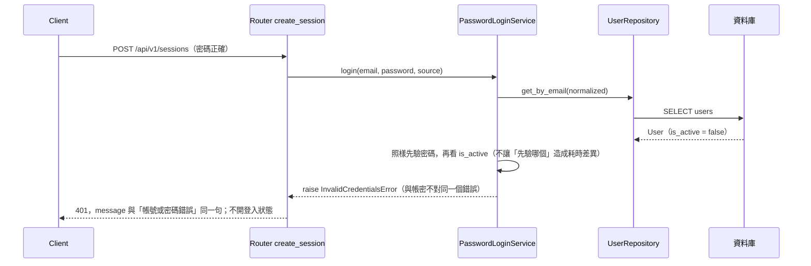

`anonymized_at` 有值（已匿名化）的帳號走同一個分支。

### Scenario: 登入不檢查密碼組成規則

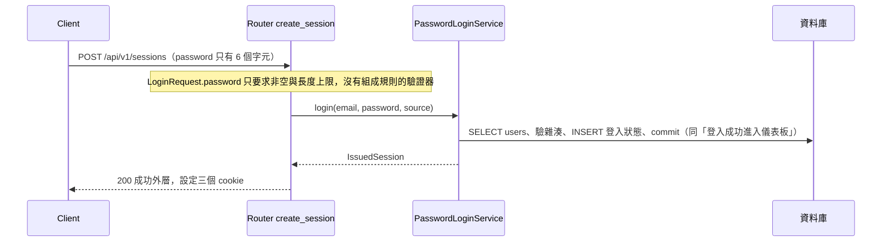

### Scenario: 用大寫寫自己的 Email 登入

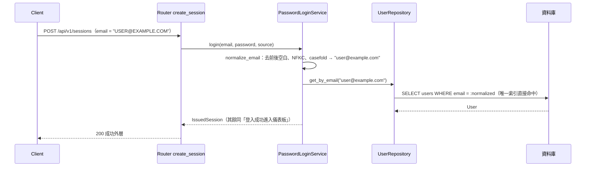

`users.email` 存的就是正規化之後的值，所以比對不依賴資料庫的 `lower()`；兩種資料庫結果相同（01-05 Q14）。

### Scenario: 正規化後超過上限就拒絕

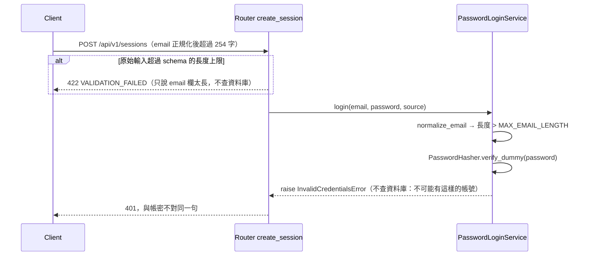

登入這條路「擋下」的樣子是帳密不對；註冊、邀請與換 Email 擋下時的訊息由各自的 change 定。原始輸入的 schema 上限（建議 320 字）只為了限制 payload 大小（Hard Rule 9），由 `api-contract.md` 定數字。

### Scenario: 沒有本地密碼的人只能用 Google

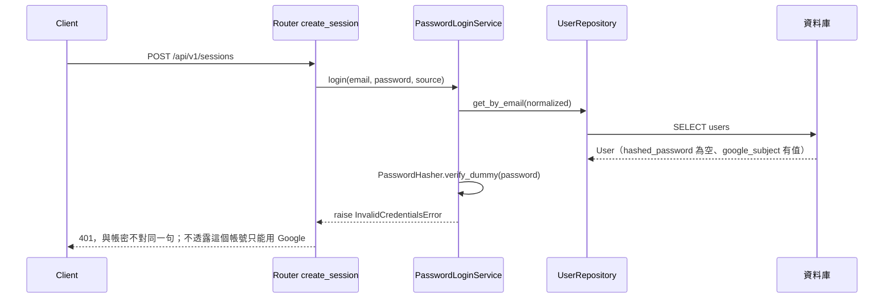

### Scenario: 連續失敗十次被擋住

依待決 3 的方案：3-A 或 3-B 本次做，下圖成立；3-C（交給 #726）則本次只保留插入點（`PasswordLoginService.login` 查帳號之前），不寫任何程式，這個 Scenario 不在本次的 specs。

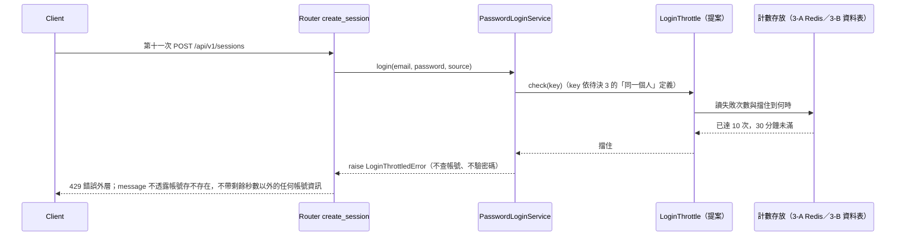

被擋住時密碼正確也不放行；擋住期間不再累計。計數在交易外，Redis 或資料表寫入失敗時的處理見 [§技術待決](#技術待決)。

### Scenario: 點 Google 帳號登入

Google 的回調網址指向**前端**的路由，前端再把 `code` 與 `state` 送給後端；這樣兩個端點都是一般的 JSON 與 envelope，不需要 `302`（理由見 [§技術待決](#技術待決) T1）。

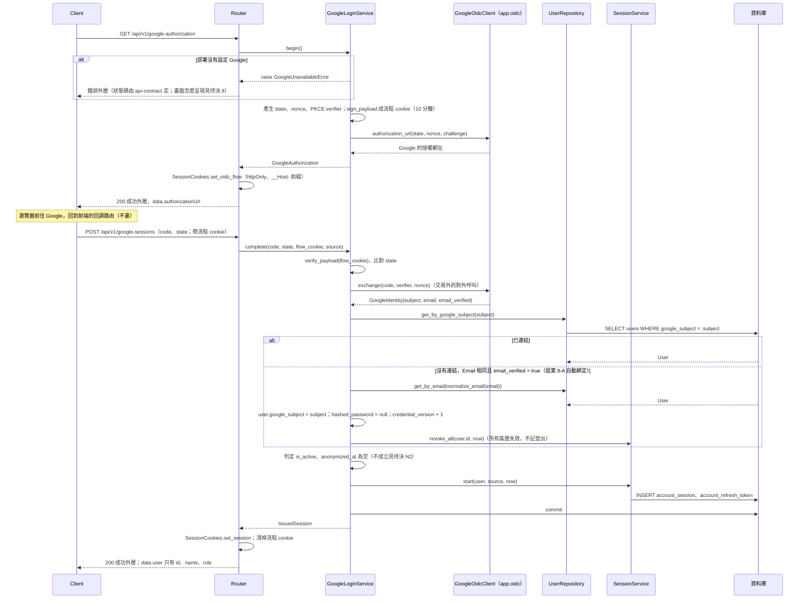

### Scenario: Google 驗證沒通過回到登入頁

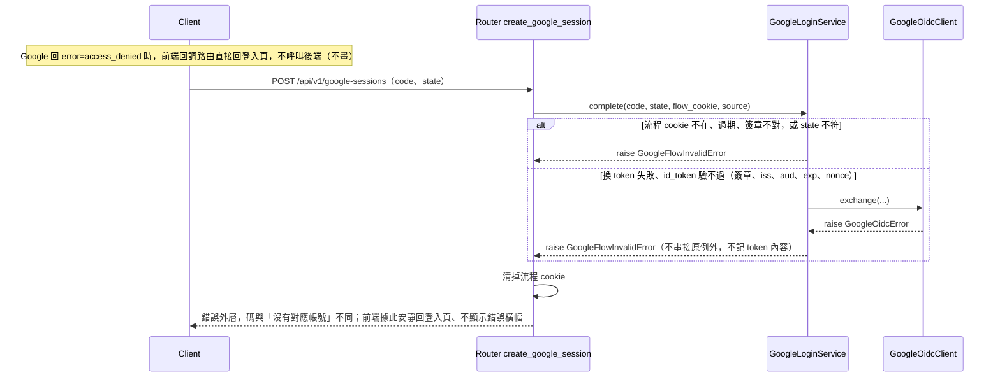

### Scenario: Google 帳號沒有對應的平台帳號

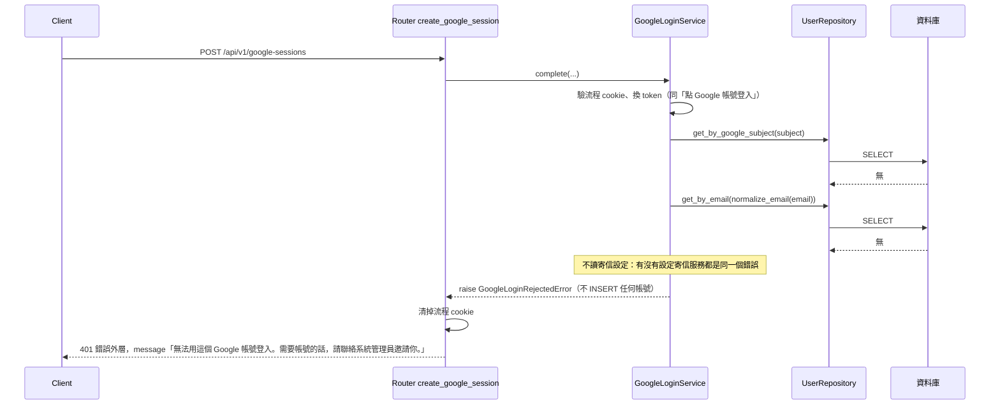

### Scenario: Google 回報 Email 未驗證

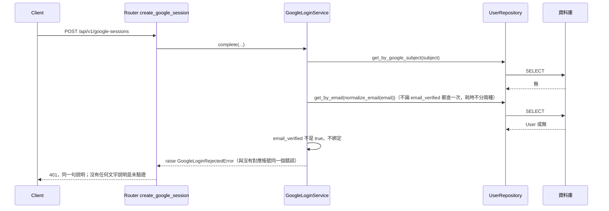

### Scenario: 已連結 Google 的帳號 Email 不同仍能登入

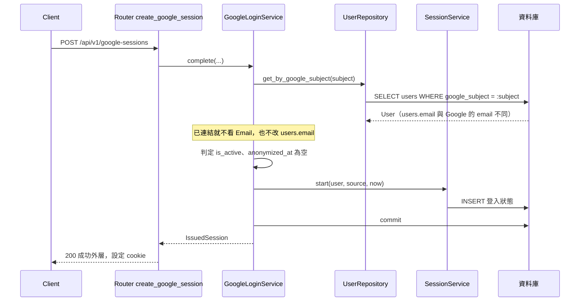

### Scenario: 已登入的人開登入頁直接進儀表板

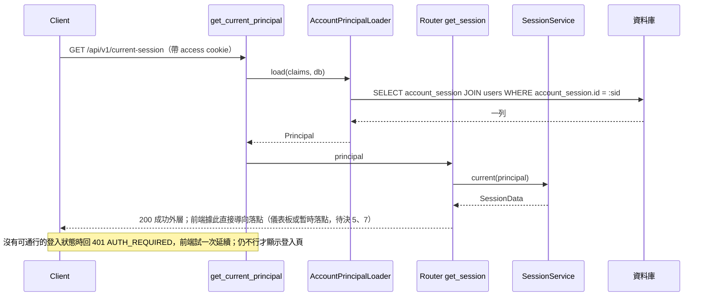

### Scenario: 沒有設定寄信服務時登入頁不顯示前往註冊

依待決 6 的方案 6-A（本次建立共用判斷）。

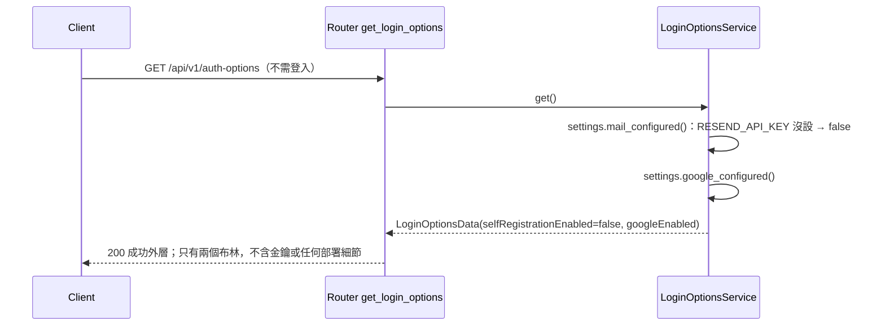

### Scenario: 不能通行的登入狀態不說明原因

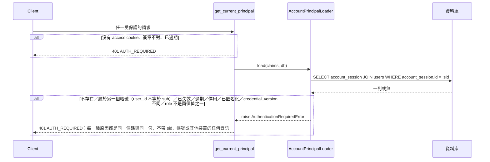

延續端點拒絕時也一樣不說明原因，只分兩種碼讓前端選 01-05 Q4 的兩句：時間到了（`SessionExpiredError`）與其他（`SessionInvalidError`）。

### Scenario: 角色變更從下一次操作起生效

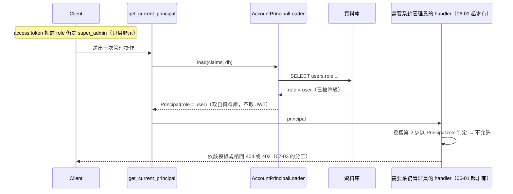

本次沒有需要系統管理員的端點；這張圖驗的是守門交出的 `Principal.role` 一定是資料庫當下的值。測試以一個只在測試掛載的探測路由代替 `H`。角色變更時要不要另外撤銷登入狀態，見待決 N3。

### Scenario: 停用帳號讓所有裝置立刻失效

停用這個動作屬 06-01；本次負責「停用之後，每一條路都進不來」。

```mermaid
sequenceDiagram
  participant C as Client（任一台裝置）
  participant A as get_current_principal
  participant P as AccountPrincipalLoader
  participant R as Router refresh_session
  participant S as SessionService
  participant DB as 資料庫
  C->>A: 下一次操作
  A->>P: load(claims, db)
  P->>DB: SELECT account_session JOIN users
  DB-->>P: users.is_active = false
  P-->>A: 拒絕
  A-->>C: 401 AUTH_REQUIRED
  C->>R: POST 延續
  R->>S: refresh(raw_refresh, now)
  S->>DB: SELECT refresh token、登入狀態與帳號
  S->>S: 輪替之前先看 is_active（architecture §認證與授權）
  S-->>R: raise SessionInvalidError（不發新 token）
  R->>R: SessionCookies.clear
  R-->>C: 401；重新用密碼或 Google 登入也走「停用的帳號無法登入」與待決 N2 的分支
```

### Scenario: 達到絕對上限就要重新登入

依待決 2 的方案 2-A（本次含期限與延續）。

```mermaid
sequenceDiagram
  participant C as Client
  participant R as Router refresh_session
  participant S as SessionService
  participant Q as AccountSessionRepository / RefreshTokenRepository
  participant DB as 資料庫
  Note over C: 守門已因 started_at + 90 天 ≤ now 回 401，前端改試延續
  C->>R: POST 延續（帶 refresh cookie）
  R->>S: refresh(raw_refresh, now)
  S->>Q: get_by_hash(hash_token(raw))
  Q->>DB: SELECT account_refresh_token JOIN account_session JOIN users
  DB-->>Q: 一列
  S->>S: SessionPolicy.is_expired：started_at + 90 天 ≤ now
  S->>Q: revoke(session_id, now, logged_out=false)（自然到期，不記登出）
  S->>DB: commit
  S-->>R: raise SessionExpiredError
  R->>R: SessionCookies.clear
  R-->>C: 401 錯誤外層，前端顯示「登入已過期，請重新登入」
```

### Scenario: 閒置超過限制就要重新登入

依待決 2 的方案 2-A。

```mermaid
sequenceDiagram
  participant C as Client
  participant R as Router refresh_session
  participant S as SessionService
  participant Q as AccountSessionRepository / RefreshTokenRepository
  participant DB as 資料庫
  C->>R: POST 延續（隔了 7 天以上才回來）
  R->>S: refresh(raw_refresh, now)
  S->>Q: get_by_hash(...)
  Q->>DB: SELECT
  DB-->>Q: 一列（last_seen_at + 7 天 ≤ now；refresh token 本身也已過 expires_at）
  S->>Q: revoke(session_id, now, logged_out=false)
  S->>DB: commit
  S-->>R: raise SessionExpiredError
  R->>R: SessionCookies.clear
  R-->>C: 401，前端顯示「登入已過期，請重新登入」
```

### Scenario: 延長不會越過絕對上限

依待決 2 的方案 2-A。

```mermaid
sequenceDiagram
  participant C as Client
  participant R as Router refresh_session
  participant S as SessionService
  participant Q as AccountSessionRepository / RefreshTokenRepository
  participant DB as 資料庫
  C->>R: POST 延續（距 started_at + 90 天只剩一天）
  R->>S: refresh(raw_refresh, now)
  S->>Q: get_by_hash(...)、consume_if_unused(token_id, now)
  Q->>DB: UPDATE account_refresh_token SET consumed_at = :now WHERE id = :id AND consumed_at IS NULL
  DB-->>Q: 1 列
  S->>S: 新 refresh token 的 expires_at = min(now + 7 天, started_at + 90 天)；access 的 exp = min(now + 15 分鐘, started_at + 90 天)
  S->>Q: add(新 refresh token)、touch(session_id, now)
  Q->>DB: INSERT、UPDATE account_session SET last_seen_at = :now
  S->>DB: commit
  S-->>R: IssuedSession
  R->>R: SessionCookies.set_session（cookie 的 Max-Age 同樣不越過那條線）
  R-->>C: 200 成功外層
```

### Scenario: 兩個分頁同時延續不會互相踢掉

依待決 2 的方案 2-A。兩個分頁共用同一組 cookie，所以帶的是同一張 refresh token。

```mermaid
sequenceDiagram
  participant A as 分頁 A
  participant B as 分頁 B
  participant R as Router refresh_session
  participant S as SessionService
  participant Q as RefreshTokenRepository
  participant DB as 資料庫
  A->>R: POST 延續（token T）
  B->>R: POST 延續（同一張 T，幾乎同時）
  R->>S: refresh(T)（A）
  S->>Q: consume_if_unused(T)
  Q->>DB: 條件式 UPDATE
  DB-->>Q: 1 列（A 搶到）
  S->>DB: INSERT T2、commit
  R-->>A: 200，Set-Cookie T2
  R->>S: refresh(T)（B）
  S->>Q: consume_if_unused(T)
  DB-->>Q: 0 列（已被 A 消耗）
  S->>S: now - consumed_at ≤ 寬限 30 秒
  S->>Q: reissue_if_below(T, limit=1)
  Q->>DB: UPDATE ... SET reissue_count = reissue_count + 1 WHERE id = :id AND reissue_count < 1
  DB-->>Q: 1 列
  S->>DB: INSERT T3（同一段登入狀態）、commit
  R-->>B: 200，Set-Cookie T3；沒有任何登入狀態被撤銷
```

「只有一個取得新的」解讀成「只有一段登入狀態」：T2 與 T3 屬於同一個 `sid`，沒有開新的登入狀態，也沒有踢掉任何裝置。這個解讀交給 specs 寫成可測的 Then（見 [§技術待決](#技術待決) T4）。

### Scenario: 同一次延續用第三次就不給

依待決 2 的方案 2-A。

```mermaid
sequenceDiagram
  participant C as Client
  participant R as Router refresh_session
  participant S as SessionService
  participant Q as RefreshTokenRepository
  participant DB as 資料庫
  C->>R: POST 延續（T 已被用過兩次，仍在寬限期內）
  R->>S: refresh(T)
  S->>Q: consume_if_unused(T)
  DB-->>Q: 0 列
  S->>Q: reissue_if_below(T, limit=1)
  DB-->>Q: 0 列（reissue_count 已是 1）
  S-->>R: raise RefreshConflictError（不撤銷任何登入狀態）
  R-->>C: 409 ACCOUNT_REFRESH_CONFLICT；不清 cookie（同一台的另一個分頁可能剛拿到新的）
```

### Scenario: 疑似被盜用時所有裝置一起登出

依待決 2 的方案 2-A。

```mermaid
sequenceDiagram
  participant C as Client
  participant R as Router refresh_session
  participant S as SessionService
  participant Q as AccountSessionRepository / RefreshTokenRepository
  participant DB as 資料庫
  C->>R: POST 延續（T 在寬限期外又被使用）
  R->>S: refresh(T)
  S->>Q: consume_if_unused(T)
  DB-->>Q: 0 列
  S->>S: now - consumed_at > 寬限
  S->>Q: revoke_all_for_user(user_id, now)
  Q->>DB: UPDATE account_session SET revoked_at = :now WHERE user_id = :uid AND revoked_at IS NULL
  S->>DB: commit（先 commit 再丟錯，否則 get_db 會 rollback 掉撤銷）
  S-->>R: raise SessionInvalidError
  R->>R: SessionCookies.clear
  R-->>C: 401，前端顯示「驗證失敗，請重新登入」；不記登出
```

### Scenario: 安全撤銷的登入狀態沒有寬限資格

依待決 2 的方案 2-A。

```mermaid
sequenceDiagram
  participant C as Client
  participant R as Router refresh_session
  participant S as SessionService
  participant Q as RefreshTokenRepository
  participant DB as 資料庫
  C->>R: POST 延續（所屬登入狀態已因登出或安全事件失效）
  R->>S: refresh(T)
  S->>Q: get_by_hash(T)
  Q->>DB: SELECT ... JOIN account_session
  DB-->>Q: account_session.revoked_at 有值
  S->>S: 先看登入狀態是否已失效，才看寬限與重用（已失效就不進盜用判定）
  S-->>R: raise SessionInvalidError（不撤銷其他裝置）
  R->>R: SessionCookies.clear
  R-->>C: 401
```

### Scenario: 從這一台登出只影響這一台

依待決 2 與 5：本次是否提供登出端點。控制項在 07-01，端點可以先在本次建立（方案 5-A）。

```mermaid
sequenceDiagram
  participant C as Client（裝置 A）
  participant R as Router delete_session
  participant S as SessionService
  participant Q as AccountSessionRepository / RefreshTokenRepository
  participant DB as 資料庫
  C->>R: DELETE /api/v1/current-session（帶 refresh cookie）
  R->>S: logout(raw_refresh, now)
  S->>Q: get_by_hash(hash_token(raw))
  Q->>DB: SELECT
  DB-->>Q: 一列，登入狀態有效
  S->>Q: revoke(session_id, now, logged_out=true)
  Q->>DB: UPDATE account_session SET revoked_at = :now, logged_out_at = :now WHERE id = :sid
  S->>DB: commit
  R->>R: SessionCookies.clear
  R-->>C: 204（envelope 的明文例外：無 body）；裝置 B 的登入狀態不受影響
```

### Scenario: 登入狀態已經不能驗證時登出

依待決 2 與 5 的方案 5-A。

```mermaid
sequenceDiagram
  participant C as Client
  participant R as Router delete_session
  participant S as SessionService
  participant DB as 資料庫
  C->>R: DELETE /api/v1/current-session（refresh cookie 不在或查不到）
  R->>S: logout(None 或查不到的值, now)
  S->>DB: SELECT（cookie 不在時不查）
  S-->>R: 不寫任何東西、不記登出
  R->>R: SessionCookies.clear
  R-->>C: 204；不聲稱伺服器端已失效
```

## 常駐文件異動

- 常駐文件：`docs/diagrams/architecture/backend-modules.mdx`

| 節                                   | 異動 | 摘要                                                                                                                                                  |
| :----------------------------------- | :--- | :---------------------------------------------------------------------------------------------------------------------------------------------------- |
| 模組一覽                             | 修改 | 加 `account` 一列；「目前只有 `health`」改成兩個模組                                                                                                  |
| account                              | 新增 | 分層表、Class 圖、兩張主要 Sequence 圖（登入成功、每一次操作的身分判定）；開頭註明延續、鎖定、Google 綁定、登出四塊依提案畫，clarification 定案後校正 |
| 後端基礎建設 §目錄                   | 修改 | 加頂層入口套件 `app/oidc/` 與它在目錄表的判斷方式                                                                                                     |
| 後端基礎建設 §`core/` 各模組         | 修改 | 新增 `auth.py`、`tokens.py`、`cookies.py`、`csrf.py`、`passwords.py`、`email_identity.py` 六列；`config.py` 加兩個判斷方法；`db.py` 加 `UtcDateTime`  |
| 後端基礎建設 §請求管線               | 修改 | 加 `CsrfMiddleware`（第 5a 層，在 `LocaleMiddleware` 內側）；認證寫明是端點依賴不是中介層；CORS 允許的標頭加 `X-CSRF-Token`                           |
| 後端基礎建設 §錯誤怎麼對到 envelope  | 修改 | 加 `403 CSRF_FAILED` 與 `401 AUTH_REQUIRED` 兩列（碼以 `api-contract.md` 與 `error-codes.mdx` 為準）                                                  |
| 後端基礎建設 §設定                   | 修改 | 加 `AUTH_SECRET`（必填）、三個 `GOOGLE_*`（一起設或一起不設）、`RESEND_API_KEY`（只看有沒有設）                                                       |
| 後端基礎建設 §新增業務模組的檢查清單 | 修改 | 加「需要登入的端點掛 `get_current_principal`，角色取 `Principal.role`」                                                                               |
| 已知限制                             | 修改 | 「認證、授權與 CSRF」縮成「授權四步的第 3、4 步」                                                                                                     |
| 決策紀錄                             | 新增 | 一列，指向 #719                                                                                                                                       |

## 資料模型異動

- 字典：`docs/diagrams/architecture/data-table-dictionary.mdx`
- ER：`docs/diagrams/architecture/database-schema.er.json`
- `pnpm check:er`：通過（`check-er-data: dictionary, diagram, landed revisions, spec entries and both kinds of line citation agree`）

| 表                | 異動                                                                     | 欄位／索引                                                                                                                                                                                                                                           | 波及的表（依字典 FK 與被參照）                                                                                                                                                                      | Alembic migration 可逆                                                    | SQLite 與 PostgreSQL 的差異                                                                                                                                                                                                                                                                                                                                                                           |
| :---------------- | :----------------------------------------------------------------------- | :--------------------------------------------------------------------------------------------------------------------------------------------------------------------------------------------------------------------------------------------------- | :-------------------------------------------------------------------------------------------------------------------------------------------------------------------------------------------------- | :------------------------------------------------------------------------ | :---------------------------------------------------------------------------------------------------------------------------------------------------------------------------------------------------------------------------------------------------------------------------------------------------------------------------------------------------------------------------------------------------- |
| `users`           | 新建（字典既有候選表首次落地）；字典同時**收回三欄**、**改一個唯一限制** | 收回 `google_subject`（`varchar(255)`，可空，唯一）、`credential_version`（`integer`，系統寫入，預設 0，CHECK `>= 0`）、`is_seeder`（`boolean`，系統寫入，預設 false）；`email` 的唯一限制從 `lower(email)` 改成對**存入的正規化值**；其餘欄位照字典 | 被參照：`account_session.user_id`（RESTRICT）、`account_password_token`、`account_email_change_request`、`account_notification_preference`（CASCADE）及其他組；本次只建 `account_session` 這一條 FK | 可逆：down 刪表；表是新建的，down 會丟掉其中的帳號（已部署之後不再 down） | `uuid`：PG 原生，SQLite 存 `CHAR(32)`（SQLAlchemy `Uuid`）；`timestamptz`：PG 存時區，SQLite 存不帶時區的文字，一律經 `UtcDateTime` 讀寫成 UTC；`boolean`：SQLite 存 0／1；`varchar(254)` 的長度 SQLite 不檢查，由 `normalize_email` 擋；名稱長度 CHECK 用兩邊都有的 `length()`；可空的唯一欄（`google_subject`）兩邊都允許多個 NULL；`email` 不用表達式索引，避免 SQLite `lower()` 只轉 ASCII 的差異 |
| `account_session` | 新建（字典既有候選表首次落地）                                           | 照字典：PK `id`；`user_id` FK → `users.id` RESTRICT 並建索引；`logged_out_at` 的 CHECK；`(user_id, id)` 另供複合 FK 父鍵的唯一限制                                                                                                                   | 父：`users`；日後被 `task_work_interval`、`annotation_history_event` 參照（不在本次）                                                                                                               | 可逆：down 先刪本表再刪 `users`                                           | CHECK 的時間比較：PG 比較 `timestamptz`，SQLite 比較文字；`UtcDateTime` 固定寫成同一格式（ISO 8601、UTC），文字比較的結果才與時間順序相同                                                                                                                                                                                                                                                             |

**字典與 ER 的其他配套異動**：§一 的欄數與 D7 說明（360 → 363 欄，本專案不收的原始欄位 6 → 3）、`users` 的寫入者、讀取權限（三個認證欄位任何回應都不帶）與不可變、§十 統計、變更紀錄各一處；ER 的 `meta.description` 欄數與 `users` 的表說明同步。

### 待定案、所以還沒進字典的資料模型提案

| 提案                                        | 依附的待決                 | 內容                                                                                                                                                                                                                                                                                                                                          | 定案之後                                                                                                                                                                                                               |
| :------------------------------------------ | :------------------------- | :-------------------------------------------------------------------------------------------------------------------------------------------------------------------------------------------------------------------------------------------------------------------------------------------------------------------------------------------- | :--------------------------------------------------------------------------------------------------------------------------------------------------------------------------------------------------------------------- |
| `account_refresh_token`（`account` 組新表） | N1，且待決 2 選 2-A 或 2-B | 一列一張 refresh token：`id uuid PK`、`session_id uuid NOT NULL FK → account_session.id CASCADE`（索引）、`token_hash char(64) NOT NULL 唯一`（原文不入庫）、`issued_at`、`expires_at timestamptz NOT NULL`、`consumed_at timestamptz 可空`、`reissue_count smallint NOT NULL 預設 0，CHECK 0–1`。token family 就是它所屬的 `account_session` | `sd` 先改字典與 ER、跑 `pnpm check:er`，再更新本節；同一個 Alembic revision 建表，down 先刪它。兩種資料庫都用條件式 `UPDATE ... WHERE consumed_at IS NULL` 判定誰搶到，不依賴 `SELECT ... FOR UPDATE`（SQLite 不支援） |
| 登入失敗計數表（3-B）                       | 待決 3                     | 只有選 3-B 才需要；欄位依「同一個人」的定義（帳號、來源或兩者）決定                                                                                                                                                                                                                                                                           | 同上；另需回頭改 ADR-004 D7                                                                                                                                                                                            |

**Migration**：一個 Alembic revision（`down_revision` 是基準 `0dfb129ee036`）建 `users`、`account_session`（與定案後的 `account_refresh_token`），`render_as_batch` 照常開啟。migration 不建任何帳號；第一個帳號從哪裡來見待決 4。`is_seeder` 的資料庫層保護（擋住清除與停用）屬 06-01 的 change（capability `user-management`「Seeder 管理員受到保護」），本次只建欄位。

## 權限檢查點

| 層                                           | 檢查                                                                                                                                                                                                                    | 適用                                                   |
| :------------------------------------------- | :---------------------------------------------------------------------------------------------------------------------------------------------------------------------------------------------------------------------- | :----------------------------------------------------- |
| `CorsMiddleware`                             | 來源逐一列出（Hard Rule 7），本次只多允許 `X-CSRF-Token` 標頭                                                                                                                                                           | 全部                                                   |
| `CsrfMiddleware`                             | 會改資料的方法要 `X-CSRF-Token` 與 CSRF cookie 相同，且等於 `HMAC(secret, sid)`；`sid` 取自 access token（驗簽章、不看是否過期）。還沒有 session 的三條（Email 與密碼登入、延續、Google 登入完成）與登出放行，理由見 T2 | 本次與之後所有 `POST`／`PUT`／`PATCH`／`DELETE`        |
| `get_current_principal`（授權第 1 步）       | 登入狀態存在、屬於 `sub`、未失效、未過 90 天與 7 天；帳號啟用、未匿名化；`credential_version` 相同                                                                                                                      | `GET /api/v1/current-session` 與之後所有需要登入的端點 |
| 同上（授權第 2 步）                          | 系統角色取自資料庫，只接受 `user` 與 `super_admin`；不讀 JWT 的 `role`                                                                                                                                                  | 同上                                                   |
| 授權第 3、4 步                               | **本次不建**（待決 11 的提案 11-A）；第一個需要權限矩陣或附加條件（含答案隔離）的端點要先補上                                                                                                                           | —                                                      |
| `PasswordLoginService`、`GoogleLoginService` | 帳號啟用、未匿名化；密碼登入要求有本地密碼；Google 只登入或綁定既有帳號，不建立帳號                                                                                                                                     | 兩條登入                                               |
| `SessionService.refresh`                     | 輪替之前先讀帳號狀態，停用就拒絕、不發新 token                                                                                                                                                                          | 延續                                                   |

**未登入的訪客**能到的只有登入頁設定、兩條登入、Google 授權網址與登出；它們不讀、不回任何業務資料。PRD §權限矩陣管的是登入之後的功能，這幾條對不到矩陣的任何一列（規格 01-01 §使用角色），本次**沒有放寬**任何一格。

**欄位遮蔽**：唯一回帳號資料的是 `SessionUserData`，明列 `id`（字串）、`name`、`role` 三欄；`hashed_password`、`google_subject`、`credential_version`、`is_seeder`、`email`、`source_info` 一律不回，不是遮蔽成某個值，而是不在 schema 裡。登入失敗、Google 拒絕、守門拒絕的錯誤外層只帶碼與本地化的 `message`，不帶帳號是否存在、是否停用、`sid` 或其他裝置的資訊。

**測試集答案隔離**：本次沒有任何端點讀或回任務、資料集或標記資料，所以沒有答案外露的風險（每個端點都是「無」）。守門是日後答案隔離檢查所在的位置（授權第 4 步）；本次交出的 `Principal` 只有 `user_id`、`session_id`、`role`，第 4 步之後接在它後面，不必改守門本身。

**任務設定驅動**：本次的行為與任務類型無關，沒有寫死任何任務類型（Hard Rule 5 不適用）。

## 待決問題與提案

### `system-analysis.md` 的 13 題

| #   | 問題（簡述）                                     | 誰決定                        | 設計上的接縫                                                                                                                                                                                           | 提案                                                                                                                                                                                                                                                                                                                                                                                                                                                                                                |
| :-- | :----------------------------------------------- | :---------------------------- | :----------------------------------------------------------------------------------------------------------------------------------------------------------------------------------------------------- | :-------------------------------------------------------------------------------------------------------------------------------------------------------------------------------------------------------------------------------------------------------------------------------------------------------------------------------------------------------------------------------------------------------------------------------------------------------------------------------------------------- |
| 1   | 「記住我」要不要做                               | 維護者                        | 期限只在 `SessionPolicy` 一處；若要依選擇而變，`account_session` 要多一個欄位記這段登入狀態用哪一組期限，`LoginRequest` 多一個布林                                                                     | **1-A（建議）**：不做，依規格與 01-05 Q1、Q2 固定 90 天與 7 天，proposal 註明與 Issue 字面不同；**1-B**：要做，先用 `spec-writing` 改 01-01、01-05 並過 Ready gate，再回修本設計                                                                                                                                                                                                                                                                                                                    |
| 2   | 01-05 哪些部分在本次                             | 維護者                        | `SessionService.refresh` 與 `SessionPolicy` 是一整塊；登出是獨立的一個端點                                                                                                                             | **2-A（建議）**：本次含兩條期限、延續（輪替、寬限、第三次不給、疑似盜用）、被動登出的兩個錯誤碼與登出端點；紀錄的保留與每日清除、改密碼與四種撤銷事件留給各自的 change。不含延續的話，access token 15 分鐘一到就得重新登入，等於不能用。**2-B**：只含期限與最基本的輪替，寬限與盜用留給 #726（之後要改 `refresh` 的判定，風險是兩次改同一段安全程式）。**2-C**：不含延續（不建議，理由同上）                                                                                                        |
| 3   | 登入失敗鎖定在本次做嗎、「同一個人」怎麼認       | 維護者                        | 插入點固定在 `PasswordLoginService.login` 查帳號之前（`check`）與失敗後、成功後（`record_failure`、`reset`），都在交易外                                                                               | **3-C（建議）**：本次不做，依 ADR-004 D7「登入鎖定屬 01-05 的 change」交給 #726，連同在兩種部署編排加入 Redis；本次只保留插入點、不寫程式。**3-A**：本次照 ADR-004 D7 用 Redis，兩種編排都要加 Redis 服務（Lite 的零前置條件仍成立，但多一個容器）。**3-B**：計數放資料庫的一張表，不加服務，但要回頭改 ADR-004 D7。「同一個人」三選一：帳號（任何人都能把別人鎖 30 分鐘）、來源位址（同一個帳號可被分散的來源慢慢猜）、**帳號加來源位址（建議）**，來源位址依 `FORWARDED_ALLOW_IPS` 的信任規則取得 |
| 4   | 第一個可以登入的帳號從哪裡來                     | 維護者                        | 帳號的建立不在本模組的任何端點；`users` 表本次就建，`is_seeder` 欄也在                                                                                                                                 | **4-A（建議）**：本次提前做 06-01 的「Seeder 管理員只能由初始化指令建立」，一支 `uv run python -m app.scripts.create_seeder` 命令（不內建預設密碼、同一身分重複執行不變、在同一交易寫入帳號與標記），資料庫層的保護仍留給 06-01；**4-B**：只在測試與驗收用測試資料建立帳號，正式部署交付後仍登不進去，直到 06-01                                                                                                                                                                                    |
| 5   | 暫時落點與登出                                   | 維護者（畫面要過 Ready gate） | 後端只回「登入成功」，不指定落點；登入成功與已登入時前端一律導向 `/`，由前端路由決定 `/` 是儀表板還是暫時落點，02-01 完成時只改前端那一條路由                                                          | 後端部分：**5-A（建議）**：本次建立登出端點（`DELETE`），控制項放不放在暫時落點由 `ui-design` 與維護者決定；**5-B**：登出端點留給 07-01 的 change                                                                                                                                                                                                                                                                                                                                                   |
| 6   | 「忘記密碼」「前往註冊」的去處與寄信判斷         | 維護者                        | `Settings.mail_configured()` 是唯一的判斷，登入頁設定端點回 `selfRegistrationEnabled`                                                                                                                  | **6-A（建議）**：本次建立這個共用判斷（只看 `RESEND_API_KEY` 有沒有設），01-02 的 change 直接用；連結的去處見 `ui-design.md`。**6-B**：本次一律回 false，等 01-02 再建（與規格「有設定就顯示」不符）                                                                                                                                                                                                                                                                                                |
| 7   | 已登入的人開登入頁是否也走暫時落點               | 維護者                        | 同 5：後端只回 `GET /api/v1/current-session` 的 200 或 401                                                                                                                                             | 與 5 一起定，後端不受影響                                                                                                                                                                                                                                                                                                                                                                                                                                                                           |
| 8   | 沒設定 Google 時按鈕怎麼呈現                     | 維護者（可能要改規格）        | `LoginOptionsData.googleEnabled` 讓前端決定呈現；授權網址端點在沒設定時丟 `GoogleUnavailableError`                                                                                                     | **8-A（建議）**：照 ADR-004 D4 按鈕在、點了不動作（前端依 `googleEnabled=false` 不呼叫後端），規格補一條；**8-B**：沒設定時不顯示按鈕（與 01-01 第 1 條「按鈕一定在」不符，要改規格）。自動化驗收以 `app.oidc` 的測試替身代替 Google（testing-agent-rules T6），CI 與 e2e 不連真的 Google                                                                                                                                                                                                           |
| 9   | 登入頁 Google 自動綁定算不算「連結 Google 成功」 | 維護者                        | 綁定只在 `GoogleLoginService.complete` 的一個分支，與「開始登入狀態」在同一筆交易                                                                                                                      | **9-A（建議）**：算，照 ADR-004 D5：同一筆交易寫 `google_subject`、清本地密碼、`credential_version` 加一、撤銷**既有的**所有登入狀態，再為這一台開新的登入狀態，所以這一台保留、其他裝置失效；規格 01-01 補流程與是否告知「密碼已清掉」。**9-B**：綁定但不清密碼、不撤銷（要改 ADR-004 D5）。**9-C**：登入頁不自動綁定，只接受已連結的帳號（要改 ADR-004 D5 與 01-05 Q18 的「沒有對應帳號」定義）                                                                                                   |
| 10  | 登入後回原頁還是一律去落點                       | 維護者                        | 登入端點不收 `returnTo`；若要回原頁，只接受站內相對路徑，由前端驗證並帶在前端狀態，不經後端                                                                                                            | **10-A（建議）**：一律去落點，照規格現況；**10-B**：回原頁，先補規格                                                                                                                                                                                                                                                                                                                                                                                                                                |
| 11  | 守門做到授權四步的哪一步                         | 維護者                        | `get_current_principal` 交出 `Principal`；第 3 步日後是另一個依賴（例如 `require_permission(key)`），接在它後面                                                                                        | **11-A（建議）**：本次只做第 1、2 步——本次沒有任何登入後的業務端點需要矩陣，先建矩陣只是空殼；第 3 步隨第一個需要它的端點或 06-02 建立。**11-B**：本次就建 `admin_role_permission` 與版本表，內容是 PRD 預設值（範圍變大、提前 06-02 的資料）                                                                                                                                                                                                                                                       |
| 12  | 字典排除的三欄                                   | 已當 P 處理                   | —                                                                                                                                                                                                      | **已改**：字典與 ER 收回 `google_subject`、`credential_version`、`is_seeder`，`pnpm check:er` 通過，見 [§資料模型異動](#資料模型異動)。順帶修正 `email` 的唯一限制（`lower(email)` 在 SQLite 只轉 ASCII，與 01-05 Q14 要求的兩種資料庫結果相同衝突）                                                                                                                                                                                                                                                |
| 13  | 覆蓋率門檻的範圍                                 | 維護者                        | 後端的「認證」與「授權與權限檢查」關鍵路徑落在 `app/core/auth.py`、`tokens.py`、`cookies.py`、`csrf.py`、`passwords.py`、`email_identity.py` 與 `app/modules/account/service.py`；路徑清單交給門檻設定 | **13-A（建議）**：本次只建這兩項的 90% 分支門檻與路徑清單，另三項不建空殼（#111 本文禁止空實作冒充完成），#111 本文那一項改寫成「認證與授權已由 #719 建立，另三項仍在本單」；**13-B**：五項一起建（另三項沒有程式，只能是空路徑）                                                                                                                                                                                                                                                                   |

### 本份新發現的待決

| #   | 問題                                           | 來源與衝突                                                                                                                                                                                                                                                                                         | 影響                                                                         | 提案                                                                                                                                                                                                                                                                                                |
| :-- | :--------------------------------------------- | :------------------------------------------------------------------------------------------------------------------------------------------------------------------------------------------------------------------------------------------------------------------------------------------------- | :--------------------------------------------------------------------------- | :-------------------------------------------------------------------------------------------------------------------------------------------------------------------------------------------------------------------------------------------------------------------------------------------------- |
| N1  | refresh token 存在哪裡                         | ADR-004 D1 寫「伺服器要維護 refresh token 的資料表」，01-05 §延續登入狀態 的寬限、第三次不給、疑似盜用都要逐張記錄；但字典 D7（維護者 2026-11-11）以「規格沒提到」拿掉了原始規劃的 `refresh_tokens`，並寫「需要時另開 issue 寫清楚為什麼」                                                         | 待決 2 選 2-A 或 2-B 時一定要有存放處；不定就無法實作延續                    | **N1-A（建議）**：新表 `account_refresh_token`（欄位見 [§資料模型異動](#待定案所以還沒進字典的資料模型提案)），一段登入狀態就是一個 token family；**N1-B**：在 `account_session` 加「目前一張、上一張」兩組雜湊與消耗時間，不加表，但寬限期內的額外重發與第三次判定要擠在同一列，條件式更新較難寫對 |
| N2  | 停用或已匿名化的帳號用 Google 登入時顯示哪一句 | 01-05 §帳號被停用或重新啟用 第 3 條與卡控寫「拒絕用 Google 登入」，但 01-01 只定了密碼登入的那一句（停用與帳密錯誤同一句），Google 那條路沒有定                                                                                                                                                    | `GoogleLoginRejectedError` 是否涵蓋停用；`ui-design` 的錯誤橫幅              | **N2-A（建議）**：用 Google 那一句「無法用這個 Google 帳號登入……」，不透露帳號存在或被停用，規格 01-01 補一句；**N2-B**：用「帳號或密碼錯誤」那一句（Google 登入沒有密碼，語意不通）                                                                                                                |
| N3  | 系統角色變更時要不要撤銷登入狀態               | security-agent-rules S4 寫「帳號停用、系統角色變更、任務成員身分變更時，`credential_version` 加一並撤銷該使用者的 refresh token family」；規格 01-05 §每一次操作都用最新的身分判定 與 Scenario「角色變更從下一次操作起生效」只要求下一次操作用新角色，§四種改動讓所有裝置重新登入 **不含**角色變更 | 06-01 的 change 怎麼實作角色變更；本次的守門兩種都相容（角色每次從資料庫讀） | 依需求依據順序以規格為準：**N3-A（建議）**：角色變更不撤銷登入狀態、不加 `credential_version`，回頭改 S4 那一句（任務成員身分那一半同理，留給 03 的 change）；**N3-B**：照 S4 撤銷，要先用 `spec-writing` 改 01-05                                                                                  |
| N4  | 規格 06-01 停用自己的情境、與本次無關的部分    | —                                                                                                                                                                                                                                                                                                  | —                                                                            | 不是新題目：停用、改密碼、換 Email 等撤銷事件的觸發都屬各自的 change，本次只提供 `SessionService.revoke_all` 供它們呼叫                                                                                                                                                                             |

### 技術待決

這些不需要維護者決定，記下設計上的取捨，交給 `api-contract`、`planner` 與 `design-reviewer` 核對。

| #   | 項目                                                        | 決定與理由                                                                                                                                                                                                                                                                                                                                                                                                                                                                                                                                                                                                                             |
| :-- | :---------------------------------------------------------- | :------------------------------------------------------------------------------------------------------------------------------------------------------------------------------------------------------------------------------------------------------------------------------------------------------------------------------------------------------------------------------------------------------------------------------------------------------------------------------------------------------------------------------------------------------------------------------------------------------------------------------------- |
| T1  | Google 回調不用 `302`                                       | envelope 的例外只有 `204`、檔案與串流三種（architecture §API 契約），`302` 不在其中。改成 Google 回到**前端**的回調路由，前端再呼叫 `POST /api/v1/google-sessions`；授權網址也以 JSON 回給前端。`code` 出現在前端網址是 SPA 加 PKCE 的標準做法：verifier 留在後端的 httpOnly 流程 cookie，單獨拿到 `code` 換不到 token。代價是前端多一條回調路由。**與 `ui-design.md` 目前的寫法不一致**：它假設 Google 起點是整頁導向後端、由後端以導回 `/` 或登入頁加網址參數結束，那需要 `302` 成為新的 envelope 例外。由 `api-contract` 定稿時兩份對齊；若要走 `302`，須先由維護者把它加進 architecture §API 契約 的例外清單（clarification 的 Q） |
| T2  | 哪些寫入端點不驗 double-submit CSRF                         | Email 與密碼登入、Google 登入完成、延續三條在 session 之前或 access token 過期之後，沒有可綁定的 `sid`；三條都只收 `application/json`，跨站表單送不出這種請求、`fetch` 會先觸發 CORS 預檢，預檢由逐一列出的來源擋下（ADR-004 D3 自己寫自訂標頭那一層的強度等於 CORS allowlist）。Google 那條另有 `state` 與 PKCE 擋登入 CSRF。登出用 `DELETE`，跨站同樣要預檢，而且登入狀態已不能驗證時也要能清 cookie（01-05「登入狀態已經不能驗證時登出」），所以放行。放行清單寫死在 `CsrfMiddleware`，端點不自己處理（S2）                                                                                                                         |
| T3  | `last_seen_at` 只在延續時更新                               | 守門不寫入，每個請求省一次寫；代價是閒置的起算點最多比實際最後一次操作早 15 分鐘（一張 access token 的效期），相對於 7 天可忽略                                                                                                                                                                                                                                                                                                                                                                                                                                                                                                        |
| T4  | 「只有一個取得新的」的解讀                                  | 01-05 Q13 寫寬限期內「最多額外重發一次」、Scenario「同一次延續用第三次就不給」也預設第二次有發；所以第二次使用會拿到同一段登入狀態的另一張 token。Scenario「兩個分頁同時延續不會互相踢掉」的「只有一個取得新的」解讀成「只有一段登入狀態」，交給 specs 寫成可測的 Then                                                                                                                                                                                                                                                                                                                                                                 |
| T5  | 寬限期 30 秒                                                | 規格把秒數交給實作（01-05 §多個分頁同時延續 的備註）；30 秒取自個人 repo ADR-021 的修訂（ADR-004 附錄記為不收、由各 change 決定），寫在 `SessionPolicy`，specs 不寫死                                                                                                                                                                                                                                                                                                                                                                                                                                                                  |
| T6  | 密碼雜湊用 argon2id，驗證丟到執行緒                         | 雜湊一次約數十毫秒，直接在 async handler 裡算會擋住事件迴圈；帳號不存在時跑一次假驗證，耗時不洩漏帳號存在與否                                                                                                                                                                                                                                                                                                                                                                                                                                                                                                                          |
| T7  | 新的第三方套件                                              | `pyjwt`（JWT）、`argon2-cffi`（密碼）、`authlib`（OIDC，只在 `app/oidc/`）；以 `uv add` 加入，並在 `tests/unit/test_dependency_classification.py` 歸類、在 `import_tree.py` 登記入口套件 `oidc`。選 3-A 時再加 `redis`，並決定它是否成為 B12 的新入口                                                                                                                                                                                                                                                                                                                                                                                  |
| T8  | `AUTH_SECRET` 是新的必填設定                                | 沒有預設值（B10、Hard Rule 8）；`.env.example` 寫產生方式但不給可用的值，兩種部署編排與 Lite 的 Quick Start 都要跟著改。由它以不同用途標籤衍生三把金鑰（JWT、CSRF、Google 流程 cookie），一把外洩不必換其他設定                                                                                                                                                                                                                                                                                                                                                                                                                        |
| T9  | `Secure` 與 `__Host-` cookie 只在 HTTPS 或 `localhost` 有效 | Lite 經 `http://localhost` 使用沒問題；用區網 IP 的純 HTTP 開啟時瀏覽器不會存 cookie、登不進去。這是部署限制，寫進部署文件，不放寬 cookie 屬性                                                                                                                                                                                                                                                                                                                                                                                                                                                                                         |
| T10 | 守門每個請求多一次查詢                                      | ADR-004 D2 已接受；一次以主鍵 JOIN `account_session` 與 `users`。之後若要快取，必須維持立即撤銷（D2 的後果）                                                                                                                                                                                                                                                                                                                                                                                                                                                                                                                           |
| T11 | `service.py` 的行數                                         | 四個 service 加一個 loader 可能超過 B11 的 400 行；超過時把 `service` 改成套件（`service/__init__.py` 匯出），import-linter 的層仍是 `app.modules.account.service`，不新增未受層契約管的檔案                                                                                                                                                                                                                                                                                                                                                                                                                                           |
