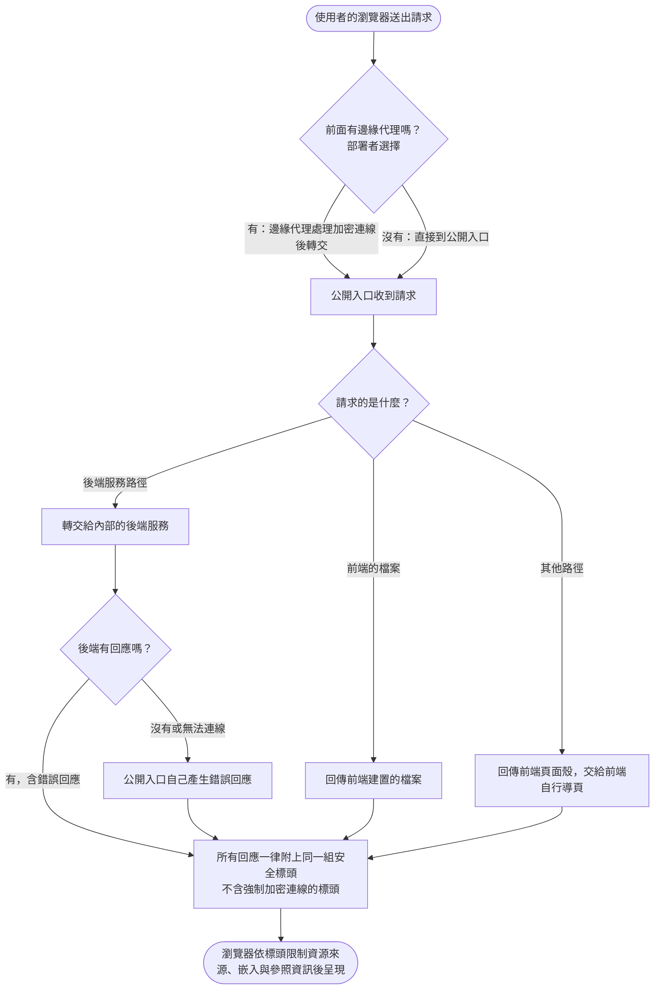

# System Analysis

change：`nginx-security-headers` · issue：#568 · 分支：`feat/nginx-security-headers` · schema：`label-suite-sdd`

## 需求依據

本 change 是基礎建設 change，`docs/specs/` 沒有規格涵蓋「公開入口的回應標頭」（`docs/specs/00-prd.mdx` 只在系統情境寫到部署者這個人，沒有部署或安全標頭的條文）。依 `docs/development/workflow/spec-migration.mdx` D4 與 `openspec/config.yaml` 的 context（維護者 2026-11-20 裁定，#503），requirement 改追溯到 issue、ADR 與規則文件的條號。依需求依據順序：維護者指定的 issue ＞ PRD（無相關條文）＞ `docs/` 其他文件 ＞ `openspec/`。

| 來源                                                        | 章節／編號                                                                            | 摘要（一句）                                                                                                                                                                                                                       |
| :---------------------------------------------------------- | :------------------------------------------------------------------------------------ | :--------------------------------------------------------------------------------------------------------------------------------------------------------------------------------------------------------------------------------- |
| issue #568                                                  | §使用情境／功能範圍、§需求目標、§驗收條件 1–4                                         | 正式層只有 Nginx 對外：服務前端建置、反向代理 `/api/v1`、回應帶 CSP、`X-Content-Type-Options`、`Referrer-Policy`、`X-Frame-Options` 或 `frame-ancestors`，有 TLS 時加 HSTS；以 e2e 或腳本驗證，並把檢查方式寫回 `architecture.mdx` |
| `docs/development/adr/008-deployment-and-operations.mdx`    | D1 §決定、§後果（變困難第 4 點）                                                      | Compose 是預設 runtime、Nginx 是唯一公開入口；有 Cloudflare 時它當 DNS、CDN 與 TLS 邊緣，Nginx 仍要負責安全標頭、路由與隔離內部服務                                                                                                |
| 同上                                                        | §待決 第 1 列                                                                         | Cloudflare 到 origin 的 TLS 模式未決，標明「維護者，在做正式部署的 change 時」決定；卡住 ADR-004 D3 的 `__Host-` 前綴 cookie                                                                                                       |
| 同上                                                        | D2 §決定                                                                              | 前端 build 完由 `nginx:alpine` 服務 `/dist`                                                                                                                                                                                        |
| `docs/development/architecture.mdx`                         | §容器視圖（C4 第二層）表「Nginx」列                                                   | Nginx：唯一公開入口，服務 `/dist`、把 `/api/v1` 反向代理到 API、負責安全標頭並隔離內部服務                                                                                                                                         |
| 同上                                                        | §部署與維運 表「本機與 CI」「正式環境」「image」三列                                  | 現行檢查方式只寫到「`compose` job 經 Nginx 檢查健康」；#568 驗收條件 4 要在這裡補上標頭的實際檢查方式                                                                                                                              |
| 同上                                                        | §認證與授權 token 表                                                                  | 三種 cookie 都帶 `Secure`，CSRF cookie 用 `__Host-` 前綴——兩者都要求瀏覽器經 HTTPS 取得，與 TLS／HSTS 是否在範圍內相關                                                                                                             |
| `docs/development/adr/004-auth-and-security.mdx`            | D7 §決定、§什麼情況要重新討論 第 2 點                                                 | 全域速率限制後端不做，「日後若要」交給反向代理層；重新討論條件寫明「Nginx 與安全標頭的 change 建立之後，反向代理層仍無法提供全域上限」                                                                                             |
| `docs/development/rules/security-agent-rules.mdx`           | S2 §正例、S9 §正例                                                                    | S2：session cookie `httpOnly`、`Secure`、`SameSite=Lax`；S9：XSS 靠輸出轉義、不改寫輸入。**沒有任何一條規範回應安全標頭或 CSP**                                                                                                    |
| `AGENTS.md`                                                 | Hard Rule 7、9                                                                        | CORS 不得 `allow_origins=["*"]`；所有使用者輸入在到達 query、template、response 前驗證，讓 SQL injection 與 XSS 無處落地                                                                                                           |
| `docs/diagrams/architecture/backend-modules.mdx`            | §已知限制 表「Nginx 與安全標頭」「信任反向代理的來源 IP」兩列                         | 前者「回應不帶 CSP 等安全標頭」追蹤 #568；後者追蹤 #566                                                                                                                                                                            |
| `openspec/specs/container-runtime/spec.md`                  | Requirement「前端服務是唯一公開入口」（三個 Scenario）                                | 兩層只有前端服務發布主機埠、轉發 `/api/v1/`、非檔案路徑回前端頁面；**沒有任何回應標頭的 requirement**                                                                                                                              |
| `openspec/specs/ci-quality-gates/spec.md`                   | Requirement「容器編排在相關變更時驗證」「容器編排驗證的步驟與失敗條件」               | 動到 `frontend/nginx.conf` 等路徑時才跑；步驟只到「經公開入口取得健康檢查回應」，不檢查標頭                                                                                                                                        |
| `openspec/specs/e2e-testing/spec.md`                        | Requirement「位址設定只集中在一處」「健康檢查頁旅程」                                 | e2e 只有一條旅程，且在**前端開發伺服器**上跑，不經 Nginx                                                                                                                                                                           |
| `openspec/changes/archive/2026-11-23-infra-compose-e2e-ci/` | clarification Q2；system-design D6、D7、§元件清單 `frontend/nginx.conf` 列；tasks 6.2 | #506 決定選項 B（前端映像內的 nginx 同時反向代理 `/api/v1`、是唯一公開入口），並已把「安全標頭」列進 `frontend/nginx.conf` 的工作項                                                                                                |
| `openspec/changes/archive/2026-11-24-prod-hide-api-docs/`   | 整個 change（#592）                                                                   | 正式層固定關閉後端內建 API 文件；該路由本來就不在 Nginx 轉發的 `/api/v1/` 之下                                                                                                                                                     |
| issue #566                                                  | §使用情境／功能範圍、§驗收條件                                                        | 後端信任反向代理的來源 IP；範圍含「Nginx 設定 `X-Forwarded-For`／`X-Forwarded-Proto`」，與本 change 同改 `frontend/nginx.conf`（Todo，未開工）                                                                                     |
| issue #565                                                  | 維護者裁定（2026-11-23）                                                              | 先不做全域限流，「全域上限日後若要，交給反向代理那一層（#568）」                                                                                                                                                                   |

前瞻性限制（不是本 change 的需求依據，但會被本 change 的標頭決定擋住或放行，見 §跨模組依賴）：

| 來源                                                                                      | 章節／編號                                                             | 摘要（一句）                                                      |
| :---------------------------------------------------------------------------------------- | :--------------------------------------------------------------------- | :---------------------------------------------------------------- |
| `docs/specs/04-annotation/02-annotation-workspace.mdx`                                    | §規格 說明檔案預覽 第 1 點「PDF」列；驗收標準表「點說明檔案（PDF）」列 | PDF 說明檔「置中彈窗在頁面內嵌入顯示、不得開新分頁」              |
| `docs/specs/01-account/01-login.mdx`                                                      | §業務流程 `用 Google 帳號登入`                                         | 登入流程要交給 Google 驗證再回來                                  |
| `design/prototype/assets/tokens.css` 第 7 行；`frontend/build/extract-tokens.ts` 檔頭註解 | —                                                                      | 設計 token 原檔會向外部字型服務取字型；前端建置刻意不帶進這個請求 |

### #506 已經交付的 vs. #568 還缺的

issue #568 §使用情境 寫「repo 裡還沒有 Nginx 設定，#506 的範圍也不含」，與現況不符（見 §需求矛盾 1）。實際盤點如下：

| 項目                           | #506 已交付（main @ `f7db41f`；與先前盤點的 `c2ccf7a` 之間 `frontend/nginx.conf`、`e2e/`、`router.tsx` 無差異）                 | #568 還缺                                                                                                                                                               |
| :----------------------------- | :------------------------------------------------------------------------------------------------------------------------------ | :---------------------------------------------------------------------------------------------------------------------------------------------------------------------- |
| 唯一公開入口                   | `frontend/nginx.conf`（commit `6e961c1`）由前端映像帶入；兩份編排檔只有 `frontend` 發布 `FRONTEND_PORT`，backend 與 db 不發布埠 | 無；驗收條件 1「正式層起得來、後端與資料庫不對外開 port」**已成立且已有機械檢查**（CI `compose` job 的 jq 斷言「only frontend may publish ports」與正式層 `up --wait`） |
| 服務前端建置與 SPA fallback    | 已有；spec `container-runtime`「非檔案路徑回前端頁面」                                                                          | 無                                                                                                                                                                      |
| 反向代理 `/api/v1`             | 已有，並已帶 `Host`、`X-Real-IP`、`X-Forwarded-For`、`X-Forwarded-Proto`、`X-Forwarded-Host`；CI 經 nginx 取健康檢查            | 轉發標頭的信任屬 #566（見 §需求矛盾 5）                                                                                                                                 |
| `X-Content-Type-Options`       | `nosniff`，server 層級、`always`                                                                                                | 沒有任何測試或 CI 斷言；沒有 spec requirement                                                                                                                           |
| `Referrer-Policy`              | `strict-origin-when-cross-origin`，同上                                                                                         | 同上                                                                                                                                                                    |
| `X-Frame-Options`              | `DENY`，同上                                                                                                                    | 改為 `SAMEORIGIN`，並與 CSP `frame-ancestors 'self'` 並存且一致（Q3，2026-11-25）                                                                                       |
| issue 沒列的另外兩個標頭       | `Cross-Origin-Opener-Policy: same-origin`、`Permissions-Policy`（停用相機、麥克風、定位）；`server_tokens off`                  | 列入可測契約，由驗證腳本比對（Q3-附，2026-11-25）                                                                                                                       |
| CSP                            | **沒有**                                                                                                                        | 全部：強制模式、不收違規回報、同源為主的政策（Q2，2026-11-25）；驗證方式見 Q4                                                                                           |
| HSTS                           | **沒有**；兩層都只聽 80 埠、沒有任何 TLS 設定                                                                                   | Nginx 不發，交給前面的 TLS 邊緣；驗證腳本斷言回應不帶此標頭（Q1，2026-11-25）                                                                                           |
| 標頭的驗證                     | **沒有**：CI `compose` job 只斷言健康檢查的內容；e2e 不經 nginx                                                                 | 驗證腳本加瀏覽器檢查，都放 CI `compose` job、不列必過（Q4）；「首頁正常」判準見 Q5（2026-11-25）                                                                        |
| `architecture.mdx` §部署與維運 | 只寫「經 Nginx 檢查健康」                                                                                                       | 驗收條件 4：補上標頭的實際檢查方式                                                                                                                                      |

## 範圍

- 這次包含（依 issue #568 §驗收條件，與 `clarification.md` 維護者 2026-11-25 的裁定）：
  - 公開入口回應的安全標頭補齊：新增 CSP，強制模式、不收違規回報，同源為主（Q2）；防嵌入改為允許同源，`X-Frame-Options: SAMEORIGIN` 與 `frame-ancestors 'self'` 並存且一致（Q3）；把既有的 `X-Content-Type-Options`、`Referrer-Policy`、`X-Frame-Options`，以及 #506 多加的 `Cross-Origin-Opener-Policy`、`Permissions-Policy`、`server_tokens off`（`Server` 不帶版本）納入可測契約（Q3-附）
  - 標頭維持寫在前端映像內的 Nginx 設定，Lite 與正式層同時生效，後端不發安全標頭（Q6）
  - 標頭的自動驗證：驗證腳本比對六類回應的完整標頭值，含斷言回應**不帶** `Strict-Transport-Security`（驗收條件 2；Q1、Q4）；瀏覽器檢查「CSP 不擋前端自己的資源」，判準為頁面殼與建置資源回 200、CSP 違規 0 次、請求失敗 0 次、同源 API 呼叫成功（驗收條件 3；Q5）。兩者都放 CI `compose` job，不列必過（Q4）
  - 驗收條件 1（正式層起得來、後端與資料庫不對外）：已由 #506 交付並已在 CI 檢查，本次只在 acceptance 引用既有證據，不另做；主 session 在 #568 留言說明，不改寫 issue 本文（Q10）
  - `docs/development/architecture.mdx` §部署與維運 補上標頭的實際檢查方式（驗收條件 4）
- 這次不包含：
  - HSTS：Nginx 不發，交給前面的 TLS 邊緣（Q1）
  - 後端信任代理的來源 IP、`X-Forwarded-*` 的信任邊界：本 change 不碰轉發標頭與代理信任，全留給 #566（Q7）
  - 全域速率限制（ADR-004 D7、#565 裁定「日後若要」；Q8 決定不做）
  - Cloudflare 的設定與 origin TLS 模式的決定本身（ADR-008 待決 1；Q1 決定 HSTS 交給邊緣，本 change 不是決定 TLS 模式的那個 change）
  - 正式層的資料庫備份（ADR-008 D9、ADR-008 待決 7）
  - 後端應用程式自己發的回應標頭（Q6：後端不發安全標頭）
  - `/assets/` 底下不存在的資源回 200 頁面殼（N1：不在本 change，寫進 PR 的非阻擋）
  - 任何畫面、`design/prototype/`、`docs/specs/`、`docs/specs/00-prd.mdx`（Q9：不補回 `docs/specs/`）
  - 修改 `main` ruleset、把 `compose` 或 `e2e` job 改列必過（#506 Q3、Q10 已決不列必過；本 change Q4 維持）

### 角色與權限

| 角色                                                       | 在本 change 中做什麼                                                                                |
| :--------------------------------------------------------- | :-------------------------------------------------------------------------------------------------- |
| 部署者（PRD §系統情境，「人，不是系統角色」）              | 起正式層或 Lite 層；決定前面有沒有 Cloudflare、有沒有 TLS；HSTS 由部署者在自己的 TLS 邊緣開啟（Q1） |
| 平台成員、系統管理員（所有用瀏覽器進來的人，含未登入訪客） | 被動接收：每一個經公開入口的回應都帶同一組標頭，由瀏覽器強制                                        |
| 維護者                                                     | 在 clarification 停點決定待決 1–10（2026-11-25 已全數裁定）                                         |
| CI                                                         | 在動到編排、映像或 `frontend/nginx.conf` 時起服務並驗證（`ci-quality-gates`）                       |

權限差異：**無**。標頭對所有角色、所有路徑一致，沒有角色 × 動作的差異，也沒有被遮蔽或唯讀的資料，因此不列矩陣。

Hard Rule 5（任務設定驅動）與 Hard Rule 6（測試集答案不外露）：本 change 不碰任務設定與任何答案資料，不適用；但 CSP 與 `X-Content-Type-Options` 是 XSS 的第二道防線，間接保護標記員畫面上不該出現的資料不被外送（Hard Rule 9 的補強，不取代 security-agent-rules S9 的輸出轉義）。

## 業務流程

不適用規格書的業務流程：`docs/specs/` 沒有規格涵蓋本 change（理由見 §需求依據），也沒有可引用的「業務流程」章節。下圖依 issue #568、ADR-008 D1、`architecture.mdx` §容器視圖 與 #506 的 Q2 決議，畫出一次瀏覽器請求經過公開入口的完整流程，只寫業務語意；維護者 2026-11-25 裁定不補回規格書（Q9），流程只留在本文件。

| 規格 | 業務流程                                                                                                       | 本次涉及 |
| :--- | :------------------------------------------------------------------------------------------------------------- | :------- |
| 無   | 無（技術 change，依 spec-migration D4 改追溯 issue #568、ADR-008 D1、ADR-004 D7、security-agent-rules S2、S9） | 下圖全部 |

### 主流程：一次瀏覽器請求經過唯一公開入口

例外路徑（文字補充，不另畫）：

- **直接連內部服務**：後端與資料庫沒有對外的入口，從外部直接連線失敗（spec `container-runtime`「後端不能從主機直接連線」，目前只寫 Lite 層）。
- **頁面載入被標頭擋下**：瀏覽器拒絕載入不在允許清單內的資源，畫面可能空白或功能失效；這正是驗收條件 3 要防的情況，政策採強制模式、不收違規回報（Q2，2026-11-25）。
- **頁面被別的網站嵌入**：瀏覽器拒絕顯示；同站內自己嵌入自己的內容允許（Q3，2026-11-25）。
- **強制加密連線的標頭**：公開入口不發；有加密邊緣代理時由部署者在邊緣開啟（Q1，2026-11-25）。

## 跨模組依賴

### 需要先存在的（都已存在）

- 唯一公開入口與前端映像：#506（`frontend/Dockerfile`、`frontend/nginx.conf`、兩份編排檔），已合併並歸檔為 `2026-11-23-infra-compose-e2e-ci`。
- CI `compose` job 與路徑過濾：`ci-quality-gates`「容器編排在相關變更時驗證」已把 `frontend/nginx.conf` 列入觸發路徑，本 change 改這個檔一定會跑 `compose`。
- 正式層關閉後端內建 API 文件（#592）：正式層沒有需要額外放寬 CSP 的文件頁。

### 交接的限制（`system-design` 要承接，不是待決問題）

- **同一份 Nginx 設定同時用在兩層**：Lite 與正式層的 `frontend` 服務都由同一個 `frontend/Dockerfile` 建、帶同一份 `frontend/nginx.conf`。在現行結構下，任何標頭改動兩層同時生效；維護者裁定維持這個結構、兩層都生效（Q6，2026-11-25）。
- **標頭必須在每一種回應上都出現**：既有設定以 server 層級加 `always`，並在註解寫明「location 區塊一旦自己加標頭就不再繼承」。新增的標頭要維持同一個不變式，否則後端錯誤回應或某個路徑會漏掉標頭。
- **前端呼叫位址與 CSP 的連線來源要對得上**：容器建置時前端呼叫位址是空字串（同源，#506 system-design D6），所以同源政策可行；但映像保留了以建置參數改成跨來源後端的可能，一旦有人那樣建，同源的連線政策會擋下所有 API 呼叫。
- **e2e 目前不經 Nginx**：`e2e/playwright.config.ts` 自己起前端開發伺服器與後端，開發伺服器不會帶 Nginx 的標頭，所以既有 e2e 旅程無法證明任何標頭；因此維護者裁定以驗證腳本加瀏覽器檢查在 CI `compose` job 對準容器公開入口驗證（Q4、Q5，2026-11-25）；`e2e-testing` 是否需要 delta 由 planner 依 Q4 判斷。
- **正式建置目前沒有任何頁面**：`frontend/src/app/router.tsx` 的正式路由「every path renders nothing」，開發用的兩頁只在開發模式出現。對正式建置而言，「首頁正常」只能觀察到「頁面殼與前端資源有載入、沒有被政策擋下」。
- **前端在執行時動態插入的樣式**：前端使用的元件庫在開彈窗等情境會於執行時插入樣式；CSP 的樣式政策若不允許，開發頁的彈窗類元件可能失效。維護者裁定樣式預先允許內嵌（`style-src 'self' 'unsafe-inline'`），程式仍不能內嵌（Q2，2026-11-25）。

### 與 #566 的重疊

- 兩者都改 `frontend/nginx.conf`。#566 的範圍寫「Nginx 設定 `X-Forwarded-For`／`X-Forwarded-Proto`」，但這兩行 #506 已經寫進設定（附加用戶端帶來的值、協定取 Nginx 自己看到的協定）。#566 要決定的是後端信任哪個網段，以及前面有 Cloudflare 時協定與來源 IP 怎麼傳——Q1 裁定 Nginx 不發 HSTS，本 change 因此不依賴這個部署假設。
- 派工順序：#566 目前在 Todo、未開工，不阻擋本 change；兩者若並行會在同一個檔案衝突。分界：本 change 不碰轉發標頭與代理信任，全留給 #566；兩張沒有相依（Q6／Q7，2026-11-25）。

### 會被後續依賴的

- **規格 04-02 標記工作區的 PDF 說明檔「頁面內嵌入顯示」**：現行 `X-Frame-Options: DENY` 會讓瀏覽器拒絕顯示自家的同源嵌入；維護者裁定改為允許同源（`SAMEORIGIN`、`frame-ancestors 'self'`、`frame-src 'self'`），04-02 日後以同源內嵌框架實作 PDF 預覽可行（Q3，2026-11-25）。
- **規格 01-01 用 Google 帳號登入**：登入是整頁導向到外部再回來，一般不受 CSP 的資源政策影響；若之後改成表單送出或在頁面內載入外部登入元件，CSP 要相應放寬。記為後續 change 的檢查點，不是本次的待決。
- **設計 token 的外部字型**：前端建置目前刻意不帶外部字型請求；之後若決定讓產品載入那些字型，CSP 的字型與樣式來源要放寬。
- **全域速率限制**：ADR-004 D7 把它交給反向代理層，並以本 change 的建立作為重新討論的時間點之一；維護者裁定本 change 不做限流，因為限流要先有正確的來源 IP（#566）（Q8，2026-11-25）。
- **正式部署的 change**：ADR-008 待決 1（TLS 模式）、待決 7（備份還原演練）都寫「在做正式部署的 change 時」決定；本 change 不是那個 change：HSTS 交給 TLS 邊緣、不決定 origin TLS 模式（Q1，2026-11-25）。

## 需求矛盾

| #   | 矛盾                                                                                                                                                                                            | 來源                                                                                                                                                                        | 處理                                                                                                                                                                                |
| :-- | :---------------------------------------------------------------------------------------------------------------------------------------------------------------------------------------------- | :-------------------------------------------------------------------------------------------------------------------------------------------------------------------------- | :---------------------------------------------------------------------------------------------------------------------------------------------------------------------------------- |
| 1   | issue #568 寫「repo 裡還沒有 Nginx 設定，#506 的範圍也不含」；實際上 #506 的 tasks 6.2 就把「安全標頭」列進 `frontend/nginx.conf`，main 上已有反向代理與五個安全標頭，驗收條件 1 也已有 CI 檢查 | issue #568 §使用情境；`openspec/changes/archive/2026-11-23-infra-compose-e2e-ci/tasks.md` 6.2、`system-design.md` §元件清單 `frontend/nginx.conf` 列；`frontend/nginx.conf` | issue 前提過時。本分析以現況為準，把 #568 視為「補齊與驗證既有設定」而不是新建；Q10（2026-11-25）：不改寫本文，主 session 在 #568 留言說明 #506 已交付的部分與驗收條件 1 的既有證據 |
| 2   | issue 的範圍是「**正式層** Compose 的 Nginx 服務與設定檔」，讀起來像要在正式層新增一個獨立的 Nginx 服務；#506 Q2 決定 Nginx 就在前端映像裡、兩層共用同一份設定                                  | issue #568 §使用情境；archive `infra-compose-e2e-ci` clarification Q2、system-design D6；`architecture.mdx` §容器視圖                                                       | Q6（2026-11-25）：維持現況，Nginx 在前端映像內、兩層都生效、後端不發安全標頭；不另立正式層服務                                                                                      |
| 3   | 驗收條件 3「e2e 驗證首頁正常」：正式建置沒有任何頁面（每個路徑都不渲染內容），而唯一的 e2e 旅程在開發伺服器上跑、不經 Nginx                                                                     | issue #568 §驗收條件 3；`frontend/src/app/router.tsx` 正式路由；spec `e2e-testing`「健康檢查頁旅程」                                                                        | Q4、Q5（2026-11-25）：以 CI `compose` job 的瀏覽器檢查驗證，判準為頁面殼與建置資源回 200、CSP 違規 0 次、請求失敗 0 次、同源 API 呼叫成功                                           |
| 4   | 「有 TLS 時加 HSTS」：兩層編排都只有未加密的 80 埠，TLS 在 ADR-008 D1 是可選的 Cloudflare 邊緣負責，origin 段的 TLS 模式仍未決；`architecture.mdx` 的 cookie 又全部要求 `Secure` 與 `__Host-`   | issue #568 §使用情境；ADR-008 D1、§待決 第 1 列；`architecture.mdx` §認證與授權                                                                                             | Q1（2026-11-25）：Nginx 不發 HSTS，交給前面的 TLS 邊緣；驗證腳本斷言回應不帶 `Strict-Transport-Security`                                                                            |
| 5   | #566 的範圍包含「Nginx 設定 `X-Forwarded-For`／`X-Forwarded-Proto`」，這兩行已由 #506 寫入；兩張 issue 都改同一個檔，分界沒有寫明                                                               | issue #566 §使用情境；`frontend/nginx.conf` `location /api/v1/` 區塊                                                                                                        | Q6／Q7（2026-11-25）：本 change 不碰轉發標頭與代理信任，全留給 #566；兩張沒有相依                                                                                                   |

## 待決問題

| #   | 問題                                                                                                                                                                                                                                                                                                                                                                                                                                                                                                                                                                      | 影響                                                                                                                                                                                                                                                                     | 決議（維護者 2026-11-25）                                                                                                                                                                                                                                                                                   | 狀態 |
| :-- | :------------------------------------------------------------------------------------------------------------------------------------------------------------------------------------------------------------------------------------------------------------------------------------------------------------------------------------------------------------------------------------------------------------------------------------------------------------------------------------------------------------------------------------------------------------------------ | :----------------------------------------------------------------------------------------------------------------------------------------------------------------------------------------------------------------------------------------------------------------------- | :---------------------------------------------------------------------------------------------------------------------------------------------------------------------------------------------------------------------------------------------------------------------------------------------------------- | :--- |
| 1   | HSTS 是否在本 change 範圍？若在，由誰發：(a) 不做，記為部署者在 TLS 邊緣（例如 Cloudflare）自行開啟；(b) Nginx 依「請求原本是否走加密連線」條件式發送；(c) 本 change 讓公開入口自己終止 TLS 再發。另外，本 change 是否就是 ADR-008 待決 1 所說的「正式部署的 change」，要一併決定 origin TLS 模式？（來源：issue #568 §使用情境「有 TLS 時加 HSTS」；ADR-008 D1、§待決 第 1 列；`architecture.mdx` §認證與授權 token 表的 `Secure`、`__Host-`；衝突點：兩層都沒有 TLS，「有 TLS 時」在現行編排裡永遠不成立，且 (b) 要依賴前面代理轉來的協定資訊，那正是 #566 的信任問題） | 驗收條件 2 要驗的標頭清單；`system-design` 的部署拓撲與是否新增憑證設定、443 埠；`.env.example` 是否新增 TLS 相關設定；`architecture.mdx` §部署與維運「正式環境」列；選 (b) 時與 #566 的先後順序；選 (c) 時範圍明顯擴大、可能要拆單；ADR-008 待決 1 是否在本 change 結案 | Q1：Nginx 不發 HSTS，交給前面的 TLS 邊緣（即選項 (a)）；驗證腳本斷言回應**不帶** `Strict-Transport-Security`。本 change 不是 ADR-008 待決 1 的「正式部署的 change」，不決定 origin TLS 模式                                                                                                                 | 已決 |
| 2   | CSP 的政策內容與模式：(a) 強制還是先只回報；(b) 腳本、樣式、圖片、字型、連線、嵌入框架、物件、表單送出、`base-uri` 各自允許哪些來源（是否一律只限同源）；(c) 前端執行時插入的樣式要以放寬內嵌樣式處理，還是改前端避免內嵌；(d) 是否需要收集違規回報、回報送到哪裡（來源：issue #568 §使用情境、§驗收條件 3；security-agent-rules 沒有 CSP 條文；衝突點：沒有任何文件規定政策內容，前端正式建置與元件庫的實際需求要由 `system-design` 盤點後才知道哪些來源非開不可）                                                                                                       | `frontend/nginx.conf` 的 CSP 值；驗收條件 3 的通過標準；選 (c) 的後者時本 change 會改到 `frontend/` 程式，`frontend-developer` 進入範圍；選只回報時驗收條件 3 的「不擋」要改成「不產生違規」；選 (d) 時需要後端或外部回報端點，範圍擴大                                  | Q2：強制模式、不收違規回報；`default-src 'self'`、`style-src 'self' 'unsafe-inline'`、`img-src 'self' data: blob:`、`object-src 'none'`、`base-uri 'self'`、`form-action 'self'`，其餘依 sd 設計取 `'self'`；`connect-src 'self'` 並寫明與建置參數 `VITE_API_BASE_URL` 的耦合。程式仍不能內嵌，不改前端程式 | 已決 |
| 3   | 防嵌入用哪一種、允許到哪裡：維持 `X-Frame-Options: DENY`、改用 CSP `frame-ancestors`，或兩者並存；值是「完全禁止」還是「允許同源」？另外 #506 已加、issue 沒列的 `Cross-Origin-Opener-Policy`、`Permissions-Policy`、隱藏伺服器版本，是否一併列入可測契約？（來源：issue #568 §使用情境；`frontend/nginx.conf` 現行標頭；規格 04-02 §規格 說明檔案預覽「PDF 在頁面內嵌入顯示、不得開新分頁」；衝突點：「完全禁止」會擋下同源嵌入，04-02 若以同源內嵌框架實作 PDF 預覽就會失效）                                                                                           | spec delta 要列哪些標頭與值；規格 04-02 日後的實作方式（同源嵌入是否可行）；acceptance 的檢查清單；若改值，需同時檢查 Lite 層（共用設定，見待決 6）                                                                                                                      | Q3：允許同源，`X-Frame-Options: SAMEORIGIN` 與 `frame-ancestors 'self'` 並存且一致，`frame-src 'self'`。Q3-附：`Cross-Origin-Opener-Policy`、`Permissions-Policy`、`server_tokens off` 列入契約，由驗證腳本比對                                                                                             | 已決 |
| 4   | 標頭的自動驗證放哪裡：(a) 在 CI `compose` job 起服務後以腳本檢查回應標頭（含成功、前端頁面殼、後端錯誤回應三類）；(b) 另加一條對準容器公開入口的 e2e；(c) 兩者都要。驗證是否要列為必過？（來源：issue #568 §驗收條件 2「e2e 或腳本驗證」、3「e2e 驗證」；spec `ci-quality-gates`「容器編排驗證的步驟與失敗條件」；archive `infra-compose-e2e-ci` Q3、Q10：`e2e` 與 `compose` 都不列必過；衝突點：驗收條件 2 允許腳本，條件 3 指定 e2e，而現行 e2e 架構不經 Nginx）                                                                                                        | `ci-quality-gates` 的 spec delta（容器編排驗證多一步）；選 (b)(c) 時 `e2e-testing` 的 delta、e2e 設定要能對準容器入口（目前位址設定與自起伺服器綁在同一處）、CI 的 `e2e` 或 `compose` job 要多起一次容器；必過與否牽動 `main` ruleset（本 change 不改 ruleset）          | Q4：驗證腳本加瀏覽器檢查，都放 CI `compose` job，不列必過；腳本比對六類回應的完整標頭值                                                                                                                                                                                                                     | 已決 |
| 5   | 驗收條件 3 的「首頁正常」以什麼為準？正式建置目前沒有任何頁面，可觀察的只有「頁面殼與前端腳本、樣式都載入成功，瀏覽器沒有報 CSP 違規」；還是要以開發模式才有的健康檢查頁為準（那就不是 Nginx 服務的正式建置）？（來源：issue #568 §驗收條件 3；`frontend/src/app/router.tsx` 正式路由；spec `e2e-testing`「健康檢查頁旅程」；衝突點：見 §需求矛盾 3）                                                                                                                                                                                                                     | acceptance 的通過判準；e2e spec 的斷言內容；若要在正式建置看到實際頁面，需要先有正式頁面或開放開發頁進正式建置，後者會牽動 `frontend-routing` 的既有 requirement、超出本 change 範圍                                                                                     | Q5：頁面殼與建置資源回 200、CSP 違規 0 次、請求失敗 0 次、同源 API 呼叫成功；不依賴頁面內容                                                                                                                                                                                                                 | 已決 |
| 6   | 標頭的歸屬與適用層：(a) 維持 #506 Q2 結構，標頭寫在前端映像內的 Nginx 設定，Lite 與正式層同時生效；(b) 正式層另立獨立的 Nginx 服務，只在正式層加標頭；(c) 前端映像的 Nginx 設定依環境切換。後端應用程式是否也要自己發部分標頭（例如 API 回應的 `X-Content-Type-Options`），還是全部只歸公開入口？（來源：issue #568 §使用情境「正式層 Compose 的 Nginx 服務」；archive `infra-compose-e2e-ci` clarification Q2、system-design D6；`architecture.mdx` §容器視圖；ADR-008 D1「Nginx 仍要負責安全標頭」；衝突點：見 §需求矛盾 2）                                            | 編排檔的服務清單與 `container-runtime` 的「只有前端服務發布主機埠」requirement（選 (b) 要改）；CI `compose` job 的 jq 斷言；兩層的驗證範圍；選後端也發時 `backend-developer` 進入範圍                                                                                    | Q6：維持現況（選項 (a)），前端映像內的 Nginx、兩層都生效、後端不發安全標頭                                                                                                                                                                                                                                  | 已決 |
| 7   | 與 #566 的分界：`frontend/nginx.conf` 的轉發標頭（`X-Forwarded-For` 附加用戶端帶來的值、`X-Forwarded-Proto` 取 Nginx 自己看到的協定）由哪張 issue 負責調整？本 change 是否完全不碰轉發標頭、留給 #566？兩張的派工順序？（來源：issue #566 §使用情境、§驗收條件；`frontend/nginx.conf` `location /api/v1/` 區塊；衝突點：見 §需求矛盾 5；待決 1 選 (b) 時 HSTS 也依賴同一份協定資訊）                                                                                                                                                                                      | 本 change 的 tasks 範圍與檔案衝突；#566 開工時的基線；若本 change 碰轉發標頭，需要 #566 的信任網段決定，形成相依                                                                                                                                                         | Q7：本 change 不碰轉發標頭與代理信任，全留給 #566；兩張沒有相依                                                                                                                                                                                                                                             | 已決 |
| 8   | 全域速率限制確認不在本 change 範圍？ADR-004 D7 把它交給反向代理層，並把「Nginx 與安全標頭的 change 建立之後，反向代理層仍無法提供全域上限」列為重新討論條件（來源：ADR-004 D7 §決定、§什麼情況要重新討論；issue #565 維護者裁定「日後若要，交給反向代理那一層（#568）」；issue #568 §使用情境 沒列速率限制；衝突點：#565 的裁定把 #568 寫成全域上限的落點，但 #568 本文沒有這一項）                                                                                                                                                                                       | 若要納入，`frontend/nginx.conf` 多一組限流設定、多一組驗證，並依賴 #566 的真實來源 IP（否則全部使用者共用一個額度）；若不納入，`backend-modules.mdx` §已知限制「全域速率限制」列維持原樣                                                                                 | Q8：限流不做（要先有正確的來源 IP，屬 #566）                                                                                                                                                                                                                                                                | 已決 |
| 9   | 本 change 沒有 `docs/specs/` 規格與業務流程可引用（技術 change，依 spec-migration D4）；§業務流程 的流程圖是否需要用 `spec-writing` 補回某份規格書？建議不補，比照 archive `2026-11-25-request-access-log` clarification Q13 的先例（來源：`docs/specs/` 無相關規格；`spec-migration.mdx` D4）                                                                                                                                                                                                                                                                            | 若要補，需先經 `spec-writing` 改 `docs/specs/`（維護者擁有），本 change 要等；不補則流程只留在本文件                                                                                                                                                                     | Q9：不補回 `docs/specs/`，比照 request-access-log Q13                                                                                                                                                                                                                                                       | 已決 |
| 10  | issue #568 §使用情境 的前提（「repo 裡還沒有 Nginx 設定，#506 的範圍也不含」）與現況不符，驗收條件 1 也已由 #506 交付並由 CI 檢查。是否更新 issue 本文、把驗收條件 1 改為「引用既有證據」？（來源：issue #568；`frontend/nginx.conf`；CI `compose` job「Assert the structure of both orchestration files」步驟；衝突點：見 §需求矛盾 1）                                                                                                                                                                                                                                  | `proposal.md` 的「為什麼」與範圍敘述；acceptance 對驗收條件 1 是重驗還是引用；issue 勾選項的依據                                                                                                                                                                         | Q10：不改寫 issue 本文；主 session 在 #568 留言說明 #506 已交付的部分與驗收條件 1 的既有證據，acceptance 引用既有證據                                                                                                                                                                                       | 已決 |

## 參考檔案

- `/Users/mandy610425/project/label-suite-oss/.claude/worktrees/issue-568-nginx-security-headers/frontend/nginx.conf`
- `/Users/mandy610425/project/label-suite-oss/.claude/worktrees/issue-568-nginx-security-headers/frontend/Dockerfile`
- `/Users/mandy610425/project/label-suite-oss/.claude/worktrees/issue-568-nginx-security-headers/frontend/index.html`
- `/Users/mandy610425/project/label-suite-oss/.claude/worktrees/issue-568-nginx-security-headers/frontend/vite.config.ts`
- `/Users/mandy610425/project/label-suite-oss/.claude/worktrees/issue-568-nginx-security-headers/frontend/build/extract-tokens.ts`
- `/Users/mandy610425/project/label-suite-oss/.claude/worktrees/issue-568-nginx-security-headers/frontend/src/app/router.tsx`
- `/Users/mandy610425/project/label-suite-oss/.claude/worktrees/issue-568-nginx-security-headers/docker-compose.yml`
- `/Users/mandy610425/project/label-suite-oss/.claude/worktrees/issue-568-nginx-security-headers/docker-compose.prod.yml`
- `/Users/mandy610425/project/label-suite-oss/.claude/worktrees/issue-568-nginx-security-headers/.github/workflows/ci.yml`（`changes`、`compose`、`e2e` 三個 job）
- `/Users/mandy610425/project/label-suite-oss/.claude/worktrees/issue-568-nginx-security-headers/e2e/playwright.config.ts`
- `/Users/mandy610425/project/label-suite-oss/.claude/worktrees/issue-568-nginx-security-headers/e2e/system-health/dev-health.spec.ts`
- `/Users/mandy610425/project/label-suite-oss/.claude/worktrees/issue-568-nginx-security-headers/design/prototype/assets/tokens.css`（第 7 行）
- `/Users/mandy610425/project/label-suite-oss/.claude/worktrees/issue-568-nginx-security-headers/docs/development/adr/008-deployment-and-operations.mdx`（D1、D2、§待決）
- `/Users/mandy610425/project/label-suite-oss/.claude/worktrees/issue-568-nginx-security-headers/docs/development/adr/004-auth-and-security.mdx`（D3、D7）
- `/Users/mandy610425/project/label-suite-oss/.claude/worktrees/issue-568-nginx-security-headers/docs/development/architecture.mdx`（§容器視圖、§認證與授權、§部署與維運）
- `/Users/mandy610425/project/label-suite-oss/.claude/worktrees/issue-568-nginx-security-headers/docs/development/rules/security-agent-rules.mdx`（S2、S9）
- `/Users/mandy610425/project/label-suite-oss/.claude/worktrees/issue-568-nginx-security-headers/docs/development/workflow/spec-migration.mdx`（D4）
- `/Users/mandy610425/project/label-suite-oss/.claude/worktrees/issue-568-nginx-security-headers/docs/diagrams/architecture/backend-modules.mdx`（§已知限制）
- `/Users/mandy610425/project/label-suite-oss/.claude/worktrees/issue-568-nginx-security-headers/docs/specs/04-annotation/02-annotation-workspace.mdx`（說明檔案預覽 PDF 列）
- `/Users/mandy610425/project/label-suite-oss/.claude/worktrees/issue-568-nginx-security-headers/docs/specs/01-account/01-login.mdx`（§業務流程 用 Google 帳號登入）
- `/Users/mandy610425/project/label-suite-oss/.claude/worktrees/issue-568-nginx-security-headers/openspec/specs/container-runtime/spec.md`
- `/Users/mandy610425/project/label-suite-oss/.claude/worktrees/issue-568-nginx-security-headers/openspec/specs/ci-quality-gates/spec.md`
- `/Users/mandy610425/project/label-suite-oss/.claude/worktrees/issue-568-nginx-security-headers/openspec/specs/e2e-testing/spec.md`
- `/Users/mandy610425/project/label-suite-oss/.claude/worktrees/issue-568-nginx-security-headers/openspec/changes/archive/2026-11-23-infra-compose-e2e-ci/`（clarification Q2、Q3、Q10；system-design D6、D7；tasks 6.2）
- `/Users/mandy610425/project/label-suite-oss/.claude/worktrees/issue-568-nginx-security-headers/openspec/changes/archive/2026-11-24-prod-hide-api-docs/`
- issue #568、#566、#565、#506（GitHub）
