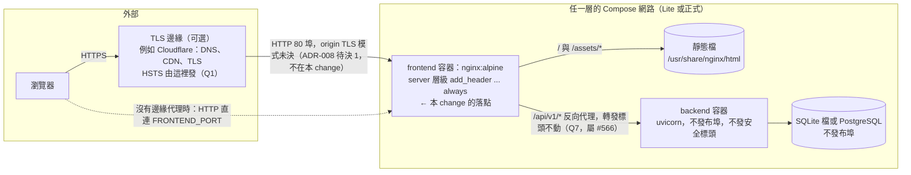
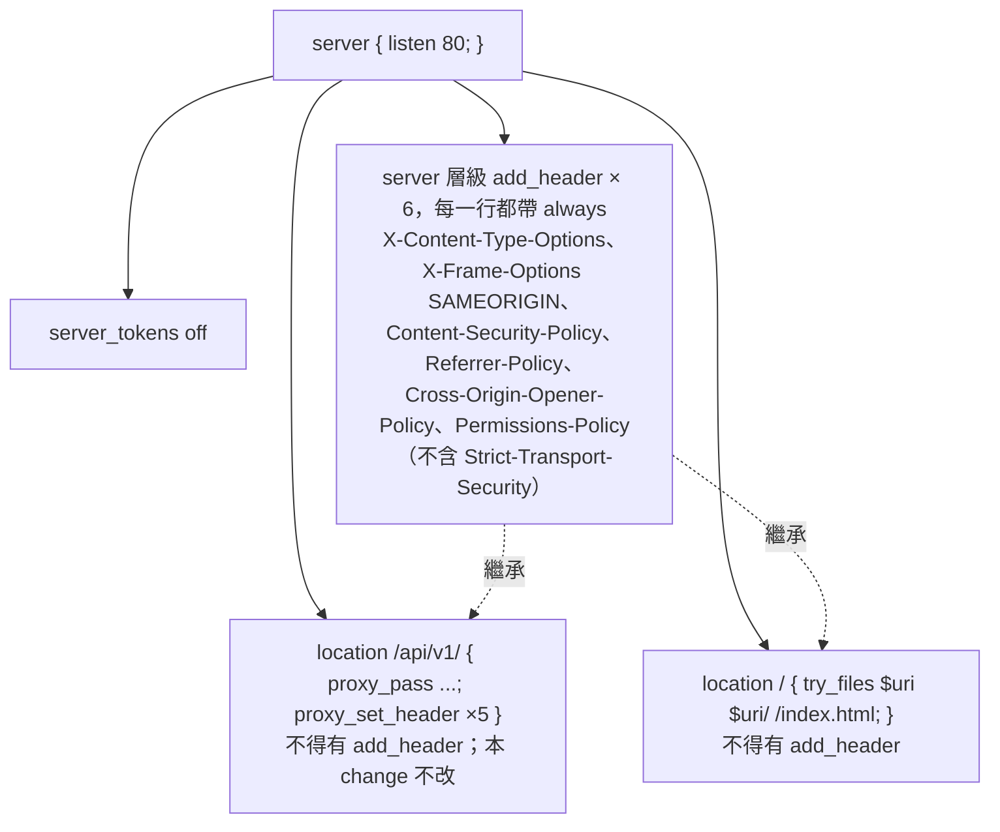
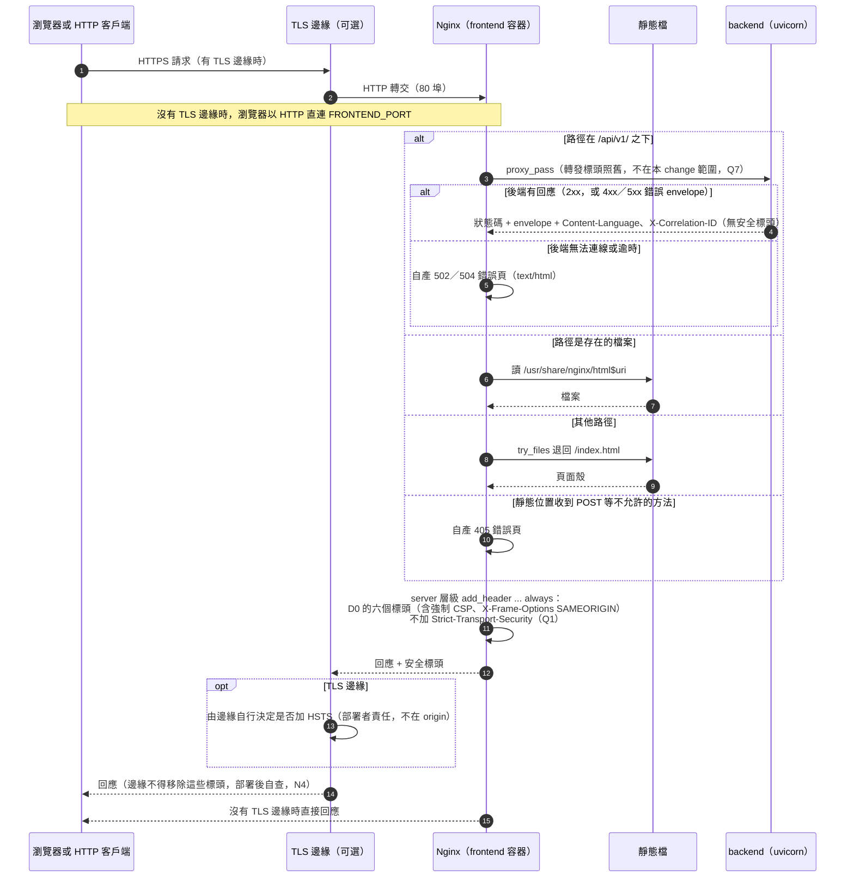
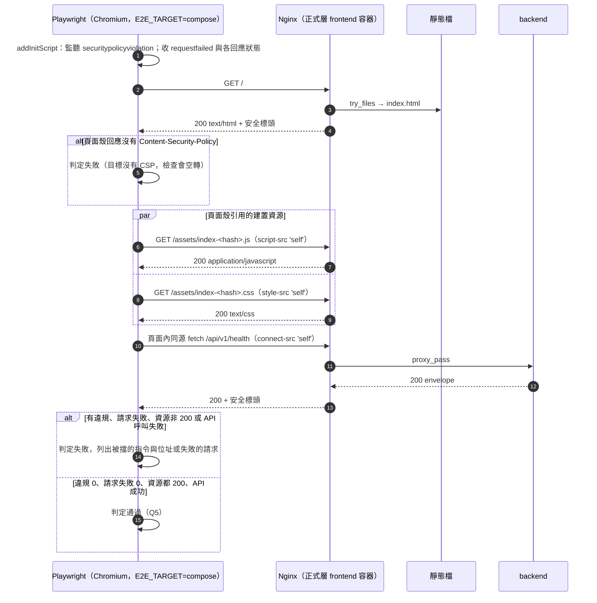
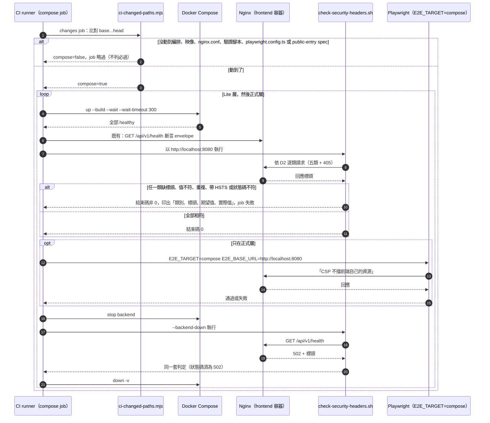

# System Design

change：`nginx-security-headers` · issue：#568 · 分支：`feat/nginx-security-headers` · schema：`label-suite-sdd` · 基準：`main` @ `f7db41f`

本文把 `system-analysis.md` 的範圍轉成 #568 的技術藍圖。這是**基礎建設 change**：產出落在公開入口的 Nginx 設定（`frontend/nginx.conf`）、一支標頭驗證腳本、一條對準容器公開入口的瀏覽器檢查、CI 的 `compose` job 與它的觸發清單，以及 `architecture.mdx` §部署與維運 的檢查方式說明；**不新增或修改任何後端類別、端點、資料表或前端應用程式碼**。

schema 範本的 Router／Service／Repository／Model 分層在這裡沒有對象，理由寫在 [§分層與類別](#分層與類別)；序列圖的參與者因此換成瀏覽器、（可選的）邊緣代理、Nginx、靜態檔、後端與 CI，畫到 **Nginx 把回應交回瀏覽器（或 CI runner 收到結果）為止**，不含畫面。

三件已裁定的事照裁定寫、不列待決（維護者 2026-11-10，`architecture.mdx` §決策紀錄）：**模組內分層** `app/modules/<module>/`、成功回應**包一層 envelope**、路徑前綴 **`/api/v1`**。本 change 不改這三件的任何行為；`/api/v1/` 只是 Nginx 轉發的前綴，envelope 由後端產生，Nginx 只在它外面加傳輸層標頭。

**與 clarification 的關係**：system-analysis 的待決 1–10 與本文先前提出的 N1–N4，已由維護者 2026-11-25 在 clarification 停點裁定（`clarification.md` Q1–Q10、Q3-附、N1；P2、P3）。本文已依裁定改寫，不再保留選項；各題落在哪裡見 [§技術待決問題](#技術待決問題)。

## 分層與類別

### 為什麼沒有 Class Diagram

範本的 Class Diagram 描述後端的 Router → Service → Repository／Model。本 change 的行為全部發生在**後端之前**的公開入口（`frontend/nginx.conf`，由前端映像帶入的 `nginx:alpine`），後端程式一行不改：

- 實測後端目前**不發任何安全標頭**：`backend/app` 裡唯一設定的回應標頭是 `backend/app/core/envelope.py` 的 `Content-Language`；CORS 中介層另發 `Vary`、`X-Correlation-ID`。因此 Nginx 加的標頭與後端的標頭不會重複（重複時的處理見 [D3](#d3後端日後若自己發同名標頭)）。
- 依 Q6／Q7，**後端不發安全標頭**，不新增 `app/core/` 中介層，`backend-modules.mdx` §後端基礎建設 不變。

所以本節改畫**部署拓撲**與**設定結構**，並先列出實測的基線。

### 部署拓撲（結構不變，標出標頭在哪裡加）

依 #506 clarification Q2（選項 B）與本 change Q6，Nginx 在前端映像裡、是兩層唯一公開入口，**兩層共用同一份 `nginx.conf`、同時生效**；本 change 不改編排的服務清單與埠。



### 實測基線（`main` @ `f7db41f`，2026-11-25）

以 `docker compose -p sd568probe up --build --wait`（Lite 層、`FRONTEND_PORT=18568`、獨立 project 名，結束後 `down -v`）實際起服務，用 `curl -D -` 逐類量回應標頭；nginx 版本 `1.31.10`。

| 回應類別                 | 請求                                  | 狀態 | Content-Type             | 五個既有標頭 | CSP | HSTS |
| :----------------------- | :------------------------------------ | :--- | :----------------------- | :----------- | :-- | :--- |
| 頁面殼                   | `GET /`                               | 200  | `text/html`              | 都有         | 無  | 無   |
| SPA 深層路徑             | `GET /some/spa/path`                  | 200  | `text/html`              | 都有         | 無  | 無   |
| 建置資源                 | `GET /assets/index-<hash>.js`         | 200  | `application/javascript` | 都有         | 無  | 無   |
| 不存在的建置資源         | `GET /assets/missing.js`              | 200  | `text/html`（SPA 退回）  | 都有         | 無  | 無   |
| 後端成功                 | `GET /api/v1/health`                  | 200  | `application/json`       | 都有         | 無  | 無   |
| 後端錯誤 envelope        | `GET /api/v1/does-not-exist`          | 404  | `application/json`       | 都有         | 無  | 無   |
| 後端方法不允許           | `OPTIONS /api/v1/health`（無 Origin） | 405  | `application/json`       | 都有         | 無  | 無   |
| Nginx 自產錯誤           | `POST /`                              | 405  | `text/html`              | 都有         | 無  | 無   |
| Nginx 自產錯誤（後端停） | `GET /api/v1/health`，backend 已 stop | 502  | `text/html`              | 都有         | 無  | 無   |

「五個既有標頭」＝`X-Content-Type-Options: nosniff`、`X-Frame-Options: DENY`、`Referrer-Policy: strict-origin-when-cross-origin`、`Cross-Origin-Opener-Policy: same-origin`、`Permissions-Policy: camera=(), microphone=(), geolocation=()`；`Server` 只回 `nginx`、不帶版本（`server_tokens off` 生效）。結論：**#506 的「server 層級加 `always`」不變式在九類回應上都成立**，含 Nginx 自產的 405 與 502；缺的只有 CSP 與任何自動驗證。

### 實測：正式建置對 CSP 的需求

以 `vite build`（`VITE_API_BASE_URL=""`，與容器建置相同）建到 scratch 目錄，盤點產物：

| 項目                   | 實測                                                                                                                                                                                   | 對 CSP 的意義                                                                         |
| :--------------------- | :------------------------------------------------------------------------------------------------------------------------------------------------------------------------------------- | :------------------------------------------------------------------------------------ |
| `index.html`           | 只有一個 `<script type="module" crossorigin src="/assets/index-<hash>.js">` 與一個 `<link rel="stylesheet" crossorigin href="/assets/index-<hash>.css">`；**沒有內嵌 script 或 style** | `script-src 'self'` 足以載入頁面殼                                                    |
| JS bundle（355 KB）    | 沒有 `eval(`、`new Function`；沒有對外的 http(s) 資源位址（出現的 URL 只有 XML 命名空間與 React／React Router 的說明連結字串）；沒有 Worker、WebSocket、EventSource                    | 不需要 `'unsafe-eval'`、外部來源、`worker-src`                                        |
| CSS（27 KB）           | 沒有 `@import`、`@font-face`、`url(`                                                                                                                                                   | `font-src`、`img-src` 不需要外部來源                                                  |
| 執行時插入 `<style>`   | bundle 裡唯一的 `createElement("style")` 是 React 19 的 hoistable `<style precedence>` 路徑，目前沒有元件用到                                                                          | 目前不觸發                                                                            |
| 元件庫                 | 正式程式碼只從 `radix-ui` 匯入 `Slot`（`button.tsx`、`badge.tsx`）；Dialog、Popover、Select、DropdownMenu 已隨 `radix-ui` 套件裝在 `node_modules`，但沒有被匯入                        | 見下一列                                                                              |
| Radix 的覆蓋層（日後） | `react-remove-scroll-bar` 經 `react-style-singleton` 在執行時 `document.createElement('style')`                                                                                        | 只有 `'self'` 時會被擋；Q2 的 `style-src 'self' 'unsafe-inline'` 預先放行（下節實測） |

規劃初期另以只允許同源的嚴格候選政策（`style-src 'self'`、`img-src 'self'`、`frame-ancestors 'none'`）實測過：正式建置 0 違規，但模擬 Radix 的執行時 `<style>` 插入被擋。這是 Q2 放寬 `style-src` 的依據。

### 實測：決議後的政策（2026-11-25，`main` @ `f7db41f` 的正式建置）

以獨立 project 名 `sd568csp`、`FRONTEND_PORT=18569`、映像標籤 `sd568-*:probe`（不覆寫共用的 `label-suite-*:latest`）起 Lite 層，把 [D0](#d0最終的標頭與值) 的 `nginx.conf` 以唯讀 bind mount 蓋進 frontend 容器；量完 `down -v` 並刪掉 probe 映像。

HTTP 客戶端（`curl -D -`）：

| 類別              | 請求                                  | 狀態 | 七個期望標頭（D0）完整值相符 | HSTS |
| :---------------- | :------------------------------------ | :--- | :--------------------------- | :--- |
| 頁面殼            | `GET /`                               | 200  | 是                           | 無   |
| SPA 深層路徑      | `GET /some/spa/path`                  | 200  | 是                           | 無   |
| 建置資源          | `GET /assets/index-<hash>.js`         | 200  | 是                           | 無   |
| 後端成功          | `GET /api/v1/health`                  | 200  | 是                           | 無   |
| 後端錯誤 envelope | `GET /api/v1/does-not-exist`          | 404  | 是                           | 無   |
| Nginx 自產錯誤    | `POST /`                              | 405  | 是                           | 無   |
| Nginx 自產錯誤    | `GET /api/v1/health`，backend 已 stop | 502  | 是                           | 無   |

Chromium（`e2e/node_modules/@playwright/test`，對 `http://localhost:18569/`）：

| 觀察                                                         | 結果                                                                                          |
| :----------------------------------------------------------- | :-------------------------------------------------------------------------------------------- |
| 載入 `/` 的請求                                              | `/`、`/assets/*.css`、`/assets/*.js` 全部 200；`requestfailed` 0 次                           |
| 載入期間的 `securitypolicyviolation` 事件                    | **0 次**                                                                                      |
| 樣式是否生效                                                 | `body` 的 `font-family` 是 `Inter, "Noto Sans TC", ...`（外部 CSS 已套用）                    |
| 頁面內 `fetch("/api/v1/health")`                             | 200（`connect-src 'self'`）                                                                   |
| 模擬 Radix 的執行時 `<style>` 插入                           | **放行**，樣式生效（`style-src 'unsafe-inline'`）                                             |
| `data:` 與 `blob:` 圖片（頭像預覽的做法）                    | 都載入成功（`img-src 'self' data: blob:`）                                                    |
| 同源 `<iframe src="/api/v1/health">`（04-02 PDF 嵌入的形狀） | 載入且可讀內容（`frame-src 'self'`，被嵌入的回應帶 `SAMEORIGIN` 與 `frame-ancestors 'self'`） |
| 執行時插入的內嵌 `<script>`                                  | **被擋**：`script-src-elem` 違規一次，腳本沒有執行（程式仍不能內嵌）                          |

實測用的 scratch 檔與 probe 映像都不進 repo。

### 元件清單（本 change 預計新增或修改的檔案）

| 檔案                                                                       | 異動                                                                                                                                                                                                                                                                                                                                 | 依據                   |
| :------------------------------------------------------------------------- | :----------------------------------------------------------------------------------------------------------------------------------------------------------------------------------------------------------------------------------------------------------------------------------------------------------------------------------- | :--------------------- |
| `frontend/nginx.conf`                                                      | server 層級新增 `Content-Security-Policy` 一行（強制模式、`always`）；`X-Frame-Options` 由 `DENY` 改為 `SAMEORIGIN`；註解寫明 `connect-src 'self'` 與 `VITE_API_BASE_URL` 的耦合（D7）、開發伺服器不帶 CSP（N3）。**不加 HSTS、不加 `limit_req`、不碰 `location /api/v1/` 的 `proxy_set_header`**                                    | Q1、Q2、Q3、Q7、Q8     |
| `scripts/check-security-headers.sh`（新）                                  | 對一個 base URL 依 D2 逐類請求，**逐一比對標頭的完整值**、斷言 `Strict-Transport-Security` 不存在、偵測同名標頭重複；期望值只寫在這一處（D4）；`--backend-down` 模式只驗 502 那一類。可在本機對任一層執行                                                                                                                            | Q1、Q3-附、Q4          |
| `e2e/playwright.config.ts`                                                 | 新增「對準既有容器入口」模式（D5）：由 `E2E_TARGET=compose` 切換，此模式**不起** `webServer`、只跑 `public-entry/**`；預設模式把 `public-entry/**` 加進 `testIgnore`，`e2e` job 行為不變。位址仍只在這個檔讀取                                                                                                                       | Q4、Q5                 |
| `e2e/public-entry/shell.spec.ts`（新）                                     | 「CSP 不擋前端自己的資源」的瀏覽器檢查，判準照 Q5；前置斷言頁面殼回應**帶** CSP（避免在沒有 CSP 的目標上空轉通過），但不比對值（值只在驗證腳本，D4）                                                                                                                                                                                 | Q4、Q5                 |
| `.github/workflows/ci.yml` `compose` job                                   | 兩層各在「Check the ... health through nginx」之後跑驗證腳本，再 `docker compose stop backend` 跑 `--backend-down`；正式層另裝 e2e 依賴與 Chromium、以 `E2E_TARGET=compose E2E_BASE_URL=http://localhost:8080` 跑瀏覽器檢查（D6）。**job 仍不列必過**，不改 `main` ruleset                                                           | Q4                     |
| `scripts/ci-changed-paths.mjs` 與其測試                                    | `EXACT` 加入 `scripts/check-security-headers.sh`、`e2e/playwright.config.ts`；`PREFIXES` 加入目錄前綴 `e2e/public-entry/`、`e2e/shared/`（`shell.spec.ts` 引用 `e2e/shared/fixtures/`，且日後新增的 public-entry spec 若只列單檔就不會在任何 job 執行），測試加對應案例；否則只改驗證本身的 PR 不會觸發 `compose`                    | N2（P3）               |
| `frontend/Dockerfile`                                                      | 只改 `VITE_API_BASE_URL` 的註解：改成跨來源時要同步改 `nginx.conf` 的 `connect-src`（D7）                                                                                                                                                                                                                                            | Q2                     |
| `docs/development/architecture.mdx` §部署與維運                            | 「本機與 CI」列寫標頭的實際檢查方式（腳本與瀏覽器檢查、六類回應、在 `compose` job、不列必過）；「正式環境」列寫 HSTS 由 TLS 邊緣負責、正式層必須在 TLS 後面（`Secure`／`__Host-` cookie）、部署後以 `curl -I https://<網域>/` 自查同一組標頭（N4）；開發伺服器不帶 CSP（N3）；`VITE_API_BASE_URL` 的耦合。**實作組做**，不在規劃階段 | 驗收條件 4、Q1、N3、N4 |
| `docs/diagrams/architecture/backend-modules.mdx` §已知限制                 | 「Nginx 與安全標頭」列刪除。**實作組做**                                                                                                                                                                                                                                                                                             | clarification 交付     |
| `openspec/specs/security-headers`（新）、`ci-quality-gates`、`e2e-testing` | spec delta 由 planner 寫；本文只提出 Scenario 名稱（見 [§關鍵情境](#關鍵情境)）。`e2e-testing` 需要 delta：新增的容器模式改變「位址設定只集中在一處」與「從根目錄執行 e2e」所假設的「e2e 自起伺服器」；`container-runtime` 不需要 delta（Q6 維持現況，編排與埠不變）                                                                 | Q4、Q5、Q6             |

### 設定結構與不變式



#### D0：最終的標頭與值

下表就是可測契約（Q2、Q3、Q3-附、Q1），也是驗證腳本的期望值；每一類回應都必須**完全相符**、每個標頭只出現一次：

| 標頭                         | 完整值                                                                                                                                                                                                                                       | 依據   |
| :--------------------------- | :------------------------------------------------------------------------------------------------------------------------------------------------------------------------------------------------------------------------------------------- | :----- |
| `Content-Security-Policy`    | `default-src 'self'; script-src 'self'; style-src 'self' 'unsafe-inline'; img-src 'self' data: blob:; font-src 'self'; connect-src 'self'; object-src 'none'; base-uri 'self'; form-action 'self'; frame-src 'self'; frame-ancestors 'self'` | Q2、Q3 |
| `X-Frame-Options`            | `SAMEORIGIN`                                                                                                                                                                                                                                 | Q3     |
| `X-Content-Type-Options`     | `nosniff`                                                                                                                                                                                                                                    | 既有   |
| `Referrer-Policy`            | `strict-origin-when-cross-origin`                                                                                                                                                                                                            | 既有   |
| `Cross-Origin-Opener-Policy` | `same-origin`                                                                                                                                                                                                                                | Q3-附  |
| `Permissions-Policy`         | `camera=(), microphone=(), geolocation=()`                                                                                                                                                                                                   | Q3-附  |
| `Server`                     | `nginx`（不帶版本，`server_tokens off`）                                                                                                                                                                                                     | Q3-附  |
| `Strict-Transport-Security`  | **不得出現**                                                                                                                                                                                                                                 | Q1     |

`nginx.conf` 裡的寫法（server 層級、單行）：

```nginx
add_header X-Frame-Options "SAMEORIGIN" always;
add_header Content-Security-Policy "default-src 'self'; script-src 'self'; style-src 'self' 'unsafe-inline'; img-src 'self' data: blob:; font-src 'self'; connect-src 'self'; object-src 'none'; base-uri 'self'; form-action 'self'; frame-src 'self'; frame-ancestors 'self'" always;
```

逐指令的理由：

| 指令                        | 值                       | 理由                                                                                                                                                                                                                                       |
| :-------------------------- | :----------------------- | :----------------------------------------------------------------------------------------------------------------------------------------------------------------------------------------------------------------------------------------- |
| `default-src`               | `'self'`                 | 未列的類型（含 `worker-src`、`media-src`、`manifest-src`）一律只允許同源                                                                                                                                                                   |
| `script-src`                | `'self'`                 | 建置只有一支外部 module script，無內嵌、無 `eval`（實測）；內嵌腳本實測被擋，是 XSS 的第二道防線                                                                                                                                           |
| `style-src`                 | `'self' 'unsafe-inline'` | 彈窗類元件（Radix 覆蓋層）執行時插入 `<style>`，日後不會壞（實測放行）。殘餘風險是 CSS 注入；外送目的地被 `img-src`、`font-src`、`connect-src` 限在同源，風險低                                                                            |
| `img-src`                   | `'self' data: blob:`     | 頭像預覽（`URL.createObjectURL` 或 `FileReader` 的 data URL）日後不必再改（實測兩者都載入）                                                                                                                                                |
| `font-src`                  | `'self'`                 | CSS 沒有 `@font-face`；設計 token 的外部字型被建置刻意排除（`frontend/build/extract-tokens.ts`）                                                                                                                                           |
| `connect-src`               | `'self'`                 | 同源 API 實測放行；與 `VITE_API_BASE_URL` 的耦合見 D7                                                                                                                                                                                      |
| `object-src`                | `'none'`                 | 沒有 `<object>`／`<embed>`；04-02 的 PDF 以同源 `<iframe>` 顯示（Q3），不需要它                                                                                                                                                            |
| `base-uri`                  | `'self'`                 | 頁面殼沒有 `<base>`；防止注入的 `<base>` 把相對路徑導到別的來源                                                                                                                                                                            |
| `form-action`               | `'self'`                 | 現在沒有表單。Chromium 系瀏覽器的 `form-action` **也檢查表單送出後的轉址**：01-01 的 Google 登入若做成「表單送到後端、後端 302 到 Google」會被擋，那個 change 要放寬到 Google 的授權端點，或改成整頁導向（`location.assign`，不受 CSP 管） |
| `frame-src`                 | `'self'`                 | 04-02 PDF 說明檔以同源 `<iframe>` 顯示（實測放行）。若那個 change 改成以 `blob:` URL 放進 iframe，要另加 `blob:`                                                                                                                           |
| `frame-ancestors`           | `'self'`                 | 與 `X-Frame-Options: SAMEORIGIN` 一致（Q3）；只能用標頭表達，`<meta>` 無效                                                                                                                                                                 |
| `upgrade-insecure-requests` | **不加**                 | 會要求瀏覽器把子資源改走 https；沒有 TLS 的部署（含本機 Lite）上子資源會改連不存在的 https 而載入失敗                                                                                                                                      |
| `report-uri`／`report-to`   | **不加**                 | Q2：不收違規回報，沒有新端點                                                                                                                                                                                                               |

附帶：`Cross-Origin-Opener-Policy: same-origin` 會切斷**彈出視窗**與開啟者的關聯，01-01 若把 Google 登入做成 popup 會失效（整頁導向不受影響）；那個 change 要知道它已在可測契約裡。

#### D1：所有安全標頭只在 server 層級、一律 `always`

沿用 #506 寫在 `frontend/nginx.conf` 註解的不變式：nginx 的 `add_header` 只在**目前層級沒有任何 `add_header`** 時才繼承上一層，所以任何 `location` 一旦自己加標頭，就會靜靜丟掉 server 層級的整組安全標頭；沒有 `always` 時，nginx 只在 200、201、204、206、301、302、303、304、307、308 加標頭，後端的 4xx／5xx envelope 與 Nginx 自產的錯誤頁都會漏掉。CSP 照同一規則寫。

後果：日後要對某一路徑放寬，不能只在那個 `location` 加一行；要嘛整組在那個 `location` 重寫一次，要嘛改用 `map` 依路徑算出值、仍在 server 層級加。Q3 選了全站 `SAMEORIGIN`，所以 04-02 的同源嵌入不需要依路徑放寬。驗證腳本就是這個不變式的守門：它對每一類回應都檢查，`location` 漏標頭時 CI 會失敗。

#### D2：驗證涵蓋六類回應，比對完整值

驗證腳本請求下列六類，並對每一類**比對 D0 每個標頭的完整值**（不是只檢查存在）、斷言沒有 `Strict-Transport-Security`、斷言每個標頭只出現一次：

| 類別              | 請求                                                                        | 為什麼要這一類                                                                    |
| :---------------- | :-------------------------------------------------------------------------- | :-------------------------------------------------------------------------------- |
| 頁面殼            | `GET /`                                                                     | CSP 真正生效的文件                                                                |
| SPA 深層路徑      | `GET /<不存在的前端路徑>`                                                   | 走 `try_files` 退回 `index.html`                                                  |
| 建置資源          | `GET` 頁面殼裡引用的那支 `/assets/*.js`                                     | 靜態檔；`nosniff` 對它最有意義                                                    |
| 後端成功          | `GET /api/v1/health`                                                        | 走 `proxy_pass`                                                                   |
| 後端錯誤 envelope | `GET /api/v1/<不存在的路徑>`（後端 404）                                    | 證明 `always` 讓後端 4xx 也帶標頭                                                 |
| Nginx 自產錯誤    | `POST /`（405）；以及 `--backend-down` 模式下的 `GET /api/v1/health`（502） | Nginx 自己的錯誤頁也帶；502 證明上游失敗時仍帶（clarification 交給 tasks 的項目） |

腳本也斷言每一類的狀態碼與上表一致（例如後端錯誤必須是 404、502 必須是 502），以免請求打錯路徑卻因為一樣帶標頭而通過。`--backend-down` 只驗 502 那一類，由 CI 在 `docker compose stop backend` 之後呼叫；不停後端的預設模式驗其餘五類加 405。失敗時印出「類別、標頭、期望值、實際值」，結束碼非 0。

`/assets/missing.js` 回 200 頁面殼（N1）不在本 change，所以腳本不把「不存在的建置資源」列為一類，也不斷言它的狀態碼。

#### D3：後端日後若自己發同名標頭

`add_header` 是**附加**，不覆蓋上游的同名標頭。後端今天不發任何安全標頭（實測），依 Q6 也不會發，所以沒有重複；若日後後端（或某個框架升級）開始發 `X-Frame-Options` 或 CSP，回應會出現兩個值：兩個 CSP 會**同時生效**（瀏覽器取交集，越疊越嚴），兩個衝突的 `X-Frame-Options` 有的瀏覽器會整個忽略。本 change 不預先加 `proxy_hide_header`（今天沒有對象，加了是無效設定）；改由 D2 的「每個標頭只出現一次、比對完整值」擋下。

#### D4：期望值只寫在一處

D0 的期望值只寫在 `scripts/check-security-headers.sh` 一處。瀏覽器檢查只斷言「頁面殼帶 CSP」與 Q5 的判準，不抄 CSP 的值；`architecture.mdx` §部署與維運 只寫「怎麼檢查、檢查哪幾類」，不另抄一份標頭清單。`frontend/nginx.conf` 是實際值的唯一來源，驗證腳本是期望值的唯一來源，兩者不一致就是 CI 失敗。

#### D5：curl 只能證明「有帶」，「不擋」要瀏覽器

驗收條件 2（回應帶標頭）用 HTTP 客戶端就能證明；驗收條件 3（CSP 不擋前端自己的資源）只有瀏覽器會執行 CSP。e2e 的預設跑法連的是 Vite 開發伺服器、不經 Nginx（N3），所以瀏覽器檢查要對準容器入口：

- `e2e/playwright.config.ts` 讀 `E2E_TARGET`：值為 `compose` 時 `webServer` 為空、`testMatch` 只取 `public-entry/**/*.spec.ts`、`baseURL` 仍取自 `E2E_BASE_URL`（此模式下必須設定，未設時以錯誤訊息結束，不退回 `localhost:5173`）；未設或其他值時維持今天的行為，並把 `public-entry/**` 加進 `testIgnore`。讀環境變數仍只在這個檔（testing-agent-rules T8）。
- `e2e/public-entry/shell.spec.ts` 符合 `e2e/static/e2e-static-checks.mjs` 的 `<module>/<page>.spec.ts` 位置規則，不必改靜態檢查。
- 判準照 Q5：**頁面殼與它引用的每一支建置資源回 200；載入期間 `securitypolicyviolation` 0 次、`requestfailed` 0 次；頁面內同源呼叫 `/api/v1/health` 成功**。另加前置斷言「頁面殼回應帶 `Content-Security-Policy`」，否則在沒有 CSP 的目標上這條檢查會空轉通過。

#### D6：兩層共用一份設定時只在一層做瀏覽器檢查

Lite 與正式層的 `frontend` 由同一個 `frontend/Dockerfile` 建、帶同一份 `nginx.conf`（Q6 維持現況）。驗證腳本兩層都跑（便宜、順便證明兩層的公開入口），瀏覽器檢查只在正式層跑一次。`compose` job 為此多一段 `pnpm/action-setup`、`pnpm install --frozen-lockfile --filter e2e...` 與 `pnpm --filter e2e exec playwright install --with-deps chromium`（步驟照抄 `e2e` job），估計多 1–2 分鐘；`timeout-minutes: 20` 不需調整。

#### D7：`connect-src 'self'` 與 `VITE_API_BASE_URL` 的耦合

容器建置的 `VITE_API_BASE_URL` 是空字串，前端以同源呼叫 `/api/v1/...`，`connect-src 'self'` 放行（實測）。`frontend/Dockerfile` 仍保留這個建置參數；有人用它建出呼叫**跨來源**後端的映像時，`connect-src 'self'` 會擋下所有 API 呼叫，畫面沒有錯誤訊息。本 change 不把 CSP 做成環境變數（不加 envsubst template），改成把耦合寫在三處：`frontend/nginx.conf` 的 CSP 註解、`frontend/Dockerfile` 的 `ARG VITE_API_BASE_URL` 註解、`architecture.mdx` §部署與維運，都寫明「改成跨來源時，同一個 change 要把該來源加進 `connect-src`」。容器內的 Nginx 只服務同源建置，所以兩層的 compose 都不受影響。

## 關鍵情境

本 change 沒有 `docs/specs/` 的規格與驗收標準可對（system-analysis §需求依據、spec-migration D4，Q9 不補）。下列 Scenario 名稱是 sd 提給 planner 的 spec delta 名稱；**planner 寫 spec 時若改名，本節標題要同步改**（`openspec/config.yaml` rules.system-design 第 2 條）。序列圖畫到 Nginx 把回應交回瀏覽器（或 CI runner 收到結果）為止。

### Scenario: 公開入口的每一類回應都帶同一組安全標頭



### Scenario: CSP 不擋前端自己的資源



### Scenario: 動到公開入口時 CI 驗證兩層的安全標頭



`compose` 維持**不列必過**（#506 Q3、Q10；本 change Q4）；本 change 不改 `main` ruleset。

## 常駐文件異動

本次規劃階段無常駐文件異動。

- `docs/diagrams/architecture/backend-modules.mdx`：後端模組的分層、Class 圖、主要 Sequence 圖與 §後端基礎建設都不變（後端程式不改，Q6 後端不發標頭）。§已知限制 的「Nginx 與安全標頭」列在標頭落地後才能刪，交給實作組，tasks 要列這一項。
- `docs/development/architecture.mdx` §部署與維運：驗收條件 4 的「實際檢查方式」、HSTS 由 TLS 邊緣負責、N3、N4 與 D7 的耦合都是實作後才成立的敘述，交給實作組。
- `error-codes.mdx`、`endpoint-authorization.mdx`：不變（api-contract：本次無 API 變更）。

## 資料模型異動

本次無資料模型異動。

## 權限檢查點

本 change 不新增或改變任何授權判定、欄位遮蔽或角色差異：安全標頭由 Nginx 在傳輸層對**所有角色、所有路徑**加同一組，與登入與否無關，也**不得**依角色或身分而不同（否則同一網址的回應會因人而異，又無法以快取鍵區分）。授權四段（`architecture.mdx` §認證與授權）照舊全在後端完成。

測試集答案隔離（Hard Rule 6）：本 change 不碰任何資料，沒有新的外露路徑。強制模式的 CSP 是 XSS 的第二道防線：`script-src 'self'` 擋下內嵌與外部腳本（實測內嵌腳本被擋），`connect-src`、`img-src`、`font-src`、`form-action`、`base-uri` 把可能的外送目的地限在同源，即使將來某處輸出轉義失手（security-agent-rules S9 仍是第一道），標記員畫面上的資料也送不到別的來源。`style-src 'unsafe-inline'` 放行的 CSS 注入，其外送管道同樣被上述指令限在同源。它**補強**而不取代後端的答案隔離與 S9。

## 技術待決問題

### 已裁定（維護者 2026-11-25，`clarification.md`）

| 編號           | 決議                                                                                                                                         | 落在本文哪裡                              | 落到哪個檔案或產出                                                                                                                        |
| :------------- | :------------------------------------------------------------------------------------------------------------------------------------------- | :---------------------------------------- | :---------------------------------------------------------------------------------------------------------------------------------------- |
| Q1 HSTS        | Nginx 不發，交給 TLS 邊緣；驗證腳本斷言回應**不帶** `Strict-Transport-Security`                                                              | D0、D2、部署拓撲、第一張序列圖            | `frontend/nginx.conf`（不加）、`scripts/check-security-headers.sh`、`architecture.mdx` §部署與維運「正式環境」列、`security-headers` spec |
| Q2 CSP         | 強制模式、不收違規回報；完整值見 D0；`connect-src 'self'` 與 `VITE_API_BASE_URL` 的耦合寫明                                                  | D0、D7、實測：決議後的政策                | `frontend/nginx.conf`、`frontend/Dockerfile` 註解、`architecture.mdx`、`security-headers` spec                                            |
| Q3 防嵌入      | `X-Frame-Options: SAMEORIGIN` 與 `frame-ancestors 'self'` 並存且一致；`frame-src 'self'`                                                     | D0、D1                                    | `frontend/nginx.conf`、驗證腳本、`security-headers` spec                                                                                  |
| Q3-附          | COOP、`Permissions-Policy`、`server_tokens off` 列入可測契約                                                                                 | D0                                        | 驗證腳本、`security-headers` spec                                                                                                         |
| Q4 驗證位置    | 腳本（六類、完整值）加瀏覽器檢查，都在 CI `compose` job，不列必過                                                                            | D2、D5、D6、第三張序列圖                  | 驗證腳本、`e2e/playwright.config.ts`、`e2e/public-entry/shell.spec.ts`、`ci.yml`、`ci-quality-gates` 與 `e2e-testing` spec                |
| Q5 首頁正常    | 頁面殼與建置資源 200、CSP 違規 0、請求失敗 0、同源 API 成功                                                                                  | D5、第二張序列圖                          | `e2e/public-entry/shell.spec.ts`、`security-headers` spec                                                                                 |
| Q6／Q7 歸屬    | 維持現況：前端映像內的 Nginx、兩層都生效、後端不發；不碰轉發標頭與代理信任（#566）                                                           | 分層與類別、部署拓撲、D3、D6              | 無檔案異動；`container-runtime` 不寫 delta                                                                                                |
| Q8 限流        | 不做                                                                                                                                         | 元件清單（`nginx.conf` 不加 `limit_req`） | 無                                                                                                                                        |
| Q9 規格書      | 不補 `docs/specs/`                                                                                                                           | 關鍵情境                                  | 無                                                                                                                                        |
| Q10 issue 本文 | 主 session 在 #568 留言說明 #506 已交付的部分與驗收條件 1 的既有證據，不改寫本文                                                             | —                                         | 不是 sd 的產出；驗收條件 1 本設計不另加檢查                                                                                               |
| N1             | `/assets/missing.js` 回 200 頁面殼不在本 change，寫進 PR 的非阻擋                                                                            | D2（不列為一類）                          | PR 本文                                                                                                                                   |
| N2（P3）       | 驗證腳本、`e2e/playwright.config.ts` 以單檔（`EXACT`）、`e2e/public-entry/` 與 `e2e/shared/` 以目錄前綴（`PREFIXES`）加進 `compose` 觸發清單 | 元件清單、第三張序列圖                    | `scripts/ci-changed-paths.mjs` 與其測試、`ci-quality-gates` spec                                                                          |
| N3             | 開發伺服器不帶 CSP，本機日常開發看不到 CSP 破損；寫進文件                                                                                    | D5                                        | `architecture.mdx` §部署與維運、`frontend/nginx.conf` 的 CSP 註解                                                                         |
| N4             | 邊緣代理可能改寫或移除 origin 的標頭，本 repo 只驗到 origin；部署後以 `curl -I https://<網域>/` 自查同一組標頭                               | 第一張序列圖                              | `architecture.mdx` §部署與維運                                                                                                            |

### 仍開著的技術問題

無。附帶給後續 change 的提醒（不是本 change 要決定的）：

- 04-02 PDF 說明檔若改以 `blob:` URL 放進 iframe，`frame-src` 要加 `blob:`；若改用 `<embed>`／`<object>`，`object-src 'none'` 會擋；若用 pdf.js 且它起 Worker，`default-src 'self'` 只放行同源 Worker 檔。
- 01-01 Google 登入的已知限制（值維持不變，維護者保留；實作時記進 `architecture.mdx` 的已知限制）：`Cross-Origin-Opener-Policy: same-origin` 會切斷 popup 與開啟者的 `window.opener`，popup 流程因此失效（Google 建議 popup 流程用 `same-origin-allow-popups`）；`form-action 'self'` 會擋「表單送出後轉址到 Google」的流程。整頁導向兩者都不受影響。開發伺服器不帶這兩個標頭，所以這種破損只會在 Nginx 後面出現，本機開發看不到。
- 日後引入外部字型、外部圖片或跨來源 API 的 change，要在同一個 change 放寬對應指令並同步驗證腳本的期望值；否則 `compose` job 會失敗（腳本）或瀏覽器檢查會抓到違規。

### 效能與資源

- 回應大小：CSP 一行約 260 位元組，加上其餘標頭，每個回應多約 0.5 KB 標頭；對 API 的 JSON 回應與靜態檔都可忽略。
- CI 時間：標頭腳本兩層合計數秒；停後端再驗 502 每層數秒；正式層的瀏覽器檢查要裝 pnpm 依賴與 Chromium，估計多 1–2 分鐘。`compose` 目前 `timeout-minutes: 20`，不需調整。
- nginx 執行期：`add_header` 是每請求常數成本；沒有 `sub_filter`、`map` 或 envsubst。
