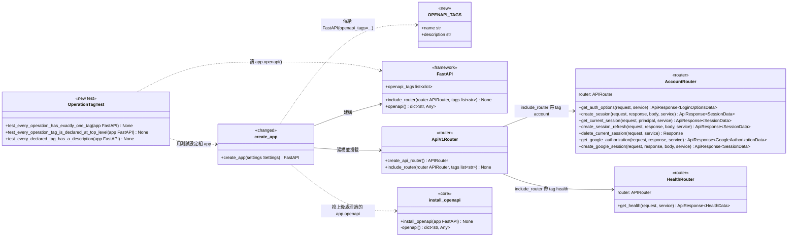
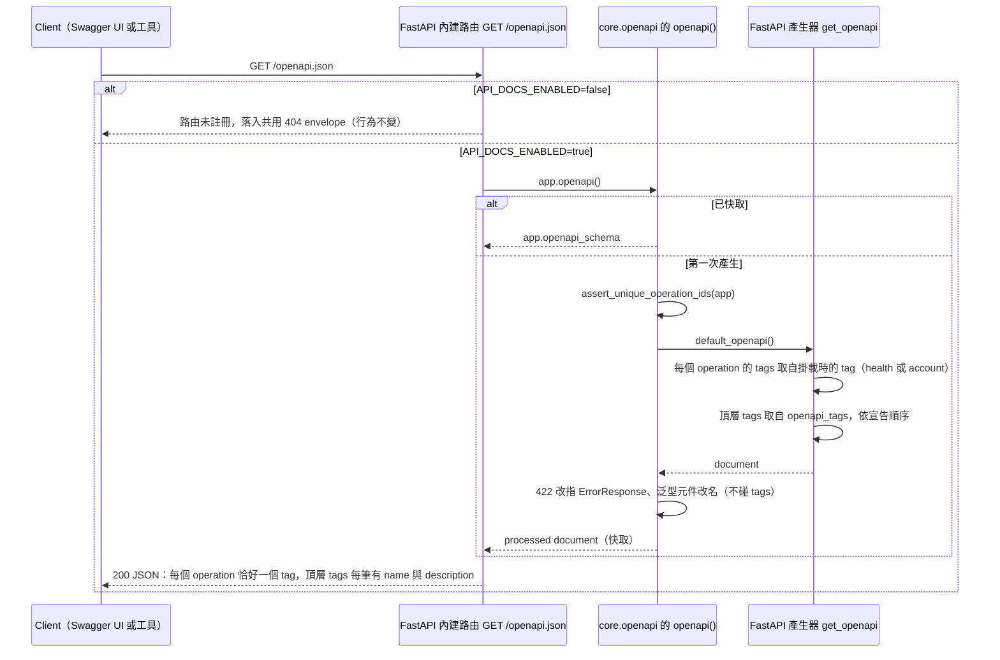
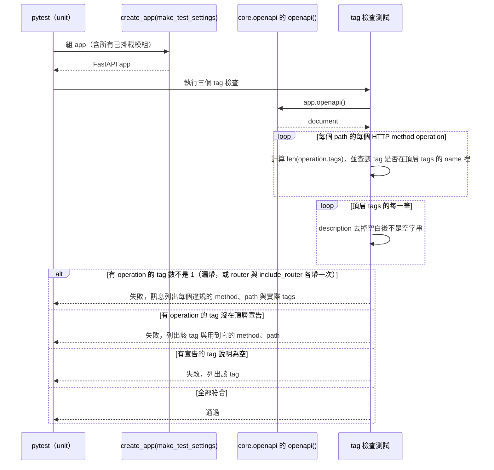
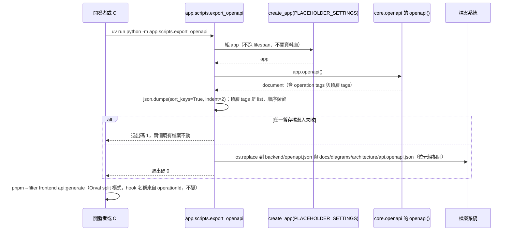

# System Design

本 change 不新增端點、不改任何端點的行為、權限或錯誤碼，也不碰資料庫；它只讓 FastAPI 產生的 API 文件替每個 operation 帶上所屬模組的 tag，並在頂層宣告每個 tag 與一句英文說明。異動只落在兩處：app 組裝（`backend/app/main.py`：宣告 `openapi_tags`，並在 `include_router` 掛載時帶 tag）與新的測試；兩個模組的 `router.py` 不動。匯出物（`backend/openapi.json`、文件站副本 `docs/diagrams/architecture/api.openapi.json`、`frontend/src/api/generated/`）隨之重產。

system-analysis 的待決 SA-1～SA-7 與本文的技術待決 T1～T4 已由 `clarification.md` 全部定案（Q1、Q2 與 P1～P9）；本文照定案寫，文末 §技術待決問題 保留每題並標出對應的 clarification 項。

## 分層與類別

這次沒有 Service、Repository、Model 的異動；Router 層只改「掛載時帶什麼 tag」，handler 的簽章與行為不變。下圖只畫這次新增或修改的元素，以及它們與既有 OpenAPI 後處理的關係（`<<changed>>` 為修改、`<<new>>` 為新增）。

`OPENAPI_TAGS` 是一個 list，每筆有 `name`（等於 `app/modules/` 下的目錄名）與 `description`（一句英文）；順序依 clarification Q2 照規格章節排、`health` 放最後：`account`、`dashboard`、`task`、`dataset`、`admin`、`health`。目前只有 `account`、`health` 兩筆，之後的模組依它的規格章節插入對應位置。`settings` 可為 `None`。`HealthRouter`、`AccountRouter` 與 `install_openapi` 本身不改。測試的三個方法依 clarification P5，名稱是提案。

### 元件與職責

| 元件                                                                      | 檔案                                                                   | 異動 | 職責                                                                                                                                                                                                                       |
| :------------------------------------------------------------------------ | :--------------------------------------------------------------------- | :--- | :------------------------------------------------------------------------------------------------------------------------------------------------------------------------------------------------------------------------- |
| `create_app`                                                              | `backend/app/main.py`                                                  | 修改 | 建 `FastAPI` 時傳 `openapi_tags=OPENAPI_TAGS`（list 的順序就是兩個文件入口的顯示順序，依 Q2）；`api.include_router(account_router, tags=["account"])`、`api.include_router(health_router, tags=["health"])`（依 P4 採 A2） |
| `OPENAPI_TAGS`（名稱暫定）                                                | `backend/app/main.py`                                                  | 新增 | tag 的名稱與英文說明的唯一來源；說明是給人看的模組用途，不寫內部識別碼、類別名或檔案路徑（handler docstring 同一條規矩）                                                                                                   |
| health 的 `router`                                                        | `backend/app/modules/health/router.py`                                 | 不動 | 維持 `APIRouter()`，不寫 `tags`，避免與掛載處的 tag 串接成兩個（P4）                                                                                                                                                       |
| account 的 `router`                                                       | `backend/app/modules/account/router.py`                                | 不動 | 同上                                                                                                                                                                                                                       |
| `install_openapi`、`generate_operation_id`、`assert_unique_operation_ids` | `backend/app/core/openapi.py`                                          | 不動 | tag 由 FastAPI 原生產生，後處理不必處理；operationId 的算法不看 tag，所以 8 個 operationId 不變                                                                                                                            |
| 匯出指令                                                                  | `backend/app/scripts/export_openapi.py`                                | 不動 | `json.dumps(sort_keys=True)` 只排序物件的 key，頂層 `tags` 是 list，宣告順序原樣保留                                                                                                                                       |
| tag 檢查測試                                                              | `backend/tests/unit/test_openapi.py`（建議沿用此檔與其 `app` fixture） | 新增 | 列舉 app 的每個 operation，斷言恰好一個 tag、該 tag 在頂層宣告、頂層每筆 `description` 非空（P5）；新模組漏帶 tag 時失敗（列舉方式見選項 B）                                                                               |
| Pydantic schema                                                           | —                                                                      | 不動 | 沒有 Request／Response／Query schema 異動                                                                                                                                                                                  |

### 設計選項 A：tag 宣告在哪裡

**已定案：A2**（clarification P4）。下表保留比較，供日後回顧。

| 選項                     | 寫法                                                                                                                                                                           | 優點                                                                                                               | 缺點                                                                                                          |
| :----------------------- | :----------------------------------------------------------------------------------------------------------------------------------------------------------------------------- | :----------------------------------------------------------------------------------------------------------------- | :------------------------------------------------------------------------------------------------------------ |
| A1 模組自己宣告          | 各模組 `router = APIRouter(tags=["<module>"])`；說明在 `main.py` 的 `openapi_tags`                                                                                             | 名稱緊鄰模組目錄，code review 一眼對得上「名稱等於目錄名」                                                         | 名稱寫在兩處（router 與 `main.py`），兩處拼字不同時，文件會多一個沒有宣告的 tag，靠「tag 在頂層宣告」的測試擋 |
| A2 組裝時宣告            | `main.py` 的 `api.include_router(health_router, tags=["health"])`；說明也在 `main.py`                                                                                          | 名稱、說明與順序都在 `create_app` 一處；issue 的檢查清單用語「掛 router 時指定模組 tag」就是這個寫法；模組檔案不動 | 名稱離模組目錄較遠；仍寫兩次（`include_router` 與 `openapi_tags`），但在同一個檔案                            |
| A3 模組提供一筆 tag 物件 | 各模組在 `router.py` 匯出 `OPENAPI_TAG = {"name": "<module>", "description": "..."}`；`main.py` 用它同時組 `openapi_tags` 與 `include_router(..., tags=[OPENAPI_TAG["name"]])` | 名稱只寫一次，拼字不一致在結構上不會發生                                                                           | 每個模組多一個公開名稱，屬於多一層抽象（agent-rules 的「不做過度抽象」要權衡）；檢查清單要多寫這個慣例        |

採用 A2 的理由：與 issue 的檢查清單用語「掛 router 時指定模組 tag」一致，模組檔案零改動，名稱、說明、順序同處可審。

FastAPI 會把 `APIRouter(tags=...)` 與 `include_router(tags=...)` 兩者的 tag **串接**，不是覆寫；所以模組自己的 `APIRouter()` 一律不寫 `tags`。若有人在 router 又寫一次，operation 會帶兩個 tag，「恰好一個 tag」的測試會擋下。

### 設計選項 B：測試怎麼列舉 operation

| 選項                | 做法                                                                                                                                                                                                                                                                    | 優點                                                                                                                                       | 缺點                                                                                                         |
| :------------------ | :---------------------------------------------------------------------------------------------------------------------------------------------------------------------------------------------------------------------------------------------------------------------- | :----------------------------------------------------------------------------------------------------------------------------------------- | :----------------------------------------------------------------------------------------------------------- |
| B1 讀產生出來的文件 | 用 `create_app(make_test_settings(...))` 組 app，走訪 `app.openapi()["paths"]` 每個 path item 中屬於 HTTP method 的 key（`get`、`put`、`post`、`delete`、`patch` 等，略過 `parameters`、`summary` 這類非 operation 的 key），斷言 `len(operation.get("tags", [])) == 1` | 驗的就是對外的契約本身；和既有 `test_the_account_operation_ids_follow_the_contract` 讀 `app.openapi()` 的方式一致；不依賴 FastAPI 內部 API | 失敗訊息要自己組（列出缺 tag 的 method 與 path）                                                             |
| B2 走訪路由         | 仿 `assert_unique_operation_ids` 用 `iter_route_contexts(app.routes)` 讀每條 `APIRoute` 的 tags                                                                                                                                                                         | 可以在 `create_app` 啟動時就失敗（像 operationId 撞名檢查）                                                                                | `iter_route_contexts` 是較內部的 API；若做成啟動檢查，就超出 issue「加一個測試」的範圍；未採用啟動檢查（P6） |

**採用 B1，放在 `backend/tests/unit/test_openapi.py`；只做測試，不在 `create_app` 加啟動檢查（clarification P6）。** 斷言的對象是 `create_app` 組出的真實 app，所以之後新模組掛進 `/api/v1` 卻沒帶 tag，這條測試就會失敗。`include_in_schema=False` 的路由（FastAPI 內建的 `/docs`、`/redoc`、`/openapi.json`）本來就不在文件裡，不受影響。

測試的範圍依 clarification P5，三項都驗：

- 每個 operation 恰好一個 tag
- 該 tag 出現在頂層 `tags` 的 `name` 裡
- 頂層每一筆的 `description` 不是空字串（含只有空白）

範圍適用文件裡的**所有** operation，沒有例外（P3）：將來若在 `app/core/` 或 `app/oidc/` 掛了不屬於任何模組的路由，測試會直接失敗，屆時再決定歸屬。tag 名稱是否等於模組目錄名不由測試驗，由 `code-reviewer` 審查（P7）。「宣告了卻沒有 operation 使用的 tag」不在 P5 的範圍，不驗。

既有的漂移檢查 `test_committed_document_matches_the_code` 與 CI 的 `api-contract` job 不用改：tag 進了 `openapi.json`，提交的檔案沒重產就會被它們擋下。

## 關鍵情境

本 change 還沒有 spec delta；以下 Scenario 名稱是提案，`planner` 寫 `specs/**/spec.md` 時若改名，本節標題要跟著改成相同名稱。這些情境沒有資料庫、沒有認證依賴（文件端點本來就公開，受 `API_DOCS_ENABLED` 開關控制），所以參與者是 Client、FastAPI 內建的文件路由、`core.openapi` 的後處理與 FastAPI 的產生器，不畫 Service、Repository、DB。

### Scenario: 每個操作都歸在所屬模組的分組

`GET /docs` 只回 Swagger UI 的 HTML，由瀏覽器再取 `/openapi.json`；Swagger UI 依頂層 `tags` 的順序分組，因為每個 operation 都有 tag，不再出現 `default` 分組。

### Scenario: 新模組漏掉分組時檢查失敗

tag **名稱**是否等於模組目錄名，由 `code-reviewer` 審查，測試不驗（clarification P7）。

### Scenario: 匯出的介面描述檔帶分組

Orval 維持 `mode: "split"`，hook 與型別名稱只取決於 operationId 與 schema 名稱，所以前端產物預期沒有名稱變動；實際差異（可能為零或只有註解）以重產結果為準。文件站的 `openapi-renderer` 外掛依 tag 導覽（`.notecraft/plugins/openapi-renderer/README.md` §導覽），輸入帶 tag 即可，外掛不改；它的分組順序是否照頂層 `tags`，驗收時在 `/docs` 與 `/view/diagrams/architecture/api.openapi` 各看一次並記錄，若文件站自己排序則記為已知差異（clarification P8）。

## 常駐文件異動

- 常駐文件：`docs/diagrams/architecture/backend-modules.mdx`

這份常駐文件的異動依 clarification 交給 tasks 執行，規劃階段不改；下表是要做的異動，`planner` 列進 `tasks.md`。改寫時照 `openspec/config.yaml` 的常駐文件寫法約束（正文只寫現況、不寫 issue 編號，依據寫進決策紀錄），規則本文連到 `api-agent-rules.mdx` A1（Q1），模組名舉例照 ADR-003 D14（P1）。

| 節                               | 異動     | 摘要                                                                                                                                                                                              |
| :------------------------------- | :------- | :------------------------------------------------------------------------------------------------------------------------------------------------------------------------------------------------ |
| §app factory 與 lifespan         | 修改     | 步驟 2 加「傳 `openapi_tags`（宣告順序即顯示順序：照規格章節，`health` 最後）」；步驟 6 寫明掛載時用 `include_router(tags=[...])` 帶模組 tag                                                      |
| §OpenAPI 匯出與 operationId 檢查 | 修改     | 表格加一列 tag：一個模組一個 tag、名稱等於 `app/modules/` 下的目錄名、每個 operation 恰好一個、頂層宣告附非空的英文說明；缺 tag、未宣告與空說明由 `tests/unit/test_openapi.py` 擋，名稱對錯靠審查 |
| §新增業務模組的檢查清單          | 修改     | 加一項「掛 router 時用 `include_router(tags=["<module>"])` 指定模組 tag，模組的 `APIRouter()` 不寫 tags；在 `openapi_tags` 依規格章節的位置加一筆英文說明」                                       |
| §決策紀錄                        | 新增一列 | 後端 OpenAPI 依模組分 tag，列出異動的節，來源連 issue                                                                                                                                             |

`docs/diagrams/architecture/error-codes.mdx` 與 `endpoint-authorization.mdx` 不受影響：沒有新錯誤碼，端點的角色、權限矩陣的格與遮蔽欄位都不變。

## 資料模型異動

本次無資料模型異動。

## 權限檢查點

- 沒有新端點，也不改任何端點的授權四段判定、欄位遮蔽或錯誤碼；授權仍只在認證依賴與 service 完成，**不以 tag 表達授權邊界**（tag 只是文件分組）。這也是 clarification P9 記下的風險：若將來想用 tag 標示「受限 client」之類的授權範圍，會和「每個 operation 恰好一個 tag、名稱等於模組」衝突，那種需求應另用 OpenAPI 擴充欄位或依賴宣告，不重用 tag。
- `/docs`、`/redoc`、`/openapi.json` 維持現行的 `API_DOCS_ENABLED` 開關（正式層 compose 為 `false`，四條內建路由都不註冊）；匯出不經這些路由，不受開關影響。
- 新增的資訊只有兩個 tag 名稱與兩句英文說明，都是公開的模組用途；說明不得含內部識別碼、類別名、檔案路徑或部署資訊。
- **測試集答案隔離**：無風險。tag 與說明不含任何資料，不會帶出標準答案或測試集辨識資訊；將來 `task` 模組的說明也只寫模組用途，不得描述答案或測試集的存在方式。

## 技術待決問題

以下各題都已由 `clarification.md` 定案，保留原題與定案指向，不再待決。

| #    | 問題                                                         | 定案                                                                                                        | 狀態                       |
| :--- | :----------------------------------------------------------- | :---------------------------------------------------------------------------------------------------------- | :------------------------- |
| SA-1 | 分組規則要不要寫進 `api-agent-rules.mdx` A1（或 ADR-003）    | 寫進 A1，與 operationId 規則放一起；各處連到 A1                                                             | 已定案（clarification Q1） |
| SA-2 | issue 舉例的 `project`、`annotation` 是否以 ADR-003 D14 為準 | 以 D14 為準：`account`、`dashboard`、`task`、`dataset`、`admin`，加上 `health`                              | 已定案（clarification P1） |
| SA-3 | 頂層 `tags` 的順序                                           | 照規格章節：`account`、`dashboard`、`task`、`dataset`、`admin`，`health` 最後；目前只有 `account`、`health` | 已定案（clarification Q2） |
| SA-4 | `schema.yaml` 的 api-contract 產出說明要不要加分組           | 要，tasks 加一項                                                                                            | 已定案（clarification P2） |
| SA-5 | 測試是否也驗頂層宣告與非空說明                               | 驗：恰好一個 tag、該 tag 在頂層宣告、頂層每筆 description 非空                                              | 已定案（clarification P5） |
| SA-6 | 不屬於任何模組的 operation 怎麼分                            | 本次不另訂規則；測試涵蓋所有 operation，出現時會失敗，屆時再決定；A1 寫明每個 operation 都要有 tag          | 已定案（clarification P3） |
| SA-7 | FR-082「restricted-client router 的 OpenAPI tag」那一列      | 本次不處理，只記風險；tag 不用來表達授權邊界                                                                | 已定案（clarification P9） |
| T1   | tag 宣告在哪裡（A1／A2／A3）                                 | A2：`create_app` 的 `include_router(tags=[...])`；模組 `APIRouter()` 不寫 tags                              | 已定案（clarification P4） |
| T2   | 只做測試，還是也在 `create_app` 啟動時檢查                   | 只做測試                                                                                                    | 已定案（clarification P6） |
| T3   | tag 名稱等於目錄名要不要自動驗                               | 不自動驗，由 `code-reviewer` 審查                                                                           | 已定案（clarification P7） |
| T4   | 文件站外掛的分組順序是否照頂層 `tags`                        | 不改外掛；驗收時兩個入口各看一次並記錄，文件站自己排序則記為已知差異                                        | 已定案（clarification P8） |

效能、交易邊界、session 生命週期：不適用。tag 只在第一次產生文件時計算並隨既有快取保存，不碰資料庫。
