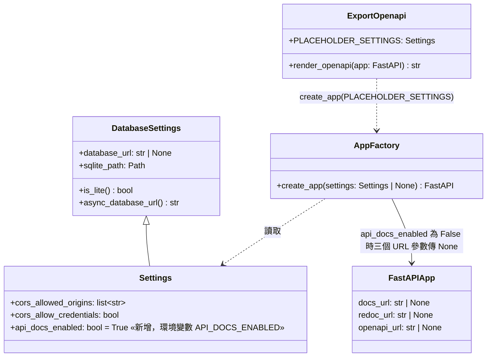
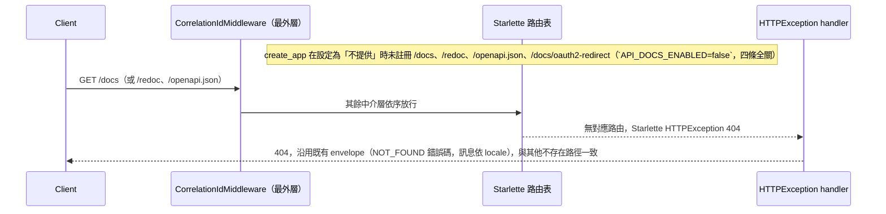
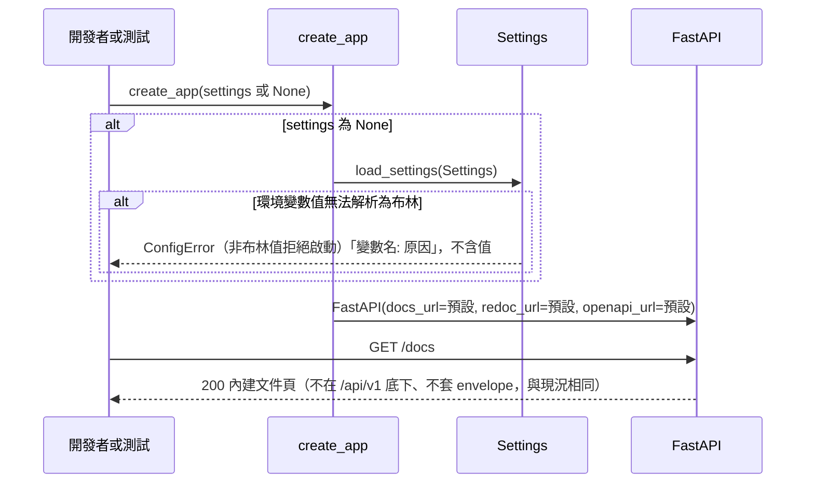
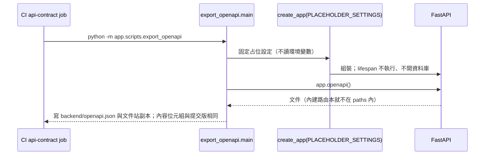

# System Design

本次是技術 change：沒有業務模組、沒有 Service／Repository／Model，只動 `app/core/config.py` 的設定類、`app/main.py` 的 `create_app` 組裝，以及部署傳遞檔（`docker-compose.prod.yml`、`.env.example`）。沒有新端點、沒有資料模型異動。決議見 `clarification.md`（維護者 2026-11-24）：新增設定 `API_DOCS_ENABLED`，布林，預設 `true`，正式層 compose 明確設為 `false`；為 `false` 時四條內建路由都不註冊。

## 分層與類別

分層是 Router → Service → Repository／Model；本次不新增任何業務類別。受影響的是 `app/core/` 的設定與 `app/main.py` 的 app factory（不屬業務模組分層）。FastAPI 內建的文件路由由框架在建構 `FastAPI(...)` 時依 `docs_url`／`redoc_url`／`openapi_url` 註冊，這三個參數設為 `None` 就不註冊；沒有自訂 Router。

設計要點：

- 新欄位放在 `Settings`（API 層），不放 `DatabaseSettings`：Alembic 只讀資料庫層，不需要它（沿用 `config.py` 模組文件的兩層切法）。
- `create_app` 內只做一個判斷：設定為「不提供」時，`docs_url`、`redoc_url`、`openapi_url` 傳 `None`。`/docs/oauth2-redirect` 由 FastAPI 在 `docs_url` 有值時一併註冊（`swagger_ui_oauth2_redirect_url` 依附於 `docs_url`），因此 `docs_url=None` 就連它一起不註冊；`openapi_url=None` 一併關掉 `/openapi.json`，所以四條都不註冊。
- `install_openapi(app)` 取代的是 `app.openapi()` 方法本身，不依賴 `/openapi.json` 路由，所以關閉路由不影響 `export_openapi.render_openapi(app)` 直接呼叫 `app.openapi()`。這是依程式結構的推論；實作要以測試證明匯出的 `backend/openapi.json` 與文件站副本位元組不變。
- 驗證規則：布林解析沿用 pydantic-settings 與既有 `CORS_ALLOW_CREDENTIALS` 的行為；解析失敗走 `load_settings` 的 `ConfigError`，只寫變數名與原因、不印值（B10、S9），不需新規則。
- 新欄位有預設值，所以 `conftest.py` 與 `test_main.py` 等直接 `Settings(...)` 的測試不必改，`PLACEHOLDER_SETTINGS` 也不必補欄位；Lite 層、本機開發與現有測試不用改設定。
- 不依 `is_lite()` 推導：開關獨立於資料庫層，`runtime-config` 的「層只決定資料庫」不變。

## 關鍵情境

情境名稱沿用 system-analysis 業務流程節的兩種使用者視角；spec delta 尚未撰寫，名稱待 specs 階段與 Scenario 對齊。

### Scenario: 正式層不提供內建 API 文件與介面描述路由

說明：`register_exception_handlers` 已把 routing 的 `404`／`405` 轉成 envelope（`errors.py` 對應表），所以未註冊路由的請求自然落在這條既有路徑，不需新程式。這是依程式碼的觀察，實作要以測試確認；回應內容是否與其他不存在的路徑完全一致由 apply 階段的測試確認。

### Scenario: Lite 層與本機開發維持提供內建 API 文件

### Scenario: 契約匯出不受設定影響

備註：新欄位有預設值，`PLACEHOLDER_SETTINGS` 不必補欄位，匯出命令不改。

## 常駐文件異動

已在規劃階段改好（clarification Q1、Q2、Q10、P2）：

- 常駐文件：`docs/diagrams/architecture/backend-modules.mdx`

| 節                                                   | 異動 | 摘要                                                                                                                                   |
| :--------------------------------------------------- | :--- | :------------------------------------------------------------------------------------------------------------------------------------- |
| 後端基礎建設 §設定                                   | 修改 | 說明文字加上內建文件開關；表新增 `API_DOCS_ENABLED` 一列（布林、預設 `true`、`false` 時四條內建路由不提供、正式層 compose 設 `false`） |
| 後端基礎建設 §app factory 與 lifespan                | 修改 | 步驟 2 說明開關為 `false` 時 `docs_url`、`redoc_url`、`openapi_url` 傳 `None`，請求落入既有 404 envelope                               |
| §OpenAPI 匯出與 operationId 檢查（operationId 註記） | 修改 | 「維持預設開啟」改為依 `API_DOCS_ENABLED`，並註明匯出不經這些路由                                                                      |

端點授權與錯誤碼兩份常駐文件的異動見 api-contract.md §常駐文件異動。

## 資料模型異動

本次無資料模型異動（沒有表、欄位、索引、Alembic migration；字典、ER 都不動，不需跑 `pnpm check:er`）。

## 權限檢查點

- 本次沒有新增端點、沒有授權判定、沒有欄位遮蔽。內建文件路由現況是「任何人」（`endpoint-authorization.mdx`），本次的控制點是**路由是否存在**（組裝期）而不是登入或角色，所以不在請求期做任何授權判斷；也沒有超出 PRD §權限矩陣的放寬。
- 認證落地後內建文件是否要登入，屬後續 change，本次不處理（system-analysis 跨模組依賴「後續功能」）。
- 測試集答案隔離：內建文件頁與 `openapi.json` 只描述端點結構，不含資料；本次不新增任何標記員能到達的端點，沒有答案外露風險。「不提供」反而縮小可讀到的 API 結構。
- 防禦層次：`frontend/nginx.conf` 只轉發 `/api/v1/`，其他路徑回前端首頁，後端不對外開放連接埠（ADR-008 D1）。因此後端關閉路由在目前部署形態是縱深防禦（clarification Q6）；不改 `frontend/nginx.conf`，驗證以直接對後端為主。

## 技術待決問題

沒有待決項目；設定名稱、預設值、關閉範圍、回應形態都已由 clarification 裁定。補充：

| 項目               | 說明                                                                                                       |
| :----------------- | :--------------------------------------------------------------------------------------------------------- |
| 交易邊界與 session | 不適用：不涉及資料庫，API async session 與 worker sync session 皆不受影響                                  |
| 效能               | 少註冊路由，無疑慮                                                                                         |
| 需以測試證明       | 隱藏時回既有 envelope 404；匯出的 `backend/openapi.json` 與文件站副本位元組不變；Lite 與關閉各一個整合測試 |
