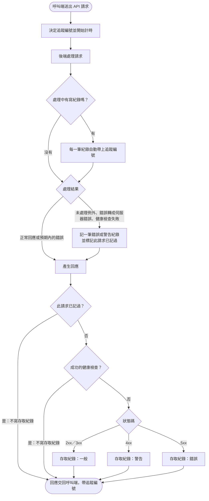

# System Analysis

本 change 是後端可觀測性的技術 change：讓每一個 API 請求都留下一行存取紀錄，並讓後端寫出的每一筆伺服器紀錄自動帶上該請求的追蹤編號（`traceId`），出事時用回應裡的 `traceId` 就能撈出同一個請求的全部紀錄，而且錯誤只記一次。

## 需求依據

`docs/specs/` 沒有任何規格描述這件事：PRD 與 `glossary.mdx` 提到「伺服器 log」只有寄信降級（設定密碼連結印在 log）一處，各模組規格也沒有存取紀錄或追蹤編號的條文。依 `openspec/config.yaml` 的 context 與 `docs/development/workflow/spec-migration.mdx` D4，技術 change 沒有 `docs/specs/` 規格可追溯時，改追溯到 issue、ADR 與規則文件的條號。下表依需求依據順序排列（維護者指定的需求文件在前）。

| 來源                                              | 章節／編號                                                                                          | 摘要（一句）                                                                                                                                                                    |
| :------------------------------------------------ | :-------------------------------------------------------------------------------------------------- | :------------------------------------------------------------------------------------------------------------------------------------------------------------------------------ |
| issue #567                                        | 使用情境／功能範圍、需求目標、驗收條件 4 條                                                         | 每個 `/api/v1` 請求一行存取紀錄（method、路由模板、狀態碼、耗時、traceId），依狀態碼分級，所有紀錄自動帶 traceId，沿用現有不記 query／body／header／cookie 的規則，500 不重複記 |
| `docs/specs/00-prd.mdx`                           | §系統脈絡（部署者那一列、Resend 那一列）                                                            | 只交代「部署者從伺服器 log 取得設定密碼連結」；沒有存取紀錄的業務條文                                                                                                           |
| `docs/specs/` 各模組規格                          | 無                                                                                                  | 沒有相關規格，本 change 不追溯到規格編號                                                                                                                                        |
| ADR-008                                           | D4 觀測性只做 `ai_runs`，監控與錯誤追蹤本期不做                                                     | 出錯時只能看 log、沒有告警；這是本 change 存在的理由                                                                                                                            |
| ADR-008                                           | D3 寄信用 Resend，沒設 key 時把連結印到 log                                                         | Lite 層的 log 視為敏感資料                                                                                                                                                      |
| ADR-003                                           | D5 API 路徑前綴與成功回應外層                                                                       | 所有端點在 `/api/v1` 底下，外層含 `traceId`                                                                                                                                     |
| ADR-003                                           | D8 非同步任務用 Celery 加 Redis                                                                     | 背景工作日後也會寫 log；本次不涉及（worker 尚不存在）                                                                                                                           |
| `docs/development/architecture.mdx`               | §部署與維運「監控」列                                                                               | 監控、告警本期不做，出錯時只能看 log；沒有 log 格式或結構的決定                                                                                                                 |
| `docs/development/rules/api-agent-rules.mdx`      | A7 錯誤處理與安全訊息、§A7 的 single-flight 與 correlation id                                       | 5xx 畫面附 correlation id；correlation id 只進錯誤物件與 log，不送第三方                                                                                                        |
| `docs/development/rules/security-agent-rules.mdx` | S9 稽核、脫敏與保留                                                                                 | 所有 log 不帶 PII 與 secret；寄信降級的那條 log 不得帶進一般 log 管道                                                                                                           |
| `docs/development/rules/security-agent-rules.mdx` | S5 答案隔離的覆蓋面                                                                                 | 標準答案不得出現在 log（覆蓋面明列 log）                                                                                                                                        |
| `docs/development/rules/backend-agent-rules.mdx`  | B1 分層與允許的 import                                                                              | 全站共用的基礎建設放在核心層，模組不各自實作                                                                                                                                    |
| `docs/development/rules/testing-agent-rules.mdx`  | T6 外部替身設在邊界上（例外欄）                                                                     | Lite 層的 log 視為敏感，測試產出不得外流                                                                                                                                        |
| `docs/diagrams/architecture/backend-modules.mdx`  | §請求管線、§correlation id、§log 安全規則、§已知限制 第 1 列                                        | 現況：只有未處理例外與資料庫連不上會留紀錄；業務程式要帶 traceId 得自己取；已知限制第 1 列即本 issue                                                                            |
| `openspec/specs/request-correlation`              | Purpose；Requirement「每個回應都帶追蹤編號且與 traceId 同值」「呼叫端自帶的追蹤編號符合格式才沿用」 | 追蹤編號的產生與沿用規則；Purpose 寫明「讓使用者回報的編號能對回伺服器紀錄」                                                                                                    |
| `openspec/specs/api-envelope`                     | Requirement「未處理例外留下可用追蹤編號對照的伺服器紀錄」                                           | 未處理例外寫一筆 `ERROR`，含 traceId、method、path，不含 body、query、header、cookie                                                                                            |
| `openspec/specs/health-check`                     | 全部                                                                                                | 健康檢查是 `/api/v1` 底下的端點，容器編排每 30 秒呼叫一次                                                                                                                       |
| 歸檔 `2026-11-23-infra-compose-e2e-ci`            | `clarification.md` Q15（2026-11-22 維護者裁定）                                                     | 「後端 access log 格式留給 01-01」，理由是查詢字串的敏感性要等有登入與 token 參數才有具體對象                                                                                   |
| 歸檔 `2026-11-20-backend-skeleton`                | `acceptance.md` §觀察 第 3 條                                                                       | 伺服器程式內建的存取紀錄會印出完整查詢字串，建議日後決定 access log 格式                                                                                                        |

## 範圍

本節依 `clarification.md`（維護者 2026-11-25 裁定 Q1–Q13、N1–N3）回修；每條決議的編號附在括號內。

- 這次包含：
  - 每一個 `/api/v1` 請求留下一行存取紀錄，欄位為 method、路由模板（不是實際路徑）、狀態碼、耗時、traceId（issue #567 驗收第 1 條）；跨來源預檢由跨來源那一層自己回應，不記；`/api/v1` 以外的路徑不記（Q4、Q6）
  - 存取紀錄的格式由本 change 定：一行 `key=value` 文字（Q2，**取代** 歸檔 `infra-compose-e2e-ci/clarification.md` Q15「access log 格式留給 01-01」）
  - 存取紀錄依狀態碼分級：2xx／3xx 為 INFO、4xx 為 WARNING、5xx 為 ERROR；健康檢查只略過成功的（2xx 不寫），非 2xx 照分級寫，驗收第 1 條加「成功的健康檢查除外」（Q1）
  - 已記過錯誤的請求不再寫存取紀錄：未處理例外、無對應錯誤碼的 HTTP 例外轉成 500、健康檢查回 503 前已記的 WARNING，這三種請求由先記的那一筆代表，存取紀錄不寫；驗收第 1 條對這類請求加例外（Q3，驗收第 2 條）
  - 沒有路由模板的請求（路徑不存在的 404、語言全部不支援的 406）在路由模板欄記固定佔位文字；未處理例外那一筆維持記實際路徑（Q5）
  - 耗時從進入存取紀錄那一層算到最後一段回應送出，單位毫秒、一位小數（Q11）
  - 後端每一筆伺服器紀錄自動帶上目前請求的 traceId，業務程式不必改寫呼叫方式（驗收第 3 條；手段依 N1）；請求以外寫的紀錄（啟動、關閉、遷移）填固定標記 `-`（Q7）
  - 既有紀錄訊息裡手寫的 traceId 拿掉，改由自動帶入提供，相關測試改斷言自動帶入的值（Q8）
  - 存取紀錄沿用既有的 log 安全規則：不記 query、body、header、cookie，來自請求的值先跳脫（驗收第 4 條）；不記來源 IP（Q9）
  - 關閉伺服器程式內建的存取紀錄（目前會印完整查詢字串），在後端的 log 設定裡關，一處涵蓋所有啟動方式（Q10）
  - 全後端的 log 輸出設定，新增部署者可調的 log 等級環境變數（`LOG_LEVEL`，預設 INFO），資料庫引擎的紀錄明確設為 WARNING；須同步 `.env.example`、`runtime-config`、`backend-modules.mdx` §設定（Q12）
  - `docs/diagrams/architecture/backend-modules.mdx` 的同步：§請求管線、§correlation id、§log 安全規則、§設定 由 `sd` 在規劃時依決議改；§已知限制 第 1 列（#567）在實作合併前仍成立，**延到實作、由實作群組在同一張 PR 刪除**（比照 #524），同一組任務在 §已知限制 新增「回應已開始送出後才出錯」一列（N2）；實作後由 `backend-developer` 校正
- 這次不包含：
  - 監控、告警、錯誤追蹤、集中式 log 平台（ADR-008 D4 本期不做）
  - 背景工作（worker）的 traceId 傳遞：worker 尚不存在（ADR-003 D8）
  - 存取紀錄的來源 IP 與信任反向代理（#566）：不記 IP（Q9），日後要加另開單
  - 回應已開始送出後才出錯的處理：記為已知限制，留給第一個串流端點的 change（N2）
  - 寄信降級的設定密碼連結與一般 log 管道的區隔：留給寄信的 change，本 change 只在 §log 安全規則註明（N3）
  - 前端的錯誤畫面與 correlation id 顯示（api-agent-rules A7 的前端那一半）
  - log 的保存期限、輪替與檔案落地方式（部署層的事，ADR-008 未決）
  - `docs/specs/`、`docs/specs/00-prd.mdx`、`design/prototype/` 的任何變更；不用 `spec-writing` 把流程補回規格書（Q13）
  - 硬性規則 5（任務設定驅動）：不適用，本 change 不涉及任務類型
  - 硬性規則 6（答案不外露）：存取紀錄只記路由模板而不是實際路徑，且不記 body，因此不會把答案或資料識別碼寫進紀錄；規劃時仍須維持這一點（S5）

## 角色與權限

本 change 沒有產品角色（系統管理員、專案負責人、標記員等）之間的權限差異：存取紀錄只寫在伺服器端，產品內沒有任何畫面或 API 能讀到它，所以不列角色 × 動作矩陣。涉及的對象如下：

| 對象                                   | 能做的事                                                            | 會看到或被遮蔽的資料                                                                                                           |
| :------------------------------------- | :------------------------------------------------------------------ | :----------------------------------------------------------------------------------------------------------------------------- |
| 呼叫端（瀏覽器、腳本、容器的健康檢查） | 送出 API 請求、可自帶追蹤編號（不合格會被換掉）、從回應拿到 traceId | 只看到回應裡的 traceId；看不到伺服器紀錄                                                                                       |
| 部署者（PRD §系統脈絡）                | 讀伺服器紀錄，用使用者回報的 traceId 撈出同一請求的全部紀錄         | 看得到紀錄全文；紀錄中不得有 query、body、header、cookie、PII、secret、答案（S5、S9）；Lite 層的紀錄本身視為敏感（ADR-008 D3） |
| 後端業務程式的撰寫者                   | 照常寫紀錄，不必自行傳入 traceId                                    | —                                                                                                                              |

## 業務流程

不適用規格書的業務流程：`docs/specs/` 沒有規格涵蓋本 change（理由見 §需求依據），維護者已決定不補回規格書（Q13）。下圖是依 issue #567、`backend-modules.mdx` §請求管線與 `clarification.md` 的決議畫的完整流程，只寫業務語意。

| 規格 | 業務流程                                                                                 | 本次涉及 |
| :--- | :--------------------------------------------------------------------------------------- | :------- |
| 無   | 無（技術 change，依 spec-migration D4 改追溯 issue #567 與 ADR、規則條號；Q13 決議不補） | 下圖全部 |

### 主流程：一個 `/api/v1` 請求留下的紀錄

圖中 `J`、`K` 兩個判斷依 Q3、Q1；`H` 涵蓋的三種情況依 Q3（健康檢查失敗那一筆是 WARNING，其餘是 ERROR）。

### 例外路徑（文字補充，不另畫）

- **跨來源預檢**：由跨來源那一層自己回應，沒有進到存取紀錄那一層，不記（Q4、Q6）。
- **`/api/v1` 以外的路徑**（API 文件頁、`/openapi.json`，正式層本來就關閉）：不記（Q6）。
- **沒有路由模板的請求**：路徑不存在的 404，以及語言全部不支援的 406（在比對路由之前就被擋下，即使路徑存在也沒有模板），路由模板欄記固定佔位文字（Q5）。方法不允許的 405 **有**路由模板（路徑已部分比對到；`system-design` §路由模板怎麼取 實測），照一般請求記模板。
- **回應已經開始送出後才出錯**：無法改寫回應，「錯誤只記一次」在這條路徑不成立；目前沒有串流端點，記為 `backend-modules.mdx` §已知限制，留給第一個串流端點的 change（N2）。
- **請求以外寫的紀錄**（啟動、關閉、遷移）：沒有追蹤編號，自動帶入時填固定標記 `-`（Q7）。

## 跨模組依賴

**需要先存在的功能（皆已存在）**

- 追蹤編號的產生、沿用與在請求期間的存放（`request-correlation` 主規格；`backend-modules.mdx` §correlation id）。本 change 只讀取它，不改它的規則。
- 既有的 log 安全規則：來自請求的值先跳脫、未處理例外只記型別與位置（`backend-modules.mdx` §log 安全規則；`api-envelope` 主規格「未處理例外留下可用追蹤編號對照的伺服器紀錄」）。
- 請求管線的層次與順序（`backend-modules.mdx` §請求管線）。存取紀錄放在跨來源那一層的內側、未處理例外那一層的外側（Q4），因此看得到 406 與最終的 500 標記，預檢則不經過它。

**會被影響的既有 capability**

| capability            | 關係                                                                                                                                                                                                                                                                  |
| :-------------------- | :-------------------------------------------------------------------------------------------------------------------------------------------------------------------------------------------------------------------------------------------------------------------- |
| `request-correlation` | Purpose 寫「讓使用者回報的編號能對回伺服器紀錄」，本 change 補上「每一筆紀錄都帶編號」；`clarification.md` §交給後續產出 已指示另立 capability `server-logging`，是否同時動 `request-correlation` 由 `planner` 決定，不在本文                                         |
| `api-envelope`        | 「未處理例外留下可用追蹤編號對照的伺服器紀錄」的 Scenario 斷言紀錄「含與回應 traceId 相同的值」；訊息裡手寫的 traceId 拿掉、改由自動帶入提供（Q8），這條 Scenario 的驗證方式是否要 MODIFIED 由 `planner` 判斷；未處理例外那一筆維持記實際路徑（Q5），不因本 change 改 |
| `health-check`        | 健康檢查每 30 秒被容器編排呼叫一次；成功的不寫存取紀錄（Q1）；資料庫連不上時健康檢查自己已記一筆 WARNING，回 503 時存取紀錄不再寫（Q3）                                                                                                                               |
| `container-runtime`   | 正式層的紀錄輸出走容器的標準輸出；本 change 定了紀錄格式（Q2）並關閉伺服器程式內建的存取紀錄（Q10），部署者看容器紀錄的內容會改變；是否需要 delta 由 `planner` 判斷                                                                                                   |
| `runtime-config`      | 新增部署者可調的 log 等級環境變數，預設 INFO（Q12），需要 MODIFIED，並同步 `.env.example`                                                                                                                                                                             |

**會被後續功能依賴的部分**

- 規格 01-01 登入、01-05 登入狀態與安全：登入失敗鎖定等追查會依賴本 change 的存取紀錄。存取紀錄的格式已由本 change 定（Q2 取代歸檔 Q15），01-01 不再負責定格式；存取紀錄不記 query，查詢字串裡的 token 參數不會進紀錄。
- #566 信任反向代理的來源 IP：存取紀錄不記來源 IP（Q9），本 change 與 #566 沒有依賴；日後要在存取紀錄加 IP 另開單。
- 日後的背景工作（ADR-003 D8）：工作內寫的紀錄目前會填 `-`（Q7）；要不要改帶派送它的請求的 traceId，屆時另議。
- 第一個串流端點的 change：要處理回應已開始送出後才出錯的紀錄（N2）。
- 寄信的 change：要處理設定密碼連結那條紀錄與一般 log 管道的區隔（N3）。

**共用的資料**

- 追蹤編號：同時出現在回應標頭、回應外層的 `traceId` 與伺服器紀錄，三者必須同值。
- 伺服器紀錄本身：寄信降級的設定密碼連結也寫在同一個紀錄管道（ADR-008 D3），S9 要求那條紀錄不得帶進一般 log 管道；自動帶入 traceId 不改變它的敏感性。本 change 不處理兩類紀錄的區隔，只在 `backend-modules.mdx` §log 安全規則註明留給寄信的 change（N3）。

## 需求矛盾

以下五條都已由維護者 2026-11-25 在 clarification 停點裁定，保留原矛盾以便追溯。

1. **存取紀錄的格式由誰定**：歸檔 `2026-11-23-infra-compose-e2e-ci/clarification.md` Q15（2026-11-22 維護者裁定）決議「後端 access log 格式留給 01-01」；issue #567 則把存取紀錄的欄位與分級放進本 change。**已決（Q2）**：由本 change 定，一行 `key=value` 文字，**取代** #506 clarification Q15。
2. **「每個請求恰好一行」與「健康檢查可略過」**：issue #567 驗收第 1 條要求「每個 `/api/v1` 請求恰好一行存取 log」，同一 issue 的範圍又寫「health 可降級或略過」，而健康檢查就在 `/api/v1` 底下（`health-check` 主規格）。**已決（Q1）**：只略過成功的健康檢查，驗收第 1 條加「成功的健康檢查除外」。
3. **存取紀錄是否含來源 IP**：issue #567 的欄位清單沒有來源 IP；#566 的使用情境寫「存取 log……拿到的 IP 都會錯」，隱含存取紀錄要記 IP。**已決（Q9）**：不記。
4. **「5xx 記 ERROR」與「500 不多記一次」**：issue #567 範圍寫 5xx 為 ERROR、驗收第 1 條要求每個請求恰好一行存取紀錄，驗收第 2 條又要求 500 不因存取紀錄多記一次；而未處理例外那一筆 ERROR 是 `api-envelope` 主規格要求的。**已決（Q3）**：已記過錯誤的請求存取紀錄不寫，驗收第 1 條對這類請求加例外。
5. **伺服器程式內建的存取紀錄會印出查詢字串**：歸檔 `backend-skeleton/acceptance.md` §觀察 第 3 條記錄現行伺服器程式內建的存取紀錄（INFO）會印出完整查詢字串；issue #567 驗收第 4 條要求「log 不含 query」。**已決（Q10）**：在後端的 log 設定裡關閉內建的存取紀錄。

## 待決問題

`sa` 原列的 13 條全部由維護者 2026-11-25 在 clarification 停點裁定（對應 `clarification.md` Q1–Q13），本節改寫為決議並保留原問題供追溯；本文沒有剩下待決的事。

| #   | 問題                                                                                                                                                                                                                                                | 影響                                                                                      | 狀態                                                                                                                                                                                                 |
| :-- | :-------------------------------------------------------------------------------------------------------------------------------------------------------------------------------------------------------------------------------------------------- | :---------------------------------------------------------------------------------------- | :--------------------------------------------------------------------------------------------------------------------------------------------------------------------------------------------------- |
| 1   | 健康檢查的存取紀錄要略過、降級，還是只略過成功、失敗照記？（來源：issue #567 §功能範圍與驗收第 1 條）                                                                                                                                               | 分級規則與例外清單；驗收第 1 條措辭與測試案例；`system-design` 分級邏輯、`specs` Scenario | 已決（Q1，2026-11-25）：只略過成功的；2xx 不寫，非 2xx 照分級寫；驗收第 1 條加「成功的健康檢查除外」                                                                                                 |
| 2   | 存取紀錄的格式是否在本 change 定（取代 Q15），用一行純文字還是結構化？（來源：歸檔 `infra-compose-e2e-ci/clarification.md` Q15；issue #567）                                                                                                        | 本 change 範圍；既有紀錄的呈現；`container-runtime` 是否需要 delta                        | 已決（Q2，2026-11-25）：本 change 定，一行 `key=value` 文字；取代 #506 clarification Q15                                                                                                             |
| 3   | 「500 不因存取 log 多記一次」指哪一種？是否也適用於健康檢查 503 與 HTTP 例外轉 500？回應已開始送出才出錯時怎麼記？（來源：issue #567 驗收第 1、2 條；`api-envelope` 主規格）                                                                        | 驗收第 1 條是否對 500 成立；`api-envelope` 是否 MODIFIED；測試斷言的筆數與等級            | 已決（Q3，2026-11-25）：已記過 ERROR／WARNING 的請求（未處理例外、HTTP 例外轉 500、健康檢查回 503）加標記，存取紀錄看到就不寫；驗收第 1 條對這類請求加例外。回應已開始送出的情況另依 N2 記為已知限制 |
| 4   | 存取紀錄放在請求管線的哪個位置？（來源：`backend-modules.mdx` §請求管線）                                                                                                                                                                           | 被擋在前面的請求有沒有存取紀錄；500 是否重複記；`system-design` 元件位置與管線圖          | 已決（Q4，2026-11-25）：跨來源那一層的內側、未處理例外那一層的外側                                                                                                                                   |
| 5   | 沒有對應路由模板的請求（路徑不存在的 404、語言全部不支援的 406）要記什麼？（來源：issue #567「路由模板（不是實際路徑）」；`api-envelope` 主規格；方法不允許的 405 依 `system-design` 實測**有**模板，不屬此題——原文誤列，依 clarification P1 更正） | 存取紀錄欄位定義；未處理例外那一筆是否跟著改；`specs` Scenario 與測試                     | 已決（Q5，2026-11-25）：固定佔位文字；未處理例外那一筆維持記實際路徑，不動 `api-envelope`                                                                                                            |
| 6   | 跨來源預檢與 `/api/v1` 以外的路徑是否要有存取紀錄？（來源：issue #567；`request-correlation` 主規格）                                                                                                                                               | 涵蓋範圍與測試矩陣；紀錄量                                                                | 已決（Q6，2026-11-25）：只記 `/api/v1`，預檢不記（隨 Q4）                                                                                                                                            |
| 7   | 請求以外寫的紀錄自動帶入 traceId 時要填什麼？（來源：issue #567 驗收第 3 條；`backend-modules.mdx` §correlation id）                                                                                                                                | 自動帶入規則；啟動與遷移紀錄的呈現；`specs` Scenario                                      | 已決（Q7，2026-11-25）：固定標記 `-`                                                                                                                                                                 |
| 8   | 既有紀錄訊息裡手寫的 traceId 要保留還是移除？（來源：`backend-modules.mdx` §log 安全規則；`api-envelope` 主規格 Scenario）                                                                                                                          | 既有程式與測試；`api-envelope` Scenario 的驗證方式；§log 安全規則文字                     | 已決（Q8，2026-11-25）：拿掉；三處訊息改寫，測試改斷言自動帶入的值                                                                                                                                   |
| 9   | 存取紀錄是否要記來源 IP？（來源：issue #567；#566 §使用情境；S9）                                                                                                                                                                                   | 存取紀錄欄位；與 #566 的依賴；S9 脫敏範圍                                                 | 已決（Q9，2026-11-25）：不記；與 #566 無依賴                                                                                                                                                         |
| 10  | 伺服器程式內建的存取紀錄要關閉、保留，還是改成不含查詢字串？（來源：歸檔 `backend-skeleton/acceptance.md` §觀察 第 3 條；issue #567 驗收第 1、4 條）                                                                                                | 驗收第 1、4 條能否成立；啟動指令與設定；部署者看得到的紀錄                                | 已決（Q10，2026-11-25）：在後端的 log 設定裡關閉，一處涵蓋所有啟動方式                                                                                                                               |
| 11  | 耗時的單位、精度與起訖點？（來源：issue #567「耗時」未定義）                                                                                                                                                                                        | 欄位定義與測試                                                                            | 已決（Q11，2026-11-25）：從進入存取紀錄那一層到最後一段回應送出，毫秒、一位小數                                                                                                                      |
| 12  | 由本 change 建立全後端的 log 輸出設定，還是只處理存取紀錄？預設等級要不要開放環境變數調整？（來源：`backend/app/main.py`、`backend/Dockerfile`；`runtime-config` 主規格）                                                                           | 本 change 範圍；`runtime-config` delta 與 `.env.example`；正式層看不看得到 INFO           | 已決（Q12，2026-11-25）：全後端，新增 `LOG_LEVEL`，預設 INFO；資料庫引擎紀錄明確設 WARNING；寫進 `.env.example`、`runtime-config`、§設定                                                             |
| 13  | 是否用 `spec-writing` 把流程補回規格書？（來源：本角色定義；`openspec/config.yaml` context 的技術 change 例外）                                                                                                                                     | 若補，需先改 `docs/specs/` 並改追溯格式                                                   | 已決（Q13，2026-11-25）：不補；依 spec-migration D4 追溯到 issue、ADR 與規則文件                                                                                                                     |

`sd` 另提的 N1–N3 也已裁定（2026-11-25）：N1 用 record factory 達成自動帶入；N2 回應已開始送出後才出錯記為已知限制；N3 寄信降級的 log 管道本 change 不處理。三條對本文的影響已寫進 §範圍、§例外路徑與 §跨模組依賴。

## 參考檔案

- `openspec/config.yaml`（context：需求依據順序、技術 change 的追溯格式）
- issue #567（本 change）、#566（信任反向代理的來源 IP）
- `docs/specs/00-prd.mdx` §系統脈絡；`docs/specs/glossary.mdx`；`docs/specs/index.mdx`
- `docs/development/adr/003-backend-architecture.mdx` D5、D8
- `docs/development/adr/008-deployment-and-operations.mdx` D3、D4
- `docs/development/architecture.mdx` §部署與維運、§API 契約
- `docs/development/rules/api-agent-rules.mdx` A7
- `docs/development/rules/security-agent-rules.mdx` S5、S9
- `docs/development/rules/backend-agent-rules.mdx` B1
- `docs/development/rules/testing-agent-rules.mdx` T6
- `docs/development/workflow/spec-migration.mdx` D4
- `docs/diagrams/architecture/backend-modules.mdx` §請求管線、§correlation id、§log 安全規則、§已知限制、§誰改、什麼時候改
- `openspec/specs/request-correlation/spec.md`、`openspec/specs/api-envelope/spec.md`、`openspec/specs/health-check/spec.md`、`openspec/specs/container-runtime/spec.md`、`openspec/specs/runtime-config/spec.md`
- `openspec/changes/request-access-log/clarification.md`（2026-11-25 決議 Q1–Q13、N1–N3、P1–P3）；`openspec/changes/request-access-log/system-design.md` §路由模板怎麼取（405 實測）、§常駐文件異動
- `openspec/changes/archive/2026-11-23-infra-compose-e2e-ci/clarification.md` Q15（已被本 change Q2 取代）；`openspec/changes/archive/2026-11-20-backend-skeleton/acceptance.md` §觀察 第 3 條
- 現況程式（只讀）：`backend/app/core/middleware.py`、`backend/app/core/log_safety.py`、`backend/app/core/errors.py`、`backend/app/core/envelope.py`、`backend/app/main.py`、`backend/app/modules/health/service.py`、`backend/Dockerfile`、`docker-compose.yml`、`docker-compose.prod.yml`
- 進行中的其他 change：無（`openspec/changes/` 只有本 change），沒有重疊或衝突
