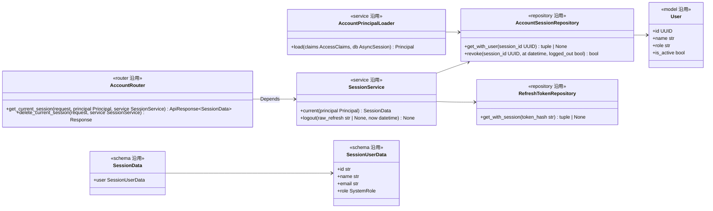
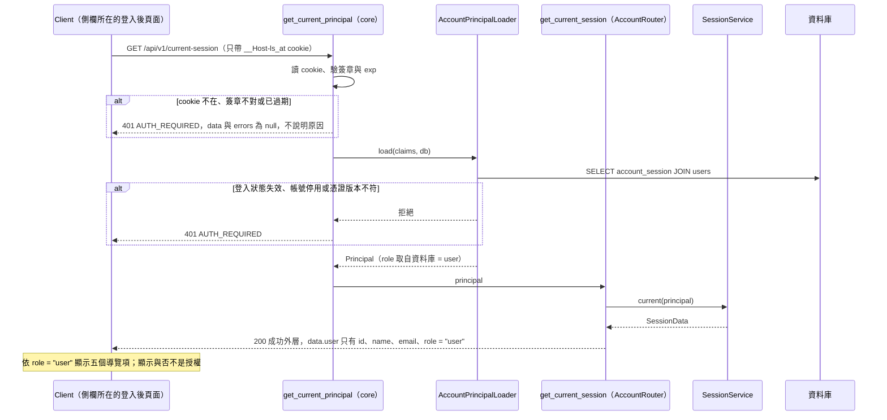
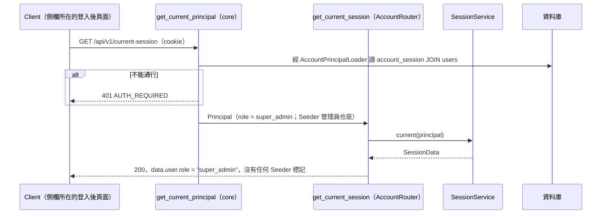
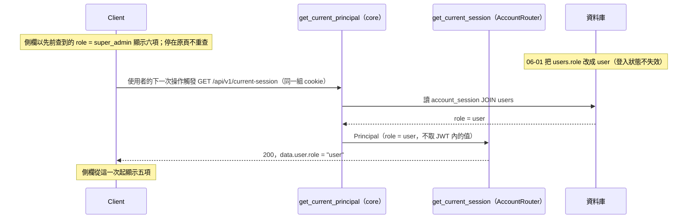
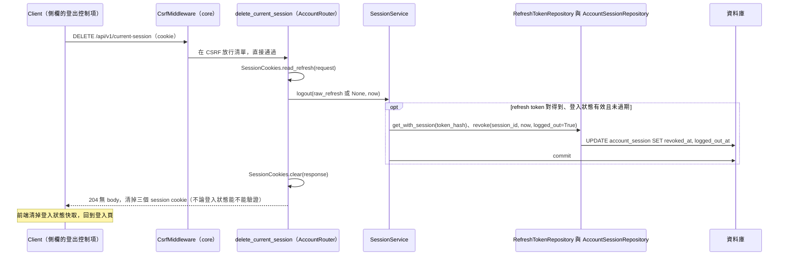
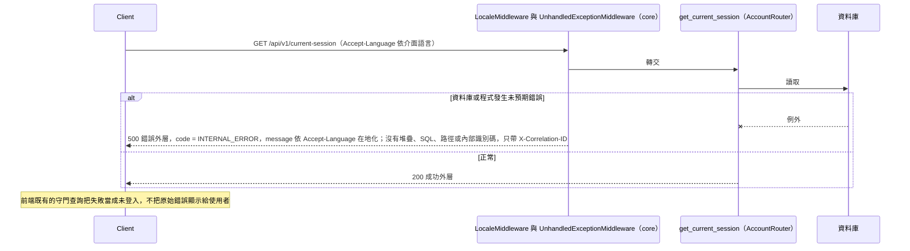
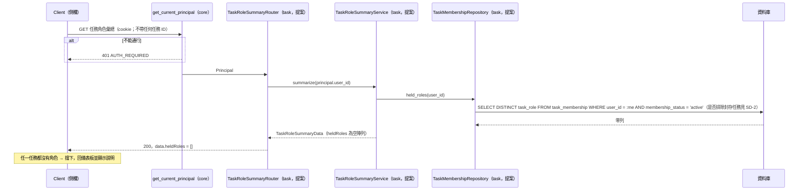
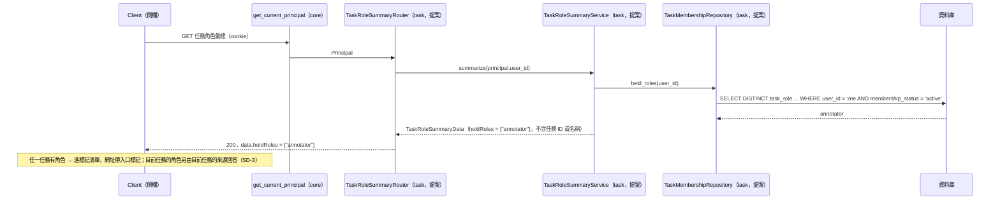
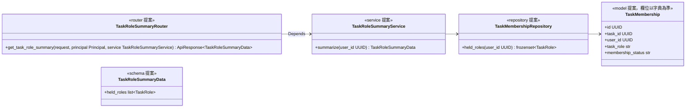

# System Design

本份是 change `sidebar-nav`（Issue #720）的後端系統設計，脈絡基準是同目錄的 `system-analysis.md`。

## 設計結論

**本次後端不新增、不修改任何端點、模組、資料表或 `app/core/` 基礎建設。** 側欄要的伺服器資料只有兩樣，都已存在：

| 側欄要的東西                                                   | 來源                                                                       | 現況                                                                                                                    |
| :------------------------------------------------------------- | :------------------------------------------------------------------------- | :---------------------------------------------------------------------------------------------------------------------- |
| 登入者的名稱與系統角色（決定五或六個導覽項、使用者晶片的名稱） | `getCurrentSession`（`GET /api/v1/current-session`，`account` 模組）       | 已有；每次從資料庫讀當下的系統角色（`openspec/specs/auth-guard` Requirement「每一次操作都用當下的帳號狀態與系統角色」） |
| 從這一台登出                                                   | `deleteCurrentSession`（`DELETE /api/v1/current-session`，`account` 模組） | 已有；回 `204` 並清三個 session cookie                                                                                  |

其餘都不需要後端：

- 語言、外觀模式、側欄收合是同一台瀏覽器的本機偏好（規格 07-01 §資料欄位；`data-field-inventory.mdx` §07-01），不存伺服器。語言切換後，前端 API client 已依介面語言送 `Accept-Language`（`frontend/src/api/generated-contract.test.ts` 已驗），後端錯誤訊息由既有的 `LocaleMiddleware` 依它在地化，不必改
- 目前位置、次選單、快捷鍵總覽、螢幕寬度與收合都是畫面行為
- 「系統管理」看不看得到只是顯示，不是授權：06-01、06-02 的頁面落地時，各自的端點掛 `require_permission(admin.*)` 才是真正的門（見 §權限檢查點）

**為什麼任務角色這次不加後端讀取**（依據，不是替維護者決定範圍）：

1. 任務、任務成員歸 `task` 模組（ADR-003 D14；`backend-modules.mdx` §預定模組與資料表歸屬）。`backend-modules.mdx` 也寫明「07 共用介面不設後端模組」，字典沒有任何一張表以 07-01 為來源
2. `task_membership` 的 FK 指向 `task`，`task` 又以 NOT NULL FK 指向 `dataset_version`、以延後複合 FK 指向 `task_config_version`、`task_guideline_version`（`data-table-dictionary.mdx` §五）。要讓成員資格有資料可讀，等於要做出 03-02 建立任務與 05 的資料集快照，遠超出 #720
3. `app/core/authz.py` 的 `TaskMembershipReader` 只回「某一個任務」裡的角色；側欄要的是「任一任務」的彙總（07-01 §進入模組的條件 第 1 條、Q16、Q18），即使 reader 有實作也不夠用，要另一個 `task` 模組的公開讀取

因此在目前的 `main` 上，**每一位使用者確實在任何任務都沒有任務角色**——沒有任務，也就沒有成員資格。側欄在本次以「沒有任何任務角色」作為任務角色來源的回答，是現況的真實狀態，不是假資料；但依任務角色的另外 12 條 Scenario 能不能在本次驗收，仍是 system-analysis 待決 1，由 clarification 決定（見 §待決問題 SD-1）。日後 `task` 模組提供讀取時應有的形狀，記在 §任務角色讀取的提案形狀，供那張單與本次的 clarification 估算成本，**本次不實作**。

前端要留一個「任務角色來源」的接縫，讓第三個導覽項名稱、角色標示與兩個進入條件只依它的回答計算，不散在各元件；本次它固定回「沒有任何任務角色、沒有目前任務」，`task` 模組落地時換成真的讀取，不動側欄的判斷。接縫的位置與型別屬前端設計（`ui-design.md`、`design.md`），本份只定它的輸入輸出要能承接下方提案形狀。

## 分層與類別

本次沒有新增或修改的後端類別。下圖只畫側欄會碰到的既有類別，全部**沿用、無異動**，完整的 `account` 類別圖見 `docs/diagrams/architecture/backend-modules.mdx` §account。

## 關鍵情境

只畫**會碰到後端**的 Scenario，參與者到 Router 回傳回應為止。其餘 Scenario 沒有後端互動，列在本節最後的對照表。

### Scenario: 平台成員看不到系統管理

### Scenario: 系統管理員看到系統管理

### Scenario: 角色被改掉時側欄不立刻變

後端本來就每一次請求都讀資料庫當下的角色；「側欄維持原狀、下一次操作起才變」的時機由前端何時再查一次 `getCurrentSession` 決定（見 §待決問題 SD-4）。

### Scenario: 登出後回到登入頁

### Scenario: 錯誤訊息不出現系統內部資訊

側欄唯一的後端讀取失敗時，回應已由既有的錯誤外層處理，本次不改。

### Scenario: 沒有任務角色時點擊標記作業

**本次（依 §設計結論）：沒有後端互動。** 前端的任務角色來源回「任何任務都沒有任務角色」，側欄擋下、回儀表板並顯示說明。下圖是日後 `task` 模組提供讀取時的樣子（§任務角色讀取的提案形狀），**本次不實作**，只畫到 Router 回傳回應。

### Scenario: 在別的任務有角色時點擊標記作業

**本次：沒有後端互動，也無法在本次驗收**（沒有任務成員資料），能否移出本次見 SD-1。下圖同樣是提案，本次不實作。

### 沒有後端互動的 Scenario

本次範圍內其餘 Scenario 都只在前端成立，後端不參與：

| 規格 07-01 的部分                     | Scenario                                                                                                                                                                                                                     | 為什麼沒有後端                                                             |
| :------------------------------------ | :--------------------------------------------------------------------------------------------------------------------------------------------------------------------------------------------------------------------------- | :------------------------------------------------------------------------- |
| §導覽項目與可見性（依任務角色的部分） | 審核員看到審核作業、專案負責人看到例外處置、標記員看到標記作業、標記員的角色標示讀作標記員、沒有任務角色時角色標示讀作一般使用者、系統管理頁的角色標示不被任務角色蓋掉、角色標示切換語言後也換                               | 依前端任務角色來源的回答計算；本次來源固定回「沒有任務角色」（SD-1、SD-3） |
| §目前位置                             | 每頁只有一個目前位置、在任務詳情頁時任務管理是目前位置、在角色設定頁時系統管理是目前位置                                                                                                                                     | 依前端路由                                                                 |
| §進入模組的條件                       | 專案負責人進得去標記作業、點標記作業進到的是清單頁、只當專案負責人的人看到例外處置、沒有任務角色時點擊資料集分析                                                                                                             | 依任務角色來源的回答與前端路由；入口標記是網址參數                         |
| §系統管理的次選單                     | 展開系統管理次選單、展開系統管理次選單直達角色設定、按 Esc 關閉系統管理次選單、手機點擊系統管理直接進入使用者管理、側欄收合後點擊系統管理                                                                                    | 畫面行為；看得到與否已由 `getCurrentSession` 的 `role` 決定                |
| §語言切換                             | 切換語言後整頁一起換、第一次登入預設繁體中文、重新整理後語言保持、換頁後語言保持、術語缺少翻譯時顯示備用文字                                                                                                                 | 本機偏好；後端只依既有的 `Accept-Language` 在地化錯誤訊息                  |
| §外觀切換                             | 切換外觀立即生效、重新整理後外觀保持、重新整理時不閃淺色、外觀設定值無效、跟隨系統依作業系統呈現、從來沒設定過外觀                                                                                                           | 本機偏好                                                                   |
| §快捷鍵總覽                           | 桌機開啟快捷鍵總覽、手機沒有快捷鍵總覽入口、手機按問號不開啟快捷鍵總覽、側欄收合後快捷鍵入口隱藏、快捷鍵總覽不合併動作、快捷鍵總覽沒有整批審核、快捷鍵總覽有頁籤那一組                                                       | 靜態清單與畫面行為                                                         |
| §側欄收合、§不同螢幕寬度的呈現        | 點擊側欄空白區收合、點擊導覽連結不會收合、點擊登出不會收合、重新整理後收合狀態保持、換頁後收合狀態保持、手機不啟用收合、手機底部導覽不遮擋主要操作、語言文字較長時導覽不截斷、桌機能完整導覽、平板能完整導覽、手機能完整導覽 | 本機偏好與版面                                                             |
| §邊界情況                             | 關閉動態效果時不播動畫、用鍵盤走過側欄所有控制項、等待中的操作顯示進行中                                                                                                                                                     | 畫面行為；「等待中」涵蓋登出那一次 `204` 回來前                            |

## 任務角色讀取的提案形狀

**這一節是提案，本次不實作**，給 clarification 估算 SD-1 的成本、給日後建立任務成員的那張單（system-analysis 待決 1 提到 #762 或 #766）當起點。正式的 path、operationId、欄位由那張單的 `api-contract.md` 決定。

- 放在 `app/modules/task/`（ADR-003 D14），不放 `account`：放 `account` 會多一條 `account` → `task` 的跨模組呼叫（ADR-003 D12），`backend-modules.mdx` §預期的跨模組呼叫 沒有算進這一條
- 不併進 `getCurrentSession` 的回應：任務角色不放進登入身分（`architecture.mdx` §認證與授權：任務角色不放進 JWT、進任務頁另查成員身分），而且 `account` 模組不讀任務資料
- 回應只帶角色名稱的集合，**不帶任務 ID、任務名稱或筆數**：側欄只需要「任一任務有沒有標記員或審核員角色、有沒有專案負責人角色」（07-01 §導覽項目與可見性 第 5、6 條、§進入模組的條件 第 1 條），多回的都是不必要的暴露
- 只認身分（`get_current_principal`），只讀呼叫者自己的成員資格，不接受任何使用者 ID 參數；沒有對應的權限鍵（見 SD-5）
- 「目前任務」的角色不在這個彙總裡，由目前任務的來源回答（SD-3）

## 常駐文件異動

本次無常駐文件異動。

- `docs/diagrams/architecture/backend-modules.mdx`：沒有新增或修改的模組、類別、主要流程或基礎建設；它已寫明「07 共用介面不設後端模組」，與本設計一致
- `docs/diagrams/architecture/error-codes.mdx`、`endpoint-authorization.mdx`：沒有新端點、新錯誤碼，也沒有改動既有端點的角色或遮蔽（屬 `api-contract.md` 的範圍，這裡只先註明）

## 資料模型異動

本次無資料模型異動。語言、外觀模式、側欄收合存在瀏覽器本機，不建表；字典沒有任何一張表以 07-01 為來源，`data-table-dictionary.mdx`、`database-schema.er.json` 不改，不需要 Alembic migration。

若 SD-3 裁定「目前任務」要在伺服器記住（例如記最後進過的任務），才會有新表或新欄位，屆時要先改字典再同步 ER；本次不預先建。

## 權限檢查點

| 檢查點                   | 層                                                                                                                               | 判定                                                                                                                                                                            | 本次                                                                         |
| :----------------------- | :------------------------------------------------------------------------------------------------------------------------------- | :------------------------------------------------------------------------------------------------------------------------------------------------------------------------------ | :--------------------------------------------------------------------------- |
| 是否登入、帳號狀態       | `get_current_principal`（`app/core/auth.py`，授權第 1 步）                                                                       | 只認 `__Host-ls_at` cookie；不能通行一律 `401 AUTH_REQUIRED`                                                                                                                    | 沿用；側欄所有後端讀取都經過它                                               |
| 系統角色                 | `AccountPrincipalLoader` 每次讀資料庫（第 2 步）                                                                                 | 「系統管理」顯示與否依 `getCurrentSession` 回的 `role`；`role` 只供顯示                                                                                                         | 沿用                                                                         |
| 系統管理頁的真正門       | 06-01、06-02 各自的端點掛 `require_permission(admin.user_management.*／admin.role_settings.*)`（第 3 步）                        | 平台成員即使手打網址也被擋                                                                                                                                                      | 不在本次；側欄隱藏導覽項**不是**授權，不能取代端點的檢查                     |
| 標記與資料集分析的真正門 | 04、05 各自的任務範圍端點掛 `require_permission(..., task_id_param=...)`，經 `TaskMembershipReader`（第 2b 步）與矩陣（第 3 步） | 非成員 `404`、格關閉 `403`                                                                                                                                                      | 不在本次；側欄依任務角色擋下只是導覽，落點頁的端點仍各自檢查（與 SD-6 有關） |
| 欄位遮蔽                 | `SessionUserData` 的 allowlist                                                                                                   | 只回自己的 `id`、`name`、`email`、`role`；密碼雜湊、Google 連結、憑證版本、Seeder 標記、登入狀態識別碼一律不在回應                                                              | 沿用                                                                         |
| 測試集答案隔離           | —                                                                                                                                | 側欄碰到的兩個端點只有登入者自己的帳號欄位，**沒有任何任務、資料集、標準答案或測試集辨識資訊**；提案的任務角色彙總也只回角色名稱，不回任務 ID，標記員從它推不出哪些項目是測試集 | 無風險                                                                       |

權限沒有超出 PRD §權限矩陣：07 共用介面兩種系統角色都是 `R/E (o)`，側欄只讀自己的身分、改自己的本機偏好、結束自己的登入狀態。

## 技術待決問題

| 項目             | 說明                                                                                                        |
| :--------------- | :---------------------------------------------------------------------------------------------------------- |
| 交易邊界         | 本次沒有寫入；登出的 commit 由既有 `SessionService.logout` 擁有（backend-agent-rules B4），不變             |
| session 生命週期 | 本次沒有 worker，只用 API 的 async session（`get_db`），沿用                                                |
| 效能             | 側欄每次重查 `getCurrentSession` 是一次主鍵 JOIN（`account_session` JOIN `users`），成本低；重查頻率見 SD-4 |
| 狀態轉換         | 本次後端沒有狀態機；不畫 `stateDiagram-v2`                                                                  |

## 待決問題

本份自己的待決（SD-*），以及 system-analysis 的 15 題在後端這一側怎麼處理。

### 本份的待決

| #    | 問題                                                                                             | 選項與代價                                                                                                                                                                                                                                                                                                                                                                                                                                                   | 本份的處理                                                                              |
| :--- | :----------------------------------------------------------------------------------------------- | :----------------------------------------------------------------------------------------------------------------------------------------------------------------------------------------------------------------------------------------------------------------------------------------------------------------------------------------------------------------------------------------------------------------------------------------------------------- | :-------------------------------------------------------------------------------------- |
| SD-1 | 任務角色的後端讀取本次做不做（system-analysis 待決 1 的後端面）                                  | A．本次不做（本份的設計）：後端零異動；依任務角色的 12 條 Scenario 只能驗「沒有任務角色」那一支，其餘移交建立任務成員的單，該單照 §任務角色讀取的提案形狀 加端點。B．本次先做一個沒有資料表、永遠回空集合的端點：契約提早固定，但它是寫死的假實作，日後換成真讀取時形狀若變就是 BREAKING，測試也只能驗空集合。C．本次連 `task` 模組與表一起做：要做出 `task`、設定版本、指引版本與 `dataset_version` 一整串（FK 依賴），等於 03-02 與 05 的一部分，遠超 #720 | 依 §設計結論 的三點依據設計為 A；12 條 Scenario 的去留仍由 clarification 問維護者       |
| SD-2 | 「任一任務有任務角色」算不算邀請中、停用的成員資格，以及封存、已完成任務裡的角色                 | 規格 07-01 只說「有任務角色」。`TaskMembershipReader` 的既有約定是只算 `active`。算進邀請中：還沒接受的人點得進標記清單卻看不到任務；排除封存任務：要多 JOIN `task`                                                                                                                                                                                                                                                                                          | 只影響提案形狀；本次不實作，留給接手單或 clarification                                  |
| SD-3 | 「目前任務」的角色從哪裡來（system-analysis 待決 2 的後端面）                                    | A．由路由推導（停在任務詳情、標記工作區等帶任務 ID 的頁面才有目前任務），角色由那一頁本來就要讀的任務端點順便回呼叫者在該任務的角色：不需要新端點、不需要表。B．記住最後進過的任務：存本機則無後端；存伺服器則要新欄位或新表，先改字典、同步 ER、Alembic migration。C．側欄自己用任務 ID 查一次：多一個任務範圍端點，掛 `require_permission` 與 reader                                                                                                       | 本次沒有任何帶任務的頁面，三者在本次的後端都是零異動；選 B 且存伺服器才會有資料模型異動 |
| SD-4 | 前端何時重查 `getCurrentSession`，才符合「角色被改掉時側欄不立刻變、下一次操作起才依新角色顯示」 | 既有的登入狀態查詢 `staleTime` 為無限，換頁不重查，現在要整頁重新載入才會變。A．每次換頁重查：每次導覽多一個請求，成本見 §技術待決問題。B．只在收到 `403`、`404` 等授權拒絕時重查：「下一次操作」只在碰到被擋的操作才成立，平時降級的管理員側欄會一直多一項。C．視窗重新取得焦點時重查                                                                                                                                                                       | 後端零異動；這是前端設計，交 `ui-ux`、`planner` 定，`planner` 寫進 Scenario 的測法      |
| SD-5 | 提案的任務角色彙總要不要有權限鍵                                                                 | 06-02 的 24 個鍵沒有對應「讀自己的任務角色」的鍵；加鍵要改 06-02 的鍵清單與初始矩陣（`docs/specs/` 屬維護者），不加鍵則只認身分，和 `getCurrentSession` 同一種放行方式。PRD 07 列是 `R/E (o)`，讀自己的資料在上限內                                                                                                                                                                                                                                          | 提案寫「只認身分、不加鍵」；接手單定案                                                  |
| SD-6 | 角色設定關掉某個任務角色的格時，側欄要不要跟著擋（system-analysis 待決 13 的後端面）             | A．照 07-01 只看任務角色（本份的設計，依據是 07-01 §進入模組的條件 的條文）：後端零異動，落點頁的端點照矩陣擋，使用者會先被放行、到落點頁才被擋。B．側欄也看矩陣：要一個「我在各層的有效權限」讀取端點（`admin` 矩陣加上任務角色），而且 07-01 要先用 `spec-writing` 回寫                                                                                                                                                                                    | 依 07-01 條文設計為 A；是否改成 B 由 clarification 問                                   |

### system-analysis 待決在後端的處理

| system-analysis 待決           | 後端影響                                                                                                   | 處理                             |
| :----------------------------- | :--------------------------------------------------------------------------------------------------------- | :------------------------------- |
| 1 任務角色來源                 | 見 SD-1、SD-2、SD-5                                                                                        | 延續，設計為不加後端讀取         |
| 2 目前任務的認定               | 見 SD-3                                                                                                    | 延續                             |
| 3 側欄掛在哪些頁、落點頁不存在 | 無：暫時落點與 `auth-guard` 的 delta 是前端與 spec 的事，`getCurrentSession` 不變                          | 延續，交 `ui-ux`、`planner`      |
| 4 次選單點使用者管理去哪       | 無                                                                                                         | 延續                             |
| 5 通知歸哪一張單               | 若留在本次，要先有通知的表；表放哪個模組是 `backend-modules.mdx` §待決 第 1 列，維護者還沒定，本次無法設計 | 延續；建議不在本次，本份不畫通知 |
| 6 收合、登出、寬度等算不算本次 | 只有登出碰後端，已沿用 `deleteCurrentSession`                                                              | 延續                             |
| 7 工作頁籤移交 #725            | 無                                                                                                         | 延續                             |
| 8 儀表板行動入口卡移交 #722    | 無                                                                                                         | 延續                             |
| 9 擋下後說明由誰呈現           | 無：擋下是前端導覽，不經後端錯誤碼                                                                         | 延續                             |
| 10 快捷鍵總覽列什麼            | 無                                                                                                         | 延續                             |
| 11 展示頁外觀切換              | 無                                                                                                         | 延續                             |
| 12 元件規格放哪                | 無                                                                                                         | 延續                             |
| 13 矩陣收窄要不要擋            | 見 SD-6                                                                                                    | 延續                             |
| 14 登出後登入頁要不要深色      | 無：外觀是本機偏好，登出的 `204` 不碰它                                                                    | 延續                             |
| 15 規格補流程                  | 無                                                                                                         | 延續                             |
