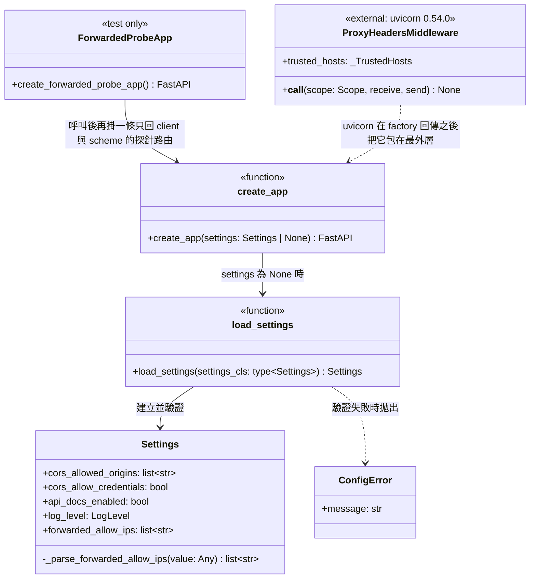
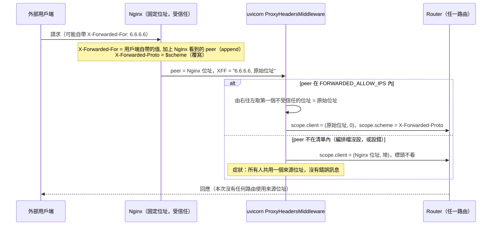
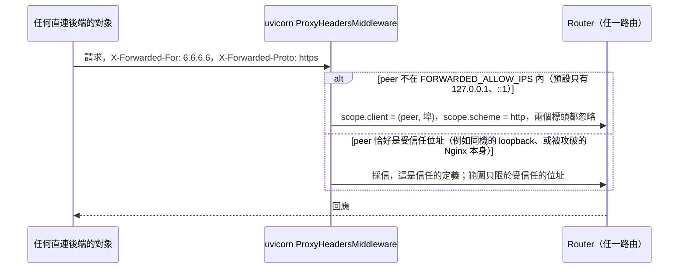
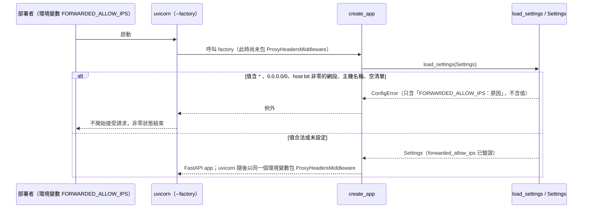

# System Design

本 change 是基礎設施 change：沒有新端點、沒有新表、沒有新的業務模組，Router → Service → Repository／Model 這條業務分層一個類別都不動。要設計的是三件事：**信任放在哪一層**（uvicorn 的代理標頭處理）、**信任的位址怎麼表達與驗證**（環境變數、Compose 網路、啟動檢查），以及**怎麼證明**（真實 uvicorn 子行程的整合測試與 Compose 層的檢查）。

下面「實測」節的行為都在 `uv.lock` 鎖定的 uvicorn 0.54.0 上用實驗取得（與 `label-suite-backend:latest` 映像內的版本一致），不是憑記憶；以下每個選項的行為描述都指向那一節的編號。

## 實測

實驗在 scratchpad 做（不在 repo 內）：一個只回報 `scope["client"]` 與 `scope["scheme"]` 的 ASGI app，分別用本機 uvicorn 0.54.0 與 Docker（後端映像自己的 uvicorn、`frontend/nginx.conf` 掛進前端映像）跑。「請求端」是 `curl`，所以 peer 位址是 `127.0.0.1`。

### 實測 A：uvicorn 的預設與取值規則

| #   | 設定                                                              | 觀察                                                                                                                                                                                                                                  |
| :-- | :---------------------------------------------------------------- | :------------------------------------------------------------------------------------------------------------------------------------------------------------------------------------------------------------------------------------ |
| A1  | 不設旗標、不設環境變數                                            | `--proxy-headers` 預設就是開的；信任清單預設 `127.0.0.1,::1`（`uvicorn/config.py:363`、`--help` 文字）。peer 是 `127.0.0.1` 時，偽造的 `X-Forwarded-For: 1.2.3.4` 會被採信，`client=('1.2.3.4', 0)`——因為 loopback 本來就在預設清單裡 |
| A2  | 加 `--proxy-headers` 明寫                                         | 與 A1 完全相同；Dockerfile 的 CMD 加不加這個旗標沒有差別                                                                                                                                                                              |
| A3  | `--no-proxy-headers` 加 `FORWARDED_ALLOW_IPS=127.0.0.1`           | 完全不處理標頭，`client` 一律是 peer。可以關，但本 change 不需要關                                                                                                                                                                    |
| B   | `FORWARDED_ALLOW_IPS=10.9.9.9`，peer 是 `127.0.0.1`               | 偽造的 `X-Forwarded-For`、`X-Forwarded-Proto` 全部被忽略，`client` 與 `scheme` 維持 peer 與 `http`：**peer 不在清單裡就整個標頭不看**                                                                                                 |
| C1  | `FORWARDED_ALLOW_IPS=127.0.0.1`，鏈 `6.6.6.6, 5.5.5.5, 127.0.0.1` | `client=5.5.5.5`：uvicorn **從右往左**，取第一個不在信任清單的位址（`get_trusted_client_address`，每個代理都把上一手 append 在右邊）。鏈 `6.6.6.6, 10.0.0.9` 且 `10.0.0.9` 不受信任時取 `10.0.0.9`                                    |
| C2  | 同一個請求送兩行 `X-Forwarded-For`                                | 兩行以 `, ` 串接後同規則處理（`6.6.6.6` + `7.7.7.7` → `7.7.7.7`）                                                                                                                                                                     |
| C3  | `X-Forwarded-Proto`                                               | 只接受 `http`、`https`、`ws`、`wss`，其他值忽略（`ftp` → `scheme=http`）。**同一份信任清單同時管 `X-Forwarded-For` 與 `X-Forwarded-Proto`**，沒有分開開關（A1 的第三列 `scheme=https`）                                               |
| C4  | 改寫後的 `scope["client"]`                                        | `(host, 0)`：埠是 0，不是 peer 的埠                                                                                                                                                                                                   |

### 實測 D：環境變數與旗標、CIDR、危險與錯誤的值

| #   | 設定                                                                       | 觀察                                                                                                                                                     |
| :-- | :------------------------------------------------------------------------- | :------------------------------------------------------------------------------------------------------------------------------------------------------- |
| D1  | `FORWARDED_ALLOW_IPS=127.0.0.0/8`（環境變數）                              | **接受 CIDR**，行為同單一位址                                                                                                                            |
| D2  | 旗標 `--forwarded-allow-ips 127.0.0.0/8` 加環境變數 `10.9.9.9`             | 旗標贏。反過來（環境變數 `127.0.0.0/8`、旗標 `10.9.9.9`）也是旗標贏（D3）。**所以 Dockerfile 的 CMD 不能寫旗標**，否則編排檔傳進去的環境變數會被靜默蓋掉 |
| D4  | `FORWARDED_ALLOW_IPS=*`                                                    | 信任所有來源，且取值改成**最左側**：鏈 `6.6.6.6, 5.5.5.5, 127.0.0.1` 得 `6.6.6.6`（用戶端自己放的值）。`*` 同時讓偽造成功與取值規則反轉                  |
| D5  | `FORWARDED_ALLOW_IPS=`（空字串）                                           | 不信任任何人（清單只有空字串），不報錯                                                                                                                   |
| D6  | `FORWARDED_ALLOW_IPS=garbage,127.0.0.1`                                    | `garbage` 被當成「literal」靜默保留（比對 peer 字串，永遠對不上）；其餘照常。**uvicorn 不會告訴你有一項寫壞了**                                          |
| D7  | `' 127.0.0.0/8 , 10.0.0.0/8'`                                              | 項目前後空白會被去掉，兩項都生效                                                                                                                         |
| D8  | `FORWARDED_ALLOW_IPS=127.0.0.0/99`                                         | 不是合法網段，被當 literal 靜默忽略，等於不信任（fail closed，但沒有任何訊息）                                                                           |
| D9  | `FORWARDED_ALLOW_IPS=127.0.0.1/8`（host bit 非零）                         | `ipaddress.ip_network` 嚴格模式拒絕，被當 literal 靜默忽略，**偽造的標頭不被採信但也沒有錯誤**。`172.28.0.10/24` 這種「位址加 mask」的常見寫法會踩到     |
| D10 | `FORWARDED_ALLOW_IPS=0.0.0.0/0`                                            | **等於信任所有人**（`client=1.2.3.4` 被採信），而且取值規則還是從右往左；所以只擋 `*` 擋不住它                                                           |
| D11 | `FORWARDED_ALLOW_IPS=localhost`（主機名稱）                                | **不解析名稱**：peer 是 `127.0.0.1` 也不被信任。「信任 Nginx 的容器名稱」（待決 2 的選項 C）在 uvicorn 內做不到                                          |
| D12 | `FORWARDED_ALLOW_IPS=127.0.0.1,192.168.0.0/16`，鏈 `6.6.6.6, 192.168.65.1` | `client=6.6.6.6`：真實用戶端剛好落在受信任的私有網段時，uvicorn 會跳過它、採信更左邊的偽造值                                                             |

### 實測 E：Compose 網路裡的真實行為（後端映像加 Nginx，Docker Desktop 29.2.1）

| #   | 設定                                                                                           | 觀察                                                                                                                                                                                                                                                          |
| :-- | :--------------------------------------------------------------------------------------------- | :------------------------------------------------------------------------------------------------------------------------------------------------------------------------------------------------------------------------------------------------------------ |
| E1  | 映像原樣、不設環境變數                                                                         | 經 Nginx、不論有沒有偽造標頭，後端看到的都是 Nginx 容器位址（`172.18.0.3`），這是 issue 描述的現況：**所有人共用一個來源位址**。第三個容器直接連後端，看到它自己的位址                                                                                        |
| E2  | `FORWARDED_ALLOW_IPS=172.18.0.0/16`（整個預設網路）                                            | 經 Nginx：`client=192.168.65.1`（見下），偽造的 `X-Forwarded-For: 6.6.6.6` 因為 Nginx **append** 成 `6.6.6.6, 192.168.65.1` 而不影響結果。**但同網路的第三個容器直接連後端、自帶偽造標頭，被採信**（`client=6.6.6.6`）：信任整段子網路 = 信任網路內每一個容器 |
| E3  | `FORWARDED_ALLOW_IPS=172.18.0.3`（只有 Nginx）                                                 | 經 Nginx 正確；第三個容器偽造無效。**但 Nginx 位址是 Docker 動態配的**，兩份 Compose 檔都沒有固定它                                                                                                                                                           |
| E4  | 自訂網路 `172.30.0.0/24`，Nginx 以 `--ip 172.30.0.10` 固定，後端信任 `172.30.0.10`（單一位址） | 經 Nginx 正確；偽造的 `X-Forwarded-For` 無效；第三個容器直連偽造無效。Nginx 的 `X-Forwarded-Proto $scheme` 會**覆寫**用戶端自帶的值（送 `X-Forwarded-Proto: https` 進去，後端看到 `scheme=http`）                                                             |
| E5  | 同 E4，信任 `172.30.0.8/29`（涵蓋 Nginx 的 `.10`，不含動態配位的容器）                         | 同 E4                                                                                                                                                                                                                                                         |
| E6  | 用戶端送 `X-Forwarded-For: 9.9.9.9, 8.8.8.8`（模擬上游邊緣已 append）                          | `client=192.168.65.1`：Nginx 再 append 之後，最右側不受信任的是 Nginx 看到的 peer，不是 `8.8.8.8`；**鏈延伸的資訊不會影響結果，也代表上游邊緣（Cloudflare）的真實位址在這套設定下取不到**                                                                     |
| E7  | 自訂網路加 `--ip-range 172.31.250.128/25`，一個容器動態配位、一個 `--ip 172.31.250.10` 固定    | 動態配位拿到 `.129`，固定的拿到 `.10`：**把動態配位限制在網段的後半，固定位址放前半，兩者不會撞**。`docker compose config` 接受 `ipam.config` 的 `subnet` 與 `ip_range`、服務的 `networks.default.ipv4_address`                                               |

**發布埠的來源位址（待決 3 的證據）**：在 Docker Desktop（macOS）上，從主機 `curl localhost:<發布埠>` 到 Nginx，Nginx 的 `$remote_addr` 是 `192.168.65.1`（Docker Desktop 的虛擬機閘道），**不是真實用戶端位址，也不是 Compose 網路的橋接閘道（`172.x.0.1`）**。Linux 上的 Docker Engine 沒有在本機測，不能由此推論；CI runner 是 Linux，所以「經 Nginx 看到的位址是什麼」不能當作可以斷言的值（見「測試設計」）。

## 設計決定與選項

這一節的每個選項都標了它依據的實測編號。**這些是技術建議，不是決定**；待決問題的編號沿用 `system-analysis.md`，由 clarification 逐題問。

### 信任放哪裡（待決 1）

| 選項      | 內容                                                                                                                            | 行為（實測）                                                                                                                  | 成本                                                                                             |
| :-------- | :------------------------------------------------------------------------------------------------------------------------------ | :---------------------------------------------------------------------------------------------------------------------------- | :----------------------------------------------------------------------------------------------- |
| A（建議） | 用 uvicorn 內建的 `ProxyHeadersMiddleware`；Dockerfile 的 CMD **不改、不加旗標**；信任清單由環境變數 `FORWARDED_ALLOW_IPS` 提供 | A2：旗標預設就開；D2：旗標會蓋掉環境變數，所以 CMD 不寫旗標才讓編排檔的值生效；C1：取值規則（最右側不受信任）正是這個需求要的 | 無應用程式碼                                                                                     |
| B         | 後端自己寫中介層，由 `Settings` 提供受信任網段                                                                                  | 要重寫 C1（右到左）、C2（多行串接）、C3（proto 白名單）、D7（空白）與 CIDR 比對，且要擺在所有其他中介層的最外面               | 約 60 行加測試，等於複製 uvicorn 已有的邏輯，且 uvicorn 的中介層仍會跑一次（沒關的話兩層都改寫） |

uvicorn 的中介層由 `Config.load()` 包在整個 ASGI app 的**最外層**（`config.py:543`），所以後面的 `CorrelationId`、`AccessLog` 與所有路由看到的 `scope["client"]` 已經是改寫後的值，不需要在應用程式裡做任何事。

**這一點會影響待決 5**：C3 說明 uvicorn 的信任清單**同時**管 `X-Forwarded-For` 與 `X-Forwarded-Proto`；選 A 就不可能「只還原位址、不信任協定標頭」。實際後果是：Nginx 在 TLS 邊緣之後仍自己送 `$scheme`（E4：`http`，而且會覆寫外部帶的值），所以後端的 `scope["scheme"]` 永遠是 `http`，與現在相同，**不是更糟**；要變成正確的 `https` 需要 Nginx 先還原上游協定（見待決 5）。

### 受信任位址怎麼表達（待決 2、10、12）

**變數**：沿用 uvicorn 原生的 `FORWARDED_ALLOW_IPS`（建議）。自訂一個名稱（例 `TRUSTED_PROXY_IPS`）再轉成旗標要改 CMD，而 D2 說旗標會蓋掉環境變數、使編排檔與 `.env` 的行為難以預測，沒有任何好處。

**預設值**：映像本身不設 `ENV`，所以直接執行映像（沒有 Nginx、沒有編排檔）時沿用 uvicorn 預設 `127.0.0.1,::1`——容器裡只有容器自己的 loopback，容器外的人（含 `docker run -p 8000:8000` 的來源，peer 是橋接閘道）不被信任（B 與 E1）。`pnpm run dev` 同理：peer 是本機，本來就是同一台機器。**不設全域的預設放寬，只有編排檔把 Nginx 的位址傳進去。**

**編排檔傳什麼**：

| 選項       | 內容                                                                                                                                                                     | 行為（實測）                                                                                                                                 | 風險                                                                                                              |
| :--------- | :----------------------------------------------------------------------------------------------------------------------------------------------------------------------- | :------------------------------------------------------------------------------------------------------------------------------------------- | :---------------------------------------------------------------------------------------------------------------- |
| A1（建議） | 兩份編排檔各宣告預設網路的 `ipam`（`subnet` 加 `ip_range` 只供動態配位用的後半段），**固定 `frontend` 服務的 `ipv4_address`**，後端 `FORWARDED_ALLOW_IPS` 預設該單一位址 | E4、E7：只有 Nginx 被信任，同網路其他容器偽造無效；固定位址與動態配位不衝突；D9 的 `/n` 陷阱用單一位址避開                                   | 子網段可能與主機既有網路或 VPN 重疊（`up` 會以 pool overlaps 失敗，不是靜默錯誤）；要在 `.env.example` 說明如何改 |
| A2         | 兩份編排檔固定子網段，信任整段                                                                                                                                           | E2：同網路任何容器（含將來的 worker、db、redis）都能偽造                                                                                     | 比 A1 弱，但不用固定單一位址；是「容器之間可信」的假設                                                            |
| B          | 預設信任私有位址區段（`10/8`、`172.16/12`、`192.168/16`），不改網路                                                                                                      | D12：真實用戶端只要落在私有網段（Docker Desktop 的 `192.168.65.1`、辦公室內網），偽造值就被採信；且沒有 Nginx 時，任何內網用戶端都能直連偽造 | **不建議**，是三個選項裡唯一有已證實漏洞的                                                                        |
| C          | 信任 Nginx 的容器名稱                                                                                                                                                    | D11：uvicorn 不解析名稱，做不到                                                                                                              | 不可行（除非額外在啟動前解析並寫回環境變數，多一層腳本）                                                          |

**兩層是否相同**：結構相同、值相同（同一個子網段與位址常數），分別寫在兩份檔（既有的「兩份要同步」慣例，由 CI 的 `docker compose config` 防漂移）；`migrate` 不需要這個變數（它不是 uvicorn）。

**是否放進 `.env`**：建議 `.env.example` 列出 `FORWARDED_ALLOW_IPS`（issue 驗收第 3 條要求，且 `container-runtime` 要求列出所有設定），預設 `${FORWARDED_ALLOW_IPS:-<固定位址>}`，**正式層不另外釘死**；說明「放在代理後面才設，直接暴露時不要設，不得為 `*` 或任何涵蓋全部位址的網段」。若維護者要求像 `API_DOCS_ENABLED` 一樣釘死而非可配置，也可行，代價是部署者要改子網段時得動編排檔。

**啟動檢查（待決 12，建議做）**：uvicorn 對 `*`（D4）、`0.0.0.0/0`（D10）、host bit 非零（D9）、拼錯（D6、D8）都不報錯，而且其中兩種是靜默變成**信任所有人**、其餘是**靜默失效**。因為 `create_app` 在 uvicorn 包中介層**之前**被呼叫（`--factory`），後端自己讀同一個環境變數就能擋：

- `Settings` 新增 `forwarded_allow_ips: Annotated[list[str], NoDecode]`，預設 `["127.0.0.1", "::1"]`（與 uvicorn 預設一致，沒設環境變數行為不變），沿用 `cors_allowed_origins` 的驗證器寫法；環境變數名稱由欄位名自然對到 `FORWARDED_ALLOW_IPS`。
- 驗證規則與 uvicorn 的比對一致，才不會「檢查過了卻沒生效」：逗號分隔、去掉前後空白；每項必須是 `ipaddress.ip_address` 或**嚴格**的 `ip_network`（`strict=True`，擋 D9）；拒絕 `*`、拒絕 prefix 長度 0 的網段（擋 D4、D10）、拒絕主機名稱與其他 literal（擋 D6、D11）、拒絕空清單（D5 是靜默不信任，改成明確失敗）。錯誤訊息只列變數名與原因，不印值（比照 `CORS_ALLOWED_ORIGINS`）。
- 不拒絕「很寬但不是全部」的網段（例 `10.0.0.0/8`）：什麼算太寬是部署決定，不是這一層能判斷的。
- 後端本身不使用這個欄位的值（uvicorn 才是使用者）：它只是驗證。這讓選項 A 不再是「零應用程式碼」，成本是一個欄位、一個驗證器、約 8 條單元測試；`runtime-config` spec 要有 delta。

### Nginx 範圍（待決 7、5）

建議 **A：核對與註解更新，不改轉發行為**。證據：E4、E6 顯示用戶端自帶 `X-Forwarded-For` 時，`$proxy_add_x_forwarded_for` 把真實 peer append 在最右邊，uvicorn 取最右側不受信任者就拿到 Nginx 看到的位址，偽造值無法影響結果；所以待決 7 的選項 B（覆寫成 `$remote_addr`）**不必做**，只是少一層「鏈裡有雜訊」的儲存。X-Forwarded-Proto：Nginx 已用 `$scheme` 覆寫，不改。要改的只有 `frontend/nginx.conf:27-30` 那段「belongs to #566」的註解，改成「#566 已決定：後端信任 Nginx 的 X-Forwarded-For 與 X-Forwarded-Proto；協定在 TLS 邊緣之後仍是 http，見待決 5」。因為不動轉發與安全標頭，`scripts/check-security-headers.sh` 不需要同步。

### 單一入口（待決 4）

建議 **A：本 change 不新增取得來源位址的共用函式**。現在零個消費者（`grep` 全 `backend/` 沒有任何 `client.host`），`request.client.host` 本身就是單一事實來源（uvicorn 已改寫它）；第一個消費者（登入次數限制）出現時再決定要不要包成依賴。因此 `backend-code-boundaries` spec 不動。

### 範圍外（待決 5、6、8、9、11）的技術立場

- 待決 6：不動 `AccessLogMiddleware`、`server-logging` spec 與稽核表。信任設好只是讓 `request.client.host` 對，不代表任何東西開始記它；記不記是另一個 change 的決定（S9、ADR-008 §待決）。
- 待決 5：同上，**建議另案**；本 change 的技術事實是 A（後端會信任 Nginx 送的 proto，其值恆為 `http`）。
- 待決 11：Cloudflare 在前面時，E6 證明這套設定拿到的是 Cloudflare 邊緣位址而不是真實用戶端（同一個邊緣的人共用一個額度）；要還原需要 Nginx 的 real_ip 設定與信任 Cloudflare 的公開網段，是另一個設計。建議寫成已知限制。
- 待決 8、9：業務決定，與實作方式無關。

## 分層與類別

這次沒有新增或修改任何 Router、Service、Repository、Model 或 Pydantic 回應 schema。動到的只有基礎建設的設定層（`Settings` 加一個只做驗證的欄位）與部署設定。下圖畫這次動到的類別，加上執行時的外部元件（uvicorn 的中介層，不是我們的程式碼，標為 external）。

說明：

- `Settings.forwarded_allow_ips` **只驗證、不被後端使用**；實際比對由 `ProxyHeadersMiddleware` 讀同一個環境變數完成。兩者讀同一個值，驗證規則刻意與 uvicorn 的比對一致（見上一節「啟動檢查」）。
- `ForwardedProbeApp` 在 `backend/tests/` 底下，不在 `app/`，不會被 production 載入（Hard Rule 6 與 `probe.py` 的先例：探針只存在於測試）；探針路由回傳 `request.client.host`、`request.url.scheme`。
- `ProxyHeadersMiddleware` 的位置是請求管線的最外層，在 `UnhandledExceptionMiddleware` 與 `CorrelationIdMiddleware` 之前；`backend-modules.mdx` 的請求管線圖是 app 內的五個中介層，要加註「uvicorn 在它們外面再包一層」。

## 關鍵情境

規格的 Scenario 名稱要等 specs 寫完才定，下面三張圖先用 `system-analysis.md` 的驗收條件命名；planner 寫 specs 時以 specs 的名稱為準，回頭對齊這裡。

### Scenario: 經 Nginx 的請求取得原始來源位址

### Scenario: 直接連後端自帶偽造標頭不被採信

這個情境的證明方式在下一節；它同時描述「沒有 Nginx 的執行方式」（本機 `pnpm run dev`、單獨起容器）：預設清單只有 loopback，外部對象的偽造無效。

### Scenario: 受信任位址設定不合法時啟動失敗

## 測試設計

| 驗收條件                               | 層                                                            | 做法                                                                                                                                                                                                                                                                                                                                                                                                                                                                                                         | 為什麼                                                                                                               |
| :------------------------------------- | :------------------------------------------------------------ | :----------------------------------------------------------------------------------------------------------------------------------------------------------------------------------------------------------------------------------------------------------------------------------------------------------------------------------------------------------------------------------------------------------------------------------------------------------------------------------------------------------- | :------------------------------------------------------------------------------------------------------------------- |
| 直連偽造標頭不被採信（issue 第 2 條）  | 整合（`backend/tests/integration/`），**真實 uvicorn 子行程** | 比照 `test_access_log.py:490-520` 的 `subprocess.Popen([sys.executable, "-m", "uvicorn", "tests.integration.<module>:create_forwarded_probe_app", "--factory", ...])`，自己的 `SQLITE_PATH`、`CORS_ALLOWED_ORIGINS`，`_free_port` 與 `_wait_until_healthy` 可抽成共用。探針路由回報 `request.client.host`、`request.url.scheme`。三輪：未信任（`FORWARDED_ALLOW_IPS=192.0.2.1`，偽造無效）、信任（`FORWARDED_ALLOW_IPS=127.0.0.1`，採最右側不受信任者）、多層鏈（`6.6.6.6, 5.5.5.5, 127.0.0.1` → `5.5.5.5`） | 現有的 `client` fixture 是 httpx 直接接 ASGI（`conftest.py:177`），**不經 uvicorn 的中介層**，無法證明這條（待決 3） |
| 同上的注意事項                         |                                                               | **預設清單含 `127.0.0.1`，而測試用戶端就是 loopback**（A1），所以「未信任」那一輪**不能用不設環境變數**，必須明確設成一個不含 loopback 的值；「預設就是 loopback only」要另用單元測試斷言 `Settings().forwarded_allow_ips`                                                                                                                                                                                                                                                                                   | A1、B                                                                                                                |
| 不依賴資料庫差異                       |                                                               | 子行程帶自己的 `SQLITE_PATH`，SQLite 與 PostgreSQL 兩輪行為相同（中介層不碰資料庫）；不需要另開 PostgreSQL 版                                                                                                                                                                                                                                                                                                                                                                                                | 見 `testing-agent-rules` 的雙資料庫驗證，這裡沒有資料庫差異可驗                                                      |
| 啟動檢查（待決 12）                    | 單元（`backend/tests/unit/`）                                 | `Settings` 對 `*`、`0.0.0.0/0`、`::/0`、`127.0.0.1/8`、`localhost`、空字串、`1.2.3.4,,5.6.7.8` 的行為，加合法的單一位址、CIDR、帶空白清單、未設定時的預設；錯誤訊息含 `FORWARDED_ALLOW_IPS` 且不含值。再一條整合測試（子行程）：值含 `*` 時 uvicorn 以非零結束、輸出含變數名                                                                                                                                                                                                                                 | D4、D6、D8、D9、D10、D11                                                                                             |
| 經 Nginx 看到原始來源（issue 第 1 條） | Compose 層                                                    | 見下                                                                                                                                                                                                                                                                                                                                                                                                                                                                                                         | 容器網路內的整合測試做不到                                                                                           |

**「經 Nginx 看到原始位址」怎麼證明**：真實的後端沒有任何路由回報來源位址（也不該為了測試新增一個），而 Docker 發布埠的來源位址依平台不同（實測 192.168.65.1，Linux 未測），所以**不能斷言原始位址等於某個值**，只能斷言「不是 Nginx 的位址、偽造值不被採信」。選項：

| 選項                      | 內容                                                                                                                                                                                                                                                                                                      | 證明力                                                                                  | 成本                                                                                         |
| :------------------------ | :-------------------------------------------------------------------------------------------------------------------------------------------------------------------------------------------------------------------------------------------------------------------------------------------------------- | :-------------------------------------------------------------------------------------- | :------------------------------------------------------------------------------------------- |
| P1（必做）                | CI `compose` job 對 `docker compose config --format json`（既有步驟已產生 JSON）加靜態斷言：兩層後端的 `FORWARDED_ALLOW_IPS` 不為 `*`，且涵蓋 `frontend` 服務的 `ipv4_address`；另 grep `frontend/nginx.conf` 仍含 `X-Forwarded-For $proxy_add_x_forwarded_for`                                           | 證明兩份編排檔沒有漂移、位址對得上；不證明執行期                                        | 約 20 行 shell                                                                               |
| P2（建議，Lite 層做一次） | 一個 compose override 檔（只給 CI 用，放在 `scripts/` 或 `e2e/` 下，**不放進預設編排**）把後端的 `command` 換成映像的 uvicorn 跑一個掛進去的回報用 ASGI 檔（即實測 E4 的做法）；CI 送一般請求與帶偽造 `X-Forwarded-For: 6.6.6.6` 的請求，斷言回報的 `client` 不是 `frontend` 的固定位址，也不是 `6.6.6.6` | 證明執行期整條路（Nginx append、固定位址、信任清單）真的通；E1 與 E4 的差異就是這個斷言 | 一個 override 檔、一個回報檔、一個腳本、兩個 CI 步驟；`compose` job 不列必過，所以不阻擋合併 |
| P3                        | 只做 P1                                                                                                                                                                                                                                                                                                   | 兩份編排檔寫對、Nginx 設定在，但「固定位址真的拿到那個位址」只靠 Docker 行為            | 最少                                                                                         |

建議 P1 加 P2。P2 的回報檔只存在於 CI 用的 override，後端映像與預設編排不含它（Hard Rule 6 與安全面：production 不得有回報來源位址的路由）。

## 常駐文件異動

`backend-modules.mdx` 開頭寫明「只寫已合併的程式有的東西」，而本 change 的關鍵決定（是否做啟動檢查、信任範圍的表達）要等 clarification 才定，所以**規劃階段先不改它**，避免寫進尚未存在的程式與尚未拍板的決定；下表是 apply 階段、程式合併的同一個 PR 內要改的位置，請主 session 確認這樣處理（與「規劃時先改常駐文件」的一般做法不同，理由如上）。

- 常駐文件：`docs/diagrams/architecture/backend-modules.mdx`

| 節                     | 異動                                | 摘要                                                                                                                         |
| :--------------------- | :---------------------------------- | :--------------------------------------------------------------------------------------------------------------------------- |
| 後端基礎建設 §設定     | 新增一列（待決 12 選啟動檢查時）    | `FORWARDED_ALLOW_IPS`（API 層、非必填、預設 `127.0.0.1,::1`）：規則同上一節「啟動檢查」；說明它只做驗證，比對由 uvicorn 完成 |
| 後端基礎建設 §請求管線 | 加註                                | uvicorn 的 `ProxyHeadersMiddleware` 在 app 的五個中介層之外，`scope["client"]` 與 `scope["scheme"]` 進入第一個中介層前已改寫 |
| 已知限制               | 刪除「信任反向代理的來源 IP」那一列 | 改記 Cloudflare 或其他邊緣代理在前面時取不到真實位址（待決 11）                                                              |

`docs/development/architecture.mdx` §部署與維運、`.env.example`、`docs/development/workflow/local-development.mdx` 的環境變數表也要改，但它們不是後端模組常駐文件，列在 tasks。

## 資料模型異動

本次無資料模型異動。沒有新表、欄位或索引，沒有 Alembic migration，所以不動 `data-table-dictionary.mdx` 與 `database-schema.er.json`，也不需要跑 `pnpm check:er`。SQLite 與 PostgreSQL 在這件事上沒有差異。

## 權限檢查點

不涉及。本 change 沒有端點、沒有角色判斷、沒有欄位遮蔽；它只影響請求進入應用程式時 `scope["client"]` 與 `scope["scheme"]` 的值，**授權不得讀它**（`security-agent-rules` S1：身分只來自驗證完成的 session；來源位址只可用於次數限制與稽核，不是身分）。

測試集答案隔離：本 change 不碰測試集答案、不新增標記員可到達的端點；探針路由只存在於測試。

## 技術待決問題

| #   | 問題                                                           | 建議                                                                                                                                                                                                                                                                           | 備註                                                                                 |
| :-- | :------------------------------------------------------------- | :----------------------------------------------------------------------------------------------------------------------------------------------------------------------------------------------------------------------------------------------------------------------------- | :----------------------------------------------------------------------------------- |
| T1  | Compose 的子網段與固定位址用哪一組常數                         | 選 Docker 預設位址池（`172.17.0.0/16` 至 `172.31.0.0/16`、`192.168.0.0/16` 的切分）之外的 `/24`，例如 `10.77.250.0/24`，動態配位限後半 `10.77.250.128/25`，`frontend` 固定 `10.77.250.10`；實測 E7 只驗證機制（用 `172.31.250.0/24` 做），常數本身要實作時再選並在兩層用同一組 | 與 E7 的組合一致；重疊時 `up` 會以 pool overlaps 明確失敗；`.env.example` 說明怎麼改 |
| T2  | `FORWARDED_ALLOW_IPS` 要不要像 `API_DOCS_ENABLED` 在正式層釘死 | 不釘死：位址常數寫在同一份編排檔，部署者改網段時兩處（網路與變數）要一起改，可用變數引用同一個常數避免漂移                                                                                                                                                                     | 見待決 2；若選釘死，`.env.example` 不列這個變數，與 issue 驗收第 3 條要調整          |
| T3  | 交易邊界、session 生命週期                                     | 不適用：沒有資料庫操作                                                                                                                                                                                                                                                         |                                                                                      |
| T4  | 效能                                                           | 比對由 uvicorn 的 `lru_cache(maxsize=4096)` 做，位址數量很少；沒有疑慮                                                                                                                                                                                                         | `X-Forwarded-For` 長度過長（超過 253 字元的單一主機）uvicorn 已不快取                |
| T5  | uvicorn 升版                                                   | 取值規則（右到左、`*` 反轉）是 0.54.0 的實測；整合測試的三輪就是升版時的回歸偵測                                                                                                                                                                                               | 不另外 pin                                                                           |
