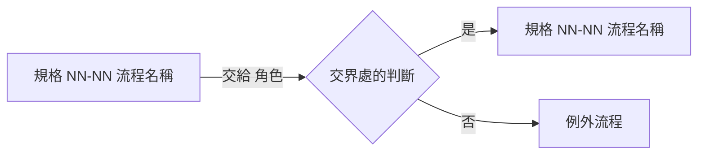

# System Analysis

## 需求依據

<!-- 依 config context 的需求依據順序讀取：docs/specs/00-prd.mdx → docs/specs/NN-<module>/NN-<page>.mdx → openspec/specs/。
     只引用章節與編號（例如 PRD §權限矩陣、規格 04-02 §耗時 第 10 條、§已確認決議 Q15），不抄寫內容。 -->

| 來源 | 章節／編號 | 摘要（一句） |
| :--- | :--- | :--- |
|  |  |  |

## 範圍

- 這次包含：
- 這次不包含：

## 業務流程

<!-- 以規格書的「業務流程」章節為準，只引用、不重畫。涉及多份規格或多個模組時，補一張串接圖（每份規格的流程一個節點，只展開交界處）。
     規格書沒有業務流程章節、或需求依據不是 docs/specs 時，才在這裡畫完整流程，並在待決問題建議補回規格書。 -->

| 規格 | 業務流程 | 本次涉及 |
| :--- | :--- | :--- |
| 規格 NN-NN | §業務流程 `{流程名稱}` | `{全部／主流程與 E1／…}` |

## 跨模組依賴

<!-- 會讀寫哪些其他模組的資料、需要誰先完成什麼 -->

## 需求矛盾

<!-- 需求文件之間互相衝突的地方；沒有就寫「無」 -->

## 待決問題

<!-- 會影響行為的未決事項。**一律記在這裡並繼續**，不要停下來問使用者：
     所有需要維護者決定的事由 clarification 在停點一一次問完。 -->

| # | 問題 | 影響 | 狀態 |
| :--- | :--- | :--- | :--- |
