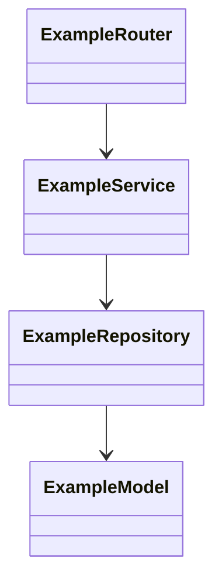
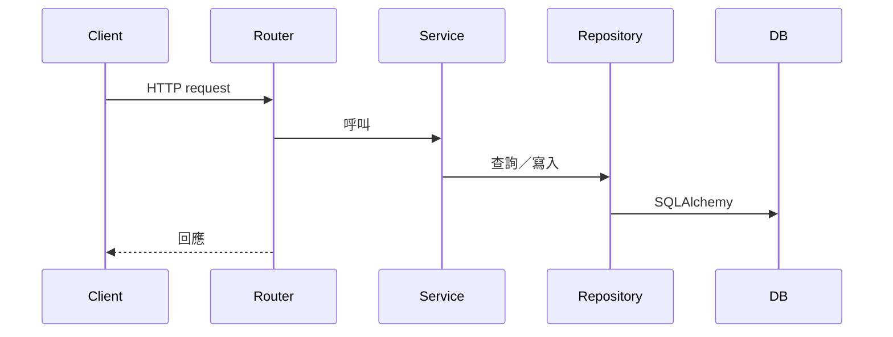

# System Design

## 分層與類別

<!-- 分層是 Router → Service → Repository／Model。Router 不直接碰 Repository，資料層不處理 HTTP。 -->

## 關鍵情境

<!-- 每個關鍵 Scenario 一張，標題與 specs 的 Scenario 名稱相同（規格書的驗收標準怎麼命名就怎麼寫）；畫到 Router 回傳回應為止，不含畫面 -->

### Scenario: <名稱>

## 資料模型異動

<!-- schema 只由 Alembic 管理（含 dev 與 test）。已部署的 migration 不再修改。 -->

| 表 | 異動 | 欄位／索引 | Alembic migration 可逆 | SQLite 與 PostgreSQL 的差異 |
| :--- | :--- | :--- | :--- | :--- |

## 權限檢查點

<!-- 哪一層檢查哪個角色；哪些欄位依角色遮蔽。
     授權與遮蔽都在後端完成，不得「先回前端再遮」。
     權限不得超出 PRD §權限矩陣；需要超出時列進待決問題，不自行放寬。
     涉及測試集答案時，寫出「標記員能接觸到的任何地方都看不到答案」怎麼在這一層成立。 -->
